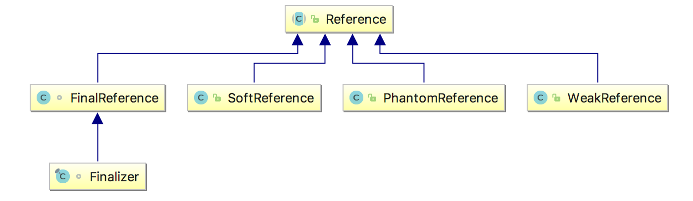
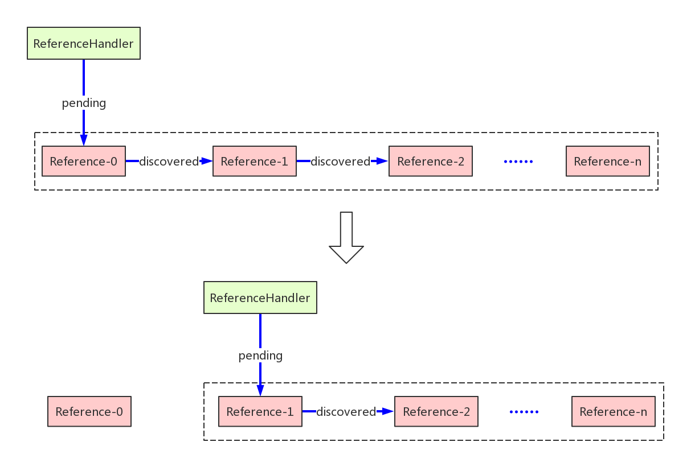
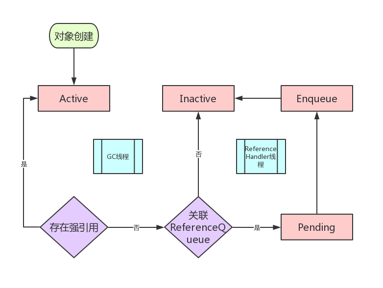
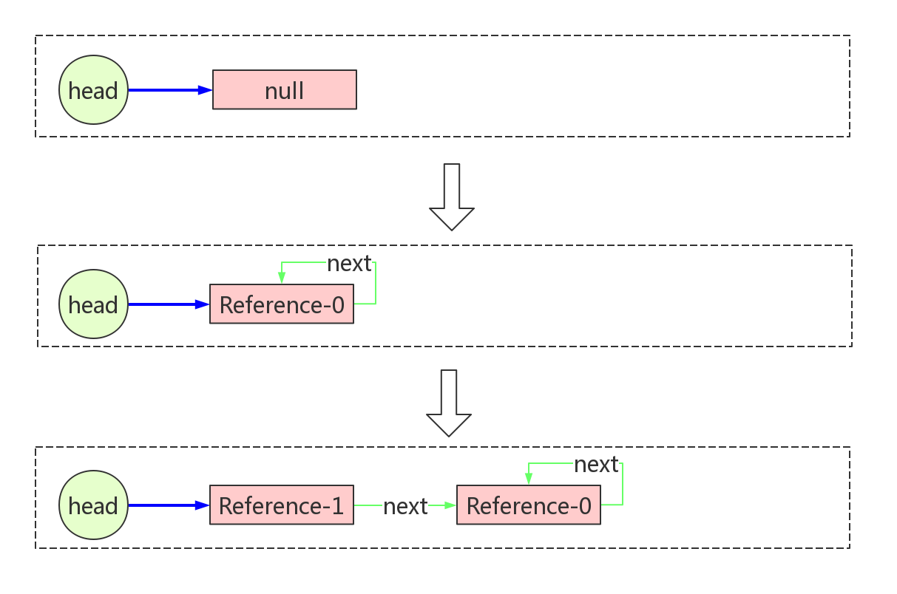
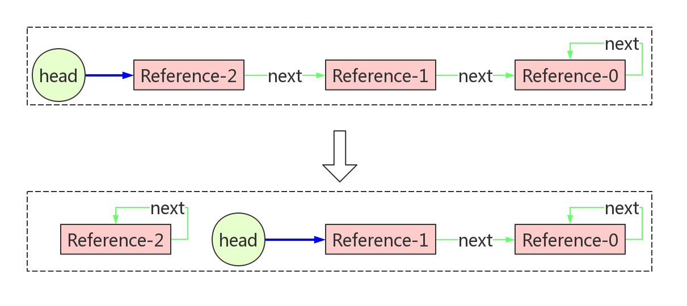
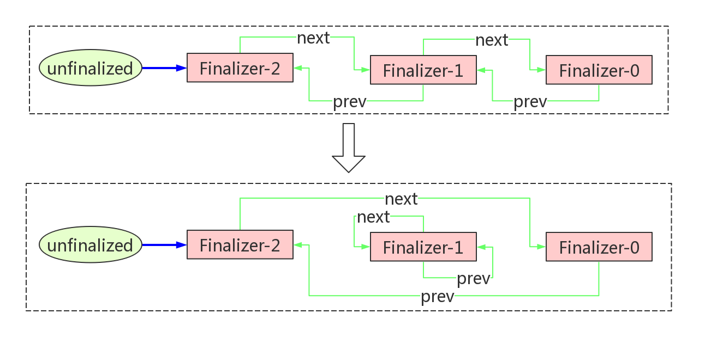

# Reference

# 1 引用级别

在 JVM 中，垃圾回收器一直在背后默默地承担着内存回收的工作，我们不需要像使用 C 语言开发那样小心翼翼地管理内存。但是凡事皆有两面性，这种机制的好处是极大地释放了程序员无处安放的焦虑，坏处是难以对回收过程进行更灵活的干预。

为了更灵活地控制垃圾回收，Java 引入了引用级别的概念。

在 JDK 1.2 以前的版本中，只有在对象没有任何其他对象引用它时，垃圾回收器才会对它进行收集。对象只有被引用和没有被引用两种状态。这种方式无法描述一些“食之无味，弃之可惜”的对象。而很多时候，我们希望存在这样一些对象：当内存空间足够时，不进行回收；当内存空间变得紧张时，允许 JVM 回收这些对象。大部分缓存都符合这样的场景。

从 JDK 1.2 版本开始，Java 对引用的概念进行了扩充，对象的引用分成了 4 种级别，从而使程序开发者能更加灵活地控制对象的生命周期，更好地控制创建的对象何时被释放和回收。

这 4 种级别由高到低依次为：强引用、软引用、弱引用和虚引用。

## 1.1 强引用（StrongReference）

我们使用的大部分的引用都是强引用，这是使用最普遍的引用。如果一个对象具有强引用，那就类似于必不可少的生活用品，垃圾回收器绝不会回收它。当内存空间不足，Java 虚拟机宁愿抛出 `OutOfMemoryError`，使程序异常终止，也不会靠随意回收具有强引用的对象来解决内存不足问题。

如果强引用对象不再使用，需要弱化从而使 GC 能够回收，如：

```java
strongReference = null;
```

显式地设置 `strongReference` 对象为 `null`，或让其超出作用域，GC 就会认为该对象不再可达，这时就可以回收这个对象。具体什么时候收集要取决于 GC 算法。

```java
public void test() {
    Object strongReference = new Object();
    // 省略其他操作
}
```

在一个方法的内部有一个强引用，这个引用保存在虚拟机栈的局部变量表中，而真正的引用内容（`Object`）保存在 Java 堆中。当这个方法运行完成后，栈帧被弹出，这个对象就无法再从 GC Roots 到达（HotSpot 使用的是可达性分析，而不是引用计数），因此可以被回收。但是如果 `strongReference` 是静态变量或者长生命周期对象的成员变量，就需要在不用这个对象时赋值为 `null`，否则它会一直存活。

`ArrayList` 的 `clear()` 方法：

```java
public void clear() {
    modCount++;

    // clear to let GC do its work
    for (int i = 0; i < size; i++)
        elementData[i] = null;

    size = 0;
}
```

在 `ArrayList` 类中定义了一个 `elementData` 数组，在调用 `clear()` 方法清空数组时，每个数组元素被赋值为 `null`。但是，这里为什么不直接将数组设置为 `null`：

```java
elementData = null;
```

一行代码搞定，岂不更加简单粗暴？

如果将整个数组指向 `null`，该数组的内存空间会被回收掉，而将数组的元素逐个指向 `null` 只会把数组中存放的强引用释放，整个数组对象还是存在的，这样一来，如果再有 `add()` 等操作就不用再次分配内存了。

## 1.2 软引用（SoftReference）

如果一个对象只具有软引用，那就类似于可有可无的生活用品。如果内存空间足够，垃圾回收器就不会回收它，如果内存空间不足了，就会回收这些对象的内存。只要垃圾回收器没有回收它，该对象就可以被程序使用。软引用可用来实现内存敏感的高速缓存。

软引用可以和一个引用队列（`ReferenceQueue`）联合使用，如果软引用所引用的对象被垃圾回收，Java 虚拟机就会把这个软引用加入到与之关联的引用队列中。

```java
ReferenceQueue<String> referenceQueue = new ReferenceQueue<>();
String str = new String("abc");
SoftReference<String> softReference = new SoftReference<>(str, referenceQueue);

str = null;
// Notify GC
System.gc();

System.out.println(softReference.get()); // abc

Reference<? extends String> reference = referenceQueue.poll();
System.out.println(reference); // null
```

**注意：** 软引用对象是在 JVM 内存不够的时候才会被回收，我们调用 `System.gc()` 方法只是起通知作用，JVM 什么时候扫描回收对象是由 JVM 自己的状态决定的。就算扫描到软引用对象也不一定会回收它，只有内存不够的时候才会回收。

当内存不足时，JVM 会先清除软引用（把其中的 `referent` 置为 `null`），再回收被引用的对象。也就是说，虚拟机保证在抛出 `OutOfMemoryError` 之前回收所有只被软引用的对象。在此之前，HotSpot 会尽可能优先回收长时间闲置不用的软引用对象，而刚构建的或刚使用过的“较新的”软引用对象会被尽可能保留，具体策略见第 5 章。被清除的软引用会进入关联的引用队列，程序可以通过轮询队列得知哪些缓存项已经失效，进而清理掉这些 `SoftReference` 对象本身。

## 1.3 弱引用（WeakReference）

弱引用与软引用的区别在于：只具有弱引用的对象拥有更短暂的生命周期。垃圾回收器一旦发现了只具有弱引用的对象，不管当前内存空间足够与否，都会回收它的内存。不过，只有发生 GC 时才会进行这种判断，并且分代收集时，如果对象位于本次没有被收集的区域（例如 Minor GC 时位于老年代），就要等到收集该区域时才会被回收。

弱引用可以和一个引用队列（`ReferenceQueue`）联合使用，如果弱引用所引用的对象被垃圾回收，Java 虚拟机就会把这个弱引用加入到与之关联的引用队列中。

```java
String str = new String("abc");
WeakReference<String> weakReference = new WeakReference<>(str);
System.out.println(weakReference.get() == null); // false

str = null;
System.gc(); // 建议 JVM 进行垃圾回收，并不保证立即执行

System.out.println(weakReference.get() == null); // 通常为 true
```

下面的代码会让一个弱引用再次变为一个强引用：

```java
String str = new String("abc");
WeakReference<String> weakReference = new WeakReference<>(str);
// 弱引用转强引用
String strongReference = weakReference.get();
```

## 1.4 虚引用（PhantomReference）

“虚引用”顾名思义，就是形同虚设，与其他几种引用都不同，虚引用并不会决定对象的生命周期。如果一个对象仅持有虚引用，那么它就和没有任何引用一样，在任何时候都可能被垃圾回收。虚引用的 `get()` 方法永远返回 `null`，无法通过它取回对象。

```java
String str = new String("abc");
ReferenceQueue<String> queue = new ReferenceQueue<>();
// 创建虚引用，必须与一个引用队列关联才有意义
PhantomReference<String> pr = new PhantomReference<>(str, queue);
```

虚引用主要用来跟踪对象被垃圾回收的活动。虚引用与软引用和弱引用的一个区别在于：虚引用必须和引用队列（`ReferenceQueue`）联合使用。当垃圾回收器发现一个对象只剩虚引用时，就会把这个虚引用加入到与之关联的引用队列中。程序可以通过判断引用队列中是否已经加入了虚引用，来了解被引用的对象是否将要被垃圾回收，从而采取必要的清理行动。

JDK 8 及之前，虚引用入队时不会被自动清除，被引用对象要等到虚引用本身被清除或不可达后才能真正回收；JDK 9 起，虚引用与软引用、弱引用一样，在入队时由 GC 自动清除。

## 1.5 典型应用

- **软引用**：内存敏感的缓存，如 Guava/Caffeine 的 `softValues()`。不过软引用的回收时机不可控，容易造成 GC 压力，现在更推荐使用基于容量或过期时间淘汰的缓存
- **弱引用**：`WeakHashMap` 的 key、`ThreadLocalMap` 的 `Entry`（继承自 `WeakReference<ThreadLocal<?>>`）、Caffeine 的 `weakKeys()`、Netty 的内存泄漏检测（`ResourceLeakDetector`），以及各种监听器注册表，避免因“被引用”而无法回收
- **虚引用**：资源清理，如 `java.lang.ref.Cleaner`、`DirectByteBuffer` 的堆外内存释放

# 2 java.lang.ref 包

`java.lang.ref` 包下都是与 `Reference` 相关的类，包括：



- **Reference**：引用对象的抽象基类，定义了所有引用对象的通用操作
- **ReferenceQueue**：引用队列，垃圾回收器在检测到对象可以回收时，会将该对象的 `Reference` 放到队列（如果有）
- **SoftReference**：`Reference` 子类，代表软引用
- **WeakReference**：`Reference` 子类，代表弱引用
- **PhantomReference**：`Reference` 子类，代表虚引用
- **FinalReference**：`Reference` 子类，访问权限是 package，外部无法访问，JVM 会为那些重写了 `Object.finalize()` 方法的类的实例创建一个对应的 `FinalReference`
- **Finalizer**：`FinalReference` 子类，访问权限是 package，且为 final 类，外部无法访问。JVM 实际操作的是 `Finalizer`。当一个类满足实例化 `FinalReference` 的条件时，JVM 会调用 `Finalizer.register()` 进行注册

# 3 Reference

本章及第 4、6、7 章的源码均基于 JDK 8，JDK 9 之后的变化见第 8 章。

## 3.1 内部变量

先来看一下 `Reference` 类中的变量：

```java
private T referent;

volatile ReferenceQueue<? super T> queue;
Reference next;

private static Reference<Object> pending = null;
transient private Reference<T> discovered;

static private class Lock { }
private static Lock lock = new Lock();
```

- **referent**

表示其引用的对象，即在构造的时候需要被包装在其中的对象。

- **queue**

是对象即将被回收时所要通知的队列。当对象即将被回收时，整个 `Reference` 对象，而不仅仅是被回收的对象，会被放到 `queue` 里面，然后外部程序通过监控这个 `queue` 即可拿到相应的数据了。`ReferenceQueue` 本身并不存储链表，它只持有链表的表头 `head`，这个链表是由 `Reference` 对象里面的 `next` 变量构建起来的，`next` 也就是链表当前节点的下一个节点，所以 `Reference` 对象本身就是一个链表的节点，这个链表由 `ReferenceHandler` 线程从 pending 队列中取出的数据构建而来。

- **next**

与 `queue` 搭配使用，仅在 `Reference` 放到 `queue` 中时才有意义，一系列的 `Reference` 正是依靠 `next` 组成了一个单链表。

- **pending**

`pending` 与后面的 `discovered` 一起构成了一个 pending 单向链表。注意这个变量是一个**静态变量**，所以是全局唯一的。`pending` 为链表的头节点，`discovered` 为链表当前 `Reference` 节点指向下一个节点的引用，这个队列是由 JVM 构建的，当对象除了被 `Reference` 引用之外没有其他强引用了，JVM 就会将指向需要回收的对象的 `Reference` 都放入到这个队列里面（注意是指向要回收的对象的 `Reference`，要回收的对象就是 `Reference` 的成员变量 `referent` 持有的对象，是 `referent` 持有的对象要被回收，而不是 `Reference` 对象本身），这个队列会由 `ReferenceHandler` 线程来处理。

- **discovered**

表示 `ReferenceHandler` 要处理的 pending 对象的下一个对象。`ReferenceHandler` 只需要不停地拿到 `pending`，然后再通过 `discovered` 不断地拿到下一个对象赋值给 `pending` 即可，直到取到了最后一个。

- **lock**

`lock` 是 pending 队列的全局锁，在 Java 代码中只在 `ReferenceHandler` 线程的处理逻辑里用到。但是，除了当前线程，JVM 垃圾回收器也会操作 pending 队列，所以需要通过这个锁来防止并发问题。

## 3.2 ReferenceHandler

`ReferenceHandler` 是 `Reference` 的一个内部类，继承自 `Thread`：

```java
private static class ReferenceHandler extends Thread {

    private static void ensureClassInitialized(Class<?> clazz) {
        try {
            Class.forName(clazz.getName(), true, clazz.getClassLoader());
        } catch (ClassNotFoundException e) {
            throw (Error) new NoClassDefFoundError(e.getMessage()).initCause(e);
        }
    }

    static {
        // 确保依赖的其他类已被加载
        ensureClassInitialized(InterruptedException.class);
        ensureClassInitialized(Cleaner.class);
    }

    ReferenceHandler(ThreadGroup g, String name) {
        super(g, name);
    }

    public void run() {
        while (true) {
            // 启动后无限循环，调用 tryHandlePending 方法
            tryHandlePending(true);
        }
    }
}

static boolean tryHandlePending(boolean waitForNotify) {
    Reference<Object> r;
    Cleaner c;
    try {
        // 此处需要加全局锁，因为除了当前线程，GC 线程也会操作 pending 队列
        synchronized (lock) {
            // 如果 pending 队列不为空，则将第一个 Reference 对象取出
            if (pending != null) {
                r = pending;
                c = r instanceof Cleaner ? (Cleaner) r : null;
                // 将头节点指向 discovered，即队列中的下一个节点，这样就把第一个头结点出队了
                pending = r.discovered;
                // 将当前节点的 discovered 设置为 null；当前节点已出队，不再需要链表序列
                r.discovered = null;
            } else {
                // 如果 pending 队列为空且需要等待，则进入阻塞状态
                if (waitForNotify) {
                    lock.wait();
                }

                return waitForNotify;
            }
        }
    } catch (OutOfMemoryError x) {
        Thread.yield();
        return true;
    } catch (InterruptedException x) {
        return true;
    }

    // 如果从 pending 队列出队的是一个 Cleaner 对象，那么直接执行其 clean() 方法
    if (c != null) {
        c.clean();
        // 注意这里直接返回了，所以 Cleaner 对象是不会进入到 ReferenceQueue 里面的
        return true;
    }

    // 如果绑定了 ReferenceQueue 队列，则将对象插入其中
    ReferenceQueue<? super Object> q = r.queue;
    if (q != ReferenceQueue.NULL) q.enqueue(r);
    return true;
}
```

可见，`ReferenceHandler` 的任务就是将 pending 队列中要被回收的 `Reference` 对象移除出来，如果 `Reference` 对象在初始化的时候传入了 `ReferenceQueue` 队列，那么就把从 pending 队列里面移除的 `Reference` 放到它自己的 `ReferenceQueue` 队列里；如果没有传入 `ReferenceQueue`，那么它即使进入了 pending 队列，也只会被 `ReferenceHandler` 直接丢弃（JDK 源码注释还指出，这种情况下 GC 也可能直接跳过 pending 队列）。

如果把 `pending` 与 `discovered` 看作指针，`ReferenceHandler` 操作 pending 队列的流程可以简化为下图：



那么问题来了：

1. `Reference` 源码中并没有发现给 `discovered` 和 `pending` 赋值的地方，是谁负责它们的初始化呢？
2. `ReferenceHandler` 是什么时候由谁启动的？

问题 1，pending 队列由 JVM 的垃圾回收器维护，负责初始化 `discovered` 和 `pending`，并不断将新的 `Reference` 追加到队列当中。

问题 2，去源码中寻找答案，`Reference` 类中有一段静态代码：

```java
static {
    ThreadGroup tg = Thread.currentThread().getThreadGroup();
    for (ThreadGroup tgn = tg;
         tgn != null;
         tg = tgn, tgn = tg.getParent());
    Thread handler = new ReferenceHandler(tg, "Reference Handler");
    // 拥有最高优先级
    handler.setPriority(Thread.MAX_PRIORITY);
    // 设为守护线程
    handler.setDaemon(true);
    // 启动线程
    handler.start();

    // provide access in SharedSecrets
    SharedSecrets.setJavaLangRefAccess(new JavaLangRefAccess() {
        @Override
        public boolean tryHandlePendingReference() {
            return tryHandlePending(false);
        }
    });
}
```

`ReferenceHandler` 是一个拥有最高优先级的守护线程，在 `Reference` 类初始化（执行 `<clinit>`）的时候被创建并启动。用 `jstack` 查看任何一个 Java 进程，都能看到名为“Reference Handler”的线程。

## 3.3 Reference 状态及其转换

`Reference` 源码开头有一段很长的注释，说明了 `Reference` 对象的四种状态：

- **Active**

活动状态，GC 尚未发现其引用的对象已经不可达。

- **Pending**

垃圾回收器将引用对象已不可达的 `Reference` 放入到 pending 队列中，等待 `ReferenceHandler` 线程处理。JDK 8 的注释称只有创建时传入了 `ReferenceQueue` 的 `Reference` 才会进入此状态，否则会直接进入 Inactive 状态。

- **Enqueued**

`ReferenceHandler` 线程将 pending 队列中的对象取出来放到 `ReferenceQueue` 队列里。

- **Inactive**

处于此状态的 `Reference` 对象可以被回收，并且其内部封装的对象也可以被回收掉了，有两个路径可以进入此状态：

- 路径一：在创建时没有传入 `ReferenceQueue` 的 `Reference` 对象，被 `Reference` 封装的对象在没有强引用时，指向它的 `Reference` 对象会直接进入此状态
- 路径二：此 `Reference` 对象经过前面三个状态后，已经由外部从 `ReferenceQueue` 中获取到，并且已经处理掉了

状态的转换示意图如下：



从代码层面来说，`Reference` 对象的状态只需要通过成员变量 `next` 和 `queue` 来判断：

- **Active**：`next = null`
- **Pending**：`next = this`，`queue = ReferenceQueue`
- **Enqueued**：`queue = ReferenceQueue.ENQUEUED`
- **Inactive**：`next = this`，`queue = ReferenceQueue.NULL`

可以结合后面的 `ReferenceQueue` 源码加深理解。

# 4 ReferenceQueue

## 4.1 内部变量

```java
private static class Null<S> extends ReferenceQueue<S> {
    boolean enqueue(Reference<? extends S> r) {
        return false;
    }
}
static ReferenceQueue<Object> NULL = new Null<>();
static ReferenceQueue<Object> ENQUEUED = new Null<>();

static private class Lock { };
private Lock lock = new Lock();

// 队列头
private volatile Reference<? extends T> head = null;
// 队列长度
private long queueLength = 0;
```

`ReferenceQueue` 定义了一个内部类 `Null<S>`，重写了 `enqueue()` 入队方法，永远返回 `false`，所以它不会存储任何数据，是一个用来做状态识别的空队列。

成员变量 `NULL` 和 `ENQUEUED` 是内部类的两个实例，用以标识 `Reference` 的状态。当 `Reference` 对象创建时没有指定 `queue` 或 `Reference` 对象已经处于 Inactive 状态时，其持有的 `queue` 会指向 `NULL`；当 `Reference` 被 `ReferenceHandler` 线程从 pending 队列移到 `queue` 里面时，其持有的 `queue` 会指向 `ENQUEUED`。

与 `Reference` 类似，`ReferenceQueue` 内部也定义了一个 `Lock` 类，内部没有任何代码填充，就是一个标志类，用来充当锁的载体。但是，`Reference` 中的 `lock` 变量是静态的，也就是被所有实例共享的；而 `ReferenceQueue` 中的 `lock` 变量是非静态的，也就是每个 `ReferenceQueue` 实例独占一份，这是为什么呢？

原因在于，`Reference` 中的 `lock` 用于锁定 pending 队列，pending 队列本身就是静态变量，全局唯一，`lock` 变量当然也得是静态的；而每个 `ReferenceQueue` 实例的入队、出队等操作都是相互独立的，只需要锁定实例相关的队列即可，所以 `lock` 是实例变量，而非静态变量。

`head` 变量持有队列的队头，`head` 与 `Reference` 中的 `next` 变量构成了一个单链表。`Reference` 对象是从队头做出队入队操作，所以它是一个后进先出的队列，其实在数据结构上更像一个栈。

## 4.2 入队操作

```java
boolean enqueue(Reference<? extends T> r) {
    // 首先要锁定队列
    synchronized (lock) {
        ReferenceQueue<?> queue = r.queue;
        // 如果 Reference 没有绑定队列，或者已经入队，直接返回
        if ((queue == NULL) || (queue == ENQUEUED)) {
            return false;
        }
        assert queue == this;
        // 将 Reference 设为已入队状态
        r.queue = ENQUEUED;
        // 如果队列为空，Reference 的 next 指向自己（自己将会成为队头）；否则，指向队头
        r.next = (head == null) ? r : head;
        // 将自己设为队头
        head = r;
        // 增加队列长度
        queueLength++;
        if (r instanceof FinalReference) {
            sun.misc.VM.addFinalRefCount(1);
        }
        // 唤醒出队操作的等待线程
        lock.notifyAll();
        return true;
    }
}
```

入队的操作很简单，就是不断地将新对象插入到队头，流程示意图如下：



## 4.3 出队操作

有两种出队操作：

- **poll**：非阻塞式，队列中没有对象直接返回
- **remove**：阻塞式，队列中没有对象时阻塞线程，直到有新对象进来，可以设置最长的阻塞时间

```java
// 真正执行出队操作的方法，poll 与 remove 都会调用
private Reference<? extends T> reallyPoll() {
    // 获取队头
    Reference<? extends T> r = head;
    if (r != null) {
        // 将队头重置为下一个对象
        head = (r.next == r) ?
            null :
            r.next;
        // 出队的 reference 设为已出队状态
        r.queue = NULL;
        // next 指向自己
        r.next = r;
        // 减少队列长度
        queueLength--;
        if (r instanceof FinalReference) {
            sun.misc.VM.addFinalRefCount(-1);
        }
        return r;
    }
    // 队列为空，则直接返回
    return null;
}

// 非阻塞式出队
public Reference<? extends T> poll() {
    if (head == null)
        return null;
    synchronized (lock) {
        return reallyPoll();
    }
}

// 阻塞式出队
public Reference<? extends T> remove(long timeout)
    throws IllegalArgumentException, InterruptedException
{
    if (timeout < 0) {
        throw new IllegalArgumentException("Negative timeout value");
    }
    synchronized (lock) {
        Reference<? extends T> r = reallyPoll();
        // 出队成功，返回结果
        if (r != null) return r;
        long start = (timeout == 0) ? 0 : System.nanoTime();
        for (;;) {
            // 出队失败，阻塞线程一定时间
            lock.wait(timeout);
            // 期间如果被唤醒，会重试出队操作
            r = reallyPoll();
            // 出队成功，返回结果
            if (r != null) return r;
            // 重试仍然失败，如果未超时，继续循环
            if (timeout != 0) {
                long end = System.nanoTime();
                timeout -= (end - start) / 1000_000;
                if (timeout <= 0) return null;
                start = end;
            }
        }
    }
}
```

出队的流程示意图如下：



# 5 SoftReference、WeakReference 和 PhantomReference

`SoftReference`、`WeakReference` 和 `PhantomReference` 是 `Reference` 的三个子类，主要功能都已在父类定义，无需赘言。`PhantomReference` 唯一的特别之处是重写了 `get()`，永远返回 `null`。

值得额外提一句的是 `SoftReference`，相较于其他子类，其特殊的地方在于多了两个内部变量：`clock` 和 `timestamp`。

```java
// 由垃圾回收器维护的一个时钟
static private long clock;

// 每次调用 get 方法时，会使用 clock 更新这个时间戳
private long timestamp;

public T get() {
    T o = super.get();
    if (o != null && this.timestamp != clock)
        this.timestamp = clock;
    return o;
}
```

`clock` 是一个静态变量，由垃圾回收器在每次 GC 时更新为当前时间。

`timestamp` 是非静态变量，初始值等于 `clock`，并且在每次 `get()` 的时候更新，记录的是这个软引用最近一次被访问的时间。

HotSpot 默认使用 LRU 策略决定是否清除一个软引用：如果它的闲置时间（`clock - timestamp`）超过了“空闲堆内存的 MB 数 × `-XX:SoftRefLRUPolicyMSPerMB`”（默认 1000，即每 MB 空闲内存保留 1 秒），就会被清除。所以空闲内存越少，软引用被回收得越积极；把该参数设为 0 时，软引用的表现就和弱引用差不多了。

# 6 FinalReference 和 Finalizer

## 6.1 Finalizer 机制

Java 有垃圾回收器负责回收无用的内存空间，但 JVM 只能管理自己的内存空间，对于应用运行时需要的其他 native 资源（JVM 通过 JNI 暴露出来的功能），例如直接内存 `DirectByteBuffer`、网络连接 `SocksSocketImpl`、文件流 `FileInputStream` 等与操作系统有交互的资源，JVM 就无能为力了，需要我们自己来调用释放资源的方法。

但是人在计算机世界中是个最不靠谱的因素，一旦程序员没有手动释放这些资源，岂不会导致资源泄露？为此，Java 提供了 finalizer 机制：如果对象重写了 `Object.finalize()` 方法，JVM 会在回收对象之前调用该方法，释放掉外部资源。

例如，JDK 8 中 `FileInputStream` 的 `finalize()`：

```java
protected void finalize() throws IOException {
    if ((fd != null) && (fd != FileDescriptor.in)) {
        /* if fd is shared, the references in FileDescriptor
         * will ensure that finalizer is only called when
         * safe to do so. All references using the fd have
         * become unreachable. We can call close()
         */
        close();
    }
}
```

`SocksSocketImpl` 则在父类 `AbstractPlainSocketImpl` 中实现了 `finalize()` 方法：

```java
protected void finalize() throws IOException {
    close();
}
```

## 6.2 unfinalized 队列

Finalizer 机制与 `FinalReference` 类、`Finalizer` 类密切相关。

```java
class FinalReference<T> extends Reference<T> {
    public FinalReference(T referent, ReferenceQueue<? super T> q) {
        super(referent, q);
    }
}
```

```java
final class Finalizer extends FinalReference<Object> {

    private Finalizer(Object finalizee) {
        super(finalizee, queue);
        add();
    }
    // ...
}
```

`Finalizer` 继承 `FinalReference` 类，`FinalReference` 继承 `Reference` 类。

`FinalReference` 和 `Finalizer` 的访问权限是 package 的，意味着我们不能直接去对其进行扩展。此外，`Finalizer` 类还是 final 的，构造函数是 private 的，可见 JDK 并不希望外部代码直接使用它们。

先来看下 `Finalizer` 类的内部变量：

```java
private static ReferenceQueue<Object> queue = new ReferenceQueue<>();
private static Finalizer unfinalized = null;
private static final Object lock = new Object();

private Finalizer
    next = null,
    prev = null;
```

首先定义了一个 `ReferenceQueue`，会通过 `Finalizer` 的构造函数传给父类，实际上最终充当了 `Reference` 中的 `queue` 变量。值得注意的是，这个 `queue` 是静态的，也就是说所有 `Finalizer` 共享同一个 `queue`。

此外，还定义了一个惯用的 `lock`，一个名为 `unfinalized` 的变量，两者也都是静态的。

再往下看，又出现了两个私有变量，一个名为 `next`，一个名为 `prev`，顾名思义，隐约嗅到了一丝双向链表的味道。

```java
// 添加节点到双向链表
private void add() {
    // 第一步肯定要锁住链表
    synchronized (lock) {
        // 链表不为空，将表头置为自己的后继节点
        if (unfinalized != null) {
            this.next = unfinalized;
            unfinalized.prev = this;
        }
        // 表头指向自己
        unfinalized = this;
    }
}

// 从双向链表中删除节点
private void remove() {
    // 拿锁
    synchronized (lock) {
        // 如果表头是自己，需要先将表头指向自己的后继节点或前驱节点
        if (unfinalized == this) {
            if (this.next != null) {
                unfinalized = this.next;
            } else {
                unfinalized = this.prev;
            }
        }
        // 取消自己与后继节点的关联
        if (this.next != null) {
            this.next.prev = this.prev;
        }
        // 取消自己与前驱节点的关联
        if (this.prev != null) {
            this.prev.next = this.next;
        }
        // 后继节点与前驱节点都指向自己（代表节点已移除）
        this.next = this;
        this.prev = this;
    }
}
```

果然如此，`Finalizer` 类实现了双向链表的增加、删除等方法，`unfinalized` 指向表头，`lock` 用于锁定链表，`next` 与 `prev` 分别指向节点的后继与前驱。这个链表的作用是让所有 `Finalizer` 对象本身保持强可达，否则 `Finalizer` 自己就会先于它引用的对象被回收掉。

添加示意图：


删除示意图：



## 6.3 f 类

类的修饰有很多，比如 `final`、`abstract`、`public` 等，如果某个类用 `final` 修饰，我们就说这个类是 final 类，上面列的都是语法层面我们可以显式指定的，在 JVM 里其实还会给类标记一些其他符号，比如 finalizer，表示这个类是一个 finalizer 类（为了和 `java.lang.ref.Finalizer` 类区分，finalizer 类简称为 **f 类**），GC 在处理这种类的对象时要做一些特殊的处理，如在这个对象被回收之前会调用它的 `finalize()` 方法。

JVM 在类加载的时候会遍历当前类的所有方法，包括父类的方法，如果有一个方法满足以下条件，该类就会被标记为 f 类：

- 当前类或其父类含有一个参数为空、返回值为 `void`、名为 `finalize` 的方法
- 这个 `finalize` 方法体不能为空

`java.lang.Object` 里就有一个 `finalize()` 方法：

```java
protected void finalize() throws Throwable { }
```

但是由于其方法体为空，`Object` 并不是一个 f 类。

## 6.4 f 类的注册

那么 JVM 又是在何时调用 `Finalizer.register()` 方法的呢？

对象的创建其实是被拆分成多个步骤的，比如 `A a = new A(2)` 这样一条语句对应的字节码如下：

```text
0: new           #1                  // class A
3: dup
4: iconst_2
5: invokespecial #11                 // Method "<init>":(I)V
```

先执行 `new` 分配好对象空间，然后再执行 `invokespecial` 调用构造函数。JVM 何时调用 `Finalizer.register()` 方法，取决于参数 `RegisterFinalizersAtInit`。该参数默认值为 `true`，代表在 `Object` 的构造函数返回之前调用 `Finalizer.register()` 方法，如果通过 `-XX:-RegisterFinalizersAtInit` 关闭了该参数，那将在对象空间分配好之后将这个对象注册进去。

当我们通过 `clone()` 的方式复制一个对象时，如果当前类是一个 f 类，那么在 `clone()` 完成时将调用 `Finalizer.register()` 方法进行注册。

## 6.5 FinalizerThread 线程

在 `Finalizer` 类的静态块里会创建一个 `FinalizerThread` 守护线程，这个线程的优先级并不是最高的，意味着在 CPU 很紧张的情况下其被调度的优先级可能会受到影响。

```java
static {
    ThreadGroup tg = Thread.currentThread().getThreadGroup();
    for (ThreadGroup tgn = tg;
         tgn != null;
         tg = tgn, tgn = tg.getParent());
    Thread finalizer = new FinalizerThread(tg);
    // 线程优先级设为 8，高于普通线程的优先级 5
    finalizer.setPriority(Thread.MAX_PRIORITY - 2);
    // 设为守护线程
    finalizer.setDaemon(true);
    finalizer.start();
}

private static class FinalizerThread extends Thread {
    private volatile boolean running;
    FinalizerThread(ThreadGroup g) {
        super(g, "Finalizer");
    }
    public void run() {
        // 如果 run 方法已经在执行了，直接退出
        if (running)
            return;

        // 等待 JVM 初始化完成后才继续执行
        while (!VM.isBooted()) {
            // delay until VM completes initialization
            try {
                VM.awaitBooted();
            } catch (InterruptedException x) {
                // ignore and continue
            }
        }
        final JavaLangAccess jla = SharedSecrets.getJavaLangAccess();
        running = true;
        for (;;) {
            try {
                // 将对象从 ReferenceQueue 中移除
                Finalizer f = (Finalizer) queue.remove();
                // 通过 runFinalizer 调用 finalize 方法
                f.runFinalizer(jla);
            } catch (InterruptedException x) {
                // ignore and continue
            }
        }
    }
}

private void runFinalizer(JavaLangAccess jla) {
    synchronized (this) {
        // 若 next == this，则表明 this 对象已经从 unfinalized 对象链中移除，已经执行过一次 runFinalizer 了
        if (hasBeenFinalized()) return;
        // 将该对象从 unfinalized 队列中移除
        remove();
    }
    try {
        Object finalizee = this.get();
        if (finalizee != null && !(finalizee instanceof java.lang.Enum)) {
            // 通过 JDK 调用对象的 finalize 方法
            jla.invokeFinalize(finalizee);
            finalizee = null;
        }
    } catch (Throwable x) { }
    super.clear();
}

private boolean hasBeenFinalized() {
    return (next == this);
}
```

这个线程用来从 `queue` 里获取 `Finalizer` 对象，然后执行该对象的 `runFinalizer()` 方法，该方法会将 `Finalizer` 对象从 `unfinalized` 队列里剥离出来，然后调用 f 类对象的 `finalize()` 方法，最后清除对它的引用，这样下次 GC 发生时就可以将其回收了。

至此，`Finalizer` 的整个流程打通了。从头再捋一遍：

1. 创建 f 类对象时，JVM 调用 `Finalizer.register()`，为它创建一个 `Finalizer` 并加入 `unfinalized` 链表
2. 当 GC 发生时，JVM 发现某个 f 类对象只被 `Finalizer` 引用，说明这个对象在不久的将来会被回收，现在可以执行它的 `finalize()` 方法了
3. GC 把这个 `Finalizer` 放入 pending 队列，但这个 f 类对象其实并没有被回收，因为 `Finalizer` 还对它保持引用
4. `ReferenceHandler` 线程把 `Finalizer` 从 pending 队列移到 `Finalizer` 的静态 `ReferenceQueue` 中，入队时调用 `lock.notifyAll()`
5. `FinalizerThread` 被唤醒，从队列中取出对象（`remove()`），执行该 `Finalizer` 对象的 `runFinalizer()` 方法（将自己从 `unfinalized` 队列移除，然后执行引用对象的 `finalize()` 方法）
6. 下次 GC 时回收这个对象

## 6.6 Finalizer 类的评价

- f 类对象因为 `Finalizer` 的引用而变成了一个临时的强引用，即使没有其他的强引用，还是无法立即被回收
- f 类对象至少经历两次 GC 才能被回收，因为只有在 `FinalizerThread` 执行完了 f 对象的 `finalize()` 方法的情况下才有可能被下次 GC 回收，而有可能期间已经经历过多次 GC 了，但是一直还没执行 f 对象的 `finalize()` 方法
- f 对象的 `finalize()` 方法被调用后，这个对象其实还并没有被回收，虽然可能在不久的将来会被回收
- 只有一个 `FinalizerThread` 线程来处理 f-queue（只有调用 `Runtime.runFinalization()` 时才会临时启动一个辅助线程 `forkSecondaryFinalizer()`），如果系统中有很多线程争用 CPU，在系统压力比较大的情况下，`FinalizerThread` 获取到 CPU 时间片的时间是不确定的，在其获取到时间片之前，应该被回收的 `Finalizer` 对象一直在队列中积累，占用大量内存，经过 n 次 GC 后，仍然没有机会被释放掉，这些对象都进入到老年代，导致老年代剩余空间变小，从而使 Full GC 更加频繁，如果 `Finalizer` 对象积压严重甚至会导致 OOM
- 如果 `Finalizer` 对象生产的速度比 `FinalizerThread` 处理的速度要快，也会导致 f-queue 队列里面的 `Finalizer` 对象积压，这些对象一直占用 JVM 的内存，直到 OOM
- 如果某个 f 类的 `finalize()` 方法执行非常耗时，或者这个方法里面的操作被锁阻塞了 `FinalizerThread`，那么就会导致队列里面其他的 `Finalizer` 对象一直在等待队列里面无法被回收释放空间，最终导致 OOM
- `Reference` 对象是在 GC 的时候来处理的，如果没有触发 GC 就没有机会触发 `Reference` 引用的处理操作，那么应该被回收的 `FinalReference` 对象就一直在 `unfinalized` 队列里，无法被回收，导致被它引用的对象也无法回收，然后又导致被引用对象占用的资源也不会释放，最终可能会导致 native 资源耗尽
- 可能导致资源泄露，例如当 JVM 退出时，很可能 `unfinalized` 队列里的对象没有被处理完就退出了
- 对象有可能在执行过 `finalize()` 方法后，又被强引用引用到了，于是对象就复活了（`finalize()` 只会被调用一次，复活后的对象再次死亡时不会再调用）

一句话总结：尽量不要使用 `Finalizer` 机制，释放资源一定要手动去释放（使用 try-with-resources），如果忘记释放，依靠 finalizer 的机制是不靠谱的，很可能会导致一些严重的内存问题或 native 资源泄露问题；如果一定要用，必须保证 `finalize()` 方法能够快速执行完成。

# 7 Cleaner

JDK 8 中还有一个 `sun.misc.Cleaner` 类，它继承自 `PhantomReference`，作用同 `finalize()` 一样，它的清理工作是在 `ReferenceHandler` 线程里面完成的，少了 `FinalizerThread` 处理这一步，也不会让对象复活。但如果 `clean()` 方法使用不当，阻塞了 `ReferenceHandler` 线程，会导致比 `FinalizerThread` 阻塞更加严重的问题——整个 JVM 的引用处理都会停摆。

```java
public class Cleaner
    extends PhantomReference<Object>
{

    // Dummy reference queue, needed because the PhantomReference constructor
    // insists that we pass a queue.  Nothing will ever be placed on this queue
    // since the reference handler invokes cleaners explicitly.
    // 就像英文注释所说的，这个队列只是为了满足构造函数的要求，不会有任何对象进入
    private static final ReferenceQueue<Object> dummyQueue = new ReferenceQueue<>();

    // Doubly-linked list of live cleaners, which prevents the cleaners
    // themselves from being GC'd before their referents
    // 所有的 Cleaner 都会被加到一个双向链表中去，这样做是为了保证在 referent 被回收之前
    // 这些 Cleaner 都是存活的
    static private Cleaner first = null;

    private Cleaner
        next = null,
        prev = null;

    // 构造的时候把自己加到双向链表中去
    private static synchronized Cleaner add(Cleaner cl) {
        if (first != null) {
            cl.next = first;
            first.prev = cl;
        }
        first = cl;
        return cl;
    }

    // clean 方法会调用 remove 把当前的 cleaner 从链表中删除
    private static synchronized boolean remove(Cleaner cl) {
        // If already removed, do nothing
        if (cl.next == cl)
            return false;

        // Update list
        if (first == cl) {
            if (cl.next != null)
                first = cl.next;
            else
                first = cl.prev;
        }
        if (cl.next != null)
            cl.next.prev = cl.prev;
        if (cl.prev != null)
            cl.prev.next = cl.next;

        // Indicate removal by pointing the cleaner to itself
        cl.next = cl;
        cl.prev = cl;
        return true;
    }

    // 用户自定义的一个 Runnable 对象
    private final Runnable thunk;

    // 私有构造函数，保证了用户无法单独地使用 new 来创建 Cleaner
    private Cleaner(Object referent, Runnable thunk) {
        super(referent, dummyQueue);
        this.thunk = thunk;
    }

    /**
     * 所有的 Cleaner 都必须通过 create 方法进行创建
     */
    public static Cleaner create(Object ob, Runnable thunk) {
        if (thunk == null)
            return null;
        return add(new Cleaner(ob, thunk));
    }

    /**
     * 这个方法会被 Reference Handler 线程调用，来清理资源
     */
    public void clean() {
        if (!remove(this))
            return;
        try {
            thunk.run();
        } catch (final Throwable x) {
            AccessController.doPrivileged(new PrivilegedAction<Void>() {
                    public Void run() {
                        if (System.err != null)
                            new Error("Cleaner terminated abnormally", x)
                                .printStackTrace();
                        System.exit(1);
                        return null;
                    }});
        }
    }
}
```

`Cleaner` 本身不带有清理逻辑，所有的逻辑都封装在 `thunk` 参数中，通过构造函数传入，因此 `thunk` 是怎么实现的才是最关键的。

JDK 中的 `DirectByteBuffer` 就是使用 `Cleaner` 清理的，来看一下它的实现：

```java
DirectByteBuffer(int cap) { // package-private

    super(-1, 0, cap, cap);
    boolean pa = VM.isDirectMemoryPageAligned();
    int ps = Bits.pageSize();
    long size = Math.max(1L, (long) cap + (pa ? ps : 0));
    Bits.reserveMemory(size, cap);

    long base = 0;
    try {
        // 通过 unsafe 分配内存
        base = unsafe.allocateMemory(size);
    } catch (OutOfMemoryError x) {
        Bits.unreserveMemory(size, cap);
        throw x;
    }
    unsafe.setMemory(base, size, (byte) 0);
    if (pa && (base % ps != 0)) {
        // Round up to page boundary
        address = base + ps - (base & (ps - 1));
    } else {
        address = base;
    }
    // 构建 Cleaner 实例
    cleaner = Cleaner.create(this, new Deallocator(base, size, cap));
    att = null;
}

private static class Deallocator
    implements Runnable
{

    private static Unsafe unsafe = Unsafe.getUnsafe();

    private long address;
    private long size;
    private int capacity;

    private Deallocator(long address, long size, int capacity) {
        assert (address != 0);
        this.address = address;
        this.size = size;
        this.capacity = capacity;
    }

    public void run() {
        if (address == 0) {
            // Paranoia
            return;
        }
        // 通过 unsafe 释放内存
        unsafe.freeMemory(address);
        address = 0;
        Bits.unreserveMemory(size, capacity);
    }

}
```

可见，`DirectByteBuffer` 的内存释放通过 `Cleaner` 调用 `Unsafe` 类来实现。不过 `DirectByteBuffer` 的释放时机还是不确定的：首先得发生 GC，其次 `ReferenceHandler` 得调度到，然后处理到你的 `Cleaner` 才行。

为了缓解这个问题，`Bits.reserveMemory()` 在直接内存达到 `-XX:MaxDirectMemorySize` 上限时，会先尝试处理 pending 队列中的引用，仍然不够就主动调用 `System.gc()` 并重试几次，最后才抛出 `OutOfMemoryError: Direct buffer memory`。这也是为什么大量使用 NIO 的应用不建议开启 `-XX:+DisableExplicitGC`。

如果要实现一个 `Cleaner`，万万不要在 `run()` 方法里写一些执行时间很长，或者会阻塞线程的逻辑，会把 `ReferenceHandler` 拖死。

# 8 新版本中的 Reference

由于 Finalizer 存在上文提到的诸多问题，JDK 一直在逐步淘汰它，同时也对引用处理的实现做了不少调整：

| 版本 | 变化 |
| ---- | ---- |
| Java 9 | pending 链表移入 JVM 内部，`Reference` 中的静态变量 `pending` 被移除，`ReferenceHandler` 改为通过 native 方法 `waitForReferencePendingList()`、`getAndClearReferencePendingList()` 一次取走整条链表 |
| Java 9 | 虚引用改为在入队时由 GC 自动清除，与软引用、弱引用一致 |
| Java 9 | `Object.finalize()` 被标记为 `@Deprecated`；新增公开的 `java.lang.ref.Cleaner`；`sun.misc.Cleaner` 移到内部包 `jdk.internal.ref.Cleaner` |
| Java 9 | 新增 `Reference.reachabilityFence()`，防止 JIT 优化导致对象在方法执行完之前就被判定为不可达 |
| Java 12 | `FileInputStream`、`FileOutputStream` 等类移除了 `finalize()` 方法，改用 `Cleaner` 释放文件描述符 |
| Java 16 | 新增 `Reference.refersTo(T obj)`，无需调用 `get()`（避免产生新的强引用）就能判断引用的是否为某个对象，对虚引用同样适用 |
| Java 18 | JEP 421 将 finalization 标记为“待移除”（`forRemoval = true`），并提供 `--finalization=disabled` 选项用于测试应用在没有 finalization 时的表现 |
| Java 26 | `DirectByteBuffer` 改用 `java.lang.ref.Cleaner` 释放堆外内存，`jdk.internal.ref.Cleaner` 被删除，`ReferenceHandler` 中对 `Cleaner` 的特殊处理也随之消失 |

## 8.1 java.lang.ref.Cleaner

`java.lang.ref.Cleaner` 是 `sun.misc.Cleaner` 的公开替代品，同样基于虚引用，因此不会像 finalizer 那样让对象复活。与内部版本不同的是，它的清理动作在 `Cleaner` 自己的守护线程中执行，不会拖累 `ReferenceHandler`。

推荐的用法是与 `AutoCloseable` 搭配：正常情况下由 `close()` 显式释放资源，`Cleaner` 只作为忘记关闭时的兜底：

```java
public class NativeResource implements AutoCloseable {

    private static final Cleaner CLEANER = Cleaner.create(); // 一个 Cleaner 线程可以服务很多对象

    private final State state;
    private final Cleaner.Cleanable cleanable;

    public NativeResource() {
        this.state = new State(allocate());
        this.cleanable = CLEANER.register(this, state);
    }

    // 清理动作必须是静态类，不能持有 NativeResource 本身的引用，否则对象永远不会变为虚可达
    private static class State implements Runnable {
        private final long handle;

        State(long handle) {
            this.handle = handle;
        }

        @Override
        public void run() {
            release(handle);
        }
    }

    @Override
    public void close() {
        cleanable.clean(); // 清理动作最多只会执行一次
    }
}
```

## 8.2 迁移建议

- 不要再重写 `finalize()`；资源释放优先使用 try-with-resources，`Cleaner` 只作为兜底
- 可以用 `jcmd <pid> GC.finalizer_info` 或启动参数 `--finalization=disabled` 检查应用（包括第三方依赖）是否还依赖 finalization
- 判断引用指向哪个对象时，用 `refersTo()` 代替 `get() == obj`
- 软引用缓存的回收时机难以预测，新代码优先考虑 Caffeine 等基于容量或过期时间淘汰的缓存

# 9 总结

- Java 有强、软、弱、虚四种引用级别：强引用永不回收；软引用在内存不足时回收；弱引用在下次 GC 时回收；虚引用不影响生命周期，只用于接收回收通知
- 引用的处理链路是：GC 发现引用对象不可达 → 放入 pending 链表 → `ReferenceHandler` 线程将其移入各自的 `ReferenceQueue` → 应用线程通过 `poll()`/`remove()` 得到通知
- `ReferenceQueue` 是一个通过 `Reference.next` 串起来的后进先出单链表，`Reference` 的状态通过 `next` 和 `queue` 两个字段编码
- `SoftReference` 通过 `clock` 与 `timestamp` 记录闲置时间，HotSpot 按 `SoftRefLRUPolicyMSPerMB` 决定是否清除
- Finalizer 机制依赖 `FinalReference`、`unfinalized` 链表和单个 `FinalizerThread`，会延迟回收、可能积压导致 OOM、还能让对象复活，已在 Java 18 被标记为待移除
- `Cleaner` 基于虚引用，是 finalizer 的替代方案；JDK 9 起应使用公开的 `java.lang.ref.Cleaner`，并配合 try-with-resources 使用
