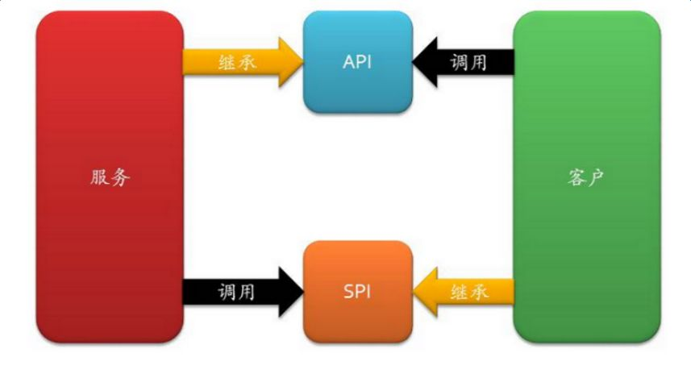

# SPI

# 1 什么是 SPI

在面向对象的设计里，我们一般推荐模块之间基于接口编程，模块之间不对实现类进行硬编码。一旦代码里涉及具体的实现类，就违反了可插拔的原则，如果需要替换一种实现，就需要修改代码。为了在模块装配时不必在程序里写死实现类，就需要一种服务发现机制。**Java SPI** 提供的正是这样一种机制：**为某个接口寻找服务实现**。这有点类似 IoC 的思想，将装配的控制权移到了程序之外。


以上图为例，我们现在需要在“调用方”和“实现方”之间引入“接口”，可以思考一下：什么情况下应该把接口放入调用方，什么情况下可以把接口归为实现方。

先来看接口属于实现方的情况。这个很容易理解：实现方提供了接口和实现，我们引用接口即可调用某个实现类的功能，这就是我们常说的 **API**（Application Programming Interface），具有以下特征：

1. 概念上更接近实现方
2. 组织上位于实现方所在的包中
3. 实现和接口在一个包中

当接口属于调用方时，我们就将其称为 **SPI**（Service Provider Interface），具有以下特征：

1. 概念上更依赖调用方
2. 组织上位于调用方所在的包中
3. 实现位于独立的包中（也可认为在提供方中）



- API：在大多数情况下，由实现方制定接口并完成对接口的实现，调用方仅仅依赖接口调用，无权选择不同的实现。从使用人员上来说，**API 直接被应用开发人员使用**。
- SPI：由调用方制定接口规范，提供给外部来实现，调用方在调用时再选择自己需要的外部实现。从使用人员上来说，**SPI 一般被框架扩展人员使用**。

# 2 代码实例

首先定义一个接口：

```java
public interface Developer {
    String getProgram();
}
```

假如该接口有两个实现：

```java
public class JavaDeveloper implements Developer {
    @Override
    public String getProgram() {
        return "Java";
    }
}

public class PhpDeveloper implements Developer {
    @Override
    public String getProgram() {
        return "PHP";
    }
}
```

然后根据 Java SPI 的规范，在 `resources` 目录下新建 `META-INF/services` 目录，并在这个目录下新建一个**与接口的全限定名一致的文件** `clf.winner.spi.Developer`，在文件中写入接口的**实现类的全限定名**：

```text
clf.winner.spi.JavaDeveloper
```

运行测试类：

```java
public static void main(String[] args) {
    ServiceLoader<Developer> services = ServiceLoader.load(Developer.class);
    for (Developer s : services) {
        System.out.println(s.getProgram());
    }
}
```

打印结果：

```text
Java
```

如果在 `clf.winner.spi.Developer` 文件里写上两个实现类（每行一个），输出结果就是两行。

这是因为 `ServiceLoader.load(Developer.class)` 在加载某接口时，会去 `META-INF/services` 下找以接口全限定名命名的文件，再根据里面的内容加载相应的实现类。注意，实现类必须有一个 `public` 的无参构造方法。

# 3 源码分析

> 本章源码基于 JDK 8。JDK 9 对 `ServiceLoader` 做了重写以支持模块系统，新特性见第 5 章。

通过上面的 demo 可以看到，最关键的实现就是 `ServiceLoader` 这个类：

```java
public final class ServiceLoader<S> implements Iterable<S> {
    // 配置文件的路径
    private static final String PREFIX = "META-INF/services/";
    // 加载的服务类或接口
    private final Class<S> service;
    // 类加载器
    private final ClassLoader loader;
    // 创建 ServiceLoader 时的访问控制上下文
    private final AccessControlContext acc;
    // 已加载的服务类缓存，按实例化顺序保存
    private LinkedHashMap<String, S> providers = new LinkedHashMap<>();
    // 内部类，真正负责查找和加载服务类
    private LazyIterator lookupIterator;
}
```

`load` 方法默认使用**线程上下文类加载器**（Thread Context ClassLoader），然后调用私有构造方法：

```java
public static <S> ServiceLoader<S> load(Class<S> service) {
    ClassLoader cl = Thread.currentThread().getContextClassLoader();
    return ServiceLoader.load(service, cl);
}

private ServiceLoader(Class<S> svc, ClassLoader cl) {
    // 要加载的接口
    service = Objects.requireNonNull(svc, "Service interface cannot be null");
    // 类加载器
    loader = (cl == null) ? ClassLoader.getSystemClassLoader() : cl;
    // 访问控制器
    acc = (System.getSecurityManager() != null) ? AccessController.getContext() : null;
    reload();
}

public void reload() {
    // 先清空缓存
    providers.clear();
    // 实例化内部类
    lookupIterator = new LazyIterator(service, loader);
}
```

可以看到，构造 `ServiceLoader` 时并不会去读取配置文件，只是实例化了内部类 `LazyIterator`。查找实现类和创建实现类的过程，都在 `LazyIterator` 中完成。

当我们调用 `iterator` 的 `hasNext` 和 `next` 方法时，会先遍历已经实例化过的缓存 `providers`，缓存遍历完后才交给 `LazyIterator`：

```java
public Iterator<S> iterator() {
    return new Iterator<S>() {
        Iterator<Map.Entry<String, S>> knownProviders = providers.entrySet().iterator();

        public boolean hasNext() {
            if (knownProviders.hasNext())
                return true;
            return lookupIterator.hasNext();
        }

        public S next() {
            if (knownProviders.hasNext())
                return knownProviders.next().getValue();
            return lookupIterator.next();
        }
        // ...
    };
}
```

所以，我们重点关注 `lookupIterator.hasNext()` 方法，它最终会调用到 `hasNextService`：

```java
private class LazyIterator implements Iterator<S> {
    Class<S> service;
    ClassLoader loader;
    Enumeration<URL> configs = null;
    Iterator<String> pending = null;
    String nextName = null;

    private boolean hasNextService() {
        // 上一次解析出的类名还没被 next 消费，直接返回
        if (nextName != null) {
            return true;
        }
        if (configs == null) {
            // META-INF/services/ 加上接口的全限定名，就是服务配置文件的路径
            // 例如：META-INF/services/clf.winner.spi.Developer
            String fullName = PREFIX + service.getName();
            // 查找 classpath 下所有同名的配置文件
            configs = loader.getResources(fullName);
        }
        while ((pending == null) || !pending.hasNext()) {
            // 所有配置文件都已解析完毕
            if (!configs.hasMoreElements()) {
                return false;
            }
            // 解析配置文件，读取其中的实现类名
            pending = parse(service, configs.nextElement());
        }
        // 拿到下一个实现类的类名
        nextName = pending.next();
        return true;
    }
}
```

调用 `next` 方法时，实际调用到的是 `lookupIterator.nextService`，它通过反射创建实现类的实例并返回：

```java
private class LazyIterator implements Iterator<S> {
    private S nextService() {
        if (!hasNextService())
            throw new NoSuchElementException();
        // 全限定类名
        String cn = nextName;
        nextName = null;
        // 加载类，但暂不初始化
        Class<?> c = Class.forName(cn, false, loader);
        // 校验实现类是否实现了服务接口
        if (!service.isAssignableFrom(c)) {
            fail(service, "Provider " + cn + " not a subtype");
        }
        // 通过 newInstance 实例化
        S p = service.cast(c.newInstance());
        // 放入缓存，返回实例
        providers.put(cn, p);
        return p;
    }
}
```

（上面的代码省略了异常处理。）由此可以总结出 Java SPI 的几个特点：

- **懒加载**：只有遍历到某个实现时才会加载并实例化它。
- **有缓存**：已实例化的实现会放入 `providers`，再次遍历时直接复用。
- **非线程安全**：`ServiceLoader` 实例不能在多个线程间并发使用。
- **使用线程上下文类加载器**：这是 SPI 能够“打破双亲委派”的关键，详见 4.1 节。

# 4 应用场景

## 4.1 JDBC 中的 SPI

SPI 机制为很多框架的扩展提供了可能，JDBC 就应用到了这一机制。JDBC 4.0 以前，开发人员需要先通过 `Class.forName("xxx")` 的方式装载驱动，再通过 `DriverManager.getConnection` 获取一个 `Connection`，类似这样：

```java
String url = "jdbc:mysql:///...";
String user = "root";
String password = "root";

Class.forName("com.mysql.jdbc.Driver");
Connection connection = DriverManager.getConnection(url, user, password);
```

到了 JDBC 4.0（Java 6），这一步骤就不再需要了。那么 `DriverManager` 是怎么知道有哪些数据库驱动的呢？答案就是 SPI。

我们把目光转向 `DriverManager` 类。在 JDK 8 中，它在静态代码块里通过 SPI 机制完成了数据库驱动的初始化：

```java
public class DriverManager {
    static {
        loadInitialDrivers();
        println("JDBC DriverManager initialized");
    }
}
```

具体过程还得看 `loadInitialDrivers`。它查找的是 `Driver` 接口的服务类，所以对应的配置文件路径就是 `META-INF/services/java.sql.Driver`：

```java
public class DriverManager {
    private static void loadInitialDrivers() {
        AccessController.doPrivileged(new PrivilegedAction<Void>() {
            public Void run() {
                // 加载 java.sql.Driver 接口的服务类
                // 即查找 META-INF/services/java.sql.Driver 文件
                ServiceLoader<Driver> loadedDrivers = ServiceLoader.load(Driver.class);
                Iterator<Driver> driversIterator = loadedDrivers.iterator();
                try {
                    // 遍历时逐个实例化驱动
                    while (driversIterator.hasNext()) {
                        driversIterator.next();
                    }
                } catch (Throwable t) {
                    // Do nothing
                }
                return null;
            }
        });
    }
}
```

那么，这个文件在哪里呢？打开 MySQL 驱动的 jar 包，就能找到它：


文件内容为 `com.mysql.cj.jdbc.Driver`。

当调用 `next` 方法时，就会创建这个类的实例，触发它的静态代码块，而静态代码块只做了一件事：向 `DriverManager` 注册自身的实例。

```java
public class Driver extends NonRegisteringDriver implements java.sql.Driver {
    static {
        try {
            // 调用 DriverManager 的注册方法
            // 往 registeredDrivers 集合中加入实例
            java.sql.DriverManager.registerDriver(new Driver());
        } catch (SQLException E) {
            throw new RuntimeException("Can't register driver!");
        }
    }

    public Driver() throws SQLException {
        // Required for Class.forName().newInstance()
    }
}
```

这里还有一个值得注意的细节：`DriverManager` 位于核心类库中，由启动类加载器加载，而 MySQL 驱动位于应用的 classpath 中，启动类加载器是“看不到”它的。`ServiceLoader.load(Driver.class)` 使用线程上下文类加载器（默认是应用类加载器）去加载驱动，相当于父加载器委托子加载器加载类，这就是常说的 SPI “打破双亲委派模型”。

> 从 JDK 9 开始，`DriverManager` 的驱动初始化改为**懒加载**：不再在静态代码块中加载，而是在首次调用 `getConnection`、`getDrivers` 等方法时，通过 `ensureDriversInitialized()` 使用线程上下文类加载器查找驱动，原理不变。

与 JDBC 类似的还有 commons-logging，它是 Apache 最早提供的日志门面，只有接口，没有实现，具体方案由各提供商实现。它发现日志实现的方式之一，就是扫描 `META-INF/services/org.apache.commons.logging.LogFactory` 配置文件，读取文件内容找到日志实现类。只要日志实现的 jar 包里包含了这个文件，并在文件里指定 `LogFactory` 工厂接口的实现类即可。

如今更常用的日志门面 SLF4J，从 2.0 版本起也改为使用标准的 `ServiceLoader` 来发现日志实现（服务接口为 `org.slf4j.spi.SLF4JServiceProvider`），取代了 1.7 时代基于 `StaticLoggerBinder` 的静态绑定方式。

## 4.2 Dubbo 中的 SPI

Java 原生的 SPI 机制并不完善，有着如下弊端：

- 只能按顺序遍历所有实现，想要使用某个实现，就得把它前面的实现全部加载并实例化（JDK 9 的 `stream()` 方法在一定程度上缓解了这个问题，见第 5 章）。
- 配置文件中只是简单地列出了所有扩展实现，而没有给它们命名，导致程序中很难准确地引用它们。
- 扩展如果依赖其他扩展，做不到自动注入和装配。
- 扩展很难和其他框架集成，比如扩展里依赖了一个 Spring Bean，原生的 Java SPI 并不支持。

Dubbo 同样采用了 SPI 的思想，但没有使用 JDK 的 SPI 机制，而是自己实现了一套。

Dubbo 的 SPI 有如下几个概念：

- **扩展点**：一个接口。
- **扩展**：扩展点（接口）的实现。
- **扩展自适应实例**：其实就是扩展的代理，它实现了扩展点接口。调用扩展点的接口方法时，它会根据实际的参数（通常是 `URL`）来决定使用哪个扩展。
- **扩展包装类（Wrapper）**：构造方法参数为扩展点接口的实现类，Dubbo 会自动用它包装真正的扩展，类似 AOP。
- **`@SPI`**：作用于扩展点的接口上，表明该接口是一个扩展点，注解的值为默认扩展的名称。
- **`@Adaptive`**：用在扩展接口的方法上，表示该方法是一个自适应方法。Dubbo 为扩展点生成自适应实例时，会为带有 `@Adaptive` 注解的方法生成对应的代理代码。
- **`@Activate`**：用在扩展实现类上，表示该扩展在满足指定条件（如分组、URL 参数）时自动激活，常用于 `Filter` 等需要同时启用多个实现的场景。

**SPI 思想贯穿了 Dubbo 的核心，很多组件都是一个接口加多个实现，系统运行时根据配置动态地找到对应的实现类；如果没有配置，就使用默认的实现类。**

在 Dubbo 2.x 的源码中，很多地方存在下面这三种代码，分别用于获取**自适应扩展点**、**指定名称的扩展点**和**激活扩展点**：

```java
ExtensionLoader.getExtensionLoader(xxx.class).getAdaptiveExtension();
ExtensionLoader.getExtensionLoader(xxx.class).getExtension(name);
ExtensionLoader.getExtensionLoader(xxx.class).getActivateExtension(url, key);
```

以 `Protocol` 模块为例：

```java
@SPI("dubbo")
public interface Protocol {

    int getDefaultPort();

    @Adaptive
    <T> Exporter<T> export(Invoker<T> invoker) throws RpcException;

    @Adaptive
    <T> Invoker<T> refer(Class<T> type, URL url) throws RpcException;

    void destroy();
}
```

```java
Protocol protocol = ExtensionLoader.getExtensionLoader(Protocol.class).getAdaptiveExtension();
```

运行时，Dubbo 会判断应该选用 `Protocol` 接口的哪个实现类：找到你配置的 `Protocol` 实现，将其加载到 JVM 中并实例化，然后使用该实现。

Dubbo 会从 `META-INF/dubbo/internal/`、`META-INF/dubbo/` 和 `META-INF/services/` 三个目录读取配置文件。与 Java SPI 不同，Dubbo 的配置文件采用 `key=value` 的形式，以 Dubbo 2.7 中的 `META-INF/dubbo/internal/org.apache.dubbo.rpc.Protocol` 为例：

```text
filter=org.apache.dubbo.rpc.protocol.ProtocolFilterWrapper
listener=org.apache.dubbo.rpc.protocol.ProtocolListenerWrapper
mock=org.apache.dubbo.rpc.support.MockProtocol
dubbo=org.apache.dubbo.rpc.protocol.dubbo.DubboProtocol
injvm=org.apache.dubbo.rpc.protocol.injvm.InjvmProtocol
rmi=org.apache.dubbo.rpc.protocol.rmi.RmiProtocol
hessian=org.apache.dubbo.rpc.protocol.hessian.HessianProtocol
http=org.apache.dubbo.rpc.protocol.http.HttpProtocol
webservice=org.apache.dubbo.rpc.protocol.webservice.WebServiceProtocol
thrift=org.apache.dubbo.rpc.protocol.thrift.ThriftProtocol
native-thrift=org.apache.dubbo.rpc.protocol.nativethrift.ThriftProtocol
memcached=org.apache.dubbo.rpc.protocol.memcached.MemcachedProtocol
redis=org.apache.dubbo.rpc.protocol.redis.RedisProtocol
rest=org.apache.dubbo.rpc.protocol.rest.RestProtocol
xmlrpc=org.apache.dubbo.xml.rpc.protocol.xmlrpc.XmlRpcProtocol
registry=org.apache.dubbo.registry.integration.RegistryProtocol
qos=org.apache.dubbo.qos.protocol.QosProtocolWrapper
```

其中 `filter`、`listener`、`qos` 对应的都是包装类，会自动包装在真正的协议实现外层。

`@SPI("dubbo")` 的含义是：通过 SPI 机制提供实现类，并以 `dubbo` 作为默认 key 去配置文件里查找，从而找到默认的实现类 `org.apache.dubbo.rpc.protocol.dubbo.DubboProtocol`。配置文件名称与接口全限定名一致。

如果想在运行时动态替换默认的实现类，就要借助 `@Adaptive` 注解。`Protocol` 接口中有两个方法加了 `@Adaptive` 注解，Dubbo 会为 `Protocol` 生成一个代理类，代理类中这两个方法的代码会在运行时从 URL 中取出 `protocol` 参数作为 key（未指定时默认为 `dubbo`），再按这个 key 获取对应的实现类实例。如果你指定了其他 key，就会获取其他实现类的实例。

> **Dubbo 3 的变化**：
>
> - 引入了 `FrameworkModel`、`ApplicationModel`、`ModuleModel` 分层的作用域模型，由 `ExtensionDirector` 管理各层的扩展加载器。静态方法 `ExtensionLoader.getExtensionLoader` 已被标记为 `@Deprecated`，推荐通过作用域模型获取，例如 `ApplicationModel.defaultModel().getExtensionLoader(Protocol.class)`。
> - rmi、hessian、http、webservice、redis、memcached 等协议已从主仓库移出，迁移到独立的 [dubbo-spi-extensions](https://github.com/apache/dubbo-spi-extensions) 仓库；同时新增了基于 HTTP/2、兼容 gRPC 的 Triple（`tri`）协议。

## 4.3 Spring 中的 SPI

Spring 也有一套类似 SPI 的机制：`SpringFactoriesLoader` 会读取 classpath 下所有的 `META-INF/spring.factories` 文件，按接口全限定名加载实现类列表。Spring Boot 的自动配置最初就是基于它实现的。

从 Spring Boot 2.7 开始，自动配置类改为在 `META-INF/spring/org.springframework.boot.autoconfigure.AutoConfiguration.imports` 文件中逐行声明；到了 Spring Boot 3.0，`spring.factories` 中的自动配置声明已不再被支持，但 `spring.factories` 仍用于注册 `ApplicationListener`、`EnvironmentPostProcessor` 等其他扩展。

# 5 新版本中的 SPI

| 版本 | 变化 |
|------|------|
| Java 6 | 引入 `java.util.ServiceLoader`，JDBC 4.0 基于它自动加载驱动 |
| Java 9 | 模块系统（JPMS）引入 `uses` / `provides ... with` 声明服务；`ServiceLoader` 新增 `stream()`、`findFirst()`、`ServiceLoader.Provider`，支持静态 `provider()` 工厂方法；`Class.newInstance()` 被废弃；`DriverManager` 改为懒加载驱动 |
| Java 17 | JEP 411 将 Security Manager 标记为废弃并计划移除，`AccessController` 等相关 API 随之废弃 |
| Java 24 | JEP 486 永久禁用 Security Manager，`ServiceLoader` 中的访问控制上下文不再起作用 |

## 5.1 模块化下的服务声明

在模块化应用中，服务不再依赖 `META-INF/services` 文件，而是在 `module-info.java` 中声明。服务的使用方声明 `uses`：

```java
module clf.winner.app {
    requires clf.winner.spi;
    uses clf.winner.spi.Developer;
}
```

服务的提供方声明 `provides ... with`：

```java
module clf.winner.java {
    requires clf.winner.spi;
    provides clf.winner.spi.Developer with clf.winner.java.JavaDeveloper;
}
```

提供方的实现类可以不再提供无参构造方法，而是提供一个 `public static` 的 `provider()` 方法，由它返回服务实例，这让单例等创建方式变得更加方便。为了兼容，放在 classpath 上的 jar 包仍然可以使用 `META-INF/services` 文件。

## 5.2 stream() 与按需实例化

JDK 9 新增的 `stream()` 方法返回 `Stream<ServiceLoader.Provider<S>>`。通过 `Provider.type()` 可以先拿到实现类的 `Class` 对象做筛选，只有调用 `Provider.get()` 时才会真正实例化，从而避免了“想用一个就得全部实例化”的问题：

```java
Optional<Developer> javaDeveloper = ServiceLoader.load(Developer.class)
        .stream()
        .filter(p -> p.type().getSimpleName().startsWith("Java"))
        .map(ServiceLoader.Provider::get)
        .findFirst();
```

如果只需要第一个可用的实现，也可以直接调用 `findFirst()`：

```java
Developer developer = ServiceLoader.load(Developer.class)
        .findFirst()
        .orElseThrow();
```

不过，`stream()` 只能基于类型筛选，仍然无法像 Dubbo 那样按名称直接获取实现，也不支持依赖注入。需要这些能力时，依然要借助 Dubbo、Spring 等框架自己的扩展机制。

# 6 总结

- SPI 是“调用方定义接口、实现方提供实现”的服务发现机制，核心价值是解耦接口与实现，让框架具备可插拔的扩展能力。
- Java SPI 基于 `ServiceLoader` 和 `META-INF/services` 配置文件实现，具有懒加载、带缓存、非线程安全的特点，并借助线程上下文类加载器打破双亲委派模型。
- JDBC、commons-logging、SLF4J 2.x 等都基于 Java SPI 实现了实现方的自动发现。
- Java 原生 SPI 无法按名称获取实现，也不支持依赖注入，Dubbo、Spring 等框架因此实现了各自增强的扩展机制。
- JDK 9 起，模块系统通过 `uses` / `provides` 声明服务，`stream()` 与 `ServiceLoader.Provider` 支持先筛选、再按需实例化。
