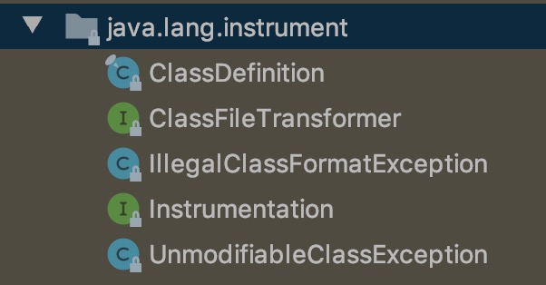
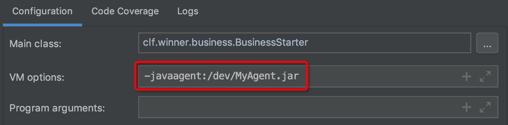
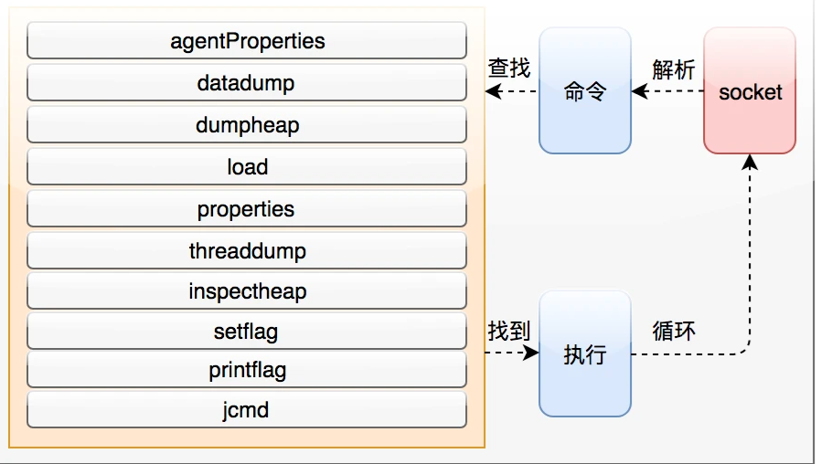
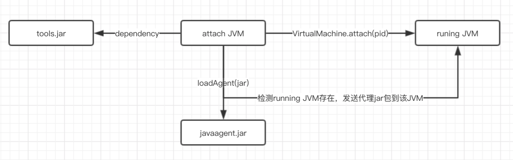

# Agent

# 1 什么是 Java Agent

笼统地讲，Java Agent 是一个统称，指的是 Java 虚拟机提供的一整套“后门”接口，通过它可以对虚拟机的方方面面进行监控与分析，甚至干预虚拟机的运行。

> Java Agent 又叫做 **Java 探针**，是在 JDK 1.5 中引入的一种可以动态修改 Java 字节码的技术。Java 类编译之后形成字节码，交由 JVM 执行。Java Agent 可以在 JVM 执行这些字节码之前获取到它们，并通过字节码转换器对其进行修改，从而完成一些额外的功能。

# 2 Instrumentation 工具包

JDK 从 5.0 开始，提供了一个名为 `java.lang.instrument` 的工具包：



借助该包，开发者可以构建一个独立于应用程序的**代理**（Agent），用来监测和协助运行在 JVM 上的程序，甚至能够动态替换和修改某些类的定义。这样的特性实际上提供了一种**虚拟机级别的 AOP 实现**。

事实上，`java.lang.instrument` 包是基于 **JVMTI** 机制实现的：

> **JVMTI**（Java Virtual Machine Tool Interface）是 Java 虚拟机提供的一套本地编程接口，支持第三方工具程序以代理的方式连接和访问 JVM。JVMTI 的功能非常丰富，涵盖虚拟机中的线程、内存/堆/栈、类/方法/变量、事件/定时器处理等。使用 JVMTI 的基本方式是设置回调函数，在某些事件发生时触发并作出相应的动作，这些事件包括虚拟机初始化、开始运行、结束，类的加载，方法进出，线程开始与结束等。

Instrument 就是一个基于 JVMTI 接口、以代理方式连接和访问 JVM 的 Agent（对应 JDK 中的 `libinstrument` 动态库）。

## 2.1 静态 Instrument

在命令行输入 `java` 可以看到相应的参数，其中与 Java Agent 相关的有：

```text
    -agentlib:<库名>[=<选项>]
                  加载本机代理库 <库名>, 例如 -agentlib:jdwp
                  另请参阅 -agentlib:jdwp=help
    -agentpath:<路径名>[=<选项>]
                  按完整路径名加载本机代理库
    -javaagent:<jar 路径>[=<选项>]
                  加载 Java 编程语言代理, 请参阅 java.lang.instrument
```

其中 `-agentlib` 和 `-agentpath` 用于加载 C/C++ 编写的本地 JVMTI 代理（如调试用的 `jdwp`、性能分析工具 async-profiler），`-javaagent` 用于加载 Java 编写的代理。早期 JDK 自带的 `-agentlib:hprof` 已在 JDK 9 中被移除（JEP 240）。

通过 `-javaagent` 参数可以指定一个特定的 jar 包来启动 Instrumentation 代理程序。

`-javaagent` 要求 jar 包中指定的代理类必须实现 `premain()` 方法，并且是以下两种格式之一：

```java
public static void premain(String agentArgs, Instrumentation inst)
public static void premain(String agentArgs)
```

JVM 会优先调用带 `Instrumentation` 参数的方法，找到后就忽略第二种；如果没有第一种，再调用第二种。

- `agentArgs` 是 `premain` 函数得到的程序参数，随同 `-javaagent` 一起传入。与 `main` 函数不同的是，这个参数是一个字符串而不是字符串数组，如果有多个参数，程序需要自行解析这个字符串。
- `inst` 是一个 `java.lang.instrument.Instrumentation` 的实例，由 JVM 自动传入。该接口集中了几乎所有的功能方法，例如类定义的转换和操作等。

JVM 启动时会先执行 `premain` 方法，在其中注册的类转换器（`ClassFileTransformer`）会拦截**此后**加载的类。注意：**是大部分类，不是所有类**。遗漏的主要是系统类，因为很多系统类在 Agent 执行之前就已经加载完成了（这些类可以通过 `retransformClasses` 重新转换），而用户类的加载肯定会被拦截。也就是说，**这种方式可以在 `main` 方法启动前拦截大部分类的加载活动**。既然可以拦截类的加载，就可以结合第三方的字节码工具，比如 ASM、Javassist、Byte Buddy 等来改写实现类。

例如：

```java
public class PreMainAgent {

    public static void premain(String agentArgs, Instrumentation inst) {
        System.out.println("agentArgs : " + agentArgs);
        // 加入自定义转换器，第二个参数表示该转换器支持重转换（retransform）
        inst.addTransformer(new MyTransformer(), true);
    }

}

// 通过 ClassFileTransformer 接口，可以在类加载时重写字节码
public class MyTransformer implements ClassFileTransformer {

    /**
     * 参数：
     * loader - 定义要转换的类的类加载器；如果是引导类加载器，则为 null
     * className - 类的内部形式全限定名，例如 "java/util/List"
     * classBeingRedefined - 如果由重定义或重转换触发，则为该类；如果是类加载，则为 null
     * protectionDomain - 要定义或重定义的类的保护域
     * classfileBuffer - 类文件格式的输入字节缓冲区（不得修改）
     * 返回：
     * 转换后的类文件字节；如果未执行转换，则返回 null
     */
    @Override
    public byte[] transform(ClassLoader loader, String className, Class<?> classBeingRedefined,
            ProtectionDomain protectionDomain, byte[] classfileBuffer) throws IllegalClassFormatException {

        if (!"clf/winner/business/BusinessService".equals(className)) {
            return null; // 返回 null 则字节码不会被修改
        }

        try {
            // 借助 Javassist 工具，基于传入的字节码进行插桩
            ClassPool pool = ClassPool.getDefault();
            CtClass cc = pool.makeClass(new ByteArrayInputStream(classfileBuffer));
            CtMethod method = cc.getDeclaredMethod("doBusiness");

            // 在目标方法前后插入代码
            method.insertBefore("System.out.println(\"--- before doBusiness ---\");");
            method.insertAfter("System.out.println(\"--- after doBusiness ---\");");

            byte[] bytes = cc.toBytecode();
            cc.detach();
            return bytes;
        } catch (Exception ex) {
            // transform 中抛出的异常会被 JVM 吞掉，务必自行记录
            ex.printStackTrace();
        }

        return null;
    }
}
```

这里使用 `classfileBuffer` 构造 `CtClass`，而不是 `pool.get(类名)` 从 classpath 读取，这样才能拿到当前真正要加载的字节码（它可能已经被其他 Agent 修改过）。JDK 9 起，`ClassFileTransformer` 还新增了一个带 `Module` 参数的 `transform` 重载方法，以适配模块系统。

除此之外，还需要在 `MANIFEST.MF` 文件中指明 `premain` 的入口在哪里，可用的属性如下：

```text
Premain-Class: 包含 premain 方法的类（类的全限定名）
Agent-Class: 包含 agentmain 方法的类（类的全限定名）
Launcher-Agent-Class: 可执行 JAR 中，在 main 方法之前启动的代理类（JDK 9 新增，调用其 agentmain 方法）
Boot-Class-Path: 由引导类加载器搜索的路径列表，路径之间用空格分隔；相对路径根据代理 JAR 文件的绝对路径解析（可选）
Can-Redefine-Classes: true 表示能重定义此代理所需的类，默认值为 false（可选）
Can-Retransform-Classes: true 表示能重转换此代理所需的类，默认值为 false（可选）
Can-Set-Native-Method-Prefix: true 表示能设置此代理所需的本地方法前缀，默认值为 false（可选）

```

注意：手写 `MANIFEST.MF` 时，最后一行必须是**空行，不能省略**。

如果不手动指定，打包时也会默认生成一个 `MANIFEST.MF` 文件，包含当前的一些版本信息、工程的启动类等。Java Agent 的信息可以在 Maven 插件中指定：

```xml
<plugin>
    <groupId>org.apache.maven.plugins</groupId>
    <artifactId>maven-jar-plugin</artifactId>
    <version>3.5.1</version>
    <configuration>
        <archive>
            <!-- 自动添加 META-INF/MANIFEST.MF -->
            <manifest>
                <addClasspath>true</addClasspath>
            </manifest>
            <manifestEntries>
                <Premain-Class>clf.winner.java.agent.PreMainAgent</Premain-Class>
                <Agent-Class>clf.winner.java.agent.PreMainAgent</Agent-Class>
                <Can-Redefine-Classes>true</Can-Redefine-Classes>
                <Can-Retransform-Classes>true</Can-Retransform-Classes>
            </manifestEntries>
        </archive>
    </configuration>
</plugin>
```

由于 Agent 依赖了 Javassist，实际使用时通常还要借助 `maven-shade-plugin` 或 `maven-assembly-plugin` 把依赖一并打入 Agent 的 jar 包，否则运行时会找不到相关的类。

Agent 程序开发完毕后，打成 jar 包，命名为 `MyAgent.jar` 待用。

然后写一个测试类来模拟应用实例：

```java
public class BusinessStarter {

    public static void main(String[] args) {
        BusinessService service = new BusinessService();
        while (true) {
            service.doBusiness();
        }
    }

}

public class BusinessService {

    public void doBusiness() {
        try {
            System.out.println("doing business"); // 模拟业务操作
            Thread.sleep(1000L);
        } catch (InterruptedException e) {
            e.printStackTrace();
        }
    }
}
```

运行命令：`java -javaagent:MyAgent.jar BusinessStarter`

或者在 IDEA 中指定 VM 参数：



运行结果如下：

```text
agentArgs : null
--- before doBusiness ---
doing business
--- after doBusiness ---
--- before doBusiness ---
doing business
--- after doBusiness ---
--- before doBusiness ---
doing business
--- after doBusiness ---
```

可见，在业务代码执行的前后，确实插入了额外代码。

## 2.2 动态 Instrument

静态 Instrument 需要把 Agent 程序提前写好，与应用实例一并启动，所做的 Instrumentation 也仅限于 `main` 函数执行前，这样的方式存在一定的局限性。

Java SE 6 的 Instrumentation 提供了一个新的代理入口方法 `agentmain`，可以在 `main` 函数开始运行之后再运行。

跟 `premain` 函数一样，开发者可以编写一个含有 `agentmain` 函数的 Java 类：

```java
public static void agentmain(String agentArgs, Instrumentation inst)
public static void agentmain(String agentArgs)
```

同样，带 `Instrumentation` 参数的 `agentmain` 方法比不带的优先级更高。开发者必须在 manifest 文件里设置 `Agent-Class` 来指定包含 `agentmain` 函数的类。

### 2.2.1 Attach 机制

跟 `premain` 不同的是，`agentmain` 需要在 `main` 函数开始运行后才启动，那么这样的时机应该如何确定，这样的功能又该如何实现呢？

答案就是 Java SE 6 提供的 **Attach 机制**。

Attach API 不是 Java SE 的标准 API，而是 JDK 提供的一套扩展 API，用来向目标 JVM “附着”（Attach）代理工具程序。有了它，开发者可以方便地监控一个 JVM，并在其中运行一个外加的代理程序。JDK 8 及以前，Attach API 位于 `tools.jar` 中；JDK 9 起 `tools.jar` 被移除，Attach API 改由 `jdk.attach` 模块提供。

首先，**Attach 机制对外提供了一种进程间的通信能力**，能让一个进程传递命令给 JVM；其次，Attach 机制内置了一些重要功能，可供外部进程调用。比如大家熟悉的 `jstack`、`jmap`、`jcmd` 就要依赖这个机制来工作。

Attach 机制的核心组件是 **Attach Listener**。顾名思义，Attach Listener 是 JVM 内部的一个线程，主要工作是监听和接收客户端进程通过 Attach 通信机制发起的命令，如下图所示：



Attach Listener 线程的主要工作是把整个流程串起来，包括：接收客户端命令、解析命令、查找命令执行器、执行命令等。

Attach API 很简单，只有 2 个主要的类，都在 `com.sun.tools.attach` 包里：

- **`VirtualMachine` 类**：代表一个 Java 虚拟机，也就是程序需要监控的目标虚拟机，提供了获取系统属性、加载代理程序、启动 JMX 管理代理、Attach 和 Detach 等方法。`jstack`、`jmap` 用到的线程 dump、堆 dump 等命令，则由其 HotSpot 内部实现类 `HotSpotVirtualMachine` 提供。
- **`VirtualMachineDescriptor` 类**：一个描述虚拟机的容器类，配合 `VirtualMachine` 类完成各种功能。

通过 `VirtualMachine` 类的 `attach(pid)` 方法，便可以 attach 到一个运行中的 Java 进程上，之后便可以通过 `loadAgent(agentJarPath)` 将 Agent 的 jar 包注入到对应的进程，然后对应的进程会调用 `agentmain` 方法。



既然是两个进程之间的通信，那肯定得先建立起连接。以 Linux/macOS 上的 HotSpot 为例，`VirtualMachine.attach` 的过程大致如下：

1. 客户端在目标进程的工作目录或临时目录下创建 `.attach_pid<pid>` 文件，然后向目标进程发送 `SIGQUIT` 信号。
2. 目标 JVM 的信号处理线程发现该文件后，启动 Attach Listener 线程（默认是懒启动的），并在临时目录下创建 UNIX 域套接字 `.java_pid<pid>`。
3. 客户端连接这个套接字，连接建立。

后面执行的操作，例如 `vm.loadAgent`，其实就是向这个套接字写入命令，目标 JVM 会根据不同的命令做不同的处理。Windows 上的实现方式则不同，是通过向目标进程注入远程线程并借助命名管道通信的。

### 2.2.2 代码实例

与上面 `premain` 的例子类似，编写 `agentmain` 入口类，然后使用 Maven 插件打包生成 `MANIFEST.MF`：

```java
public class AgentMainAgent {

    public static void agentmain(String agentArgs, Instrumentation inst) throws UnmodifiableClassException {
        inst.addTransformer(new MyTransformer(), true);
        // 目标类早已加载，需要指明哪些类要重新转换
        for (Class<?> clazz : inst.getAllLoadedClasses()) {
            if ("clf.winner.business.BusinessService".equals(clazz.getName())) {
                inst.retransformClasses(clazz);
            }
        }
    }

}
```

```xml
<plugin>
    <groupId>org.apache.maven.plugins</groupId>
    <artifactId>maven-jar-plugin</artifactId>
    <version>3.5.1</version>
    <configuration>
        <archive>
            <!-- 自动添加 META-INF/MANIFEST.MF -->
            <manifest>
                <addClasspath>true</addClasspath>
            </manifest>
            <manifestEntries>
                <Agent-Class>clf.winner.java.agent.AgentMainAgent</Agent-Class>
                <Can-Redefine-Classes>true</Can-Redefine-Classes>
                <Can-Retransform-Classes>true</Can-Retransform-Classes>
            </manifestEntries>
        </archive>
    </configuration>
</plugin>
```

将 Agent 打包为 `MyAgent2.jar` 之后，编写一个测试用的 `main` 方法：从当前 JVM 去探测目标 JVM，如果目标 JVM 存在，就向它发送 `MyAgent2.jar`：

```java
public static void main(String[] args) throws Exception {
    // 获取当前系统中所有运行中的虚拟机
    List<VirtualMachineDescriptor> list = VirtualMachine.list();
    for (VirtualMachineDescriptor vmd : list) {
        // 如果虚拟机的名称为 xxx，则该虚拟机为目标虚拟机，获取该虚拟机的 pid
        // 然后将 agent 的 jar 包发送给该虚拟机
        System.out.println(vmd.displayName());
        if (vmd.displayName().endsWith("clf.winner.business.BusinessStarter")) {
            VirtualMachine virtualMachine = VirtualMachine.attach(vmd.id());
            virtualMachine.loadAgent("/Users/winner/Desktop/MyAgent2.jar");
            virtualMachine.detach();
        }
    }
}
```

先运行模拟业务的 `main` 函数，然后再运行上面的测试类，打印结果如下：

```text
doing business
doing business
doing business
doing business
doing business
--- before doBusiness ---
doing business
--- after doBusiness ---
--- before doBusiness ---
doing business
--- after doBusiness ---
```

可见，`main` 函数刚启动时还没有 attach 外部的 Agent 程序，执行的是原始代码；Agent 启动后，`BusinessService` 类被重新转换（retransform），新的方法调用就执行了插入额外代码后的版本。注意，重转换并不会重新加载类或重新初始化静态变量，正在执行中的方法栈帧也仍然运行旧代码。

此外，从 JDK 9 开始，JVM 默认不允许 attach 到自身进程，需要通过 `-Djdk.attach.allowAttachSelf=true` 显式开启。

## 2.3 本地方法 Instrument

本地方法（Native Method）没有字节码，无法像普通方法那样通过插桩来修改。JDK 1.5 的 Instrumentation 里并没有处理本地方法的方式，而且在标准的 JVMTI 之下，也没有办法改变方法签名，这就使得替换本地方法非常困难。一个比较直接而简单的想法是，**在启动时替换本地代码所在的动态链接库**，但这样**本质上是一种静态的替换，而不是动态的 Instrumentation**。

Java SE 6 为此在 `java.lang.instrument` 包里提供了一种对本地方法进行 Instrument 的方式：**设置前缀（prefix）**。它的思路是：把本地方法“包装”起来，用一个同名的 Java 方法替代它，在 Java 方法里加入额外逻辑后，再去调用改了名的本地方法。

假设我们有一个本地方法 `nativeMethod`：

```java
package nativeTester;

class NativePrefixTester {
    native int nativeMethod(int input);
}
```

它对应的本地代码是：

```c
JNIEXPORT jint JNICALL Java_nativeTester_NativePrefixTester_nativeMethod(JNIEnv *env, jobject thisObj, jint input);
```

借助 `ClassFileTransformer`，我们可以把这个类转换成如下的样子（以 `another_` 作为前缀）：

```java
class NativePrefixTester {
    // 同名的 Java 方法，可以在其中加入额外逻辑
    int nativeMethod(int input) {
        // 额外逻辑……
        return another_nativeMethod(input);
    }

    // 原本地方法被加上前缀
    native int another_nativeMethod(int input);
}
```

问题在于，本地代码中并不存在 `Java_nativeTester_NativePrefixTester_another_nativeMethod` 这个函数。设置前缀之后，JVM 解析本地方法时，如果按标准方式找不到对应的函数，就会把前缀去掉后再次查找，从而解析到原来的 `Java_nativeTester_NativePrefixTester_nativeMethod`。这样，既不用修改本地代码，又实现了对本地方法的 Instrument。

设置前缀的代码也相当简单，既可以在 `premain` 中完成，也可以在 `agentmain` 中完成：

```java
public static void premain(String agentArgs, Instrumentation inst) {
    // ...
    if (!inst.isNativeMethodPrefixSupported()) {
        return; // 如果无法设置，则返回
    }
    // 设置本地方法的前缀，前缀与对应的转换器绑定
    inst.setNativeMethodPrefix(transformer, "another_");
    // ...
}
```

并不是在任何情况下都可以设置本地方法前缀的。首先，Agent 包的 manifest 中需要设定以下属性：

```text
Can-Set-Native-Method-Prefix: true
```

这个属性决定了是否可以设置本地方法前缀，而它的**默认值是 false**，我们需要将其设置成 true。

当然，我们还需要确认虚拟机本身是否支持设置前缀，`Instrumentation` 接口提供的 `isNativeMethodPrefixSupported()` 方法就是用来判断这一点的。

总之，前缀机制**弥补了以前本地方法无法被动态 Instrument 的不足**，让我们可以在不修改本地代码的情况下，动态地为本地方法加入额外的逻辑。

# 3 应用场景

从上面提到的字节码转换器的两种执行方式来看，Java Agent 可以：

- 在加载 Java 字节码之前进行拦截，并对字节码进行修改；
- 在 JVM 运行期间修改已经加载的字节码。

因此，通过以上两点，就可以在一些框架或技术的采集点进行字节码修改，对应用进行监控（比如通过 JVM CPU Profiler 从 CPU、Memory、Thread、Classes、GC 等多个方面对程序进行动态分析），或者在执行指定方法或接口时做一些额外操作，比如打印日志、统计方法执行时间、采集方法的入参和结果等。

基于前面对 Java Agent 大致机制的描述，我们不难想到，既然能够干预 JVM 的运行，就可以解决包括但不限于如下的问题：

- **应用性能监控（APM）**：在微服务大行其道的环境下，分布式系统的逻辑结构变得越来越复杂，这给系统性能分析和问题定位带来了非常大的挑战。基于 Java Agent 字节码增强的 APM 能够无侵入地汇聚业务系统各处理环节的实时数据，分析各事务的调用链路和处理时间，实现对应用的全链路性能监测。开源的 SkyWalking、Pinpoint、OpenTelemetry Java Agent、Elastic APM，商业的 Datadog、New Relic、Dynatrace、AppDynamics、阿里云 ARMS 等都是个中好手。其中 OpenTelemetry 已经成为可观测性领域事实上的标准，它的链路追踪思想则可以追溯到 Google 的 Dapper 论文。
- **classpath 动态增补**：通过设置系统参数或虚拟机启动参数，我们可以设置虚拟机运行时的 boot class 加载路径（`-Xbootclasspath/a`）和 system class 加载路径（`-cp`）。然而，有时我们需要把某些 jar 加载到 bootclasspath 之中，却无法使用上述两种方式；或者需要**在虚拟机启动之后再把某些 jar 加入 classpath**。这时可以在 `premain`/`agentmain` 方法中使用 `appendToBootstrapClassLoaderSearch`/`appendToSystemClassLoaderSearch` 来完成这个任务。JDK 9 起，系统类加载器不再是 `URLClassLoader`，以往通过反射调用 `URLClassLoader.addURL` 的做法已经失效，`Instrumentation` 提供的这两个方法成了受支持的方式。
- **class 文件加密**：有时一些涉及关键技术的 class 文件或 jar 包我们不希望对外暴露，因而需要进行加密。使用一些常规手段（例如混淆器或自定义类加载器）处理的 class 文件很容易被反编译，反编译后的代码虽然增加了阅读难度，但花些功夫也是可以读懂的。借助 JVMTI 的类加载回调（`ClassFileLoadHook`），我们可以把解密代码封装成 `.dll` 或 `.so` 文件形式的本地 Agent，这些文件想要反编译就麻烦得多，另外还能加壳，从而提高破解的难度。但要注意，类最终必须以明文字节码的形式交给 JVM，攻击者仍有可能从内存中把它导出来，所以这只能增加破解成本，无法做到绝对安全。

另外来看看有哪些开源工具和项目用到了 Agent 技术：

- 阿里巴巴开源的 **Arthas**：深受开发者喜爱的 Java 诊断工具，可以在线排查问题而无需重启，动态跟踪 Java 代码，实时监控 JVM 状态。
- 阿里巴巴开源的 **JVM-Sandbox**：实时、无侵入、动态可插拔的字节码增强框架，可用于线上故障定位、系统流控、动态日志等场景。
- Apache 顶级项目 **SkyWalking**：由国内开发者发起，对服务的调用链路、JVM 基础监控信息进行采集。
- CNCF 旗下的 **OpenTelemetry Java Agent**：无需修改代码即可为数百种常见框架和类库自动采集链路、指标和日志。
- Uber 开源的 **jvm-profiler**：通过 Java Agent 采集 JVM 的 CPU、Memory、IO 等指标，并发送给 Kafka、控制台或自定义的发送器。
- 最初由 Sun 开发的 **BTrace**：一款 Java 动态、安全的追踪工具，可以在不停机的情况下监控线上情况，并且做到侵入最少、占用系统资源最少。

# 4 局限性

大多数情况下，我们使用 Instrumentation 都是使用它的**字节码插桩**功能，或者笼统地说就是**类重定义**（Class Redefine）功能，但它有以下局限性：

1. 无论是 `premain` 还是 `agentmain`，都只能修改已经存在的类的字节码，不能凭空定义一个原本不存在的类。如果需要定义新类，要借助类加载器，或者 JDK 9 提供的 `MethodHandles.Lookup#defineClass`。
2. 对已加载的类进行重定义（`redefineClasses`）或重转换（`retransformClasses`）时，有以下限制：
    1. 新类和老类的父类必须相同；
    2. 新类和老类实现的接口必须完全相同；
    3. 新类和老类的类修饰符必须一致；
    4. 新类和老类的字段数量、字段名必须一致，不能新增、删除或重命名字段；
    5. 不能新增、删除或重命名方法，也不能修改方法的签名和修饰符；
    6. 可以修改的只有方法体、常量池和属性。

    在 JDK 12 及以前，HotSpot 实际上允许新增或删除 `private static`/`private final` 方法，这并不符合规范；JDK 13 起 HotSpot 改为严格遵循规范，仅临时保留了 `-XX:+AllowRedefinitionToAddDeleteMethods` 参数用于兼容。

除了上面的方式，如果想要重新定义一个类，可以考虑基于类加载器隔离的方式：创建一个新的自定义类加载器，用新的字节码定义一个全新的类。不过这样也有局限性，旧代码只能通过反射或接口来调用这个全新的类。如果需要在开发阶段突破上述限制、实现更彻底的热替换，可以使用 JetBrains Runtime 提供的增强类重定义（`-XX:+AllowEnhancedClassRedefinition`）等方案。

# 5 新版本中的 Java Agent

| 版本 | 变化 |
|------|------|
| Java 5 | 引入 `java.lang.instrument`，支持 `-javaagent` 和 `premain` |
| Java 6 | 新增 `agentmain` 与 Attach API、`retransformClasses`、本地方法前缀、`appendToBootstrapClassLoaderSearch`/`appendToSystemClassLoaderSearch` |
| Java 9 | `tools.jar` 移除，Attach API 移入 `jdk.attach` 模块；新增 `Launcher-Agent-Class`、带 `Module` 参数的 `transform` 方法、`redefineModule` 等模块相关方法；默认禁止 attach 自身；移除 `hprof` 代理（JEP 240） |
| Java 13 | HotSpot 重定义类时不再允许新增或删除 `private static`/`private final` 方法 |
| Java 21 | JEP 451：运行时动态加载 Agent 会打印警告，为将来默认禁止做准备 |
| Java 24 | JEP 484：Class-File API 正式发布，JDK 自带了解析、生成和转换字节码的标准 API |

## 5.1 动态加载 Agent 的收紧

动态加载 Agent 的能力非常强大，但也意味着任何能 attach 到 JVM 的代码都可以悄无声息地修改应用的行为，破坏 Java 的完整性保障。为此，JDK 21 通过 JEP 451 迈出了“默认禁止动态加载 Agent”的第一步：当 Agent 在运行时被动态加载时，JVM 会打印警告。

以下方式**不受影响**，不会产生警告：

- 启动时通过 `-javaagent`、`-agentlib`、`-agentpath` 加载 Agent；
- 可执行 JAR 中通过 `Launcher-Agent-Class` 属性指定的 Agent。

对于 Arthas 这类依赖 attach 的诊断工具，如果确实需要在运行时动态加载 Agent，建议在启动参数中显式加上：

```text
-XX:+EnableDynamicAgentLoading
```

这样既能消除警告，也能保证在未来 JDK 默认禁止动态加载后依然可用。`jcmd`、`jstack` 等不加载 Agent 的工具不受影响。

## 5.2 字节码工具的选择

编写 Agent 时离不开字节码工具：

- **ASM**：最底层、性能最好，但需要直接操作字节码指令，上手门槛高。
- **Javassist**：可以直接用 Java 源码字符串插入代码，简单易用，适合入门和简单场景。
- **Byte Buddy**：提供类型安全的流式 API，并内置了 `AgentBuilder` 简化 Agent 开发，是 OpenTelemetry Java Agent、Mockito 等众多项目的选择，也是目前编写 Agent 的主流方案。
- **Class-File API**（JDK 24）：JDK 官方的字节码 API，能随 JDK 版本同步支持最新的 class 文件格式，避免第三方库跟不上新版本 class 文件格式的问题。

至于 cglib，它已基本停止维护，在新版本 JDK 上存在兼容性问题，Spring 等框架也早已改为使用内部重新打包的版本，新项目不建议再使用。

# 6 总结

- Java Agent 基于 JVMTI 实现，通过 `java.lang.instrument` 提供虚拟机级别的 AOP 能力，核心是 `ClassFileTransformer` 对字节码的转换。
- 静态加载使用 `-javaagent` 和 `premain`，在 `main` 之前注册转换器；动态加载借助 Attach 机制和 `agentmain`，在运行时对已加载的类进行重转换。
- Attach 机制在 Linux/macOS 上基于信号和 UNIX 域套接字实现，`jstack`、`jmap`、`jcmd`、Arthas 等工具都依赖它。
- 本地方法前缀机制让没有字节码的本地方法也能被 Instrument。
- 重定义和重转换只能修改方法体，不能修改类的结构；需要更彻底的热替换时，可借助类加载器隔离或增强的类重定义方案。
- JDK 21 起动态加载 Agent 会打印警告，生产环境需要动态 attach 的场景应显式开启 `-XX:+EnableDynamicAgentLoading`；字节码工具方面推荐 Byte Buddy，或 JDK 24 起的 Class-File API。
