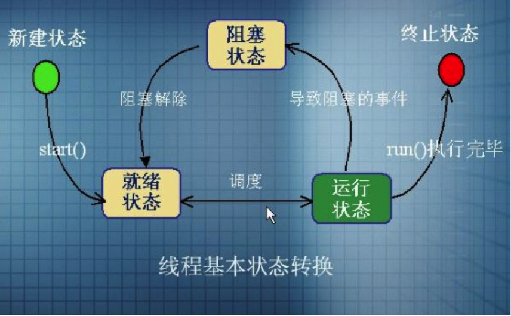
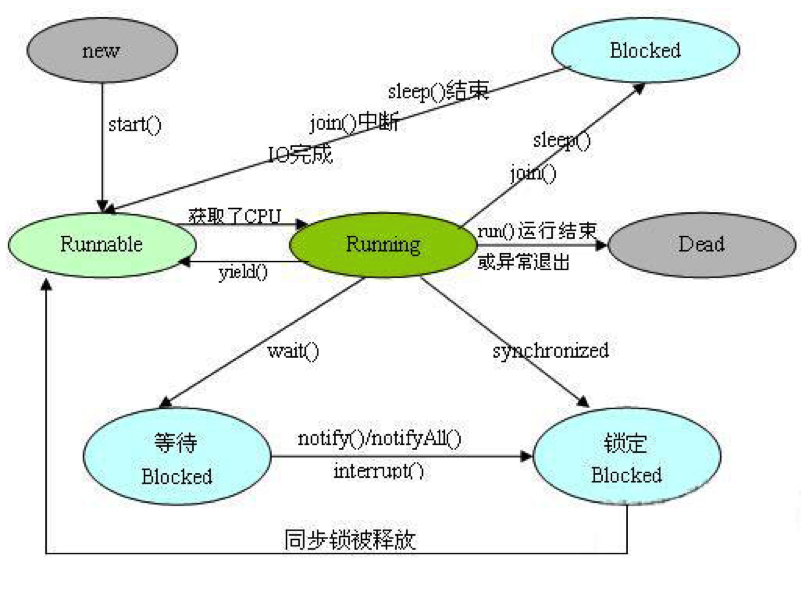
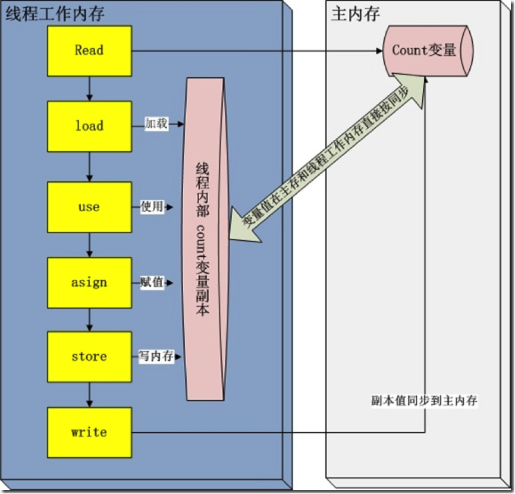

# 线程

# 1 相关概念

进程是指一个内存中运行的应用程序，每个进程都有自己独立的一块内存空间，一个进程中可以启动多个线程。

一个进程是一个独立的运行环境，它可以被看作一个程序或者一个应用，而**线程是在进程中执行的一个任务**。一个 Java 应用运行在一个 JVM 进程中。线程可以被称为**轻量级进程**，创建线程所需的资源比创建进程少，并且线程之间可以共享进程中的资源。

多线程程序中，多个线程并发执行以提高程序的效率，CPU 不会因为某个线程需要等待资源而进入空闲状态。多个线程共享堆内存（heap memory），因此创建多个线程去执行任务往往比创建多个进程更好。举个例子，在早期的 Web 开发中，Servlet 比 CGI 更高效，正是因为 Servlet 用线程处理请求，而 CGI 要为每个请求创建一个进程。

在单核 CPU 上，所谓多个线程“同时”执行只是人的感觉，实际上是多个线程轮换执行；在多核 CPU 上，多个线程才能真正地并行执行。

**线程调度器**（Thread Scheduler）是一个操作系统服务，它负责为 Runnable 状态的线程分配 CPU 时间。一旦我们创建一个线程并启动它，它的执行便依赖于线程调度器的实现。

**时间片**（Time Slicing）是指将可用的 CPU 时间分配给可运行线程的过程。分配 CPU 时间可以基于线程优先级或者线程等待的时间。

在 HotSpot 中，Java 的平台线程与操作系统线程是一对一映射的，线程调度由操作系统完成，并不受 JVM 控制。所以程序的正确性不应该依赖线程的调度顺序，也不要依赖线程的优先级。JDK 21 正式引入的**虚拟线程**（Virtual Thread）则是由 JVM 调度的轻量级线程，大量虚拟线程会被映射到少量平台线程上执行，详见第 9 章。

# 2 线程的生命周期

从操作系统的视角来看，线程的生命周期通常被划分为五个状态：

- **新建**（New）：线程对象已经创建，还没有在其上调用 `start()` 方法。
- **就绪**（Runnable）：线程有资格运行，但调度程序还没有把它选定为运行线程时所处的状态。调用 `start()` 方法后，线程首先进入就绪状态；线程在运行之后，或者从阻塞、等待、睡眠状态回来后，也会返回到就绪状态。
- **运行**（Running）：线程调度程序从可运行池中选择一个线程作为当前线程时，该线程所处的状态。这也是线程进入运行状态的唯一一种方式。
- **阻塞**（Blocked）：线程仍旧是活的，但当前没有条件运行。当某个事件出现时，它可能返回到就绪状态。阻塞的情况分三种：
    1. 等待阻塞：运行的线程执行 `wait()` 方法，JVM 会把该线程放入等待池中。
    2. 同步阻塞：运行的线程在获取对象的同步锁时，若该同步锁被别的线程占用，则 JVM 会把该线程放入锁池中。
    3. 其他阻塞：运行的线程执行 `sleep()` 或 `join()` 方法，或者发出了 I/O 请求时，线程会进入阻塞状态。当 `sleep()` 超时、`join()` 等待的线程终止或者超时、I/O 处理完毕时，线程重新转入就绪状态。
- **终止**（Terminated）：当线程的 `run()` 方法执行完毕或因异常退出时，线程就终止了。这个线程对象也许还存在，但它已经不是一个单独执行的线程了。线程一旦终止，就不能复生，如果在一个已终止的线程上调用 `start()` 方法，会抛出 `java.lang.IllegalThreadStateException` 异常。

如下图所示：



各状态间的转换条件如下图所示：



上面是操作系统层面的经典模型。而在 Java 中，`Thread.State` 枚举定义了线程的**六种状态**，可以通过 `getState()` 方法获取：

| 状态 | 含义 |
|------|------|
| `NEW` | 线程已创建，尚未调用 `start()` |
| `RUNNABLE` | 可运行状态，包含了操作系统层面的就绪和运行两种状态；线程阻塞在 I/O 上时，在 Java 中也是 `RUNNABLE` |
| `BLOCKED` | 等待进入 `synchronized` 方法或代码块，即等待获取监视器锁 |
| `WAITING` | 无限期等待，调用不带超时的 `Object.wait()`、`Thread.join()`、`LockSupport.park()` 后进入 |
| `TIMED_WAITING` | 限时等待，调用 `Thread.sleep()`、带超时的 `wait()`、`join()`、`LockSupport.parkNanos()` 等后进入 |
| `TERMINATED` | 线程已执行完毕 |

注意两者的区别：Java 没有单独的“运行”状态；操作系统层面的“阻塞”，在 Java 中被细分成了 `BLOCKED`、`WAITING`、`TIMED_WAITING` 三种。用 `jstack` 查看线程栈时，看到的就是这六种状态。

# 3 线程的创建

严格来说，在 Java 中创建线程只有一种方式，就是构造 `Thread` 对象并调用 `start()`；但定义线程要执行的任务有多种方式，最基础的是以下两种。

## 3.1 继承 java.lang.Thread 类

一个 `Thread` 类实例只是一个对象，像 Java 中的任何其他对象一样，具有变量和方法，生死于堆上。

```java
public class ThreadInstance extends Thread {

    public ThreadInstance(String name) {
        super(name);
    }

    @Override
    public void run() {
        for (int i = 0; i < 5; i++) {
            System.out.println(getName() + ":" + "第" + i + "次执行");
        }
    }
}
```

测试类：

```java
Thread threadA = new ThreadInstance("threadA");
Thread threadB = new ThreadInstance("threadB");
Thread threadC = new ThreadInstance("threadC");

threadA.start();
threadB.start();
threadC.start();
```

打印结果：

```text
threadA:第0次执行
threadC:第0次执行
threadB:第0次执行
threadC:第1次执行
threadA:第1次执行
threadC:第2次执行
threadB:第1次执行
threadB:第2次执行
threadB:第3次执行
threadB:第4次执行
threadC:第3次执行
threadA:第2次执行
threadC:第4次执行
threadA:第3次执行
threadA:第4次执行
```

注意：由于程序运行时 CPU 的状态、线程调度器的工作状态不同，每次的打印结果并不一致。

假如我们不调用 `start()` 方法，而是直接调用 `run()` 方法，会怎样呢？将测试代码作如下改动：

```java
Thread threadA = new ThreadInstance("threadA");
Thread threadB = new ThreadInstance("threadB");
Thread threadC = new ThreadInstance("threadC");

threadA.run();
threadB.run();
threadC.run();
```

打印结果：

```text
threadA:第0次执行
threadA:第1次执行
threadA:第2次执行
threadA:第3次执行
threadA:第4次执行
threadB:第0次执行
threadB:第1次执行
threadB:第2次执行
threadB:第3次执行
threadB:第4次执行
threadC:第0次执行
threadC:第1次执行
threadC:第2次执行
threadC:第3次执行
threadC:第4次执行
```

这次的打印结果是按照 `Thread` 实例的先后顺序执行的，这不是偶然的。从本质上讲，`run()` 方法就是 `Thread` 实例的一个普通成员方法，如果直接调用，就跟调用其他成员方法一样，在当前线程中同步执行完毕，之后的代码才会执行：先执行 `threadA.run()`，完毕后再执行 `threadB.run()`，完毕后再执行 `threadC.run()`。所以它并不是一个多线程程序。

而 `start()` 方法会让 JVM 创建一个新的线程，由新线程去调用 `run()` 方法。`start()` 只是让线程进入就绪状态，等待 CPU 分配时间片，并不一定会立刻执行。这时可能有多个线程处在就绪状态，线程调度器轮流分配给它们时间片，所以它是一个多线程程序。

## 3.2 实现 java.lang.Runnable 接口

实现 `Runnable` 接口时，必须实现其中的 `run()` 方法。跟 `Thread` 类中的 `run()` 方法一样，线程执行的任务需要写在 `run()` 方法中。

```java
public class RunnableInstance implements Runnable {
    @Override
    public void run() {
        for (int i = 0; i < 5; i++) {
            System.out.println(Thread.currentThread().getName() + ":" + "第" + i + "次执行");
        }
    }
}
```

`Thread` 的构造方法可以接受一个 `Runnable` 实例，`Thread` 默认的 `run()` 方法会转而调用这个 `Runnable` 的 `run()` 方法。

```java
RunnableInstance r1 = new RunnableInstance();
Thread threadA = new Thread(r1, "threadA");
RunnableInstance r2 = new RunnableInstance();
Thread threadB = new Thread(r2, "threadB");
RunnableInstance r3 = new RunnableInstance();
Thread threadC = new Thread(r3, "threadC");

threadA.start();
threadB.start();
threadC.start();
```

打印结果：

```text
threadA:第0次执行
threadB:第0次执行
threadA:第1次执行
threadB:第1次执行
threadA:第2次执行
threadB:第2次执行
threadC:第0次执行
threadC:第1次执行
threadC:第2次执行
threadC:第3次执行
threadC:第4次执行
threadA:第3次执行
threadA:第4次执行
threadB:第3次执行
threadB:第4次执行
```

执行效果与继承 `Thread` 的方式类似。由于 `Runnable` 是函数式接口，也可以直接用 Lambda 表达式来写：

```java
Thread thread = new Thread(() -> System.out.println("running"), "threadD");
thread.start();
```

相比继承 `Thread`，实现 `Runnable` 的方式把“任务”和“线程”分离开来，还可以继承其他类，因此更为推荐。

在测试程序中，每个 `Thread` 持有一个 `Runnable` 实例，互不干扰。试想，如果让多个 `Thread` 共享一个 `Runnable` 实例，会发生什么情况呢？

```java
RunnableInstance r1 = new RunnableInstance();
Thread threadA = new Thread(r1, "threadA");
Thread threadB = new Thread(r1, "threadB");
Thread threadC = new Thread(r1, "threadC");

threadA.start();
threadB.start();
threadC.start();
```

打印结果：

```text
threadA:第0次执行
threadA:第1次执行
threadC:第0次执行
threadB:第0次执行
threadC:第1次执行
threadA:第2次执行
threadC:第2次执行
threadB:第1次执行
threadC:第3次执行
threadA:第3次执行
threadC:第4次执行
threadB:第2次执行
threadB:第3次执行
threadB:第4次执行
threadA:第4次执行
```

可见，与原来的测试结果类似，并没有特别的地方。

这是因为没有出现多线程竞争同一个资源的情况。将 `Runnable` 的实现改动如下：

```java
public class RunnableInstance implements Runnable {

    private int count = 100;

    @Override
    public void run() {
        while (count > 0) {
            count = count - 10;
            System.out.println(Thread.currentThread().getName() + "取出10元，余额：" + count);
        }
    }
}
```

再进行测试，打印结果如下：

```text
threadA取出10元，余额：80
threadC取出10元，余额：70
threadB取出10元，余额：80
threadB取出10元，余额：40
threadC取出10元，余额：50
threadC取出10元，余额：20
threadC取出10元，余额：10
threadC取出10元，余额：0
threadA取出10元，余额：60
threadB取出10元，余额：30
```

结果显然不正常。

这是因为多个线程同时对同一实例中的同一数据进行了读写操作。为了避免这种情况，需要让共享数据在同一时刻只能被一个线程读写，这就是线程的同步控制，详见第 5 章。

## 3.3 其他方式

除了上面两种基础方式，实际开发中还会用到：

- **`Callable` 与 `FutureTask`**：`Runnable` 的 `run()` 方法没有返回值，也不能抛出受检异常；`Callable` 的 `call()` 方法则可以返回结果并抛出异常，配合 `FutureTask` 交给 `Thread` 执行，通过 `get()` 获取结果。
- **线程池**：通过 `ExecutorService` 提交任务，由线程池复用线程，避免频繁创建和销毁线程的开销。这是生产环境中最常用的方式。
- **虚拟线程**（JDK 21）：通过 `Thread.ofVirtual().start(task)` 或 `Executors.newVirtualThreadPerTaskExecutor()` 创建，详见第 9 章。

```java
FutureTask<Integer> task = new FutureTask<>(() -> 1 + 1);
new Thread(task).start();
System.out.println(task.get()); // 2

try (ExecutorService executor = Executors.newFixedThreadPool(4)) {
    Future<String> future = executor.submit(() -> Thread.currentThread().getName());
    System.out.println(future.get());
}
```

`ExecutorService` 从 JDK 19 开始实现了 `AutoCloseable` 接口，可以用 try-with-resources 自动关闭，`close()` 会等待已提交的任务执行完毕。

## 3.4 补充

- 一个运行中的线程总是有名字的。名字有两个来源，一个是虚拟机自动指定的名字，一个是我们自己指定的名字。在没有指定线程名字的情况下，平台线程会被自动命名为 `Thread-0`、`Thread-1` 等，主线程的名字总是 `main`；虚拟线程默认则没有名字（名字为空字符串）。
- 线程可以设置名字，也可以获取名字，连主线程也不例外。生产环境中建议为线程（或线程池的线程工厂）指定有意义的名字，方便排查问题。
- 获取当前线程对象的方法是 `Thread.currentThread()`。
- 在上面的代码中，只能保证每个线程都将启动，每个线程都将运行直到完成。一系列线程以某种顺序启动，并不意味着将按该顺序执行。对于任何一组启动的线程来说，调度程序不能保证其执行次序，持续时间也无法保证。
- 当线程的 `run()` 方法结束时，该线程完成。
- 一旦线程启动，它就永远不能再重新启动。一个线程只能被启动一次，无论它是正在运行还是已经终止，再次调用 `start()` 都会抛出 `IllegalThreadStateException`。
- 线程的调度由操作系统负责，在单个 CPU 核心上，同一时刻实际只能运行一个线程。线程调度程序决定实际运行哪个处于就绪状态的线程，就绪线程被选择运行的顺序是没有保障的。
- 尽管通常采用队列形式，但这也是没有保障的。队列形式是指当一个线程完成“一轮”时，它移到可运行队列的尾部等待，直到它最终排队到该队列的前端为止，才能被再次选中。事实上，我们把它称为可运行池而不是可运行队列，目的是帮助认识到线程并不都是以某种有保障的顺序排成一个队列的。
- 尽管我们无法控制线程调度程序，但可以通过别的方式来影响线程调度，比如设置优先级，以及调用 `Thread.sleep()`、`wait()`、`yield()` 等方法。

# 4 线程的状态转换

## 4.1 sleep() 方法

`Thread.sleep(long millis)` 和 `Thread.sleep(long millis, int nanos)` 静态方法强制当前正在执行的线程休眠（暂停执行），以“减慢线程”。线程睡眠时，在苏醒之前不会返回到就绪状态；睡眠时间到期，则返回到就绪状态。但它并**不释放对象锁**，也就是说，如果当前线程持有 `synchronized` 同步块的锁，其他线程仍然不能访问共享数据。JDK 19 起，还可以使用 `Thread.sleep(Duration)`。

例如，在前面的例子中，模拟一个耗时的操作，以减慢线程的执行，可以这么写：

```java
public class ThreadInstance extends Thread {

    public ThreadInstance(String name) {
        super(name);
    }

    @Override
    public void run() {
        for (int i = 1; i < 9; i++) {
            if (i % 3 == 0) {
                try {
                    System.out.println(getName() + "睡眠20毫秒");
                    Thread.sleep(20);
                } catch (InterruptedException e) {
                    Thread.currentThread().interrupt();
                    return;
                }
            }
            System.out.println(getName() + ":" + "第" + i + "次执行");
        }
    }

    public static void main(String[] args) {
        Thread threadA = new ThreadInstance("threadA");
        Thread threadB = new ThreadInstance("threadB");
        Thread threadC = new ThreadInstance("threadC");

        threadA.start();
        threadB.start();
        threadC.start();
    }
}
```

打印结果：

```text
threadA:第1次执行
threadC:第1次执行
threadB:第1次执行
threadC:第2次执行
threadA:第2次执行
threadC睡眠20毫秒
threadB:第2次执行
threadA睡眠20毫秒
threadB睡眠20毫秒
threadC:第3次执行
threadC:第4次执行
threadC:第5次执行
threadC睡眠20毫秒
threadA:第3次执行
threadB:第3次执行
threadA:第4次执行
threadB:第4次执行
threadA:第5次执行
threadB:第5次执行
threadA睡眠20毫秒
threadB睡眠20毫秒
threadC:第6次执行
threadC:第7次执行
threadC:第8次执行
threadA:第6次执行
threadA:第7次执行
threadA:第8次执行
threadB:第6次执行
threadB:第7次执行
threadB:第8次执行
```

为了让其他线程有机会执行，可以将 `Thread.sleep()` 的调用放在线程的 `run()` 方法之内，这样才能保证该线程在执行过程中会睡眠。

- 线程睡眠是让其他线程获得运行机会的一种简单方法，但不应该用它来协调线程之间的执行顺序，线程间的协作应该使用 `wait()`/`notify()` 或并发工具类。
- 线程睡眠到期自动苏醒，并返回到就绪状态，而不是运行状态。`sleep()` 中指定的时间是线程不会运行的最短时间，因此，`sleep()` 方法不能保证该线程睡眠到期后就立刻开始执行。
- `sleep()` 是静态方法，只能控制当前正在运行的线程。

## 4.2 yield() 方法

线程的让步是通过 `Thread.yield()` 来实现的。`yield()` 方法的作用是：提示调度器当前线程愿意让出 CPU，让其他线程有机会执行。

要理解 `yield()`，必须了解线程优先级的概念。线程总是存在优先级，优先级范围在 1~10 之间。在支持优先级的调度器中，当前运行线程的优先级通常大于或等于可运行池中任何线程的优先级，但这仅仅是大多数情况。

注意：设计多线程应用程序时，一定不要依赖线程的优先级。因为**线程调度优先级是没有保障的**，优先级越高只代表它获取 CPU 资源的概率比较大。只能把线程优先级当作一种提高程序效率的手段，但要保证程序的正确性不依赖这种手段。

当可运行池中的线程都具有相同的优先级时，调度程序可以自由选择它喜欢的线程。这时候调度程序的操作有两种可能：

- 选择一个线程运行，直到它阻塞或者运行完成为止。
- 时间分片，为池内的每个线程提供均等的运行机会。

设置线程的优先级：线程默认的优先级是创建它的线程的优先级，可以通过 `setPriority(int newPriority)` 更改线程的优先级。例如：

```java
Thread t = new MyThread();
t.setPriority(8);
t.start();
```

线程优先级为 1~10 之间的正整数，JVM 从不会主动改变一个线程的优先级。然而，1~10 之间的值是没有保证的，优先级最终要映射到操作系统的线程优先级上，一些操作系统不能识别 10 个不同的值，会将两个或多个优先级映射为同一个优先级。例如在 Linux 上，HotSpot 默认会忽略 Java 线程的优先级。另外，虚拟线程的优先级始终是 `NORM_PRIORITY`，调用 `setPriority` 不起作用。

**线程默认优先级是 5**，`Thread` 类中有三个常量，定义了线程优先级的范围：

- `static int MAX_PRIORITY`：线程可以具有的最高优先级，值为 10。
- `static int MIN_PRIORITY`：线程可以具有的最低优先级，值为 1。
- `static int NORM_PRIORITY`：分配给线程的默认优先级，值为 5。

`yield()` 应该做的是让当前运行线程回到就绪状态，以允许具有相同优先级的其他线程获得运行机会。因此，使用 `yield()` 的目的是让相同优先级的线程之间能适当地轮转执行。但实际上无法保证 `yield()` 达到让步的目的，因为让步的线程还有可能被线程调度程序再次选中。

`yield()` 从不会导致线程转到等待、睡眠或阻塞状态。在大多数情况下，`yield()` 会导致线程从运行状态转到就绪状态，但也有可能没有效果。实际开发中很少需要直接调用 `yield()`；如果是在自旋等待中想提示 CPU，JDK 9 起可以使用 `Thread.onSpinWait()`。

## 4.3 join() 方法

`join()` 方法的作用是：让当前线程等待调用该方法的线程执行完毕，再执行 `join()` 后面的代码。示例：

```java
public class ThreadInstance extends Thread {

    public static int count = 5;

    @Override
    public void run() {
        for (int i = 0; i < 5; i++) {
            count--;
            System.out.print(count + ",");
        }
    }

    public static void main(String[] args) {
        Thread threadA = new ThreadInstance();
        threadA.start();
        System.out.println(ThreadInstance.count);
    }
}
```

打印结果如下：

```text
5
4,3,2,1,0,
```

就是说，`System.out.println(ThreadInstance.count)` 这条语句打印出的结果为“5”，而不是“0”。

这是因为在上面的程序中存在两个线程，一个是主线程 `main`，一个是子线程 `threadA`。两个线程并发执行，`threadA.start()` 只是让 `threadA` 进入就绪状态，并不一定会立即执行。同时主线程不会等待 `threadA` 执行完毕，而是继续执行后面的语句，此时静态变量 `count` 还没有被 `threadA` 改变，所以打印出的结果是“5”。

如果想保证 `threadA` 执行完毕之后再执行后面的语句，就需要用到 `join()` 方法了。将程序修改如下：

```java
public class ThreadInstance extends Thread {

    public static int count = 5;

    @Override
    public void run() {
        for (int i = 0; i < 5; i++) {
            count--;
            System.out.print(count + ",");
        }
        System.out.println();
    }

    public static void main(String[] args) throws InterruptedException {
        Thread threadA = new ThreadInstance();
        threadA.start();
        threadA.join();
        System.out.println(ThreadInstance.count);
    }
}
```

打印结果如下：

```text
4,3,2,1,0,
0
```

可见，`join()` 方法保证了 `threadA` 执行完毕之后才去执行后面的语句。此外，`join()` 还建立了 happens-before 关系：`threadA` 中的所有操作，对 `join()` 返回后的主线程都是可见的。

在上例中，主线程是调用 `threadA.join()` 的线程。`join` 从字面上理解是“加入”的意思，就是把 `threadA` 加入到当前线程中，保证它执行完毕后再进行下一步的工作。

另外，`join()` 方法还有带超时限制的重载版本。例如 `threadA.join(5000)` 会让当前线程最多等待 5000 毫秒，如果超过这个时间，则停止等待，变为就绪状态。JDK 19 起，还可以使用 `join(Duration)`，它会返回一个布尔值，表示线程是否已经终止。

## 4.4 interrupt() 方法

首先来说说 Java 中的中断机制。Java 中断机制是一种**协作机制**，也就是说，通过中断并不能直接终止另一个线程，而需要被中断的线程自己处理中断。调用 `interrupt()` 方法时，只是设置了目标线程的中断状态，被中断的线程可以通过实例方法 `isInterrupted()` 或静态方法 `Thread.interrupted()` 判断当前线程的中断状态是否被置位。

来看一个例子：

```java
class ATask implements Runnable {

    private double d = 0.0;

    public void run() {
        // 死循环执行打印 "I am running!" 和做消耗时间的浮点计算
        while (true) {
            System.out.println("I am running!");

            for (int i = 0; i < 900000; i++) {
                d = d + (Math.PI + Math.E) / d;
            }
        }
    }
}

public class InterruptTaskTest {

    public static void main(String[] args) throws Exception {
        // 将任务交给一个线程执行
        Thread t = new Thread(new ATask());
        t.start();

        // 运行一段时间后中断线程
        Thread.sleep(100);
        System.out.println("************************");
        System.out.println("Interrupted Thread!");
        System.out.println("************************");
        t.interrupt();
    }
}
```

运行这个程序，我们发现调用 `interrupt()` 后，程序仍在运行，如果不强制结束，程序将一直运行下去，如下所示：

```text
I am running!
I am running!
I am running!
I am running!
************************
Interrupted Thread!
************************
I am running!
I am running!
I am running!
I am running!
I am running!
...
```

`interrupt()` **只是改变中断状态而已**。

`interrupt()` 不会中断一个正在运行的线程。它实际完成的是，给处于阻塞状态的线程发出一个中断信号，让它得以退出阻塞状态。更确切地说，如果线程被 `Object.wait`、`Thread.join` 和 `Thread.sleep` 三种方法之一阻塞，那么它将收到一个 `InterruptedException`，从而提早结束阻塞状态。

如果线程没有被阻塞，调用 `interrupt()` 只会设置中断状态，不会产生其他效果；如果线程正被上述方法阻塞，它将得到 `InterruptedException` 异常（该线程必须事先准备好处理这种情况），接着退出阻塞状态。

响应中断、让线程退出有两种常用的方法：

- 捕获 `InterruptedException`
- 用 `Thread.interrupted()` 检查是否发生中断

下面分别看一下这两种方法。

在 `Thread.sleep()` 这类阻塞操作中被中断，会抛出 `InterruptedException`。注意，因进行不可中断的 I/O 操作而阻塞，或者因等待进入 `synchronized` 方法而阻塞时，不会抛出 `InterruptedException`。

```java
class ATask implements Runnable {

    private double d = 0.0;

    public void run() {
        // 死循环执行打印 "I am running!" 和做消耗时间的浮点计算
        try {
            while (true) {
                System.out.println("I am running!");

                for (int i = 0; i < 900000; i++) {
                    d = d + (Math.PI + Math.E) / d;
                }
                // 休眠一段时间，在休眠的过程中接收到中断信号，会抛出 InterruptedException
                Thread.sleep(50);
            }
        } catch (InterruptedException e) {
            System.out.println("ATask.run() interrupted!");
        }
    }
}
```

打印结果：

```text
I am running!
I am running!
************************
Interrupted Thread!
************************
ATask.run() interrupted!
```

`Thread.interrupted()` 能告诉你线程是否发生了中断，并且会**清除中断状态标记**，所以程序不会两次通知你线程发生了中断。

```java
class ATask implements Runnable {

    private double d = 0.0;

    public void run() {
        // 检查程序是否发生中断
        while (!Thread.interrupted()) {
            System.out.println("I am running!");

            for (int i = 0; i < 900000; i++) {
                d = d + (Math.PI + Math.E) / d;
            }
        }

        System.out.println("ATask.run() interrupted!");
    }
}
```

打印结果：

```text
I am running!
I am running!
I am running!
I am running!
I am running!
I am running!
I am running!
************************
Interrupted Thread!
************************
ATask.run() interrupted!
```

再回过头来理解 `sleep`、`wait`、`join` 抛出 `InterruptedException` 的机制：调用 `interrupt()` 时，如果目标线程正阻塞在这些方法上，它会被唤醒，然后检查到中断状态，清除中断状态并抛出 `InterruptedException`；如果在调用这些方法之前中断状态就已经被置位，那么一调用就会立即抛出异常。

如果线程既没有调用 `sleep`、`wait`、`join` 这些方法，也没有自己检查中断状态，那么中断就不会产生任何效果。

我们可以结合使用两种方法，让线程能够被 `interrupt()` 及时中断。请看下面的例子：

```java
class ATask implements Runnable {

    private double d = 0.0;

    public void run() {
        try {
            // 检查程序是否发生中断
            while (!Thread.interrupted()) {
                System.out.println("I am running!");

                Thread.sleep(20);

                System.out.println("Calculating");
                for (int i = 0; i < 900000; i++) {
                    d = d + (Math.PI + Math.E) / d;
                }
            }
        } catch (InterruptedException e) {
            System.out.println("Exiting by Exception");
        }

        System.out.println("ATask.run() interrupted!");
    }
}
```

处理中断时有一条重要的最佳实践：由于抛出 `InterruptedException` 时中断状态已经被清除，如果当前代码不能直接结束线程（比如它只是被调用的一个方法），就应该在捕获异常后**恢复中断状态**，让上层调用者也能感知到中断，而不是把异常“吞掉”：

```java
try {
    Thread.sleep(1000);
} catch (InterruptedException e) {
    Thread.currentThread().interrupt(); // 恢复中断状态
    // 清理资源并尽快返回
}
```

此外，并发包中的很多工具也支持中断：`LockSupport.park()` 被中断时会直接返回（不抛异常），`ReentrantLock.lockInterruptibly()` 可以在等锁时响应中断，NIO 中实现了 `InterruptibleChannel` 的通道在阻塞时被中断，会关闭通道并抛出 `ClosedByInterruptException`。

还有一点需要特别注意，`Thread.stop()` 也是一个让线程停止的实例方法，与 `interrupt()` 最大的区别在于：`interrupt()` 方法只是设置线程的中断状态，让线程自己选择时间和地点结束；而 `stop()` 方法会在线程的当前执行处直接抛出一个 `ThreadDeath` 错误（`java.lang.Error` 的子类），并释放线程持有的所有锁，很可能造成对象状态的不一致。

因此，`Thread.stop()` 早已被废弃，从 JDK 20 开始，调用它会直接抛出 `UnsupportedOperationException`。

## 4.5 其他方法

除了以上方法，`Thread` 类中还有一些 JDK 旧版本的遗留方法：

- `suspend()`/`resume()` 方法对：`suspend()` 将线程挂起，直到调用 `resume()` 方法使之恢复到就绪状态。由于线程挂起时不会释放锁，这对方法极易导致死锁。它们在 JDK 1.2 就已被废弃，JDK 20 起调用会抛出 `UnsupportedOperationException`，JDK 23 中已被彻底移除。
- `stop()` 方法：无论该线程在做什么，都会被迫异常停止，并抛出一个新创建的 `ThreadDeath` 对象。该方法具有固有的不安全性，JDK 20 起调用会抛出 `UnsupportedOperationException`。

## 4.6 补充

到目前为止，介绍了线程离开运行状态的 3 种方法：

- 调用 `Thread.sleep()`：使当前线程睡眠至少指定的毫秒数（尽管它可能在指定的时间之前被中断）。
- 调用 `Thread.yield()`：不能保证太多事情，尽管通常它会让当前运行线程回到就绪状态，使得有相同优先级的线程有机会执行。
- 调用 `join()` 方法：保证当前线程停止执行，直到它所等待的线程完成为止。然而，如果等待的线程已经终止，则当前线程不需要停止。

这里要明确一点：不管程序员怎么编写调度，都只能最大限度地影响线程执行的次序，而不能做到精准控制。

除了以上三种方式外，还有下面几种情况可能使线程离开运行状态：

- 线程的 `run()` 方法完成。
- 在对象上调用 `wait()` 方法（不是在线程上调用）。
- 线程不能在对象上获得锁，而它正试图运行该对象上的同步代码。
- 线程调度程序可以决定将当前线程从运行状态移动到就绪状态，以便让另一个线程获得运行机会，而不需要任何理由。


# 5 线程的同步

## 5.1 synchronized

由于同一进程的多个线程共享同一片存储空间，在带来方便的同时，也带来了访问冲突这个严重的问题。Java 语言提供了专门机制以解决这种冲突，有效避免了同一个数据对象被多个线程同时访问。

在具体的 Java 代码中需要完成以下两个操作：

- 把竞争访问的资源变量标识为 `private`；
- 同步那些修改变量的代码，使用 `synchronized` 关键字同步方法或代码块。

当然这不是唯一控制并发安全的途径，`java.util.concurrent` 包中的显式锁、原子类、并发容器等也是常用手段。

**Java 中每个对象都有一个内置锁**（也称监视器锁，Monitor）。

当程序运行到非静态的 `synchronized` 同步方法上时，自动获得与正在执行代码类的当前实例（`this` 实例）有关的锁。获得一个对象的锁也称为获取锁、锁定对象、在对象上锁定或在对象上同步。

只有当程序运行到 `synchronized` 同步方法或代码块时，该对象锁才起作用。

**一个对象只有一个锁**。所以，如果一个线程获得该锁，就没有其他线程可以获得锁，直到第一个线程释放（或返回）锁。这也意味着任何其他线程都不能进入该对象上的 `synchronized` 方法或代码块，直到该锁被释放。

释放锁是指持锁线程退出了 `synchronized` 同步方法或代码块（无论是正常返回还是抛出异常）。

在使用同步代码块时，应该指定在哪个对象上同步，也就是说要获取哪个对象的锁。例如：

```java
public int fix(int y) {
    synchronized (this) {
        x = x - y;
    }
    return x;
}
```

同步方法也可以改写为同步代码块，两者功能完全一样，例如：

```java
public synchronized int getX() {
    return x++;
}
```

与

```java
public int getX() {
    synchronized (this) {
        return x++;
    }
}
```

效果是完全一样的。

要同步静态方法，需要一个用于整个类对象的锁，这个对象就是这个类的 `Class` 对象（`Xxx.class`）。显而易见，因为静态方法、静态变量都是与类绑定的，而不是与某个特定的对象绑定。

例如：

```java
public static synchronized void setName(String name) {
    Xxx.name = name;
}
```

等价于

```java
public static void setName(String name) {
    synchronized (Xxx.class) {
        Xxx.name = name;
    }
}
```

如果线程试图进入同步方法，而其锁已经被占用，则线程在该对象上被阻塞。实质上，线程进入该对象的一种**锁池**中，必须在那里等待，直到其锁被释放，该线程再次变为可运行或运行为止。

当考虑阻塞时，一定要注意哪个对象正被用于锁定：

- 调用同一个对象中非静态同步方法的线程将彼此阻塞。如果是不同对象，则每个线程有自己的对象的锁，线程间彼此互不干预。
- 调用同一个类中的静态同步方法的线程将彼此阻塞，它们都是锁定在相同的 `Class` 对象上。
- 静态同步方法和非静态同步方法将永远不会彼此阻塞，因为静态方法锁定在 `Class` 对象上，非静态方法锁定在该类的对象上。
- 对于同步代码块，要看清楚什么对象已经用于锁定（`synchronized` 后面括号的内容）。在同一个对象上进行同步的线程将彼此阻塞，在不同对象上锁定的线程将永远不会彼此阻塞。

此外，`synchronized` 是**可重入**的：已经持有某个对象锁的线程，可以再次进入该对象上的其他同步方法或代码块，而不会被自己阻塞。JVM 会为每个锁维护一个持有计数，退出一层同步块计数减一，减到零时才真正释放锁。

关于 `synchronized` 的底层实现，这些年 HotSpot 有几处重要变化：

- **偏向锁被移除**：JDK 15 中偏向锁被废弃并默认关闭（JEP 374），JDK 18 中相关代码被彻底移除。网上很多资料中“无锁 → 偏向锁 → 轻量级锁 → 重量级锁”的升级过程，在新版本 JDK 中已经没有偏向锁这一环。
- **不再钉住虚拟线程**：JDK 21 引入虚拟线程后，虚拟线程在 `synchronized` 块中阻塞会“钉住”（pin）其载体线程，因此当时推荐用 `ReentrantLock` 代替。JDK 24 的 JEP 491 解决了这个问题，虚拟线程在 `synchronized` 中阻塞时也能正常卸载，不必再为此改写代码。

锁的更多细节，可以参见本系列的《锁》一文。

## 5.2 volatile 关键字

在 Java 内存模型（Java Memory Model，JMM）中，所有共享变量都存储在主内存（main memory）中，每个线程还有自己的工作内存（working memory）。工作内存是一个抽象概念，实际对应 CPU 寄存器、多级缓存以及编译器优化等。为了性能，线程可能会在工作内存中保留变量的副本，这样就会出现同一个变量在某个瞬间，在一个线程中看到的值与另外一个线程中的值、或者主内存中的值不一致的情况。

一个变量声明为 `volatile`，就是告诉 JVM：这个变量随时可能被其他线程修改。`volatile` 提供两项保证：

- **可见性**：对 `volatile` 变量的写，会立即对后续读取该变量的其他线程可见；读 `volatile` 变量时，总能读到最近一次写入的值。
- **有序性**：禁止编译器和处理器对 `volatile` 读写与前后的普通读写进行特定的重排序。按照 JMM 的 happens-before 规则，对一个 `volatile` 变量的写，happens-before 于后续对这个变量的读，因此写之前的所有操作，对读到该值的线程都可见。

`volatile` 不能和 `final` 同时修饰一个字段（编译报错），因为 `final` 字段在构造完成后禁止修改，本身就有 JMM 的初始化安全保证。

Java 语言中的 `volatile` 变量可以被看作是一种“程度较轻的 `synchronized`”；与 `synchronized` 块相比，`volatile` 变量所需的编码较少，并且运行时开销也较少，但是它所能实现的功能也仅是 `synchronized` 的一部分。

`volatile` 在高性能的并发程序中有很重要的用途（`java.util.concurrent` 包的大量实现都依赖它），只是这个关键字用不好会出很多问题。

只能在有限的一些情形下使用 `volatile` 变量替代锁。要使 `volatile` 变量提供理想的线程安全，必须同时满足下面两个条件：

- 对变量的写操作不依赖于当前值。
- 该变量没有包含在具有其他变量的不变式中。

实际上，这些条件表明，可以被写入 `volatile` 变量的这些有效值独立于任何程序的状态，包括变量的当前状态。

第一个条件的限制使 `volatile` 变量不能用作线程安全计数器。虽然增量操作（`x++`）看上去类似一个单独操作，实际上它是一个由“读取－修改－写入”操作序列组成的组合操作，必须以原子方式执行，而 **`volatile` 不能提供必需的原子性**。实现正确的操作需要使 `x` 的值在操作期间保持不变，而 `volatile` 变量无法实现这点。（然而，如果将值调整为只从单个线程写入，那么可以忽略第一个条件。）

大多数编程情形都会与这两个条件的其中之一冲突，使得 `volatile` 变量不能像 `synchronized` 那样普遍适用于实现线程安全。典型的适用场景是状态标志位（如 `volatile boolean running`）和双重检查锁定（Double-Checked Locking）单例中的实例字段。

比如做了一个 `i++` 操作，计算机内部做了三次处理：“读取－修改－写入”。

同样，按照 JLS 17.7 的规定，对非 `volatile` 的 `long` 和 `double` 变量的一次写入，允许被拆成两次 32 位写入（先写低 32 位、再写高 32 位，或者相反）。这时另一个线程可能读到“一半新、一半旧”的值。而**声明为 `volatile` 的 `long` 和 `double` 的读写总是原子的**。目前主流的 64 位 JVM 实际上都以原子方式读写 `long`/`double`，但这不是规范的保证。

`volatile` 很容易被误用，用来进行原子性操作。下面看一个例子，我们实现一个计数器，每次线程启动的时候，会调用计数器 `inc` 方法，对计数器进行加一。

```java
public class Counter {

    public static int count = 0;

    public static void inc() {
        // 这里延迟 1 毫秒，使得结果明显
        try {
            Thread.sleep(1);
        } catch (InterruptedException e) {
            Thread.currentThread().interrupt();
        }
        count++;
    }

    public static void main(String[] args) throws InterruptedException {
        // 同时启动 1000 个线程，去进行 i++ 计算，看看实际结果
        List<Thread> threads = new ArrayList<>();
        for (int i = 0; i < 1000; i++) {
            Thread t = new Thread(Counter::inc);
            threads.add(t);
            t.start();
        }
        // 等待所有线程执行完毕再输出
        for (Thread t : threads) {
            t.join();
        }
        System.out.println("运行结果:Counter.count=" + Counter.count);
    }
}
```

注意：必须先 `join()` 等待所有线程结束再打印结果，否则打印时可能还有线程没有执行，结果偏小就不完全是并发问题造成的了。

实际运算结果每次可能都不一样，某次的结果为：

```text
运行结果:Counter.count=995
```

可以看出，在多线程的环境下，`Counter.count` 并不是期望的 1000。

很多人以为，只需要在变量 `count` 之前加上 `volatile` 就可以避免这个问题，那我们修改代码看看结果是不是符合我们的期望：

```java
public static volatile int count = 0;
```

其他代码不变，再次运行：

```text
运行结果:Counter.count=992
```

运行结果还是没有达到期望的 1000，下面我们分析一下原因。

早期的 JMM 规范定义了 8 种原子操作来描述主内存与工作内存之间的交互，其中与本例相关的有：



- `read` 和 `load`：从主内存复制变量到当前工作内存。
- `use` 和 `assign`：执行代码，改变共享变量值。
- `store` 和 `write`：用工作内存数据刷新主内存相关内容。

其中 `use` 和 `assign` 可以多次出现。

但是这一些操作组合起来并不是原子的。也就是说，在 `read`、`load` 之后，如果主内存中的 `count` 变量发生修改，线程工作内存中已经加载的值不会产生对应的变化，所以计算出来的结果会和预期不一样。

对于 `volatile` 修饰的变量，JVM 只是保证**从主内存加载到线程工作内存的值是最新的**，以及写入后立即刷回主内存。

例如假如线程 1、线程 2 在进行 `read`、`load` 操作时，发现主内存中 `count` 的值都是 5，那么都会加载这个最新的值。

线程 1 对 `count` 进行修改之后，会 `write` 到主内存中，主内存中的 `count` 变量就会变为 6。

线程 2 由于已经进行了 `read`、`load` 操作，在进行运算之后，也会更新主内存 `count` 的变量值为 6。

这导致两个线程即使用 `volatile` 关键字修饰之后，还是会存在并发问题。

> 说明：JDK 5 的 JSR-133 重新定义了 Java 内存模型，现行规范（JLS 第 17 章）改用 happens-before 关系来描述可见性和有序性，上面 8 种操作的说法来自旧版规范，目前主要用于帮助理解。

要让计数器正确工作，可以给 `inc()` 加 `synchronized`，或者使用原子类：

```java
private static final AtomicInteger count = new AtomicInteger();

public static void inc() {
    count.incrementAndGet();
}
```

在高并发、写多读少的统计场景下，`LongAdder`（JDK 8 引入）通过分段累加减少竞争，性能通常比 `AtomicLong` 更好。

## 5.3 死锁

死锁对 Java 程序来说，是很复杂的，也很难发现问题。当两个线程被阻塞，每个线程在等待另一个线程持有的锁时就发生死锁。

来看一个实例：

```java
public class DeadlockRisk {

    private static class Resource {
        public int value;
    }

    private final Resource resourceA = new Resource();
    private final Resource resourceB = new Resource();

    public int read() {
        synchronized (resourceA) {
            synchronized (resourceB) {
                return resourceB.value + resourceA.value;
            }
        }
    }

    public void write(int a, int b) {
        synchronized (resourceB) {
            synchronized (resourceA) {
                resourceA.value = a;
                resourceB.value = b;
            }
        }
    }
}
```

假设 `read()` 方法由一个线程启动，`write()` 方法由另外一个线程启动。读线程拥有 `resourceA` 锁，写线程拥有 `resourceB` 锁，两者都坚持等待的话就出现死锁。

在测试环境中，这种死锁可能很少出现，因为它要求两个线程恰好在“各自拿到第一把锁、还没拿到第二把锁”时发生切换。但在多核 CPU 和高并发的生产环境中，这种时序迟早会出现。如果在两层 `synchronized` 之间加一行 `Thread.sleep(100)`，几乎每次都能复现死锁。**无论代码中发生死锁的概率有多小，一旦发生，相关线程就会永久阻塞**，而且 `synchronized` 造成的死锁无法通过中断解除。

产生死锁需要同时满足四个必要条件：

1. **互斥**：资源同一时刻只能被一个线程占用。
2. **占有且等待**：线程持有资源的同时，又在等待其他资源。
3. **不可剥夺**：线程已获得的资源不能被强行剥夺。
4. **循环等待**：多个线程之间形成首尾相接的资源等待环。

破坏其中任意一个条件即可避免死锁，常用做法有：

- **固定加锁顺序**：所有线程都按相同的顺序获取锁。上例中只要 `write()` 也先锁 `resourceA` 再锁 `resourceB`，就不会死锁。
- **使用带超时的锁**：`ReentrantLock.tryLock(timeout, unit)` 获取失败时释放已持有的锁并重试，从而打破“占有且等待”。
- **缩小锁的范围**：尽量避免在持有一把锁时调用外部方法或获取另一把锁。

排查死锁时，可以用 `jstack <pid>` 或 `jcmd <pid> Thread.print` 导出线程栈，JVM 会在末尾直接提示 `Found one Java-level deadlock`，并列出相互等待的线程和锁。也可以在程序中通过 `ThreadMXBean.findDeadlockedThreads()` 进行检测。

## 5.4 补充

- 对于同步，要时刻清醒在哪个对象上同步，这是关键。
- 每个对象只有一个锁；当提到同步时，应该清楚在什么上同步，也就是说在哪个对象上同步。
- 不必同步类中所有的方法，类可以同时拥有同步和非同步方法。
- 如果两个线程要执行一个类中的 `synchronized` 方法，并且两个线程使用相同的实例来调用方法，那么一次只能有一个线程能够执行方法，另一个需要等待，直到锁被释放。也就是说：如果一个线程在对象上获得一个锁，就没有任何其他线程可以进入该对象的任何一个非静态同步方法。
- 如果类拥有同步和非同步方法，则非同步方法可以被多个线程自由访问而不受锁的限制。
- **线程睡眠时，它所持的任何锁都不会释放**。
- 线程可以获得多个锁。比如，在一个对象的同步方法里面调用另外一个对象的同步方法，则获取了两个对象的同步锁。
- 同步损害并发性，应该尽可能缩小同步范围。同步不但可以同步整个方法，还可以同步方法中一部分代码块。
- **`synchronized` 关键字是不能继承的**，它不属于方法签名的一部分。也就是说，基类的方法 `synchronized f(){}` 在子类中重写后，并不自动是 `synchronized f(){}`，而是变成了 `f(){}`，子类需要显式地将它声明为 `synchronized` 方法。（如果子类方法中调用 `super.f()`，这一调用本身仍然是同步的。）

# 6 线程的交互

## 6.1 wait 与 notify

这里所提到的交互指 `java.lang.Object` 类的三个方法：

- `void notify()`：唤醒在此对象监视器上等待的单个线程。
- `void notifyAll()`：唤醒在此对象监视器上等待的所有线程。
- `void wait()`：导致当前的线程等待，直到其他线程调用此对象的 `notify()` 方法或 `notifyAll()` 方法。

当然，`wait()` 还有另外两个重载方法：

- `void wait(long timeout)`：导致当前的线程等待，直到其他线程调用此对象的 `notify()` 方法或 `notifyAll()` 方法，或者超过指定的时间量。
- `void wait(long timeout, int nanos)`：与上一个方法类似，只是时间精度更细。

需要注意的是，以上所有 `wait()` 方法在等待期间如果被其他线程中断，会抛出 `InterruptedException`；此外，规范还允许出现**虚假唤醒**（spurious wakeup），即线程在没有被通知、没有被中断、也没有超时的情况下醒来。因此 `wait()` 应该始终放在检查条件的循环中调用（见后文）。

以上这些方法是帮助线程传递线程关心的状态。

来看一个实例：

```java
// 计算并输出其他线程所计算的数据
public class ThreadA {
    public static void main(String[] args) {
        ThreadB b = new ThreadB();
        // 启动计算线程
        b.start();
        // 线程 A 拥有 b 对象上的锁。线程为了调用 wait() 或 notify() 方法，该线程必须是那个对象锁的拥有者
        synchronized (b) {
            try {
                System.out.println("等待对象b完成计算...");
                // 当前线程 A 释放对象 b 的锁，进入对象 b 的等待队列，直到收到对象 b 发出 notify() 或者 notifyAll() 的信号
                // 注意，b.wait() 并不是让 b 等待，而是让当前线程等待 b
                b.wait();
            } catch (InterruptedException e) {
                Thread.currentThread().interrupt();
            }
            System.out.println("b对象计算的总和是：" + b.total);
        }
    }
}

// 计算 1+2+3 ... +100 的和
public class ThreadB extends Thread {
    int total;

    @Override
    public void run() {
        synchronized (this) {
            for (int i = 0; i < 101; i++) {
                total += i;
            }
            // （完成计算了）唤醒在此对象监视器上等待的单个线程，在本例中线程 A 被唤醒
            notify();
        }
    }
}
```

多个线程在等待一个对象锁时使用 `notifyAll()`。

在多数情况下，最好通知等待某个对象的所有线程。如果这样做，可以在对象上使用 `notifyAll()` 让所有在此对象上等待的线程冲出等待区，返回到可运行状态。

依照上面的例子再写一个实例：

```java
// 计算 1+2+3 ... +100 的和
public class Calculator extends Thread {
    int total;

    @Override
    public void run() {
        synchronized (this) {
            for (int i = 0; i < 101; i++) {
                total += i;
            }
            try {
                Thread.sleep(1000);
            } catch (InterruptedException e) {
                Thread.currentThread().interrupt();
            }
            notifyAll();
        }
    }
}

public class TestThread extends Thread {

    private final Calculator calculator;

    public TestThread(Calculator c) {
        this.calculator = c;
    }

    @Override
    public void run() {
        synchronized (calculator) {
            try {
                System.out.println(Thread.currentThread() + "等待计算结果...");
                calculator.wait();
            } catch (InterruptedException e) {
                Thread.currentThread().interrupt();
            }
            System.out.println(Thread.currentThread() + "计算结果为：" + calculator.total);
        }
    }

    public static void main(String[] args) {
        Calculator c = new Calculator();

        TestThread threadA = new TestThread(c);
        TestThread threadB = new TestThread(c);
        TestThread threadC = new TestThread(c);

        threadA.start();
        threadB.start();
        threadC.start();
        c.start();
    }
}
```

运行程序，打印结果如下：

```text
Thread[Thread-1,5,main]等待计算结果...
Thread[Thread-3,5,main]等待计算结果...
Thread[Thread-2,5,main]等待计算结果...
Thread[Thread-2,5,main]计算结果为：5050
Thread[Thread-3,5,main]计算结果为：5050
Thread[Thread-1,5,main]计算结果为：5050
```

（JDK 19 起，`Thread.toString()` 的格式变为 `Thread[#22,Thread-1,5,main]`，多了线程 ID。）

虽然与我们预期的结果一样，但是这是一个有漏洞的程序，下面将做具体分析。

```java
threadA.start();
threadB.start();
threadC.start();
c.start();
```

这四行代码虽然有先后顺序，但是我们一再强调，**调用 `start()` 方法之后线程并不一定立刻执行**，而是进入到就绪状态，至于先执行哪个，后执行哪个，由线程调度器决定，是不可预测的。

假如线程 `c` 先执行完毕，这时候 `threadA`（或者 `threadB`、`threadC`）还没有执行，那么问题就出现了：`threadA` 需要等待 `c` 发出的 `notifyAll()` 信号，但是 `c` 早已执行完毕，不可能再第二次执行 `notifyAll()`，`threadA` 就会永远等下去。上面的 `ThreadA`/`ThreadB` 例子也有同样的问题。

因此，当等待的事件发生时，需要能够检查 `notifyAll()` 通知事件是否已经发生。

通常，解决上面问题的最佳方式是利用某种循环，该循环检查某个条件表达式，只有当正在等待的事情还没有发生的情况下，它才继续等待。这个循环同时也能应对虚假唤醒。

另外，上面两个例子都把 `Thread` 对象本身当作锁和等待对象，这是**不推荐**的做法：JVM 在线程终止时会自动对该 `Thread` 对象调用 `notifyAll()`（`join()` 正是依赖这一机制实现的），这会和我们自己的 `wait`/`notify` 逻辑相互干扰。上面的例子之所以“看起来正常”，有一部分原因正是线程结束时的这次自动通知。`Thread` 的 Javadoc 也明确建议应用程序不要在 `Thread` 实例上使用 `wait`、`notify` 或 `notifyAll`。

改进后的写法如下，使用单独的锁对象和完成标志：

```java
public class Calculator implements Runnable {

    private final Object lock = new Object();
    private boolean done = false;
    private int total;

    @Override
    public void run() {
        int sum = 0;
        for (int i = 1; i <= 100; i++) {
            sum += i;
        }
        synchronized (lock) {
            total = sum;
            done = true;
            lock.notifyAll();
        }
    }

    public int getResult() throws InterruptedException {
        synchronized (lock) {
            // 用 while 而不是 if：既能处理“通知先于等待发生”，也能处理虚假唤醒
            while (!done) {
                lock.wait();
            }
            return total;
        }
    }
}
```

这样，无论计算线程和等待线程谁先启动，等待线程都能正确拿到结果。

当在对象上调用 `wait()` 方法时，执行该代码的线程立即放弃它在对象上的锁。然而调用 `notify()` 时，并不意味着这时线程会放弃其锁。如果线程仍然在执行同步代码，则线程在退出同步代码之前不会放弃锁。因此，调用 `notify()` 并不意味着这时该锁变得可用。

必须从同步环境内调用 `wait()`、`notify()`、`notifyAll()` 方法。只有在线程拥有该对象的锁时，才能调用这三个方法，否则会抛出 `IllegalMonitorStateException`。

`wait()`、`notify()`、`notifyAll()` 都是 `Object` 的实例方法。与每个对象具有锁一样，每个对象可以有一个线程列表，它们等待来自该对象的信号（通知）。线程通过执行对象上的 `wait()` 方法进入这个等待列表。从那时候起，它不再执行任何其他指令，直到调用对象的 `notify()` 方法为止。如果多个线程在同一个对象上等待，则将只选择一个线程（不保证以何种顺序）继续执行。如果没有线程等待，则不采取任何特殊操作。

## 6.2 与 suspend 和 resume 的对比

初看 `wait()` 与 `notify()` 方法与 `suspend()` 和 `resume()` 方法对没有什么分别，但是事实上它们是截然不同的。区别的核心在于，前面叙述的 `sleep()`、`suspend()` 等方法，阻塞时都不会释放占用的锁（如果占用了的话），而这一对方法则相反。上述的核心区别导致了一系列细节上的区别。

首先，前面叙述的方法都隶属于 `Thread` 类，但是这一对却直接隶属于 `Object` 类，也就是说，所有对象都拥有这一对方法。初看起来这十分不可思议，但是实际上却是很自然的，因为这一对方法阻塞时要释放占用的锁，而锁是任何对象都具有的，调用任意对象的 `wait()` 方法导致线程阻塞，并且该对象上的锁被释放。而调用任意对象的 `notify()` 方法则导致因调用该对象的 `wait()` 方法而阻塞的线程中任意选择的一个解除阻塞（但要等到获得锁后才真正可执行）。

其次，前面叙述的方法都可在任何位置调用，但是这一对方法却必须在 `synchronized` 方法或块中调用，理由也很简单，只有在 `synchronized` 方法或块中当前线程才占有锁，才有锁可以释放。同样的道理，调用这一对方法的对象上的锁必须为当前线程所拥有，这样才有锁可以释放。因此，这一对方法调用必须放置在这样的 `synchronized` 方法或块中，该方法或块的上锁对象就是调用这一对方法的对象。若不满足这一条件，则程序虽然仍能编译，但在运行时会出现 `IllegalMonitorStateException` 异常。

`wait()` 和 `notify()` 方法的上述特性决定了它们经常和 `synchronized` 方法或块一起使用，将它们和操作系统的进程间通信机制作一个比较就会发现它们的相似性：`synchronized` 方法或块提供了类似于操作系统原语的功能，它们的执行不会受到多线程机制的干扰，而这一对方法则相当于 `block` 和 `wakeup` 原语。注意，这些方法都是 `Object` 中的 `final` 方法，底层由 JVM 实现，本身并没有声明为 `synchronized`。它们的结合使得我们可以实现操作系统上一系列精妙的进程间通信的算法（如信号量算法），并用于解决各种复杂的线程间通信问题。

需要说明的是，`suspend()`/`resume()` 已在 JDK 23 中被移除，这里的对比仅用于理解原理。在现代 Java 代码中，除了 `wait`/`notify`，还可以使用更灵活的替代方案：

- `java.util.concurrent.locks.Condition`：配合 `ReentrantLock` 使用，一把锁可以有多个等待条件，如 `notFull`、`notEmpty`。
- `LockSupport.park()`/`unpark(thread)`：不需要持有锁，可以精确唤醒指定线程，也是 AQS 等同步器的底层基础。
- 更高层的工具，如 `CountDownLatch`、`CompletableFuture`、`BlockingQueue` 等，大多数场景下直接用它们即可，不必手写 `wait`/`notify`。

## 6.3 补充

- 调用 `notify()` 方法导致解除阻塞的线程是从因调用该对象的 `wait()` 方法而阻塞的线程中任意选取的，我们无法预料哪一个线程将会被选择，所以编程时要特别小心，避免因这种不确定性而产生问题。
- 除了 `notify()`，`notifyAll()` 也可起到类似作用，唯一的区别在于，调用 `notifyAll()` 方法将把因调用该对象的 `wait()` 方法而阻塞的所有线程一次性全部解除阻塞。当然，只有获得锁的那一个线程才能进入可执行状态。

# 7 守护线程

守护线程是一类特殊的线程，它和普通线程的区别在于它并不是应用程序的核心部分。当一个应用程序的所有非守护线程终止运行时，即使仍然有守护线程在运行，应用程序也将终止；反之，只要有一个非守护线程在运行，应用程序就不会终止。守护线程一般被用于在后台为其它线程提供服务。

可以通过调用方法 `isDaemon()` 来判断一个线程是否是守护线程，也可以调用方法 `setDaemon(true)` 来将一个线程设为守护线程。该方法必须在启动线程前调用，否则会抛出 `IllegalThreadStateException`。新创建的线程默认继承创建它的线程的守护状态。

JVM 内部有不少后台线程，例如 GC 线程、JIT 编译线程，它们由虚拟机自己管理；在 Java 层面，`Reference Handler`、`Finalizer` 等系统线程都是守护线程。在做数据库应用时使用的数据库连接池，本身也包含着很多后台线程，用来监控连接个数、超时时间、状态等等。另外，JDK 21 引入的**虚拟线程总是守护线程**，不能将其设置为非守护线程。

来看一个实例：

```java
public class Test {

    public static void main(String[] args) {
        Thread t1 = new MyCommon();
        Thread t2 = new Thread(new MyDaemon());
        t2.setDaemon(true); // 设置为守护线程

        t2.start();
        t1.start();
    }
}

class MyCommon extends Thread {
    @Override
    public void run() {
        for (int i = 0; i < 5; i++) {
            System.out.println("线程1第" + i + "次执行！");
            try {
                Thread.sleep(7);
            } catch (InterruptedException e) {
                Thread.currentThread().interrupt();
            }
        }
    }
}

class MyDaemon implements Runnable {
    @Override
    public void run() {
        for (long i = 0; i < 9999999L; i++) {
            System.out.println("后台线程第" + i + "次执行！");
            try {
                Thread.sleep(7);
            } catch (InterruptedException e) {
                Thread.currentThread().interrupt();
            }
        }
    }
}
```

打印结果：

```text
后台线程第0次执行！
线程1第0次执行！
线程1第1次执行！
后台线程第1次执行！
后台线程第2次执行！
线程1第2次执行！
线程1第3次执行！
后台线程第3次执行！
线程1第4次执行！
后台线程第4次执行！
后台线程第5次执行！
后台线程第6次执行！
后台线程第7次执行！
```

从上面的执行结果可以看出，前台线程是保证执行完毕的，后台线程还没有执行完毕就退出了。

实际上，JVM 判断程序是否执行结束的标准是所有的前台线程执行完毕，而不管后台线程的状态。JVM 退出时，守护线程会被直接丢弃，其 `finally` 块不保证会执行。因此，不要在守护线程中执行写文件、提交事务等需要完整收尾的操作。

# 8 线程组

线程组是一个 Java 特有的概念，在 Java 中，线程组是类 `ThreadGroup` 的对象，每个线程都隶属于唯一一个线程组，这个线程组在线程创建时指定，并在线程的整个生命期内都不能更改。

可以通过调用包含 `ThreadGroup` 类型参数的 `Thread` 类构造函数来指定线程所属的线程组；若没有指定，则线程默认隶属于**创建它的线程所在的线程组**。普通应用中，`main` 线程属于名为 `main` 的线程组，所以我们自己创建的线程通常也在 `main` 线程组中（前面打印结果中 `Thread[Thread-1,5,main]` 的最后一项就是线程组名）。

除系统线程组外的每个线程组又隶属于另一个线程组，可以在创建线程组时指定其父线程组，若没有指定，则默认为当前线程所在的线程组。这样，所有线程组组成了一棵以 `system` 线程组为根的树（`main` 线程组是 `system` 的子线程组）。

早期的设计中，Java 允许我们对一个线程组中的所有线程同时进行操作，比如通过调用线程组的相应方法来设置其中所有线程的最大优先级，或者统一停止、挂起、恢复其中的所有线程。线程组机制的另一个作用是配合 `SecurityManager` 做安全隔离，区分有不同安全特性的线程。

不过，这些设计如今基本都已过时：

- 线程组的 `stop()`、`suspend()`、`resume()` 依赖于线程的同名方法，同样不安全。JDK 19 起 `ThreadGroup.stop()` 调用会抛出 `UnsupportedOperationException`，JDK 23 中这三个方法均已被移除。
- JDK 16 起 `destroy()`、守护状态等相关方法被废弃；JDK 19 中线程组被“降级”，`destroy()` 不再有作用，线程组的守护状态也不再有意义，线程组也不再强引用其中的线程。
- `SecurityManager` 在 JDK 17 被废弃（JEP 411），在 JDK 24 中被永久禁用（JEP 486），线程组的安全用途随之失去意义。
- 虚拟线程都属于一个特殊的 `VirtualThreads` 线程组，不能指定线程组。

因此，在新代码中应当把 `ThreadGroup` 视为遗留 API：需要统一管理一批线程时，使用线程池（`ExecutorService`）；需要按任务分组、统一取消时，可以关注仍处于预览阶段的结构化并发（Structured Concurrency）。

# 9 新版本中的线程

本文最初基于 JDK 8 之前的 API 编写，下表汇总了线程相关的主要演进：

| 版本 | 变化 |
|------|------|
| Java 5 | 引入 `Thread.State` 枚举和 `java.util.concurrent` 并发包，JSR-133 重新定义了 Java 内存模型 |
| Java 9 | 新增 `Thread.onSpinWait()`，用于自旋等待时提示 CPU |
| Java 15 | 偏向锁被废弃并默认关闭（JEP 374） |
| Java 18 | 偏向锁相关代码被移除 |
| Java 19 | 新增 `sleep(Duration)`、`join(Duration)`；新增 `threadId()` 并废弃 `getId()`；`ExecutorService` 实现 `AutoCloseable`；`ThreadGroup` 被降级；`ThreadGroup.stop()` 抛出 `UnsupportedOperationException` |
| Java 20 | `Thread.stop()`、`suspend()`、`resume()` 调用时抛出 `UnsupportedOperationException` |
| Java 21 | 虚拟线程正式发布（JEP 444），新增 `Thread.Builder`、`Thread.ofVirtual()`、`Thread.ofPlatform()`、`Executors.newVirtualThreadPerTaskExecutor()` |
| Java 23 | `Thread` 和 `ThreadGroup` 的 `suspend()`、`resume()` 等方法被移除 |
| Java 24 | `synchronized` 不再钉住虚拟线程（JEP 491） |

其中影响最大的是**虚拟线程**。

传统的 Java 线程（平台线程）与操作系统线程一一对应，创建和切换成本较高，一个 JVM 通常只能支撑几千个线程。虚拟线程则由 JVM 调度，多个虚拟线程复用少量的平台线程（称为载体线程，carrier thread）。当虚拟线程执行阻塞 I/O、`sleep()`、等锁等操作时，JVM 会把它从载体线程上卸载，载体线程转而去执行其他虚拟线程。因此，一个 JVM 可以轻松创建百万级的虚拟线程，开发者依然可以用同步阻塞的写法获得接近异步编程的吞吐量。

创建虚拟线程的几种方式：

```java
// 直接启动一个虚拟线程
Thread vt = Thread.startVirtualThread(() -> System.out.println("hello"));
vt.join();

// 使用 Thread.Builder，可以指定名称前缀和起始编号
Thread worker = Thread.ofVirtual().name("worker-", 0).start(() -> {
    System.out.println(Thread.currentThread());
});
worker.join();

// 每个任务一个虚拟线程，try-with-resources 结束时会等待所有任务完成
try (ExecutorService executor = Executors.newVirtualThreadPerTaskExecutor()) {
    IntStream.range(0, 10_000).forEach(i ->
        executor.submit(() -> {
            Thread.sleep(Duration.ofSeconds(1));
            return i;
        }));
}
```

使用虚拟线程时需要注意：

- 虚拟线程很廉价，**不需要池化**，应当“每个任务一个虚拟线程”，用完即弃。需要限制并发度时，使用 `Semaphore` 等工具，而不是限制线程池大小。
- 虚拟线程适合 I/O 密集型任务，对 CPU 密集型任务没有帮助。
- 虚拟线程总是守护线程，优先级固定为 `NORM_PRIORITY`，`setPriority()`、`setDaemon(false)` 对它无效或会抛出异常。
- 虚拟线程数量可能非常多，应谨慎使用 `ThreadLocal` 缓存大对象。JDK 25 中正式发布的作用域值（Scoped Values，JEP 506）是更适合虚拟线程的替代方案，可参见本系列的《ThreadLocal》一文。

# 10 总结

- 线程是进程中执行任务的单元，多个线程共享进程的堆内存。Java 线程有 `NEW`、`RUNNABLE`、`BLOCKED`、`WAITING`、`TIMED_WAITING`、`TERMINATED` 六种状态。
- 创建线程可以继承 `Thread`、实现 `Runnable` 或 `Callable`；实际开发中更推荐使用线程池或虚拟线程，而不是手动 `new Thread()`。
- `sleep()`、`yield()`、`join()` 只能影响线程的调度，不能精确控制执行顺序；线程优先级没有保证，程序不应依赖它。
- 中断是一种协作机制，`interrupt()` 只是设置中断标志；捕获 `InterruptedException` 后应恢复中断状态。`stop()`、`suspend()`、`resume()` 已不可用。
- `synchronized` 保证原子性、可见性和有序性，并且可重入；`volatile` 只保证可见性和有序性，不保证复合操作的原子性，计数器应使用原子类或加锁。
- 避免死锁的关键是固定加锁顺序或使用带超时的锁；排查时使用 `jstack`/`jcmd`。
- `wait()` 必须在持有锁的同步块中、放在条件循环里调用；不要在 `Thread` 对象上 `wait`/`notify`；新代码优先使用 `Condition` 或更高层的并发工具。
- 守护线程会在所有前台线程结束时被直接终止；`ThreadGroup` 已是遗留 API。
- JDK 21 起的虚拟线程是 Java 并发编程最重要的变化，适合大量 I/O 密集型任务，不需要池化。
