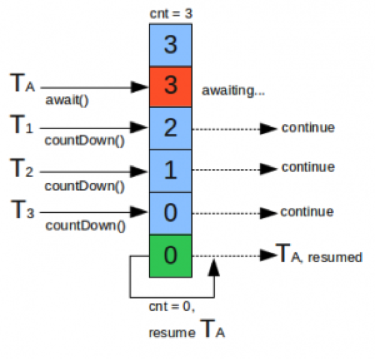

# 并发

# 1 概述

JDK 5 通过 JSR-166（由 Doug Lea 主导）对 Java 线程类库做了大量的扩展，其中线程池就是 JDK 5 的新特性之一。除了线程池之外，还有很多多线程相关的内容，为多线程的编程带来了极大便利。为了编写高效稳定可靠的多线程程序，这部分内容显得尤为重要。

这些新特性全部位于 `java.util.concurrent` 包及其子包 `java.util.concurrent.atomic`、`java.util.concurrent.locks` 下面，里面包含数目众多的接口和类。此后的每个 JDK 版本都在持续扩充这个包，例如 JDK 7 的 `ForkJoinPool`、JDK 8 的 `CompletableFuture`、JDK 21 的虚拟线程执行器等，详见第 11 章。

# 2 线程池

线程池的基本思想还是一种**对象池**的思想，开辟一块内存空间，里面存放了众多（未死亡）的线程，池中线程执行调度由池管理器来处理。当有任务时，从池中取一个线程，执行完成后线程归还到池中，这样可以避免反复创建线程对象所带来的性能开销，节省了系统的资源。

JDK 5 的线程池分好多种：固定尺寸的线程池、单任务线程池、可变尺寸的线程池、延迟线程池等。

在使用线程池之前，必须知道如何去创建一个线程池。需要了解的是 `java.util.concurrent.Executors` 类的 API，这个类提供了大量创建线程池的静态方法。

## 2.1 固定大小的线程池

```java
public class Test {
    public static void main(String[] args) {
        // 创建一个可重用固定线程数的线程池
        ExecutorService pool = Executors.newFixedThreadPool(2);
        // 将任务提交到池中执行
        pool.execute(new MyRunnable("TaskA"));
        pool.execute(new MyRunnable("TaskB"));
        pool.execute(new MyRunnable("TaskC"));
        pool.execute(new MyRunnable("TaskD"));
        pool.execute(new MyRunnable("TaskE"));
        // 启动有序关闭：执行以前提交的任务，但不接受新任务。如果已经关闭，则调用没有其他作用
        pool.shutdown();
    }
}

class MyRunnable implements Runnable {

    private final String name;

    public MyRunnable(String name) {
        this.name = name;
    }

    @Override
    public void run() {
        System.out.println(Thread.currentThread().getName() + " 正在执行任务：" + name);
    }
}
```

打印结果：

```text
pool-1-thread-1 正在执行任务：TaskA
pool-1-thread-2 正在执行任务：TaskB
pool-1-thread-1 正在执行任务：TaskC
pool-1-thread-1 正在执行任务：TaskE
pool-1-thread-2 正在执行任务：TaskD
```

可见，5 个任务只由 2 个线程轮流执行，并且线程池并不保证按照任务提交的顺序来执行。

> 注意：很多资料中会创建 `Thread` 对象再交给 `pool.execute()`，这是一种误导性的写法。`Thread` 实现了 `Runnable` 接口，线程池只会调用它的 `run()` 方法，这个 `Thread` 对象本身从来不会被启动，它的名字、优先级等属性也都不起作用（见 2.7 节）。提交任务时直接传入 `Runnable` 即可。

`Executors.newFixedThreadPool()` 创建一个可重用固定线程数的线程池，以共享的无界队列方式来运行这些线程。在任意点，最多有 `nThreads` 个线程会处于处理任务的活动状态。如果在所有线程处于活动状态时提交附加任务，则在有可用线程之前，附加任务将在队列中等待。如果在关闭前的执行期间由于失败而导致任何线程终止，那么一个新线程将代替它执行后续的任务（如果需要）。在线程池被显式地关闭之前，池中的线程将一直存在。

## 2.2 单任务线程池

如果在上例中使用

```java
ExecutorService pool = Executors.newSingleThreadExecutor();
```

来创建线程池，即为单任务线程池。

执行效果类似，不同的是，单任务线程池可保证顺序地执行各个任务，并且在任意给定的时间不会有多个线程是活动的。与等效的 `newFixedThreadPool(1)` 不同，此方法返回的执行器经过了包装，保证不能被重新配置为使用更多的线程。

## 2.3 可变尺寸的线程池

如用

```java
ExecutorService pool = Executors.newCachedThreadPool();
```

来创建线程池，即为可变尺寸的线程池。

该方法创建一个可根据需要创建新线程的线程池，但是在以前构造的线程可用时将重用它们。对于执行很多短期异步任务的程序而言，这些线程池通常可提高程序性能。调用 `execute` 将重用以前构造的线程（如果线程可用）。如果现有线程没有可用的，则创建一个新线程并添加到池中。终止并从缓存中移除那些已有 60 秒钟未被使用的线程。因此，长时间保持空闲的线程池不会使用任何资源。注意，可以使用 `ThreadPoolExecutor` 构造方法创建具有类似属性但细节不同（例如超时参数）的线程池。

## 2.4 可调度线程池

可调度线程池可安排任务在给定延迟后运行或者定期地执行。

```java
public class Test {
    public static void main(String[] args) {
        // 创建一个线程池，它可安排在给定延迟后运行命令或者定期地执行
        // 注意，返回的是 ScheduledExecutorService 接口，而非 ExecutorService，ScheduledExecutorService 是 ExecutorService 的子接口
        ScheduledExecutorService pool = Executors.newScheduledThreadPool(2);

        // 立即执行
        pool.execute(new MyRunnable("TaskA"));
        // 延迟执行：使 TaskB 延迟 2 秒再执行
        pool.schedule(new MyRunnable("TaskB"), 2000, TimeUnit.MILLISECONDS);
        // 固定频率：使 TaskC 延迟 2 秒执行，然后每隔 5 秒执行一次
        pool.scheduleAtFixedRate(new MyRunnable("TaskC"), 2000, 5000, TimeUnit.MILLISECONDS);
        // 固定延迟：使 TaskD 延迟 2 秒执行，然后在每一次执行结束和下一次执行开始之间都间隔 5 秒
        pool.scheduleWithFixedDelay(new MyRunnable("TaskD"), 2000, 5000, TimeUnit.MILLISECONDS);
        // 如果此时关闭线程池，周期性任务默认会被取消，不再执行（单次延迟任务默认仍会执行）
        // pool.shutdown();
    }
}
```

`MyRunnable` 与 2.1 节相同。打印结果如下：

```text
pool-1-thread-1 正在执行任务：TaskA
pool-1-thread-1 正在执行任务：TaskB
pool-1-thread-2 正在执行任务：TaskC
pool-1-thread-1 正在执行任务：TaskD
pool-1-thread-2 正在执行任务：TaskC
pool-1-thread-1 正在执行任务：TaskD
pool-1-thread-2 正在执行任务：TaskC
pool-1-thread-1 正在执行任务：TaskD
……
```

需要注意：周期任务的某一次执行如果抛出了异常，后续的执行都会被**静默取消**，而且异常不会打印出来。因此周期任务内部最好自行捕获并记录所有异常。

## 2.5 可调度单任务线程池

```java
ScheduledExecutorService pool = Executors.newSingleThreadScheduledExecutor();
```

创建的即为单任务可调度线程池，使用方法与上例类似。

## 2.6 自定义线程池

线程池类 `java.util.concurrent.ThreadPoolExecutor` 参数最全的构造方法为：

```java
ThreadPoolExecutor(
    int corePoolSize,
    int maximumPoolSize,
    long keepAliveTime,
    TimeUnit unit,
    BlockingQueue<Runnable> workQueue,
    ThreadFactory threadFactory,
    RejectedExecutionHandler handler)
```

参数意义如下：

- `corePoolSize`：核心线程数。核心线程默认不会因空闲而被回收（除非调用了 `allowCoreThreadTimeOut(true)`）。
- `maximumPoolSize`：线程池允许的最大线程数。
- `keepAliveTime`：超出核心线程数的那部分线程所允许的最长空闲时间。
- `unit`：`keepAliveTime` 的时间单位。
- `workQueue`：线程池所使用的任务队列。
- `threadFactory`：创建新线程的工厂（见 2.7 节），可省略。
- `handler`：线程池对拒绝任务的处理策略，可省略，默认为 `AbortPolicy`。

一个任务通过 `execute(Runnable)` 方法被添加到线程池，任务就是一个 `Runnable` 类型的对象，任务的执行方法就是 `Runnable` 类型对象的 `run()` 方法。

当一个任务通过 `execute(Runnable)` 方法欲添加到线程池时：

- 如果此时线程池中的线程数量小于 `corePoolSize`，即使线程池中的线程都处于空闲状态，也要创建新的线程来处理被添加的任务。
- 如果此时线程池中的线程数量大于或等于 `corePoolSize`，但是任务队列 `workQueue` 未满，那么任务被放入队列。
- 如果此时任务队列 `workQueue` 已满，并且线程池中的线程数量小于 `maximumPoolSize`，则创建新的线程来处理被添加的任务。
- 如果此时任务队列 `workQueue` 已满，并且线程池中的线程数量等于 `maximumPoolSize`，那么通过 `handler` 所指定的策略来处理此任务。

也就是说，处理任务的优先级为：核心线程 `corePoolSize`、任务队列 `workQueue`、最大线程 `maximumPoolSize`，如果三者都满了，使用 `handler` 处理被拒绝的任务。

当线程池中的线程数量大于 `corePoolSize` 时，如果某线程空闲时间超过 `keepAliveTime`，线程将被终止。这样，线程池可以动态地调整池中的线程数。

排队有三种通用策略：

- **直接提交**

  工作队列的一个很好的默认选择是 `SynchronousQueue`，它将任务直接提交给线程而不保存它们。在此，如果不存在可用于立即运行任务的线程，则试图把任务加入队列将失败，因此会构造一个新的线程。此策略可以避免在处理可能具有内部依赖性的请求集合时出现锁定。直接提交通常要求无界的 `maximumPoolSize` 以避免拒绝新提交的任务。当任务以超过线程池所能处理的平均速度连续到达时，此策略允许线程数无限增长。`newCachedThreadPool()` 使用的就是这种策略。

- **无界队列**

  使用无界队列（例如，不指定容量的 `LinkedBlockingQueue`）将导致在所有 `corePoolSize` 线程都忙的情况下将新任务加入队列。这样，创建的线程就不会超过 `corePoolSize`。（因此，`maximumPoolSize` 的值也就无效了。）当每个任务完全独立于其他任务，即任务执行互不影响时，适合于使用无界队列；例如，在 Web 服务器中。这种排队可用于处理瞬态突发请求，当任务以超过线程池所能处理的平均速度连续到达时，此策略允许工作队列无限增长。`newFixedThreadPool()` 和 `newSingleThreadExecutor()` 使用的就是这种策略。

- **有界队列**

  当使用有限的 `maximumPoolSize` 时，有界队列（如 `ArrayBlockingQueue`）有助于防止资源耗尽，但是可能较难调整和控制。队列大小和最大池大小可能需要相互折衷：使用大型队列和小型池可以最大限度地降低 CPU 使用率、操作系统资源和上下文切换开销，但是可能导致人为地降低吞吐量。如果任务频繁阻塞（例如，如果它们是 I/O 密集型的），则系统可能能够为更多的线程安排时间。使用小型队列通常要求较大的池大小，CPU 使用率较高，但是可能遇到不可接受的调度开销，这样也会降低吞吐量。

`unit` 可选的参数为 `java.util.concurrent.TimeUnit` 中的几个枚举值：

- `NANOSECONDS`：纳秒，千分之一微秒
- `MICROSECONDS`：微秒，千分之一毫秒
- `MILLISECONDS`：毫秒，千分之一秒
- `SECONDS`：秒
- `MINUTES`：分钟
- `HOURS`：小时
- `DAYS`：天

`workQueue` 常用的有：`ArrayBlockingQueue`（有界数组队列）、`LinkedBlockingQueue`（链表队列，可指定容量）、`SynchronousQueue`（不存储元素的直接移交队列）、`PriorityBlockingQueue`（优先级队列）。

`handler` 有四个选择：

- `ThreadPoolExecutor.AbortPolicy`：默认策略，直接抛出 `RejectedExecutionException`。
- `ThreadPoolExecutor.CallerRunsPolicy`：直接在 `execute` 方法的调用线程中运行被拒绝的任务；如果执行程序已关闭，则会丢弃该任务。这种策略可以对任务提交方形成“反压”。
- `ThreadPoolExecutor.DiscardOldestPolicy`：放弃最旧的未处理任务，然后重试 `execute`；如果执行程序已关闭，则会丢弃该任务。
- `ThreadPoolExecutor.DiscardPolicy`：静默丢弃被拒绝的任务。

此外，也可以实现 `RejectedExecutionHandler` 接口来自定义拒绝策略，例如记录日志、持久化任务等。

此类提供 `protected` 可重写的 `beforeExecute(Thread, Runnable)` 和 `afterExecute(Runnable, Throwable)` 方法，这两种方法分别在执行每个任务之前和之后调用。它们可用于操纵执行环境；例如，重新初始化 `ThreadLocal`、搜集统计信息或添加日志条目。此外，还可以重写方法 `terminated()` 来执行 `Executor` 完全终止后需要完成的所有特殊处理。

`ThreadPoolExecutor` 可以使我们根据实际需要创建合适的线程池，使程序员编写出更有弹性的代码。

实例：

```java
public class Test {

    private static final int QUEUE_DEEP = 4;

    public void createThreadPool() {
        /*
         * 创建线程池，核心线程数为 2，最大线程数为 4，非核心线程的空闲时间为 3 秒，
         * 使用队列深度为 4 的有界队列。拒绝策略为 DiscardOldestPolicy：如果执行程序尚未关闭，
         * 则位于工作队列头部的任务将被删除，然后重试执行程序（如果再次失败，则重复此过程）。
         * 下面的代码中已经根据队列深度对任务加载进行了控制。
         */
        ThreadPoolExecutor tpe = new ThreadPoolExecutor(2, 4, 3, TimeUnit.SECONDS,
                new ArrayBlockingQueue<>(QUEUE_DEEP), new ThreadPoolExecutor.DiscardOldestPolicy());

        // 向线程池中添加 10 个任务
        for (int i = 0; i < 10; i++) {
            try {
                Thread.sleep(1);
                while (tpe.getQueue().size() >= QUEUE_DEEP) {
                    System.out.println("队列已满，等3秒再添加任务");
                    Thread.sleep(3000);
                }
            } catch (InterruptedException e) {
                Thread.currentThread().interrupt();
                return;
            }
            System.out.println("put i:" + i);
            tpe.execute(new Task(i));
        }

        tpe.shutdown();
    }

    public static void main(String[] args) {
        new Test().createThreadPool();
    }

    static class Task implements Runnable {
        private final int index;

        public Task(int index) {
            this.index = index;
        }

        @Override
        public void run() {
            System.out.println(Thread.currentThread() + " index:" + index);
            try {
                Thread.sleep(3000);
            } catch (InterruptedException e) {
                Thread.currentThread().interrupt();
            }
        }
    }
}
```

打印结果如下：

```text
put i:0
put i:1
Thread[pool-1-thread-1,5,main] index:0
Thread[pool-1-thread-2,5,main] index:1
put i:2
put i:3
put i:4
put i:5
队列已满，等3秒再添加任务
Thread[pool-1-thread-1,5,main] index:2
Thread[pool-1-thread-2,5,main] index:3
put i:6
put i:7
队列已满，等3秒再添加任务
Thread[pool-1-thread-1,5,main] index:4
Thread[pool-1-thread-2,5,main] index:5
put i:8
put i:9
Thread[pool-1-thread-1,5,main] index:6
Thread[pool-1-thread-2,5,main] index:7
Thread[pool-1-thread-1,5,main] index:8
Thread[pool-1-thread-2,5,main] index:9
```

由于提交方在队列满时主动等待，队列始终没有溢出，所以线程数一直保持在核心线程数 2，没有扩展到最大线程数 4。

## 2.7 ThreadFactory

以上创建线程池的方法都可以接受一个 `ThreadFactory` 参数，它是按需创建新线程的对象。使用线程工厂就无需再手工编写对 `new Thread` 的调用了，从而允许应用程序使用特殊的线程子类、属性等，也可以初始化线程的名称、守护状态、优先级、`ThreadGroup` 等等。

```java
public class Test {

    public static void main(String[] args) {
        ExecutorService pool = Executors.newCachedThreadPool();

        // 为线程实例命名
        Thread thread1 = new Thread(new MyRunnable(), "ThreadA");
        Thread thread2 = new Thread(new MyRunnable(), "ThreadB");
        pool.execute(thread1);
        pool.execute(thread2);
        pool.shutdown();
    }
}

class MyRunnable implements Runnable {

    @Override
    public void run() { // 打印当前线程的名字
        System.out.println("线程名字：" + Thread.currentThread().getName());
    }
}
```

打印结果：

```text
线程名字：pool-1-thread-1
线程名字：pool-1-thread-2
```

可见，我们创建线程实例时给线程的命名并没有生效，这是为什么呢？

原因在于，`thread1` 和 `thread2` 从来没有被启动过，线程池只是把它们当作普通的 `Runnable` 任务，调用了它们的 `run()` 方法；真正执行任务的是线程池自己创建的工作线程。如果我们没有传入 `ThreadFactory`，线程池会使用 `Executors.defaultThreadFactory()`，它创建的都是非守护、优先级为 `NORM_PRIORITY` 的线程，名称格式为 `pool-N-thread-M`，其中 `N` 是此工厂的序列号，`M` 是此工厂所创建线程的序列号。

如果想控制工作线程的名字，就需要传入自己的 `ThreadFactory`，在 `newThread()` 方法中可以设置新建线程的参数，也可以进行其他操作。

```java
public class Test {

    public static void main(String[] args) {
        // 传入自定义的 ThreadFactory
        ExecutorService pool = Executors.newCachedThreadPool(new MyThreadFactory());
        pool.execute(new MyRunnable());
        pool.execute(new MyRunnable());
        pool.shutdown();
    }
}

class MyThreadFactory implements ThreadFactory {

    @Override
    public Thread newThread(Runnable r) {
        Thread thread = new Thread(r);
        // 设置线程的新名字
        thread.setName("newThreadName");
        return thread;
    }
}
```

打印结果：

```text
线程名字：newThreadName
线程名字：newThreadName
```

现在，线程使用的是我们在 `MyThreadFactory` 中设定的新名称。

实际项目中，线程名通常带上业务前缀和递增序号，方便在日志和线程栈中定位问题。JDK 21 起可以直接用 `Thread.Builder` 生成这样的工厂，不必自己实现：

```java
ThreadFactory factory = Thread.ofPlatform().name("order-worker-", 0).factory();
ExecutorService pool = Executors.newFixedThreadPool(4, factory);
// 工作线程依次命名为 order-worker-0、order-worker-1……
```

在更早的版本中，可以使用 Guava 的 `ThreadFactoryBuilder` 或者在自定义工厂里用 `AtomicInteger` 计数实现同样的效果。

## 2.8 使用建议

- **生产环境慎用 `Executors` 的工厂方法**：`newFixedThreadPool()` 和 `newSingleThreadExecutor()` 使用的 `LinkedBlockingQueue` 容量为 `Integer.MAX_VALUE`，任务堆积时可能导致 OOM；`newCachedThreadPool()` 和 `newScheduledThreadPool()` 的最大线程数为 `Integer.MAX_VALUE`，可能创建过多线程。《阿里巴巴 Java 开发手册》明确要求通过 `ThreadPoolExecutor` 手动创建线程池，以便明确队列容量和拒绝策略。
- **为线程池命名**：通过 `ThreadFactory` 指定有意义的线程名。
- **注意异常处理**：`execute()` 提交的任务抛出异常时，异常会打印到标准错误并导致工作线程被替换；`submit()` 提交的任务抛出的异常会被封装进返回的 `Future`，如果不调用 `get()`，异常会被“吞掉”。
- **正确关闭线程池**：`shutdown()` 不再接受新任务，但会执行完已提交的任务；`shutdownNow()` 会尝试中断正在执行的任务，并返回尚未执行的任务列表。通常在 `shutdown()` 之后调用 `awaitTermination()` 等待结束。JDK 19 起 `ExecutorService` 实现了 `AutoCloseable`，可以直接用 try-with-resources，`close()` 会关闭线程池并等待所有任务完成。
- **合理设置线程数**：CPU 密集型任务一般设为 CPU 核数左右；I/O 密集型任务可以更多。JDK 21 起，大量阻塞 I/O 的任务可以改用 `Executors.newVirtualThreadPerTaskExecutor()`，每个任务一个虚拟线程，不必再为线程池大小纠结。

# 3 BlockingQueue

上例中提到的 `ArrayBlockingQueue` 即是 `BlockingQueue` 接口的实现类。`java.util.concurrent.BlockingQueue` 继承了 `java.util.Queue` 接口。

**阻塞队列**的概念是，一个指定长度的队列，如果队列满了，添加新元素的操作会被阻塞等待，直到有空位为止。同样，当队列为空时，请求队列元素的操作同样会阻塞等待，直到有可用元素为止。

有了这样的功能，就为多线程的排队等候模型（如生产者－消费者模型）的实现开辟了便捷通道。

```java
public class Test {
    public static void main(String[] args) throws InterruptedException {
        BlockingQueue<Integer> bqueue = new ArrayBlockingQueue<>(10);
        for (int i = 0; i < 20; i++) {
            // 将指定元素添加到此队列中，如果没有可用空间，将一直等待
            bqueue.put(i);
            System.out.println("向阻塞队列中添加了元素:" + i);
        }

        System.out.println("程序到此运行结束，即将退出----");
    }
}
```

打印结果：

```text
向阻塞队列中添加了元素:0
向阻塞队列中添加了元素:1
向阻塞队列中添加了元素:2
向阻塞队列中添加了元素:3
向阻塞队列中添加了元素:4
向阻塞队列中添加了元素:5
向阻塞队列中添加了元素:6
向阻塞队列中添加了元素:7
向阻塞队列中添加了元素:8
向阻塞队列中添加了元素:9
```

`BlockingQueue` 的容量为 10，存入第十个元素之后已满，所以存入第十一个元素时进入阻塞状态，等待有可用的空间。由于没有其他线程取出元素，程序会一直阻塞，最后一句也永远不会打印。

`BlockingQueue` 针对“队列满或空”的情况提供了四组不同行为的方法：

| 操作 | 抛出异常 | 返回特殊值 | 一直阻塞 | 超时等待 |
|------|----------|------------|----------|----------|
| 插入 | `add(e)` | `offer(e)` | `put(e)` | `offer(e, time, unit)` |
| 移除 | `remove()` | `poll()` | `take()` | `poll(time, unit)` |
| 检查 | `element()` | `peek()` | 无 | 无 |

常用的实现类有：

- `ArrayBlockingQueue`：基于数组的有界队列。
- `LinkedBlockingQueue`：基于链表的队列，不指定容量时为 `Integer.MAX_VALUE`。
- `PriorityBlockingQueue`：支持优先级排序的无界队列。
- `DelayQueue`：元素到期后才能被取出的延迟队列。
- `SynchronousQueue`：不存储元素，每个插入操作必须等待一个对应的移除操作。
- `LinkedTransferQueue`（JDK 7）：在 `SynchronousQueue` 和 `LinkedBlockingQueue` 的基础上增加了 `transfer()` 方法。

除了阻塞队列，还有 JDK 6 引入的阻塞双端队列 `java.util.concurrent.BlockingDeque` 接口（实现类为 `LinkedBlockingDeque`）。双端队列在头尾两端都可以插入和移除元素，因此既可以当作“先进先出”的队列使用，也可以当作“后入先出”的栈使用。

# 4 Callable 与 Future

`Callable` 与 `Future` 也是 JDK 5 为了更好地支持并发而加入的。`Callable` 是类似于 `Runnable` 的接口，实现 `Callable` 接口的类和实现 `Runnable` 的类都是可被其他线程执行的任务。

`Callable` 的接口定义如下：

```java
@FunctionalInterface
public interface Callable<V> {

    V call() throws Exception;

}
```

`Callable` 和 `Runnable` 的区别如下：

- `Callable` 定义的方法是 `call`，而 `Runnable` 定义的方法是 `run`。
- `Callable` 的 `call` 方法可以有返回值，而 `Runnable` 的 `run` 方法不能有返回值。
- `Callable` 的 `call` 方法可以抛出受检异常，而 `Runnable` 的 `run` 方法只能抛出非受检异常。

`Future` 表示异步计算的结果，它提供了检查计算是否完成的方法，以等待计算的完成，并检索计算的结果。`Future` 的 `cancel` 方法可以取消任务的执行，它有一个布尔参数：参数为 `true` 表示如果任务正在运行，则尝试中断执行任务的线程；参数为 `false` 表示允许正在运行的任务运行完成。`Future` 的 `get` 方法等待计算完成，获取计算结果。

```java
public class Test {

    public static class MyCallable implements Callable<String> {

        private final int flag;

        public MyCallable(int flag) {
            this.flag = flag;
        }

        @Override
        public String call() throws Exception {
            if (this.flag == 0) {
                return "flag = 0";
            }
            if (this.flag == 1) {
                try {
                    while (true) {
                        System.out.println("looping.");
                        Thread.sleep(2000);
                    }
                } catch (InterruptedException e) {
                    System.out.println("Interrupted");
                }
                return "false";
            } else {
                throw new Exception("Bad flag value!");
            }
        }
    }

    public static void main(String[] args) {
        // 定义 3 个 Callable 类型的任务
        MyCallable task1 = new MyCallable(0);
        MyCallable task2 = new MyCallable(1);
        MyCallable task3 = new MyCallable(2);

        // 创建一个执行任务的服务
        ExecutorService es = Executors.newFixedThreadPool(3);

        try {
            // 提交并执行任务，任务启动时返回了一个 Future 对象，
            // 如果想得到任务执行的结果或者是异常可对这个 Future 对象进行操作
            Future<String> future1 = es.submit(task1);

            // 获得第一个任务的结果，如果调用 get 方法，当前线程会等待任务执行完毕后才往下执行
            System.out.println("task1: " + future1.get());
            Future<String> future2 = es.submit(task2);

            // 等待 5 秒后，再停止第二个任务。因为第二个任务进行的是无限循环
            Thread.sleep(5000);
            System.out.println("task2 cancel: " + future2.cancel(true));

            // 获取第三个任务的输出，因为执行第三个任务会引起异常
            // 所以下面的语句将引起异常的抛出
            Future<String> future3 = es.submit(task3);
            System.out.println("task3: " + future3.get());
        } catch (Exception e) {
            System.out.println(e);
        }

        // 停止任务执行服务
        es.shutdownNow();
    }
}
```

打印结果：

```text
task1: flag = 0
looping.
looping.
looping.
Interrupted
task2 cancel: true
java.util.concurrent.ExecutionException: java.lang.Exception: Bad flag value!
```

可见，`call()` 中抛出的异常被封装成 `ExecutionException`，在调用 `get()` 时才抛出。

`Future` 最常用的实现类是 `FutureTask`，它同时实现了 `Runnable` 和 `Future`，因此既可以交给线程池执行，也可以直接交给 `new Thread(futureTask)` 执行。

`Future` 的局限在于只能通过阻塞的 `get()` 或轮询 `isDone()` 获取结果，无法注册回调，也不便于组合多个异步任务。JDK 8 引入的 `CompletableFuture` 解决了这些问题，可参见本系列的《CompletableFuture》一文。JDK 19 还为 `Future` 接口新增了几个便捷方法：

- `state()`：返回任务状态 `RUNNING`、`SUCCESS`、`FAILED` 或 `CANCELLED`。
- `resultNow()`：在确定任务已成功完成时直接获取结果，不需要处理受检异常。
- `exceptionNow()`：在确定任务已失败时直接获取异常。

# 5 Lock

## 5.1 synchronized 的不足

如果一个代码块被 `synchronized` 修饰了，当一个线程获取了对应的锁，并执行该代码块时，其他线程便只能一直等待，等待获取锁的线程释放锁，而这里获取锁的线程释放锁只会有两种情况：

- 获取锁的线程执行完了该代码块，然后线程释放对锁的占有；
- 线程执行发生异常，此时 JVM 会让线程自动释放锁。

那么如果这个获取锁的线程由于要等待 I/O 或者其他原因（比如调用 `sleep` 方法）被阻塞了，但是又没有释放锁，其他线程便只能等待，很影响程序执行效率。

因此就需要有一种机制可以不让等待的线程一直无期限地等待下去（比如只等待一定的时间或者能够响应中断），通过 `Lock` 就可以办到。

再举个例子：当有多个线程读写文件时，读操作和写操作会发生冲突，写操作和写操作会发生冲突，但是读操作和读操作不会发生冲突。

但是采用 `synchronized` 关键字来实现同步的话，就会导致一个问题：即使多个线程都只是进行读操作，当一个线程在进行读操作时，其他线程也只能等待，无法进行读操作。

因此就需要一种机制来使得多个线程都只是进行读操作时，线程之间不会发生冲突，通过 `Lock` 就可以办到。

另外，通过 `Lock` 可以知道线程有没有成功获取到锁，这个是 `synchronized` 无法办到的。

也就是说 `Lock` 提供了比 `synchronized` 更多的功能。但是要注意以下几点：

- `Lock` 不是 Java 语言内置的，`synchronized` 是 Java 语言的关键字，因此是内置特性。`Lock` 是一个接口，通过它的实现类可以实现同步访问；
- `Lock` 和 `synchronized` 有一点非常大的不同，采用 `synchronized` 不需要用户去手动释放锁，当 `synchronized` 方法或者 `synchronized` 代码块执行完之后，系统会自动让线程释放对锁的占用；而 `Lock` 则必须要用户去手动释放锁，如果没有主动释放锁，就有可能导致出现死锁现象。

在性能方面，早期 `synchronized` 是重量级锁，性能明显不如 `ReentrantLock`；但 JDK 6 对 `synchronized` 做了大量优化（轻量级锁、自适应自旋、锁消除、锁粗化等），两者在一般场景下的性能已相差不大。因此，**只有在确实需要 `Lock` 的额外功能时才使用它**，否则优先使用更简单、不会忘记释放的 `synchronized`。另外，JDK 21 引入虚拟线程时，`synchronized` 会钉住载体线程，一度推荐改用 `ReentrantLock`；JDK 24 的 JEP 491 已解决了这个问题。

Java 中专门提供了锁对象，利用锁可以方便地实现资源的封锁，用来控制对竞争资源的并发访问，这些内容主要集中在 `java.util.concurrent.locks` 包下面，里面有三个重要的接口 `Condition`、`Lock`、`ReadWriteLock`。

## 5.2 Lock 接口

`Lock` 实现提供了比使用 `synchronized` 方法和语句可获得的更广泛的锁定操作。此实现允许更灵活的结构，可以具有差别很大的属性，可以支持多个相关的 `Condition` 对象。

锁是控制多个线程对共享资源进行访问的工具。通常，锁提供了对共享资源的独占访问。一次只能有一个线程获得锁，对共享资源的所有访问都需要首先获得锁。不过，某些锁可能允许对共享资源并发访问，如 `ReadWriteLock` 的读取锁。

`synchronized` 方法或语句的使用提供了对与每个对象相关的隐式监视器锁的访问，但却强制所有锁获取和释放均要出现在一个块结构中：当获取了多个锁时，它们必须以相反的顺序释放，且必须在与所有锁被获取时相同的词法范围内释放所有锁。

虽然 `synchronized` 方法和语句的范围机制使得使用监视器锁编程方便了很多，而且还帮助避免了很多涉及到锁的常见编程错误，但有时也需要以更为灵活的方式使用锁。例如，某些遍历并发访问的数据结构的算法要求使用“hand-over-hand”或“chain locking”：获取节点 A 的锁，然后再获取节点 B 的锁，然后释放 A 并获取 C，然后释放 B 并获取 D，依此类推。`Lock` 接口的实现允许锁在不同的作用范围内获取和释放，并允许以任何顺序获取和释放多个锁，从而支持使用这种技术。

随着灵活性的增加，也带来了更多的责任。不使用块结构锁就失去了使用 `synchronized` 方法和语句时会出现的锁自动释放功能。在大多数情况下，应该使用以下语句：

```java
Lock l = ...;
l.lock();
try {
    // access the resource protected by this lock
} finally {
    l.unlock();
}
```

锁定和取消锁定出现在不同作用范围中时，必须谨慎地确保保持锁定时所执行的所有代码用 `try-finally` 或 `try-catch` 加以保护，以确保在必要时释放锁。注意 `lock()` 要放在 `try` 之前：如果放在 `try` 内部且加锁失败抛出异常，`finally` 中的 `unlock()` 会因为当前线程并未持有锁而抛出 `IllegalMonitorStateException`。

`Lock` 实现提供了使用 `synchronized` 方法和语句所没有的其他功能，包括提供了一个非块结构的获取锁尝试（`tryLock()`）、一个获取可中断锁的尝试（`lockInterruptibly()`）和一个获取超时失效锁的尝试（`tryLock(long, TimeUnit)`）。

`Lock` 类还可以提供与隐式监视器锁完全不同的行为和语义，如保证排序、非重入用法或死锁检测。如果某个实现提供了这样特殊的语义，则该实现必须对这些语义加以记录。

注意，`Lock` 实例只是普通的对象，其本身可以在 `synchronized` 语句中作为目标使用。获取 `Lock` 实例的监视器锁与调用该实例的任何 `lock()` 方法没有特别的关系。为了避免混淆，建议除了在其自身的实现中之外，决不要以这种方式使用 `Lock` 实例。

```java
public class Test {

    // 锁为成员变量，所有线程必须使用同一个锁对象，这一点很重要
    // ReentrantLock 的意思是“可重入锁”，是最常用的 Lock 实现类
    private final Lock lock = new ReentrantLock();
    private int counter = 0;

    public void add() {
        // 获取锁
        lock.lock();
        try {
            System.out.println(Thread.currentThread().getName() + "获取锁");
            for (int i = 0; i < 10; i++) {
                counter = counter + i;
            }
            System.out.println("counter:" + counter);
        } finally {
            // 释放锁
            lock.unlock();
            System.out.println(Thread.currentThread().getName() + "释放锁");
        }
    }

    public static void main(String[] args) {
        Test test = new Test(); // JDK 8 起，lambda 中可以直接引用事实上的 final 变量
        Runnable r = test::add;

        Thread threadA = new Thread(r, "threadA");
        Thread threadB = new Thread(r, "threadB");
        threadA.start();
        threadB.start();
    }
}
```

打印结果：

```text
threadA获取锁
counter:45
threadA释放锁
threadB获取锁
counter:90
threadB释放锁
```

除了 `ReentrantLock`，`ReentrantReadWriteLock` 内部的读锁 `ReadLock` 和写锁 `WriteLock` 也实现了 `Lock` 接口。`ReentrantLock` 的构造方法可以传入 `true` 创建**公平锁**，等待时间最长的线程优先获得锁；默认是非公平锁，吞吐量更高。

`Lock` 接口除了 `lock()` 方法，还有以下几种获取锁的方法：

- `tryLock()` 方法：尝试获取锁，如果获取成功，则返回 `true`；如果获取失败（即锁已被其他线程获取），则返回 `false`。也就是说这个方法无论如何都会立即返回，在拿不到锁时不会一直在那等待。
- `tryLock(long time, TimeUnit unit)` 方法：和 `tryLock()` 方法是类似的，区别在于这个方法在拿不到锁时会等待一定的时间，在时间期限之内如果还拿不到锁，就返回 `false`；如果一开始拿到锁或者在等待期间内拿到了锁，则返回 `true`。等待期间可以响应中断。
- `lockInterruptibly()` 方法：获取锁，但在等待锁的过程中可以响应中断，抛出 `InterruptedException`。而 `synchronized` 和 `lock()` 在等锁时都不响应中断。

## 5.3 ReadWriteLock

在上例中使用了 `Lock` 接口以及对象，很优雅地控制了竞争资源的安全访问，但是这种锁不区分读写，称这种锁为普通锁。为了提高性能，Java 提供了读写锁，在读的地方使用读锁，在写的地方使用写锁，灵活控制，在一定程度上提高了程序的执行效率。

读写锁的规则是：**读读共享、读写互斥、写写互斥**。

```java
public class Test {

    private final ReadWriteLock lock = new ReentrantReadWriteLock();
    private int counter = 0;

    public void write() {
        // 获取写入锁，注意 writeLock() 只是返回锁对象，还要调用 lock() 才真正加锁
        lock.writeLock().lock();
        try {
            System.out.println(Thread.currentThread().getName() + "获取写入锁");
            for (int i = 0; i < 10; i++) {
                counter = counter + 1;
                System.out.println(Thread.currentThread().getName() + "修改数据，counter:" + counter);
                Thread.sleep(500);
            }
            System.out.println(Thread.currentThread().getName() + "写入完毕");
        } catch (InterruptedException e) {
            Thread.currentThread().interrupt();
        } finally {
            lock.writeLock().unlock();
        }
    }

    public void read() {
        // 获取读取锁
        lock.readLock().lock();
        try {
            System.out.println(Thread.currentThread().getName() + "获取读出锁");
            for (int i = 0; i < 10; i++) {
                System.out.println(Thread.currentThread().getName() + "第" + (i + 1) + "次读数据，counter:" + counter);
                Thread.sleep(200);
            }
            System.out.println(Thread.currentThread().getName() + "读取数据完毕");
        } catch (InterruptedException e) {
            Thread.currentThread().interrupt();
        } finally {
            lock.readLock().unlock();
        }
    }

    public static void main(String[] args) {
        Test test = new Test();

        Thread threadA = new Thread(test::write, "threadA");
        Thread threadB = new Thread(test::read, "threadB");
        Thread threadC = new Thread(test::read, "threadC");

        // 读与写同时开始
        threadA.start();
        threadB.start();
        threadC.start();
    }
}
```

某次运行的打印结果（写线程先拿到锁）：

```text
threadA获取写入锁
threadA修改数据，counter:1
threadA修改数据，counter:2
……
threadA修改数据，counter:10
threadA写入完毕
threadB获取读出锁
threadC获取读出锁
threadB第1次读数据，counter:10
threadC第1次读数据，counter:10
threadC第2次读数据，counter:10
threadB第2次读数据，counter:10
……
threadB第10次读数据，counter:10
threadC第10次读数据，counter:10
threadB读取数据完毕
threadC读取数据完毕
```

可见，写线程持有写锁期间，两个读线程都被阻塞；写锁释放后，两个读线程**同时**持有读锁，交替读取数据。如果是读线程先拿到读锁，那么另一个读线程也能立即进入，而写线程要等到所有读锁都释放后才能写入。

> 注意：很多资料中的示例只写了 `lock.writeLock();` 和 `lock.readLock();`，这两个方法只是返回对应的锁对象，并没有加锁，此时读写完全没有互斥，输出中会看到读写交错进行，这是一个常见的错误。

`ReentrantReadWriteLock` 还有以下特点：

- 支持**锁降级**：持有写锁的线程可以再获取读锁，然后释放写锁，从而降级为读锁；但不支持锁升级，持有读锁时再去获取写锁会导致死锁。
- 适合读多写少的场景；如果写操作频繁，读写锁的额外开销可能使它比普通锁更慢。

JDK 8 还引入了 `StampedLock`，它在读写锁的基础上增加了**乐观读**模式：读操作先不加锁，读完后通过“戳”（stamp）校验期间是否有写操作发生，没有则直接使用结果，有则再退化为加读锁重读。它在读多写少时性能更好，但不可重入、不支持 `Condition`，使用也更复杂。

# 6 Condition

`Condition` 将 `Object` 监视器方法（`wait`、`notify` 和 `notifyAll`）分解成截然不同的对象，以便通过将这些对象与任意 `Lock` 实现组合使用，为每个对象提供多个等待集（wait-set）。其中，`Lock` 替代了 `synchronized` 方法和语句的使用，`Condition` 替代了 `Object` 监视器方法的使用。

条件（也称为条件队列或条件变量）为线程提供了一种手段：在某个状态条件可能已经为真、并由另一个线程发出通知之前，一直挂起该线程（即让其“等待”）。因为访问此共享状态信息发生在不同的线程中，所以它必须受保护，因此要将某种形式的锁与该条件相关联。等待条件的关键特性是：以原子方式释放相关的锁，并挂起当前线程，就像 `Object.wait` 做的那样。

`Condition` 实例实质上被绑定到一个锁上。要为特定 `Lock` 实例获得 `Condition` 实例，使用其 `newCondition()` 方法。与 `wait`/`notify` 相比，`Condition` 的优势在于：一把锁可以创建多个 `Condition`，从而可以分别等待和唤醒不同条件上的线程；此外还提供了 `awaitNanos()`、`awaitUntil()`、`awaitUninterruptibly()` 等更丰富的等待方式。

来看一个实例：

```java
public class Test {
    public static void main(String[] args) {
        // 创建并发访问的账户
        MyCount myCount = new MyCount("66666666666", 10000);
        // 创建一个线程池
        ExecutorService pool = Executors.newFixedThreadPool(3);
        // 执行各个存取款任务
        pool.execute(new SaveTask("洪七公", myCount, 2000));
        pool.execute(new SaveTask("黄老邪", myCount, 3600));
        pool.execute(new DrawTask("欧阳锋", myCount, 2700));
        pool.execute(new SaveTask("老顽童", myCount, 600));
        pool.execute(new DrawTask("郭靖", myCount, 1300));
        pool.execute(new DrawTask("黄蓉", myCount, 800));
        // 关闭线程池
        pool.shutdown();
    }
}

/**
 * 存款任务
 */
class SaveTask implements Runnable {
    private final String name; // 操作人
    private final MyCount myCount; // 账户
    private final int x; // 存款金额

    SaveTask(String name, MyCount myCount, int x) {
        this.name = name;
        this.myCount = myCount;
        this.x = x;
    }

    @Override
    public void run() {
        myCount.saving(x, name);
    }
}

/**
 * 取款任务
 */
class DrawTask implements Runnable {
    private final String name; // 操作人
    private final MyCount myCount; // 账户
    private final int x; // 取款金额

    DrawTask(String name, MyCount myCount, int x) {
        this.name = name;
        this.myCount = myCount;
        this.x = x;
    }

    @Override
    public void run() {
        myCount.drawing(x, name);
    }
}

/**
 * 普通银行账户，不可透支
 */
class MyCount {
    private final String oid; // 账号
    private int cash; // 账户余额
    private final Lock lock = new ReentrantLock(); // 账户锁
    private final Condition enoughCash = lock.newCondition(); // 余额充足条件

    MyCount(String oid, int cash) {
        this.oid = oid;
        this.cash = cash;
    }

    public void saving(int x, String name) {
        lock.lock(); // 获取锁
        try {
            if (x > 0) {
                cash += x; // 存款
                System.out.println(name + "存款" + x + "，当前余额为" + cash);
            }
            enoughCash.signalAll(); // 唤醒所有等待取款的线程
        } finally {
            lock.unlock(); // 释放锁
        }
    }

    public void drawing(int x, String name) {
        lock.lock(); // 获取锁
        try {
            // 余额不足时阻塞取款操作，被唤醒后重新检查条件
            while (cash < x) {
                enoughCash.await();
            }
            cash -= x; // 取款
            System.out.println(name + "取款" + x + "，当前余额为" + cash);
        } catch (InterruptedException e) {
            Thread.currentThread().interrupt();
        } finally {
            lock.unlock(); // 释放锁
        }
    }
}
```

打印结果：

```text
洪七公存款2000，当前余额为12000
欧阳锋取款2700，当前余额为9300
郭靖取款1300，当前余额为8000
黄蓉取款800，当前余额为7200
黄老邪存款3600，当前余额为10800
老顽童存款600，当前余额为11400
```

注意 `drawing()` 中必须用 `while` 而不是 `if` 来判断条件：线程被唤醒后，余额可能已经被其他取款线程取走，必须重新检查；`await()` 同样可能出现虚假唤醒。如果用 `if`，被唤醒的线程会跳过取款逻辑，或者在余额不足时继续扣款。

# 7 原子量

所谓的原子量即对变量的操作是“原子的”，该操作不可再分，因此是线程安全的。

多个线程对单个变量操作也会引起一些问题。如前面提到的类似 `i++` 这样的“读－改－写”复合操作（在一个操作序列中，后一个操作依赖前一次操作的结果），在多线程并发处理的时候会出现问题，因为可能一个线程修改了变量，而另一个线程没有察觉到这样的变化。使用原子变量之后，则将一系列的复合操作合并为一个原子操作，从而避免这种问题（使用 `i.incrementAndGet()` 代替 `i++` 的操作）。

在 `java.util.concurrent.atomic` 包下提供了十几个原子类，大致分为几类：

- 基本类型：`AtomicInteger`、`AtomicLong`、`AtomicBoolean`。
- 数组：`AtomicIntegerArray`、`AtomicLongArray`、`AtomicReferenceArray`。
- 引用：`AtomicReference`，以及为了处理 ABA 问题引入的 `AtomicStampedReference`（带版本号）和 `AtomicMarkableReference`（带标记位）。
- 字段更新器：基于反射对 `volatile` 字段进行原子更新的工具类 `AtomicIntegerFieldUpdater`、`AtomicLongFieldUpdater`、`AtomicReferenceFieldUpdater`。
- 累加器（JDK 8）：`LongAdder`、`DoubleAdder`、`LongAccumulator`、`DoubleAccumulator`。

这些原子类通过无锁的方式实现线程安全，在竞争不激烈时性能明显优于加锁。并且 `java.util.concurrent` 内的并发集合、线程池、执行器、同步器的内部实现大量地依赖这些无锁原子操作，从而争取性能的最大化。

下面通过一个简单的例子看看：

```java
public class Test extends Thread {
    private final AtomicCounter atomicCounter;

    public Test(AtomicCounter atomicCounter) {
        this.atomicCounter = atomicCounter;
    }

    @Override
    public void run() {
        long sleepTime = (long) (Math.random() * 100); // 睡眠时间为随机值
        try {
            Thread.sleep(sleepTime);
        } catch (InterruptedException e) {
            Thread.currentThread().interrupt();
        }
        // 使计数器增 1
        atomicCounter.counterIncrement();
    }

    public static void main(String[] args) throws Exception {
        AtomicCounter atomicCounter = new AtomicCounter();

        for (int i = 0; i < 5000; i++) { // 开启 5000 个线程，共用一个 AtomicCounter 对象
            new Test(atomicCounter).start();
        }

        Thread.sleep(3000); // 简单起见用 sleep 等待所有线程结束，严谨的写法应逐个 join
        // 经过 5000 次的并发自增操作，打印结果应该为 5000
        System.out.println("counter=" + atomicCounter.getCounter());
    }
}

class AtomicCounter {
    // 原子更新的整型计数器
    private final AtomicInteger counter = new AtomicInteger(0);

    public int getCounter() {
        return counter.get();
    }

    public void counterIncrement() {
        for (;;) {
            // get()：获取当前值
            int current = counter.get();
            int next = current + 1;
            // compareAndSet()：如果当前值 == 预期值，则以原子方式将该值设置为给定的更新值
            // 如果成功，则返回 true；返回 false 表示实际值与预期值不相等
            // 无限循环，直到更新成功
            if (counter.compareAndSet(current, next)) {
                return;
            }
        }
    }
}
```

打印结果：

```text
counter=5000
```

跟预期的一样。

`AtomicCounter` 内的共享变量使用了 `Integer` 的原子类代替，在 `get()` 方法中不使用锁，也不用担心获取的过程中别的线程去改变 `counter` 的值，因为原子类内部的值是用 `volatile` 修饰的，可以看成 `volatile` 的泛化扩展，可见性能够保证。

而在 `counterIncrement()` 方法中揭示了使用原子类的重要技巧：**循环 + CAS**。

CAS（Compare-And-Swap）是一种实现无锁（lock-free）的非阻塞算法。CAS 有 3 个操作数：内存值 V、旧的预期值 A、要修改的新值 B。当且仅当预期值 A 和内存值 V 相同时，将内存值 V 修改为 B，否则什么都不做。它的语义是“我认为 V 的值应该为 A，如果是，那么将 V 的值更新为 B，否则不修改并告诉我 V 的值实际为多少”。

CAS 是一种乐观锁技术：当多个线程尝试使用 CAS 同时更新同一个变量时，只有其中一个线程能更新变量的值，而其它线程都失败，失败的线程并不会被挂起，而是被告知这次竞争中失败，并可以再次尝试。CAS 依赖处理器提供的原子指令，例如 x86 上的 `lock cmpxchg`，ARM 上的 LL/SC 指令对（`ldxr`/`stxr`）或 ARMv8.1 起提供的 `cas` 指令。这个技巧可以帮助我们实现复杂的非阻塞并发集合。

方法中的 `counter.compareAndSet(current, next)` 就是原子类使用的精髓。

使用 CAS 时需要注意两个问题：

- **ABA 问题**：一个值从 A 变成 B 又变回 A，CAS 会认为它没有变化。如果业务关心这一点，可以使用 `AtomicStampedReference` 为值附加版本号。
- **高竞争下的自旋开销**：大量线程同时 CAS 同一个变量时，失败重试会消耗大量 CPU。高并发计数场景可以改用 `LongAdder`，它把累加分散到多个单元（Cell）上，求和时再汇总，竞争大大降低。

再看另一个版本：

```java
public class Test extends Thread {
    private final AtomicCounter2 atomicCounter;

    public Test(AtomicCounter2 atomicCounter) {
        this.atomicCounter = atomicCounter;
    }

    @Override
    public void run() {
        long sleepTime = (long) (Math.random() * 100); // 睡眠时间为随机值
        try {
            Thread.sleep(sleepTime);
        } catch (InterruptedException e) {
            Thread.currentThread().interrupt();
        }
        // 使计数器增 1
        atomicCounter.counterIncrement();
    }

    public static void main(String[] args) throws Exception {
        AtomicCounter2 atomicCounter = new AtomicCounter2();

        for (int i = 0; i < 5000; i++) { // 开启 5000 个线程，共用一个 AtomicCounter2 对象
            new Test(atomicCounter).start();
        }

        Thread.sleep(3000);
        // 经过 5000 次的并发自增操作，打印结果应该为 5000
        System.out.println("counter=" + atomicCounter.getCounter());
    }
}

class AtomicCounter2 {
    // 计数器只是用 volatile 关键字修饰，没有使用原子量
    private volatile int counter;

    public int getCounter() {
        return counter;
    }

    public int counterIncrement() {
        // 自增操作在并发操作时会出现问题
        return counter++;
    }
}
```

第一次运行结果：

```text
counter=4970
```

第二次运行结果：

```text
counter=4968
```

可见，这次的计数器出现了并发问题。我们预期打印结果为 5000，实际上却小于 5000。

虽然是对同一个变量进行了修改，但是变量的自增操作不是原子的，依然会出现问题。虽然增量操作（`x++`）看上去类似一个单独操作，实际上它是一个由“读取－修改－写入”操作序列组成的组合操作，必须以原子方式执行，而 `volatile` 不能提供必需的原子性。

比如，现在 `counter` 的值为 2000，线程 1 对 `counter` 进行自增操作，执行第二步“修改”的时候，线程 2 也来取值并做修改，但是这时候线程 1 还没有把自增的结果存入 `counter` 变量，导致线程 1 与线程 2 取出的值都是 2000，两个线程执行自增操作后，本应增至 2002，但是实际上却只增加了 1，变成 2001。这就是为什么第二个例子打印的结果会小于 5000。

下面我们使用原子量的概念对第二个例子进行修改，使之达到预期的效果。

```java
class AtomicCounter2 {

    private volatile int counter;
    // AtomicIntegerFieldUpdater：基于反射的实用工具，可以对指定类的指定 volatile int 字段进行原子更新
    // 此类用于原子数据结构，该结构中同一节点的几个字段都独立受原子更新控制
    private static final AtomicIntegerFieldUpdater<AtomicCounter2> COUNTER_UPDATER =
            AtomicIntegerFieldUpdater.newUpdater(AtomicCounter2.class, "counter");

    public int getCounter() {
        return counter;
    }

    public int counterIncrement() {
        // 以原子方式将此更新器管理的给定对象的当前值加 1
        return COUNTER_UPDATER.getAndIncrement(this);
    }
}
```

打印结果：

```text
counter=5000
```

修改后的计数器内有个 `volatile` 的共享变量 `counter`，并且有个类变量 `COUNTER_UPDATER` 作为 `counter` 的更新器。与 `AtomicInteger` 相比，字段更新器的好处是不必为每个对象额外创建一个原子类实例，在对象数量很多时可以节省内存。`getAndIncrement(this)` 的语义和第一个例子中的“循环 + CAS”是一样的，只是通过反射找到要原子更新的变量 `counter`。（在 JDK 8 及以后，`getAndIncrement` 内部调用 `Unsafe.getAndAddInt`，HotSpot 会在 x86 上将其直接编译为一条 `lock xadd` 指令，而不是真正的 CAS 循环。）

JDK 9 引入的 `VarHandle`（JEP 193）提供了对字段、数组元素进行原子操作和指定内存屏障语义的标准 API，是字段更新器和 `sun.misc.Unsafe` 的现代替代品，JDK 内部的并发类也已大量改用 `VarHandle` 实现：

```java
class AtomicCounter3 {

    private volatile int counter;
    private static final VarHandle COUNTER;

    static {
        try {
            COUNTER = MethodHandles.lookup().findVarHandle(AtomicCounter3.class, "counter", int.class);
        } catch (ReflectiveOperationException e) {
            throw new ExceptionInInitializerError(e);
        }
    }

    public int counterIncrement() {
        return (int) COUNTER.getAndAdd(this, 1);
    }
}
```

特别需要注意：原子变量只能保证对一个变量的操作是原子的，如果有多个原子变量之间存在依赖的复合操作，也不可能是安全的。

另外一种情况是要将更多的复合操作作为一个原子操作，则需要使用 `synchronized` 或 `Lock` 将要作为原子操作的语句包围起来。只有涉及到可变的共享变量（如类的实例成员变量）才会涉及到同步，否则不必使用 `synchronized`。

# 8 CountDownLatch

`CountDownLatch` 是在 JDK 5 中被引入的，跟它一起被引入的并发工具类还有 `CyclicBarrier`、`Semaphore`、`ConcurrentHashMap` 和 `BlockingQueue`，它们都存在于 `java.util.concurrent` 包下。

`CountDownLatch` 这个类能够使一个线程等待其他线程完成各自的工作后再执行。有时候会有这样的需求，多个线程同时工作，然后其中几个可以随意并发执行，但有一个线程需要等其他线程工作结束后，才能开始。举个例子，开启多个线程分块下载一个大文件，每个线程只下载固定的一段，最后由另外一个线程来拼接所有的分段，那么这时候我们可以考虑使用 `CountDownLatch` 来控制并发。

`CountDownLatch` 是通过一个计数器来实现的，计数器的初始值为需要等待完成的任务数（通常就是工作线程的数量）。每当一个线程完成了自己的任务后，计数器的值就会减 1。当计数器值到达 0 时，它表示所有的线程已经完成了任务，然后在闭锁上等待的线程就可以恢复执行任务。



上图中，TA 线程调用了 `CountDownLatch` 的 `await()` 方法，进入阻塞状态，等待计数器归零；线程 T1、T2、T3 在合适的场景下分别调用了 `CountDownLatch` 的 `countDown()` 方法，使计数器减 1；当计数器归零后，TA 线程解除阻塞，继续运行。

比如，模拟一个炒菜的场景，炒一份番茄炒蛋。大酒店都是分工合作，流水线作业，假设需要四个人完成：三个配菜工，一个准备番茄，一个准备鸡蛋，一个准备调味品，还有一个主厨负责掌勺。巧妇难为无米之炊，显然，主厨必须等配菜工把材料备好后才能动手。

```java
public class CountDownLatchTest {

    static class AssistantCook implements Runnable {
        private final CountDownLatch countDownLatch;
        private final String name;

        public AssistantCook(CountDownLatch countDownLatch, String name) {
            this.countDownLatch = countDownLatch;
            this.name = name;
        }

        @Override
        public void run() {
            try {
                Thread.sleep(ThreadLocalRandom.current().nextInt(1000)); // 模拟工作耗时
                System.out.println(name + "工作完毕");
            } catch (InterruptedException e) {
                Thread.currentThread().interrupt();
            } finally {
                countDownLatch.countDown(); // 计数器减 1，放在 finally 中保证一定执行
            }
        }
    }

    static class ChiefCook implements Runnable {
        private final CountDownLatch countDownLatch;
        private final String name;

        public ChiefCook(CountDownLatch countDownLatch, String name) {
            this.countDownLatch = countDownLatch;
            this.name = name;
        }

        @Override
        public void run() {
            try {
                System.out.println(name + "等待中……");
                countDownLatch.await(); // 等待计数器归零
                System.out.println(name + "开始炒菜");
                Thread.sleep(ThreadLocalRandom.current().nextInt(1000)); // 模拟工作耗时
                System.out.println(name + "已将菜炒好！");
            } catch (InterruptedException e) {
                Thread.currentThread().interrupt();
            }
        }
    }

    public static void main(String[] args) {

        CountDownLatch countDownLatch = new CountDownLatch(3); // 计数器初始值为 3

        ChiefCook chiefCook = new ChiefCook(countDownLatch, "主厨");
        AssistantCook tomatoCook = new AssistantCook(countDownLatch, "番茄配菜工");
        AssistantCook eggCook = new AssistantCook(countDownLatch, "鸡蛋配菜工");
        AssistantCook spicesCook = new AssistantCook(countDownLatch, "调料配菜工");

        ExecutorService pool = Executors.newFixedThreadPool(4);
        pool.submit(chiefCook);
        pool.submit(tomatoCook);
        pool.submit(eggCook);
        pool.submit(spicesCook);

        pool.shutdown();
    }
}
```

打印结果如下：

```text
主厨等待中……
番茄配菜工工作完毕
调料配菜工工作完毕
鸡蛋配菜工工作完毕
主厨开始炒菜
主厨已将菜炒好！
```

`CountDownLatch` 的作用与 `join` 方法很像，都可以实现某个线程等待其他线程完成后再进行后续操作的场景。但是，`CountDownLatch` 更加灵活，适用范围更广。比如，某个线程等待其他线程完成部分工作时即可继续运行，`join` 方法就无法胜任，而 `CountDownLatch` 通过计数器提供了更灵活的控制。另外，在使用线程池时我们根本拿不到工作线程的引用，也就无法 `join`。

使用时还需注意：

- `CountDownLatch` 的计数器只能使用一次，归零后无法重置；需要重复使用时应考虑 `CyclicBarrier` 或 `Phaser`。
- 建议使用带超时的 `await(long timeout, TimeUnit unit)`，避免某个工作线程异常退出、没有调用 `countDown()` 时，等待线程永远阻塞。

# 9 CyclicBarrier

`CyclicBarrier` 的字面意思是可循环使用（Cyclic）的屏障（Barrier）。它要做的事情是，让一组线程到达一个屏障（也可以叫同步点）时被阻塞，直到最后一个线程到达屏障时，屏障才会开门，所有被屏障拦截的线程才会继续干活。

`CyclicBarrier` 默认的构造方法是 `CyclicBarrier(int parties)`，其参数表示屏障拦截的线程数量，每个线程调用 `await()` 方法告诉 `CyclicBarrier` 我已经到达了屏障，然后当前线程被阻塞。`await()` 方法每被调用一次，计数便会减少 1，并阻塞住当前线程。当计数减至 0 时，阻塞解除，所有在此 `CyclicBarrier` 上面阻塞的线程开始运行。在这之后，如果再次调用 `await()` 方法，计数就又会变成 N-1，新一轮重新开始，这便是 Cyclic 的含义所在。

`CyclicBarrier.await()` 方法带有返回值，表示当前线程到达屏障的序号：`getParties() - 1` 表示第一个到达，0 表示最后一个到达。和 `CountDownLatch` 一样，`CyclicBarrier` 同样可以在构造函数中设定总计数值。与 `CountDownLatch` 不同的是，`CyclicBarrier` 的构造函数还可以接受一个 `Runnable`，它会在屏障被打开时、由最后一个到达的线程执行。

如果某个等待中的线程被中断或等待超时，屏障会进入“损坏”（broken）状态，其他等待线程都会收到 `BrokenBarrierException`，此时需要调用 `reset()` 重置。

下面我们来模拟一个机场大巴发车的场景，每辆大巴载客 10 人，滚动发车，人满即走，每次发车后需要将本次发车的时间、乘客信息登记下来。

```java
public class CyclicBarrierTest {

    // DateTimeFormatter 是线程安全的；注意年份用 yyyy、24 小时制用 HH
    private static final DateTimeFormatter FORMATTER = DateTimeFormatter.ofPattern("yyyy-MM-dd HH:mm:ss");

    static int busCounter = 0;

    public static synchronized void departBus() {
        busCounter++;
    }

    private static String getTime() {
        return LocalDateTime.now().format(FORMATTER);
    }

    public static class Passenger implements Runnable {

        private final CyclicBarrier barrier;

        public Passenger(CyclicBarrier barrier) {
            this.barrier = barrier;
        }

        @Override
        public void run() {
            try {
                Thread.sleep(ThreadLocalRandom.current().nextInt(10000)); // 到达时间随机
                String arriveTime = getTime();
                int index = barrier.await();
                System.out.println("第" + (10 - index) + "位乘客于" + arriveTime + "到达");
            } catch (BrokenBarrierException | InterruptedException e) {
                e.printStackTrace();
            }
        }
    }

    public static class BusManager implements Runnable {

        @Override
        public void run() {
            departBus();
            System.out.println("******************");
            System.out.println("第" + busCounter + "辆大巴于" + getTime() + "发车");
            System.out.println("乘客到达时间如下：");
        }
    }

    public static void main(String[] args) {

        CyclicBarrier barrier = new CyclicBarrier(10, new BusManager());

        ExecutorService pool = Executors.newFixedThreadPool(10);
        for (int i = 0; i < 50; i++) { // 共 50 名乘客
            pool.submit(new Passenger(barrier));
        }
        pool.shutdown();
    }
}
```

打印结果如下：

```text
******************
第1辆大巴于2017-06-27 12:13:08发车
乘客到达时间如下：
第10位乘客于2017-06-27 12:13:08到达
第2位乘客于2017-06-27 12:13:00到达
第4位乘客于2017-06-27 12:13:03到达
第1位乘客于2017-06-27 12:12:58到达
第6位乘客于2017-06-27 12:13:04到达
第8位乘客于2017-06-27 12:13:07到达
第7位乘客于2017-06-27 12:13:06到达
第5位乘客于2017-06-27 12:13:03到达
第3位乘客于2017-06-27 12:13:02到达
第9位乘客于2017-06-27 12:13:07到达
******************
第2辆大巴于2017-06-27 12:13:17发车
乘客到达时间如下：
第10位乘客于2017-06-27 12:13:17到达
第2位乘客于2017-06-27 12:13:10到达
第4位乘客于2017-06-27 12:13:11到达
第6位乘客于2017-06-27 12:13:14到达
第8位乘客于2017-06-27 12:13:15到达
第1位乘客于2017-06-27 12:13:08到达
第9位乘客于2017-06-27 12:13:16到达
第7位乘客于2017-06-27 12:13:14到达
第5位乘客于2017-06-27 12:13:13到达
第3位乘客于2017-06-27 12:13:11到达
……（共 5 辆大巴，此处省略）
```

在很多场景下，`CountDownLatch` 与 `CyclicBarrier` 可以互换，都能实现类似的功能，细微的差别在于：

- `CountDownLatch` 适用于一个（或多个）线程等待一组工作线程的任务完毕才能继续执行的场景，计数器不可重用；
- `CyclicBarrier` 适用于一组线程互相等待、在一个时间点上达成一致才开始工作的场景，可以循环使用。

JDK 7 引入的 `Phaser` 是更灵活的可重用屏障，它支持在运行过程中动态增减参与者，并可以分多个阶段（phase）推进，可以看作 `CountDownLatch` 和 `CyclicBarrier` 的通用版本。此外还有 `Exchanger`，用于两个线程在同步点交换数据。

# 10 Semaphore

`Semaphore` 是一种基于计数的信号量。它可以设定一个阈值，基于此，多个线程竞争获取许可信号，做完自己的事情后归还，超过阈值后，线程申请许可信号将会被阻塞。

可以把 `Semaphore` 比作控制流量的红绿灯，比如某条马路要限制流量，只允许同时有一百辆车在这条路上行驶，其他的都必须在路口等待，所以前一百辆车会看到绿灯，可以开进这条马路，后面的车会看到红灯，不能驶入马路，但是如果前一百辆中有五辆车已经驶离马路，那么后面就允许有 5 辆车驶入马路。这个例子里说的车就是线程，驶入马路就表示线程在执行，离开马路就表示线程执行完成，看见红灯就表示线程被阻塞，不能执行。

`Semaphore` 可以用于做流量控制，特别是公用资源有限的应用场景，比如数据库连接池。假如有一个需求，要读取几万个文件的数据，因为都是 I/O 密集型任务，我们可以启动几十个线程并发地读取，但是如果读到内存后，还需要存储到数据库中，而数据库的连接数只有 10 个，这时我们必须控制只有 10 个线程同时获取数据库连接保存数据，否则会报错无法获取数据库连接。这个时候，我们就可以使用 `Semaphore` 来做流控。在使用虚拟线程时，线程数量不再受限，`Semaphore` 更是限制并发度的首选工具。

`Semaphore` 可以看做是拥有多把锁的同步机制，而 `synchronized` 关键字是只有一把锁（互斥锁）的同步机制。

**互斥锁**（mutex）是一把钥匙，一个人拿了就可进入一个房间，出来的时候把钥匙交给队列的第一个。一般的用法是用于串行化对关键代码的访问，保证这段代码不会被并行地运行。

`Semaphore` 是一间可以容纳 N 人的房间，如果人不满就可以进去，如果人满了，就要等待有人出来。当 N=1 的情况，称为**二元信号量**（binary semaphore），其功能类似于互斥锁。可见，互斥锁相当于一种特殊的 `Semaphore`。不过两者有一个重要区别：`Semaphore` 的许可没有“持有者”的概念，任何线程都可以调用 `release()`，它也不可重入。

下面使用 `Semaphore` 实现这样一个场景：某个美食店共有 20 个座位，在用餐高峰期肯定应对不了蜂拥而至的顾客，后到的顾客只能去拿号排队，等有人吃完离场了才能进去。

```java
public class SemaphoreTest {

    static class Eater implements Runnable {

        private final int index;
        private final Semaphore semaphore;

        public Eater(int index, Semaphore semaphore) {
            this.index = index;
            this.semaphore = semaphore;
        }

        @Override
        public void run() {
            try {
                int waiterCount = semaphore.getQueueLength();
                System.out.println("第" + index + "个客人到达，当前等待者共有" + waiterCount + "人");
                semaphore.acquire(); // 获取许可，有可能被阻塞
            } catch (InterruptedException e) {
                Thread.currentThread().interrupt();
                return; // 没有拿到许可，不能 release
            }
            try {
                System.out.println("第" + index + "个客人开始吃饭");
                Thread.sleep(ThreadLocalRandom.current().nextInt(10000));
                System.out.println("第" + index + "个客人吃完离场");
            } catch (InterruptedException e) {
                Thread.currentThread().interrupt();
            } finally {
                semaphore.release(); // 释放许可，放在 finally 中保证一定执行
            }
        }
    }

    public static void main(String[] args) {
        // 构造函数中的第二个参数代表是否为公平模式
        // 公平模式：按照申请的先后顺序（FIFO）发放许可
        // 非公平模式：新到达的线程可能“插队”，抢在已等待的线程之前拿到许可，吞吐量更高
        Semaphore semaphore = new Semaphore(20, true);

        ExecutorService pool = Executors.newCachedThreadPool();
        for (int i = 0; i < 100; i++) {
            pool.submit(new Eater(i + 1, semaphore));
        }
        pool.shutdown();
    }
}
```

打印结果如下：

```text
第1个客人到达，当前等待者共有0人
第1个客人开始吃饭
第4个客人到达，当前等待者共有0人
第4个客人开始吃饭
第3个客人到达，当前等待者共有0人
第3个客人开始吃饭
第2个客人到达，当前等待者共有0人
第2个客人开始吃饭
第7个客人到达，当前等待者共有0人
第8个客人到达，当前等待者共有0人
第8个客人开始吃饭
第6个客人到达，当前等待者共有0人
第9个客人到达，当前等待者共有0人
第9个客人开始吃饭
第10个客人到达，当前等待者共有0人
第10个客人开始吃饭
第11个客人到达，当前等待者共有0人
第11个客人开始吃饭
第12个客人到达，当前等待者共有0人
第12个客人开始吃饭
第5个客人到达，当前等待者共有0人
第5个客人开始吃饭
第13个客人到达，当前等待者共有0人
第13个客人开始吃饭
第6个客人开始吃饭
第7个客人开始吃饭
第15个客人到达，当前等待者共有0人
第14个客人到达，当前等待者共有0人
第14个客人开始吃饭
第15个客人开始吃饭
第17个客人到达，当前等待者共有0人
第16个客人到达，当前等待者共有0人
第16个客人开始吃饭
第18个客人到达，当前等待者共有0人
第18个客人开始吃饭
第17个客人开始吃饭
第19个客人到达，当前等待者共有0人
第19个客人开始吃饭
第20个客人到达，当前等待者共有0人
第20个客人开始吃饭
第22个客人到达，当前等待者共有0人
第23个客人到达，当前等待者共有0人
第21个客人到达，当前等待者共有0人
第24个客人到达，当前等待者共有2人
第25个客人到达，当前等待者共有4人
第26个客人到达，当前等待者共有5人
第27个客人到达，当前等待者共有6人
第28个客人到达，当前等待者共有7人
第29个客人到达，当前等待者共有8人
第30个客人到达，当前等待者共有9人
第31个客人到达，当前等待者共有10人
第32个客人到达，当前等待者共有11人
第33个客人到达，当前等待者共有12人
……
```

可见，前 20 位顾客到达后直接入座，从第 21 位开始就需要排队等待了。

# 11 新版本中的并发工具

本文最初基于 JDK 5/6 编写，此后 `java.util.concurrent` 包一直在持续演进，主要变化如下：

| 版本 | 变化 |
|------|------|
| Java 5 | JSR-166 引入 `java.util.concurrent`：线程池、`BlockingQueue`、`Callable`/`Future`、`Lock`/`Condition`、原子类、`CountDownLatch`、`CyclicBarrier`、`Semaphore`、`ConcurrentHashMap` 等 |
| Java 6 | 新增 `BlockingDeque`/`LinkedBlockingDeque`、`ConcurrentSkipListMap`/`ConcurrentSkipListSet`；`synchronized` 引入大量锁优化 |
| Java 7 | 新增 `ForkJoinPool`、`Phaser`、`LinkedTransferQueue`、`ThreadLocalRandom` |
| Java 8 | 新增 `CompletableFuture`、`StampedLock`、`LongAdder`/`LongAccumulator` 等累加器、`Executors.newWorkStealingPool()`；`ConcurrentHashMap` 重写为 CAS + `synchronized` 实现，不再使用分段锁 |
| Java 9 | 新增 `Flow` 响应式流接口、`VarHandle`（JEP 193）；`CompletableFuture` 增加 `orTimeout()`、`completeOnTimeout()` 等超时方法 |
| Java 19 | `ExecutorService` 实现 `AutoCloseable`；`Future` 新增 `state()`、`resultNow()`、`exceptionNow()` |
| Java 21 | 虚拟线程正式发布（JEP 444），新增 `Executors.newVirtualThreadPerTaskExecutor()`；结构化并发以预览特性形式引入（JEP 453） |
| Java 24 | `synchronized` 不再钉住虚拟线程（JEP 491） |
| Java 25 | 作用域值（Scoped Values）正式发布（JEP 506）；结构化并发仍为预览特性（JEP 505） |

其中对日常开发影响最大的有三点：

- **异步编排**：需要组合多个异步任务、注册回调时，用 `CompletableFuture` 代替手动 `Future.get()`。
- **虚拟线程**：大量阻塞 I/O 的任务可以使用 `Executors.newVirtualThreadPerTaskExecutor()`，每个任务一个虚拟线程，配合 `Semaphore` 限制对下游资源的并发访问，而不是靠线程池大小来限流。
- **结构化并发**：`StructuredTaskScope` 把一组相关的子任务当作一个整体来管理，任一子任务失败时可以自动取消其他子任务，避免线程泄漏。它截至 JDK 25 仍处于预览阶段，API 也还在调整中，生产环境使用前需留意其状态。

# 12 总结

- `java.util.concurrent` 是 Java 并发编程的核心工具包，自 JDK 5 引入以来持续演进。
- 线程池通过复用线程降低开销。理解 `ThreadPoolExecutor` 的核心线程数、任务队列、最大线程数、拒绝策略之间的关系是关键；生产环境应手动创建线程池，明确队列容量、拒绝策略和线程名称。
- 提交给线程池的应该是 `Runnable`/`Callable` 任务，而不是 `Thread` 对象。
- `BlockingQueue` 是实现生产者－消费者模型的基础，`put`/`take` 阻塞，`offer`/`poll` 可以设置超时。
- `Callable` 可以返回结果和抛出受检异常，`Future` 用于获取异步结果；更复杂的异步编排使用 `CompletableFuture`。
- `Lock` 提供了可中断、可超时、可尝试的加锁方式，以及公平锁和多个 `Condition`；必须在 `finally` 中释放。读写锁适合读多写少的场景，`StampedLock` 提供乐观读。
- `Condition` 的 `await()` 与 `wait()` 一样，必须放在条件循环中调用。
- 原子类基于 CAS 实现无锁的线程安全操作；高并发计数用 `LongAdder`，字段级原子操作可以用 `VarHandle`。
- `CountDownLatch` 用于等待一组任务完成且不可重用，`CyclicBarrier` 用于一组线程互相等待且可循环使用，`Semaphore` 用于限制同时访问资源的线程数。
