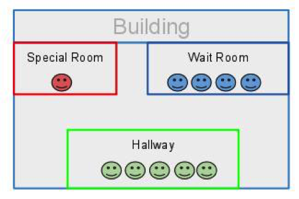
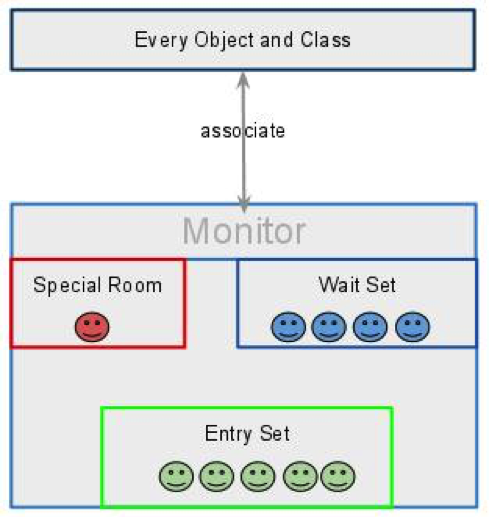
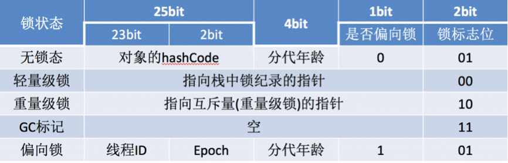
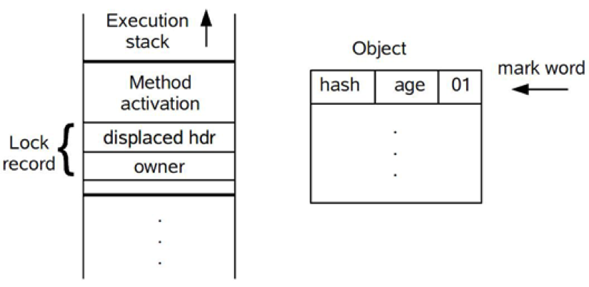
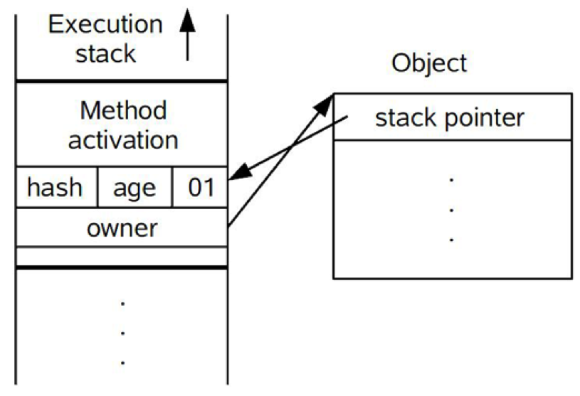
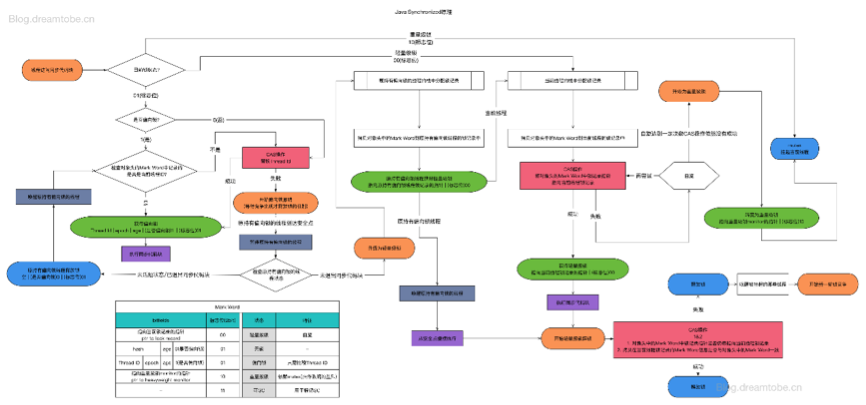
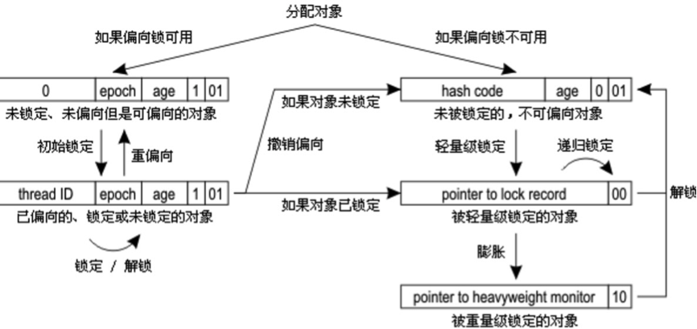

# 锁

# 1 重量级锁

内置锁是 JVM 提供的最便捷的线程同步工具。使用 `synchronized` 关键字修饰方法或代码块时，用到的锁称为 Java 的**内置锁**（intrinsic lock）或**监视器锁**（monitor lock）。

## 1.1 监视器模型

首先要明确的一点是，监视器（Monitor）模型不是 Java 特有的。它是并发程序设计领域的经典概念，由 Hoare 和 Brinch Hansen 在 20 世纪 70 年代提出，是为了实现线程同步而采取的技术手段，很多编程语言的并发设计中都有这个概念。

JVM 会为每个对象关联一个 `monitor`，同一时刻只能有一个线程获得该对象 `monitor` 的所有权。对于同步代码块，javac 会在编译时插入成对的字节码指令：

- **`monitorenter`**：插入到同步代码块开始处，线程执行到这里时尝试获取对象 `monitor` 的所有权。
- **`monitorexit`**：插入到同步代码块正常结束处和异常出口处，用于释放 `monitor` 的所有权。

例如下面这段代码：

```java
public void foo() {
    synchronized (this) {
        System.out.println("hello");
    }
}
```

用 `javap -c` 反编译后可以看到（省略了常量池索引）：

```text
 0: aload_0
 1: dup
 2: astore_1
 3: monitorenter
 4: getstatic     // Field java/lang/System.out:Ljava/io/PrintStream;
 7: ldc           // String hello
 9: invokevirtual // Method java/io/PrintStream.println:(Ljava/lang/String;)V
12: aload_1
13: monitorexit
14: goto          22
17: astore_2
18: aload_1
19: monitorexit
20: aload_2
21: athrow
22: return
```

可以看到有两条 `monitorexit`：第一条用于正常退出，第二条位于异常处理路径上，保证同步块抛出异常时锁也一定会被释放。

而对于 `synchronized` 修饰的方法，字节码中并不会出现 `monitorenter` 与 `monitorexit`，而是在方法的访问标志中设置 `ACC_SYNCHRONIZED`，JVM 在调用和返回该方法时隐式地完成加锁和解锁。

监视器可以看作一座经过特殊布置的建筑，这座建筑有一个特殊的房间，房间里通常包含一些数据和代码，但是一次只能有一个消费者使用这个房间。



当一个消费者（线程）想要使用这个房间时，首先必须到大厅（Entry Set）等待，调度程序会按照某种标准（例如 FIFO）从大厅中选择一个消费者（线程）进入特殊房间。如果这个线程因为某些原因被“挂起”（例如调用了 `wait()`），它会被调度程序安排到“等待房间”（Wait Set），一段时间之后再被重新分配到特殊房间。按照上面的线路，这座建筑包含三个房间，分别是“特殊房间”、“大厅”以及“等待房间”。



简单来说，监视器用来监视线程进入这个特殊房间，它确保同一时间只能有一个线程访问特殊房间中的数据和代码。

那么，锁和监视器有什么区别？

一言以蔽之，**锁为实现监视器提供必要的支持，监视器是比锁更高层次的抽象**。

锁是存在于对象内部的数据结构（体现在对象头的 Mark Word 中），监视器是一个独立的结构（在 HotSpot 中是 C++ 实现的 `ObjectMonitor`），但与对象关联。监视器负责操控线程，它维护着一个代码数据区和线程队列等，保证同一时刻只有一个线程访问代码数据区。

## 1.2 重量级锁的局限性

Java 的平台线程是映射到操作系统原生线程之上的，如果要阻塞或唤醒一个线程，就需要操作系统介入，在用户态与内核态之间切换。这种切换会消耗大量的系统资源：用户态与内核态都有各自专用的内存空间、专用的寄存器等，用户态切换至内核态需要向内核传递许多变量和参数，内核也需要保存好用户态在切换时的寄存器值、变量等，以便内核态调用结束后切换回用户态继续工作。

如果线程状态切换是一个高频操作，就会消耗很多 CPU 时间；此外，获取锁时挂起线程所消耗的时间往往比用户代码执行的时间还要长，这种同步策略显然是非常糟糕的。

早期的 `synchronized` 会直接让争用不到锁的线程进入阻塞状态，所以被称为“重量级锁”。

为此，JVM 的研究人员花费了大量精力实现各种锁优化技术，如**自适应自旋**（Adaptive Spinning）、**锁消除**（Lock Elimination）、**锁粗化**（Lock Coarsening）、**轻量级锁**（Lightweight Locking）、**偏向锁**（Biased Locking）等。这些技术大多在 JDK 6 中引入，都是为了在线程之间更高效地共享数据以及解决竞争问题，从而提高程序的执行效率。经过这些优化，`synchronized` 在大多数场景下已经不再“重”了。

# 2 自旋锁

## 2.1 实现原理

重量级锁的成本非常高，而且不容易优化。同时，虚拟机的开发团队也注意到，在许多应用中，共享数据的锁定状态只会持续很短的一段时间，为了这段时间去挂起和恢复线程并不值得。如果物理机器有一个以上的处理器，能让两个或以上的线程同时并行执行，我们就可以让后面请求锁的那个线程“稍等一会”，但不放弃处理器的执行时间，看看持有锁的线程是否很快就会释放锁。为了让线程等待，只需让线程执行一个忙循环（自旋），这项技术就是所谓的**自旋锁**。

对于这类锁的竞争而言，锁阻塞造成的线程切换时间与锁持有的时间相当，减少线程阻塞造成的线程切换，就能得到较大的性能提升。具体过程如下：

1. 当前线程竞争锁失败时，打算阻塞自己。
2. 不直接阻塞自己，而是自旋（空等待，比如一个空的有限 `for` 循环）一会。
3. 在自旋的同时重新竞争锁。
4. 如果自旋结束前获得了锁，那么锁获取成功；否则，自旋结束后阻塞自己。

如果在自旋的时间内，锁就被原持有者释放了，那么当前线程就不需要阻塞自己（也不需要在将来锁释放时被唤醒），从而减少了一次线程切换。

“锁的持有时间比较短”这一条件还可以放宽。实际上，只要锁竞争的时间比较短（比如线程 1 快要释放锁的时候，线程 2 才来竞争锁），就能够提高自旋获得锁的概率。这种情况也可能发生在锁持有时间较长、但竞争不激烈的场景中。

## 2.2 自适应自旋

自旋锁在 JDK 1.4.2 中就已经引入，只不过默认是关闭的，可以使用 `-XX:+UseSpinning` 参数开启，在 JDK 6 中改为默认开启。

但是，**自旋等待不能代替阻塞**：

- 在单核处理器上不存在真正的并行，当前线程不阻塞自己的话，锁的持有者就无法执行，锁永远不会被释放，此时不管自旋多久都是浪费；同理，如果线程多而处理器少，自旋也会造成不少无谓的浪费。
- 自旋要占用 CPU，如果是计算密集型任务，这一优化通常得不偿失，减少锁的使用才是更好的选择。

如果锁竞争的时间比较长，那么自旋通常不能获得锁，白白浪费了自旋占用的 CPU 时间。因此自旋等待的时间必须有一定的限度，如果自旋超过限定的次数仍然没有成功获得锁，就应当使用传统的方式挂起线程。自旋次数的默认值是 10 次，可以使用 `-XX:PreBlockSpin` 参数修改。JDK 7 起，`-XX:+UseSpinning` 和 `-XX:PreBlockSpin` 参数都已被移除，自旋完全由 JVM 自行控制。

JDK 6 中引入了自适应的自旋锁。自适应意味着自旋的时间不再固定，而是由前一次在同一个锁上的自旋时间及锁的拥有者的状态来决定。如果在同一个锁对象上，自旋等待刚刚成功获得过锁，并且持有锁的线程正在运行中，那么虚拟机就会认为这次自旋也很有可能再次成功，进而允许自旋等待持续相对更长的时间，比如 100 个循环。另一方面，如果对于某个锁，自旋很少成功获得过，那么以后获取这个锁时将可能省略掉自旋过程，以避免浪费处理器资源。

在 HotSpot 中，自适应自旋发生在重量级锁（`ObjectMonitor`）的加锁过程中：线程在真正挂起之前，会先自适应地自旋若干次尝试获取监视器。

# 3 轻量级锁

自旋锁的目标是降低线程切换的成本。如果锁竞争激烈，我们不得不依赖重量级锁，让竞争失败的线程阻塞；如果完全没有实际的锁竞争，那么申请重量级锁就是浪费。轻量级锁的目标是，减少无实际竞争情况下使用重量级锁产生的性能消耗，包括系统调用引起的内核态与用户态切换、线程阻塞造成的线程切换等。

顾名思义，轻量级锁是相对于重量级锁而言的。使用轻量级锁时，不需要申请互斥量，只需用 CAS 更新对象头的 Mark Word：如果更新成功，则轻量级锁获取成功，锁状态记录为轻量级锁；否则，说明已经有其他线程持有了这把锁，发生了锁竞争（不适合继续使用轻量级锁），接下来膨胀为重量级锁。

轻量级锁天然瞄准的是“多个线程交替使用锁、但不同时争抢”的场景。一旦出现真正的同时竞争，锁就会膨胀为重量级锁，竞争线程在重量级锁中先自适应自旋，自旋失败后再阻塞。

# 4 偏向锁

在没有实际竞争的情况下，还能够针对部分场景继续优化。如果不仅没有实际竞争，而且自始至终使用锁的线程都只有一个，那么维护轻量级锁也是浪费。偏向锁的目标是，减少无竞争且只有一个线程使用锁的情况下，使用轻量级锁产生的性能消耗。轻量级锁每次加锁、解锁都至少需要一次 CAS，而偏向锁只有初始化时需要一次 CAS。

“**偏向**”的意思是，偏向锁假定将来只有第一个申请锁的线程会使用锁（不会有其他线程再来申请锁），因此，只需要在 Mark Word 中用 CAS 记录持有者的线程 ID（本质上也是更新，但初始值为空）。如果记录成功，则偏向锁获取成功，锁状态记录为偏向锁，以后只要当前线程就是持有者，就可以零成本地直接获得锁；否则，说明有其他线程竞争，膨胀为轻量级锁。需要注意的是，**撤销偏向锁时需要进入安全点，安全点会导致 STW**（Stop The World），从而降低性能。

偏向锁无法使用自旋锁优化，因为一旦有其他线程申请锁，就破坏了偏向锁的假定。

偏向锁可以提高带有同步但无竞争的程序的性能，但它并不总是对程序运行有利。如果程序中大多数的锁总是被多个不同的线程访问，那么偏向模式就是多余的。在具体问题具体分析的前提下，有时使用参数 `-XX:-UseBiasedLocking` 禁用偏向锁反而可以提升性能。

> **偏向锁已成为历史**：JDK 15 通过 JEP 374 默认禁用并废弃了偏向锁，JDK 18 起相关代码被彻底移除，`-XX:+UseBiasedLocking` 参数也随之失效。原因主要有三点：
>
> - 偏向锁带来的收益主要来自 `Vector`、`Hashtable`、`StringBuffer` 等早期集合类，它们内部的每个操作都会加锁，而现代代码普遍使用不加锁的 `ArrayList`、`HashMap`、`StringBuilder` 或者并发容器；
> - 现代处理器上 CAS 的开销已经大幅降低，偏向锁相对轻量级锁的优势不再明显；
> - 偏向锁的撤销需要进入安全点，实现非常复杂，严重阻碍了 HotSpot 同步子系统的演进。
>
> 因此在 JDK 18 及以上版本中，锁的状态只剩下无锁、轻量级锁和重量级锁三种。本文仍然保留偏向锁的原理介绍，便于理解 JDK 8~17 的行为。

# 5 锁消除与锁粗化

**锁消除**是指虚拟机即时编译器在运行时，对一些代码上要求同步、但被检测到不可能存在共享数据竞争的锁进行消除。锁消除的主要判定依据来源于逃逸分析的数据支持：如果判断到一段代码中，堆上的所有数据都不会逃逸出去被其他线程访问到，那就可以把它们当作栈上数据对待，认为它们是线程私有的，同步加锁自然就无须进行。HotSpot 中的逃逸分析（`-XX:+DoEscapeAnalysis`）和锁消除（`-XX:+EliminateLocks`）都是默认开启的。

程序员自己应该很清楚哪里存在数据争用，怎么会在明知道不存在数据争用的情况下要求同步呢？答案是，有许多同步措施并不是程序员自己加入的，同步代码在 Java 程序中的普遍程度也许超过了我们的想象。

我们来看看下面的例子，这段非常简单的代码仅仅是输出三个字符串相加的结果，无论是从源码字面上还是程序语义上都没有同步：

```java
public String concatString(String s1, String s2, String s3) {
    return s1 + s2 + s3;
}
```

由于 `String` 是一个不可变的类，对字符串的连接操作总是通过生成新的 `String` 对象来进行的，因此 javac 会对字符串连接做自动优化：

- JDK 5 之前，会转化为 `StringBuffer` 对象的连续 `append()` 操作；
- JDK 5~8，会转化为 `StringBuilder` 对象的连续 `append()` 操作；
- JDK 9 起（JEP 280），会编译为一条 `invokedynamic` 指令，由 `StringConcatFactory` 在运行时生成最优的拼接策略。

以 JDK 5 之前的编译结果为例，上面的代码相当于：

```java
public String concatString(String s1, String s2, String s3) {
    StringBuffer sb = new StringBuffer();
    sb.append(s1);
    sb.append(s2);
    sb.append(s3);
    return sb.toString();
}
```

现在大家还认为这段代码没有涉及同步吗？每个 `StringBuffer.append()` 方法都是 `synchronized` 的，锁就是 `sb` 对象。虚拟机观察变量 `sb`，很快就会发现它的动态作用域被限制在 `concatString()` 方法内部，也就是说，`sb` 的所有引用永远不会“逃逸”到 `concatString()` 方法之外，其他线程无法访问到它。所以这里虽然有锁，但是可以被安全地消除掉，在即时编译之后，这段代码就会忽略掉所有的同步而直接执行。

虽然现在的 javac 已经不会再为字符串拼接生成 `StringBuffer`，但只要代码中直接使用了 `StringBuffer`、`Vector`、`Hashtable` 这类内部加锁的类，锁消除依然会发挥作用。

原则上，我们在编写代码的时候，总是推荐将同步块的作用范围限制得尽量小——只在共享数据的实际作用域中才进行同步，这样是为了使需要同步的操作数量尽可能少，如果存在锁竞争，等待锁的线程也能尽快拿到锁。

大部分情况下，上面的原则都是正确的。但是如果一系列的连续操作都对同一个对象反复加锁和解锁，甚至加锁操作出现在循环体中，那么即使没有线程竞争，频繁地进行互斥同步操作也会导致不必要的性能损耗。

上面代码中连续的 `append()` 方法就属于这类情况。如果虚拟机探测到有这样一串零碎的操作都对同一个对象加锁，就会把加锁同步的范围扩展（粗化）到整个操作序列的外部，即扩展到第一个 `append()` 操作之前直至最后一个 `append()` 操作之后，这样只需要加锁一次就可以了，这就是**锁粗化**。

# 6 锁的分配和膨胀过程

## 6.1 对象头

锁的实现与对象头密切相关。

在 HotSpot 虚拟机中，对象在内存中的存储布局可以分为三块区域：

- 对象头（Header）
- 实例数据（Instance Data）
- 对齐填充（Padding）

HotSpot 虚拟机的对象头包括两部分信息。

第一部分用于存储对象自身的运行时数据，如哈希码（HashCode）、GC 分代年龄、锁状态标志、线程持有的锁、偏向线程 ID、偏向时间戳等，这部分数据的长度在 32 位和 64 位的虚拟机中分别为 32 bit 和 64 bit，官方称它为“**Mark Word**”。

对象需要存储的运行时数据很多，其实已经超出了 32 位、64 位所能记录的限度，但是对象头信息是与对象自身定义的数据无关的额外存储成本，考虑到虚拟机的空间效率，Mark Word 被设计成一个非固定的数据结构，以便在极小的空间内存储尽量多的信息，它会根据对象的状态复用自己的存储空间。例如在 32 位的 HotSpot 虚拟机中，对象未被锁定的状态下，Mark Word 的 32 bit 空间中，25 bit 用于存储对象哈希码，4 bit 用于存储对象分代年龄，2 bit 用于存储锁标志位，1 bit 固定为 0。在其他状态（轻量级锁定、重量级锁定、GC 标记、可偏向）下，对象的存储内容如下表所示：



目前主流的 64 位 HotSpot 虚拟机（JDK 8~17，未开启紧凑对象头）中，Mark Word 的布局如下：

| 锁状态 | 存储内容 | 偏向锁标志 | 锁标志位 |
|--------|----------|------------|----------|
| 无锁 | unused:25、hashcode:31、unused:1、age:4 | 0 | 01 |
| 偏向锁 | 线程 ID:54、epoch:2、unused:1、age:4 | 1 | 01 |
| 轻量级锁 | 指向栈中锁记录的指针:62 | - | 00 |
| 重量级锁 | 指向重量级锁（`ObjectMonitor`）的指针:62 | - | 10 |
| GC 标记 | 空 | - | 11 |

对象头的另一部分是类型指针，即对象指向它的类元数据的指针，虚拟机通过这个指针来确定这个对象是哪个类的实例。并不是所有的虚拟机实现都必须在对象数据上保留类型指针，换句话说，查找对象的元数据信息并不一定要经过对象本身。另外，如果对象是一个 Java 数组，那么对象头中还必须有一块用于记录数组长度的数据，因为虚拟机可以通过普通 Java 对象的元数据信息确定 Java 对象的大小，但是从数组的元数据中无法确定数组的大小。

这里要特别关注的是锁标志位，**锁标志位与偏向锁标志共同对应唯一的锁状态**。

锁的状态总共有四种：

- 无锁状态
- 偏向锁（JDK 18 起已移除）
- 轻量级锁
- 重量级锁

随着锁竞争的加剧，锁可以从偏向锁升级到轻量级锁，再升级到重量级锁。在锁被使用的过程中，锁的升级是单向的，也就是说**只能从低到高升级，不会降级**。不过，HotSpot 会在后台回收（deflate）不再被使用的重量级锁监视器，让对象重新回到无锁状态，以免空闲的 `ObjectMonitor` 一直占用内存。

## 6.2 偏向锁实现原理

偏向锁的获取过程如下：

1. 检查 Mark Word 中偏向锁的标志是否为 1、锁标志位是否为 01，确认为可偏向状态。
2. 如果为可偏向状态，则检查线程 ID 是否指向当前线程。如果是，进入步骤 5；否则进入步骤 3。
3. 如果线程 ID 并未指向当前线程，则通过 CAS 操作竞争锁。如果竞争成功，则将 Mark Word 中的线程 ID 设置为当前线程 ID，然后执行步骤 5；如果竞争失败，执行步骤 4。
4. 如果 CAS 获取偏向锁失败，则表示有竞争。当到达**全局安全点**（safepoint）时，获得偏向锁的线程被挂起，偏向锁升级为轻量级锁，然后被阻塞在安全点的线程继续往下执行同步代码。
5. 执行同步代码。

偏向锁的撤销在上述第 4 步中有提到。偏向锁只有在其他线程尝试竞争时，持有偏向锁的线程才会释放锁，线程不会主动释放偏向锁。偏向锁的撤销需要等待全局安全点（在这个时间点上没有字节码正在执行），它会首先暂停拥有偏向锁的线程，判断锁对象是否处于被锁定状态，撤销偏向锁后恢复到未锁定（标志位为“01”）或轻量级锁（标志位为“00”）的状态。

## 6.3 轻量级锁实现原理

下面介绍的是 JDK 22 及以前默认使用的传统轻量级锁（栈锁，Stack Locking）。轻量级锁的获取过程如下：

1. 在代码进入同步块的时候，如果同步对象为无锁状态（锁标志位为“01”，偏向锁标志为“0”），虚拟机首先在当前线程的栈帧中建立一个名为**锁记录**（Lock Record）的空间，用于存储锁对象当前 Mark Word 的拷贝，官方称之为 Displaced Mark Word。这时候线程堆栈与对象头的状态如下图所示：

   

2. 将对象头中的 Mark Word 复制到锁记录中。

3. 复制成功后，虚拟机使用 CAS 操作尝试将对象的 Mark Word 更新为指向锁记录的指针，并将锁记录里的 `owner` 指针指向锁对象。如果更新成功，则执行步骤 4，否则执行步骤 5。

4. 如果这个更新动作成功了，那么这个线程就拥有了该对象的锁，并且对象 Mark Word 的锁标志位设置为“00”，表示此对象处于轻量级锁定状态。这时候线程堆栈与对象头的状态如下图所示：

   

5. 如果这个更新操作失败了，虚拟机首先会检查对象的 Mark Word 是否指向当前线程的栈帧。如果是，就说明当前线程已经拥有了这个对象的锁（锁重入），那就可以直接进入同步块继续执行。否则说明有多个线程竞争锁，轻量级锁就要膨胀为重量级锁，锁标志的状态值变为“10”，Mark Word 中存储的就是指向重量级锁（`ObjectMonitor`）的指针。竞争锁的线程会先在重量级锁中自适应自旋，自旋仍未获得锁则进入阻塞状态。

上面描述的是轻量级锁的加锁过程，它的解锁过程也是通过 CAS 操作来进行的：如果对象的 Mark Word 仍然指向线程的锁记录，那就用 CAS 操作把对象当前的 Mark Word 和线程中复制的 Displaced Mark Word 替换回来。如果替换成功，整个同步过程就完成了；如果替换失败，说明有其他线程尝试过获取该锁，锁已经膨胀，那就要在释放锁的同时唤醒被挂起的线程。

轻量级锁能提升程序同步性能的依据是“**对于绝大部分的锁，在整个同步周期内都是不存在竞争的**”，这是一个经验数据。如果没有竞争，轻量级锁使用 CAS 操作避免了使用互斥量的开销；但如果存在锁竞争，除了互斥量的开销外，还额外发生了 CAS 操作，因此在有竞争的情况下，轻量级锁会比传统的重量级锁更慢。

## 6.4 重量级锁、轻量级锁和偏向锁之间的转换

详细版：



简化版：



## 6.5 三种锁的对比

| 锁 | 优点 | 缺点 | 适用场景 |
|----|------|------|----------|
| 偏向锁 | 加锁和解锁几乎没有额外开销 | 出现竞争时撤销偏向锁需要进入安全点，带来额外开销 | 始终只有一个线程访问同步块（JDK 18 起已移除） |
| 轻量级锁 | 竞争的线程不会阻塞，响应速度快 | 出现真正的同时竞争时，CAS 失败加上锁膨胀反而更慢 | 多个线程交替执行同步块，追求响应时间 |
| 重量级锁 | 竞争的线程阻塞，不会空耗 CPU | 线程阻塞与唤醒涉及内核态切换，响应慢 | 竞争激烈、同步块执行时间较长，追求吞吐量 |

# 7 新版本中的锁

## 7.1 版本演进

| 版本 | 变化 |
|------|------|
| JDK 1.4.2 | 引入自旋锁，默认关闭 |
| JDK 6 | 引入自适应自旋、锁消除、锁粗化、轻量级锁、偏向锁，自旋默认开启 |
| JDK 7 | 移除 `-XX:+UseSpinning`、`-XX:PreBlockSpin` 参数，自旋完全由 JVM 控制 |
| JDK 15 | JEP 374：默认禁用并废弃偏向锁；空闲监视器改为异步回收 |
| JDK 18 | 偏向锁相关代码被彻底移除 |
| JDK 21 | 引入新的轻量级锁实现与 `-XX:LockingMode` 参数（当时为实验性参数）；虚拟线程正式发布 |
| JDK 23 | `LockingMode` 默认值改为新的轻量级锁 `LM_LIGHTWEIGHT` |
| JDK 24 | JEP 491：虚拟线程在 `synchronized` 中阻塞时不再固定（pin）载体线程；`LockingMode` 参数及传统栈锁 `LM_LEGACY` 被废弃 |
| JDK 25 | JEP 519：紧凑对象头成为正式特性（`-XX:+UseCompactObjectHeaders`，默认未开启） |

## 7.2 新的轻量级锁

传统轻量级锁需要把 Mark Word 复制到栈上的锁记录中，再让 Mark Word 指向这个栈地址。这意味着在加锁期间，对象的哈希码、分代年龄等信息都“搬”到了线程栈上，其他线程或 GC 要读取这些信息时必须先找到持锁线程的栈帧，实现复杂且与虚拟线程、紧凑对象头等新特性冲突。

新的轻量级锁（`LM_LIGHTWEIGHT`）改为在每个线程中维护一个小的**锁栈**（lock stack），记录该线程当前持有轻量级锁的对象：

- 加锁时，只用 CAS 把 Mark Word 的锁标志位从“01”改为“00”，Mark Word 的其余内容保持不变，然后把对象压入当前线程的锁栈。
- 判断锁的持有者和锁重入时，检查线程自己的锁栈即可。
- 出现竞争时，同样膨胀为重量级锁。

这种实现不再修改 Mark Word 中的哈希码等信息，也不再依赖线程栈地址，为紧凑对象头和虚拟线程的进一步优化扫清了障碍。按照官方计划，`LM_LIGHTWEIGHT` 将成为未来唯一受支持的实现。

## 7.3 虚拟线程与 synchronized

JDK 21 正式发布虚拟线程时，虚拟线程如果在 `synchronized` 代码块中阻塞，会把承载它的平台线程（载体线程）一起“固定”（pin）住，导致载体线程无法去执行其他虚拟线程，大量使用 `synchronized` 的代码在虚拟线程下可能吞吐量下降甚至死锁。因此当时的建议是：在虚拟线程中，用 `ReentrantLock` 替代长时间持有的 `synchronized`。

JDK 24 通过 JEP 491 重新实现了 `synchronized` 与虚拟线程的协作：虚拟线程在获取监视器、持有监视器期间阻塞或调用 `Object.wait()` 时，都可以从载体线程上卸载，不再固定载体线程。从 JDK 24 起，选择 `synchronized` 还是 `ReentrantLock` 不必再考虑虚拟线程固定的问题，只需关注功能需求（如可中断、超时、公平性、多条件队列等）。

## 7.4 紧凑对象头

JDK 25 正式发布的紧凑对象头（JEP 519）把 64 位 HotSpot 的对象头从 96~128 bit 压缩到 64 bit，类型指针也被压缩后放进了 Mark Word 中。开启后，对象占用的堆内存普遍减少，缓存命中率也随之提高。这项优化正是建立在偏向锁被移除、新的轻量级锁不再改写 Mark Word 的基础之上的。

# 8 总结

- `synchronized` 基于监视器实现：同步代码块编译为 `monitorenter`/`monitorexit` 指令，同步方法通过 `ACC_SYNCHRONIZED` 标志实现，JVM 保证异常时也会释放锁。
- 重量级锁依赖操作系统互斥量，线程阻塞与唤醒需要切换到内核态，代价高昂；JDK 6 起引入自适应自旋、锁消除、锁粗化、轻量级锁、偏向锁等优化，`synchronized` 已不再“重”。
- 锁状态记录在对象头的 Mark Word 中，随竞争加剧由低向高升级：偏向锁适合单线程，轻量级锁适合交替执行，重量级锁适合激烈竞争。
- 偏向锁在 JDK 15 被默认禁用、在 JDK 18 被移除；新的轻量级锁在 JDK 23 成为默认实现。现代 JDK 中，锁状态只剩下无锁、轻量级锁、重量级锁三种。
- JDK 24 起，虚拟线程在 `synchronized` 中阻塞不再固定载体线程，`synchronized` 与 `ReentrantLock` 的选择可以回归到功能需求本身。
