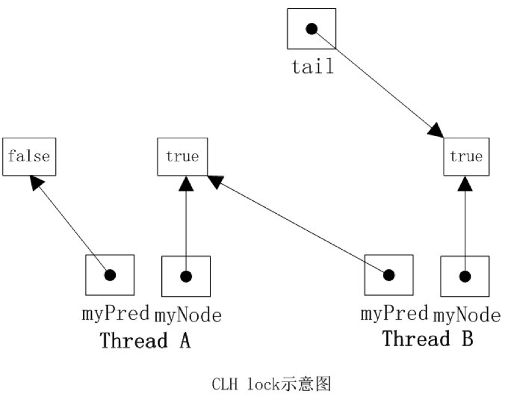
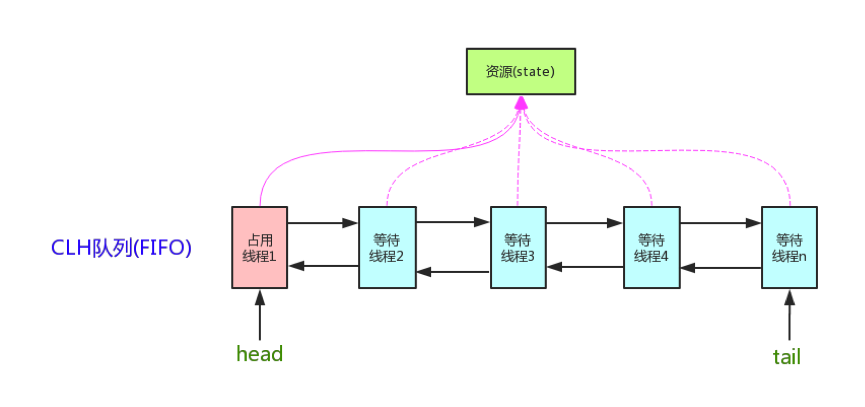
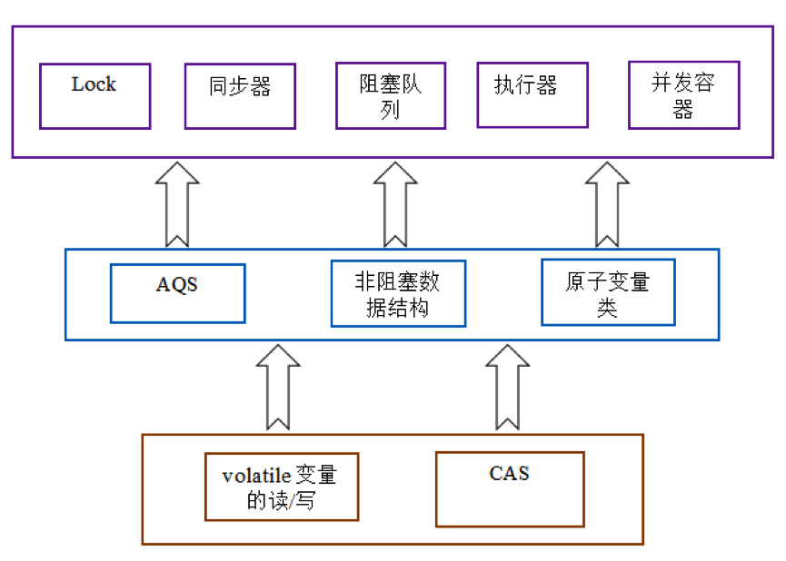

# AQS

# 1 引言

在 JDK 5 之前，一般依靠 `synchronized` 关键字来实现线程对共享变量的互斥访问。`synchronized` 由 JVM 实现：同步代码块在字节码中插入 `monitorenter`/`monitorexit` 指令，发生竞争时最终依赖操作系统的互斥量（Mutex Lock）来阻塞线程。

从 JDK 5 开始，Doug Lea 主导设计的 `java.util.concurrent` 包（JSR 166）中提供了 `AbstractQueuedSynchronizer`（AQS），用纯 Java 代码实现了与 `synchronized` 类似的互斥语义。换句话说，它没有依赖 JVM 层面的特殊指令，也不依赖编译器的特殊处理，仅仅借助 CAS、`volatile` 和 `LockSupport.park()/unpark()`，就用一个普通的类完成了线程的排队、阻塞与唤醒，并且在功能上比 `synchronized` 更加丰富（可中断、可超时、可选公平性、支持多个条件队列等）。

AQS 定义了一套多线程访问共享资源的同步器框架，是整个 `java.util.concurrent` 包的基石：

- `ReentrantLock`、`ReentrantReadWriteLock`、`Semaphore`、`CountDownLatch` 都在内部定义了继承 AQS 的同步器；
- `ThreadPoolExecutor` 的工作线程 `Worker` 也继承了 AQS，用来标记线程是否正在执行任务；
- `CyclicBarrier` 则基于 `ReentrantLock` 和 `Condition` 实现，间接依赖 AQS。

# 2 实现原理

并发控制的核心是锁的获取与释放。锁的实现方式有很多种，AQS 采用的是一种改进的 **CLH 锁**。

## 2.1 CLH 锁

**CLH**（Craig, Landin, and Hagersten locks）是一种**自旋锁**，能确保无饥饿，提供先来先服务的公平性。

何谓自旋锁？它是为保护共享资源而提出的一种锁机制。其实，自旋锁与互斥锁比较类似，它们都是为了解决对某项资源的互斥使用。无论是互斥锁还是自旋锁，在任何时刻最多只能有一个持有者，也就是说，在任何时刻最多只能有一个执行单元获得锁。但是两者在调度机制上略有不同：对于互斥锁，如果资源已经被占用，资源申请者只能进入睡眠状态；而自旋锁不会引起调用者睡眠，如果自旋锁已经被别的执行单元持有，调用者就一直在那里循环检查该自旋锁的持有者是否已经释放了锁，“自旋”一词就是因此而得名。

CLH 锁是一种基于链表的可扩展、高性能、公平的自旋锁。申请线程只在本地变量上自旋，它不断轮询前驱的状态，如果发现前驱释放了锁就结束自旋。

CLH 队列中的节点 `QNode` 含有一个 `locked` 字段，该字段为 `true` 表示该线程需要获取锁或已经持有锁且尚未释放，为 `false` 表示线程已经释放了锁。节点之间通过隐式的链表相连。之所以叫隐式的链表，是因为这些节点之间没有明显的 `next` 指针，而是通过 `myPred` 所指向的节点的变化情况来影响 `myNode` 的行为。

`CLHLock` 上还有一个尾指针，始终指向队列的最后一个节点。



当一个线程需要获取锁时，会创建一个新的 `QNode`，将其中的 `locked` 设置为 `true`，表示需要获取锁，然后使自己成为队列的尾部，同时获取一个指向其前驱的引用 `myPred`，然后该线程就在前驱节点的 `locked` 字段上自旋，直到前驱节点释放锁。当一个线程需要释放锁时，将当前节点的 `locked` 字段设置为 `false`，同时回收前驱节点（下次加锁时复用）。

如上图所示，线程 A 需要获取锁，其 `myNode` 的 `locked` 为 `true`，此时 `tail` 指向线程 A 的节点；然后线程 B 也加入到线程 A 后面，`tail` 指向线程 B 的节点。线程 A 和 B 都在各自 `myPred` 节点的 `locked` 字段上自旋，一旦 `myPred` 节点的 `locked` 字段变为 `false`，就可以获取锁。

## 2.2 AQS 数据模型

AQS 维护了一个 `volatile int state`（代表共享资源）和一个 FIFO 线程等待队列（多线程争用资源被阻塞时会进入此队列）。



AQS 的内部队列是 CLH 队列的一种变体，主要从以下几个方面进行了改造：

- 在结构上引入了头节点和尾节点，分别指向队列的头和尾，尝试获取锁、入队、释放锁等实现都与头尾节点相关；
- 为了处理超时和取消操作，每个节点维护了一个指向前驱的指针，如果一个节点的前驱被取消，这个节点可以向前移动，使用更前面节点的状态字段；同时还维护了指向后继的指针，用于释放锁时快速找到要唤醒的线程；
- 在每个节点中使用一个状态字段来控制阻塞和唤醒，等待的线程通过 `LockSupport.park()` 阻塞，而不是一直自旋；
- 头节点是一个哑节点（dummy node），它代表当前已经获取到资源的线程，本身不参与排队。

下面的源码均取自 JDK 8。JDK 14 对 AQS 进行了重写，但整体思想不变，差异见第 5 章。

FIFO 队列中的节点由 AQS 的静态内部类 `Node` 定义：

```java
static final class Node {

    // 共享模式
    static final Node SHARED = new Node();

    // 独占模式
    static final Node EXCLUSIVE = null;

    static final int CANCELLED = 1;
    static final int SIGNAL = -1;
    static final int CONDITION = -2;
    static final int PROPAGATE = -3;

    /**
     * CANCELLED，值为 1，表示当前节点的线程已被取消（超时或被中断）；
     * SIGNAL，值为 -1，表示当前节点的后继节点需要被唤醒（unpark）；
     * CONDITION，值为 -2，表示当前节点在等待 Condition，即位于条件队列中；
     * PROPAGATE，值为 -3，表示下一次共享式获取应该无条件传播下去；
     * 值为 0，表示当前节点在同步队列中，等待获取锁。
     */
    volatile int waitStatus;

    // 前驱节点
    volatile Node prev;

    // 后继节点
    volatile Node next;

    // 与该节点绑定的线程
    volatile Thread thread;

    // 存储条件队列中的后继节点，或者标记共享模式
    Node nextWaiter;

    // 是否为共享模式
    final boolean isShared() {
        return nextWaiter == SHARED;
    }

    // 获取前驱节点
    final Node predecessor() throws NullPointerException {
        Node p = prev;
        if (p == null)
            throw new NullPointerException();
        else
            return p;
    }

    Node() { // Used to establish initial head or SHARED marker
    }

    Node(Thread thread, Node mode) { // Used by addWaiter
        this.nextWaiter = mode;
        this.thread = thread;
    }

    Node(Thread thread, int waitStatus) { // Used by Condition
        this.waitStatus = waitStatus;
        this.thread = thread;
    }
}
```

`Node` 类中有两个常量 `SHARED` 和 `EXCLUSIVE`，顾名思义，这两个常量用于表示这个节点是共享模式还是独占模式。**共享模式**指的是允许多个线程同时获取资源，**独占模式**指的是资源一旦被一个线程持有，其他线程必须等待。多个线程同时读取一个文件可以采用共享模式；而当有一个线程在写文件时，不允许其他线程同时写这个文件，这就是独占模式的应用场景。

## 2.3 CAS 操作

AQS 有三个重要的变量：

```java
// 队头节点
private transient volatile Node head;

// 队尾节点
private transient volatile Node tail;

// 代表共享资源
private volatile int state;

protected final int getState() {
    return state;
}

protected final void setState(int newState) {
    state = newState;
}

protected final boolean compareAndSetState(int expect, int update) {
    return unsafe.compareAndSwapInt(this, stateOffset, expect, update);
}
```

`compareAndSetState()` 方法以乐观锁的方式更新共享资源。

独占锁是一种悲观锁，`synchronized` 就是一种独占锁，它会导致其他所有需要锁的线程挂起，等待持有锁的线程释放锁。而另一种更加高效的锁就是乐观锁。所谓乐观锁就是，每次不加锁，而是假设没有冲突而去完成某项操作，如果因为冲突失败就重试，直到成功为止。乐观锁用到的机制就是 **CAS**，即 Compare And Swap。

CAS 指的是现代 CPU 广泛支持的一种对内存中的共享数据进行操作的特殊指令。这个指令会对内存中的共享数据做原子的读写操作。简单介绍一下这个指令的操作过程：

1. CPU 将内存中将要被更改的数据与期望的值做比较；
2. 当这两个值相等时，CPU 才会将内存中的数值替换为新的值，否则不做操作；
3. 最后，CPU 将旧的数值返回。

这一系列的操作是原子的。它们虽然看似复杂，却是 **Java 5 并发机制优于原有锁机制的根本**。简单来说，CAS 的含义是：“我认为原有的值应该是什么，如果是，则将原有的值更新为新值，否则不做修改，并告诉我原来的值是多少。”

`Unsafe` 是 CAS 的核心类，它提供了硬件级别的原子操作。`Unsafe` 中的 CAS 方法虽然被声明为 `native`，但它们是 JVM 的内建方法（intrinsic）：即时编译器会把这些调用直接替换为对应的 CPU 指令（如 x86 上的 `lock cmpxchg`），并不会真正走一次 JNI 调用。JDK 9 起，标准库更推荐使用 `VarHandle` 来完成同样的原子操作。

CAS 不仅在 AQS 的实现中随处可见，也是整个 `java.util.concurrent` 包的基石。

可以发现，`head`、`tail`、`state` 三个变量都是 `volatile` 的。

`volatile` 在多处理器开发中保证了共享变量的“可见性”和有序性。**可见性**的意思是当一个线程修改一个共享变量时，另外一个线程能读到这个修改后的值。如果一个字段被声明成 `volatile`，Java 内存模型会确保所有线程看到这个变量的值是一致的。

`volatile` 变量也存在一些局限：它不能保证复合操作的原子性，因此当一个变量的新值依赖旧值时，单靠 `volatile` 是不够的。而 CAS 恰恰可以提供对共享变量的原子条件更新。

**`volatile` 保证共享变量的可见性，CAS 保证更新操作的原子性**，二者配合起来，就形成了整个 `concurrent` 包得以实现的基石。如果仔细分析 `concurrent` 包的源代码实现，会发现一个通用的实现模式：

1. 首先，声明共享变量为 `volatile`；
2. 然后，使用 CAS 的原子条件更新来实现线程之间的同步；
3. 同时，配合 `volatile` 的读写以及 CAS 所具有的 `volatile` 读和写的内存语义，来实现线程之间的通信。

AQS、非阻塞数据结构和原子变量类（`java.util.concurrent.atomic` 包中的类），这些 `concurrent` 包中的基础类都是使用这种模式来实现的，而 `concurrent` 包中的高层类又依赖于这些基础类。从整体来看，`concurrent` 包的实现示意图如下：



# 3 源码解读

前面提到过，AQS 定义了两种资源共享方式：

- **Exclusive**：独占，只有一个线程能执行，如 `ReentrantLock`；
- **Share**：共享，多个线程可同时执行，如 `Semaphore`、`CountDownLatch`。

不同的自定义同步器争用共享资源的方式也不同。自定义同步器在实现时只需要实现共享资源 `state` 的获取与释放方式即可，至于具体线程等待队列的维护（如获取资源失败入队、唤醒出队等），AQS 已经在顶层实现好了。这是典型的模板方法模式。自定义同步器主要实现以下几种方法：

- `isHeldExclusively()`：当前线程是否正在独占资源。只有用到 `Condition` 时才需要实现它。
- `tryAcquire(int)`：独占方式。尝试获取资源，成功则返回 `true`，失败则返回 `false`。
- `tryRelease(int)`：独占方式。尝试释放资源，完全释放则返回 `true`，否则返回 `false`。
- `tryAcquireShared(int)`：共享方式。尝试获取资源。负数表示失败；0 表示成功，但没有剩余可用资源；正数表示成功，且有剩余资源。
- `tryReleaseShared(int)`：共享方式。尝试释放资源，如果释放后允许唤醒后续等待的节点则返回 `true`，否则返回 `false`。

以 `ReentrantLock` 为例，`state` 初始化为 0，表示未锁定状态。线程 A 调用 `lock()` 时，会调用 `tryAcquire()` 独占该锁并将 `state` 加 1。此后，其他线程再调用 `tryAcquire()` 时就会失败，直到线程 A 调用 `unlock()` 使 `state` 回到 0（即释放锁）为止，其他线程才有机会获取该锁。当然，释放锁之前，线程 A 自己是可以重复获取此锁的（`state` 会累加），这就是可重入的概念。但要注意，获取多少次就要释放多少次，这样才能保证 `state` 能回到 0。

再以 `CountDownLatch` 为例，`state` 初始化为 N，表示需要等待 N 次 `countDown()`（通常对应 N 个子任务）。这 N 个子任务并行执行，每个子任务执行完后调用一次 `countDown()`，`state` 就会通过 CAS 减 1。等到 `state` 减到 0 时，会 `unpark()` 等待中的主调用线程，主调用线程就会从 `await()` 方法返回，继续后续动作。

一般来说，自定义同步器要么是独占方式，要么是共享方式，它们也只需实现 `tryAcquire`/`tryRelease`、`tryAcquireShared`/`tryReleaseShared` 中的一组即可。但 AQS 也支持自定义同步器同时实现独占和共享两种方式，如 `ReentrantReadWriteLock`。

## 3.1 acquire(int)

```java
public final void acquire(int arg) {
    if (!tryAcquire(arg) && acquireQueued(addWaiter(Node.EXCLUSIVE), arg))
        selfInterrupt();
}
```

此方法是独占模式下线程获取共享资源的顶层入口。如果获取到资源，线程直接返回；否则进入等待队列，直到获取到资源为止，且整个过程忽略中断的影响。获取到资源后，线程就可以去执行其临界区代码了。

方法流程如下：

1. `tryAcquire()` 尝试直接去获取资源，如果成功则直接返回；
2. `addWaiter()` 将该线程加入等待队列的尾部，并标记为独占模式；
3. `acquireQueued()` 使线程在等待队列中获取资源，一直获取到资源后才返回。如果在整个等待过程中被中断过，则返回 `true`，否则返回 `false`；
4. 线程在等待过程中被中断时是不响应的，只是在获取资源后再进行自我中断 `selfInterrupt()`，将中断标记补上。

下面再来看看每个方法的实现代码。

### 3.1.1 tryAcquire(int)

```java
protected boolean tryAcquire(int arg) {
    throw new UnsupportedOperationException();
}
```

此方法尝试去获取独占资源。如果获取成功，则直接返回 `true`，否则直接返回 `false`。

AQS 只是一个框架，这里只定义了一个“钩子”，具体资源的获取交由自定义同步器去实现（通过 `state` 的 get/set/CAS）。至于能不能重入、能不能插队，就看具体的自定义同步器怎么设计了。当然，自定义同步器在进行资源访问时要考虑线程安全的影响。

这里之所以没有定义成 `abstract`，是因为独占模式下只用实现 `tryAcquire`/`tryRelease`，而共享模式下只用实现 `tryAcquireShared`/`tryReleaseShared`。如果都定义成 `abstract`，那么每种模式都要去实现另一种模式下的方法。这样设计是为了尽量减少开发者不必要的工作量。

### 3.1.2 addWaiter(Node)

```java
private Node addWaiter(Node mode) {
    // 使用当前线程构造节点
    Node node = new Node(Thread.currentThread(), mode);

    Node pred = tail;
    if (pred != null) { // 如果队尾节点不为空，尝试快速将当前节点插入队尾
        node.prev = pred;
        if (compareAndSetTail(pred, node)) {
            pred.next = node;
            return node;
        }
    }
    // 队尾节点为空（队列还没有初始化）或 CAS 失败，则转调 enq 入队
    enq(node);
    return node;
}
```

其中，`compareAndSetTail()` 方法也是调用 `Unsafe` 类实现 CAS 操作，更新队尾。

### 3.1.3 enq(Node)

```java
private Node enq(final Node node) {
    for (;;) { // CAS 自旋，直到插入成功
        Node t = tail;
        if (t == null) { // 队尾为空，则先初始化队列，创建一个哑节点作为头节点
            if (compareAndSetHead(new Node()))
                tail = head; // 头尾指针都指向哑节点
        } else { // 插入队尾
            node.prev = t;
            if (compareAndSetTail(t, node)) {
                t.next = node;
                return t;
            }
        }
    }
}
```

这段代码的精髓就在于“循环 + CAS”更新 `volatile` 变量，这也是 `AtomicInteger`、`AtomicBoolean` 等原子类的核心思想。

注意入队的顺序：先设置 `node.prev`，再 CAS 更新 `tail`，最后才设置 `t.next`。因此在某一瞬间，新节点可能已经成为队尾，但前驱的 `next` 还没来得及指向它。也就是说，**`prev` 指针总是可靠的，`next` 指针却可能暂时为空**，这一点在后面的 `unparkSuccessor()` 中会用到。

### 3.1.4 acquireQueued(Node, int)

通过 `tryAcquire()` 和 `addWaiter()`，获取资源失败的线程已经被放入等待队列尾部了。但是，后面还有一件重要的事没做，就是让线程进入阻塞状态，直到其他线程释放资源后唤醒自己。这个过程跟在银行办理业务时排队拿号有点相似：`acquireQueued()` 就是让线程在等待队列中排队（中间没其他事可做就休息），直到叫到自己的号再返回。

```java
final boolean acquireQueued(final Node node, int arg) {
    boolean failed = true; // 是否获取资源失败
    try {
        boolean interrupted = false; // 等待过程中有没有被中断
        for (;;) { // 自旋，直到获取到资源
            final Node p = node.predecessor();
            // 前驱是 head，才有资格去尝试获取资源
            if (p == head && tryAcquire(arg)) {
                // 获取资源成功，将自己置为队头，并断开其前驱（旧的队头）
                setHead(node);
                p.next = null; // help GC
                failed = false;
                return interrupted;
            }
            // 获取资源失败，判断是否需要阻塞，需要则阻塞并检查中断
            if (shouldParkAfterFailedAcquire(p, node) && parkAndCheckInterrupt())
                interrupted = true;
        }
    } finally {
        if (failed)
            cancelAcquire(node);
    }
}
```

获取资源失败后，会调用两个方法：`shouldParkAfterFailedAcquire()` 和 `parkAndCheckInterrupt()`，下面来看看它俩是做什么的。

### 3.1.5 shouldParkAfterFailedAcquire(Node, Node)

从名字可以猜出来，该方法的作用是判断“获取资源失败后是否需要阻塞”：

```java
private static boolean shouldParkAfterFailedAcquire(Node pred, Node node) {
    int ws = pred.waitStatus; // 前驱状态
    if (ws == Node.SIGNAL)
        // Node.SIGNAL，代表前驱释放资源后会通知后继节点，可以放心阻塞
        return true;
    if (ws > 0) { // 代表前驱已取消，相当于退出了等待队列
        do { // 一个个往前找，找到最近一个正常等待的前驱，排在它的后面
            node.prev = pred = pred.prev;
        } while (pred.waitStatus > 0);
        pred.next = node;
    } else {
        // 前驱状态正常，则将其状态置为 SIGNAL，意为：释放资源后通知后继节点
        compareAndSetWaitStatus(pred, ws, Node.SIGNAL);
    }
    return false;
}
```

整个流程中，如果前驱节点的状态不是 `SIGNAL`，那么当前线程就不能安心去休息，需要先找到一个安全的休息点（把前驱设置为 `SIGNAL`），同时返回 `false`，让外层循环再尝试一次，看看有没有机会轮到自己。

### 3.1.6 parkAndCheckInterrupt()

线程找好安全的休息点后，就可以安心去休息了。此方法就是让线程去休息，真正进入等待状态：

```java
private final boolean parkAndCheckInterrupt() {
    LockSupport.park(this); // 使线程进入 WAITING 状态
    return Thread.interrupted();
}
```

`park()` 会让当前线程进入 `WAITING` 状态。在此状态下，有两种途径可以唤醒该线程：被 `unpark()` 或被 `interrupt()`。此外，`park()` 还可能发生没有任何原因的虚假唤醒，因此它总是放在循环中调用，醒来后重新检查条件。

`Thread.interrupted()` 会返回并清除当前线程的中断标记，这正是 `acquire()` 需要在最后调用 `selfInterrupt()` 补上中断标记的原因。

### 3.1.7 小结

总结一下 `acquire()` 的流程：

1. 调用自定义同步器的 `tryAcquire()` 尝试直接去获取资源，如果成功则直接返回；
2. 没成功，则通过 `addWaiter()` 将该线程加入等待队列的尾部，并标记为独占模式；
3. `acquireQueued()` 使线程在等待队列中休息，有机会时（轮到自己，被 `unpark()`）会去尝试获取资源，获取到资源后才返回。如果在整个等待过程中被中断过，则返回 `true`，否则返回 `false`；
4. 线程在等待过程中被中断时是不响应的，只是在获取资源后再进行自我中断 `selfInterrupt()`，将中断标记补上。

## 3.2 release(int)

`release()` 是 `acquire()` 的逆操作，是独占模式下线程释放共享资源的顶层入口。它会释放指定量的资源，如果彻底释放了（即 `state` 为 0），它会唤醒等待队列里的其他线程来获取资源。

```java
public final boolean release(int arg) {
    if (tryRelease(arg)) {
        Node h = head;
        if (h != null && h.waitStatus != 0) // 状态不为 0，说明需要唤醒后继节点
            unparkSuccessor(h);
        return true;
    }
    return false;
}
```

### 3.2.1 tryRelease(int)

```java
protected boolean tryRelease(int arg) {
    throw new UnsupportedOperationException();
}
```

跟 `tryAcquire()` 一样，这个方法需要自定义同步器去实现。正常来说，`tryRelease()` 都会成功，因为这是独占模式，该线程来释放资源，那么它肯定已经拿到了独占资源，直接减掉相应量的资源即可，也不需要考虑线程安全的问题。对于可重入的同步器，只有当资源被彻底释放（`state` 回到 0）时才返回 `true`。

### 3.2.2 unparkSuccessor(Node)

```java
private void unparkSuccessor(Node node) {

    int ws = node.waitStatus;
    if (ws < 0) // 将当前节点状态置零
        compareAndSetWaitStatus(node, ws, 0);

    Node s = node.next;
    if (s == null || s.waitStatus > 0) { // 后继节点为空或者已取消
        s = null;
        // 从队尾开始向前寻找，找到最靠前的正常节点
        for (Node t = tail; t != null && t != node; t = t.prev)
            if (t.waitStatus <= 0)
                s = t;
    }
    if (s != null)
        LockSupport.unpark(s.thread); // 唤醒该节点上的线程
}
```

逻辑并不复杂，一句话概括：用 `unpark()` 唤醒等待队列中最靠前的那个未放弃的线程。

为什么要从队尾向前找，而不是从 `node.next` 往后找呢？原因就在 3.1.3 节提到的入队顺序：`next` 指针可能暂时还没设置好，而 `prev` 指针在节点入队时就已经设置好了，从后往前遍历才能保证不漏掉任何节点。

## 3.3 acquireShared(int)

此方法是共享模式下线程获取共享资源的顶层入口。它会获取指定量的资源，获取成功则直接返回，获取失败则进入等待队列，直到获取到资源为止，整个过程忽略中断。

```java
public final void acquireShared(int arg) {
    if (tryAcquireShared(arg) < 0)
        doAcquireShared(arg);
}

protected int tryAcquireShared(int arg) { // 留给子类实现
    throw new UnsupportedOperationException();
}
```

这里 `tryAcquireShared()` 依然需要自定义同步器去实现，但是 AQS 已经把其返回值的语义定义好了：负值代表获取失败；0 代表获取成功，但没有剩余资源；正数表示获取成功，还有剩余资源，其他线程还可以去获取。

### 3.3.1 doAcquireShared(int)

```java
private void doAcquireShared(int arg) {
    final Node node = addWaiter(Node.SHARED); // 以共享模式加入队尾
    boolean failed = true;
    try {
        boolean interrupted = false;
        for (;;) {
            final Node p = node.predecessor();
            if (p == head) { // 前驱是队头（队头肯定是已经拿到资源的节点）
                int r = tryAcquireShared(arg); // 尝试获取资源
                if (r >= 0) { // 获取资源成功
                    setHeadAndPropagate(node, r); // 将自己置为队头，若还有剩余资源，向后传播
                    p.next = null; // help GC
                    if (interrupted)
                        selfInterrupt(); // 如果等待过程中被打断过，此时将中断补上
                    failed = false;
                    return;
                }
            }
            // 判断状态，寻找安全的休息点，进入 WAITING 状态，等着被 unpark() 或 interrupt()
            if (shouldParkAfterFailedAcquire(p, node) && parkAndCheckInterrupt())
                interrupted = true;
        }
    } finally {
        if (failed)
            cancelAcquire(node);
    }
}
```

该方法的功能类似于独占模式下的 `acquireQueued()`。

与独占模式一样，只有当线程是 `head.next`（“老二”）时，才会去尝试获取资源；不同的是，获取成功后如果还有剩余资源，还会继续唤醒后面的队友。

那么问题就来了：假如老大用完后释放了 5 个资源，而老二需要 6 个，老三需要 1 个，老四需要 2 个。老大先唤醒老二，老二一看资源不够自己用，继续 `park()`，也就不会去唤醒老三和老四了。独占模式下，同一时刻只有一个线程执行，这样做未尝不可；但在共享模式下，多个线程本可以同时执行，现在却因为老二的资源需求量大，把后面需求量小的老三和老四也都卡住了。这是 AQS 为了严格保证 FIFO 顺序、避免大需求线程饥饿而做出的取舍。

### 3.3.2 setHeadAndPropagate(Node, int)

```java
private void setHeadAndPropagate(Node node, int propagate) {
    Node h = head;
    setHead(node); // 将自己置为队头

    if (propagate > 0 || h == null || h.waitStatus < 0) {
        Node s = node.next;
        if (s == null || s.isShared()) // 后继节点也为共享模式，则继续唤醒
            doReleaseShared();
    }
}
```

此方法在 `setHead()` 的基础上多了一步：自己苏醒的同时，如果条件符合（比如还有剩余资源），还会去唤醒后继节点，毕竟是共享模式。

## 3.4 releaseShared(int)

此方法是共享模式下线程释放共享资源的顶层入口。它会释放指定量的资源，如果 `tryReleaseShared()` 返回 `true`，就会唤醒等待队列里的其他线程来获取资源。

```java
public final boolean releaseShared(int arg) {
    if (tryReleaseShared(arg)) { // 尝试释放资源
        doReleaseShared(); // 释放成功，继续唤醒后继节点
        return true;
    }
    return false;
}

protected boolean tryReleaseShared(int arg) { // 留给子类实现
    throw new UnsupportedOperationException();
}
```

跟独占模式下的 `release()` 相似，但有一点需要注意：可重入的独占同步器通常只有在完全释放掉资源（`state` 为 0）后，`tryRelease()` 才返回 `true` 去唤醒其他线程；而共享模式下 `tryReleaseShared()` 何时返回 `true` 完全由同步器自行决定。例如 `Semaphore` 每次释放许可都返回 `true`，`CountDownLatch` 只有在计数减到 0 时才返回 `true`，`ReentrantReadWriteLock` 的读锁则在读锁和写锁全部释放后才返回 `true`。

### 3.4.1 doReleaseShared()

```java
private void doReleaseShared() {

    for (;;) {
        Node h = head;
        if (h != null && h != tail) { // 头节点不为空且有后继节点
            int ws = h.waitStatus;
            if (ws == Node.SIGNAL) {
                if (!compareAndSetWaitStatus(h, Node.SIGNAL, 0)) // 头节点状态：SIGNAL -> 0
                    continue; // 状态更新失败则继续循环，直到成功
                unparkSuccessor(h); // 唤醒后继节点
            } else if (ws == 0 && !compareAndSetWaitStatus(h, 0, Node.PROPAGATE)) // 头节点状态：0 -> PROPAGATE
                continue; // 持续循环，直到状态更新成功
        }
        if (h == head) // 头节点没变，则结束循环；否则继续
            break;
    }
}
```

其余方法已经在上面分析过了。至此，AQS 独占模式与共享模式下的实现原理就剖析得差不多了，代码是最好的老师。

除了上面分析的核心方法，AQS 还定义了带超时功能的 `tryAcquireNanos()`/`tryAcquireSharedNanos()` 方法，以及响应中断的 `acquireInterruptibly()`/`acquireSharedInterruptibly()` 方法，其核心流程与上述方法大同小异，不再赘述。

# 4 应用实例

我们利用 AQS 来实现一个不可重入的互斥锁。锁资源（AQS 里的 `state`）只有两种状态：0 表示未锁定，1 表示锁定。下面是 `Mutex` 的核心源码：

```java
public class Mutex {

    /**
     * 静态内部类，自定义同步器
     */
    private static class Sync extends AbstractQueuedSynchronizer {

        @Override
        protected boolean isHeldExclusively() {
            return getExclusiveOwnerThread() == Thread.currentThread(); // 是否由当前线程持有锁
        }

        @Override
        protected boolean tryAcquire(int acquires) {
            assert acquires == 1;
            if (compareAndSetState(0, 1)) { // state: 0 -> 1，代表获取锁
                setExclusiveOwnerThread(Thread.currentThread()); // 设置当前占用资源的线程
                return true;
            }
            return false;
        }

        @Override
        protected boolean tryRelease(int releases) {
            assert releases == 1;
            if (!isHeldExclusively()) { // 只有持有锁的线程才能释放锁
                throw new IllegalMonitorStateException();
            }
            setExclusiveOwnerThread(null);
            setState(0); // state: 1 -> 0，代表释放锁
            return true;
        }
    }

    private final Sync sync = new Sync();

    /**
     * 获取锁，可能会阻塞
     */
    public void lock() {
        sync.acquire(1);
    }

    /**
     * 尝试获取锁，无论成功或失败，立即返回
     */
    public boolean tryLock() {
        return sync.tryAcquire(1);
    }

    /**
     * 释放锁
     */
    public void unlock() {
        sync.release(1);
    }
}
```

同步类在实现时一般都将自定义同步器（`Sync`）定义为内部类，供自己使用；而同步类自己（`Mutex`）则实现某个接口（如 `Lock`），对外提供服务。当然，接口的实现要直接依赖 `Sync`，它们在语义上也存在某种对应关系。而 `Sync` 只用实现资源 `state` 的获取与释放方式 `tryAcquire`/`tryRelease`，至于线程的排队、等待、唤醒等，上层的 AQS 都已经实现好了，我们不用关心。

`tryRelease()` 中的 `isHeldExclusively()` 检查非常重要：如果只判断 `state` 是否为 0，那么任何线程都可以释放别人持有的锁。

`ReentrantLock`、`CountDownLatch`、`Semaphore` 这些同步类的实现方式都差不多，不同的地方就在于获取、释放资源的方式 `tryAcquire`/`tryRelease`（或 `tryAcquireShared`/`tryReleaseShared`）。

# 5 新版本中的 AQS

## 5.1 版本演进

| 版本 | 变化 |
|------|------|
| JDK 5 | 随 JSR 166 引入 `AbstractQueuedSynchronizer` |
| JDK 6 | 新增 `AbstractQueuedLongSynchronizer`（`state` 为 `long` 类型）和 `AbstractOwnableSynchronizer`（提供 `exclusiveOwnerThread`） |
| JDK 7 | 新增 `hasQueuedPredecessors()`，公平锁借助它判断是否有线程排在自己前面 |
| JDK 9 | 内部的原子操作从 `sun.misc.Unsafe` 改为 `VarHandle` |
| JDK 14 | AQS 被重写，队列节点与获取流程大幅简化，内部改用 `jdk.internal.misc.Unsafe` |
| JDK 21 | 虚拟线程正式发布，AQS 基于 `LockSupport.park()` 阻塞，虚拟线程阻塞时会从载体线程上卸载，不会固定载体线程 |

## 5.2 JDK 14 的重写

第 3 章分析的是 JDK 8 的源码，这也是目前资料最多的版本。JDK 14 对 AQS 进行了一次较大的重写，主要变化如下：

- **节点按用途拆分**：`Node` 变为抽象类，派生出 `ExclusiveNode`、`SharedNode` 和 `ConditionNode` 三个子类。其中 `ConditionNode` 实现了 `ForkJoinPool.ManagedBlocker`，在 `ForkJoinPool` 中等待条件时，线程池可以补偿创建新的工作线程。
- **状态字段简化**：原来的 `waitStatus`（`SIGNAL`、`CANCELLED`、`CONDITION`、`PROPAGATE`）被替换为 `status` 字段，只保留 `WAITING`、`CANCELLED`、`COND` 三种状态位，`PROPAGATE` 被移除。
- **获取流程合并**：`addWaiter()`、`enq()`、`acquireQueued()`、`doAcquireShared()`、`doAcquireInterruptibly()`、`doAcquireNanos()` 等一系列方法被合并成一个统一的 `acquire(Node node, int arg, boolean shared, boolean interruptible, boolean timed, long time)` 方法，独占与共享、是否可中断、是否超时都通过参数区分。
- **唤醒逻辑简化**：`unparkSuccessor()` 被更简单的 `signalNext()` 取代。

重写后的顶层入口如下：

```java
public final void acquire(int arg) {
    if (!tryAcquire(arg))
        acquire(null, arg, false, false, false, 0L);
}

public final boolean release(int arg) {
    if (tryRelease(arg)) {
        signalNext(head);
        return true;
    }
    return false;
}
```

可以看到，“先 `tryAcquire()`，失败再排队”的整体思路没有变化。`state` + CLH 变体队列 + 模板方法的设计，以及 `tryAcquire()`、`tryRelease()`、`tryAcquireShared()`、`tryReleaseShared()`、`isHeldExclusively()` 这些留给子类的扩展点，都与 JDK 8 完全一致，基于 AQS 编写的自定义同步器无需任何修改。

## 5.3 虚拟线程

AQS 中的线程阻塞与唤醒全部基于 `LockSupport.park()`/`unpark()`。当虚拟线程在 `ReentrantLock` 等基于 AQS 的同步器上阻塞时，JVM 会把它从载体线程上卸载，载体线程可以继续执行其他虚拟线程。因此在 JDK 21~23 中，`synchronized` 会固定载体线程，官方建议在虚拟线程中用 `ReentrantLock` 替代长时间持有的 `synchronized`；JDK 24 通过 JEP 491 解决了 `synchronized` 的固定问题之后，两者在这方面已无差别。

# 6 总结

- AQS 是 `java.util.concurrent` 包的基石，用一个 `volatile int state` 表示资源，用一个 CLH 变体的 FIFO 双向队列管理等待线程。
- AQS 基于模板方法模式，自定义同步器只需实现 `tryAcquire`/`tryRelease` 或 `tryAcquireShared`/`tryReleaseShared`，排队、阻塞、唤醒、取消、超时、中断等复杂逻辑都由 AQS 完成。
- `volatile` 保证可见性，CAS 保证原子性，`LockSupport.park()/unpark()` 负责阻塞与唤醒，三者共同构成了 AQS 的实现基础。
- 独占模式下只有 `head` 的后继才能尝试获取资源；共享模式下获取成功后还会向后传播唤醒，以便多个线程同时获取资源。
- JDK 14 重写了 AQS 的内部实现，但对外的扩展点保持不变；基于 AQS 的同步器在虚拟线程中阻塞时不会固定载体线程。
