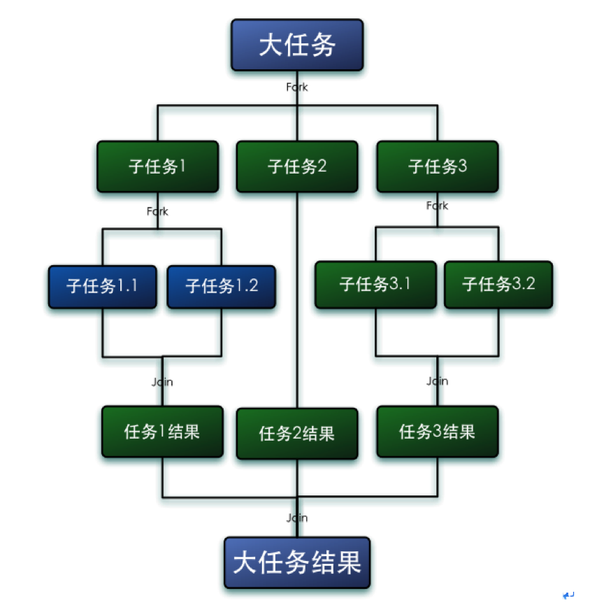
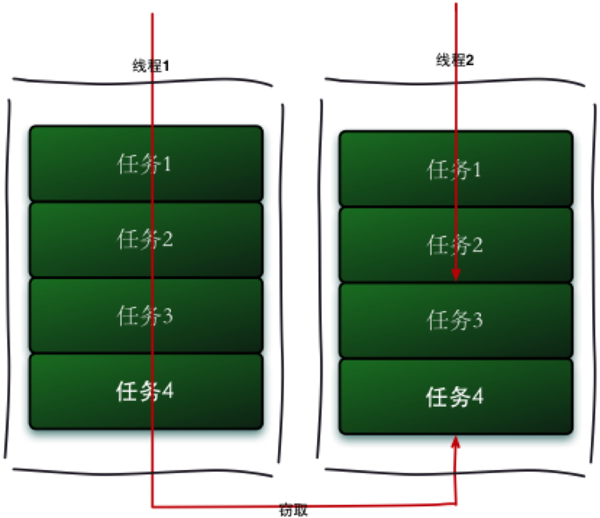
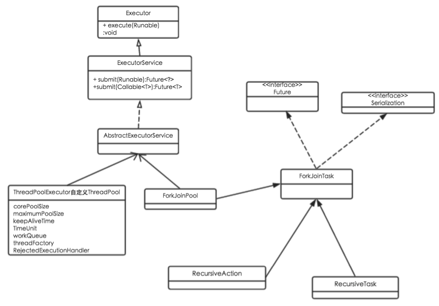

# ForkJoin

# 1 核心思想

Fork/Join 框架是 Java 7 引入的一个用于并行执行任务的框架，核心思想是**把大任务分割成若干个小任务，最终汇总每个小任务的结果得到大任务的结果**，其思路与 MapReduce 有异曲同工之妙。

Fork 就是把一个大任务切分为若干子任务并行执行，Join 就是合并这些子任务的执行结果，最后得到大任务的结果。比如计算 `1 + 2 + … + 10000`，可以分割成 10 个子任务，每个子任务分别对 1000 个数求和，最终汇总这 10 个子任务的结果。Fork/Join 的运行流程如下：



Fork/Join 框架使用一种巧妙的算法来平衡线程的负载，称为**工作窃取**（work-stealing）算法。工作窃取的运行流程如下：



假如我们需要完成一个比较大的任务，可以把它分割为若干互不依赖的子任务。为了减少线程间的竞争，把这些子任务分别放到不同的队列里，并为每个队列创建一个单独的线程来执行队列里的任务，线程和队列一一对应，比如 A 线程负责处理 A 队列里的任务。但是有的线程会先把自己队列里的任务干完，而其他线程对应的队列里还有任务等待处理。干完活的线程与其空等，不如去帮其他线程干活，于是它就去其他线程的队列里窃取一个任务来执行。

此时多个线程会访问同一个队列，为了减少窃取线程和被窃取线程之间的竞争，通常使用**双端队列**：队列的所有者线程总是从队列的一端（top）存取任务，而窃取线程总是从另一端（base）获取任务。

工作窃取算法的优点是充分利用线程进行并行计算，并减少了线程间的竞争；缺点是在某些情况下仍然存在竞争（比如双端队列里只剩一个任务时），并且消耗了更多的系统资源（比如创建多个线程和多个双端队列）。

# 2 应用实例

使用 Fork/Join 框架主要包括两部分工作：

- **分割任务**：把大任务分割成子任务，如果子任务仍然很大，就继续分割，直到子任务足够小。
- **执行任务并合并结果**：分割出的子任务放在工作线程的双端队列里，由各个工作线程获取并执行。父任务通过 `join()` 拿到子任务的返回值，再把它们合并起来。

Fork/Join 主要通过两个类来完成以上工作：

- **ForkJoinTask**
  要使用 Fork/Join 框架，首先要创建一个 Fork/Join 任务，它提供了在任务中执行 `fork()` 和 `join()` 的机制。通常情况下我们不需要直接继承 `ForkJoinTask`，只需要继承它的子类：
  - **RecursiveAction**：用于没有返回结果的任务。
  - **RecursiveTask**：用于有返回结果的任务。
  - **CountedCompleter**（Java 8 引入）：任务完成时触发回调，适合子任务完成后不需要阻塞等待的场景，JDK 内部的并行流大量使用了它。
- **ForkJoinPool**
  `ForkJoinTask` 需要通过 `ForkJoinPool` 来执行。工作线程中分割出的子任务会被压入当前工作线程所维护的双端队列；当一个工作线程的队列里暂时没有任务时，它会随机地从其他工作线程的队列中窃取任务。

下面通过一个简单的需求来使用 Fork/Join 框架：计算 1~8 的累加结果。

首先要考虑的是如何分割任务。如果希望每个子任务最多计算两个数的相加，那么设置分割的阈值为 2。由于是 8 个数字相加，Fork/Join 框架会先把任务分割成两个子任务，子任务一负责计算 `1 + 2 + 3 + 4`，子任务二负责计算 `5 + 6 + 7 + 8`；子任务会继续分割，直到需要累加的数字降为两个，最后逐层 join 子任务的结果。

```java
import java.util.concurrent.ForkJoinPool;
import java.util.concurrent.RecursiveTask;

public class CountTask extends RecursiveTask<Integer> {

    private static final int THRESHOLD = 2;
    private final int start;
    private final int end;

    public CountTask(int start, int end) {
        this.start = start;
        this.end = end;
    }

    @Override
    protected Integer compute() {
        System.out.println(start + " - " + end + " begin");
        int sum = 0;
        if (end - start + 1 <= THRESHOLD) { // 达到了计算条件，则直接执行
            for (int i = start; i <= end; i++) {
                sum += i;
            }
        } else { // 不满足计算条件，则分割任务
            int middle = (start + end) >>> 1;
            CountTask leftTask = new CountTask(start, middle);
            CountTask rightTask = new CountTask(middle + 1, end);

            leftTask.fork();                        // 左半部分交给线程池异步执行
            int rightResult = rightTask.compute();  // 右半部分由当前线程直接计算
            int leftResult = leftTask.join();       // 等待左半部分执行完毕

            sum = leftResult + rightResult;         // 合并子任务的计算结果
        }
        System.out.println(start + " - " + end + " end");
        return sum;
    }

    public static void main(String[] args) {
        ForkJoinPool pool = ForkJoinPool.commonPool();
        try {
            int result = pool.invoke(new CountTask(1, 8));
            System.out.println("result: " + result);
        } catch (RuntimeException e) { // 子任务抛出的异常会在 invoke/join 处重新抛出
            e.printStackTrace();
        }
    }
}
```

某一次的打印结果：

```text
1 - 8 begin
5 - 8 begin
1 - 4 begin
7 - 8 begin
1 - 2 begin
3 - 4 begin
7 - 8 end
5 - 6 begin
1 - 2 end
3 - 4 end
5 - 6 end
1 - 4 end
5 - 8 end
1 - 8 end
result: 36
```

由于任务由线程池并行执行，每次的执行顺序都可能不同。但父任务一定在所有子任务之后完成，比如 1-8 一定在 1-4、5-8 之后完成，而 1-4、5-8 之间的完成顺序是不确定的。

关于这段代码，有几点值得注意：

- **只 fork 一个子任务**：常见的错误写法是对两个子任务都调用 `fork()`，再依次 `join()`。这样当前线程分割完任务后就无事可做，只能等待。更好的做法是 fork 一个、当前线程直接 `compute()` 另一个；子任务较多时可以使用 `invokeAll(left, right)`，效果相同。
- **先 fork 后 join，且 join 的顺序与 fork 相反**：最后 fork 的任务位于队列的 top 端，先 join 它最有可能直接从自己的队列中弹出执行，而不必等待其他线程。
- **使用 `invoke()` 获取结果**：`invoke()` 会等待任务执行完毕再返回结果。如果像旧写法那样 `submit()` 之后立即调用 `isCompletedAbnormally()`，此时任务很可能还没执行完，判断结果没有意义。
- **阈值的选择**：示例中阈值为 2 只是为了演示分割过程。实际使用时，每个子任务的计算量太小会导致任务调度的开销超过计算本身，一般建议每个叶子任务执行的基本计算步骤在 100 到 10000 之间。

`ForkJoinTask` 在执行时可能会抛出异常。调用 `join()`/`invoke()` 时，子任务中抛出的 `RuntimeException` 或 `Error` 会在调用处重新抛出，`get()` 则会把异常包装为 `ExecutionException`。如果不希望抛出异常，可以先调用 `quietlyJoin()` 等待任务结束，再通过 `isCompletedAbnormally()` 检查任务是否抛出了异常或被取消，并通过 `getException()` 获取异常：任务被取消时返回 `CancellationException`，任务尚未完成或没有抛出异常时返回 `null`。

# 3 核心原理



Fork/Join 框架的实现在 JDK 8 中经历过一次彻底的重写：JDK 7 中每个 `ForkJoinWorkerThread` 自己持有任务数组，`ForkJoinPool` 维护一个工作线程数组；JDK 8 起改为由 `ForkJoinPool` 统一维护一个**工作队列数组**，线程与队列解耦，并新增了公共线程池 `commonPool`。此后的版本虽然仍在持续优化，但核心思路保持不变。下面的源码基于 JDK 8。

## 3.1 ForkJoinPool

`ForkJoinPool` 继承自 `AbstractExecutorService`，本身就是一个 `ExecutorService`。与 `ThreadPoolExecutor` 所有线程共享一个阻塞队列不同，它采用了 work-stealing 模式：每个工作线程拥有自己的双端队列，空闲的线程会尝试去执行其他线程创建的子任务，因此很少有线程处于空闲状态。

池中维护着一个 `WorkQueue` 数组：

```java
    // Main registry of queues; size is a power of two
    volatile WorkQueue[] workQueues;
```

数组的大小总是 2 的 n 次方，方便将取模运算转换为位运算。数组中的队列分为两类：

- **奇数下标**：工作线程私有的队列，每个 `ForkJoinWorkerThread` 拥有一个，用来存放该线程 fork 出的子任务。
- **偶数下标**：共享的提交队列，存放由外部线程（非工作线程）提交的任务，这类队列没有所有者线程，存取时需要加锁。

`WorkQueue` 内部用数组实现双端队列，核心字段如下：

```java
    static final class WorkQueue {
        volatile int base;         // index of next slot for poll
        int top;                   // index of next slot for push
        ForkJoinTask<?>[] array;   // the elements (initially unallocated)
        final ForkJoinPool pool;   // the containing pool (may be null)
        final ForkJoinWorkerThread owner; // owning thread or null if shared
        // ...
    }
```

- 所有者线程在 `top` 端执行 `push` 和 `pop`，默认是 LIFO 顺序，最近 fork 的任务最先执行，数据局部性更好。
- 窃取线程在 `base` 端执行 `poll`，是 FIFO 顺序。被窃取的往往是更早 fork 出来、粒度更大的任务，一次窃取就能带走较多的工作量。
- 只有所有者线程会修改 `top`，`base` 则通过 CAS 更新，因此所有者线程的 push/pop 在大多数情况下不需要加锁。

此外，`ForkJoinPool` 用一个 64 位的 `ctl` 字段同时记录活跃线程数、总线程数以及空闲线程栈，所有线程状态的变更都通过对 `ctl` 的 CAS 完成，避免使用锁。

`parallelism`（并行度）决定了池中期望的活跃线程数，通过构造方法自定义的线程池默认等于 CPU 核数。当有新任务到来而活跃线程不足时，`signalWork()` 会唤醒一个空闲线程；如果没有空闲线程且线程总数未达上限，则通过 `ForkJoinWorkerThreadFactory` 创建新的工作线程。新线程在构造时回调 `registerWorker()` 完成注册：

```java
    protected ForkJoinWorkerThread(ForkJoinPool pool) {
        // Use a placeholder until a useful name can be set in registerWorker
        super("aForkJoinWorkerThread");
        this.pool = pool;
        this.workQueue = pool.registerWorker(this);
    }
```

`registerWorker()` 会把线程设置为守护线程，为它创建一个 `WorkQueue`，并在 `workQueues` 中找一个空闲的奇数下标放进去，空间不足时将数组扩容为原来的 2 倍。

工作线程启动后进入 `runWorker()` 循环：先通过 `scan()` 从随机位置开始扫描各个队列，窃取到任务就执行它，然后清空自己队列中的本地任务；扫描一轮仍找不到任务时，就把自己压入空闲线程栈并挂起，等待被 `signalWork()` 唤醒。

`ForkJoinPool` 提供了三类提交任务的方法，都可以接受 `ForkJoinTask`、`Runnable` 和 `Callable` 类型的任务：

| 方法 | 说明 |
|------|------|
| `execute()` | 异步执行，不关心结果 |
| `submit()` | 异步执行，返回 `ForkJoinTask`（同时也是 `Future`） |
| `invoke()` | 同步执行，等待任务完成并返回结果 |

外部线程提交的任务会被放入一个随机选择的偶数下标共享队列，再由工作线程窃取执行；如果在工作线程内部调用 `fork()`，任务则直接压入当前线程自己的队列。

与 `ExecutorService` 的约定一致，`shutdown()` 之后线程池不再接受新任务，但已提交的任务会继续执行完毕；`shutdownNow()` 则会尝试取消所有任务并中断工作线程。

## 3.2 ForkJoinTask

`ForkJoinTask` 是一个轻量级的任务抽象，与 `Thread` 相比，大量的 `ForkJoinTask` 可以由少量的工作线程承载。

### 3.2.1 fork

调用 `fork()` 时，如果当前线程是工作线程，任务会被压入该线程自己的队列；否则会提交到公共线程池 `commonPool` 中：

```java
    public final ForkJoinTask<V> fork() {
        Thread t;
        if ((t = Thread.currentThread()) instanceof ForkJoinWorkerThread)
            ((ForkJoinWorkerThread)t).workQueue.push(this);
        else
            ForkJoinPool.common.externalPush(this);
        return this;
    }
```

`fork()` 只负责把任务放入队列，然后立即返回，任务会在之后被当前线程或窃取线程执行。`WorkQueue.push()` 的实现如下：

```java
    final void push(ForkJoinTask<?> task) {
        ForkJoinTask<?>[] a; ForkJoinPool p;
        int b = base, s = top, n;
        if ((a = array) != null) {    // ignore if queue removed
            int m = a.length - 1;     // fenced write for task visibility
            U.putOrderedObject(a, ((m & s) << ASHIFT) + ABASE, task);
            U.putOrderedInt(this, QTOP, s + 1);
            if ((n = s - b) <= 1) {
                if ((p = pool) != null)
                    p.signalWork(p.workQueues, this);
            }
            else if (n >= m)
                growArray();
        }
    }
```

首先将任务放在 `top` 指向的位置，再将 `top` 加 1。然后检查队列中的任务数：

- 如果放入之前队列几乎为空（任务数不超过 1），说明其他线程可能正处于空闲状态，调用 `signalWork()` 唤醒或创建一个工作线程来窃取任务。
- 如果队列已满，则调用 `growArray()` 将数组扩容为原来的 2 倍。

### 3.2.2 join

`join()` 的作用是等待任务执行完成并获取结果。与 `Future.get()` 不同的是，它在任务异常结束时直接抛出 `RuntimeException` 或 `Error`，而不是 `ExecutionException`，并且不会因为调用线程被中断而抛出 `InterruptedException`。

```java
    public final V join() {
        int s;
        if ((s = doJoin() & DONE_MASK) != NORMAL)
            reportException(s);
        return getRawResult();
    }
```

任务的状态保存在 `status` 字段中，用高 4 位表示完成状态，负数即表示任务已经结束：

```java
    volatile int status; // accessed directly by pool and workers
    static final int DONE_MASK   = 0xf0000000;  // mask out non-completion bits
    static final int NORMAL      = 0xf0000000;  // must be negative
    static final int CANCELLED   = 0xc0000000;  // must be < NORMAL
    static final int EXCEPTIONAL = 0x80000000;  // must be < CANCELLED
    static final int SIGNAL      = 0x00010000;  // must be >= 1 << 16
    static final int SMASK       = 0x0000ffff;  // short bits for tags
```

> JDK 7 中这几个状态分别是 `-1`、`-2`、`-3` 和 `1`，JDK 8 改为位标记的形式，以便在同一个字段中存放额外的标签信息。

`join()` 根据 `doJoin()` 返回的状态决定返回什么结果：

- 如果任务正常完成（`NORMAL`），则直接返回任务结果。
- 如果任务被取消（`CANCELLED`），则抛出 `CancellationException`。
- 如果任务抛出了异常（`EXCEPTIONAL`），则重新抛出对应的异常。

再来看 `doJoin()` 方法：

```java
    private int doJoin() {
        int s; Thread t; ForkJoinWorkerThread wt; ForkJoinPool.WorkQueue w;
        return (s = status) < 0 ? s :
            ((t = Thread.currentThread()) instanceof ForkJoinWorkerThread) ?
            (w = (wt = (ForkJoinWorkerThread)t).workQueue).
            tryUnpush(this) && (s = doExec()) < 0 ? s :
            wt.pool.awaitJoin(w, this, 0L) :
            externalAwaitDone();
    }

    final int doExec() {
        int s; boolean completed;
        if ((s = status) >= 0) {
            try {
                completed = exec();
            } catch (Throwable rex) {
                return setExceptionalCompletion(rex);
            }
            if (completed)
                s = setCompletion(NORMAL);
        }
        return s;
    }
```

`doJoin()` 的执行逻辑如下：

1. 检查任务状态，如果任务已经完成，直接返回状态。
2. 如果当前线程是工作线程，且要 join 的任务恰好位于自己队列的 top 端（`tryUnpush()` 成功），说明还没被其他线程窃取，直接弹出并在当前线程执行。这也是前面建议“join 的顺序与 fork 相反”的原因。
3. 否则调用 `awaitJoin()` 等待任务完成。
4. 如果当前线程不是工作线程，则调用 `externalAwaitDone()`，在必要时帮助执行一部分任务，然后阻塞等待。

`doExec()` 负责真正执行任务：调用 `exec()`（最终调用我们实现的 `compute()`），执行成功则把状态设置为 `NORMAL`；出现异常则记录异常，并把状态设置为 `EXCEPTIONAL`。

`awaitJoin()` 是 join 高效的关键。等待中的工作线程并不会立即阻塞，而是尽量“帮忙”：

- **tryRemoveAndExec**：如果要等待的任务还在自己的队列中（不在 top 端），就把它取出来直接执行。
- **helpStealer**：如果任务已经被其他线程窃取，就找到这个窃取者，从窃取者的队列中拿任务来执行，帮它更快地完成工作。窃取者可能也在等待别人，因此这个过程会沿着窃取链继续向下追溯。
- **tryCompensate**：如果实在帮不上忙，当前线程在阻塞前会唤醒一个空闲线程或创建一个补偿线程，保证池中的活跃线程数不低于并行度，然后才真正进入等待。

# 4 使用建议

## 4.1 公共线程池 commonPool

JDK 8 引入了一个全局共享的 `ForkJoinPool`，通过 `ForkJoinPool.commonPool()` 获取，它有以下特点：

- 默认并行度为 CPU 核数减 1（至少为 1），因为调用线程通常也会参与执行。可以通过系统属性 `java.util.concurrent.ForkJoinPool.common.parallelism` 修改。
- 对它调用 `shutdown()` 或 `shutdownNow()` 不会产生任何效果。
- 工作线程都是守护线程，主线程结束时 JVM 不会等待其中的任务完成，因此需要通过 `join()`/`invoke()` 等方式显式等待结果。

JDK 中很多并行能力都默认运行在 `commonPool` 上：

| 功能 | 说明 |
|------|------|
| 并行流 `parallelStream()` | 基于 `CountedCompleter` 拆分任务，调用线程也会参与执行 |
| `CompletableFuture` 的 `xxxAsync()` 方法 | 未指定 `Executor` 时使用 `commonPool`；若其并行度小于 2，则为每个任务新建线程 |
| `Arrays.parallelSort()` / `parallelPrefix()` | 数组的并行排序与并行前缀计算 |
| `ConcurrentHashMap` 的批量操作 | 如带 `parallelismThreshold` 参数的 `forEach`、`reduce`、`search` |

## 4.2 注意事项

- **只用于计算密集型任务**：Fork/Join 的设计目标是 CPU 密集型的分治计算。在任务中执行 IO、加锁、`sleep` 等阻塞操作会占用宝贵的工作线程。尤其是在 `commonPool` 中阻塞，会拖慢整个 JVM 中所有的并行流和异步任务。
- **阻塞操作使用 ManagedBlocker 或单独的线程池**：确实需要阻塞时，可以实现 `ForkJoinPool.ManagedBlocker` 并通过 `ForkJoinPool.managedBlock()` 执行，线程池会在阻塞期间创建补偿线程；更简单的做法是把阻塞型任务交给专门的线程池。
- **子任务之间避免共享可变状态**：子任务应当只处理自己负责的数据，通过返回值合并结果，而不是同时修改同一个变量，否则需要额外同步，抵消了并行的收益。
- **合理设置阈值**：任务太大，并行度发挥不出来；任务太小，调度开销超过计算本身。需要结合数据量和实际测试来确定。
- **ForkJoinPool 与 ThreadPoolExecutor 的选择**：`ThreadPoolExecutor` 适合大量互相独立、可能阻塞的任务；`ForkJoinPool` 适合可以递归分解、子任务之间存在依赖的计算任务。也有人概括为：`ThreadPoolExecutor` 主要解决并发问题，而 `ForkJoinPool` 主要解决并行问题。另外，通过构造方法的 `asyncMode` 参数可以让工作线程以 FIFO 顺序处理本地任务，适合从不 join 的事件型任务，虚拟线程的调度器就采用了这种模式。

# 5 新版本中的 Fork/Join

| 版本 | 变化 |
|------|------|
| JDK 7 | 引入 Fork/Join 框架（JSR 166y），包括 `ForkJoinPool`、`ForkJoinTask`、`RecursiveTask`、`RecursiveAction` |
| JDK 8 | 实现重写为 `WorkQueue` 数组；新增 `commonPool` 和 `CountedCompleter`；并行流、`CompletableFuture` 默认基于 `commonPool` |
| JDK 19 | jsr166 更新，新增 `setParallelism()`、`lazySubmit()` 等方法，并优化了异步场景的性能；`ExecutorService` 实现 `AutoCloseable`，`ForkJoinPool` 支持 `close()`（对 `commonPool` 无效） |
| JDK 21 | 虚拟线程正式发布（JEP 444），其默认调度器是一个 FIFO 模式的 `ForkJoinPool` |
| JDK 25 | `ForkJoinPool` 实现 `ScheduledExecutorService` 接口，支持 `schedule()` 等延迟任务方法，并新增 `submitWithTimeout()` |

## 5.1 虚拟线程的调度器

JDK 21 正式发布的虚拟线程，其默认调度器就是一个专用的 `ForkJoinPool`：

- 它工作在 FIFO 模式（`asyncMode = true`），因为虚拟线程之间不存在 fork/join 关系，按提交顺序调度更加公平。
- 承载虚拟线程运行的平台线程称为载体线程（carrier thread），默认数量等于 CPU 核数，可以通过系统属性 `jdk.virtualThreadScheduler.parallelism` 调整。
- 虚拟线程遇到阻塞操作时会从载体线程上卸载，让出的载体线程可以去执行其他虚拟线程；对于无法卸载的阻塞（比如某些文件 IO），调度器会临时补偿额外的载体线程，这正是利用了 `ForkJoinPool` 已有的补偿机制。

这意味着 Fork/Join 的工作窃取调度不再只服务于分治计算，也成为了 Java 高并发 IO 编程的基础设施。

## 5.2 其他用法的变化

- `lazySubmit()` 提交任务时不保证唤醒空闲线程，适合能确定池中已有线程（可能包括当前线程）稍后会处理该任务的场景，可以减少竞争和开销；`setParallelism()` 允许在运行时调整并行度。这两个方法主要是为 JDK 内部（如虚拟线程调度器）而添加的。
- JDK 19 起可以用 try-with-resources 管理自定义的 `ForkJoinPool`，代码块结束时会等待所有任务执行完毕并关闭线程池：

```java
try (ForkJoinPool pool = new ForkJoinPool(4)) {
    int result = pool.invoke(new CountTask(1, 10000));
    System.out.println(result);
}
```

- JDK 25 起 `ForkJoinPool` 可以直接执行延迟任务和周期任务，`submitWithTimeout()` 会在任务超时后自动取消它。

# 6 总结

- Fork/Join 框架基于分治思想：把大任务递归地分割成小任务并行执行，再逐层合并结果。
- 工作窃取是其高效的关键：每个工作线程拥有自己的双端队列，所有者在 top 端按 LIFO 存取任务，窃取者在 base 端按 FIFO 窃取任务，在充分利用 CPU 的同时尽量减少竞争。
- `join()` 并不是简单的阻塞等待，等待中的线程会优先执行自己队列中的任务、帮助窃取者完成工作，实在无事可做时才补偿线程并进入等待。
- 编写任务时应只 fork 一个子任务、当前线程直接计算另一个，并以与 fork 相反的顺序 join；任务应保持计算密集，避免阻塞和共享可变状态。
- JDK 8 之后，`commonPool` 承载了并行流、`CompletableFuture` 等大量并行能力；JDK 21 起，`ForkJoinPool` 又成为虚拟线程的默认调度器，其应用范围已经远远超出了最初的分治计算。
