# CompletableFuture

# 1 背景

在微服务架构中，从各个服务获取数据最常见的方式是同步调用，如下图所示：

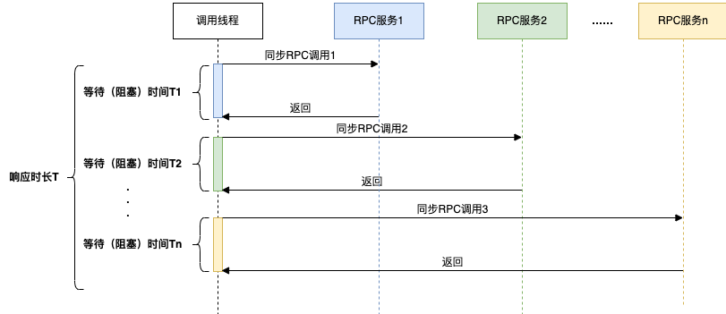

在同步调用的场景下，接口耗时长、性能差，接口的响应时长 `T > T1 + T2 + T3 + … + Tn`。为了缩短接口的响应时间，一般会使用线程池并行获取数据：

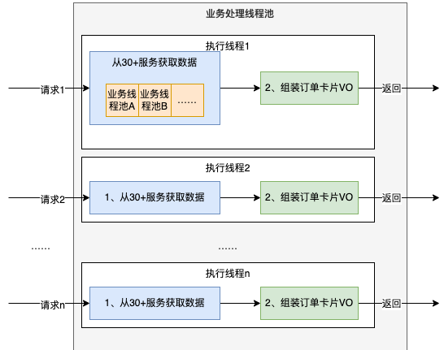

这种方式由于以下两个原因，资源利用率比较低：

- CPU 资源大量浪费在阻塞等待上，导致 CPU 利用率低。在 Java 8 之前，一般会通过回调的方式来减少阻塞，但是大量使用回调又会引发臭名昭著的**回调地狱**问题，导致代码的可读性和可维护性大大降低。
- 为了提高并发度，会引入更多额外的线程池。随着 CPU 调度的线程数增加，资源争用会更加严重，宝贵的 CPU 资源被损耗在上下文切换上；而且线程本身也会占用系统资源，不能无限增加。

同步模型下，硬件资源无法被充分利用，系统吞吐量容易达到瓶颈。

## 1.1 Future 的局限

在 Java 8 之前，我们一般通过 **Future** 实现异步。`Future` 用作对异步计算结果的引用，它提供了检查计算是否完成的 `isDone()` 方法，以及在计算完成后获取结果的 `get()` 方法。

Future API 是 Java 异步编程迈出的一大步，但它缺乏一些重要且有用的特性，比如：

- 不支持设置回调方法。为了获取异步计算的结果，必须阻塞调用线程，或者由调用线程轮询。
- 无法很好地实现异步任务间的复杂编排，比如前后依赖、等待全部完成、任一任务完成时得到通知等。
- 不支持手动完成，也没有统一的异常处理机制，复杂场景下的代码不优雅，可读性很低。

**CompletableFuture** 是 JDK 8 开始提供的函数式异步编程工具，它实现了 `Future` 接口并对其进行了扩展，可以通过回调函数的方式实现异步编程，并且提供了多种异步任务的编排方式以及统一的异常处理机制。

## 1.2 与 ListenableFuture 的对比

在 Java 8 之前，若要设置回调，一般会使用 Guava 的 `ListenableFuture`。下面通过一个例子来说明用 `ListenableFuture` 和 `CompletableFuture` 实现异步的差异：假设有三个操作 step1、step2、step3，其中 step3 的执行依赖 step1 和 step2 的结果。

`ListenableFuture` 的实现（回调地狱）如下：

```java
ExecutorService executor = Executors.newFixedThreadPool(5);
ListeningExecutorService guavaExecutor = MoreExecutors.listeningDecorator(executor);
ListenableFuture<String> future1 = guavaExecutor.submit(() -> {
    // step 1
    System.out.println("执行step 1");
    return "step1 result";
});
ListenableFuture<String> future2 = guavaExecutor.submit(() -> {
    // step 2
    System.out.println("执行step 2");
    return "step2 result";
});
ListenableFuture<List<String>> future1And2 = Futures.allAsList(future1, future2);
Futures.addCallback(future1And2, new FutureCallback<List<String>>() {
    @Override
    public void onSuccess(List<String> result) {
        System.out.println(result);
        ListenableFuture<String> future3 = guavaExecutor.submit(() -> {
            System.out.println("执行step 3");
            return "step3 result";
        });
        Futures.addCallback(future3, new FutureCallback<String>() {
            @Override
            public void onSuccess(String result) {
                System.out.println(result);
            }

            @Override
            public void onFailure(Throwable t) {
            }
        }, guavaExecutor);
    }

    @Override
    public void onFailure(Throwable t) {
    }
}, guavaExecutor);
```

`CompletableFuture` 的实现如下：

```java
ExecutorService executor = Executors.newFixedThreadPool(5);
CompletableFuture<String> cf1 = CompletableFuture.supplyAsync(() -> {
    System.out.println("执行step 1");
    return "step1 result";
}, executor);
CompletableFuture<String> cf2 = CompletableFuture.supplyAsync(() -> {
    System.out.println("执行step 2");
    return "step2 result";
}, executor);
cf1.thenCombine(cf2, (result1, result2) -> {
    System.out.println(result1 + " , " + result2);
    System.out.println("执行step 3");
    return "step3 result";
}).thenAccept(result3 -> System.out.println(result3));
```

显然，`CompletableFuture` 的实现更为简洁，可读性更好。

# 2 CompletableFuture 用法

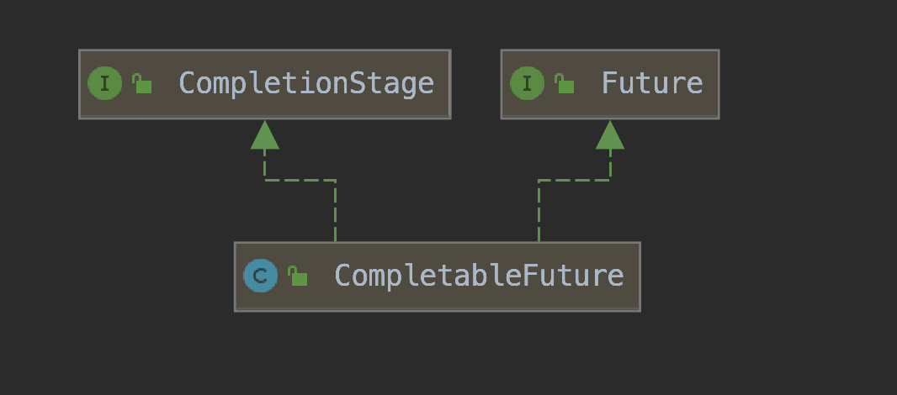

`CompletableFuture` 实现了两个接口：`Future` 和 `CompletionStage`。

`Future` 表示异步计算的结果；`CompletionStage` 表示异步执行过程中的一个步骤（Stage），这个步骤可能由另外一个 `CompletionStage` 触发，而随着当前步骤的完成，也可能会触发其他一系列 `CompletionStage` 的执行。我们可以根据实际业务对这些步骤进行多样化的编排组合，`CompletionStage` 接口正是定义了这样的能力，可以通过它提供的 `thenApply`、`thenCompose` 等函数式方法来组合编排这些步骤。

下面通过一个例子来讲解 `CompletableFuture` 的用法。使用 `CompletableFuture` 的过程也是构建依赖树的过程，一个 `CompletableFuture` 的完成会触发另外一系列依赖它的 `CompletableFuture` 的执行：

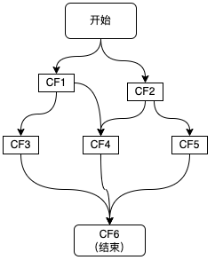

上图描绘的是一个业务接口的流程，其中包括 CF1、CF2、CF3、CF4、CF5 共 5 个步骤，以及这些步骤之间的依赖关系。每个步骤可以是一次 RPC 调用、一次数据库操作或者一次本地方法调用等。使用 `CompletableFuture` 进行异步编程时，图中的每个步骤都会产生一个 `CompletableFuture` 对象，最终结果也会用一个 `CompletableFuture` 来表示。

根据依赖的 `CompletableFuture` 的数量，可以分为以下几类：零依赖、一元依赖、二元依赖和多元依赖。

## 2.1 零依赖：CompletableFuture 的创建

我们先看下如何不依赖其他 `CompletableFuture` 来创建新的 `CompletableFuture`：

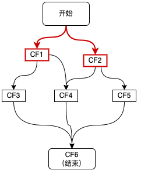

如上图红色链路所示，接口接收到请求后，首先发起两个异步调用 CF1、CF2，主要有三种方式：

```java
ExecutorService executor = Executors.newFixedThreadPool(5);
// 1、使用 runAsync 或 supplyAsync 发起异步调用
CompletableFuture<String> cf1 = CompletableFuture.supplyAsync(() -> {
    return "result1";
}, executor);
// 2、使用 completedFuture() 直接创建一个已完成状态的 CompletableFuture
CompletableFuture<String> cf2 = CompletableFuture.completedFuture("result2");
// 3、先初始化一个未完成的 CompletableFuture，然后通过 complete()、completeExceptionally() 完成它
CompletableFuture<String> cf = new CompletableFuture<>();
cf.complete("success");
```

第三种方式的一个典型使用场景，是将回调方法转为 `CompletableFuture`，然后再依赖 `CompletableFuture` 的能力进行调用编排，示例如下：

```java
/**
 * 将 RPC 的回调监听封装为 CompletableFuture
 * callback 自定义的回调方法
 * rpcCall  自定义函数，用来表示一次 RPC 调用
 */
public static <T> CompletableFuture<T> toCompletableFuture(final Callback<?, T> callback, RpcCall rpcCall) {
    // 新建一个未完成的 CompletableFuture
    CompletableFuture<T> resultFuture = new CompletableFuture<>();
    // 监听回调的完成，并且与 CompletableFuture 同步状态
    callback.addObserver(new Observer<T>() {
        @Override
        public void onSuccess(T t) {
            resultFuture.complete(t);
        }

        @Override
        public void onFailure(Throwable throwable) {
            resultFuture.completeExceptionally(throwable);
        }
    });

    if (rpcCall != null) {
        try {
            rpcCall.invoke();
        } catch (TException e) {
            resultFuture.completeExceptionally(e);
        }
    }
    return resultFuture;
}
```

## 2.2 一元依赖：依赖一个 CF

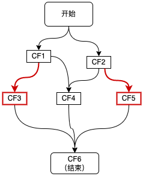

如上图红色链路所示，CF3、CF5 分别依赖于 CF1 和 CF2。这种对单个 `CompletableFuture` 的依赖可以通过 `thenApply`、`thenAccept`、`thenCompose` 等方法来实现，代码如下所示：

```java
CompletableFuture<String> cf3 = cf1.thenApply(result1 -> {
    // result1 为 CF1 的结果
    // ......
    return "result3";
});
CompletableFuture<String> cf5 = cf2.thenApply(result2 -> {
    // result2 为 CF2 的结果
    // ......
    return "result5";
});
```

常用的一元依赖方法如下：

| 方法 | 入参函数 | 说明 |
|------|----------|------|
| `thenApply` | `Function<T, U>` | 对结果进行转换，返回新的值 |
| `thenAccept` | `Consumer<T>` | 消费结果，没有返回值 |
| `thenRun` | `Runnable` | 不关心结果，只在完成后执行一个动作 |
| `thenCompose` | `Function<T, CompletionStage<U>>` | 用结果发起另一个异步操作，并把嵌套的 CF 展开 |

`thenApply` 和 `thenCompose` 的区别类似于 Stream 中的 `map` 和 `flatMap`：当回调函数本身返回一个 `CompletableFuture` 时（比如用上一步的结果再发起一次 RPC 调用），使用 `thenApply` 会得到 `CompletableFuture<CompletableFuture<U>>`，而 `thenCompose` 会把它展开为 `CompletableFuture<U>`。

## 2.3 二元依赖：依赖两个 CF

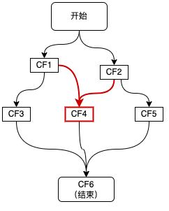

如上图红色链路所示，CF4 同时依赖于 CF1 和 CF2。这种二元依赖可以通过 `thenCombine` 等回调来实现，如下代码所示：

```java
CompletableFuture<String> cf4 = cf1.thenCombine(cf2, (result1, result2) -> {
    // result1 和 result2 分别为 CF1 和 CF2 的结果
    return "result4";
});
```

类似的方法还有：`thenAcceptBoth`、`runAfterBoth`（两者都完成后执行），以及 `applyToEither`、`acceptEither`、`runAfterEither`（任意一个完成后执行）。

## 2.4 多元依赖：依赖多个 CF

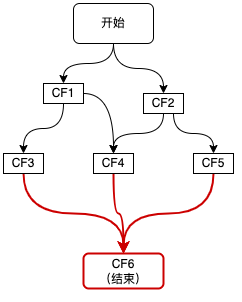

如上图红色链路所示，整个流程的结束依赖于 CF3、CF4、CF5 三个步骤。这种多元依赖可以通过 `allOf` 或 `anyOf` 方法来实现：需要多个依赖全部完成时使用 `allOf`，多个依赖中任意一个完成即可时使用 `anyOf`。如下代码所示：

```java
CompletableFuture<Void> cf6 = CompletableFuture.allOf(cf3, cf4, cf5);
CompletableFuture<String> result = cf6.thenApply(v -> {
    // 这里的 join 并不会阻塞，因为传给 thenApply 的函数是在 CF3、CF4、CF5 全部完成时才会执行
    String result3 = cf3.join();
    String result4 = cf4.join();
    String result5 = cf5.join();
    // 根据 result3、result4、result5 组装最终 result
    return "result";
});
```

需要注意，`allOf` 返回的是 `CompletableFuture<Void>`，不包含各个依赖的结果，需要像上面这样再通过各个 CF 的 `join()` 取出；`anyOf` 返回的是 `CompletableFuture<Object>`，使用时需要进行类型转换。

## 2.5 异常处理

异步任务中抛出的异常不会直接抛给调用方，而是记录在 `CompletableFuture` 中，并沿着依赖链向下传递：如果某个步骤异常完成，依赖它的普通回调（如 `thenApply`）不会执行，它们返回的 CF 也会以异常完成。`CompletableFuture` 提供了以下几种处理异常的方法：

| 方法 | 是否能拿到结果 | 是否能拿到异常 | 是否能改变结果 |
|------|----------------|----------------|----------------|
| `exceptionally(Function<Throwable, T>)` | 否 | 是 | 是，只在异常时调用，返回一个兜底值 |
| `handle(BiFunction<T, Throwable, U>)` | 是 | 是 | 是，无论成功或失败都会调用 |
| `whenComplete(BiConsumer<T, Throwable>)` | 是 | 是 | 否，只做观察（如记录日志），原样传递结果或异常 |

```java
CompletableFuture<String> cf = CompletableFuture.supplyAsync(() -> {
    if (true) {
        throw new IllegalStateException("remote error");
    }
    return "result";
}, executor).exceptionally(ex -> {
    // ex 通常是 CompletionException，真正的异常需要通过 getCause() 获取
    log.error("call failed", ex);
    return "default";
});
```

在依赖链中传递时，原始异常通常会被包装为 `CompletionException`，处理时需要通过 `getCause()` 取出真正的异常。

## 2.6 获取结果

`CompletableFuture` 提供了多种获取结果的方法：

| 方法 | 说明 |
|------|------|
| `get()` / `get(timeout, unit)` | 阻塞等待，异常被包装为受检的 `ExecutionException`，可被中断 |
| `join()` | 阻塞等待，异常被包装为非受检的 `CompletionException`，不响应中断，适合在 Lambda 中使用 |
| `getNow(valueIfAbsent)` | 不阻塞，未完成时返回给定的默认值 |
| `resultNow()` / `exceptionNow()` | 不阻塞，JDK 19 引入，任务未正常完成（或未异常完成）时抛出 `IllegalStateException` |

在业务代码中，**阻塞获取结果时一定要设置超时时间**，否则一旦下游服务没有响应，调用线程会被一直占用。JDK 9 起还可以直接在依赖链上设置超时：

```java
CompletableFuture<String> cf = CompletableFuture
        .supplyAsync(() -> remoteCall(), executor)
        .orTimeout(1, TimeUnit.SECONDS)             // 超时后以 TimeoutException 异常完成
        .exceptionally(ex -> "default");

CompletableFuture<String> cf2 = CompletableFuture
        .supplyAsync(() -> remoteCall(), executor)
        .completeOnTimeout("default", 1, TimeUnit.SECONDS); // 超时后以默认值完成
```

需要注意，超时只是让 CF 提前完成，并不会中断正在执行的任务，任务本身仍会占用线程直到执行结束。

# 3 CompletableFuture 原理

## 3.1 设计思想

`CompletableFuture` 中包含两个核心字段：`result` 和 `stack`。

```java
    volatile Object result;       // Either the result or boxed AltResult
    volatile Completion stack;    // Top of Treiber stack of dependent actions
```

`result` 用于存储当前 CF 的结果，异常或 `null` 结果会被包装为 `AltResult` 存放；`stack`（`Completion` 类型）表示当前 CF 完成后需要触发的依赖动作，用来触发依赖它的 CF 的计算。依赖动作可以有多个（表示有多个 CF 依赖它），它们以栈（无锁的 Treiber 栈）的形式存储，`stack` 指向栈顶元素。

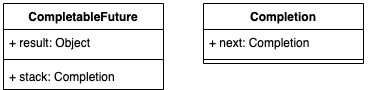

这种方式类似“观察者模式”，依赖动作都封装在单独的 `Completion` 子类中。下面是 `Completion` 的类关系结构图，`CompletableFuture` 中的每个回调方法都对应图中的一个 `Completion` 子类，`Completion` 本身是观察者的基类。

- `UniCompletion` 继承了 `Completion`，是一元依赖的基类，例如 `thenApply` 的实现类 `UniApply` 就继承自 `UniCompletion`。
- `BiCompletion` 继承了 `UniCompletion`，是二元依赖的基类，同时也是多元依赖的基类。例如 `thenCombine` 的实现类 `BiApply` 和 `allOf` 使用的 `BiRelay` 都继承自 `BiCompletion`。

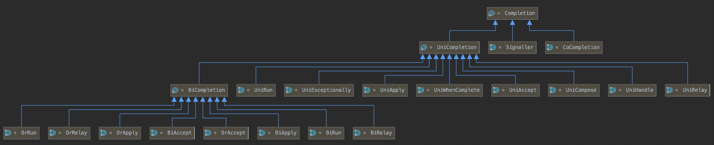

值得一提的是，`Completion` 继承自 `ForkJoinTask` 并实现了 `Runnable`，因此它既可以被提交到任意 `Executor` 中执行，也可以利用 `ForkJoinTask` 自带的标签字段实现无锁的状态控制（见 3.2.1 的问题 3）。

按照“观察者模式”的设计思想，原理分析可以从“观察者”和“被观察者”两个方面着手。由于回调种类多，但结构差异不大，所以这里只以一元依赖中的 `thenApply` 为例，如下图所示：

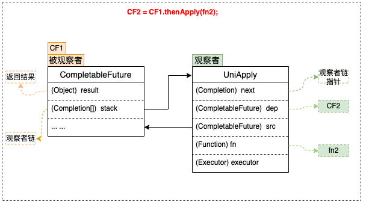

### 3.1.1 被观察者

1. 每个 `CompletableFuture` 都可以被看作一个被观察者，其内部有一个 `Completion` 类型的链表成员变量 `stack`，用来存储注册到其中的所有观察者。当被观察者执行完成后会弹出 `stack` 中的元素，依次通知注册到其中的观察者。上面例子中步骤 `fn2` 就是作为观察者被封装在 `UniApply` 中。
2. 被观察者 CF 中的 `result` 属性用来存储返回结果，它可能是一次 RPC 调用的返回值，也可能是任意对象，在上面的例子中对应步骤 `fn1` 的执行结果。

### 3.1.2 观察者

`CompletableFuture` 支持很多回调方法，例如 `thenAccept`、`thenApply`、`exceptionally` 等。这些方法接收一个函数类型的参数 `f`，生成一个 `Completion` 类型的对象（即观察者），并将入参函数 `f` 赋值给 `Completion` 的成员变量 `fn`。然后检查当前 CF 是否已处于完成状态（即 `result != null`），如果已完成则直接触发 `fn`；否则将观察者 `Completion` 加入到 CF 的观察者链 `stack` 中，并再次尝试触发；如果被观察者此时仍未执行完，则在它执行完毕之后通知触发。

1. 观察者中的 `dep` 属性：指向其对应的 `CompletableFuture`，在上面的例子中 `dep` 指向 CF2。
2. 观察者中的 `src` 属性：指向其依赖的 `CompletableFuture`，在上面的例子中 `src` 指向 CF1。
3. 观察者中的 `fn` 属性：用来存储具体的等待被回调的函数。需要注意的是，不同的回调方法（`thenAccept`、`thenApply`、`exceptionally` 等）接收的函数类型也不同，即 `fn` 的类型有很多种，在上面的例子中 `fn` 指向 `fn2`。

## 3.2 流程分析

### 3.2.1 一元依赖

这里仍然以 `thenApply` 为例来说明一元依赖的流程：

1. 将观察者 `Completion` 注册到 CF1，此时 CF1 将 `Completion` 压栈。
2. 当 CF1 的操作运行完成时，会将结果赋值给 CF1 的 `result` 属性。
3. 依次弹栈，通知观察者尝试运行。

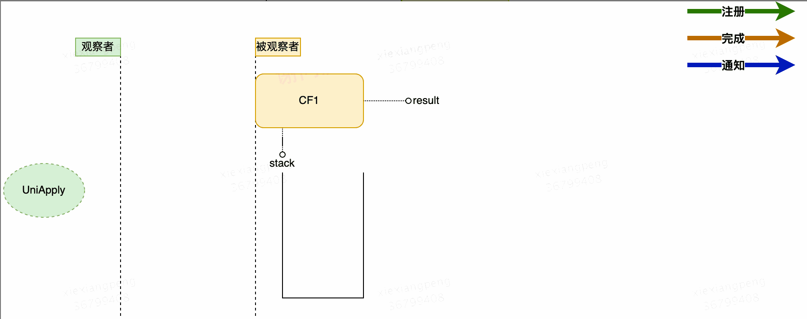

初步的流程设计如上图所示，这里有几个关于注册与通知的并发问题：

**问题 1**：在观察者注册之前，如果 CF 已经执行完成，并且已经发出了通知，那么观察者由于错过了通知，是不是将永远不会被触发？

**答案 1**：不会。注册时会检查依赖的 CF 是否已经完成。如果未完成（即 `result == null`），则将观察者入栈；如果已完成（`result != null`），则直接触发观察者操作。

**问题 2**：在“入栈”前会有 `result == null` 的判断，这两个操作并非原子操作，`CompletableFuture` 的实现也没有对这两个操作加锁。如果 CF 恰好在这两个操作之间完成，观察者仍然得不到通知，是不是仍然无法触发？

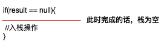

**答案 2**：不会。入栈之后会再次检查 CF 是否完成，如果已完成则触发。

**问题 3**：当依赖多个 CF 时，观察者会被压入所有依赖的 CF 的栈中，每个 CF 完成时都会尝试触发它，那么会不会导致一个操作被多次执行？如下图所示，即当 CF1、CF2 同时完成时，如何避免 CF3 被多次触发？

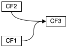

**答案 3**：观察者在执行之前会先调用 `claim()` 方法，通过 CAS 将 `ForkJoinTask` 的标签由 0 改为 1。如果观察者已经执行过了，CAS 操作就会失败，从而放弃执行：

```java
        final boolean claim() {
            Executor e = executor;
            if (compareAndSetForkJoinTaskTag((short)0, (short)1)) {
                if (e == null)
                    return true;
                executor = null; // disable
                e.execute(this);
            }
            return false;
        }
```

从这段代码还可以看出，对于带 `Async` 后缀的方法，抢到执行权的线程并不直接执行回调，而是把它提交给指定的 `Executor`。

通过对以上 3 个问题的分析可以看出，**CompletableFuture 在处理并发问题时，全程没有加锁**，而是依靠 `volatile` 和 CAS 实现，极大地提高了程序的执行效率。将并发问题考虑在内之后，可以得到完善的整体流程图，如下所示：

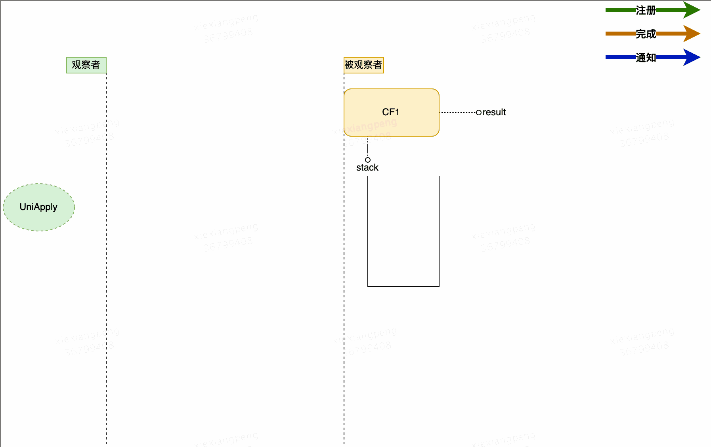

### 3.2.2 多元依赖

依赖多个 `CompletableFuture` 的回调方法包括 `allOf` 和 `anyOf`：

- `allOf` 的观察者实现类为 `BiRelay`，需要所有被依赖的 CF 完成后才会执行回调。它将多个被依赖的 CF 构建成一棵**平衡二叉树**，两两合并，执行结果逐层通知，直到根节点，触发回调监听。
- `anyOf` 在 JDK 8 中同样采用二叉树结构，观察者实现类为 `OrRelay`；在较新的 JDK 中改为向每个被依赖的 CF 直接注册一个 `AnyOf` 观察者，任意一个 CF 完成后就会完成结果 CF，并清理其余 CF 栈中残留的观察者。

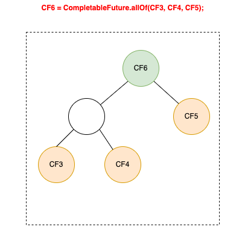

# 4 CompletableFuture 实践

## 4.1 CompletableFuture 与线程池

要合理治理线程资源，最基本的前提是在写代码时清楚地知道每一行代码都将执行在哪个线程上。下面我们看一下 `CompletableFuture` 的执行线程情况。

`CompletableFuture` 实现了 `CompletionStage` 接口，通过丰富的回调方法支持各种组合操作，每种组合场景都有同步和异步两种方法。

同步方法（即不带 `Async` 后缀的方法）有两种情况：

- 如果注册时被依赖的操作已经执行完成，则直接由当前线程执行。
- 如果注册时被依赖的操作还未执行完，则由完成被依赖操作的线程（也就是调用 `complete()` 的线程）执行。

异步方法（即带 `Async` 后缀的方法）可以通过 `Executor` 参数指定运行的线程池；不传递 `Executor` 时，会使用 `ForkJoinPool` 的公共线程池 `commonPool`。

例如：

```java
ExecutorService threadPool1 = new ThreadPoolExecutor(10, 10, 0L, TimeUnit.MILLISECONDS, new ArrayBlockingQueue<>(100));
CompletableFuture<String> future1 = CompletableFuture.supplyAsync(() -> {
    System.out.println("supplyAsync 执行线程：" + Thread.currentThread().getName());
    // 业务操作
    return "";
}, threadPool1);
// 此时，如果 future1 中的业务操作已经执行完毕并返回，则该 thenApply 直接由当前 main 线程执行；
// 否则，将会由执行以上业务操作的 threadPool1 中的线程执行。
future1.thenApply(value -> {
    System.out.println("thenApply 执行线程：" + Thread.currentThread().getName());
    return value + "1";
});
// 使用 ForkJoinPool 的公共线程池 commonPool
future1.thenApplyAsync(value -> {
    // do something
    return value + "1";
});
// 使用指定的线程池
future1.thenApplyAsync(value -> {
    // do something
    return value + "1";
}, threadPool1);
```

前面提到，异步回调方法可以选择是否传递线程池参数 `Executor`，这里**建议强制传递线程池，并根据实际情况做线程池隔离**。

不传递线程池时，所有异步回调都会共用 `commonPool`，它的并行度默认为 `CPU 核数 - 1`。`commonPool` 是为 CPU 密集型任务设计的，而业务中的异步调用大多是 RPC、数据库访问等 IO 操作，线程数很容易成为瓶颈；而且核心与非核心业务都在竞争同一个池中的线程，同一个 JVM 中的并行流也在使用它，相互之间很容易产生干扰。手动传递线程池可以更方便地调节参数，并且可以给不同的业务分配不同的线程池，实现资源隔离。

> 在 JDK 25 之前，如果 `commonPool` 的并行度小于 2（比如容器只分配了 1~2 个 CPU），不传 `Executor` 的异步方法会为每个任务新建一个线程；JDK 25 起改为统一使用 `commonPool` 执行。这一变化可能导致在低核数环境中，原本能并发执行的异步任务变成串行执行，这也是应当显式传递线程池的又一个理由。

## 4.2 常见问题

### 4.2.1 线程池循环引用导致死锁

```java
public Object doGet() {
    ExecutorService threadPool1 = new ThreadPoolExecutor(10, 10, 0L, TimeUnit.MILLISECONDS, new ArrayBlockingQueue<>(100));
    CompletableFuture<Object> cf1 = CompletableFuture.supplyAsync(() -> {
        // do sth
        return CompletableFuture.supplyAsync(() -> {
            System.out.println("child");
            return "child";
        }, threadPool1).join(); // 子任务
    }, threadPool1);
    return cf1.join();
}
```

上面的代码中，父任务和子任务使用了同一个线程池，并且父任务在线程池中阻塞等待子任务。当请求量较大、10 个线程全部被父任务占满时，子任务只能进入队列等待，而父任务又在等待子任务完成，所有线程都被阻塞，形成死锁。解决方法是为父子任务使用不同的线程池，或者用 `thenCompose` 等非阻塞的方式组织依赖，避免在线程池的任务中阻塞等待同一线程池中的其他任务。

### 4.2.2 异常被吞没

如果依赖链的末端没有处理异常，也没有调用 `join()`/`get()` 获取结果，那么异步任务中抛出的异常会被静默记录在 CF 中，不会打印任何日志，排查问题非常困难。因此依赖链的末端应当通过 `exceptionally`、`whenComplete` 等方法处理或至少记录异常。

### 4.2.3 线程上下文丢失

回调可能运行在任意线程上，基于 `ThreadLocal` 的上下文（如链路追踪 ID、用户信息、日志 MDC）不会自动传递到异步线程中，需要在提交任务时手动传递，或者使用对线程池进行包装的工具（如 TransmittableThreadLocal）。

## 4.3 Dubbo 中的 CompletableFuture

我们知道，Dubbo 在服务调用时既可以同步调用，也可以异步调用。

但是在 Dubbo 2.7 之前，异步调用存在一些不足。下面是一个早期版本的异步调用案例：

```java
// 此方法应该返回 Foo，但异步后会立刻返回 null
fooService.findFoo(fooId);
// 立刻得到当前调用的 Future 实例，当发生新的调用时它将会被覆盖
Future<Foo> fooFuture = RpcContext.getContext().getFuture();

// 调用另一个服务的方法
barService.findBar(barId);
// 立刻得到当前调用的 Future
Future<Bar> barFuture = RpcContext.getContext().getFuture();

// 此时，两个服务的方法在并发执行
// 等待第一个调用完成，线程会进入等待状态，当调用完成后被唤醒
Foo foo = fooFuture.get();
// 同上
Bar bar = barFuture.get();
// 假如第一个调用需要等待 5 秒，第二个需要等待 6 秒，则整个调用过程完成的时间是 6 秒
```

调用服务方法后，Dubbo 会创建一个 `DefaultFuture`，并将该 Future 存放到 `RpcContext` 中。用户线程想获取调用结果时，会从 `RpcContext` 中获取该 Future 并调用 `get()` 方法，但如果此时服务仍没有处理完毕，就会阻塞，直到结果返回或调用超时为止。发生阻塞时，该方法的后续步骤就得不到执行，对于异步来说，这显然是不合理的。理想的异步应当是：如果服务没有处理完，用户线程继续执行后续逻辑，而不是阻塞等待。

之前的异步方式存在以下问题：

- Future 的获取方式不够直接，只能从 `RpcContext` 中获取；
- Future 只支持通过阻塞式的 `get()` 接口获取结果；
- Future 接口无法实现自动回调，自定义的 `ResponseFuture` 虽然支持 callback 回调，但支持的异步场景有限，比如不支持 Future 间的相互协调或组合；
- 不支持 Provider 端异步。

从 Dubbo 2.7 开始，Dubbo 的异步调用改为以 `CompletableFuture` 为基础实现。

在 Dubbo 2.6 的远程调用中，关键代码如下：

```java
// DubboInvoker 类
protected Result doInvoke(final Invocation invocation) throws Throwable {
    RpcInvocation inv = (RpcInvocation) invocation;
    // 忽略部分代码
    boolean isAsync = RpcUtils.isAsync(getUrl(), invocation);
    boolean isOneway = RpcUtils.isOneway(getUrl(), invocation);
    // 忽略部分代码
    if (isOneway) {
        // 单向调用，无返回值
        boolean isSent = getUrl().getMethodParameter(methodName, Constants.SENT_KEY, false);
        currentClient.send(inv, isSent);
        RpcContext.getContext().setFuture(null);
        return new RpcResult();
    } else if (isAsync) {
        // 异步调用
        ResponseFuture future = currentClient.request(inv, timeout);
        RpcContext.getContext().setFuture(new FutureAdapter<Object>(future));
        return new RpcResult();
    } else {
        // 同步调用
        RpcContext.getContext().setFuture(null);
        return (Result) currentClient.request(inv, timeout).get();
    }
}
```

在 Dubbo 2.6 及之前的版本中，不管同步调用还是异步调用，都会调用 `HeaderExchangeClient.request()` 方法，返回一个 `DefaultFuture` 对象。不同之处在于：异步调用会将该 Future 存放到 `RpcContext` 中，并先返回一个空的 `RpcResult`；而同步调用不会将 Future 存放到 `RpcContext` 中，而是直接调用它的 `get()` 方法，阻塞等待调用结果。

```java
// HeaderExchangeChannel 类
public ResponseFuture request(Object request, int timeout) throws RemotingException {
    Request req = new Request();
    req.setVersion(Version.getProtocolVersion());
    req.setTwoWay(true);
    req.setData(request);
    DefaultFuture future = new DefaultFuture(channel, req, timeout);
    channel.send(req);
    // 忽略了部分代码
    return future;
}
```

```java
// DefaultFuture 类（忽略了部分代码）
public Object get(int timeout) throws RemotingException {
    if (!isDone()) {
        long start = System.currentTimeMillis();
        lock.lock();
        try {
            while (!isDone()) {
                done.await(timeout, TimeUnit.MILLISECONDS);
                if (isDone() || System.currentTimeMillis() - start > timeout) {
                    break;
                }
            }
        } catch (InterruptedException e) {
            throw new RuntimeException(e);
        } finally {
            lock.unlock();
        }
    }
    return returnFromResponse();
}
```

当服务端处理完请求后，`HeaderExchangeHandler` 会处理发送过来的 `Response`，根据 `requestId` 获取对应的 `DefaultFuture` 对象，最终调用 `doReceived()` 方法对结果赋值，并利用 `ReentrantLock` 的 `Condition` 唤醒阻塞的线程。

Dubbo 2.7 对异步调用进行了改良，使用了 `CompletableFuture`。下面是 Dubbo 2.7 异步调用的一个样例：

```java
// 此调用会立即返回 null
asyncService.sayHello("world");
// 拿到调用的 Future 引用，当结果返回后，会被通知和设置到此 Future
CompletableFuture<String> helloFuture = RpcContext.getContext().getCompletableFuture();
// 为 Future 添加回调
helloFuture.whenComplete((retValue, exception) -> {
    if (exception == null) {
        System.out.println(retValue);
    } else {
        exception.printStackTrace();
    }
});
```

更推荐的方式是直接在服务接口中声明返回值为 `CompletableFuture` 的方法，这样调用方无需再通过 `RpcContext` 获取 Future，Provider 端也可以借此实现异步执行：

```java
public interface AsyncService {
    CompletableFuture<String> sayHello(String name);
}
```

同样是 `DubboInvoker` 发起远程调用，2.7 版本在 `doInvoke()` 方法中进行了改进：

```java
// DubboInvoker（2.7.9 版本）
protected Result doInvoke(final Invocation invocation) throws Throwable {
    RpcInvocation inv = (RpcInvocation) invocation;
    final String methodName = RpcUtils.getMethodName(invocation);
    boolean isOneway = RpcUtils.isOneway(getUrl(), invocation);
    if (isOneway) {
        // 单向调用
        boolean isSent = getUrl().getMethodParameter(methodName, Constants.SENT_KEY, false);
        currentClient.send(inv, isSent);
        return AsyncRpcResult.newDefaultAsyncResult(invocation);
    } else {
        // 同步调用和异步调用
        ExecutorService executor = getCallbackExecutor(getUrl(), inv);
        CompletableFuture<AppResponse> appResponseFuture =
                currentClient.request(inv, timeout, executor).thenApply(obj -> (AppResponse) obj);
        FutureContext.getContext().setCompatibleFuture(appResponseFuture);
        AsyncRpcResult result = new AsyncRpcResult(appResponseFuture, inv);
        result.setExecutor(executor);
        return result;
    }
}
```

在 Dubbo 2.7 中，`DubboInvoker` 对同步调用和异步调用进行了统一处理，都封装成 `CompletableFuture`，并以 `AsyncRpcResult` 返回。

Dubbo 2.7 中 `HeaderExchangeChannel.request()` 方法与 2.6 版本相差不大，只是 `DefaultFuture` 有一点不同：新版本中它继承了 `CompletableFuture` 类。

同步调用和异步调用的区别交给 `AsyncToSyncInvoker` 类处理：

```java
public Result invoke(Invocation invocation) throws RpcException {
    // 调用 DubboInvoker 等 Invoker 返回的调用结果
    Result asyncResult = invoker.invoke(invocation);
    try {
        // 如果是同步调用
        if (InvokeMode.SYNC == ((RpcInvocation) invocation).getInvokeMode()) {
            // 不能使用 CompletableFuture#get() 方法，否则性能会出现严重下降
            asyncResult.get(Integer.MAX_VALUE, TimeUnit.MILLISECONDS);
        }
    }
    // 忽略了部分代码
    return asyncResult;
}
```

对于同步调用，`AsyncToSyncInvoker` 在这里阻塞等待结果，从而在统一的异步模型之上实现同步语义。注释中提到的性能问题与 JDK 8 的实现有关：JDK 8 中无参的 `get()` 在阻塞前会先自旋一段时间，大量线程同步等待时会白白消耗 CPU，而带超时参数的 `get()` 不会自旋；较新的 JDK 实现中已经去掉了这段自旋。Dubbo 3 延续了这套基于 `CompletableFuture` 的异步模型。

# 5 新版本中的 CompletableFuture

| 版本 | 变化 |
|------|------|
| JDK 8 | 引入 `CompletableFuture` 和 `CompletionStage` |
| JDK 9 | JEP 266：新增 `orTimeout()`、`completeOnTimeout()` 超时支持，`delayedExecutor()` 延迟执行，`completeAsync()`、`failedFuture()`、`completedStage()`、`minimalCompletionStage()`、`copy()` 等方法，支持通过 `defaultExecutor()`、`newIncompleteFuture()` 定制子类 |
| JDK 12 | `CompletionStage` 新增 `exceptionallyAsync()`、`exceptionallyCompose()`、`exceptionallyComposeAsync()` |
| JDK 19 | `Future` 新增 `resultNow()`、`exceptionNow()`、`state()`，可以非阻塞地获取结果和状态 |
| JDK 21 | 虚拟线程正式发布（JEP 444），可以通过 `Executors.newVirtualThreadPerTaskExecutor()` 作为 `Executor` 传入 |
| JDK 25 | 不指定 `Executor` 的异步方法统一使用 `commonPool`，不再在并行度小于 2 时为每个任务新建线程 |

## 5.1 虚拟线程

`CompletableFuture` 解决的核心问题是：平台线程昂贵，不能让线程阻塞等待 IO，于是用回调把“等待”变成“通知”。JDK 21 正式发布的虚拟线程从另一个角度解决了这个问题：虚拟线程非常轻量，阻塞时会自动从载体线程上卸载，因此可以放心地为每个任务创建一个虚拟线程，用同步的写法获得接近异步的吞吐量。

```java
try (ExecutorService executor = Executors.newVirtualThreadPerTaskExecutor()) {
    Future<String> f1 = executor.submit(() -> remoteCall1());
    Future<String> f2 = executor.submit(() -> remoteCall2());
    String result = f1.get() + f2.get(); // 阻塞的是虚拟线程，代价很低
}
```

对于以 IO 为主的服务调用编排，虚拟线程往往能让代码更简单，异常栈也更清晰。`CompletableFuture` 仍然适合以下场景：

- 需要复杂的编排组合（如任一完成、结果合并、超时兜底）。
- 对接本身就基于回调或 `CompletableFuture` 的异步框架（如 Dubbo、HTTP 异步客户端、响应式驱动）。
- 运行在 JDK 21 之前的版本上。

两者也可以结合使用：把 `newVirtualThreadPerTaskExecutor()` 作为 `supplyAsync()` 的 `Executor` 参数传入，让阻塞型任务运行在虚拟线程上，既保留了编排能力，又不必再为 IO 型任务精细地调整线程池大小。

## 5.2 结构化并发

`CompletableFuture` 的一个痛点是任务的生命周期不受控：某个子任务失败后，其他子任务仍会继续执行，需要手动取消。结构化并发（Structured Concurrency）通过 `StructuredTaskScope` 把一组子任务的生命周期绑定在一个代码块内，任一子任务失败时会自动取消其余子任务，代码块退出时保证所有子任务都已结束。截至 JDK 25，它仍处于预览阶段（JEP 505，第五次预览），使用时需要开启 `--enable-preview`。

# 6 总结

- `CompletableFuture` 实现了 `Future` 和 `CompletionStage` 接口，通过回调和函数式的编排方法解决了 `Future` 只能阻塞获取结果、难以组合的问题。
- 按依赖数量可以分为零依赖、一元依赖、二元依赖和多元依赖，分别对应 `supplyAsync`/`completedFuture`、`thenApply`/`thenCompose`、`thenCombine`、`allOf`/`anyOf` 等方法；异常通过 `exceptionally`、`handle`、`whenComplete` 处理。
- 其实现基于观察者模式：每个 CF 用 `result` 存储结果、用 Treiber 栈 `stack` 存储依赖动作，借助“入栈后再检查”和 CAS 抢占执行权，在全程无锁的情况下保证回调不丢失、不重复。
- 实践中应为异步方法显式指定线程池并做好隔离，阻塞获取结果时设置超时，避免父子任务共用线程池导致死锁，并在依赖链末端处理异常。
- JDK 9 起补充了超时、延迟执行等能力；JDK 21 的虚拟线程为 IO 型任务提供了更简单的同步写法，结构化并发则在进一步完善任务生命周期的管理，`CompletableFuture` 更多地回归到复杂编排和对接异步框架的场景。
