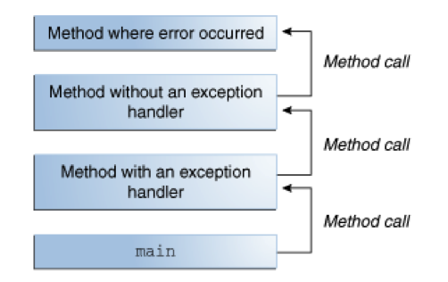
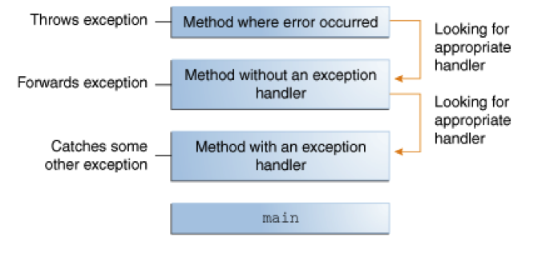
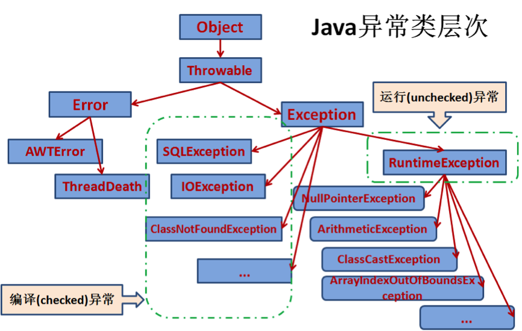

# 异常

# 1 概述

当方法内部发生一项错误时，该方法会创建一个对象并传递给运行时系统（Runtime System），这个对象被称为异常对象，包含错误的类型、发生位置、程序状态等一系列信息。

当一个方法抛出异常时，运行时系统会沿着调用栈寻找该异常的处理方式。

下图中，调用栈下面的方法调用了上面的方法，层层嵌套，一共四层：



调用第三个方法时抛出了一个异常，运行时系统就会沿着调用栈反向寻找该异常的处理程序，当该异常类型与某个异常处理程序声明的异常类型一致（或是其子类）时，系统就将该异常交给它处理。



如果沿着调用栈一直找不到合适的异常处理程序，当前线程就会终止，并由默认的未捕获异常处理器打印异常堆栈；如果终止的是主线程，并且没有其他非守护线程在运行，整个程序随之退出。

# 2 异常类型

Java 提供了两种处理异常的方式：

- 使用 `try` 语句捕获异常并处理；
- 使用 `throws` 关键字列出要抛出的异常类型，代表在本方法内不做处理，但是调用该方法的方法必须处理该异常或者继续抛出。

并不是所有异常都需要显式处理（这里的处理代表在程序内部捕获或者抛出），比如 `IOException`、`SQLException` 等是必须要处理的，而 `NullPointerException`、`ArithmeticException`、`IndexOutOfBoundsException` 等可以不做处理。

理解这一点，就要弄清异常的基本分类。

## 2.1 Checked Exception

受检异常（Checked Exception）是应用程序可以预见并能够恢复的错误，比如，应用程序需要用户输入一个文件名，然后程序将对这个文件进行读写操作。假如用户输入的文件名不存在，抛出 `java.io.FileNotFoundException`，应用程序应该捕获这个异常并提醒用户。类似这种异常就属于 Checked Exception。

**除了 `Error`、`RuntimeException` 以及两者的子类，所有异常都属于 Checked Exception**。

`Error` 与 `RuntimeException` 合称为非受检异常（Unchecked Exception）。

## 2.2 Error

`Error` 一般表示 JVM 或运行环境层面的严重问题，应用程序通常不能预见并恢复。常见的有内存耗尽时的 `OutOfMemoryError`、递归过深时的 `StackOverflowError`；再比如，程序顺利打开了一个文件，但是由于硬件或者操作系统故障，不能够读取文件中的内容，程序就会抛出 `java.io.IOError`。

注意 `Error` 与 `Exception` 是平级的，都直接继承自 `Throwable`，严格来说它并不属于“异常（Exception）”。`Error` 不是必须处理的，一般也不建议捕获它。

## 2.3 RuntimeException

运行时异常（`RuntimeException`）一般来说是程序内部引起的异常，应用程序通常不能预见也难以恢复。这类异常的出现一般暗示程序存在 Bug。比如，还是文件操作的例子，由于逻辑错误，传入的文件名为空值，程序就会抛出一个 `NullPointerException`。

虽然可以让程序捕获 `RuntimeException`，但更合适的做法是修复引起这类异常的 Bug。

Java 的异常类层次图如下：



# 3 异常的捕获

Checked Exception 必须捕获（或声明抛出），而 Unchecked Exception 的捕获不是必须的。例如：

```java
import java.io.*;
import java.util.List;
import java.util.ArrayList;

public class ListOfNumbers {
    private List<Integer> list;
    private static final int SIZE = 10;

    public ListOfNumbers() {
        list = new ArrayList<>(SIZE);
        for (int i = 0; i < SIZE; i++) {
            list.add(i);
        }
    }

    public void writeList() {
        try {
            // FileWriter 的构造方法 throws IOException，属于 Checked Exception，必须捕获
            PrintWriter out = new PrintWriter(new FileWriter("OutFile.txt"));

            for (int i = 0; i < SIZE; i++) {
                // get(int) 方法 throws IndexOutOfBoundsException，是 RuntimeException 的子类，属于 Unchecked Exception，不是必须捕获的
                out.println("Value at: " + i + " = " + list.get(i));
            }
            out.close();
        } catch (IOException e) { // 捕获 IOException
            // ...
        }
    }
}
```

Unchecked Exception 在一些特殊的情况下也可以选择捕获它，比如上面的程序，现在既要捕获 `IOException`，也要捕获 `IndexOutOfBoundsException`，改写如下：

```java
    public void writeList() {
        try {
            // FileWriter 的构造方法 throws IOException，属于 Checked Exception，必须捕获
            PrintWriter out = new PrintWriter(new FileWriter("OutFile.txt"));

            for (int i = 0; i < SIZE; i++) {
                // get(int) 方法 throws IndexOutOfBoundsException，是 RuntimeException 的子类，属于 Unchecked Exception，不是必须捕获的
                out.println("Value at: " + i + " = " + list.get(i));
            }
            out.close();
        } catch (IndexOutOfBoundsException e) { // 捕获 IndexOutOfBoundsException
            // ...
        } catch (IOException e) { // 捕获 IOException
            // ...
        }

    }
```

如果要同时捕获的异常存在继承关系，即某个异常是另一个异常的子类，必须把父类异常写在子类异常后面，否则会报编译错误。但是，无论有几个捕获语句，最终至多会进入一个 `catch` 语句。

例如：

```java
    public class Example {

        public void test() throws IOException {
            throw new IOException();
        }

        public static void main(String[] args) {

            Example example = new Example();

            try {
                example.test();
            } catch (IOException e) {
                System.out.println("捕获了子类异常");
            } catch (Exception e) {
                System.out.println("捕获了父类异常");
            }

        }

    }
```

上例中，`IOException` 是 `Exception` 的子类，如果方法抛出了 `IOException` 异常，会进入第一个 `catch` 子句，但不会进入第二个 `catch` 子句；如果抛出的是非 `IOException` 的其他 `Exception` 子类异常，则会直接进入第二个 `catch` 子句。也就是说，不会同时进入两个 `catch` 子句。

从 Java 7 以后，一个 `catch` 块可以捕获多个异常，上面的捕获语句可简写为：

```java
catch (IndexOutOfBoundsException | IOException ex) {
    // ...
}
```

需要注意的是，这种情况下，`catch` 的参数（上例中的 `ex`）隐式为 `final`，不能够在 `catch` 块中对它再次赋值；并且用 `|` 连接的异常类型之间不能存在继承关系。

无论异常是否发生，`try` 代码块退出后，`finally` 代码块都会执行，常常用于释放资源。例如：

```java
    public void writeList() {
        PrintWriter out = null;
        try {
            out = new PrintWriter(new FileWriter("OutFile.txt"));

            for (int i = 0; i < SIZE; i++) {
                out.println("Value at: " + i + " = " + list.get(i));
            }

        } catch (IOException e) {
            // ...
        } finally { // 释放资源
            if (out != null) {
                out.close();
            }
        }
    }
```

有三种情况可导致 `try` 代码块退出：

- `new FileWriter("OutFile.txt")` 抛出 `IOException`
- `list.get(i)` 抛出 `IndexOutOfBoundsException`
- 无异常抛出，代码执行完毕

无论发生了上面的哪种情况，运行时系统都会保证 `finally` 代码块中的程序执行。

需要注意的是，以下情况中 `finally` 代码块可能不会被执行：调用了 `System.exit()`、进程被强制杀死（如 `kill -9`）、JVM 崩溃、执行 `try` 代码块的是守护线程而 JVM 已经退出，或者 `try` 代码块中出现了死循环、死锁而永远无法退出。注意，线程被 `interrupt()` 中断并不会跳过 `finally`。

带有返回值的函数中使用了 `try-catch-finally` 块，且返回值与是否发生异常有关，则应该避免将返回值写在 `finally` 块中，因为无论是否会发生异常，都会按照 `finally` 块的返回值，而忽略 `try-catch` 任何地方的返回值。例如：

```java
    public int test() {
        InputStream in = null;
        try {
            File f = new File("F:/test.txt");
            in = new FileInputStream(f);
            return 1;
        } catch (IOException e) {
            e.printStackTrace();
            return 2;
        } finally {
            try {
                if (in != null) {
                    in.close();
                }
            } catch (IOException e) {
                e.printStackTrace();
            }
            return 3;
        }
    }
```

上例中，无论是否会抛出 `IOException`，都不会返回 1 或 2，只会返回 3。更危险的是，`finally` 中的 `return` 还会“吞掉”`try` 或 `catch` 中抛出的异常，让调用方完全感知不到错误，编译器（`javac -Xlint`）也会对此给出 `finally clause cannot complete normally` 警告。

在 `try` 中打开的一个或多个资源，使用完毕后应该关闭，通常我们是在 `finally` 代码块中完成这项工作。

从 Java 7 开始，提供了一种更为简洁有效的写法：`try-with-resources` 语句。

使用形式如下：

```java
    static String readFirstLineFromFile(String path) throws IOException {
        try (BufferedReader br =
                     new BufferedReader(new FileReader(path))) {
            return br.readLine();
        }
    }
```

`try-with-resources` 确保 `{}` 内的程序执行完毕后自动关闭资源，所有实现了 `java.lang.AutoCloseable` 接口（Java 7 新增的接口，是 `java.io.Closeable` 的父接口）的对象都可以当作资源。多个资源用分号隔开，关闭顺序与声明顺序相反。

`try-with-resources` 还有两点值得注意：

- 如果 `try` 块和 `close()` 方法都抛出了异常，抛给调用方的是 `try` 块中的异常，`close()` 的异常作为**被抑制的异常**附加在上面，可通过 `Throwable.getSuppressed()` 获取，不会像手写 `finally` 那样被覆盖丢失。
- 从 Java 9 开始，如果资源变量已经在外部声明并且是 `final` 或事实上的 `final`（Effectively Final），可以直接写成 `try (br) { ... }`，无需再次声明。

# 4 throw 与 throws

捕获异常的前提是有方法抛出了异常。

`throw` 关键字用于在方法体内部，发生错误的地方抛出异常。如：

```java
    public Object pop() {
        Object obj;

        if (size == 0) { // 栈为空，抛出异常
            throw new EmptyStackException();
        }

        obj = objectAt(size - 1);
        setObjectAt(size - 1, null);
        size--;
        return obj;
    }
```

该方法用于从栈中弹出栈顶元素，但是，如果栈为空就不能进行这项操作，所以就会抛出 `EmptyStackException` 异常。

当其他方法调用 `pop()` 方法时，就应该考虑到 `pop()` 可能会抛出的异常：如果 `pop()` 抛出的是 Unchecked Exception，可以不做额外的处理；如果 `pop()` 抛出的是 Checked Exception 则必须进行处理，可以用 `try-catch` 捕获，也可以选择在本方法内不做捕获，继续用 `throws` 关键字抛出，如：

```java
public void callPop() throws EmptyStackException {
    // ...
    pop(); // 该方法可能会抛出 EmptyStackException
    // ...
}
```

这里的 `EmptyStackException` 是 `RuntimeException` 的子类，用 `throws` 声明只是起到提示调用方的作用，不声明也能编译通过；如果换成 Checked Exception，这个声明（或者 `try-catch`）就是必需的。

实际上，一个异常很多时候是由于另一个异常（称为 Cause）引起的，而 Cause 自身也会有 Cause，依此类推，就形成了链式异常（Chained Exceptions）。例如：

```java
try {
    // ...
} catch (IOException e) { // 捕获到 IOException 时，抛出另一个异常
    throw new SampleException("Other IOException", e);
}
```

`Throwable` 提供了接受 `Throwable` 类型参数的构造方法（如 `Throwable(String message, Throwable cause)`），用来指定引起该异常的 Cause；`Throwable` 类的 `initCause(Throwable)`、`getCause()` 方法可以设置、获取 Cause 信息。

# 5 新版本改进与实践建议

近几个版本的 Java 对异常也做了一些改进，结合日常开发，有以下几点值得关注：

- **Helpful NullPointerExceptions**：JDK 14（JEP 358）引入、JDK 15 起默认开启。空指针异常的消息会直接指出是哪个变量或表达式为 `null`，例如 `Cannot invoke "String.length()" because "user.name" is null`，排查效率大大提高。
- **优先使用 `try-with-resources`**：凡是实现了 `AutoCloseable` 的资源（流、数据库连接、锁的包装等），都应该用它代替手写 `finally` 关闭。
- **不要吞掉异常**：`catch` 块中至少要记录日志，生产代码中用日志框架代替 `e.printStackTrace()`；包装成新异常抛出时要把原异常作为 Cause 传入，保留完整的异常链。
- **不要用异常控制正常流程**：异常的创建需要填充堆栈，开销较大，能用条件判断规避的情况（如判空、判断下标范围）不要依赖捕获异常处理。

总之，Checked Exception 用于调用方能够预见并处理的情况，`RuntimeException` 通常意味着程序 Bug，`Error` 则是程序难以应对的严重问题。理解这三类异常的区别，再配合 `try-with-resources` 和清晰的异常链，就能写出健壮、易排查的代码。