# Disruptor

# 1 ArrayBlockingQueue 的局限性

队列是一种使用非常广泛的数据结构，JDK 中提供了多种多样的队列实现。假如要选择一种队列作为 JVM 内线程间的异步通信工具，应该选择哪一种呢？

`java.util` 包下的 `ArrayDeque`、`LinkedList`、`PriorityQueue` 等队列实现没有任何同步措施，读写性能很高，但只能在单线程环境下使用，首先被排除。

线程安全的队列实现集中在 `java.util.concurrent` 包下面，常见的有下列几种：

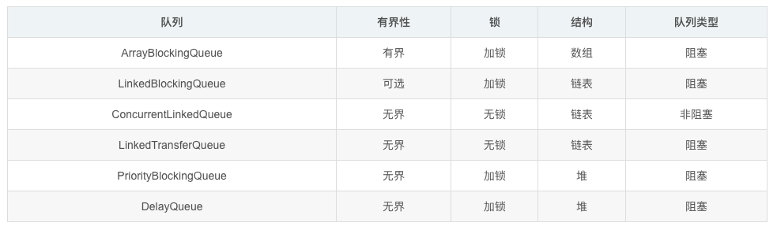

队列的底层一般分成三种：数组、链表和堆。其中，堆一般是为了实现带有优先级特性的队列，暂且不考虑。

可以发现，通过不加锁的方式（CAS）实现的队列都是无界的，无法保证队列长度在确定的范围内；而加锁的方式可以实现有界队列。在稳定性和性能要求特别高的系统中，为了防止生产者速度过快导致内存溢出，**只能选择有界队列**。

队列的读写往往是顺序进行的：取出一个元素之后紧接着取下一个，或者一次批量取出多个。数组在内存中地址连续，能充分利用 CPU 缓存（见 1.2.2 节），访问速度更快；而链表每次入队都要创建一个节点对象，数组则没有这部分开销，可以减轻垃圾回收对系统性能的影响。因此要**尽量选择数组这样的数据结构**。

这样筛选下来，符合条件的队列就只有 `ArrayBlockingQueue`。事实上，很多框架的异步组件都选择了它，比如 Logback 的 `AsyncAppender`、Log4j 2 的 `AsyncAppender` 默认都使用 `ArrayBlockingQueue` 作为缓冲队列。

但是，`ArrayBlockingQueue` 在高并发场景下，会因为**加锁**和**伪共享**等原因出现明显的性能问题，下面来分析一下。

## 1.1 加锁

保证线程安全一般有两种方式：

* **悲观锁**：`synchronized`、`ReentrantLock` 等
* **乐观锁**：CAS

### 1.1.1 悲观锁

悲观锁默认线程之间会发生冲突，访问数据前先加锁，访问之后再解锁，通过锁界定一个临界区，同一时刻只有一个线程能进入。

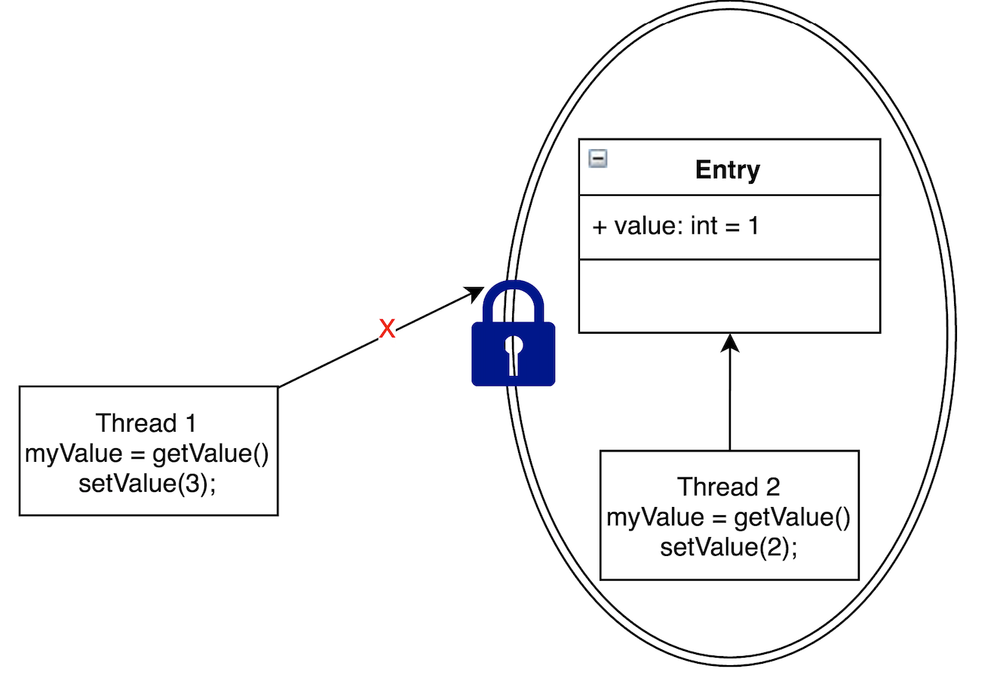

如上图所示，Thread2 访问 Entry 时加了锁，Thread1 就无法再执行访问 Entry 的代码，从而保证线程安全。

下面是 `ArrayBlockingQueue` 通过加锁实现的 `offer` 方法：

```java
public boolean offer(E e) {
    Objects.requireNonNull(e);
    final ReentrantLock lock = this.lock;
    lock.lock();
    try {
        if (count == items.length)
            return false;
        else {
            enqueue(e);
            return true;
        }
    } finally {
        lock.unlock();
    }
}
```

`ArrayBlockingQueue` 的入队和出队共用同一把 `ReentrantLock`，生产者之间、消费者之间以及生产者与消费者之间都会相互竞争，这严重拉低了队列的性能上限。线程竞争不到锁时会被挂起，锁释放后再被唤醒，这个过程涉及系统调用和上下文切换，开销很大；而且线程在等待锁期间什么也做不了。

### 1.1.2 CAS

乐观锁的思路是：执行某个操作时，先假定不会发生冲突，若没有冲突则直接成功；若发生冲突则本次操作失败，重新读取最新值后再次尝试，直到成功为止。CAS（Compare And Swap，比较并交换）就是典型的乐观锁实现，要么比较并交换成功，要么失败，由 CPU 保证原子性。

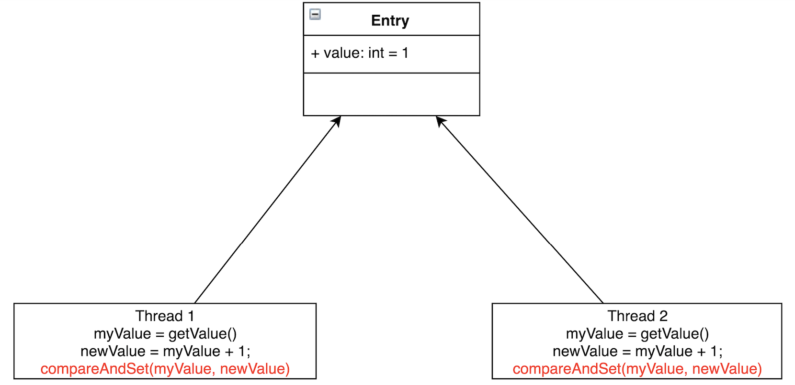

如图所示，Thread1 和 Thread2 都要把 Entry 的值加 1。如果既不加锁也不使用 CAS，有可能 Thread1 读到了 `myValue=1`，Thread2 也读到了 `myValue=1`，各自加 1 后写回，Entry 的值为 2。这与预期不符，我们预期 Entry 的值经过两次相加后等于 3。

CAS 会先把 Entry 当前的值与线程之前读到的值相比较，若相同则赋值，若不同则本次赋值失败。一般会通过 `while`/`for` 循环重新执行，直到赋值成功。

下面是 JDK 8 中 `AtomicInteger` 的 `updateAndGet` 方法：

```java
public final int updateAndGet(IntUnaryOperator updateFunction) {
    int prev, next;
    do {
        prev = get();
        next = updateFunction.applyAsInt(prev);
    } while (!compareAndSet(prev, next));
    return next;
}

/**
 * Atomically sets the value to the given updated value
 * if the current value {@code ==} the expected value.
 */
public final boolean compareAndSet(int expect, int update) {
    return unsafe.compareAndSwapInt(this, valueOffset, expect, update);
}
```

**CAS 对应的是 CPU 的原子指令**（如 x86 上的 `lock cmpxchg`），由硬件保证原子性。JDK 9 起，`AtomicInteger` 改用 `jdk.internal.misc.Unsafe` 的 `compareAndSetInt` 等方法；应用代码则推荐使用 JDK 9 引入的 `VarHandle` 来实现 CAS，不再直接使用 `sun.misc.Unsafe`。

在竞争极其激烈的情况下，大量 CAS 失败重试会白白消耗 CPU，此时锁的表现可能反而更好；但在更常见的中低程度竞争下，**CAS 的性能优于锁**，而且不会出现死锁等活跃性问题。

## 1.2 伪共享

### 1.2.1 CPU 的多级缓存

缓存大小是 CPU 的重要指标之一，缓存的结构和大小对 CPU 速度的影响非常大。CPU 内缓存的运行频率极高，一般与处理器同频运作，速度远远高于系统内存和硬盘。实际工作时，CPU 往往需要重复读取同样的数据块，缓存容量越大，命中率越高，就越不需要到内存或硬盘上寻找数据，以此提高系统性能。但出于芯片面积和成本的考虑，缓存都很小。

CPU 缓存可以分为一级缓存、二级缓存，如今主流 CPU 还有三级缓存，有些 CPU 甚至有四级缓存。这几级缓存的技术难度和制造成本依次递减，容量则依次递增。在包含式（inclusive）缓存设计中，上一级缓存的数据都是下一级缓存的子集；不过现代 CPU 也大量采用非包含式（non-inclusive）或排他式（exclusive）设计，比如 Intel 自 Skylake-SP 起的服务器 CPU、AMD Zen 系列的 L3 缓存。

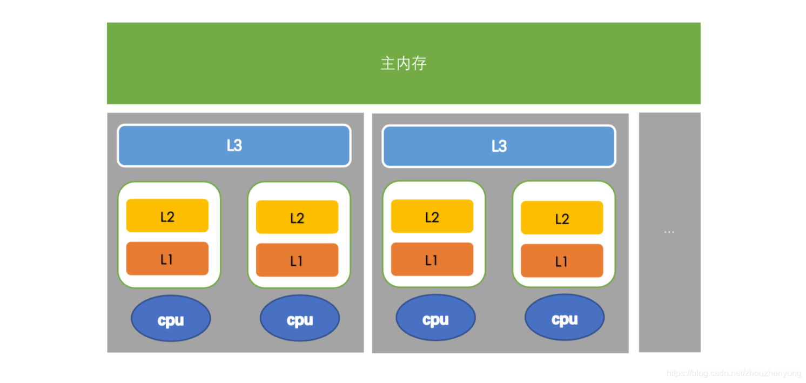

L1、L2、L3 分别表示一级缓存、二级缓存、三级缓存，越靠近 CPU 的缓存速度越快、容量越小。L1 缓存很小但很快，紧挨着使用它的 CPU 核；L2 大一些、慢一些，通常也只被单个 CPU 核使用（部分架构如 Apple M 系列的 L2 由多个核共享）；L3 更大、更慢，被同一个插槽上的所有 CPU 核共享；最后是主存，由所有插槽上的所有 CPU 核共享。

CPU 执行运算时，先去 L1 查找所需的数据，再去 L2、L3，如果这些缓存中都没有，就要去主内存读取。走得越远，耗费的时间就越长。所以对于非常频繁的操作，要尽量确保数据在 L1 缓存中。

下面是 CPU 访问不同层级数据的大致耗时：

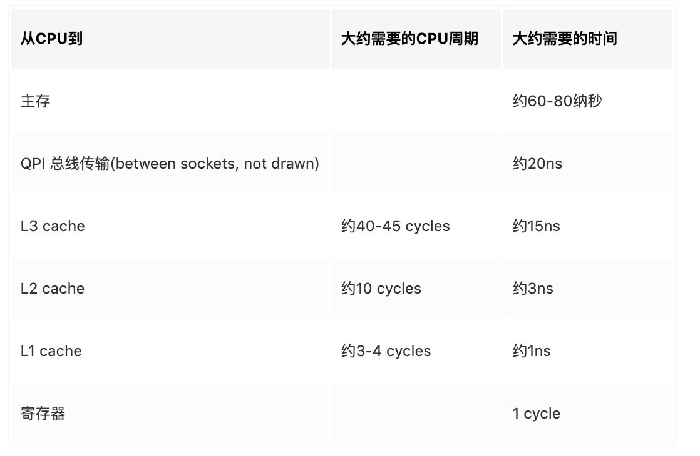

需要注意的是，多个线程共享数据时，并不一定要经过主内存中转：多核 CPU 通过**缓存一致性协议**（如 MESI）保证各个核缓存的数据一致，一个核修改了数据，其他核持有的副本会被置为失效，再次读取时可以直接从持有最新数据的核的缓存（或共享的 L3）中获取。

有人会问：既然每个核都有自己的缓存，一个线程会不会读到另一个线程修改之前的旧值呢？

答案是会的。缓存一致性协议本身能保证缓存行的一致，但为了提升性能，CPU 在核与缓存之间还加入了存储缓冲区（store buffer）和失效队列（invalidate queue），写操作和失效消息都可能被延迟处理，再加上编译器和 CPU 的指令重排序，另一个线程就可能读到旧值。解决办法是**内存屏障**（memory barrier）：它是一类 CPU 指令，禁止屏障前后的读写操作越过屏障重排序，并会刷新存储缓冲区、处理失效队列，从而保证屏障之后读到的是最新数据。**对应到 Java 层面就是关键字 `volatile`**：JVM 会在 `volatile` 变量的读写前后插入相应的内存屏障。

### 1.2.2 缓存行

缓存一致性协议的基本单位是 Cache Line，也就是**缓存行**。缓存由很多个缓存行组成，缓存行的大小通常是 64 字节（Apple M 系列等部分 ARM 处理器为 128 字节）。下面以 64 字节为例，Java 的 `long` 类型占 8 字节，一个缓存行就可以存放 8 个 `long` 变量，如下图所示：

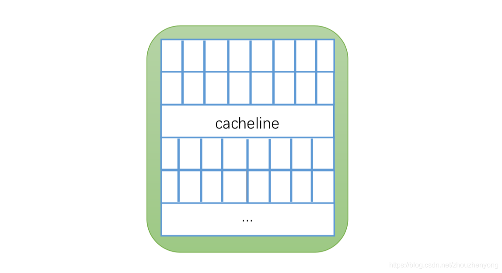

CPU 从主内存加载数据时以缓存行为单位，会**把相邻的数据一起加载到同一个缓存行中**。比如访问一个 `long` 数组中的某个元素时，与它相邻的另外 7 个元素也会一并被加载进缓存，后续访问这些元素就会非常快。

前面说选择数组而不选择链表，也是这个原因：数组元素连续存放，可以充分利用缓存行；链表节点分散在堆中，很难享受到这个好处。

### 1.2.3 伪共享

根据 **MESI 协议**，当某个核修改了缓存行中的数据时，其他核中持有同一缓存行的副本都会被置为失效。

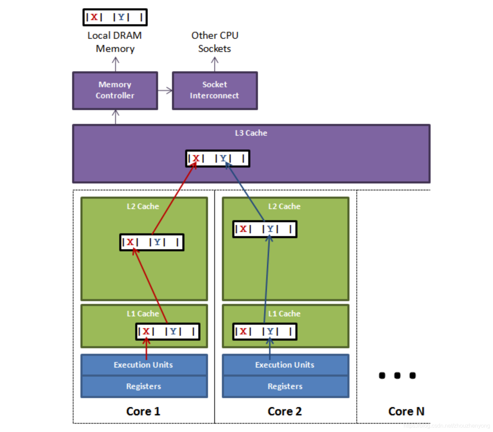

上图展示的是同一个插槽上的多个 CPU 核。如果 CPU1 上的线程更新了变量 X，根据 MESI 协议，其他核中包含 X 的缓存行都会失效（注意：虽然改的只是 X，但 X 和 Y 位于同一个缓存行，Y 也跟着失效了）。这时如果 CPU2 上的线程读取变量 Y，就会发现缓存行已失效，只能重新从 CPU1 的缓存、L3 或主内存中获取这个缓存行。如果两个线程交替修改 X 和 Y，同一个缓存行就会在两个核之间来回传递（cache line ping-pong），性能会严重下降，这就是**伪共享**（false sharing）。

表面上 X 和 Y 被不同的线程独立操作，两个操作之间也没有任何关系，只不过它们共享了一个缓存行，所有的竞争冲突都来源于此。

那么 `ArrayBlockingQueue` 的伪共享问题存在于哪里呢？

`ArrayBlockingQueue` 有三个成员变量：

* `takeIndex`：下一个被取走的元素下标
* `putIndex`：下一个可插入元素的位置下标
* `count`：队列中元素的数量

这三个变量很容易被放到同一个缓存行中，而它们由不同的线程修改：生产者修改 `putIndex` 和 `count`，消费者修改 `takeIndex` 和 `count`，每次修改都会让对方缓存中的这个缓存行失效。

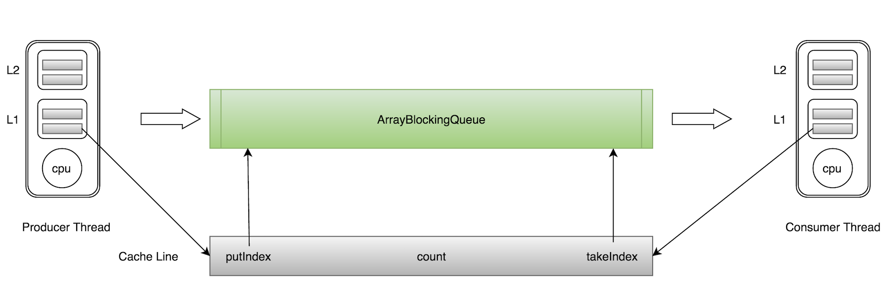

如上图所示，当生产者线程向 `ArrayBlockingQueue` 中 `put` 一个元素时，`putIndex` 会被修改，导致消费者线程缓存中的缓存行失效，需要重新读取。

需要说明的是，由于 `ArrayBlockingQueue` 的读写本来就被同一把锁串行化，伪共享在这里只是次要因素，锁才是主要瓶颈；但在 Disruptor 这类无锁设计中，伪共享会成为突出的性能问题，必须专门处理。

# 2 Disruptor 概述

有没有一种比 `ArrayBlockingQueue` 更好的队列，能同时满足以下条件呢？

* 线程安全
* 有界
* 无锁
* 高性能

答案就是 **Disruptor**。

> Disruptor 是英国外汇交易公司 LMAX 开发的一个高性能队列，于 2011 年开源，其官网定义为：`High Performance Inter-Thread Messaging Library`，即线程间的高性能消息库。LMAX 基于 Disruptor 构建的业务逻辑处理器单线程能支撑每秒 600 万笔订单，2010 年在 QCon 演讲后获得了业界关注，2011 年 Disruptor 还获得了 Oracle 官方的 Duke's Choice Award。

Disruptor 研发的初衷是解决内存队列的延迟问题。与 Kafka、RocketMQ 等进程间的分布式消息队列不同，Disruptor 用于同一个进程内线程之间的消息传递。

Disruptor 非常轻量，但性能却非常强悍：在多种场景下，它的吞吐量是 `ArrayBlockingQueue` 的数倍，延迟更是低了几个数量级。

需要注意的是，“每秒 600 万订单”是 LMAX 整个业务逻辑处理器在单线程上的处理能力，Disruptor 负责高效地把输入事件交给它、再把处理结果送出去。这个数字衡量的是整体架构，并不意味着任意业务接入 Disruptor 后都能达到这样的 TPS。此外，这是 2010 年前后的硬件水平，在如今的硬件上，Disruptor 单纯的消息派发吞吐量可以达到每秒数千万级。

Disruptor 到底有多快，可以通过测试数据有个直观印象：

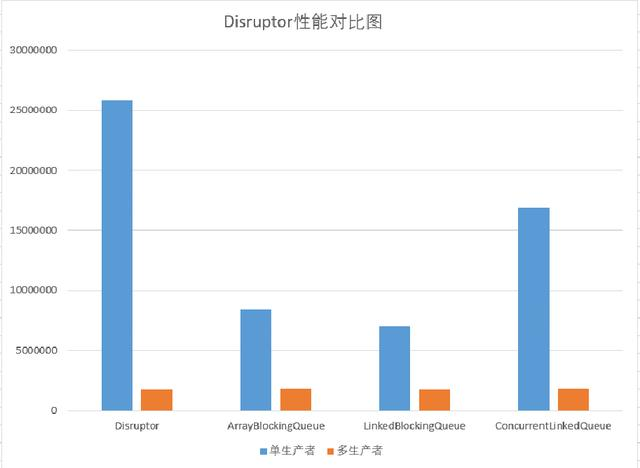

在普通 PC 上，Disruptor 在单生产者情况下吞吐量能达到每秒 2500 万以上，远超其他队列。而在多生产者的情况下，几个队列的吞吐量基本一致，说明在多线程环境下，性能瓶颈已经不在队列本身。

再看 Log4j 2 官网的性能测试截图：

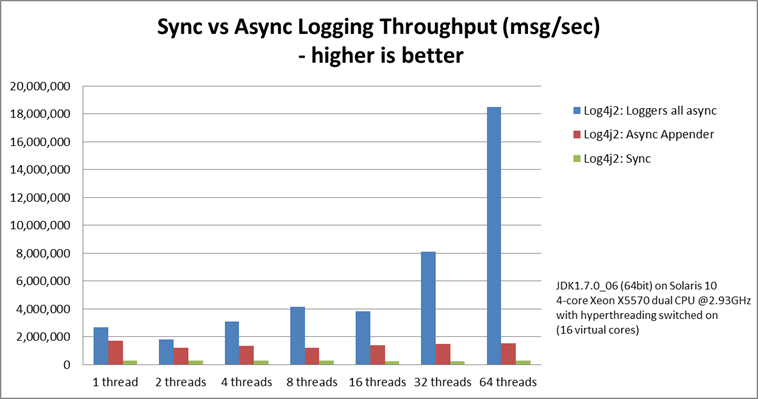

`Loggers all async` 采用的是 Disruptor，而 `Async Appender` 采用的是 `ArrayBlockingQueue`。

由图可见，单线程情况下，`Loggers all async` 与 `Async Appender` 的吞吐量相差不大；但在 64 个线程时，`Loggers all async` 的吞吐量约为 `Async Appender` 的 12 倍，是同步模式的 68 倍。（该测试基于 JDK 1.7 和 Solaris 10，数据较早，但相对差距依然有参考意义。）

Disruptor 出色的性能使其得到了很多开源项目的青睐，如 Log4j 2（异步日志器）、HBase（WAL 写入）、Apache Camel（camel-disruptor 组件）以及早期的 Apache Storm 等。Storm 自 2.0 起已改用 JCTools 的队列替换了 Disruptor。

# 3 Disruptor 原理

Disruptor 之所以性能出色，主要依靠三项关键设计：

* **环形数组 RingBuffer**
* **CAS 无锁设计**
* **消除伪共享**

## 3.1 环形数组

环形数组是整个 Disruptor 的核心所在。

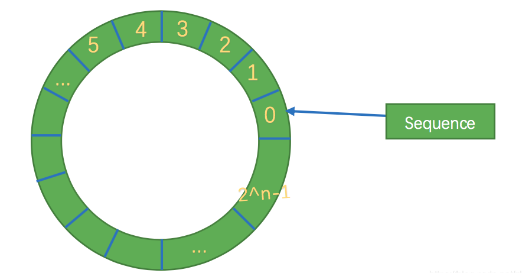

它的实质就是一个普通的数组，当数据填充到数组末尾（下标 `2^n - 1`）之后，再填充数据就会从下标 0 开始覆盖之前的数据，就像一个环。

RingBuffer 不会主动删除数据，**数据会一直保存在数组中，直到被新数据覆盖**。生产者只有在确认某个位置的数据已被所有消费者处理过之后才会覆盖它，否则会等待消费者，因此不会丢失尚未消费的数据。

RingBuffer 没有传统队列的头指针和尾指针，而是用一个只增不减的序号（Sequence，`long` 类型）标识写入进度，每个消费者也各自维护一个序号标识自己的消费进度。随着数据不断写入，序号会一直增长，并绕着环一圈圈地前进。

要找到序号对应的数组元素，可以通过 `sequence & (arrayLength - 1)` 计算下标。比如数组长度为 8，序号 11 对应的下标就是 `11 & 7 = 3`。HashMap 也是用这种方式定位桶的，比取模运算更快。

RingBuffer 的数据结构有以下优势：

* 数组元素在内存中连续存储，对 CPU 缓存友好：一个元素被加载到缓存行时，相邻的几个元素也会被一起加载，CPU 无需频繁去主存读取下一个元素。
* 数组在初始化时就**预先分配好所有元素对象**（通过 `EventFactory` 创建），之后只修改对象的字段而不创建新对象，避免了频繁的对象分配和垃圾回收。
* 数组长度为 2 的 n 次方，**元素定位可以通过位运算完成**，效率更高。

## 3.2 无锁设计

下面暂时忽略数组的环形结构，看一下 Disruptor 如何实现无锁设计。

Disruptor 的生产者分为单生产者和多生产者两种模式，分别对应 `SingleProducerSequencer` 和 `MultiProducerSequencer`，消费者则不做区分。

* 单生产者模式下，只有一个线程写入，不存在写冲突，**完全不需要 CAS**，只需普通读写加上必要的内存屏障来更新序号。消费者获取最大可消费的位置后进行消费。
* 多生产者模式下，多出了一个与 RingBuffer 等长的数组，称为 **availableBuffer**。每个生产者先通过 CAS 竞争获取可写的空间，然后再往里写入数据；消费者在消费前，需要从 availableBuffer 中找出已经写入完成的最长连续序号。

### 3.2.1 单生产者

单生产者写数据的流程比较简单：

1. 申请写入 m 个元素；
2. 若有 m 个位置可以写入，则返回最大的序号，这里主要判断是否会覆盖尚未被消费的元素；
3. 申请成功后，生产者开始写入元素。

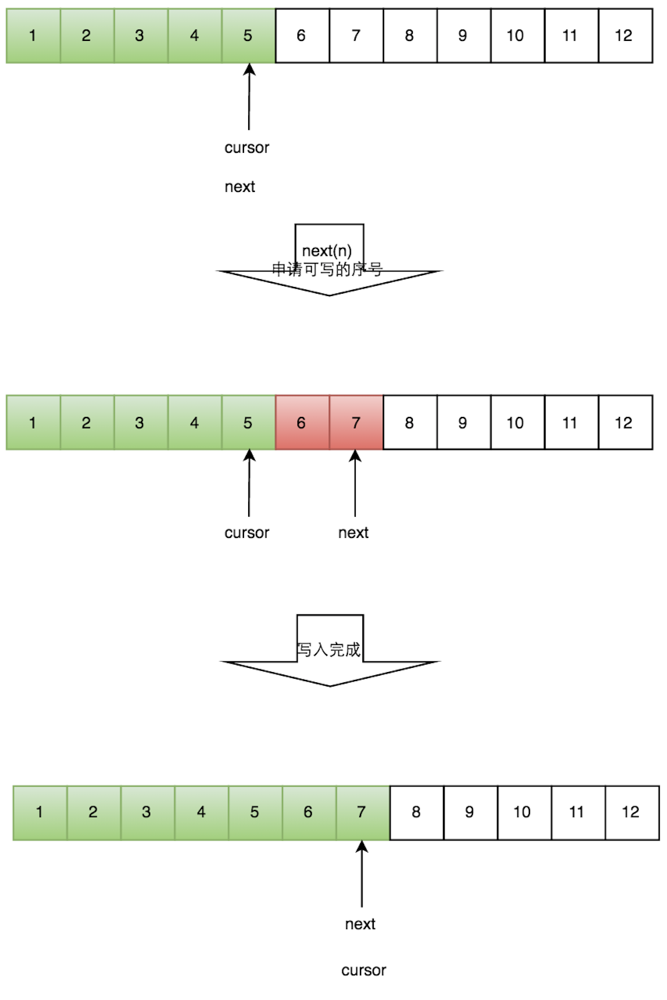

### 3.2.2 多生产者

多个生产者同时写入时，会遇到“**如何防止多个线程重复写同一个位置**”的问题。Disruptor 的解决方法是让每个线程获取不同的一段数组空间进行操作，这通过 CAS 很容易做到：分配空间时，用 CAS 判断这段空间是否已经被分配出去即可。

多个生产者写入的流程如下：

1. 申请写入 m 个元素；
2. 若有 m 个位置可以写入，则返回最大的序号，每个生产者会被分配一段独享的空间；
3. 生产者写入元素，同时设置 availableBuffer 中相应的位置，标记哪些位置已经写入成功。

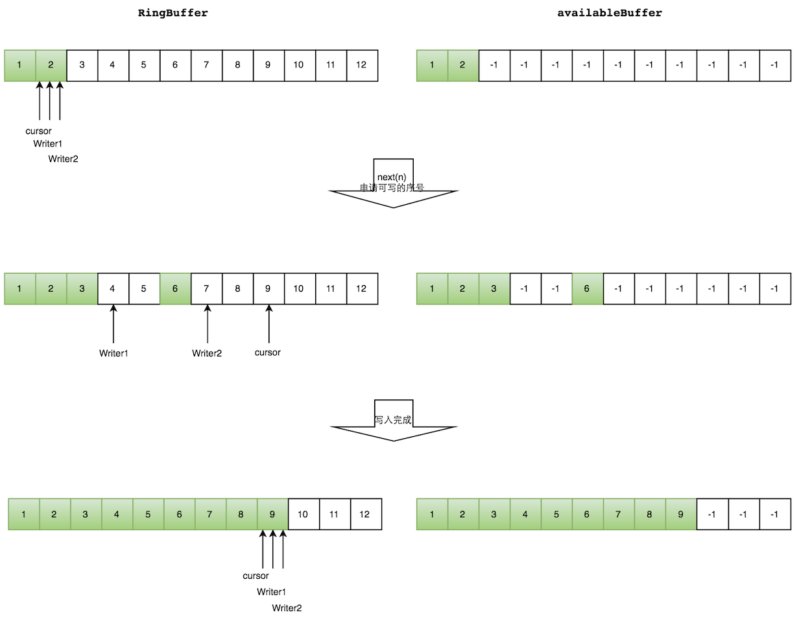

如上图所示，Writer1 和 Writer2 两个线程都申请了可写的数组空间：Writer1 被分配了下标 3 到 5 的空间，Writer2 被分配了下标 6 到 9 的空间。

Writer1 写入下标 3 的元素，同时把 availableBuffer 中相应的位置置位，标记写入成功，然后后移一位，开始写下标 4 的元素。Writer2 也是同样的方式，最终都写入完成。

防止不同生产者对同一段空间写入的代码如下：

```java
public long tryNext(int n) throws InsufficientCapacityException
{
    if (n < 1)
    {
        throw new IllegalArgumentException("n must be > 0");
    }

    long current;
    long next;

    do
    {
        current = cursor.get();
        next = current + n;

        if (!hasAvailableCapacity(gatingSequences, n, current))
        {
            throw InsufficientCapacityException.INSTANCE;
        }
    }
    while (!cursor.compareAndSet(current, next));

    return next;
}
```

do/while 循环的条件 `cursor.compareAndSet(current, next)` 用来判断申请的空间是否已被其他生产者抢占：如果 CAS 失败，说明 `cursor` 已经被其他生产者修改，需要重新读取并再次申请。

`tryNext` 是非阻塞版本，空间不足时直接抛出异常。阻塞版本的 `next(n)` 在较新的版本中改为直接调用 `cursor.getAndAdd(n)` 一次性占位，空间不足时再自旋等待消费者，避免了 CAS 失败重试的开销。

### 3.2.3 消费者

消费者需要面对的问题是：**如何防止读到还没写完的元素**。

答案是借助 availableBuffer。生产者写入某个位置后，会把 availableBuffer 中对应的位置标记为已发布。这个标记并不是简单的 0/1，而是该序号所在的“圈数”（`sequence >>> indexShift`，即序号除以数组长度），这样 RingBuffer 绕圈之后无需重置标记，旧一圈的标记自然就失效了。Disruptor 4.x 通过 `VarHandle` 以 `setRelease`/`getAcquire` 的方式读写这些标记，在保证可见性的同时避免了完整内存屏障的开销。

消费者读取的流程如下：

1. 申请读取到序号 n；
2. 若 writer cursor >= n，此时仍无法确定连续可读的最大序号，需要从 reader cursor 开始检查 availableBuffer，直到遇到第一个尚未发布的位置，返回最大连续可读的序号；
3. 消费者读取元素。

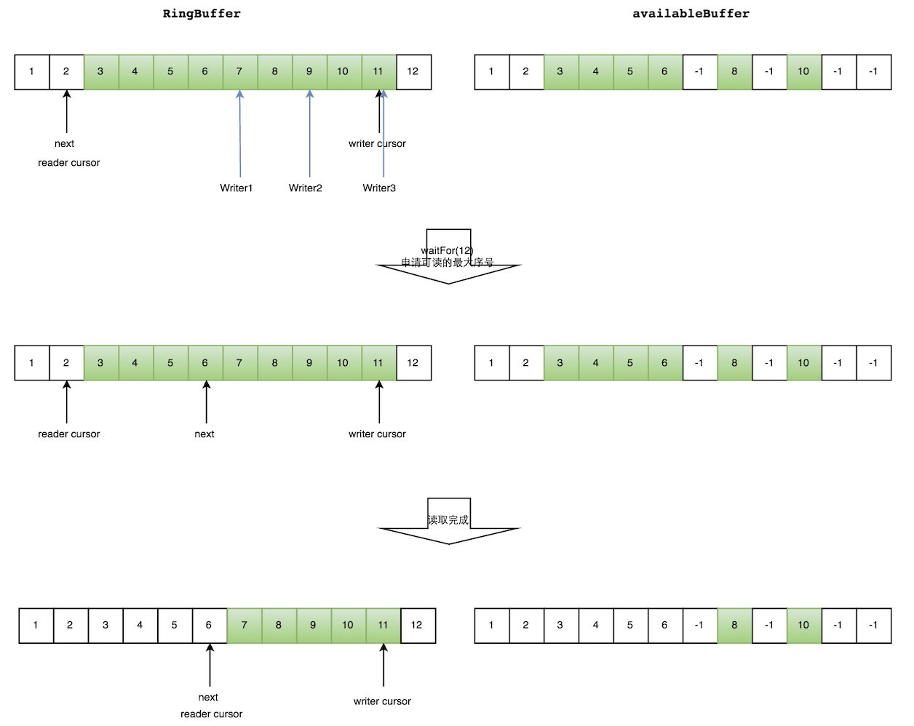

如上图所示，消费者已经读到下标为 2 的元素，三个生产者 Writer1、Writer2、Writer3 正在向 RingBuffer 的相应位置写数据，被分配到的最大下标是 11。

消费者申请读取下标 3 到 11 的元素，判断 `writer cursor >= 11` 成立，然后从下标 3 开始检查 availableBuffer，发现下标 7 的元素还没有发布，于是 `waitFor(11)` 返回 6（这一步由 `getHighestPublishedSequence` 方法完成）。

随后，消费者读取下标 3 到 6 共 4 个元素。

## 3.3 消除伪共享

对于伪共享，一般的解决方案是增大数据之间的间隔，使不同线程访问的数据位于不同的缓存行上，以空间换时间。

Disruptor 采用了缓存行填充（Padding）的方式。以 3.x 版本为例，`Sequence` 类通过继承 `LhsPadding`、`Value`、`RhsPadding` 三个类来做缓存行填充：

```java
class LhsPadding
{
    protected long p1, p2, p3, p4, p5, p6, p7;
}

class Value extends LhsPadding
{
    protected volatile long value;
}

class RhsPadding extends Value
{
    protected long p9, p10, p11, p12, p13, p14, p15;
}

public class Sequence extends RhsPadding
{
    static final long INITIAL_VALUE = -1L;
    private static final Unsafe UNSAFE;
    private static final long VALUE_OFFSET;
}
```

其中的 `value` 前后都被无用的 `long` 字段填充，这样修改 `value` 时，就不会影响到其他变量所在的缓存行。

之所以用继承而不是在一个类里直接声明这些字段，是因为 JVM 会对同一个类中的字段重新排列，无法保证填充字段一定位于 `value` 两侧；而父类的字段总是排在子类字段之前，借助继承层次就能固定字段的相对位置。

注意到上面的代码中，一共使用了 14 个额外的 `long` 来填充，不多也不少，这是为什么呢？

Java 的 `long` 类型占 8 字节，主流缓存行大小为 64 字节，可以存放 8 个 `long`。

填充被设计成前面 7 个 `long`、后面 7 个 `long`，是为了保证**无论缓存行从哪里切分，包含有效数据的缓存行中都不会混入其他无关数据**，从而避免相互影响。如下图所示：

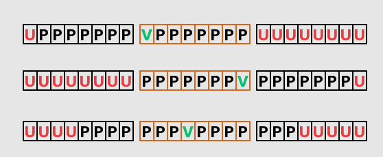

* V：Value，有效数据
* P：Padding，填充
* U：其他无关数据

Disruptor 4.x 改用 `byte` 字段填充，前后各 56 个，同样是 56 字节；`value` 也不再声明为 `volatile`，而是通过 `VarHandle` 按需选择 `getVolatile`、`getAcquire`、`setRelease` 等不同强度的内存语义来访问：

```java
class LhsPadding
{
    protected byte
        p10, p11, p12, p13, p14, p15, p16, p17,
        p20, p21, p22, p23, p24, p25, p26, p27,
        p30, p31, p32, p33, p34, p35, p36, p37,
        p40, p41, p42, p43, p44, p45, p46, p47,
        p50, p51, p52, p53, p54, p55, p56, p57,
        p60, p61, p62, p63, p64, p65, p66, p67,
        p70, p71, p72, p73, p74, p75, p76, p77;
}

class Value extends LhsPadding
{
    protected long value;
}

class RhsPadding extends Value
{
    protected byte
        p90, p91, p92, p93, p94, p95, p96, p97,
        p100, p101, p102, p103, p104, p105, p106, p107,
        p110, p111, p112, p113, p114, p115, p116, p117,
        p120, p121, p122, p123, p124, p125, p126, p127,
        p130, p131, p132, p133, p134, p135, p136, p137,
        p140, p141, p142, p143, p144, p145, p146, p147,
        p150, p151, p152, p153, p154, p155, p156, p157;
}

public class Sequence extends RhsPadding
{
    static final long INITIAL_VALUE = -1L;
    private static final VarHandle VALUE_FIELD;
}
```

除了手动填充，JDK 8 还提供了 `@sun.misc.Contended` 注解来避免伪共享，JVM 会自动为被注解的类或字段添加填充（默认 128 字节）。JDK 9 起，该注解移到了 `jdk.internal.vm.annotation.Contended`，属于 JDK 内部 API：应用代码要使用它，编译时需要通过 `--add-exports java.base/jdk.internal.vm.annotation=ALL-UNNAMED` 导出，运行时还要加上 `-XX:-RestrictContended` 参数，否则注解会被忽略（JDK 自身的类不受此限制）。

JDK 内部大量使用了这个注解，比如 `LongAdder` 的 `Cell`、`ConcurrentHashMap` 的 `CounterCell`、`Thread` 中供 `ThreadLocalRandom` 使用的字段等。正因为 `@Contended` 在应用代码中使用门槛较高，Disruptor、JCTools 等库至今仍采用手动填充的方式。

# 4 使用示例

下面以 Disruptor 4.x 为例，演示一个最简单的单生产者、单消费者场景。

首先定义事件，它就是 RingBuffer 中预先分配、反复复用的元素：

```java
public class LongEvent {
    private long value;

    public void set(long value) {
        this.value = value;
    }

    public long get() {
        return value;
    }
}
```

然后创建 Disruptor，注册消费者并发布事件：

```java
import com.lmax.disruptor.BlockingWaitStrategy;
import com.lmax.disruptor.RingBuffer;
import com.lmax.disruptor.dsl.Disruptor;
import com.lmax.disruptor.dsl.ProducerType;
import com.lmax.disruptor.util.DaemonThreadFactory;

public class DisruptorDemo {
    public static void main(String[] args) throws Exception {
        int bufferSize = 1024;
        Disruptor<LongEvent> disruptor = new Disruptor<>(
                LongEvent::new,
                bufferSize,
                DaemonThreadFactory.INSTANCE,
                ProducerType.SINGLE,
                new BlockingWaitStrategy());

        disruptor.handleEventsWith((event, sequence, endOfBatch) ->
                System.out.println("消费: " + event.get()));
        disruptor.start();

        RingBuffer<LongEvent> ringBuffer = disruptor.getRingBuffer();
        for (long i = 0; i < 3; i++) {
            ringBuffer.publishEvent((event, seq, value) -> event.set(value), i);
        }

        Thread.sleep(100);
        disruptor.shutdown();
    }
}
```

输出如下：

```text
消费: 0
消费: 1
消费: 2
```

几点说明：

* `bufferSize` 必须是 2 的 n 次方。
* `ProducerType.SINGLE` 对应 `SingleProducerSequencer`，只有确定只有一个线程发布事件时才能使用，否则要用 `ProducerType.MULTI`（默认值）。
* `publishEvent` 内部完成了“申请序号、填充事件、发布序号”三步，推荐使用这种 Translator 风格的 API，避免手动调用 `next()`/`publish()` 时遗漏 `publish` 导致消费者卡住。
* 消费者之间可以编排依赖关系，比如 `disruptor.handleEventsWith(a, b).then(c)` 表示 a、b 并行消费同一批事件，二者都处理完后再交给 c。

## 4.1 等待策略

消费者在没有可消费的数据时如何等待，由 `WaitStrategy` 决定，它直接影响延迟和 CPU 占用：

| 等待策略 | 实现方式 | 特点 | 适用场景 |
|----------|----------|------|----------|
| `BlockingWaitStrategy` | 锁 + 条件等待 | CPU 占用低，延迟较高 | 默认策略，通用场景 |
| `SleepingWaitStrategy` | 先自旋，再 `Thread.yield()`，最后 `parkNanos` | 延迟与 CPU 占用折中 | 对延迟不敏感的后台任务，如异步日志 |
| `YieldingWaitStrategy` | 自旋 + `Thread.yield()` | 低延迟，CPU 占用高 | 消费者线程数少于 CPU 核数 |
| `BusySpinWaitStrategy` | 纯自旋 | 延迟最低，独占 CPU 核 | 线程绑核的极致低延迟场景 |

此外还有 `TimeoutBlockingWaitStrategy`、`LiteBlockingWaitStrategy`、`PhasedBackoffWaitStrategy` 等变体。自旋类策略会让消费者线程一直占用 CPU，使用前要确认机器有足够的空闲核。

# 5 新版本中的 Disruptor

| 版本 | 时间 | 主要变化 |
|------|------|----------|
| 1.x / 2.x | 2011 年 | 开源发布 |
| 3.0 | 2013 年前后 | 重写核心 API，`Sequencer` 体系与 DSL 基本定型 |
| 3.4.0 | 2018 年 | 不再支持 JDK 6；新增 `ThreadHints.onSpinWait`，在 JDK 9+ 上调用 `Thread.onSpinWait()` 优化自旋 |
| 4.0.0 | 2023 年 | 最低要求 Java 11；`Unsafe` 全面替换为 `VarHandle`；移除 `WorkerPool`、`WorkProcessor` 及 `handleEventsWithWorkerPool`；移除接收 `Executor` 的构造方法，统一使用 `ThreadFactory`；`BatchStartAware`、`LifecycleAware`、`SequenceReportingEventHandler` 等接口合并进 `EventHandler`；支持批处理回滚（rewind）和最大批大小；日志改用 `System.Logger`；`ThreadHints.onSpinWait` 被废弃，直接使用 `Thread.onSpinWait()` |

从 3.x 升级到 4.x 时，最常见的改动有两处：

* 原来通过 `Executor` 构造 Disruptor 的代码要改为传入 `ThreadFactory`。
* 原来用 `WorkerPool` 实现的“多个消费者竞争消费”模式被移除，可以改为由单个 `EventHandler` 消费后再分发到线程池，或者使用多个 `EventHandler` 按序号取模各自处理一部分事件。

结合近几年 Java 生态的变化，还有几点值得关注：

* **Log4j 2 仍在使用 Disruptor**：Log4j 2 的异步日志器至今仍基于 Disruptor 实现，较新版本已兼容 Disruptor 4.x。
* **JCTools 是常见的替代方案**：JCTools 提供了 `SpscArrayQueue`、`MpscArrayQueue` 等针对不同生产者、消费者数量专门优化的有界无锁队列，同样使用了缓存行填充。Netty 内部就使用了 JCTools 的队列，Apache Storm 2.0 也用它替换了 Disruptor。如果只需要一个高性能的队列，而不需要 Disruptor 的事件预分配和消费者编排能力，JCTools 更轻量。
* **不适合搭配虚拟线程**：Disruptor 的消费者是少量长期运行、最好绑定 CPU 核的线程，自旋类等待策略更会一直占用 CPU，用虚拟线程运行它们没有任何好处，反而会占住载体线程。Disruptor 应继续通过 `ThreadFactory` 使用平台线程；虚拟线程适合的是大量阻塞在 I/O 上的任务。

# 6 总结

1. `ArrayBlockingQueue` 用一把锁保护入队和出队，高并发下锁竞争严重，是它的主要性能瓶颈；此外还存在伪共享问题。
2. Disruptor 通过环形数组预分配元素、位运算定位下标，对 CPU 缓存友好，也减少了垃圾回收。
3. 单生产者模式完全不需要 CAS；多生产者模式通过 CAS 或 `getAndAdd` 分配独享的写入区间，并用 availableBuffer 记录每个位置的发布情况，让消费者只读取已经写完的连续区间。
4. Disruptor 通过缓存行填充消除伪共享，4.x 改用 `byte` 字段填充并以 `VarHandle` 访问序号；JDK 的 `@Contended` 注解也能解决伪共享，但在应用代码中使用门槛较高。
5. Disruptor 4.x 要求 Java 11，移除了 `WorkerPool` 等 API，升级时需要调整代码；如果只需要高性能队列，也可以考虑更轻量的 JCTools。
