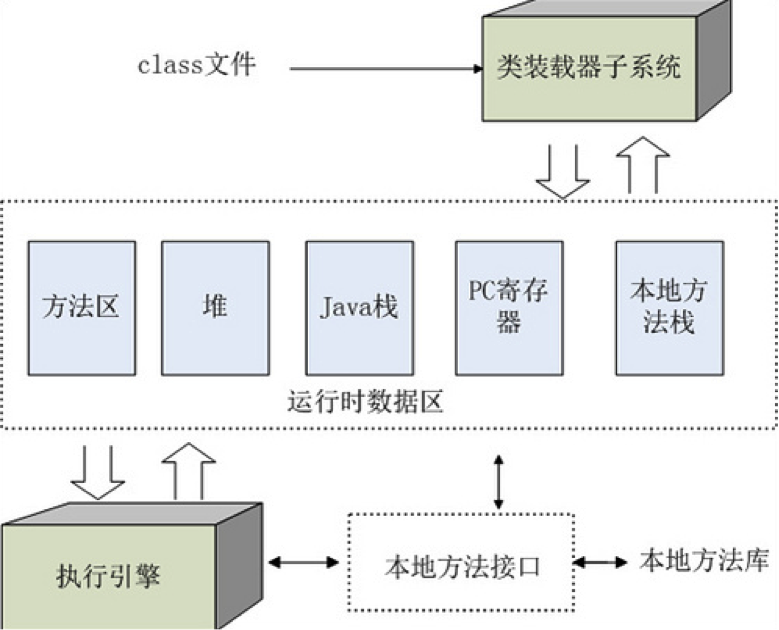

# JVM 概述

# 1 JVM 是什么

JVM 全称是 **Java Virtual Machine**（Java 虚拟机）。之所以称为“虚拟”，是因为它是由《Java 虚拟机规范》（JVMS）定义的一台抽象计算机，任何厂商都可以按照规范实现自己的 JVM。

目前最主流的实现是 HotSpot。它最初由 Sun 开发，2010 年 Sun 被 Oracle 收购后由 Oracle 主导，并作为 OpenJDK 的默认虚拟机开源。我们平时使用的 Oracle JDK，以及 Eclipse Temurin、Amazon Corretto、Azul Zulu、阿里巴巴 Dragonwell 等 OpenJDK 发行版，底层几乎都是 HotSpot。其他知名的实现还有：

| 实现 | 说明 |
|------|------|
| HotSpot | OpenJDK 的默认虚拟机，使用最广泛 |
| Eclipse OpenJ9 | 前身为 IBM J9，2017 年开源并捐给 Eclipse 基金会，以内存占用低、启动快著称 |
| GraalVM | Oracle 推出的高性能运行时，最大特色是 Native Image，可以把 Java 程序提前编译为本地可执行文件 |
| Azul Platform Prime（原 Zing） | 商业 JVM，提供低停顿的 C4 垃圾收集器和 Falcon JIT 编译器 |
| JRockit | 原 BEA 产品，后归 Oracle 所有，已停止发展，其 JFR、JMC 等特性已并入 HotSpot |

JVM 规范明确定义了 class 文件格式、字节码指令集、运行时数据区、类的加载/链接/初始化过程以及异常处理等内容；而内存如何布局、采用什么垃圾收集算法、是否使用即时编译等细节，则留给各个实现自行决定。只要 JVM 符合规范，编译好的 class 文件就可以在它上面运行。

JVM 是 Java 平台的核心，位于字节码与操作系统、硬件之间。它屏蔽了底层平台的差异，让同一份字节码可以在不同的平台上运行，也就是“一次编写，到处运行”（Write Once, Run Anywhere）。JVM 只认识 class 文件，并不关心它由哪种语言编译而来，因此 Kotlin、Scala、Groovy、Clojure 等语言也都运行在 JVM 之上。

# 2 JDK、JRE 与 JVM 的关系

**JRE**（Java Runtime Environment，Java 运行环境）包含 JVM 和 Java 核心类库，是运行 Java 程序所需的最小环境。普通用户只需要运行已开发好的 Java 程序，安装 JRE 即可。

**JDK**（Java Development Kit，Java 开发工具包）是开发者用来编译、调试、诊断 Java 程序的工具包，包含 JRE 以及 `javac`、`jar`、`javadoc`、`jdb`、`jcmd`、`jstack` 等工具。这些工具大多本身也是用 Java 编写的，同样需要 JRE 才能运行。

**JVM** 是 JRE 的一部分，负责加载并执行字节码。它定义了自己的指令集和运行时数据区（如程序计数器、虚拟机栈、堆），以基于栈的方式执行字节码。Java 最重要的特点就是跨平台，而 JVM 正是实现跨平台的关键。

三者是层层包含的关系：

* JDK = JRE + 开发工具
* JRE = JVM + 核心类库

需要注意的是，JDK 9 之后情况有所变化：

* JDK 9 引入了模块系统（JPMS），JDK 的目录结构重新组织：安装目录下不再有单独的 `jre` 子目录，核心类库也不再打包为 `rt.jar`，而是以 `lib/modules` 文件的形式存储。
* 从 JDK 11 开始，Oracle 不再单独提供 JRE 下载。需要精简的运行环境时，可以使用 `jlink` 根据应用依赖的模块裁剪出一个自定义运行时镜像，这在容器部署中很常用。部分发行版（如 Eclipse Temurin）仍然提供 JRE 包。

# 3 JVM 的生命周期

当启动一个 Java 程序时，一个虚拟机实例也就诞生了；当该程序关闭退出，这个虚拟机实例也就随之消亡。如果在同一台计算机上同时运行三个 Java 程序，将得到三个 JVM 实例，每个 Java 程序都运行在它自己的 JVM 实例中。

一个 JVM 实例对应一个独立运行的 Java 程序，它是进程级别的。

## 3.1 启动

启动一个 Java 程序时，一个 JVM 实例就产生了。传统上，任何一个拥有 `public static void main(String[] args)` 方法的类都可以作为程序的入口。新版本的 JDK 为启动程序提供了更多选择：

* JDK 11 起（JEP 330），可以用 `java Hello.java` 直接运行单个源文件，无需先编译；JDK 22 起（JEP 458），还支持直接运行由多个源文件组成的程序。
* JDK 25 起（JEP 512），`main` 方法可以是实例方法，并且可以省略 `public`、`static` 和参数，最简单的程序可以写成：

```java
void main() {
    IO.println("Hello, World!");
}
```

## 3.2 运行

`main()` 方法在程序的主线程中执行，其他线程都直接或间接地由它启动。JVM 中的线程分为守护线程和非守护线程：

* main 线程属于非守护线程；
* JVM 内部的 Reference Handler、Finalizer、Signal Dispatcher 等线程是守护线程；
* Java 程序也可以通过 `Thread.setDaemon(true)` 把自己创建的线程标记为守护线程；
* JDK 21 正式引入的虚拟线程总是守护线程。

## 3.3 消亡

JVM 在以下情况下退出：

* 程序中所有的非守护线程都已终止；
* 调用了 `System.exit()` 或 `Runtime.exit()`；
* 调用了 `Runtime.halt()`，JVM 立即终止；
* 收到操作系统的终止信号，如 `SIGTERM`（`kill` 命令）、`SIGINT`（Ctrl+C），或者 JVM 发生致命错误而崩溃。

除了 `halt()`、`kill -9`（`SIGKILL`）和崩溃之外，JVM 退出前都会先执行通过 `Runtime.addShutdownHook()` 注册的关闭钩子，应用通常借此释放资源、实现优雅停机。

早期版本中，是否允许调用 `System.exit()` 可以由安全管理器（SecurityManager）控制。安全管理器已在 JDK 17 中被标记为废弃（JEP 411），并在 JDK 24 中被永久禁用（JEP 486）。

# 4 JVM 运行原理

我们平时执行的 `java` 命令（Windows 上是 `java.exe`）是一个用 C 语言编写的启动器（launcher），源码位于 OpenJDK 的 `src/java.base/share/native/libjli/java.c`。它通过下面 4 步启动 JVM 并运行程序，下面以 Windows 为例进行分析。

## 4.1 确定 JRE 路径和 JVM 类型

JVM 以操作系统动态链接库的形式提供：Windows 上是 `jvm.dll`，Linux 上是 `libjvm.so`，macOS 上是 `libjvm.dylib`。既然是文件，就存在一个查找路径的问题。

首先确定 JRE 路径。启动器通过 `GetApplicationHome` 获得当前 `java.exe` 的绝对路径，比如 `C:\jdk1.7.0_45\bin\java.exe`，截取得到 `C:\jdk1.7.0_45\`，然后判断 `C:\jdk1.7.0_45\bin\java.dll` 是否存在：

* 如果存在，就把 `C:\jdk1.7.0_45\` 作为 JRE 路径；
* 如果不存在，则判断 `C:\jdk1.7.0_45\jre\bin\java.dll` 是否存在，存在则把 `C:\jdk1.7.0_45\jre` 作为 JRE 路径；
* 如果仍不存在，则调用 `GetPublicJREHome` 查询注册表 `HKEY_LOCAL_MACHINE\Software\JavaSoft\Java Runtime Environment\<当前 JRE 版本号>\JavaHome`，以其值作为 JRE 路径。

JDK 9 之后没有了 `jre` 子目录，JDK 安装目录本身就是一个完整的运行时镜像，第一种情况即可命中。

然后读取 `jvm.cfg` 配置文件，确定 JVM 类型。在 32 位 JDK 中，`bin\server` 和 `bin\client` 目录下各有一个 `jvm.dll`，分别对应 Server VM 和 Client VM，启动器根据 `jvm.cfg` 以及 `-server`/`-client` 参数选择使用哪一个；64 位 JDK 只提供 Server VM，`-client` 参数会被忽略。JDK 9 起，`jvm.cfg` 位于 JDK 的 `lib` 目录下。

最后得到 `jvm.dll` 的路径：`JRE 路径\bin\<JVM 类型>\jvm.dll`。如果启动时通过 `-XXaltjvm=<path>` 参数指定了路径，则直接使用 `<path>\jvm.dll`。

## 4.2 装载 jvm.dll

找到 `jvm.dll` 的路径后，启动器通过 `LoadJavaVM` 函数装载它：Windows 上调用 `LoadLibrary`，Linux、macOS 上调用 `dlopen`。

然后把 `jvm.dll` 导出的 `JNI_CreateJavaVM` 和 `JNI_GetDefaultJavaVMInitArgs` 函数挂接到 `InvocationFunctions` 结构的 `CreateJavaVM` 和 `GetDefaultJavaVMInitArgs` 函数指针上，`jvm.dll` 的装载工作就完成了。

## 4.3 初始化 JVM

启动器会新建一个线程来执行后续的 `JavaMain` 函数（这样主线程的栈大小就可以通过 `-Xss` 参数控制），并在其中调用 `InvocationFunctions->CreateJavaVM`，也就是 JVM 中的 `JNI_CreateJavaVM` 函数。

JVM 在这一步完成解析启动参数、初始化堆和垃圾收集器、加载 `java.lang.Object`、`java.lang.String` 等核心类、初始化模块系统等工作，最后返回一个 `JNIEnv` 实例。

`JNIEnv`（JNI 接口指针）是本地代码调用 JVM 功能的入口，启动器后续正是通过它来加载类、调用 Java 方法的。

## 4.4 运行 Java 程序

Java 程序主要有以下几种启动方式：

* `java Xxx`：运行一个类；
* `java -jar xxx.jar`：运行一个 JAR 包；
* `java -m 模块名/主类名`：运行一个模块（JDK 9+）；
* `java Xxx.java`：直接运行源文件（JDK 11+）。

启动器通过 `LoadMainClass` 函数加载主类，它借助 `JNIEnv` 调用 Java 类 `sun.launcher.LauncherHelper` 的 `checkAndLoadMain` 方法完成具体工作：

* 如果是 JAR 包，就读取 `META-INF/MANIFEST.MF` 中 `Main-Class` 属性指定的类作为主类；
* 如果是类名，就直接通过系统类加载器加载该类；
* 如果是源文件，则先由 `jdk.compiler` 模块中的源码启动器在内存中编译，再加载运行。

加载主类的同时会校验 `main` 方法是否存在。然后启动器通过 `JNIEnv` 的 `GetStaticMethodID` 方法查找主类中的 `public static void main(String[] args)` 方法，再调用 `CallStaticVoidMethod` 执行它。JDK 25 支持实例 `main` 方法后，这部分逻辑也随之扩展：如果找到的是实例方法，会先创建主类的实例再调用。

`main` 方法返回后，启动器调用 `DestroyJavaVM`：它会等待所有非守护线程结束，然后执行关闭钩子并销毁 JVM。这正是 3.3 节“所有非守护线程终止后 JVM 才退出”的实现方式，线程转储中常见的 `DestroyJavaVM` 线程就来源于此。

# 5 JVM 体系结构

JVM 的体系结构图如下：



JVM 主要包括两个子系统和两个组件：类装载器（Class Loader）子系统、执行引擎（Execution Engine）子系统，以及运行时数据区（Runtime Data Area）组件、本地接口（Native Interface）组件。

* **类装载器子系统**：根据给定的全限定类名（如 `java.lang.Object`），将 class 文件的内容装载到运行时数据区的方法区中。JDK 8 起，HotSpot 用位于本地内存的元空间（Metaspace）取代了永久代来实现方法区。详见《类的加载机制》一文。
* **执行引擎子系统**：执行 class 中的字节码指令。方法的字节码由 JVM 的指令序列构成，每条指令包含一个单字节的操作码，后面跟随 0 个或多个操作数。执行引擎先取得一个操作码，如果该操作码有操作数，再取得它的操作数，执行操作码规定的动作，然后取下一个操作码，如此循环直到方法执行完毕。HotSpot 的执行引擎包括解释器和即时编译器（JIT）：程序启动时先解释执行，热点代码会被 C1、C2 编译器编译成本地机器码（即分层编译，JDK 8 起默认开启）。垃圾收集器通常也被视为执行引擎的一部分。不同 JVM 实现之间的性能差异，很大程度上取决于执行引擎和垃圾收集器的实现。
* **本地接口组件**：与本地方法库（native libraries）交互，是 Java 与其他编程语言交互的接口。JDK 中声明为 `native` 的方法，其实现大多位于 OpenJDK 源码的 `src/<模块>/<平台>/native/` 目录下（JDK 9 之前是 `jdk/src/<平台>/native/`），其中 `<平台>` 可以是 `share`，即平台无关的代码，也可以是 `windows`、`unix` 等具体平台，目录结构按包名组织。需要注意，这些 native 方法属于类库，而不属于 JVM 本身。JDK 22 正式发布了外部函数与内存 API（FFM API，JEP 454），无需编写 C 胶水代码就能直接调用本地函数，是 JNI 的现代替代方案；JDK 24 起，使用 JNI 时 JVM 会输出警告（JEP 472），为将来默认限制 JNI 做准备。
* **运行时数据区组件**：JVM 定义了若干种程序运行时使用的数据区。一类随虚拟机启动而创建、随虚拟机退出而销毁，由所有线程共享，如堆、方法区；另一类与线程一一对应，随线程的开始和结束而创建和销毁，如虚拟机栈、本地方法栈、程序计数器。详见《内存模型》一文。

# 6 新版本中的 JVM

近十年来，JVM 层面的主要变化如下：

| 版本 | 发布时间 | 主要变化 |
|------|----------|----------|
| JDK 8（LTS） | 2014 年 | 元空间取代永久代；分层编译默认开启 |
| JDK 9 | 2017 年 | 模块系统；G1 成为默认垃圾收集器；取消 `jre` 子目录和 `rt.jar`；新增 `jlink`；统一 JVM 日志 `-Xlog`；紧凑字符串 |
| JDK 10 | 2018 年 | JVM 能识别容器的 CPU 和内存限制；应用类数据共享（AppCDS，JEP 310） |
| JDK 11（LTS） | 2018 年 | ZGC（实验）、Epsilon GC；单文件源码运行；JFR 开源（JEP 328）；Oracle 不再单独提供 JRE |
| JDK 15 | 2020 年 | ZGC、Shenandoah 转为正式特性（JEP 377、379）；偏向锁默认禁用（JEP 374） |
| JDK 17（LTS） | 2021 年 | 强封装 JDK 内部 API（JEP 403）；移除实验性的 AOT 编译和 Graal JIT（JEP 410）；废弃安全管理器（JEP 411） |
| JDK 21（LTS） | 2023 年 | 虚拟线程（JEP 444）；分代 ZGC（JEP 439） |
| JDK 22 | 2024 年 | FFM API 正式发布（JEP 454）；直接运行多文件源码程序（JEP 458） |
| JDK 24 | 2025 年 3 月 | AOT 类加载与链接（JEP 483）；虚拟线程执行 `synchronized` 时不再固定载体线程（JEP 491）；永久禁用安全管理器（JEP 486）；紧凑对象头（实验，JEP 450） |
| JDK 25（LTS） | 2025 年 9 月 | 紧凑对象头转为正式特性（JEP 519）；AOT 命令行简化与方法剖析（JEP 514、515）；实例 `main` 方法（JEP 512）；分代 Shenandoah 转为正式特性（JEP 521）；移除 32 位 x86 移植（JEP 503） |
| JDK 26 | 2026 年 3 月 | 任意垃圾收集器均可使用 AOT 对象缓存（JEP 516）；G1 减少同步开销以提升吞吐量（JEP 522）；通过反射修改 `final` 字段时发出警告（JEP 500） |
| JDK 27 | 2026 年 9 月 | G1 成为所有环境下的默认垃圾收集器（JEP 523）；紧凑对象头默认开启（JEP 534） |

从这些变化可以看出 JVM 近年的几个演进方向：

* **启动速度**：Project Leyden 通过 AOT 缓存，把类加载、链接、方法剖析等工作提前到训练运行中完成，显著缩短启动和预热时间。
* **内存占用**：Project Lilliput 把对象头从 12 字节压缩到 8 字节（开启压缩类指针时），减少堆内存占用。
* **低延迟**：ZGC、Shenandoah 等收集器的停顿时间已降到毫秒以下，并且都支持了分代。
* **并发模型**：虚拟线程让“一个请求一个线程”的编程模型可以支撑百万级并发。
* **本地互操作**：FFM API 逐步取代 JNI，JDK 对 JNI 和深度反射的限制也在逐步收紧。

目前的长期支持（LTS）版本有 JDK 8、11、17、21、25，新项目建议直接选择 JDK 21 或 JDK 25。

# 7 总结

1. JVM 是由规范定义的抽象计算机，HotSpot 是最主流的实现，Oracle JDK 和绝大多数 OpenJDK 发行版都基于它。
2. JDK 包含 JRE 和开发工具，JRE 包含 JVM 和核心类库；JDK 9 之后不再有独立的 `jre` 目录，可以用 `jlink` 定制运行时。
3. 一个 Java 程序对应一个 JVM 实例；所有非守护线程结束、调用 `System.exit()` 或收到终止信号时 JVM 退出，正常退出前会执行关闭钩子。
4. `java` 启动器通过“确定 JRE 路径、装载 `jvm.dll`、初始化 JVM、运行 `main` 方法”4 步启动程序。
5. JVM 由类装载器子系统、执行引擎子系统、运行时数据区和本地接口组成。
6. 新版本 JVM 在启动速度、内存占用、低延迟 GC、虚拟线程和本地互操作等方面持续演进。
