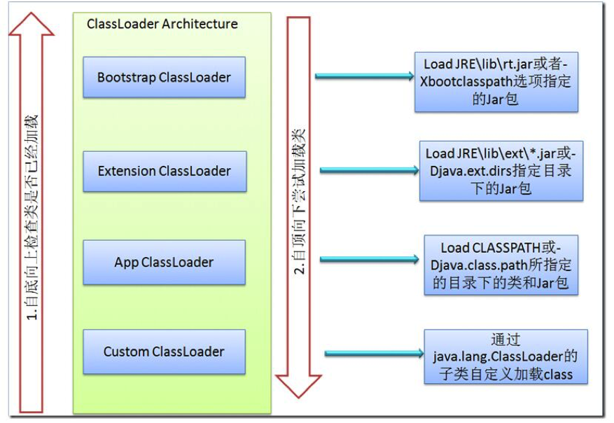

# 类的加载机制

# 1 类加载器

Java 程序并不是一个原生的可执行文件，而是由许多独立的 class 文件组成，每个 class 文件对应一个 Java 类或接口。这些 class 文件并不会在启动时全部装入内存，而是在程序需要时才按需装入。类加载器（ClassLoader）就专门负责把 class 文件装入内存。

需要注意，**数组类的 `Class` 对象不是由类加载器创建的**，而是由 JVM 在需要时直接创建。对数组类调用 `Class.getClassLoader()`，返回的是其元素类型的类加载器；如果元素类型是基本类型，则数组类没有类加载器，返回 `null`。

## 1.1 类加载器的层次

JDK 8 及之前的类加载器层次如下图所示：



从上图可以看出类加载器之间的父子关系。注意这**不是类的继承关系**，而是组合关系：每个类加载器内部通过 `parent` 字段持有它的父加载器。

* **Bootstrap ClassLoader**（启动类加载器）：最顶层的类加载器，在 HotSpot 中由 C++ 实现并内嵌在 JVM 中，负责加载 Java 核心类库 `JRE/lib/rt.jar`，或 `-Xbootclasspath` 参数指定的 JAR 包。它在 Java 代码中表示为 `null`。
* **Extension ClassLoader**（扩展类加载器）：负责加载 Java 平台的扩展功能，即 `JRE/lib/ext/*.jar` 或 `-Djava.ext.dirs` 指定目录下的 JAR 包。
* **App ClassLoader**（应用类加载器，又称 System ClassLoader）：负责加载 classpath（`-classpath` 或 `-Djava.class.path`）中指定的 JAR 包及目录中的类，`ClassLoader.getSystemClassLoader()` 默认返回的就是它。
* **Custom ClassLoader**（自定义类加载器）：应用程序根据自身需要，继承 `java.lang.ClassLoader` 实现的类加载器，比如 Tomcat 就为每个 Web 应用实现了独立的类加载器。

JDK 9 引入模块系统后，类加载器的层次发生了变化：

| 类加载器 | JDK 8 及之前 | JDK 9 及之后 |
|----------|--------------|--------------|
| 启动类加载器 | 加载 `rt.jar` 等核心类库 | 加载 `java.base`、`java.logging` 等核心模块 |
| 扩展类加载器 | 加载 `lib/ext` 下的 JAR 包 | 被**平台类加载器**（Platform ClassLoader）取代，负责加载 `java.sql`、`java.compiler` 等其余平台模块；`lib/ext` 和 `java.ext.dirs` 机制被移除 |
| 应用类加载器 | `URLClassLoader` 的子类 | 改为 JDK 内部类 `jdk.internal.loader.ClassLoaders$AppClassLoader`，不再是 `URLClassLoader` 的子类 |

最后一点是 JDK 8 升级时的一个常见问题：早期一些代码通过把系统类加载器强转为 `URLClassLoader`，再反射调用 `addURL` 来动态添加 classpath，在 JDK 9 及之后的版本中会直接抛出 `ClassCastException`。

## 1.2 双亲委派模型

既然有多种类加载器，一个类该由哪个类加载器来加载呢？

Java 采用的是**双亲委派模型**（Parents Delegation Model）：类加载器收到加载类的请求时，不会先自己尝试加载，而是先委托给父加载器，在父加载器的搜索范围内加载；只有父加载器找不到时，才由自己在自己的搜索范围内加载。具体流程如下：

1. 类加载器 A 加载类时，先判断该类是否已经加载过了；
2. 如果还未加载，则先委托 A 的父加载器去加载，这是一个不断向上的过程；当 A 所有的上级加载器（包括启动类加载器）都无法加载该类时，再回到发起者 A 自己加载；
3. 如果 A 也加载不了，则抛出 `ClassNotFoundException`。

双亲委派模型有两个好处：

* **避免重复加载**：父加载器已经加载过的类，子加载器不会再加载一次。
* **保证核心类库的安全**：无论哪个类加载器要加载 `java.lang.String`，最终都会委托给启动类加载器，用户自己编写的同名类不会被加载，核心类不会被篡改。此外，`defineClass` 也禁止非平台加载器定义 `java.*` 包下的类，否则会抛出 `SecurityException`。

JDK 9 之后，双亲委派的流程略有调整：平台类加载器和应用类加载器在委派给父加载器之前，会先根据包名判断这个类是否属于某个已定义的命名模块，如果是，就直接委派给负责该模块的类加载器。

## 1.3 ClassLoader 的关键方法

`ClassLoader` 抽象类的几个关键方法如下：

* `loadClass()`：负责加载指定名字的类，双亲委派的逻辑就实现在这里。它先从已加载的类中查找，没有则委托父加载器加载（父加载器为 `null` 时委托启动类加载器），仍然没找到才调用 `findClass` 自己加载。如果要改变类的加载顺序，可以覆盖此方法。
* `findLoadedClass()`：从 JVM 中查找当前类加载器已经加载过的类，最终调用的是 native 方法。
* `findClass()`：默认实现直接抛出 `ClassNotFoundException`。自定义类加载器**推荐覆盖此方法**而不是 `loadClass`，这样既能实现自定义的加载方式，又不会破坏双亲委派模型。
* `findSystemClass()`：通过系统类加载器加载类，等价于 `getSystemClassLoader().loadClass(name)`，找不到时抛出 `ClassNotFoundException`。
* `defineClass()`：把字节数组形式的 class 文件内容转换为 `Class` 对象。
* `resolveClass()`：按设计是用来链接 `Class` 对象的，但在 HotSpot 中链接由 JVM 在需要时自动完成，这个方法在新版本 JDK 中只做空值检查。

`loadClass` 的源码如下（省略了性能统计代码）：

```java
protected Class<?> loadClass(String name, boolean resolve)
    throws ClassNotFoundException
{
    synchronized (getClassLoadingLock(name)) {
        // 先检查该类是否已经加载过
        Class<?> c = findLoadedClass(name);
        if (c == null) {
            try {
                if (parent != null) {
                    c = parent.loadClass(name, false);
                } else {
                    c = findBootstrapClassOrNull(name);
                }
            } catch (ClassNotFoundException e) {
                // 父加载器无法加载
            }

            if (c == null) {
                // 父加载器都无法加载时，调用自己的 findClass
                c = findClass(name);
            }
        }
        if (resolve) {
            resolveClass(c);
        }
        return c;
    }
}
```

`getClassLoadingLock(name)` 是 JDK 7 引入的：对于通过 `registerAsParallelCapable()` 注册为支持并行加载的类加载器，它为每个类名返回一个单独的锁对象，不同的类可以并行加载；否则返回类加载器自身，整个加载过程串行执行。

下面是一个从指定目录加载 class 文件的自定义类加载器：

```java
public class DirClassLoader extends ClassLoader {
    private final Path root;

    public DirClassLoader(Path root, ClassLoader parent) {
        super(parent);
        this.root = root;
    }

    @Override
    protected Class<?> findClass(String name) throws ClassNotFoundException {
        Path file = root.resolve(name.replace('.', '/') + ".class");
        try {
            byte[] bytes = Files.readAllBytes(file);
            return defineClass(name, bytes, 0, bytes.length);
        } catch (IOException e) {
            throw new ClassNotFoundException(name, e);
        }
    }
}
```

## 1.4 Class.forName() 与 ClassLoader.loadClass()

`Class.forName()` 与 `ClassLoader.loadClass()` 都可以根据给定的类名定位并加载对应的 `java.lang.Class` 对象，区别如下：

**`Class.forName(String)` 会初始化类，而 `loadClass(String)` 只会加载类，不会链接和初始化**，类要等到第一次被主动使用时才会初始化。利用这个差异，对于静态初始化开销很大的类，就可以先用 `loadClass` 提前加载（以确认它在 classpath 下），等到第一次使用时再进行初始化。

经典的例子是 JDBC：早期需要通过 `Class.forName("com.mysql.jdbc.Driver")` 触发驱动类的静态代码块，把驱动注册到 `DriverManager`。JDBC 4.0（JDK 6）起，`DriverManager` 会通过 SPI 机制自动发现并加载驱动，这行代码已经不再需要。

`Class.forName(String)` 使用调用者的类加载器来加载，也就是加载了调用 `forName` 方法的那个类的类加载器。它还有一个重载方法 `Class.forName(String name, boolean initialize, ClassLoader loader)`，可以指定类加载器以及是否初始化。而 `ClassLoader.loadClass()` 是实例方法，调用时需要自己选定类加载器，这个类加载器可能是、也可能不是加载调用代码的那个类加载器。

# 2 类的加载过程

类从被加载到 JVM 内存中开始，到卸载出内存为止，整个生命周期包括：**加载**（Loading）、**链接**（Linking）、**初始化**（Initialization）、使用和卸载。其中链接又分为**验证**（Verification）、**准备**（Preparation）、**解析**（Resolution）三步。

## 2.1 加载

类加载器负责的就是加载阶段：根据指定的类名找到二进制字节流，生成 `Class` 对象。

在加载阶段，JVM 需要完成以下三件事（JVM 规范对这三件事的要求并不具体，因此虚拟机实现与具体应用的灵活度相当大）：

* 通过一个类的全限定名获取定义这个类的二进制字节流。字节流可以从 JAR、WAR 等压缩包中读取，从 JDK 的模块镜像文件中读取（JDK 9+），从网络中获取（如早期的 Applet，Applet API 已在 JDK 26 中移除），在运行时动态生成（如动态代理），或者由其他文件生成（如 JSP）等。
* 将这个字节流所代表的静态存储结构转化为方法区的运行时数据结构。
* 在内存中生成一个代表这个类的 `java.lang.Class` 对象，作为方法区中这些数据的访问入口。在 HotSpot 中，`Class` 对象存放在堆中。

## 2.2 链接

链接就是把加载进来的类合并到 JVM 的运行时状态中，分为三个阶段。

### 2.2.1 验证

验证阶段对二进制字节码进行校验，确保 class 文件的字节流中包含的信息符合 JVM 规范的要求，不会危害虚拟机自身的安全。主要的验证过程包括：

* **文件格式验证**：验证字节流是否符合 class 文件格式的规范，并且能被当前虚拟机正确处理，比如魔数是否为 `0xCAFEBABE`、版本号是否在当前虚拟机的支持范围内。
* **元数据验证**：对字节码描述的信息进行语义分析，比如这个类是否有父类、是否继承了不允许被继承的 `final` 类。
* **字节码验证**：通过数据流和控制流分析，保证被校验类的方法在运行时不会做出危害虚拟机的行为。JDK 7 起，版本号 50 及以上的 class 文件使用基于 `StackMapTable` 属性的类型检查验证器，由编译器预先记录类型信息，验证速度大大提高。
* **符号引用验证**：发生在虚拟机将符号引用转化为直接引用的时候，这个转化动作在解析阶段中发生，主要检查被引用的类、字段、方法是否存在并且可以访问。

HotSpot 默认不验证由启动类加载器加载的类。早期常用 `-Xverify:none` 关闭验证以加快启动速度，这个参数已在 JDK 13 中被废弃，现在更推荐使用 CDS/AOT 缓存来提升启动速度。

### 2.2.2 准备

准备阶段为类变量（即 `static` 修饰的变量，而不是实例变量）分配内存并设置初始值。这里的初始值并不是代码中赋予的值，而是数据类型的零值：`int` 等数值类型为 `0`，`boolean` 为 `false`，`char` 为 `'\u0000'`，引用类型为 `null`。

例如：

```java
private static int size = 12;
```

在准备阶段，`size` 的值为 `0`，而不是 `12`，把 `12` 赋给 `size` 的动作要到初始化阶段才会执行。

唯一的例外是**编译期常量**：如果类变量同时被 `final` 修饰，并且是用常量表达式赋值的基本类型或 `String`，编译器会为它生成 `ConstantValue` 属性，准备阶段就会直接把它设置为目标值。

```java
private static final int MAX = 12;                         // 准备阶段直接赋值为 12
private static final Integer BOXED = 12;                   // 不是编译期常量，初始化阶段才赋值
private static final int RANDOM = new Random().nextInt();  // 不是编译期常量，初始化阶段才赋值
```

### 2.2.3 解析

解析阶段将常量池中的符号引用替换为直接引用。符号引用以一组符号来描述所引用的目标，比如类的全限定名、字段名和描述符；直接引用则是可以直接定位到目标的指针、偏移量或句柄。解析的对象包括类或接口、字段、类方法、接口方法、方法类型、方法句柄和调用点限定符等。

JVM 规范允许在类加载时就解析全部符号引用，也允许等到某个符号引用第一次被使用时再解析。HotSpot 采用的是后一种延迟解析的方式。

## 2.3 初始化

在准备阶段，类变量已经被赋过一次零值；而在初始化阶段，才会按照程序员编写的代码去初始化类变量和其他资源。

初始化阶段就是执行类构造器 `<clinit>()` 方法的过程。`<clinit>()` 由编译器自动收集类中所有类变量的赋值动作和 `static {}` 代码块合并而成，顺序与源码中出现的顺序一致。JVM 会保证 `<clinit>()` 在多线程环境下被正确地加锁和同步，同一个类只会初始化一次，这也是“静态内部类实现单例”能够保证线程安全的原因。

类初始化前，它的直接父类一定要先初始化（递归进行），但它实现的接口一般不需要先初始化；例外是，JDK 8 起，如果接口中声明了 `default` 方法，那么实现类初始化时，这个接口也要先初始化。类似地，接口初始化时，父接口不需要先初始化。

JVM 规范规定，有且只有以下 6 种情况必须立即对类进行初始化（称为主动引用）：

1. 遇到 `new`、`getstatic`、`putstatic`、`invokestatic` 这 4 条字节码指令时，如果类还没有初始化，则必须先初始化。对应的 Java 代码场景是：使用 `new` 关键字实例化对象、读取或设置一个类的静态字段（已在编译期放入常量池的静态常量除外）、调用一个类的静态方法。
2. 使用 `java.lang.reflect` 包的方法或 `Class.forName()` 对类进行反射调用时，如果类还没有初始化，则必须先初始化。
3. 初始化一个类时，如果其父类还没有初始化，则必须先初始化其父类。
4. 虚拟机启动时，用户需要指定一个主类（`main` 方法所在的类），虚拟机会先初始化这个主类。
5. 使用 JDK 7 引入的动态语言支持时，如果一个 `MethodHandle` 实例最后的解析结果为 `REF_getStatic`、`REF_putStatic`、`REF_invokeStatic`、`REF_newInvokeSpecial` 四种类型的方法句柄，并且其对应的类没有初始化，则必须先初始化。
6. 当一个接口中定义了 JDK 8 新加入的 `default` 方法时，如果它的实现类发生了初始化，那该接口要在其之前被初始化。

除此之外，所有引用类的方式都不会触发初始化，称为被动引用。比如：

* 通过子类引用父类的静态字段，不会导致子类初始化；
* 通过数组定义来引用类，不会触发此类的初始化；
* 引用类的静态常量不会触发定义常量的类的初始化，因为常量在编译阶段已经被放入调用方类的常量池中了。

下面的例子演示了这三种情况：

```java
class SuperClass {
    static {
        System.out.println("SuperClass init");
    }
    public static int value = 123;
}

class SubClass extends SuperClass {
    static {
        System.out.println("SubClass init");
    }
}

class ConstClass {
    static {
        System.out.println("ConstClass init");
    }
    public static final String HELLO = "hello";
}

public class NotInitialization {
    public static void main(String[] args) {
        System.out.println(SubClass.value);
        SuperClass[] arr = new SuperClass[10];
        System.out.println(ConstClass.HELLO);
    }
}
```

运行结果如下：

```text
SuperClass init
123
hello
```

只有 `SuperClass` 被初始化了。如果加上 `-Xlog:class+load` 参数运行，还能看到 `SubClass` 虽然没有被初始化，但已经被加载了；而 `ConstClass` 连加载都没有发生，因为 `HELLO` 已经在编译时被内联到了 `NotInitialization` 的常量池中。

## 2.4 卸载

一个类要被卸载，需要同时满足三个条件：

* 该类的所有实例都已经被回收；
* 加载该类的类加载器已经被回收；
* 该类对应的 `Class` 对象没有在任何地方被引用，无法通过反射访问该类。

由于启动类加载器、平台类加载器和应用类加载器在 JVM 的整个生命周期中都不会被回收，由它们加载的类也永远不会被卸载。只有自定义类加载器加载的类才可能被卸载，这也是热部署、插件化框架能够回收旧版本类的前提。

# 3 打破双亲委派模型

双亲委派模型并不是强制约束，而是 Java 推荐的类加载器实现方式。在一些场景下，需要打破这个模型。

## 3.1 线程上下文类加载器

双亲委派模型很好地解决了“基础类由上层加载器加载”的问题，但如果基础类需要回调用户代码，就无能为力了。

典型的例子是 SPI（Service Provider Interface）机制：JDBC 的 `DriverManager` 位于 `java.sql` 模块，由启动类加载器（JDK 8）或平台类加载器（JDK 9+）加载，而各数据库厂商的驱动实现位于应用的 classpath 中，上层加载器无法加载它们。

为此，Java 引入了**线程上下文类加载器**（Thread Context ClassLoader）：通过 `Thread.setContextClassLoader()` 设置，默认继承自父线程，主线程默认是应用类加载器。`ServiceLoader.load()` 就是使用线程上下文类加载器去加载服务实现类，相当于由父加载器“请求”子加载器完成加载，打破了双亲委派模型。详见《SPI》一文。

## 3.2 Tomcat 的类加载器

一个 Tomcat 实例可以同时部署多个 Web 应用，这些应用可能依赖同一个库的不同版本，需要相互隔离；而 Tomcat 自身的类又不能被 Web 应用访问到。因此 Tomcat 为每个 Web 应用创建了一个独立的 `WebappClassLoader`：

* 加载 Web 应用的类时，`WebappClassLoader` 先尝试委托给启动类加载器、平台类加载器，保证 Java 核心类不被覆盖；
* 然后**优先从自己的 `/WEB-INF/classes` 和 `/WEB-INF/lib` 中查找**，找不到才委托给父加载器（Common ClassLoader）。

这种“先自己加载、再委托父加载器”的方式打破了双亲委派模型，使不同的 Web 应用可以使用同一个类的不同版本。

## 3.3 其他场景

* **OSGi**：每个模块（Bundle）都有自己的类加载器，类加载器之间按照模块的导入导出关系形成网状结构，而不是树状结构。
* **热部署**：替换代码时创建一个新的类加载器加载新版本的类，旧的类加载器连同它加载的类一起被回收。

# 4 新版本中的类加载

| 版本 | 主要变化 |
|------|----------|
| JDK 7 | 类加载器支持并行加载（`registerAsParallelCapable`），`loadClass` 的锁从整个类加载器细化到单个类名 |
| JDK 8 | 类的元数据从永久代移到元空间（Metaspace） |
| JDK 9 | 模块系统：扩展类加载器被平台类加载器取代，移除 `lib/ext`、`java.ext.dirs` 和 `-Xbootclasspath/p`；应用类加载器不再是 `URLClassLoader`；新增 `ClassLoader.getPlatformClassLoader()`、`ClassLoader.getName()` 和 `MethodHandles.Lookup.defineClass()` |
| JDK 10 | 类数据共享（CDS）扩展到应用类（AppCDS，JEP 310） |
| JDK 12 | JDK 自带默认的 CDS 归档文件，默认开启（JEP 341） |
| JDK 13 | 支持在程序退出时动态生成 CDS 归档（JEP 350）；废弃 `-Xverify:none` |
| JDK 15 | 隐藏类（Hidden Classes，JEP 371）：通过 `Lookup.defineHiddenClass()` 定义不能被其他类直接引用的类，Lambda 的实现类改用隐藏类生成；`Unsafe.defineAnonymousClass()` 被废弃，并在 JDK 17 中移除 |
| JDK 24 | AOT 类加载与链接（JEP 483）：在训练运行中记录用到的类，下次启动时直接从 AOT 缓存中获得已加载、已链接的类 |
| JDK 25 | 简化 AOT 缓存的生成命令（JEP 514），并在缓存中加入方法剖析数据（JEP 515） |

其中，CDS 和 AOT 缓存是近年来改进启动速度的重点。以 JDK 25 为例，只需两步就能使用 AOT 缓存：

```bash
# 训练运行：执行一次程序，并生成 AOT 缓存
java -XX:AOTCacheOutput=app.aot -cp app.jar com.example.App
# 生产运行：使用 AOT 缓存启动
java -XX:AOTCache=app.aot -cp app.jar com.example.App
```

# 5 总结

1. 类加载器负责把 class 文件加载到内存中。JDK 8 及之前分为启动、扩展、应用三层内置类加载器；JDK 9 起扩展类加载器被平台类加载器取代，应用类加载器也不再是 `URLClassLoader`。
2. 双亲委派模型保证了类不会被重复加载，核心类库不会被篡改；自定义类加载器应覆盖 `findClass` 而不是 `loadClass`。
3. `Class.forName()` 默认会初始化类，`ClassLoader.loadClass()` 只加载不初始化。
4. 类的生命周期包括加载、链接（验证、准备、解析）、初始化、使用和卸载。准备阶段为类变量赋零值，编译期常量除外；初始化阶段执行 `<clinit>()` 方法，并且只有 6 种主动引用会触发初始化。
5. 线程上下文类加载器、Tomcat、OSGi 等场景打破了双亲委派模型。
6. 新版本 JDK 通过 CDS 和 AOT 缓存，大幅减少了类加载和链接的启动开销。
