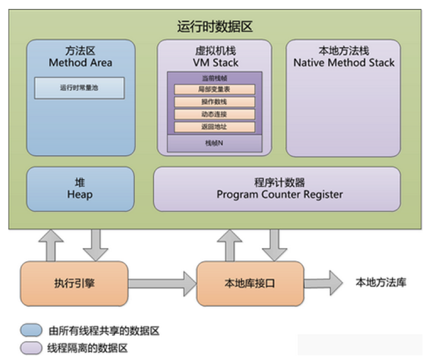
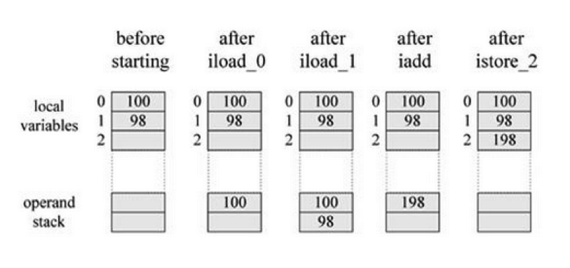
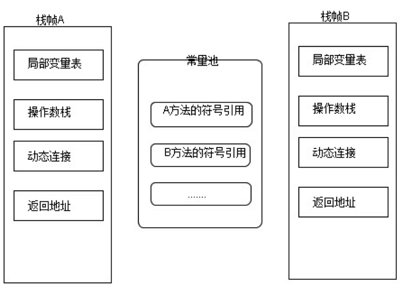
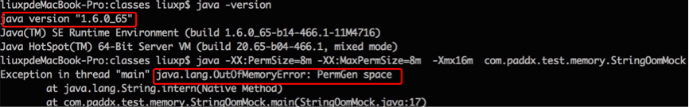
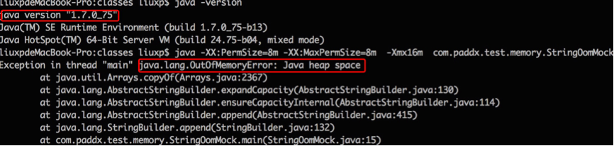
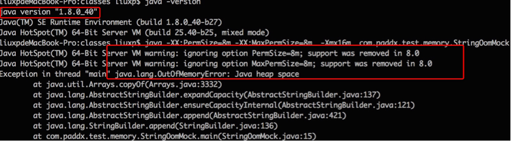
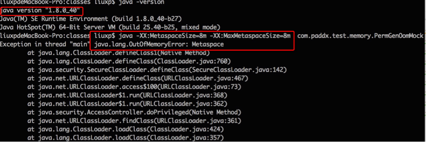

# 内存模型

本文所说的“内存模型”指的是 JVM 的运行时数据区，即 JVM 在执行程序期间如何划分和使用内存。它与 Java 内存模型（JMM，定义多线程之间的可见性、有序性规则）是两个不同的概念。

JVM 定义了若干个程序执行期间使用的数据区域。其中一些区域在 JVM 启动时创建、在 JVM 退出时销毁，由所有线程共享；另一些区域则与线程一一对应，在线程创建时创建、在线程退出时销毁。



# 1 程序计数器

程序计数器（Program Counter Register）是一块较小的内存空间，可以看作是当前线程所执行的字节码的行号指示器。分支、循环、跳转、异常处理、线程恢复等基础功能都需要依赖这个计数器来完成。

由于 JVM 的多线程是通过线程轮流切换、分配处理器执行时间的方式来实现的，在任何一个确定的时刻，一个处理器（对于多核处理器来说是一个内核）只会执行一个线程中的指令。因此，为了线程切换后能恢复到正确的执行位置，每个线程都需要有一个独立的程序计数器，各个线程的计数器互不影响、独立存储，我们称这类内存区域为“**线程私有**”的内存。

如果线程正在执行的是一个 Java 方法，这个计数器记录的是正在执行的字节码指令的地址；如果正在执行的是 Native 方法，这个计数器的值则为空（Undefined）。

**此内存区域是唯一一个在 JVM 规范中没有规定任何 `OutOfMemoryError` 情况的区域。**

# 2 虚拟机栈

虚拟机栈（VM Stack）也是线程私有的，它的生命周期与线程相同。虚拟机栈描述的是 Java 方法执行的内存模型：**每个方法被执行的时候都会创建一个栈帧（Stack Frame），用于存储局部变量表、操作数栈、动态链接、方法返回地址等信息**。

动画是由一帧一帧的图片连续切换而产生的，虚拟机执行程序的过程也与此类似，只不过这里的“帧”中存放的是方法的局部变量表、操作数栈、动态链接、方法返回地址和一些额外的附加信息。每一个方法从被调用到执行完成的过程，就对应着一个栈帧在虚拟机栈中从入栈到出栈的过程。

对于执行引擎来说，在活动线程中，只有栈顶的栈帧是有效的，称为**当前栈帧**，与这个栈帧关联的方法称为**当前方法**。**执行引擎运行的所有字节码指令都只针对当前栈帧进行操作**。

## 2.1 局部变量表

局部变量表是一组变量值存储空间，**用于存放方法参数和方法内部定义的局部变量**。Java 程序被编译成 class 文件时，就已经在方法 `Code` 属性的 `max_locals` 数据项中确定了该方法所需的局部变量表的最大容量。

局部变量表的容量以**变量槽**（Slot）为最小单位。一个 Slot 可以存放一个 32 位以内的数据类型，即 `boolean`、`byte`、`char`、`short`、`int`、`float`、`reference` 和 `returnAddress` 这 8 种类型；`long` 和 `double` 则占用两个连续的 Slot。

`reference` 类型表示对一个对象实例的引用，JVM 规范没有明确规定它的长度和结构，但虚拟机实现至少应当能通过这个引用直接或间接地找到对象在堆中的起始地址或索引，以及对象所属类型在方法区中的类型信息。

`returnAddress` 类型是为字节码指令 `jsr`、`jsr_w` 和 `ret` 服务的，它指向一条字节码指令的地址。这几条指令早期用于实现 `finally`，现在的编译器早已改为复制 `finally` 代码块的方式，并且版本号 51（JDK 7）及以上的 class 文件中已经禁止使用它们。

**JVM 使用局部变量表完成参数值到参数变量列表的传递**。如果是实例方法（非 `static`），局部变量表中索引为 0 的 Slot 默认用于传递方法所属对象实例的引用，在方法中通过 `this` 访问。

Slot 是可以重用的：当某个变量超出了作用域，它占用的 Slot 就可以交给其他变量使用。Slot 中对对象的引用会影响垃圾回收：在解释执行时，即使变量已经超出作用域，只要它的 Slot 还没有被复用，引用的对象就不会被回收。经过 JIT 编译后，编译器会分析变量的活跃范围，这种情况就基本不存在了。

**系统不会为局部变量赋予初始值**（实例变量和类变量都会被赋予零值），也就是说局部变量不存在类变量那样的准备阶段。局部变量在使用前必须被明确赋值，否则无法通过编译。

## 2.2 操作数栈

操作数栈（Operand Stack）也被组织成一个数组，它的最大深度在编译时就写入了 `Code` 属性的 `max_stack` 数据项中。和局部变量表不同的是，操作数栈不是通过索引来访问的，而是通过标准的栈操作——压栈和出栈——来访问。比如，某条指令把一个值压入操作数栈后，稍后另一条指令就可以弹出这个值来使用。

操作数栈中存储数据的方式与局部变量表一样，支持 `int`、`long`、`float`、`double`、`reference` 和 `returnAddress` 等类型，其中 `long` 和 `double` 占两个单位。`boolean`、`byte`、`short` 和 `char` 类型的值在压入操作数栈之前，会被转换为 `int`。

虚拟机把操作数栈作为它的工作区：大多数指令都要从这里弹出数据、执行运算，然后把结果压回操作数栈。比如，`iadd` 指令就要从操作数栈中弹出两个整数，执行加法运算，再把结果压回操作数栈。下面的示例演示了虚拟机如何把两个 `int` 类型的局部变量相加，再把结果保存到第三个局部变量中：

```text
iload_0    // 把局部变量 0 中的 int 值压入操作数栈
iload_1    // 把局部变量 1 中的 int 值压入操作数栈
iadd       // 弹出两个 int 值，相加后把结果压入操作数栈
istore_2   // 弹出结果，存入局部变量 2
```

在这个字节码序列里，前两条指令 `iload_0` 和 `iload_1` 将局部变量表中索引为 0 和 1 的整数压入操作数栈，然后 `iadd` 指令从操作数栈中弹出这两个整数相加，再将结果压入操作数栈，第四条指令 `istore_2` 则从操作数栈中弹出结果，并把它存储到局部变量表中索引为 2 的位置。下图详细描述了这个过程中局部变量表和操作数栈的状态变化，图中没有使用的区域以空白表示。



## 2.3 动态链接

class 文件的常量池中存有大量的符号引用，每个栈帧都包含一个指向当前方法所属类的运行时常量池的引用，以支持方法调用过程中的动态链接。

如果栈帧 A 对应的方法要调用栈帧 B 对应的方法，方法调用指令会以 B 方法的符号引用作为参数。但符号引用并不直接指向 B 方法的内存位置，所以在调用之前，必须先把符号引用转换为直接引用，然后才能通过直接引用访问到真正的方法。

如果符号引用在类加载阶段或者第一次使用时就被转化为直接引用，这种转化称为**静态解析**，比如静态方法、私有方法、构造方法的调用；如果需要在每次运行期间才能确定调用目标，这种转化称为**动态链接**，比如虚方法调用要根据对象的实际类型（通过虚方法表）确定最终调用的方法。JDK 7 新增的 `invokedynamic` 指令更进一步，把调用目标的确定完全交给运行时的引导方法，Lambda 表达式和 JDK 9 起的字符串拼接都是基于它实现的。



## 2.4 方法返回地址

方法的退出分为两种情况：一种是正常退出，根据方法的定义决定是否要把返回值传给上层调用者；另一种是因异常导致的方法结束，这种情况不会给上层调用者传递返回值。

无论哪种方式退出，都需要回到方法被调用的位置继续执行。如果是正常退出，调用者的程序计数器的值就可以作为返回地址；如果是因为异常退出，则需要通过异常处理表来确定返回地址。

方法的一次调用就对应着栈帧在虚拟机栈中的一次入栈和出栈操作，因此方法退出时可能执行的操作包括：恢复上层方法的局部变量表和操作数栈；如果有返回值，就把返回值压入调用者栈帧的操作数栈中；调整程序计数器的值，指向方法调用指令的下一条指令。

## 2.5 异常

JVM 规范对虚拟机栈规定了两种异常情况：

* 如果线程请求的栈深度大于虚拟机所允许的深度，将抛出 **`StackOverflowError`**，常见于无限递归；
* 如果虚拟机栈可以动态扩展，当扩展时无法申请到足够的内存时，会抛出 **`OutOfMemoryError`**。

HotSpot 的虚拟机栈是不能动态扩展的，栈的大小通过 `-Xss` 参数设置（64 位 Linux 上默认为 1 MB）。因此在 HotSpot 中，只有在创建线程时无法为其分配栈空间才会出现 `OutOfMemoryError`，错误信息通常是 `unable to create native thread`。

JDK 21 正式引入的虚拟线程与此不同：虚拟线程挂起时，它的栈帧会以对象的形式保存到堆中，恢复时再复制回载体线程的栈上，所以创建上百万个虚拟线程也不会耗尽栈内存。

# 3 本地方法栈

本地方法栈（Native Method Stack）与虚拟机栈的作用非常相似，区别是虚拟机栈为虚拟机执行 Java 方法（也就是字节码）服务，而本地方法栈为虚拟机用到的 Native 方法服务。JVM 规范对本地方法栈中方法使用的语言、使用方式与数据结构并没有强制规定，具体的虚拟机可以自由实现它，**HotSpot 就直接把本地方法栈和虚拟机栈合二为一**。

与虚拟机栈一样，本地方法栈也会抛出 `StackOverflowError` 和 `OutOfMemoryError`。

# 4 堆

堆（Heap）是 JVM 所管理的内存中最大的一块，被所有线程共享，在虚拟机启动时创建。此内存区域的唯一目的就是存放对象实例，几乎所有的对象实例都在这里分配内存。

之所以说“几乎”，是因为随着 JIT 编译器的发展与逃逸分析技术的成熟，对象也可能不在堆上分配：如果 JIT 分析出一个对象不会逃逸出方法，就可以把它拆散为若干个局部变量（标量替换），从而完全不创建这个对象。需要注意，HotSpot 实现的是标量替换，而不是真正把整个对象分配在栈上。

**堆是垃圾收集器管理的主要区域**，因此很多时候也被称为“**GC 堆**”。

## 4.1 堆的大小

堆的大小可以通过 `-Xms`（初始值）和 `-Xmx`（最大值）参数设置：

* `-Xms` 未设置时，默认为物理内存的 1/64（`-XX:InitialRAMPercentage` 默认为 1.5625）；
* `-Xmx` 未设置时，默认为物理内存的 1/4（`-XX:MaxRAMPercentage` 默认为 25）。

JDK 10 起（JDK 8 自 8u191 起），JVM 能够识别容器的内存限制，这里的“物理内存”在容器中就是容器的内存上限。在容器中运行时，更推荐使用 `-XX:MaxRAMPercentage` 按比例设置堆大小，而不是写死 `-Xmx`。

默认情况下，GC 之后如果堆的空闲比例小于 40%，JVM 会扩大堆，直到 `-Xmx` 指定的大小，这个比例可以通过 `-XX:MinHeapFreeRatio` 指定；如果空闲比例大于 70%，JVM 会缩小堆，直到 `-Xms` 指定的大小，这个比例可以通过 `-XX:MaxHeapFreeRatio` 指定。对于服务端应用，为了避免运行时频繁调整堆的大小，通常把 `-Xms` 和 `-Xmx` 设置成一样的值。

## 4.2 堆的分代

从内存回收的角度看，主流的垃圾收集器都采用分代收集算法，所以堆还可以细分为新生代和老年代。

**新生代**：**程序新创建的对象通常都在新生代分配内存**。新生代由一个 Eden 区和两个大小相同的 Survivor 区（通常称为 S0 和 S1，或者 From 和 To）构成。可以通过 `-Xmn` 参数指定新生代的大小，通过 `-XX:SurvivorRatio` 调整 Eden 区与 Survivor 区的比例，默认为 8，即 Eden : S0 : S1 = 8 : 1 : 1。

为了避免多个线程同时在 Eden 区分配对象时相互竞争，JVM 会为每个线程在 Eden 区中预先划出一小块私有的分配缓冲区（TLAB，Thread Local Allocation Buffer），线程优先在自己的 TLAB 中分配对象，用完了再申请新的 TLAB。

**老年代**：用于存放经过多次新生代 GC 后仍然存活的对象（默认 15 次，可通过 `-XX:MaxTenuringThreshold` 设置），比如缓存对象。新创建的对象也有可能直接进入老年代，比如大对象：使用 Serial 收集器时，可以通过 `-XX:PretenureSizeThreshold` 设置超过多少字节的对象直接在老年代分配（默认为 0，表示不启用）；而 G1 会把大小超过 Region 一半的对象作为巨型对象（Humongous Object），直接分配在专门的巨型 Region 中。

在新生代大小固定的情况下，老年代的大小就是 `-Xmx` 的值减去 `-Xmn` 的值。

需要说明的是，上述 Eden、Survivor、老年代在物理上连续划分的布局，是 Serial、Parallel 等经典收集器的做法。JDK 9 起默认的 G1 收集器把堆划分为大小相等的 Region，每个 Region 可以动态地充当 Eden、Survivor 或老年代；使用 G1 时一般不建议设置 `-Xmn`，否则会影响它根据停顿时间目标自动调整新生代大小。各收集器的细节详见《垃圾回收机制》一文。

如果堆中没有内存完成实例分配，并且堆也无法再扩展时，将会抛出 `OutOfMemoryError: Java heap space`。

# 5 方法区

方法区（Method Area）与堆一样，是所有线程共享的内存区域，用于存储已被虚拟机加载的类型信息、常量、静态变量、即时编译器编译后的代码缓存等数据。

class 文件是类被 JVM 使用之前的表现形式。一旦这个类要被使用，JVM 就会对其进行加载、链接（验证、准备、解析）和初始化，而加载的结果，就是把 class 文件转变为方法区中的一段特定的数据结构。这个数据结构会存储如下信息：

* **类型信息**
    * 这个类型的全限定名
    * 这个类型的直接超类的全限定名
    * 这个类型是类还是接口
    * 这个类型的访问修饰符
    * 所有直接超接口的全限定名的有序列表
* **字段信息**
    * 字段名
    * 字段类型
    * 字段的修饰符
* **方法信息**
    * 方法名
    * 方法返回类型
    * 方法参数的数量和类型（按照顺序）
    * 方法的修饰符
    * 方法的字节码、异常表等
* **其他信息**
    * 类（静态）变量
    * 一个指向类加载器的引用
    * 一个指向 `Class` 对象的引用
    * 运行时常量池（常量数据以及对其他类型的符号引用）

无论是创建这个类的实例，还是调用这个类的某个方法，都需要访问方法区中的这些元数据。

创建一个对象时，JVM 会在堆中为对象分配空间，这些空间用来存储当前类及其所有父类声明的实例字段（字段的布局信息从方法区获得）。需要注意，实例化子类时，**只会创建一个对象**，这个对象中包含了从父类继承来的字段，并不会额外创建一个父类对象。子类构造方法会先调用父类的构造方法，但调用构造方法只是在初始化这同一个对象中由父类声明的那部分字段，并不意味着创建了新的实例。

类变量被类的所有实例共享，即使没有类的实例也可以访问它。这些变量只与类相关，在逻辑上属于方法区中类数据的一部分。不过在 HotSpot 的实现中，JDK 7 起类变量实际上存放在堆中该类的 `Class` 对象里。

方法区主要有以下几个特点：

* 方法区的访问必须是线程安全的。由于所有线程都共享方法区，方法区里的数据访问必须被设计成线程安全的。例如，两个线程同时访问同一个还没有被加载的类时，只允许一个线程去加载它，其他线程必须等待。
* 方法区的大小不必是固定的，JVM 可以根据应用的需要动态调整。同时，方法区也不一定是连续的。
* 方法区也可以被垃圾回收：当某个类不再被使用时，JVM 可以卸载这个类。相对而言，垃圾回收在这个区域比较少出现，回收的目标主要是常量池中废弃的常量和不再使用的类型。

当方法区无法满足内存分配需求时，将抛出 `OutOfMemoryError`。

对于习惯在 HotSpot 上开发和部署程序的开发者来说，很多人习惯把方法区称为“**永久代**”（Permanent Generation），但两者本质上并不等价，只是 JDK 7 及之前的 HotSpot 选择用永久代来实现方法区，把 GC 的分代收集扩展到了方法区而已，可以通过 `-XX:PermSize` 和 `-XX:MaxPermSize` 参数限制它的大小。对于其他虚拟机（如 JRockit、J9）来说，并不存在永久代的概念。JDK 8 起，HotSpot 也用元空间取代了永久代，详见 6.2 节。

## 5.1 运行时常量池

运行时常量池（Runtime Constant Pool）是方法区的一部分。class 文件中的常量池用于存放编译期生成的各种字面量和符号引用，这部分内容在类加载后存放到运行时常量池中。常量池中的数据项像数组项一样，**通过索引访问**。

与 class 文件的常量池相比，运行时常量池具有动态性：运行期间也可以把新的常量放入池中，比如 `String.intern()` 方法。

需要区分的是字符串常量池（StringTable）。它是 JVM 全局共享的一张哈希表，JDK 7 起从永久代移到了堆中，表的桶数可以通过 `-XX:StringTableSize` 设置，JDK 11 起默认为 65536。

# 6 扩展

## 6.1 直接内存

直接内存（Direct Memory）并不是虚拟机运行时数据区的一部分，也不是 JVM 规范中定义的内存区域，但这部分内存也被频繁使用，而且也可能导致 `OutOfMemoryError`。

JDK 1.4 中新加入了 NIO，引入了一种基于通道（Channel）与缓冲区（Buffer）的 I/O 方式，它可以使用 Native 函数库直接分配堆外内存，然后通过一个存储在堆中的 `DirectByteBuffer` 对象作为这块内存的引用进行操作。这样能在一些场景中显著提高性能，因为避免了在 Java 堆和 Native 堆之间来回复制数据。Netty 等网络框架就大量使用了直接内存。

直接内存的大小可以通过 `-XX:MaxDirectMemorySize` 设置，默认与堆的最大值相同。`DirectByteBuffer` 对象被回收时，才会通过 `Cleaner` 释放对应的堆外内存，因此堆外内存的释放依赖于 GC 的时机。

JDK 22 正式发布的 FFM API（JEP 454）提供了更现代的堆外内存管理方式：通过 `Arena` 分配 `MemorySegment`，可以确定性地释放内存，并且没有 `ByteBuffer` 2 GB 的大小限制。

```java
try (Arena arena = Arena.ofConfined()) {
    MemorySegment segment = arena.allocate(1024);
    segment.set(ValueLayout.JAVA_INT, 0, 42);
} // 离开 try 代码块时，内存立即释放
```

## 6.2 元空间

绝大部分 Java 程序员应该都见过 `java.lang.OutOfMemoryError: PermGen space` 这个异常，这里的“PermGen space”指的就是永久代。前面说过，方法区是 JVM 的规范，而永久代是这个规范的一种实现，并且只有 HotSpot 才有永久代。由于方法区主要存储类的相关信息，在动态生成类的场景下比较容易出现永久代的内存溢出，一个典型的场景就是 JSP 页面比较多的情况。

在 JDK 8 中，HotSpot 已经没有永久代了，取而代之的是一个叫做 **Metaspace**（元空间）的区域。下面来看看元空间与永久代的区别。

其实，移除永久代的工作从 JDK 7 就开始了。JDK 7 中，存储在永久代的部分数据已经转移到了堆或本地内存中，但永久代仍然存在，并没有完全移除：符号引用（Symbols）转移到了本地内存，字符串常量池（interned strings）转移到了堆，类的静态变量（class statics）也转移到了堆。我们可以通过一段程序来比较 JDK 6、JDK 7 与 JDK 8 的区别，以字符串常量为例：

```java
public class StringOomMock {

    static String base = "string";

    public static void main(String[] args) {
        List<String> list = new ArrayList<>();
        for (int i = 0; i < Integer.MAX_VALUE; i++) {
            String str = base + base;
            base = str;
            list.add(str.intern());
        }
    }
}
```

这段程序以 2 的指数级不断地生成新的字符串，可以比较快速地消耗内存。我们分别用 JDK 6、JDK 7 和 JDK 8 运行它。

JDK 6 的运行结果：



JDK 7 的运行结果：



JDK 8 的运行结果：



从上述结果可以看出，JDK 6 下会出现“PermGen space”的内存溢出，而在 JDK 7 和 JDK 8 中，会出现堆内存溢出，并且 JDK 8 中 `PermSize` 和 `MaxPermSize` 参数已经无效。由此可以验证：JDK 7 和 JDK 8 已经将字符串常量由永久代转移到了堆中，并且 JDK 8 中已经不存在永久代。

那么元空间到底是什么呢？

元空间的本质和永久代类似，都是对 JVM 规范中方法区的实现。不过元空间与永久代之间最大的区别在于：**元空间并不在虚拟机的堆中，而是使用本地内存**。因此，默认情况下，元空间的大小仅受本地内存限制，但可以通过以下参数来调整：

* `-XX:MetaspaceSize`：触发元空间垃圾回收的阈值（64 位平台默认约 21 MB），注意它并不是元空间的初始大小。元空间占用达到该值就会触发 GC 进行类型卸载，GC 之后会对该值进行调整：如果释放了大量空间，就适当降低该值；如果释放的空间很少，就在不超过 `MaxMetaspaceSize` 的前提下适当提高该值。
* `-XX:MaxMetaspaceSize`：元空间的最大值，默认没有限制。生产环境建议设置一个上限，避免类加载器泄漏时耗尽本机内存。
* `-XX:CompressedClassSpaceSize`：开启压缩类指针时，类元数据中的 `Klass` 结构存放在一块单独的压缩类空间中，默认大小为 1 GB。

除了上面几个指定大小的参数以外，还有两个与 GC 相关的参数：

* `-XX:MinMetaspaceFreeRatio`：GC 之后，元空间剩余容量的最小百分比，用于减少因为分配空间而导致的垃圾回收。
* `-XX:MaxMetaspaceFreeRatio`：GC 之后，元空间剩余容量的最大百分比，用于减少因为释放空间而导致的垃圾回收。

字符串已经不在元空间中了，要让元空间溢出，需要不断地加载新的类。下面的程序不断创建新的类加载器，每个类加载器都加载一次同一个类，这样元空间中就会不断产生新的类元数据：

```java
public class PermGenOomMock {
    public static void main(String[] args) throws Exception {
        // /tmp/classes 下存放编译好的 com.paddx.test.memory.Test，该目录不能在 classpath 中
        URL[] urls = {new File("/tmp/classes/").toURI().toURL()};
        List<ClassLoader> loaders = new ArrayList<>();
        while (true) {
            ClassLoader loader = new URLClassLoader(urls);
            loaders.add(loader);
            loader.loadClass("com.paddx.test.memory.Test");
        }
    }
}
```

在 JDK 8 下运行这段代码，并指定 `MetaspaceSize` 和 `MaxMetaspaceSize` 的大小，输出结果如下：



从输出结果可以看出，这次出现的是元空间的溢出：`OutOfMemoryError: Metaspace`。

为什么要用元空间取代永久代呢？大体上有以下几点原因：

* 字符串存放在永久代中，容易出现性能问题和内存溢出。
* 类和方法的信息比较难确定大小，因此永久代的大小很难指定：太小容易出现永久代溢出，太大则容易导致老年代溢出。
* 永久代会为 GC 带来不必要的复杂度，并且回收效率偏低。
* Oracle 需要合并 HotSpot 与 JRockit 两款虚拟机，而 JRockit 中没有永久代。

# 7 新版本中的运行时数据区

| 版本 | 主要变化 |
|------|----------|
| JDK 7 | 字符串常量池、类的静态变量从永久代移到堆中，符号引用移到本地内存 |
| JDK 8 | 元空间取代永久代（JEP 122），`-XX:PermSize`、`-XX:MaxPermSize` 失效 |
| JDK 9 | 代码缓存分段（JEP 197），分为非方法代码、带剖析信息的代码和不带剖析信息的代码三部分；G1 成为默认收集器 |
| JDK 10 | JVM 能识别容器的 CPU 和内存限制，新增 `-XX:MaxRAMPercentage` 等参数（JDK 8 自 8u191 起也已支持） |
| JDK 12 | G1 能及时把空闲的堆内存归还给操作系统（JEP 346） |
| JDK 16 | 弹性元空间（JEP 387）：元空间能更及时地把空闲内存归还给操作系统，并减少碎片 |
| JDK 21 | 虚拟线程正式发布，挂起的虚拟线程栈帧以对象的形式存放在堆中 |
| JDK 22 | FFM API 正式发布（JEP 454），可以用 `Arena` 管理堆外内存 |
| JDK 24 | 紧凑对象头（实验，JEP 450）：64 位平台上对象头从 12 字节压缩为 8 字节 |
| JDK 25 | 紧凑对象头转为正式特性（JEP 519），通过 `-XX:+UseCompactObjectHeaders` 开启 |
| JDK 27 | 紧凑对象头默认开启（JEP 534） |

# 8 总结

| 名称 | 特征 | 作用 | 配置参数 | 异常 |
|------|------|------|----------|------|
| 程序计数器 | 占用内存小，线程私有，生命周期与线程相同 | 当前线程执行的字节码的行号指示器 | 无 | 无 |
| 虚拟机栈 | 线程私有，生命周期与线程相同 | Java 方法执行的内存模型，存储局部变量表、操作数栈、动态链接、方法返回地址等信息 | `-Xss` | `StackOverflowError`、`OutOfMemoryError` |
| 本地方法栈 | 线程私有，HotSpot 中与虚拟机栈合二为一 | 为 Native 方法服务 | `-Xss` | `StackOverflowError`、`OutOfMemoryError` |
| 堆 | 线程共享，生命周期与虚拟机相同，可以不使用连续的内存地址 | 存放对象实例，几乎所有对象实例（包括数组）都在堆上分配 | `-Xms`、`-Xmx`、`-Xmn`、`-XX:MaxRAMPercentage` | `OutOfMemoryError` |
| 方法区 | 线程共享，生命周期与虚拟机相同，可以不使用连续的内存地址 | 存储已被虚拟机加载的类型信息、常量、静态变量等数据 | JDK 7 及之前：`-XX:PermSize`、`-XX:MaxPermSize`；JDK 8 起：`-XX:MetaspaceSize`、`-XX:MaxMetaspaceSize` | `OutOfMemoryError` |
| 运行时常量池 | 方法区的一部分，具有动态性 | 存放字面量及符号引用 | 无 | `OutOfMemoryError` |

1. 程序计数器、虚拟机栈、本地方法栈是线程私有的，堆和方法区是线程共享的。
2. HotSpot 中，JDK 7 把字符串常量池和类的静态变量移到了堆中，JDK 8 用使用本地内存的元空间取代了永久代。
3. 堆是 GC 管理的主要区域，经典收集器按新生代、老年代物理划分，G1 等新收集器则基于 Region 动态划分。
4. 容器环境下推荐用 `-XX:MaxRAMPercentage` 设置堆大小；直接内存、元空间都在堆外，也需要设置上限并纳入容器内存规划。
5. 虚拟线程、FFM API、紧凑对象头等新特性，正在改变栈内存、堆外内存和对象布局的使用方式。
