# 垃圾回收机制

垃圾回收（Garbage Collection，GC）负责自动回收程序不再使用的内存，让开发者不必像 C/C++ 那样手动释放对象。理解 GC 需要回答四个问题：回收哪些区域、如何判断对象已死、用什么算法回收、由哪个收集器在什么时机执行。本文以 HotSpot 虚拟机为例展开，并在最后梳理截至 JDK 27 的演进。

# 1 范围：要回收哪些区域

在 JVM 的运行时数据区中，程序计数器、虚拟机栈、本地方法栈这三个区域是线程私有的，生命周期与线程相同：栈帧随方法进入和退出而入栈、出栈，每个栈帧分配多少内存在编译期基本就已确定，线程结束时这些内存自然释放。**因此 GC 主要关注堆和方法区**，这两块区域的内存分配和回收都是动态的，只有在运行期间才能知道会创建哪些对象、加载哪些类。

- **堆**：回收不再被引用的对象实例，是 GC 的主战场。
- **方法区**：回收废弃的常量和不再使用的类型。JDK 8 起方法区由元空间（Metaspace）实现，位于本地内存中，其回收依赖类卸载。

直接内存（如 `DirectByteBuffer` 申请的堆外内存）不由 GC 直接管理，但当堆中的 `DirectByteBuffer` 对象被回收时，会通过 `Cleaner` 机制释放对应的堆外内存。

# 2 前提：如何判断对象已死

所有垃圾收集算法都面临同一个问题：**找出程序已经无法访问到的对象**，再将其内存释放。

## 2.1 引用计数算法

引用计数是最简单直接的一种方式：在每个对象中维护一个引用计数器，每当有一个地方引用它，计数器加 1；引用失效时，计数器减 1；计数器为 0 的对象就可以被回收。

- **优点**：实现简单，判定效率高，回收可以分散在程序运行过程中进行，不需要集中暂停整个应用。
- **缺点**：
    - 每次引用赋值都要更新计数器，需要编译器或运行时配合插入额外的计数操作，多线程下还要保证计数更新的原子性。
    - 单纯的引用计数无法处理循环引用：对象 A 和 B 互相引用，但都不再被外部使用，它们的计数器永远不为 0。

CPython 和 Swift（ARC）等语言采用了引用计数，CPython 还额外配合了循环检测机制。**HotSpot 没有采用引用计数，而是基于可达性分析算法判断对象是否存活**。

## 2.2 可达性分析算法

可达性分析算法也称根搜索算法：以一系列被称为“GC Roots”的对象作为起点，从这些节点开始沿引用关系向下搜索，搜索所走过的路径称为引用链（Reference Chain）。当一个对象到 GC Roots 没有任何引用链相连时，说明该对象不可达，可以被回收。

在 Java 中，可作为 GC Roots 的对象主要包括：

- 虚拟机栈（栈帧中的局部变量表）中引用的对象，如方法参数、局部变量。
- 本地方法栈中 JNI 引用的对象。
- 类的静态属性引用的对象。
- 常量引用的对象，如字符串常量池（StringTable）中的引用。
- 被同步锁（`synchronized`）持有的对象。
- JVM 内部的引用，如基本类型对应的 `Class` 对象、常驻的异常对象（`NullPointerException`、`OutOfMemoryError` 等）、系统类加载器。

此外，在只回收部分区域的局部回收中（例如只回收新生代），其他区域中指向本区域对象的引用也要作为临时的 GC Roots，这类跨区域引用通过记忆集（Remembered Set）和卡表（Card Table）记录，避免扫描整个老年代。

方法区中的类型要被判定为“无用的类”，需要同时满足以下三个条件：

- 该类的所有实例都已经被回收，即堆中不存在该类及其任何子类的实例。
- 加载该类的类加载器已经被回收。
- 该类对应的 `java.lang.Class` 对象没有在任何地方被引用，无法通过反射访问该类的方法。

满足这些条件的类只是“可以”被卸载。由应用程序类加载器加载的类，由于其类加载器一直存活，通常不会被卸载；只有自定义类加载器加载的类（如 OSGi、热部署、动态代理大量生成类的场景）才会频繁卸载。JDK 9 起可以通过 `-Xlog:class+unload` 观察类卸载情况。

## 2.3 四种引用

判断对象是否存活都与“引用”有关。JDK 1.2 起，Java 将引用分为强引用、软引用、弱引用和虚引用四种，强度依次递减。

### 2.3.1 强引用（Strong Reference）

强引用是最普遍的引用，如 `Object obj = new Object()`。只要强引用关系还存在，垃圾收集器就永远不会回收被引用的对象。当内存空间不足时，JVM 宁愿抛出 `OutOfMemoryError` 使程序终止，也不会回收具有强引用的对象。

### 2.3.2 软引用（Soft Reference）

如果一个对象只具有软引用，内存空间足够时垃圾收集器不会回收它；**在即将发生内存溢出之前，会回收这些对象**。只要没有被回收，该对象就可以被程序使用，因此**软引用可用来实现内存敏感的缓存**。

例如，一个应用需要读取大量本地图片：每次都从磁盘读取会严重影响性能，全部加载到内存又可能造成内存溢出。此时可以用一个 `HashMap` 保存图片路径与图片对象软引用之间的映射，内存不足时 JVM 会自动回收这些缓存图片占用的空间，从而避免内存溢出。

HotSpot 回收软引用时并非一次全部清除，而是按 LRU 策略（由 `-XX:SoftRefLRUPolicyMSPerMB` 控制）优先回收长时间未被访问的软引用对象，但保证在抛出 `OutOfMemoryError` 之前清除所有只被软引用的对象。

### 2.3.3 弱引用（Weak Reference）

弱引用比软引用更弱，只被弱引用关联的对象只能存活到下一次垃圾收集发生为止。**无论当前内存是否足够，垃圾收集器工作时都会回收只被弱引用关联的对象**。`WeakHashMap`、`ThreadLocal` 内部的 `ThreadLocalMap` 都使用了弱引用。

### 2.3.4 虚引用（Phantom Reference）

虚引用顾名思义就是形同虚设，它完全不会影响对象的生命周期，也无法通过虚引用获取对象实例（`get()` 方法始终返回 `null`）。**虚引用的唯一用途是在对象被回收时收到一个系统通知**，因此虚引用必须和引用队列（`ReferenceQueue`）联合使用。

```java
ReferenceQueue<Object> queue = new ReferenceQueue<>();
PhantomReference<Object> pr = new PhantomReference<>(object, queue);
```

JDK 9 之前，虚引用入队时其引用的对象不会被自动清除，需要程序手动调用 `clear()`；JDK 9 起虚引用与软引用、弱引用一样，在入队时会被自动清除。

软引用、弱引用同样可以和引用队列联合使用：当引用的对象被回收后，JVM 会把引用对象本身加入关联的引用队列，程序可以据此清理相关资源。

| 引用类型 | 回收时机 | 典型用途 |
| -------- | -------- | -------- |
| 强引用 | 永不回收（只要可达） | 普通对象引用 |
| 软引用 | 内存不足时 | 内存敏感的缓存 |
| 弱引用 | 下一次 GC 时 | `WeakHashMap`、`ThreadLocalMap` |
| 虚引用 | 随时，仅用于接收回收通知 | 堆外内存释放、资源清理（`Cleaner`） |

## 2.4 finalize 与 Cleaner

早期 Java 允许对象在 `finalize()` 方法中“自我拯救”：不可达的对象会先被标记并放入 F-Queue，由低优先级的 Finalizer 线程执行其 `finalize()` 方法，如果在方法中重新与引用链建立了关联，就能逃过这次回收。

这一机制运行代价高、执行时机不确定、容易造成资源泄漏，JDK 9 起 `Object.finalize()` 被标记为废弃，JDK 18 的 JEP 421 进一步将终结机制标记为待移除。需要在对象回收时释放资源的场景，应使用 `try-with-resources` 显式关闭，或使用基于虚引用实现的 `java.lang.ref.Cleaner`。

# 3 策略：垃圾收集算法

## 3.1 标记-清除算法

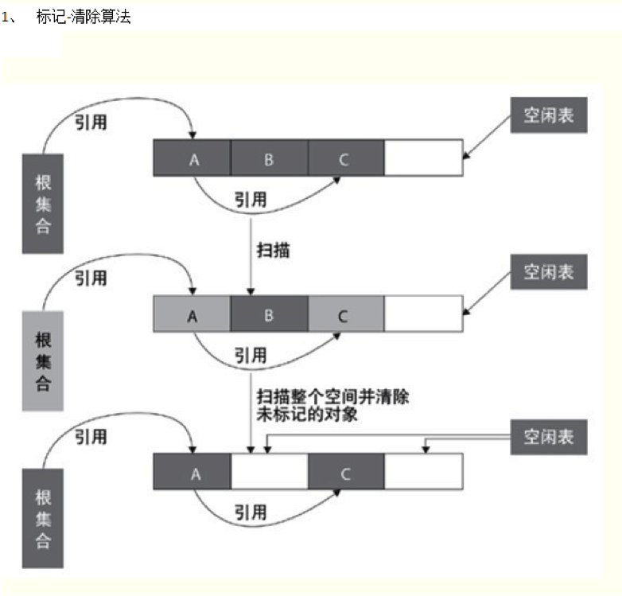

标记-清除（Mark-Sweep）算法分为“标记”和“清除”两个阶段：首先从 GC Roots 出发扫描并标记所有存活的对象，标记完成后，再扫描整个空间，回收所有未被标记的对象，并把回收的空间记录到空闲列表中。

优点：

- 能够处理循环引用问题。
- 不需要移动对象，仅对不存活的对象进行处理，在存活对象较多时效率较高。

缺点：

- 执行效率不稳定：如果堆中有大量对象需要回收，标记和清除的工作量都会随对象数量增长。
- **会产生内存碎片**：清除后会留下大量不连续的空间，当需要分配较大对象时，可能因为找不到足够的连续内存而不得不提前触发另一次垃圾收集。

## 3.2 复制算法

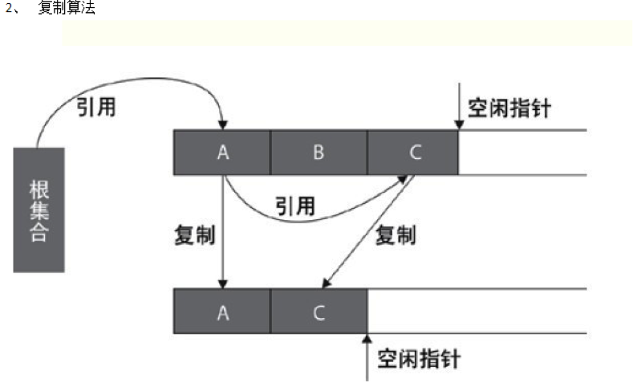

复制（Copying）算法将可用内存划分为大小相等的两块，每次只使用其中一块。当这一块内存用完时，就把存活的对象复制到另一块上，然后把已使用的那块空间一次性清理掉，两块空间的角色随之互换。

优点：

- 只处理存活对象，在存活对象较少时极为高效。
- 复制后对象紧凑排列，没有内存碎片，分配内存时只需移动指针（指针碰撞）。

缺点：

- 需要额外的空间：任意时刻总有一块内存处于未使用状态。
- 存活对象较多时，复制的开销较大。

## 3.3 标记-整理算法

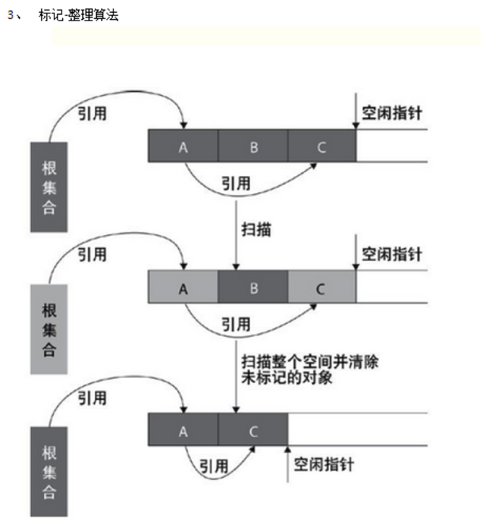

标记-整理（Mark-Compact）算法的标记过程与标记-清除算法相同，但后续步骤不是直接清理可回收对象，而是让所有存活的对象都向内存空间的一端移动，然后直接清理掉边界以外的内存，并更新指向这些对象的引用。

该算法解决了内存碎片问题，也不需要像复制算法那样浪费一半的空间。代价是移动存活对象并更新引用的开销较大，且在传统实现中这一过程需要暂停用户线程。

## 3.4 分代收集理论

分代收集（Generational Collection）并不是一种具体算法，而是根据对象存活周期的不同将内存划分为几块，再为每块选择合适的算法。它建立在以下几个经验法则之上：

- **弱分代假说**：绝大多数对象都是朝生夕灭的。
- **强分代假说**：熬过越多次垃圾收集的对象就越难以消亡。
- **跨代引用假说**：跨代引用相对于同代引用来说仅占极少数。

基于这些假说，HotSpot 的经典设计把堆划分为新生代和老年代：

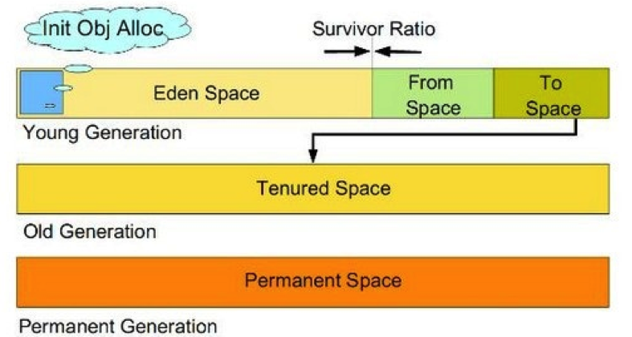

上图为 JDK 7 及之前的经典布局，其中的永久代（Permanent Generation）在 JDK 8 中已被移除，取而代之的元空间位于本地内存中，不再属于堆。

**新生代（Young Generation）**：大部分对象在这里创建，也在这里很快死去，因此新生代采用**复制算法**。IBM 的研究表明新生代中约 98% 的对象熬不过第一轮收集，所以 HotSpot 并没有按 1:1 划分空间，而是把新生代分为一块较大的 Eden 区和两块较小的 Survivor 区（From 和 To，也称 S0 和 S1），默认比例为 8:1:1（由 `-XX:SurvivorRatio` 控制）。每次分配内存只使用 Eden 和其中一块 Survivor，即 90% 的新生代空间可用，只有 10% 的空间被“浪费”。两块 Survivor 是对称的，始终有一块是空的。新生代的大小可以通过 `-Xmn` 指定。

**老年代（Old Generation）**：存放在新生代中经历多次收集仍然存活的对象，以及直接分配的大对象。老年代对象存活率高，也没有额外空间做分配担保，因此一般采用**标记-清除**或**标记-整理**算法，具体取决于收集器。老年代的大小为堆的大小（`-Xms`、`-Xmx`）减去新生代的大小。

按照回收范围，各类收集行为通常这样命名：

- **Minor GC / Young GC**：只回收新生代，频率高、速度快。
- **Major GC / Old GC**：只回收老年代，目前只有 CMS 有单独收集老年代的行为。“Major GC”一词在不同资料中含义混乱，有时也指 Full GC，需要结合上下文判断。
- **Mixed GC**：回收整个新生代和部分老年代，目前只有 G1 有这种行为。
- **Full GC**：回收整个堆和方法区，停顿时间通常最长。

## 3.5 Minor GC 的过程

以经典分代布局为例，一次 Minor GC 的过程如下：

1. 新对象优先在 Eden 区分配（多数情况下在线程私有的 TLAB 中分配）。
2. 当 Eden 区没有足够空间时，触发一次 Minor GC。收集器从 GC Roots 以及记录跨代引用的卡表出发，找出 Eden 区和 From 区中所有存活的对象。
3. 将存活的对象复制到 To 区，对象年龄加 1。年龄达到晋升阈值的对象，或者 To 区放不下的对象，直接晋升到老年代。
4. 清空 Eden 区和 From 区，然后交换 From 区和 To 区的角色，保证下一次 Minor GC 时 To 区依然是空的。
5. 如果老年代也没有足够空间容纳晋升的对象，就会触发 Full GC；Full GC 之后仍然无法分配，JVM 抛出 `java.lang.OutOfMemoryError: Java heap space`。

分代之后，大多数收集只需要处理较小的新生代，不必每次都扫描整个堆，因此回收速度大大提高。

## 3.6 对象的空间分配和晋升

- **对象优先在 Eden 分配**：Eden 区空间不足时触发 Minor GC。
- **大对象直接进入老年代**：大对象是指需要大量连续内存的对象，如很长的字符串或数组。在 Eden 中分配大对象会导致它在 Eden 区和两个 Survivor 区之间来回复制，开销很大。Serial 和 ParNew 收集器支持 `-XX:PretenureSizeThreshold` 参数，大于该值的对象直接在老年代分配；G1 则把大小超过 Region 一半的对象作为巨型对象（Humongous Object），存放在专门的 Humongous Region 中。
- **长期存活的对象进入老年代**：对象每熬过一次 Minor GC，年龄就增加 1，当年龄达到阈值（`-XX:MaxTenuringThreshold`，默认为 15）时晋升到老年代。对象年龄存放在对象头的 4 个比特中，因此该阈值最大只能设为 15。
- **动态年龄判定**：HotSpot 并不总是等到年龄达到阈值才晋升。它从年龄 1 开始累加各年龄对象的总大小，一旦超过 Survivor 区容量的 `-XX:TargetSurvivorRatio`（默认 50%），就把当前年龄作为新的晋升阈值，大于或等于该年龄的对象直接进入老年代。
- **空间分配担保**：Minor GC 之前，JVM 会检查老年代的最大可用连续空间。JDK 6 Update 24 之后，只要该空间大于新生代对象总大小或历次晋升的平均大小，就进行 Minor GC，否则直接进行 Full GC。原来的 `-XX:HandlePromotionFailure` 参数已不再生效。

# 4 触发：何时开始 GC

Minor GC 的触发条件比较简单：**Eden 区空间不足时触发**。

Full GC 的触发条件则比较多：

- 老年代空间不足。
- 方法区空间不足：JDK 7 及之前为永久代空间不足，JDK 8 起为元空间使用量达到 `-XX:MetaspaceSize` 阈值或 `-XX:MaxMetaspaceSize` 上限。
- 空间分配担保失败：统计得到的 Minor GC 晋升到老年代的平均大小大于老年代的剩余空间。
- 代码中显式调用 `System.gc()`。这只是对 JVM 的建议，可以通过 `-XX:+DisableExplicitGC` 禁用；在 G1 中也可以通过 `-XX:+ExplicitGCInvokesConcurrent` 让它触发并发周期而不是 Full GC。
- 并发收集器来不及回收：如 CMS 的 Concurrent Mode Failure、G1 的转移失败（Evacuation Failure）后无法继续分配，都会退化为 Full GC。

对于 G1、ZGC 这类并发收集器，正常情况下由堆占用率等启发式条件触发并发周期，Full GC 只是兜底手段，频繁出现 Full GC 通常意味着堆空间不足或参数设置不当。

# 5 实现：HotSpot 中的垃圾收集器

## 5.1 收集器概览

HotSpot 针对不同的代和应用场景实现了多款垃圾收集器：

- 单线程收集器 Serial 和 Serial Old，分别用于新生代和老年代。
- 随着多核 CPU 的普及，出现了 Serial 的多线程版本 ParNew。
- 同样是多线程的 Parallel Scavenge 和 Parallel Old，分别用于新生代和老年代，关注吞吐量。
- 以最短停顿时间为目标、能与用户线程并发执行的 CMS。
- 面向整堆、可预测停顿时间的 G1，JDK 9 起成为默认收集器。
- 停顿时间与堆大小无关的低延迟收集器 ZGC 和 Shenandoah。

| 收集器 | 作用区域 | 算法 | 线程模型 | 现状（JDK 27） |
| ------ | -------- | ---- | -------- | -------------- |
| Serial | 新生代 | 复制 | 单线程 | 可用 |
| ParNew | 新生代 | 复制 | 多线程并行 | JDK 14 随 CMS 移除 |
| Parallel Scavenge | 新生代 | 复制 | 多线程并行 | 可用 |
| Serial Old | 老年代 | 标记-整理 | 单线程 | 可用 |
| Parallel Old | 老年代 | 标记-整理 | 多线程并行 | 可用 |
| CMS | 老年代 | 标记-清除 | 并发 | JDK 14 移除 |
| G1 | 整堆 | 整体标记-整理，局部复制 | 并行 + 并发 | 默认收集器 |
| ZGC | 整堆 | 并发标记-整理 | 并发 | 可用，JDK 23 起默认分代 |
| Shenandoah | 整堆 | 并发标记-整理 | 并发 | 可用，JDK 25 起支持分代 |

## 5.2 年轻代收集器

### 5.2.1 Serial 收集器

Serial 收集器是发展历史最悠久的新生代收集器，使用复制算法。它只使用一个线程完成垃圾收集工作，并且在收集时**必须暂停所有用户线程**，直到收集结束。工作过程如下图所示：


这种暂停所有用户线程的现象称为 **STW**（Stop The World）。如果收集时间很长，停顿时间也会很长，系统响应会变得迟钝。

不过，正因为只用一个线程，Serial 没有线程交互和上下文切换的开销，在单核或资源受限的环境中反而简单高效，内存占用也是所有收集器中最小的。JDK 9 到 JDK 26 期间，当 JVM 判断运行环境不属于“服务器级机器”（少于 2 个 CPU 或少于 1792 MB 内存）时，会默认选择 Serial；JDK 27 的 JEP 523 起，所有环境默认都使用 G1。

### 5.2.2 ParNew 收集器

ParNew 收集器是 Serial 收集器的多线程版本，同样使用复制算法，可以用多个线程并行地进行垃圾收集。

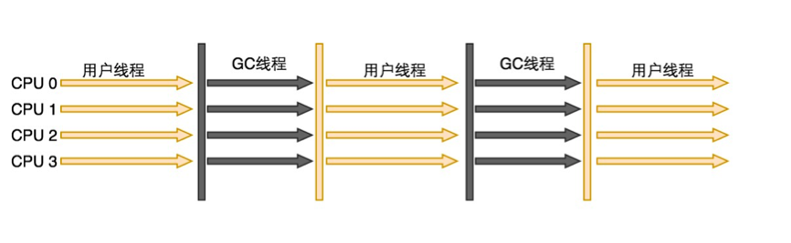

ParNew 曾是服务端新生代收集器的常见选择，一个重要原因是：除了 Serial 之外，只有它能与 CMS 配合使用。在单核机器上，由于存在线程切换开销，ParNew 的性能不一定比 Serial 好；在多核机器上则能明显提高收集效率。它默认开启的收集线程数与 CPU 数量相关，可以通过 `-XX:ParallelGCThreads` 控制。

JDK 9 移除了 ParNew + Serial Old 的组合，ParNew 只能与 CMS 搭配；JDK 14 移除 CMS 后，ParNew 也随之退出历史舞台。

### 5.2.3 Parallel Scavenge 收集器

Parallel Scavenge 收集器同样是基于复制算法的多线程新生代收集器，但它的关注点与其他收集器不同：CMS 等收集器关注如何缩短用户线程的停顿时间，而 Parallel Scavenge 关注的是**吞吐量**，即 CPU 用于运行用户代码的时间与 CPU 总耗时的比值：

> 吞吐量 = 运行用户代码时间 /（运行用户代码时间 + 垃圾收集时间）

如果虚拟机总共运行了 100 分钟，其中垃圾收集用了 1 分钟，那么吞吐量就是 99%。

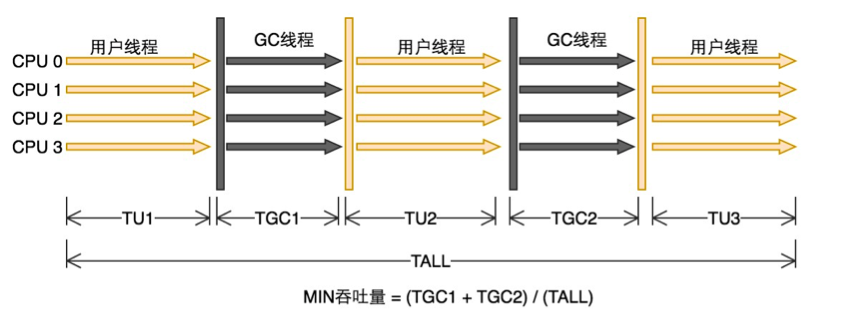

图中公式计算的实际是垃圾收集时间的占比，吞吐量等于 1 减去该值。

停顿时间短适合需要与用户交互的程序，良好的响应速度能提升用户体验；高吞吐量则适合在后台运算、不需要太多交互的任务，可以最高效地利用 CPU 尽快完成计算。例如，同样是 1 分钟的计算，一个收集器每次停顿 10 ms 但发生了 1000 次，另一个每次停顿 100 ms 但只发生 5 次，前者交互体验更好，后者的总收集时间更短、吞吐量更高。

Parallel Scavenge 提供了两个参数精确控制吞吐量：

- `-XX:MaxGCPauseMillis`：最大垃圾收集停顿时间，值为大于 0 的毫秒数。收集器会尽量保证每次收集耗时不超过该值，但停顿时间缩短是以牺牲吞吐量和新生代空间为代价的：设置得过小，收集器会缩小新生代，导致收集更频繁，吞吐量下降。
- `-XX:GCTimeRatio`：用户代码运行时间与垃圾收集时间的比值，值为大于 0 小于 100 的整数。设置为 19 时，允许的最大收集时间占比为 1 /（1 + 19）= 5%；默认值为 99，即最多允许 1% 的时间用于垃圾收集。

此外还有一个开关参数 `-XX:+UseAdaptiveSizePolicy`（默认开启）。开启后不需要手动指定新生代大小（`-Xmn`）、Eden 与 Survivor 的比例（`-XX:SurvivorRatio`）、晋升老年代的年龄阈值等细节参数，JVM 会根据运行情况动态调整，以达到设定的停顿时间或吞吐量目标，这种方式称为 **GC 自适应调节策略**。

由于以吞吐量为目标，Parallel Scavenge 也被称为“吞吐量优先收集器”。JDK 9 之前，服务器级机器上的默认收集器就是 Parallel Scavenge + Parallel Old 的组合。

## 5.3 老年代收集器

### 5.3.1 Serial Old 收集器

Serial Old 是 Serial 收集器的老年代版本，同样是单线程收集器，使用标记-整理算法。它主要与 Serial 搭配，用于客户端或资源受限的环境。在服务端，它曾在 JDK 5 及之前与 Parallel Scavenge 搭配使用，也曾作为 CMS 发生 Concurrent Mode Failure 时的后备方案。

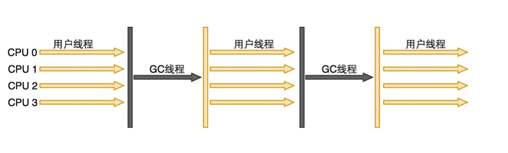

### 5.3.2 Parallel Old 收集器

Parallel Old 是 Parallel Scavenge 的老年代版本，支持多线程并行收集，使用标记-整理算法，从 JDK 6 开始提供。在此之前，Parallel Scavenge 只能与单线程的 Serial Old 搭配，老年代收集拖累了整体吞吐量。Parallel Scavenge + Parallel Old 的组合实现了真正意义上的“吞吐量优先”，在注重吞吐量或处理器资源较为稀缺的场合可以优先考虑。


JDK 7 Update 4 起，`-XX:+UseParallelGC` 会默认同时启用 Parallel Old；JDK 14 的 JEP 366 废弃了 Parallel Scavenge + Serial Old 的组合，JDK 15 将其移除，`-XX:+UseParallelOldGC` 参数也随之成为过时参数。

### 5.3.3 CMS 收集器

CMS（Concurrent Mark Sweep）收集器是一款**以获取最短停顿时间为目标**的老年代收集器。从名字可以看出，它基于标记-清除算法，并且能与用户线程并发执行。在 G1 成熟之前，它非常适合重视响应速度的互联网服务端应用。

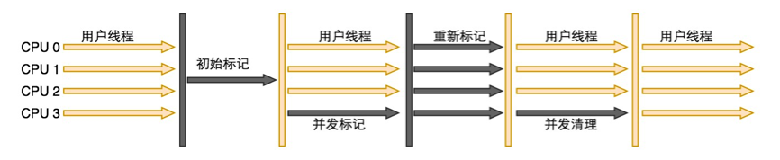

CMS 的工作过程主要分为 4 个阶段：

1. **初始标记（CMS initial mark）**：只标记 GC Roots 能直接关联到的对象，速度很快，需要 STW。
2. **并发标记（CMS concurrent mark）**：从 GC Roots 直接关联的对象开始遍历整个对象图，耗时较长，但与用户线程并发执行。
3. **重新标记（CMS remark）**：修正并发标记期间因用户程序继续运行而导致标记变动的那部分对象，需要 STW，耗时比初始标记稍长，但远比并发标记短。
4. **并发清除（CMS concurrent sweep）**：清理已经判断死亡的对象，由于不需要移动存活对象，可以与用户线程并发执行。

实际实现中，并发标记之后还有并发预清理（concurrent preclean）阶段，并发清除之后还有并发重置（concurrent reset）阶段，在后文的 GC 日志中可以看到。由于耗时最长的并发标记和并发清除阶段都可以与用户线程一起工作，因此可以认为 CMS 的内存回收过程与用户线程是并发执行的，它也被称为“并发低停顿收集器”。

CMS 也存在明显的不足：

- **对处理器资源敏感**：并发阶段虽然不会暂停用户线程，但会占用一部分线程，降低总吞吐量。CMS 默认启动的回收线程数是（处理器核心数 + 3）/ 4，处理器核心数在 4 个及以上时，回收线程占用不超过 25% 的处理器资源；核心数不足 4 个时，影响会变大，例如 2 核时回收线程要占用一半的处理器资源。
- **无法处理浮动垃圾**：在并发标记和并发清除阶段，用户线程还在运行，新产生的垃圾只能留待下一次收集处理，这部分垃圾称为**浮动垃圾**。因此 CMS 不能等老年代几乎填满再收集，必须预留空间给用户线程使用。JDK 5 的默认设置下，老年代使用了 68% 后就会激活 CMS；JDK 6 将这一阈值提高到 92%，可以通过 `-XX:CMSInitiatingOccupancyFraction` 调整。如果预留的内存无法满足程序分配新对象的需要，就会出现 **Concurrent Mode Failure**，此时 JVM 启动后备预案，临时用 Serial Old 重新进行老年代收集，停顿时间会大大增加。因此该参数设置过高容易导致 Concurrent Mode Failure，设置过低则浪费内存并导致收集过于频繁。
- **产生内存碎片**：标记-清除算法会留下大量空间碎片，即使老年代总空闲空间很多，也可能因为找不到足够大的连续空间分配大对象而提前触发 Full GC。为此 CMS 提供了 `-XX:+UseCMSCompactAtFullCollection` 参数（默认开启），在 Full GC 时进行碎片整理，整理过程无法并发，会延长停顿时间；`-XX:CMSFullGCsBeforeCompaction` 则用来指定执行多少次不整理的 Full GC 之后进行一次整理，默认值为 0，表示每次 Full GC 都进行整理。

由于这些问题，以及 G1 的成熟，CMS 在 JDK 9 中被标记为废弃（JEP 291），并在 JDK 14 中被正式移除（JEP 363），相关参数也一并失效。

## 5.4 G1 收集器

G1（Garbage First）收集器是垃圾收集技术发展史上的里程碑。它在 JDK 6 Update 14 中以实验状态出现，JDK 7 Update 4 起获得正式支持，JDK 9 起取代 Parallel Scavenge + Parallel Old 成为服务端模式下的默认收集器（JEP 248），JDK 27 起成为所有环境下的默认收集器。G1 的目标是在延迟可控的前提下获得尽可能高的吞吐量，适合大堆内存的场景。

G1 与前面介绍的收集器有很大不同：

- **基于 Region 的内存布局**：G1 把整个堆划分为多个大小相等的独立区域（Region），每个 Region 都可以根据需要扮演 Eden、Survivor 或老年代空间，收集时以 Region 为单位进行回收。
- **逻辑分代**：G1 仍然是分代收集器，但新生代和老年代不再是固定的连续区域，而是一系列 Region 的动态集合，不需要预先划分好独立的 Survivor 空间。
- **可预测的停顿时间**：G1 跟踪每个 Region 中垃圾堆积的“价值”（回收能获得的空间大小以及所需时间的经验值），在后台维护一个优先级列表，每次根据用户设定的停顿时间目标，优先回收价值最大的 Region，这也是“Garbage First”名称的由来。
- **混合收集**：每次收集既可能只回收新生代 Region（Young GC），也可能在回收新生代的同时回收部分老年代 Region（Mixed GC），即使堆很大也能把单次收集范围控制在目标停顿时间之内。
- **无内存碎片**：从整体看 G1 基于标记-整理算法，从局部（两个 Region 之间）看则基于复制算法，存活对象被复制到空闲 Region 中，不会产生空间碎片。

除了 Eden、Survivor 和 Old 三类 Region，G1 还专门设置了 Humongous Region 来存储巨型对象：大小超过 Region 容量一半的对象会被分配到一组连续的 Humongous Region 中（由 Humongous Start 和 Humongous Continues 组成），G1 通常把它们当作老年代的一部分。

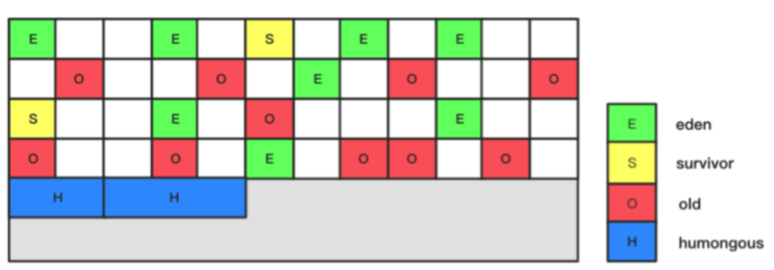

Region 之间的跨区引用通过每个 Region 各自的记忆集（Remembered Set）记录，避免回收部分 Region 时扫描整个堆；并发标记期间用户线程对引用关系的修改，则通过原始快照（SATB，Snapshot At The Beginning）算法处理，保证不会漏标存活对象。

G1 的垃圾收集周期在“仅新生代收集”和“空间回收”两个阶段之间交替：

1. **年轻代收集（Young GC）**：Eden 区耗尽时触发，STW，把 Eden 和 Survivor Region 中的存活对象复制到新的 Survivor 或老年代 Region 中。
2. **并发启动（Concurrent Start）**：当老年代占用达到阈值（`-XX:InitiatingHeapOccupancyPercent`）时，在一次年轻代收集中顺带标记 GC Roots 直接关联的对象，开启并发标记周期。该阶段在早期版本中称为初始标记（Initial Mark）。
3. **并发标记（Concurrent Mark）**：从 GC Roots 开始对堆中对象进行可达性分析，找出所有存活对象，耗时较长，但与用户线程并发执行。
4. **最终标记（Remark）**：STW，处理并发标记期间 SATB 记录下来的引用变化，完成标记，同时进行引用处理和类卸载。
5. **清理（Cleanup）**：STW，统计各 Region 的存活数据，直接回收完全没有存活对象的 Region，并判断是否需要进入空间回收阶段。
6. **混合收集（Mixed GC）**：在随后的若干次收集中，除了新生代 Region，还会挑选一部分回收价值高的老年代 Region 一起回收，根据停顿时间目标控制每次回收的 Region 数量，直到可回收的老年代空间不再值得回收。

如果回收速度跟不上分配速度，G1 会退化为 Full GC。JDK 10 起 G1 的 Full GC 改为多线程并行执行（JEP 307），缓解了退化时的长停顿问题。

G1 的常用参数如下：

- `-XX:+UseG1GC`：指定使用 G1 收集器，JDK 9 起在服务器级机器上默认启用。
- `-XX:MaxGCPauseMillis`：停顿时间目标，默认值为 200 ms。这是一个“软目标”，G1 会尽量满足，但不保证每次都能达到。
- `-XX:InitiatingHeapOccupancyPercent`：老年代占用达到整个堆的该比例时启动并发标记，默认值为 45。JDK 9 起 G1 默认开启自适应 IHOP，会根据运行情况动态调整，该参数仅作为初始值。
- `-XX:G1HeapRegionSize`：每个 Region 的大小，必须是 2 的幂，范围为 1 MB 到 32 MB，JDK 18 起上限提高到 512 MB。默认值根据最大堆大小计算，目标是划分出约 2048 个 Region。
- `-XX:ParallelGCThreads` 和 `-XX:ConcGCThreads`：分别设置 STW 阶段的并行线程数和并发标记阶段的线程数。

## 5.5 ZGC 收集器

ZGC（Z Garbage Collector）是由 Oracle 开发的低延迟收集器，目标是在尽可能对吞吐量影响不大的前提下，把停顿时间控制在毫秒级甚至亚毫秒级，并且**停顿时间不随堆大小增长**，可以支持从几百 MB 到 16 TB 的堆。

ZGC 的核心技术包括：

- **染色指针（Colored Pointers）**：把标记、重映射等状态信息直接存储在对象引用的高位比特上，不需要访问对象本身就能获知其状态。
- **读屏障（Load Barrier）**：用户线程读取对象引用时，由屏障检查指针状态，在必要时修正指向已转移对象的引用。
- **并发转移**：标记、转移（复制存活对象）和重映射几乎全部与用户线程并发执行，STW 阶段只处理少量根节点，因此停顿时间很短。

ZGC 的发展历程：

- JDK 11 以实验特性引入（JEP 333），JDK 15 成为正式特性（JEP 377），通过 `-XX:+UseZGC` 启用。
- JDK 21 引入分代 ZGC（JEP 439），需配合 `-XX:+ZGenerational` 启用，分代后能更频繁地回收短命对象，降低内存开销和分配停顿的风险。
- JDK 23 起分代模式成为 ZGC 的默认模式（JEP 474），JDK 24 移除了非分代模式（JEP 490），此后 `-XX:+UseZGC` 即为分代 ZGC。

## 5.6 Shenandoah 收集器

Shenandoah 最初由 Red Hat 开发并贡献给 OpenJDK，与 ZGC 一样以低延迟为目标，停顿时间与堆大小无关。它同样采用基于 Region 的堆布局，核心特点是**并发整理**：通过读屏障和转发指针，在移动存活对象的同时允许用户线程继续访问这些对象。

Shenandoah 在 JDK 12 以实验特性引入（JEP 189），JDK 15 成为正式特性（JEP 379），通过 `-XX:+UseShenandoahGC` 启用。JDK 24 引入实验性的分代模式（JEP 404），JDK 25 将分代 Shenandoah 转为正式特性（JEP 521），可以通过 `-XX:ShenandoahGCMode=generational` 启用。需要注意，部分 JDK 发行版（如 Oracle JDK）的构建中并未包含 Shenandoah。

## 5.7 Epsilon 收集器

Epsilon 是 JDK 11 引入的一个“不回收垃圾”的收集器（JEP 318）：它只负责内存分配，从不回收，堆耗尽时 JVM 直接退出。它主要用于性能测试（排除 GC 的影响）、内存压力测试，以及生命周期极短、在堆耗尽前就会结束的任务，目前仍是实验特性，需要通过 `-XX:+UnlockExperimentalVMOptions -XX:+UseEpsilonGC` 启用。

## 5.8 收集器组合与选择

| 参数 | 新生代 | 老年代 | 状态 |
| ---- | ------ | ------ | ---- |
| `-XX:+UseSerialGC` | Serial | Serial Old | 可用 |
| `-XX:+UseParallelGC` | Parallel Scavenge | Parallel Old | 可用，JDK 9 之前服务端默认 |
| `-XX:+UseParallelGC -XX:-UseParallelOldGC` | Parallel Scavenge | Serial Old | JDK 14 废弃，JDK 15 移除 |
| `-XX:+UseParNewGC` | ParNew | Serial Old | JDK 9 移除该组合，JDK 10 参数过时 |
| `-XX:+UseConcMarkSweepGC` | ParNew | CMS（后备 Serial Old） | JDK 9 废弃，JDK 14 移除 |
| `-XX:+UseConcMarkSweepGC -XX:-UseParNewGC` | Serial | CMS（后备 Serial Old） | JDK 9 移除 |
| `-XX:+UseG1GC` | G1 | G1 | JDK 9 起默认 |
| `-XX:+UseZGC` | ZGC | ZGC | JDK 15 起正式，JDK 23 起默认分代 |
| `-XX:+UseShenandoahGC` | Shenandoah | Shenandoah | JDK 15 起正式 |

在当前版本中选择收集器，可以参考以下思路：

- **G1**：大多数服务端应用的默认选择，在吞吐量和停顿时间之间取得平衡，通常只需设置堆大小和停顿时间目标。
- **ZGC 或 Shenandoah**：对延迟极其敏感的应用，如交易系统、实时服务，或者堆非常大、G1 停顿时间无法满足要求的场景。
- **Parallel**：批处理、离线计算等只关心吞吐量、可以接受较长停顿的任务。
- **Serial**：堆很小（如几十 MB）、单核的容器或客户端程序，内存开销最低。

# 6 GC 日志分析

垃圾收集器在工作过程中可以输出日志。通过 GC 日志可以观察收集器的行为以及应用的内存使用情况，一方面可以帮助我们学习垃圾收集器，另一方面在必要时可以帮助我们定位问题、优化 JVM。

JDK 9 引入了统一日志框架（JEP 158、JEP 271），GC 日志的参数和格式都发生了很大变化。下面先介绍 JDK 8 及之前的日志格式，再介绍 JDK 9 之后的统一日志。

## 6.1 JDK 8 及之前的日志

默认情况下 JVM 不打印 GC 日志，可以通过 `-XX:+PrintGC` 或 `-verbose:gc` 参数让 JVM 把 GC 日志输出到终端。以下示例均来自 JDK 8。

JVM 参数：`-XX:+PrintGC -XX:+UseSerialGC -Xms10m -Xmx10m`

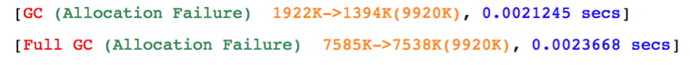

这是最简单的 GC 日志格式。红色部分的“GC”和“Full GC”表示这次收集的类型，绿色部分的“Allocation Failure”表示触发这次 GC 的原因是内存分配失败。橙色部分的“1922K->1394K(9920K)”表示这次 GC 使堆内存的使用量从 1922 KB 降到了 1394 KB，括号中是当前整个堆的大小。最后蓝色部分的“0.0021245 secs”表示这次 GC 的耗时。

简单格式的日志无法看出这次 GC 发生在哪个代、是否有对象晋升到老年代等信息，这时需要设置 `-XX:+PrintGCDetails` 参数输出更详细的日志。下面结合不同的收集器组合分析它们的输出。

### 6.1.1 Serial + Serial Old

JVM 参数：`-XX:+PrintGC -XX:+PrintGCDetails -XX:+UseSerialGC -Xms10m -Xmx10m`

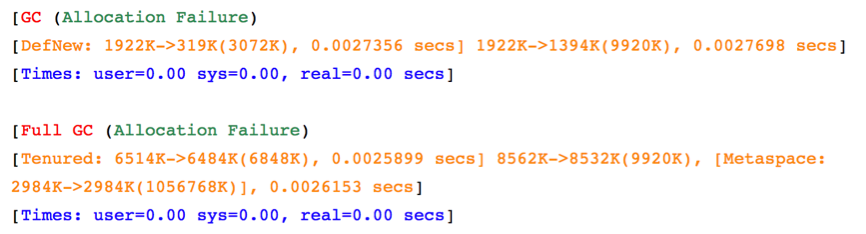

设置了 `-XX:+PrintGCDetails` 之后，输出的信息多了很多。

先看第一条，“GC”表示这次发生的是 Minor GC，原因同样是内存分配失败。“DefNew: 1922K->319K(3072K), 0.0027356 secs”中，DefNew 表示这次 GC 发生在 Serial 收集器管理的新生代（不同收集器的名称不同），新生代的使用量从 1922 KB 降到 319 KB，新生代总大小为 3072 KB，新生代收集耗时 0.0027356 秒。后面的“1922K->1394K(9920K)”表示整个堆（新生代 + 老年代）的使用量从 1922 KB 降到 1394 KB，堆总大小为 9920 KB，最后的“0.0027698 secs”是这次 GC 的总耗时。

最后一行是耗时统计：user 表示用户态 CPU 时间，sys 表示内核态 CPU 时间，这两个值不包括线程挂起等待的时间；real 表示实际经过的墙上时钟时间。多线程收集时，user + sys 可能大于 real。

再看第二条，“Full GC”表示这次是一次整堆收集。“Tenured: 6514K->6484K(6848K), 0.0025899 secs”表示老年代的使用量从 6514 KB 降到 6484 KB，耗时 0.0025899 秒；“8562K->8532K(9920K)”表示整个堆的变化；“Metaspace: 2984K->2984K(1056768K)”表示元空间的变化，Full GC 会同时回收元空间；最后的“0.0026153 secs”是这次 GC 的总耗时。

### 6.1.2 Parallel Scavenge + Parallel Old

不同收集器输出的日志格式不完全相同，下面是使用 Parallel Scavenge 和 Parallel Old 收集器输出的日志。

JVM 参数：`-XX:+PrintGC -XX:+UseParallelOldGC -XX:+PrintGCDetails -Xms10m -Xmx10m`

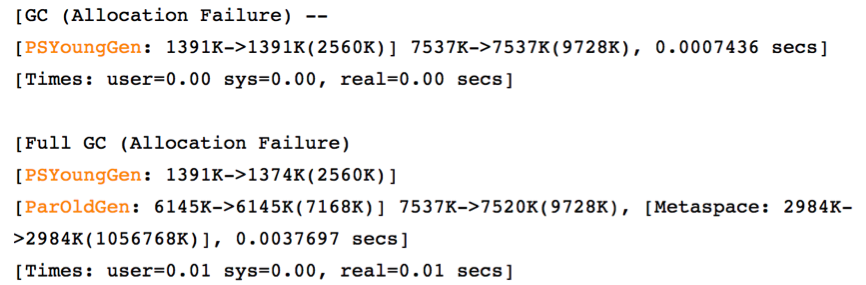

可以看到，日志内容与 Serial 大体相同，只是新生代和老年代的名称分别变成了 PSYoungGen 和 ParOldGen。第一条日志末尾的“--”表示这次 Minor GC 发生了晋升失败（Promotion Failed），存活对象无法晋升到老年代，紧接着就触发了一次 Full GC。

### 6.1.3 ParNew + CMS

JVM 参数：`-XX:+PrintGC -XX:+UseConcMarkSweepGC -XX:+PrintGCDetails -Xms10m -Xmx10m`

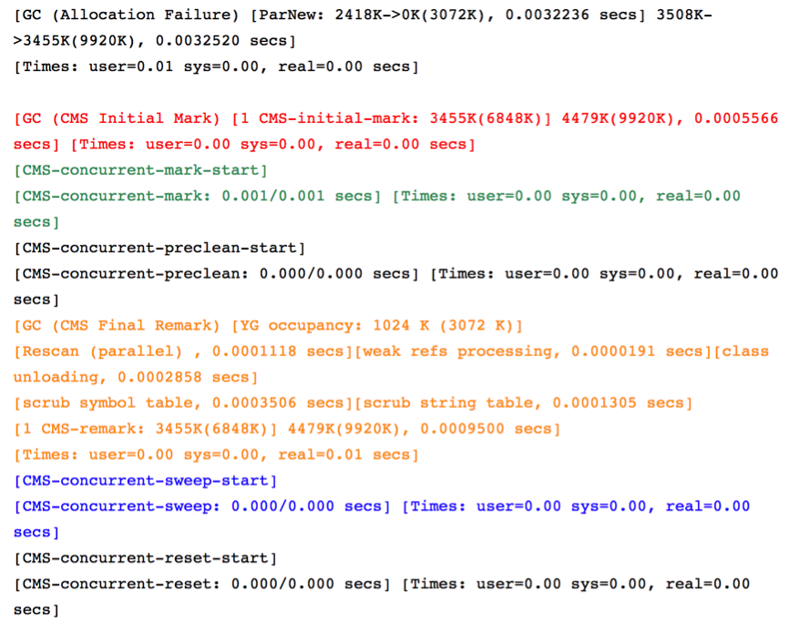

第一条日志中的“ParNew”说明使用 `-XX:+UseConcMarkSweepGC` 指定 CMS 时，新生代使用的是 ParNew 收集器。后面的一系列日志就是 CMS 一次完整收集过程的输出，可以看到初始标记（红色）、并发标记（绿色）、重新标记（橙色）、并发清除（蓝色）4 个主要阶段，以及并发预清理和并发重置阶段。需要关注的是橙色的重新标记阶段，这个阶段会 STW，如果耗时较长，会影响应用的响应时间。

### 6.1.4 其他日志参数

有时需要在 GC 日志中输出时间，以便知道每次 GC 发生的具体时间点，可以通过 `-XX:+PrintGCDateStamps` 输出日期时间，或通过 `-XX:+PrintGCTimeStamps` 输出 JVM 启动以来的秒数。

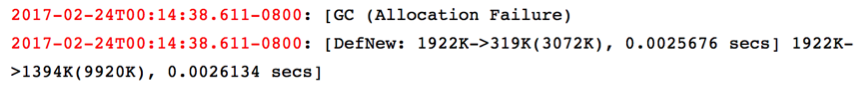

除了输出到控制台，还可以通过 `-Xloggc:文件路径` 把日志输出到文件中，配合 `-XX:+UseGCLogFileRotation`、`-XX:NumberOfGCLogFiles`、`-XX:GCLogFileSize` 实现日志文件滚动，之后再借助工具分析日志文件。

## 6.2 JDK 9 之后的统一日志

JDK 9 起，JVM 的各类日志统一由 `-Xlog` 参数配置，其格式为：

```text
-Xlog:[选择器]:[输出]:[修饰符]:[输出选项]
```

- **选择器**：由标签（tag）和级别（level）组成，如 `gc`、`gc*`（所有以 gc 开头的标签）、`gc+heap=debug`。
- **输出**：`stdout`、`stderr` 或 `file=文件路径`。
- **修饰符**：每行日志的前缀信息，如 `time`（日期时间）、`uptime`（启动以来的时间）、`level`、`tags`。
- **输出选项**：如 `filecount=5,filesize=20m` 用于日志文件滚动。

旧参数与统一日志的对应关系如下。旧参数在 JDK 9 之后大多被移除，部分仍可使用但会输出废弃警告并自动转换为对应的 `-Xlog` 配置，例如 JDK 11 中使用 `-XX:+PrintGCDetails` 会提示“-XX:+PrintGCDetails is deprecated. Will use -Xlog:gc* instead.”，而 `-XX:+PrintGCDateStamps` 会直接导致 JVM 无法启动。

| JDK 8 参数 | JDK 9+ 对应写法 |
| ---------- | --------------- |
| `-XX:+PrintGC`、`-verbose:gc` | `-Xlog:gc` |
| `-XX:+PrintGCDetails` | `-Xlog:gc*` |
| `-XX:+PrintGCDateStamps`、`-XX:+PrintGCTimeStamps` | 修饰符 `time`、`uptime` |
| `-Xloggc:gc.log` | `-Xlog:gc:file=gc.log` |
| `-XX:+UseGCLogFileRotation` 等滚动参数 | 输出选项 `filecount=5,filesize=20m` |
| `-XX:+PrintHeapAtGC` | `-Xlog:gc+heap=debug` |
| `-XX:+PrintTenuringDistribution` | `-Xlog:gc+age=trace` |
| `-XX:+PrintGCApplicationStoppedTime` | `-Xlog:safepoint` |

生产环境常用的配置如下：

```text
-Xlog:gc*:file=gc.log:time,uptime,level,tags:filecount=5,filesize=20m
```

在 zsh 等 shell 中，`*` 会被当作通配符展开，需要用引号把整个参数括起来，如 `'-Xlog:gc*:stdout'`。

下面的示例程序循环分配 8 个 1 MB 的数组，在 JDK 11 中分别使用 Serial 和 G1 运行：

```java
import java.util.ArrayList;
import java.util.List;

public class GcLogDemo {
    public static void main(String[] args) {
        List<byte[]> list = new ArrayList<>();
        for (int i = 0; i < 8; i++) {
            list.add(new byte[1024 * 1024]);
        }
    }
}
```

使用 `-Xlog:gc -XX:+UseSerialGC -Xms10m -Xmx10m` 运行，输出的简要日志与 JDK 8 的 `-XX:+PrintGC` 类似：

```text
[0.004s][info][gc] Using Serial
[0.030s][info][gc] GC(0) Pause Young (Allocation Failure) 3M->3M(15M) 0.633ms
[0.031s][info][gc] GC(1) Pause Young (Allocation Failure) 7M->7M(15M) 0.633ms
```

把堆调整为 20 MB，并使用 `-Xlog:gc*:stdout:time,uptime,level,tags` 输出详细日志：

```text
[2026-10-16T17:18:23.276+0800][0.036s][info][gc,start     ] GC(0) Pause Young (Allocation Failure)
[2026-10-16T17:18:23.277+0800][0.038s][info][gc,heap      ] GC(0) DefNew: 6052K->492K(7424K)
[2026-10-16T17:18:23.277+0800][0.038s][info][gc,heap      ] GC(0) Tenured: 0K->5120K(16384K)
[2026-10-16T17:18:23.277+0800][0.038s][info][gc,metaspace ] GC(0) Metaspace: 3361K(4864K)->3361K(4864K) NonClass: 3062K(4352K)->3062K(4352K) Class: 299K(512K)->299K(512K)
[2026-10-16T17:18:23.277+0800][0.038s][info][gc           ] GC(0) Pause Young (Allocation Failure) 5M->5M(23M) 1.312ms
[2026-10-16T17:18:23.277+0800][0.038s][info][gc,cpu       ] GC(0) User=0.00s Sys=0.00s Real=0.00s
```

统一日志的每一行都带有修饰符前缀，同一次 GC 的多行日志通过“GC(0)”这样的编号关联起来。从上面的日志可以看出：这次 Minor GC 后新生代（DefNew）从 6052 KB 降到 492 KB，老年代（Tenured）从 0 增加到 5120 KB，说明有约 5 MB 的数组因 Survivor 区放不下而直接晋升到了老年代。由于堆大小会按平台的内存粒度对齐，日志中的堆容量与 `-Xmx` 指定的值略有差异。

使用 `-Xlog:gc -XX:+UseG1GC -Xms20m -Xmx20m` 运行：

```text
[0.011s][info][gc] Using G1
[0.067s][info][gc] GC(0) Pause Young (Concurrent Start) (G1 Humongous Allocation) 11M->10M(24M) 0.655ms
[0.067s][info][gc] GC(1) Concurrent Cycle
[0.068s][info][gc] GC(1) Pause Remark 14M->14M(24M) 0.354ms
[0.068s][info][gc] GC(1) Pause Cleanup 16M->16M(24M) 0.008ms
[0.068s][info][gc] GC(1) Concurrent Cycle 0.984ms
```

这段日志完整展示了 G1 的一次并发标记周期：堆只有 20 MB 时，Region 大小为 1 MB，每个 1 MB 的数组都超过了 Region 容量的一半，因此都作为巨型对象分配，巨型对象的分配触发了一次带并发启动（Concurrent Start）的年轻代收集；随后进入并发周期（Concurrent Cycle），依次经过最终标记（Pause Remark）和清理（Pause Cleanup）两次短暂停顿。

# 7 新版本中的垃圾回收

| 版本 | 变化 |
| ---- | ---- |
| JDK 7 Update 4 | G1 获得正式支持；`-XX:+UseParallelGC` 默认同时启用 Parallel Old |
| JDK 8 | 移除永久代，改用元空间实现方法区 |
| JDK 9 | G1 成为服务端默认收集器（JEP 248）；CMS 被废弃（JEP 291）；移除 ParNew + Serial Old 等组合（JEP 214）；引入统一日志 `-Xlog`（JEP 158、JEP 271）；`Object.finalize()` 被废弃 |
| JDK 10 | G1 的 Full GC 改为并行执行（JEP 307）；引入统一的 GC 接口（JEP 304） |
| JDK 11 | 引入实验性的 ZGC（JEP 333）和 Epsilon（JEP 318） |
| JDK 12 | 引入实验性的 Shenandoah（JEP 189）；G1 支持可中止的混合收集（JEP 344），并能及时归还未使用的内存（JEP 346） |
| JDK 14 | 移除 CMS（JEP 363）；废弃 Parallel Scavenge + Serial Old 组合（JEP 366）；G1 支持 NUMA 感知的内存分配（JEP 345） |
| JDK 15 | ZGC（JEP 377）和 Shenandoah（JEP 379）成为正式特性；移除 Parallel Scavenge + Serial Old 组合 |
| JDK 16 | ZGC 支持并发处理线程栈（JEP 376），进一步缩短停顿 |
| JDK 18 | G1 的 Region 大小上限从 32 MB 提高到 512 MB；终结机制被标记为待移除（JEP 421） |
| JDK 21 | 引入分代 ZGC（JEP 439） |
| JDK 22 | G1 支持区域固定（JEP 423），JNI 临界区不再阻塞 GC |
| JDK 23 | 分代模式成为 ZGC 的默认模式（JEP 474） |
| JDK 24 | 移除非分代 ZGC（JEP 490）；引入实验性的分代 Shenandoah（JEP 404）；G1 采用延迟屏障展开（JEP 475）；引入实验性的紧凑对象头（JEP 450） |
| JDK 25 | 分代 Shenandoah 成为正式特性（JEP 521）；紧凑对象头成为正式特性（JEP 519） |
| JDK 26 | G1 通过减少同步提升吞吐量（JEP 522）；AOT 对象缓存支持所有收集器（JEP 516） |
| JDK 27 | G1 成为所有环境下的默认收集器（JEP 523）；紧凑对象头默认开启（JEP 534），减少对象占用的堆空间 |

总体趋势是：分代模型被保留并推广到低延迟收集器中，CMS 等老旧组合被逐步淘汰，G1 成为通用默认选择，ZGC 和 Shenandoah 则把停顿时间降到了与堆大小无关的毫秒级以下。

# 8 总结

| 问题 | 要点 |
| ---- | ---- |
| 回收哪些区域 | 堆和方法区；线程私有区域随线程结束自动释放 |
| 如何判断对象已死 | 可达性分析，从 GC Roots 出发不可达的对象可被回收；引用分为强、软、弱、虚四种 |
| 用什么算法回收 | 标记-清除、复制、标记-整理，按分代收集理论组合使用 |
| 何时触发 | Eden 不足触发 Minor GC；老年代或元空间不足、担保失败、`System.gc()`、并发收集失败可能触发 Full GC |
| 由谁执行 | Serial、Parallel、G1、ZGC、Shenandoah，CMS 和 ParNew 已在 JDK 14 移除 |

- HotSpot 使用可达性分析而不是引用计数判断对象存活，跨代引用通过记忆集和卡表处理。
- 新生代对象存活率低，采用复制算法；老年代对象存活率高，采用标记-清除或标记-整理算法。
- 对象优先在 Eden 分配，大对象可能直接进入老年代，长期存活或满足动态年龄判定的对象晋升到老年代。
- G1 基于 Region 布局和可预测停顿模型，是 JDK 9 起的默认收集器，JDK 27 起在所有环境下都是默认选择。
- ZGC 和 Shenandoah 通过并发整理实现与堆大小无关的低停顿，两者都已支持分代模式。
- JDK 9 起 GC 日志统一使用 `-Xlog` 配置，旧的 `-XX:+PrintGC*` 系列参数已被废弃或移除。
