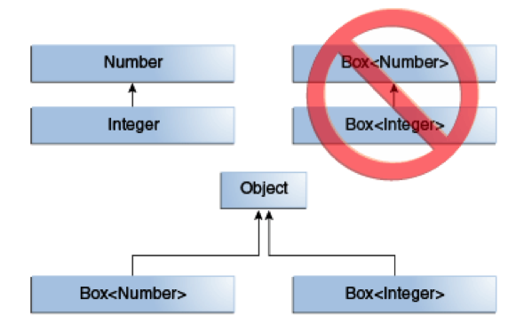
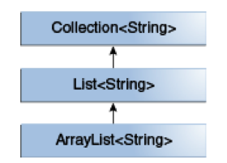
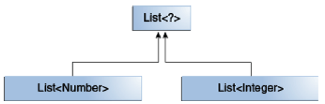
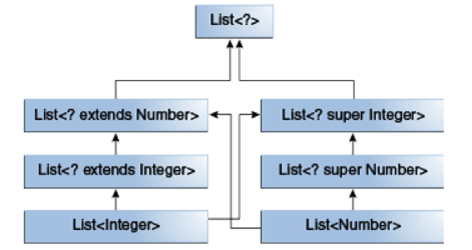

# 泛型

# 1 为什么引入泛型

Bug 是编程的一部分，我们只能尽自己最大的能力减少出现 Bug 的几率，但是谁也不能保证自己写出的程序不出现任何问题。

错误可分为两种：**编译时错误**与**运行时错误**。编译时错误在编译时可以发现并排除，而运行时错误具有很大的不确定性，在程序运行时才能发现，造成的后果可能是灾难性的。

使用泛型可以使错误在编译时被探测到，从而增加程序的健壮性。

来看一个例子：

```java
    public class Box {
        private Object object;

        public void set(Object object) {
            this.object = object;
        }

        public Object get() {
            return object;
        }
    }
```

按照声明，其中的 `set()` 方法可以接受任何 Java 对象作为参数（任何对象都是 `Object` 的子类），假如在某个地方使用该类，`set()` 方法预期的输入对象为 `Integer` 类型，但是实际输入的却是 `String` 类型，就会抛出一个运行时错误，这个错误在编译阶段是无法检测的。例如：

```java
Box box = new Box();
box.set("abc");
Integer a = (Integer) box.get(); // 编译时不会报错，但是运行时会报 ClassCastException
```

运用泛型改造上面的代码：

```java
public class Box<T> {

    private T t;

    public void set(T t) {
        this.t = t;
    }

    public T get() {
        return t;
    }
}
```

当我们使用该类时会指定 `T` 的具体类型，该类型参数可以是类、接口、数组等，但是**不能是基本类型**。

比如：

```java
Box<Integer> box = new Box<>(); // 指定了类型参数为 Integer
// box.set("abc"); 该句在编译时就会报错
box.set(2);
Integer a = box.get(); // 不用转换类型
```

可以看到，使用泛型还免除了类型转换操作。

在引入泛型机制之前，要在方法中支持多个数据类型，需要对方法进行重载，在引入泛型后，可以更简洁地解决此问题，更进一步可以定义多个参数以及返回值之间的关系。

例如：

```java
public void write(Integer i, Integer[] ia);
public void write(Double d, Double[] da);
public void write(Long l, Long[] la);
```

泛型版本为：

```java
public <T> void write(T t, T[] ta);
```

总体来说，泛型机制能够在定义类、接口、方法时把“类型”当作参数使用，有点类似于方法声明中的形式参数，如此我们就能通过不同的输入参数来实现程序的重用。不同的是，形式参数的输入是值，而泛型参数的输入是类型。

# 2 命名规则

类型参数的命名有一套默认规则，为了提高代码的维护性和可读性，强烈建议遵循这些规则。JDK 中，随处可见这些命名规则的应用。

- E - Element（通常代表集合类中的元素）
- K - Key
- N - Number
- T - Type
- V - Value
- S、U、V 等 - 第二个、第三个、第四个类型参数……

注意，**子类不会自动拥有父类声明的类型参数**，如果子类也要使用该类型参数，需要在子类上重新声明，例如 `class Sub<T> extends Base<T>`。

也可以同时声明多个类型变量，用逗号分隔，例如：

```java
public interface Pair<K, V> {
    public K getKey();
    public V getValue();
}

public class OrderedPair<K, V> implements Pair<K, V> {

    private K key;
    private V value;

    public OrderedPair(K key, V value) {
        this.key = key;
        this.value = value;
    }

    public K getKey() {
        return key;
    }

    public V getValue() {
        return value;
    }
}
```

下面的两行代码创建了 `OrderedPair` 对象的两个实例。

```java
Pair<String, Integer> p1 = new OrderedPair<String, Integer>("Even", 8);
Pair<String, String>  p2 = new OrderedPair<String, String>("hello", "world");

// 也可以将 new 后面的类型参数省略，简写为：
// Pair<String, Integer> p1 = new OrderedPair<>("Even", 8);

// 也可以用参数化类型作为类型参数，例如：
OrderedPair<String, Box<Integer>> p = new OrderedPair<>("primes", new Box<Integer>());
```

泛型是 JDK 5 才引入的，为了兼容性，允许不指定泛型参数（即使用原始类型），但是如此一来，编译器就无法进行类型检查，在编程时，最好明确指定泛型参数。

同样，在方法中也可以使用泛型参数，并且该参数的使用范围仅限于该方法的签名和方法体内。例如：

```java
public class Util {
    // 该方法用于比较两个 Pair 对象是否相等。
    // 泛型参数必须写在方法返回类型 boolean 之前
    public static <K, V> boolean compare(Pair<K, V> p1, Pair<K, V> p2) {
        return p1.getKey().equals(p2.getKey()) &&
               p1.getValue().equals(p2.getValue());
    }
}

Pair<Integer, String> p1 = new OrderedPair<>(1, "apple");
Pair<Integer, String> p2 = new OrderedPair<>(2, "pear");
boolean same = Util.<Integer, String>compare(p1, p2);
// 实际上，编译器可以通过 Pair 当中的类型来推断 compare 需要使用的类型，所以可以简写为：
// boolean same = Util.compare(p1, p2);
```

有时候我们想让类型参数限定在某个范围之内，就需要用到 `extends` 关键字（`extends` 后面可以跟一个接口，这里的 `extends` 既可以表示继承了某个类，也可以表示实现了某个接口），例如，我们想让参数是数字类型：

```java
    class Box<T extends Number> { // 类型参数限定为 Number 的子类

        private T t;

        public Box(T t) {
            this.t = t;
        }

        public void print() {
            System.out.println(t.getClass().getName());
        }

        public static void main(String[] args) {

            Box<Integer> box1 = new Box<>(2);
            box1.print(); // 打印结果：java.lang.Integer
            Box<Double> box2 = new Box<>(1.2);
            box2.print(); // 打印结果：java.lang.Double

            Box<String> box3 = new Box<>("abc"); // 报错，因为 String 类型不是 Number 的子类
            box3.print();
        }

    }
```

如果加入多个限定，可以用 `&` 连接起来，但是由于 Java 是单继承，多个限定中最多只能有一个类，而且必须放在第一个位置。例如：

```java
    class Box<T extends Number & Cloneable & Comparable<T>> {

        // 该类型必须为 Number 的子类并且实现了 Cloneable 接口和 Comparable 接口。
        // ……
    }
```

# 3 泛型类的继承

Java 是面向对象的高级语言，在一个接受 A 类参数的地方传入一个 A 的子类是允许的，例如：

```java
Object someObject = new Object();
Integer someInteger = 10;
someObject = someInteger; // 因为 Integer 是 Object 的子类
```

这种特性同样适用于类型参数，例如：

```java
List<Number> list = new ArrayList<>();
list.add(10);   // Integer 是 Number 的子类
list.add(10.1); // Double 同样是 Number 的子类
```

但是，有一种情况很容易引起混淆，例如：

```java
// 该方法接受的参数类型为 Box<Number>
public void boxTest(Box<Number> n) {
    // ……
}
// 下面两种调用都会报错
boxTest(new Box<Integer>());
boxTest(new Box<Double>());
```

虽然 `Integer` 和 `Double` 都是 `Number` 的子类，但是 `Box<Integer>` 与 `Box<Double>` 并不是 `Box<Number>` 的子类型，不存在继承关系。`Box<Integer>` 与 `Box<Double>` 的共同父类是 `Object`（借助第 5 章的通配符，它们还有共同的父类型 `Box<? extends Number>`）。



以 JDK 中的集合类为例，`ArrayList<E>` 实现了 `List<E>` 接口，`List<E>` 接口继承了 `Collection<E>` 接口，所以，`ArrayList<String>` 是 `List<String>` 的子类型，而非 `List<Integer>` 的子类型。三者的继承关系如下：



# 4 类型推断

先来看一个例子：

```java
    public class Demo {

        static <T> T pick(T a1, T a2) {
            return a2;
        }

    }
```

静态方法 `pick()` 在三个地方使用了泛型，分别限定了两个输入参数的类型与返回类型。调用该方法的代码如下：

`Integer ret = Demo.<Integer>pick(1, 2);`

前文已经提到，上面的代码可以简写为：

`Integer ret = Demo.pick(1, 2);`

因为 Java 编译器会根据传入的参数类型推断出该方法返回的类型应该为 `Integer`，这种机制称为**类型推断**（Type Inference）。

那么问题来了，假如两个输入参数为不同的类型，应该返回什么类型呢？

例如：

`pick("d", new ArrayList<String>());`

第一个参数为 `String` 类型，第二个参数为 `ArrayList` 类型，Java 编译器就会根据这两个参数类型来推断，尽量使返回类型为最明确的一种。本例中，`String` 与 `ArrayList` 都实现了同样的接口——`Serializable`，当然，它们也是 `Object` 的子类，`Serializable` 类型显然比 `Object` 类型更加明确，因为它的范围更小更细分，所以最终的返回类型应该为 `Serializable`：

`Serializable s = pick("d", new ArrayList<String>());`

在泛型类实例化的时候同样可以利用这种机制简化代码，这种写法称为**菱形语法**（Diamond，Java 7 引入），需要注意的是，尖括号 `<>` 在此时是不能省略的。例如：

```java
Map<String, List<String>> myMap = new HashMap<String, List<String>>();
// 编译器能推断出后面的类型，所以可以简化为：
Map<String, List<String>> myMap = new HashMap<>();
// 但是，不能简化为：
Map<String, List<String>> myMap = new HashMap();
// 因为 HashMap() 是 HashMap 原始类型（Raw Type）的构造函数，而非 HashMap<String, List<String>> 的构造函数，如果不加 <> 编译器不会进行类型检查，只会给出 unchecked 警告
```

# 5 通配符

上文中我们提到过一个例子：

```java
public void boxTest(Box<Number> n) {
    // ……
}
```

该方法只能接受 `Box<Number>` 这一种类型的参数，当我们输入一个 `Box<Double>` 或者 `Box<Integer>` 时会报错，尽管 `Integer` 与 `Double` 是 `Number` 的子类。可是如果我们希望该方法可以接受 `Number` 以及它的任何子类，该怎么办呢？

这时候就要用到通配符了，改写如下：

```java
public void boxTest(Box<? extends Number> n) {
    // ……
}
```

`? extends Number` 就代表可以接受 `Number` 以及它的子类作为参数。这种声明方式被称为**上限通配符**（Upper Bounded Wildcards）。

相反地，如果我们希望该方法可以接受 `Integer`、`Number` 以及 `Object` 类型的参数怎么办呢？应该使用**下限通配符**（Lower Bounded Wildcards）：

```java
public void boxTest(Box<? super Integer> n) {
    // ……
}
```

`? super Integer` 代表可以接受 `Integer` 以及它的父类作为参数。

如果类型参数中既没有 `extends` 关键字，也没有 `super` 关键字，只有一个 `?`，代表**无限定通配符**（Unbounded Wildcards）。

通常在两种情况下会使用无限定通配符：

- 正在编写的方法只需要使用 `Object` 类中提供的功能就能实现；
- 代码实现的功能与类型参数无关，比如 `List.clear()` 与 `List.size()` 方法，还有经常使用的 `Class<?>` 类型，其实现的功能都与类型参数无关。

来看一个例子：

```java
public static void printList(List<Object> list) {
    for (Object elem : list)
        System.out.print(elem + " ");
    System.out.println();
}
```

该方法只能接受 `List<Object>` 型的参数，不接受其他任何类型的参数。但是，该方法实现的功能与 `List` 之中参数类型没有关系，所以我们希望它可以接受包含任何类型的 `List` 参数。代码改动如下：

```java
public static void printList(List<?> list) {
    for (Object elem : list)
        System.out.print(elem + " ");
    System.out.println();
}
```

需要特别注意的是，`List<?>` 与 `List<Object>` 并不相同，无论 `A` 是什么类型，`List<A>` 都是 `List<?>` 的子类型，但是，`List<A>` 不是 `List<Object>` 的子类型。

例如：

```java
List<Integer> li = new ArrayList<>();
List<Number> ln = li; // 会报编译错误，尽管 Integer 是 Number 的子类，但是 List<Integer> 不是 List<Number> 的子类型
```

`List<Integer>` 与 `List<Number>` 的关系如下：



所以，下面的代码是正确的：

```java
List<? extends Integer> intList = new ArrayList<>();
List<? extends Number>  numList = intList; // 不会报错，List<? extends Integer> 是 List<? extends Number> 的子类型
```

下面这张图介绍了上限通配符、下限通配符、无限定通配符之间的关系：



编译器可以通过类型推断机制来决定通配符的类型，这种情况被称为通配符捕获。大多数时候我们不必担心通配符捕获，除非编译器报出了包含 `capture of` 的错误。例如：

```java
    public class WildcardError {

        void foo(List<?> i) {
            i.set(0, i.get(0)); // 会报编译错误
        }
    }
```

上例中，调用 `List.set(int, E)` 方法的时候，编译器无法推断 `i.get(0)` 是什么类型，就会报错。

我们可以借助一个私有的可以捕获通配符的 Helper 方法来解决这种错误：

```java
    public class WildcardFixed {
        void foo(List<?> i) {
            fooHelper(i);
        }

        // 该方法可以确保编译器通过通配符捕获来推断出参数类型
        private <T> void fooHelper(List<T> l) {
            l.set(0, l.get(0));
        }

    }
```

按照约定俗成的习惯，Helper 方法的命名方式为“原始方法” + “Helper”，上例中，原始方法为 `foo`，所以命名为 `fooHelper`。

关于什么时候该使用上限通配符，什么时候该使用下限通配符，应该遵循以下几项指导规则。

首先将变量分为 `in-变量` 与 `out-变量`：`in-变量` 持有为当前代码服务的数据，`out-变量` 持有其他地方需要使用的数据。

例如 `copy(src, dest)` 方法实现了从 `src` 源头将数据复制到 `dest` 目的地的功能，那么 `src` 就是 `in-变量`，而 `dest` 就是 `out-变量`。当然，在一些情况下，一个变量可能既是 `in-变量` 也是 `out-变量`。

- `in-变量` 使用上限通配符；
- `out-变量` 使用下限通配符；
- 当 `in-变量` 可以被 `Object` 类中的方法访问时，使用无限定通配符；
- 一个变量既是 `in-变量` 也是 `out-变量` 时，不使用通配符。

注意，上面的规则不适用于方法的返回类型。

这套规则在业界通常被概括为 **PECS**（Producer Extends, Consumer Super）：只从中读取数据的“生产者”用 `extends`，只向其中写入数据的“消费者”用 `super`。JDK 中的 `Collections.copy` 就是典型例子：

```java
public static <T> void copy(List<? super T> dest, List<? extends T> src)
```

# 6 类型擦除

Java 编译器在处理泛型的时候，会做下面几件事：

- 将没有限定的类型参数用 `Object` 替换，有限定的用第一个限定类型替换，保证 class 文件中只含有正常的类、接口与方法；
- 在必要的时候进行类型转换，保证类型安全；
- 在泛型的继承上使用**桥接方法**（Bridge Methods）保持多态性。

这类操作被称为**类型擦除**（Type Erasure）。

例如：

```java
    public class Node<T> {

        private T data;
        private Node<T> next;

        public Node(T data, Node<T> next) {
            this.data = data;
            this.next = next;
        }

        public T getData() {
            return data;
        }
        // ...
    }
```

该类中的 `T` 没有被 `extends` 或者 `super` 限定，会被编译器替换成 `Object`：

```java
    public class Node {

        private Object data;
        private Node next;

        public Node(Object data, Node next) {
            this.data = data;
            this.next = next;
        }

        public Object getData() {
            return data;
        }
        // ...
    }
```

如果 `T` 加了限定，编译器会将它替换成合适的类型：

```java
public class Node<T extends Comparable<T>> {

    private T data;
    private Node<T> next;

    public Node(T data, Node<T> next) {
        this.data = data;
        this.next = next;
    }

    public T getData() { return data; }
    // ...
}
```

改造成：

```java
    public class Node {

        private Comparable data;
        private Node next;

        public Node(Comparable data, Node next) {
            this.data = data;
            this.next = next;
        }

        public Comparable getData() {
            return data;
        }
        // ...
    }
```

方法中的类型擦除与之类似。

有时候类型擦除会产生一些我们预想不到的情况，下面通过一个例子来分析它是如何产生的。

```java
   public class Node<T> {

        public T data;

        public Node(T data) {
            this.data = data;
        }

        public void setData(T data) {
            System.out.println("Node.setData");
            this.data = data;
        }
    }

    public class MyNode extends Node<Integer> {
        public MyNode(Integer data) {
            super(data);
        }

        public void setData(Integer data) {
            System.out.println("MyNode.setData");
            super.setData(data);
        }
    }
```

上面的代码定义了两个类，`MyNode` 类继承了 `Node` 类，然后运行下面的代码：

```java
MyNode mn = new MyNode(5);
Node n = mn;        // 原始类型，编译器给出 unchecked 警告
n.setData("Hello"); // 抛出 ClassCastException 异常
Integer x = mn.data;
```

上面的代码在类型擦除之后会转换成下面的形式：

```java
MyNode mn = new MyNode(5);
Node n = (MyNode) mn;

n.setData("Hello"); // 抛出 ClassCastException 异常
Integer x = (Integer) mn.data;
```

我们来看看代码是怎么执行的：

- （1）`n` 是原始类型 `Node`，编译期 `n.setData("Hello")` 绑定到擦除后的 `setData(Object)` 方法，只会产生 unchecked 警告；
- （2）运行时 `n` 实际指向 `MyNode` 对象，由于多态，执行的是编译器为 `MyNode` 生成的桥接方法 `setData(Object)`；
- （3）桥接方法内部会把参数强制转换为 `Integer`（见下文代码），而传入的是 `String`，所以在第三行就抛出了 `ClassCastException`，第四行根本不会执行。

可以看到，桥接方法让错误尽早暴露，避免了 `Integer` 类型的字段里被悄悄塞进一个 `String`。

当编译一个继承了参数化类型的类或实现了参数化类型的接口时，编译器会根据需要创建被称为 `bridge method` 的桥接方法，这是类型擦除中的一部分。

上例中 `MyNode` 继承了 `Node<Integer>` 类，类型擦除之后，代码变为：

```java
    class MyNode extends Node {

        // 编译器添加的桥接方法
        public void setData(Object data) {
            setData((Integer) data);
        }

        // 擦除后 MyNode 的该方法并没有覆写父类的 setData(Object data) 方法，因为参数类型不一样，所以需要上面的桥接方法来保持多态
        public void setData(Integer data) {
            System.out.println("MyNode.setData");
            super.setData(data);
        }

        // ...
    }
```

# 7 注意事项

为了高效地使用泛型，应该注意下面几个方面：

## 7.1 不能用基本类型实例化类型参数

例如：

```java
    class Pair<K, V> {

        private K key;
        private V value;

        public Pair(K key, V value) {
            this.key = key;
            this.value = value;
        }

        // ...
    }
```

当创建一个 `Pair` 类时，不能用基本类型来替代 `K`、`V` 两个类型参数。

```java
Pair<int, char> p = new Pair<>(8, 'a'); // 编译错误
Pair<Integer, Character> p = new Pair<>(8, 'a'); // 正确写法
```

## 7.2 不可实例化类型参数

例如：

```java
public static <E> void append(List<E> list) {
    E elem = new E(); // 编译错误
    list.add(elem);
}
```

但是，我们可以通过反射实例化带有类型参数的对象：

```java
public static <E> void append(List<E> list, Class<E> cls) throws Exception {
    E elem = cls.getDeclaredConstructor().newInstance(); // 正确
    list.add(elem);
}

List<String> ls = new ArrayList<>();
append(ls, String.class); // 传入类型参数的 Class 对象
```

注意，早期常用的 `cls.newInstance()` 从 Java 9 开始已被标记为废弃，应改用 `getDeclaredConstructor().newInstance()`。在 Java 8 之后，更常见的做法是传入一个 `Supplier<E>`（如 `ArrayList::new`）来创建对象，既避免了反射，也不需要处理受检异常。

## 7.3 不能声明类型为类型参数的静态字段

通过一个反例来说明：

```java
public class MobileDevice<T> {
    private static T os; // 假如我们定义了一个带泛型的静态字段

    // ...
}

MobileDevice<Smartphone> phone = new MobileDevice<>();
MobileDevice<Pager> pager = new MobileDevice<>();
MobileDevice<TabletPC> pc = new MobileDevice<>();
```

因为静态变量是类变量，被所有实例共享，此时，静态变量 `os` 的真实类型是什么呢？显然不能同时是 `Smartphone`、`Pager`、`TabletPC`。

这就是为什么不能在静态字段上使用类型参数的原因。

## 7.4 不能对参数化类型使用类型转换或 instanceof

```java
public static <E> void rtti(List<E> list) {
    if (list instanceof ArrayList<Integer>) { // 编译错误
        // ...
    }
}
```

传给该方法的参数化类型集合为：

`S = { ArrayList<Integer>, ArrayList<String>, LinkedList<Character>, ... }`

运行环境并不会跟踪类型参数，所以分辨不出 `ArrayList<Integer>` 与 `ArrayList<String>`，我们能做的至多是使用无限定通配符来验证 `list` 是否为 `ArrayList`：

```java
public static void rtti(List<?> list) {
    if (list instanceof ArrayList<?>) { // 正确
        // ...
    }
}
```

从 Java 16 开始（随 `instanceof` 模式匹配一起），只要编译器能够证明这次判断是安全的，也允许使用参数化类型，例如 `List<Integer> list` 判断 `list instanceof ArrayList<Integer> al` 可以通过编译；而上例中的 `List<E>` 无法保证类型参数一致，仍然会报错。

同样，不能将参数转换成一个带参数化类型的对象，除非它的参数化类型为无限定通配符（`<?>`）：

```java
List<Integer> li = new ArrayList<>();
List<Number>  ln = (List<Number>) li; // 编译错误
```

当然，如果编译器知道参数化类型肯定有效，是允许这种转换的：

```java
List<String> l1 = ...;
ArrayList<String> l2 = (ArrayList<String>) l1; // 允许转换，类型参数没变化
```

## 7.5 不能创建带有参数化类型的数组

例如：

`List<Integer>[] arrayOfLists = new List<Integer>[2]; // 编译错误`

下面通过两段代码来解释为什么不行。先来看一个正常的操作：

```java
Object[] strings = new String[2];
strings[0] = "hi"; // 插入正常
strings[1] = 100;  // 运行时抛出 ArrayStoreException，因为 100 不是 String 类型
```

同样的操作，如果使用的是泛型数组，就会出问题：

```java
Object[] stringLists = new List<String>[2]; // 该句代码实际上会报错，但是我们先假定它可以执行
stringLists[0] = new ArrayList<String>();   // 插入正常
stringLists[1] = new ArrayList<Integer>();  // 该句代码应该报 ArrayStoreException 的异常，但是运行环境探测不到
```

## 7.6 不能创建、捕获泛型异常

泛型类不能直接或间接继承 `Throwable` 类：

```java
class MathException<T> extends Exception { /* ... */ }     // 编译错误

class QueueFullException<T> extends Throwable { /* ... */ } // 编译错误
```

方法不能捕获泛型异常：

```java
public static <T extends Exception, J> void execute(List<J> jobs) {
    try {
        for (J job : jobs)
            // ...
    } catch (T e) { // 编译错误
        // ...
    }
}
```

但是，我们可以在 `throws` 子句中使用类型参数：

```java
class Parser<T extends Exception> {
    public void parse(File file) throws T { // 正确
        // ...
    }
}
```

## 7.7 不能重载经过类型擦除后形参转化为相同原始类型的方法

先来看一段代码：

```java
List<String> l1 = new ArrayList<String>();
List<Integer> l2 = new ArrayList<Integer>();
System.out.println(l1.getClass() == l2.getClass());
```

打印结果可能与我们猜测的不一样，打印出的是 `true`，而非 `false`，因为一个泛型类的所有实例在运行时具有相同的运行时类（Class），而不管它们的实际类型参数。

事实上，泛型之所以叫泛型，就是因为它对所有其可能的类型参数，有同样的行为；同样的类可以被当作许多不同的类型。

认识到了这一点，再来看下面的例子：

```java
public class Example {
    public void print(Set<String> strSet) { }  // 编译错误
    public void print(Set<Integer> intSet) { } // 编译错误
}
```

因为 `Set<String>` 与 `Set<Integer>` 本质上属于同一个运行时类，在经过类型擦除以后，上面的两个方法会共享一个方法签名，相当于一个方法，所以重载出错。

# 8 新版本中的泛型

泛型在 JDK 5 引入后，语法层面一直在持续简化：

- **Java 7**：引入菱形语法 `new HashMap<>()`，构造对象时可以省略类型参数。
- **Java 8**：增强了目标类型推断，泛型方法可以根据赋值目标或方法参数推断类型，配合 Lambda 表达式，`Collections.emptyList()` 之类的调用基本不再需要显式写类型参数。
- **Java 9**：菱形语法可以用于匿名内部类，如 `new Comparator<>() { ... }`。
- **Java 10**：引入局部变量类型推断 `var`，如 `var map = new HashMap<String, List<String>>();`，此时要把类型参数写在右侧，否则会被推断为 `HashMap<Object, Object>`。
- **Java 16**：`instanceof` 在能证明安全的前提下允许使用参数化类型（见 7.4 节）。

类型擦除带来的限制（不支持基本类型、运行时拿不到类型参数等）至今仍然存在。OpenJDK 的 Valhalla 项目正在推进值类型（Value Classes），长期目标之一是让泛型能够更高效地支持基本类型，但截至目前尚未正式发布，日常开发仍以本文介绍的规则为准。

总结一下：泛型把类型检查从运行时提前到了编译时，通配符和 PECS 原则解决了参数化类型之间“没有继承关系”带来的不便，而类型擦除则是理解泛型诸多限制的关键。