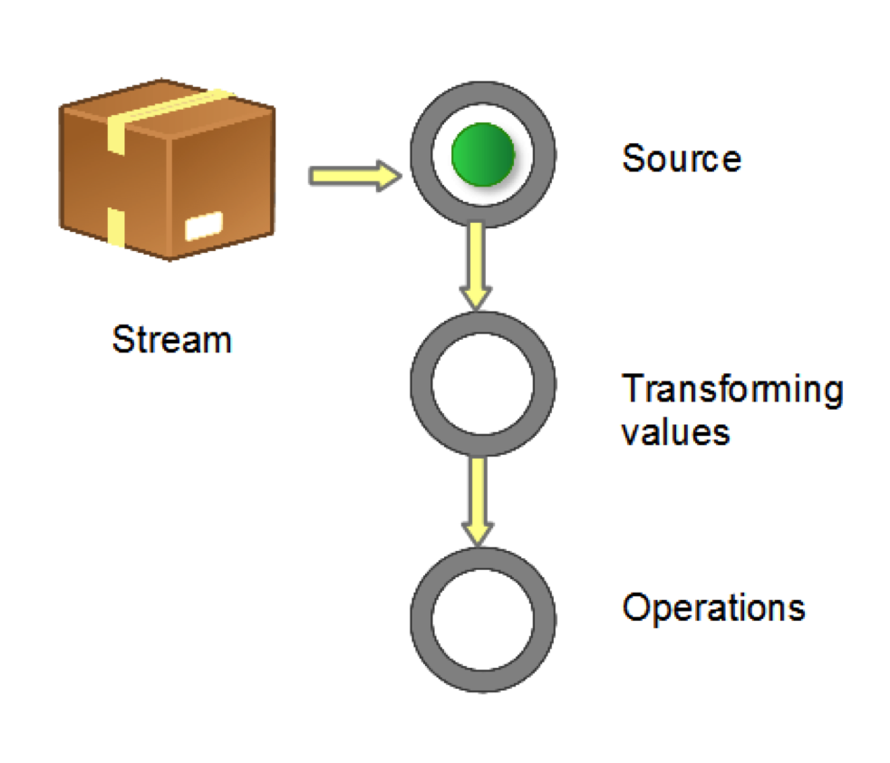
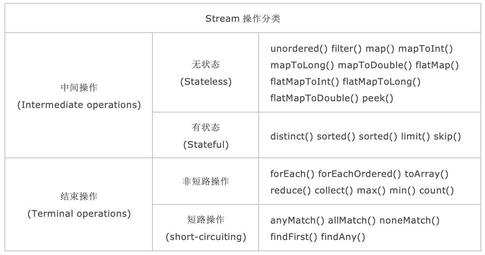
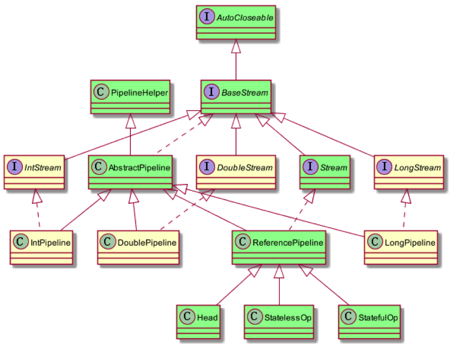
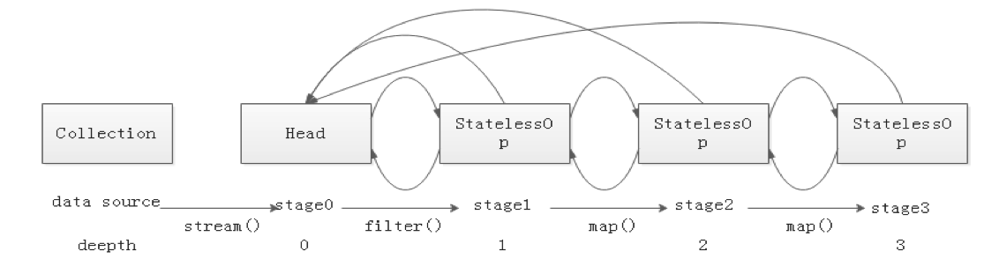
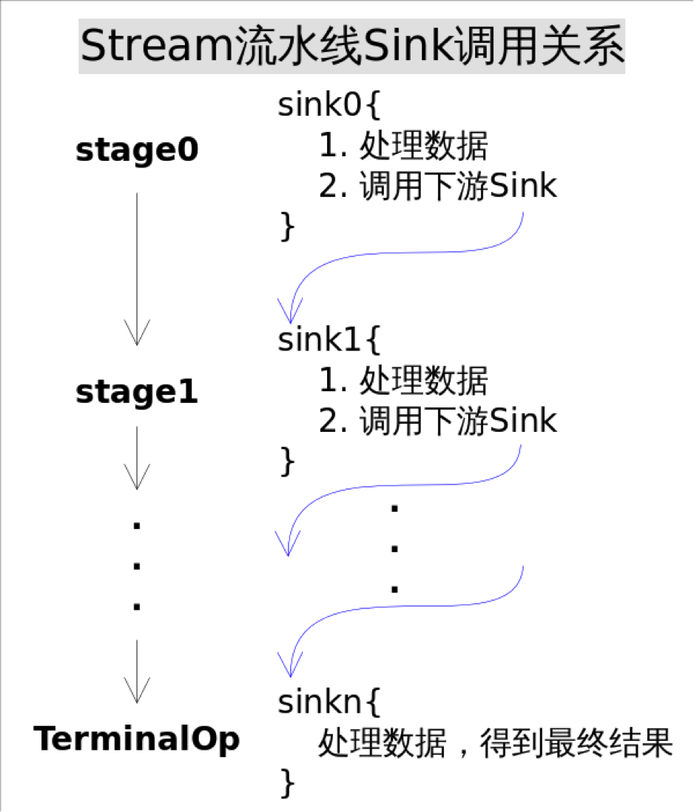
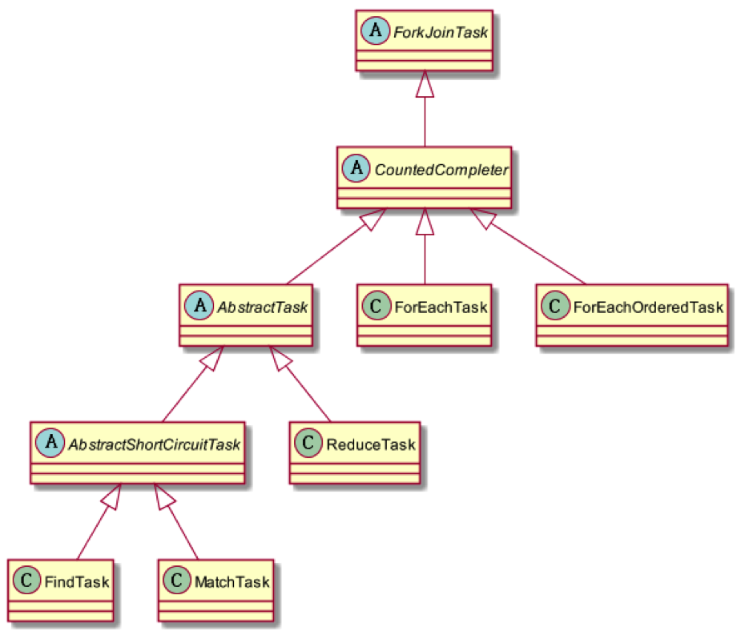
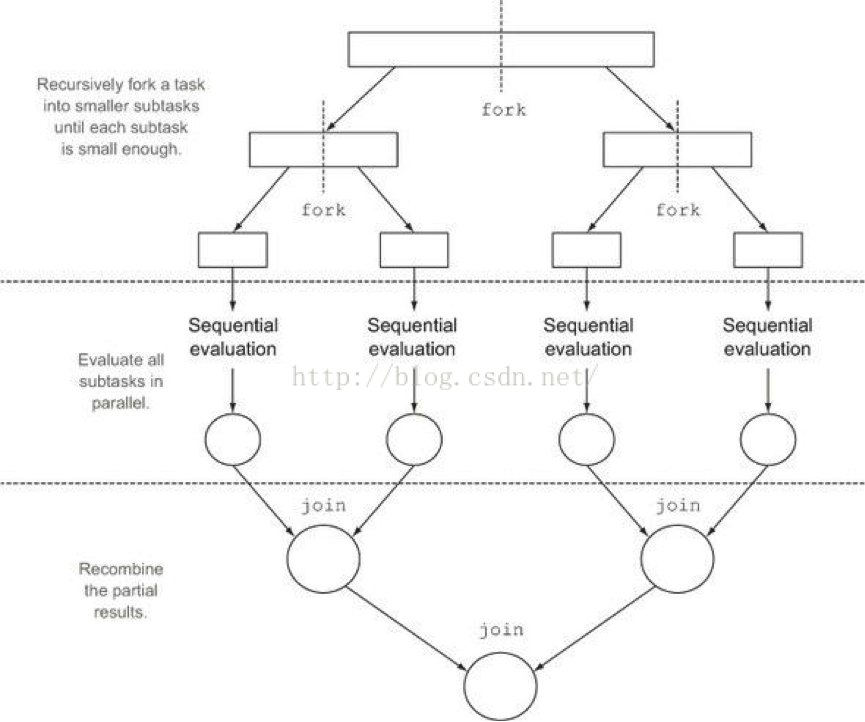

# Stream

# 1 什么是 Stream

Java 8 之前的集合类库主要依赖于**外部迭代**（external iteration）。`Collection` 实现 `Iterable` 接口，从而使得用户可以依次遍历集合的元素。比如我们需要把一个集合中的形状都设置成红色，那么可以这么写：

```java
for (Shape shape : shapes) {
    shape.setColor(RED);
}
```

这个例子演示了外部迭代：for-each 循环调用 `shapes` 的 `iterator()` 方法进行依次遍历。外部迭代的代码非常直接，但它有如下问题：

- Java 的 for 循环是串行的，而且必须按照集合中元素的顺序依次处理；
- 集合框架无法对控制流进行优化，例如通过排序、并行、短路（short-circuiting）求值以及惰性求值改善性能。

尽管有时 for-each 循环的这些特性（串行、依次）是我们所期待的，但它对改善性能造成了阻碍。

我们可以使用**内部迭代**（internal iteration）替代外部迭代：用户把对迭代的控制权交给类库，并以 Lambda 表达式的形式向类库传递迭代时所需执行的代码（行为参数化），遍历的方式则由类库自己决定。

下面是前例的内部迭代代码：

`shapes.forEach(s -> s.setColor(RED));`

尽管看起来只是一个小小的语法改动，但是它们的实际差别非常巨大。用户把对操作的控制权交还给类库，从而允许类库进行各种各样的优化（例如乱序执行、惰性求值和并行等等）。总的来说，内部迭代使得外部迭代中不可能实现的优化成为可能。

外部迭代同时承担了*做什么*（把形状设为红色）和*怎么做*（得到 Iterator 实例然后依次遍历）两项职责，而内部迭代只负责*做什么*，而把*怎么做*留给类库。通过这样的职责转变，用户的代码会变得更加清晰，而类库则可以进行各种优化，从而使所有用户都从中受益。

Java 8 API 添加了一个新的抽象，称为 Stream。Stream 使用一种类似用 SQL 语句从数据库查询数据的直观方式，来提供一种对 Java 集合运算和表达的高阶抽象。

这种风格将要处理的元素集合看作一种流，流在管道中传输，并且可以在管道的节点上进行处理，比如筛选、排序、聚合等。

Stream 不是集合元素，它不是数据结构，并不保存数据，它是有关算法和计算的，更像一个高级版本的 Iterator。原始版本的 Iterator，用户只能显式地一个一个遍历元素并对其执行某些操作；高级版本的 Stream，用户只要给出需要对其包含的元素执行什么操作，比如“过滤掉长度大于 10 的字符串”“获取每个字符串的首字母”等，Stream 会隐式地在内部进行遍历，做出相应的数据转换。

Stream 就如同一个迭代器（Iterator），单向，不可往复，数据只能遍历一次，遍历过一次后即用尽了，就好比流水从面前流过，一去不复返。

而和迭代器又不同的是，Stream 可以并行化操作，迭代器只能命令式地、串行化操作。顾名思义，当使用串行方式去遍历时，每个 item 读完后再读下一个 item。而使用并行去遍历时，数据会被分成多个段，其中每一个都在不同的线程中处理，然后将结果一起输出。Stream 的并行操作依赖于 Java 7 中引入的 Fork/Join 框架来拆分任务和加速处理过程。

# 2 流的构成与转换

当我们使用一个流的时候，通常包括三个基本步骤：

- 获取一个数据源（source）
- 数据转换
- 执行操作获取想要的结果

每次转换原有 Stream 对象不改变，返回一个新的 Stream 对象（可以有多次转换），这就允许对其操作可以像链条一样排列，变成一个管道，如下图所示：



流的操作类型分为两种：

- **Intermediate**：一个流可以后面跟随零个或多个 intermediate 操作。其目的主要是打开流，做出某种程度的数据映射/过滤，然后返回一个新的流，交给下一个操作使用。这类操作都是**惰性化的**（lazy），就是说，仅仅调用到这类方法，并没有真正开始流的遍历。
- **Terminal**：一个流只能有一个 terminal 操作，当这个操作执行后，流就被使用“光”了，无法再被操作。所以这必定是流的最后一个操作。Terminal 操作的执行，才会真正开始流的遍历，并且会生成一个结果，或者一个副作用（side effect）。

对一个 Stream 进行多次转换操作（Intermediate 操作）时，如果每次都对 Stream 的每个元素进行转换，那么时间复杂度就是 N（转换次数）个 for 循环的总和吗？其实不是这样的，转换操作都是 lazy 的，多个转换操作只会在 Terminal 操作的时候融合起来，一次循环完成。我们可以这样简单地理解：Stream 里有个操作函数的集合，每次转换操作就是把转换函数放入这个集合中，在 Terminal 操作的时候循环 Stream 对应的集合，然后对每个元素执行所有的函数。

还有一种操作被称为 `short-circuiting`（短路），用以指：

- 对于一个 intermediate 操作，如果它接受的是一个无限大（infinite/unbounded）的 Stream，但返回一个有限的新 Stream；
- 对于一个 terminal 操作，如果它接受的是一个无限大的 Stream，但能在有限的时间内计算出结果。

当操作一个无限大的 Stream，而又希望在有限时间内完成操作，则在管道内拥有一个 `short-circuiting` 操作是必要非充分条件。

```java
int sum = widgets.stream().filter(w -> w.getColor() == RED).mapToInt(w -> w.getWeight()).sum();
```

`stream()` 获取 source，`filter` 和 `mapToInt` 为 intermediate 操作，进行数据筛选和转换，最后一个 `sum()` 为 terminal 操作，对符合条件的组件重量求和。

下面提供最常见的几种构造 Stream 的样例。

```java
// 1. Individual values
Stream<String> stream = Stream.of("a", "b", "c");
// 2. Arrays
String[] strArray = new String[] { "a", "b", "c" };
stream = Stream.of(strArray);
stream = Arrays.stream(strArray);
// 3. Collections
List<String> list = Arrays.asList(strArray);
stream = list.stream();
```

需要注意的是，对于基本数值型，有三种对应的原始类型特化 Stream：`IntStream`、`LongStream`、`DoubleStream`。当然我们也可以用 `Stream<Integer>`、`Stream<Long>`、`Stream<Double>`，但是装箱（boxing）和拆箱（unboxing）会很耗时，所以特别为这三种基本数值型提供了对应的 Stream。

直到最新的 JDK 也没有提供 `CharStream`、`FloatStream` 等其他数值型 Stream，因为这将导致 API 数量大幅膨胀。常规的数值型聚合运算可以通过上面三种 Stream 进行，比如字符可以用 `String.chars()` 得到的 `IntStream` 处理。

数值流的构造：

```java
IntStream.of(new int[] { 1, 2, 3 }).forEach(System.out::println);
IntStream.range(1, 3).forEach(System.out::println);
IntStream.rangeClosed(1, 3).forEach(System.out::println);
```

流转换为其它数据结构：

```java
// 1. Array
String[] strArray1 = stream.toArray(String[]::new);
// 2. Collection
List<String> list1 = stream.collect(Collectors.toList());
List<String> list2 = stream.collect(Collectors.toCollection(ArrayList::new));
Set<String> set1 = stream.collect(Collectors.toSet());
Stack<String> stack1 = stream.collect(Collectors.toCollection(Stack::new));
// 3. String
String str = stream.collect(Collectors.joining());
```

一个 Stream 只可以使用一次（重复使用会抛出 `IllegalStateException: stream has already been operated upon or closed`），上面的代码为了简洁而重复使用了数次。

# 3 流的操作

接下来，当把一个数据结构包装成 Stream 后，就要开始对里面的元素进行各类操作了。常见的操作可以归类如下：

- **Intermediate**：`map`（`mapToInt`、`flatMap` 等）、`filter`、`distinct`、`sorted`、`peek`、`limit`、`skip`、`parallel`、`sequential`、`unordered`，以及 Java 9 新增的 `takeWhile`、`dropWhile`，Java 16 新增的 `mapMulti`，Java 24 新增的 `gather`
- **Terminal**：`forEach`、`forEachOrdered`、`toArray`、`reduce`、`collect`、`min`、`max`、`count`、`anyMatch`、`allMatch`、`noneMatch`、`findFirst`、`findAny`、`iterator`，以及 Java 16 新增的 `toList`
- **Short-circuiting**：`anyMatch`、`allMatch`、`noneMatch`、`findFirst`、`findAny`、`limit`、`takeWhile`

我们下面看一下 Stream 的比较典型用法。

## 3.1 map/flatMap

我们先来看 `map`。如果你熟悉 Scala 这类函数式语言，对这个方法应该很了解，它的作用就是把 input Stream 的每一个元素，映射成 output Stream 的另外一个元素。

```java
List<String> output = wordList.stream().map(String::toUpperCase).collect(Collectors.toList());
// 这段代码把所有的单词转换为大写

List<Integer> nums = Arrays.asList(1, 2, 3, 4);
List<Integer> squareNums = nums.stream().map(n -> n * n).collect(Collectors.toList());
// 这段代码生成一个整数 list 的平方数 {1, 4, 9, 16}
```

从上面例子可以看出，`map` 生成的是个 1:1 映射，每个输入元素，都按照规则转换成为另外一个元素。还有一些场景，是一对多映射关系的，这时需要 `flatMap`。

```java
Stream<List<Integer>> inputStream = Stream.of(Arrays.asList(1), Arrays.asList(2, 3), Arrays.asList(4, 5, 6));
Stream<Integer> outputStream = inputStream.flatMap((childList) -> childList.stream());
```

`flatMap` 把 input Stream 中的层级结构扁平化，就是将最底层元素抽出来放到一起，最终 output 的新 Stream 里面已经没有 List 了，都是直接的数字。

> 在 Java 8 中，`flatMap` 内部展开的子流不支持短路，即使后面跟着 `findFirst`、`limit` 等操作，子流也会被完整遍历（JDK-8075939），该问题在 Java 10 中修复。Java 16 还新增了 `mapMulti`，在一对多映射的元素较少时，它可以避免为每个元素创建子 Stream 的开销。

## 3.2 filter

`filter` 对原始 Stream 进行某项测试，通过测试的元素被留下来生成一个新 Stream。

```java
Integer[] sixNums = { 1, 2, 3, 4, 5, 6 };
Integer[] evens = Stream.of(sixNums).filter(n -> n % 2 == 0).toArray(Integer[]::new);
// 经过条件“被 2 整除”的 filter，剩下的数字为 {2, 4, 6}

List<String> output = reader.lines().flatMap(line -> Stream.of(line.split(REGEXP)))
        .filter(word -> word.length() > 0).collect(Collectors.toList());
```

这段代码首先把每行的单词用 `flatMap` 整理到新的 Stream，然后保留长度不为 0 的，就是整篇文章中的全部单词了。

## 3.3 forEach

`forEach` 方法接收一个 Lambda 表达式，然后在 Stream 的每一个元素上执行该表达式。

```java
// Java 8
roster.stream().filter(p -> p.getGender() == Person.Sex.MALE).forEach(p -> System.out.println(p.getName()));
// Pre-Java 8
for (Person p : roster) {
    if (p.getGender() == Person.Sex.MALE) {
        System.out.println(p.getName());
    }
}
```

对一个人员集合遍历，找出男性并打印姓名。可以看出来，forEach 是为 Lambda 而设计的，保持了最紧凑的风格。而且 Lambda 表达式本身是可以重用的，非常方便。当需要为多核系统优化时，可以 `parallelStream().forEach()`，只是此时原有元素的次序没法保证，并行的情况下将改变串行时操作的行为，此时 forEach 本身的实现不需要调整，而 Java 8 以前的 for 循环代码可能需要加入额外的多线程逻辑。

但一般认为，`forEach` 和常规 for 循环的差异不涉及性能，它们仅仅是函数式风格与传统 Java 风格的差别。

另外一点需要注意，**forEach 是 terminal 操作**，因此它执行后，Stream 的元素就被“消费”掉了，你无法对一个 Stream 进行两次 terminal 运算。下面的代码是错误的：

```java
stream.forEach(element -> doOneThing(element));
stream.forEach(element -> doAnotherThing(element));
```

相反，具有相似功能的 intermediate 操作 `peek` 可以达到上述目的。如下是出现在该 API Javadoc 上的一个示例。

`peek` 对每个元素执行操作并返回一个新的 Stream：

```java
Stream.of("one", "two", "three", "four").filter(e -> e.length() > 3)
        .peek(e -> System.out.println("Filtered value: " + e)).map(String::toUpperCase)
        .peek(e -> System.out.println("Mapped value: " + e)).collect(Collectors.toList());
```

Javadoc 明确指出 `peek` 主要用于调试。从 Java 9 开始，如果 `count()` 能直接从数据源算出元素个数（如 `list.stream().peek(...).count()`），流水线会被跳过，`peek` 中的动作根本不会执行，因此不要在 `peek` 中编写业务逻辑。

`forEach` 中的 Lambda 不能修改外部的局部变量（只能捕获 effectively final 的变量），也不能用 break/return 之类的关键字提前结束循环；如需按条件提前结束，可以使用 Java 9 新增的 `takeWhile`。

## 3.4 findFirst

这是一个 terminal 兼 short-circuiting 操作，它总是返回 Stream 的第一个元素，或者空。

这里比较重点的是它的返回值类型：`Optional`。这个概念借鉴自 Scala 的 `Option` 和 Guava 的 `Optional`，作为一个容器，它可能含有某值，或者不包含。使用它的目的是尽可能避免 `NullPointerException`。

`Optional` 的两个用例：

```java
public static void main(String[] args) {
    String strA = " abcd ", strB = null;
    print(strA);
    print("");
    print(strB);
    getLength(strA);
    getLength("");
    getLength(strB);
}

public static void print(String text) {
    // Java 8
    Optional.ofNullable(text).ifPresent(System.out::println);
    // Pre-Java 8
    if (text != null) {
        System.out.println(text);
    }
}

public static int getLength(String text) {
    // Java 8
    return Optional.ofNullable(text).map(String::length).orElse(-1);
    // Pre-Java 8
    // return text != null ? text.length() : -1;
}
```

在更复杂的 `if (xx != null)` 的情况中，使用 `Optional` 代码的可读性更好。它通过返回类型显式地表达“值可能不存在”，迫使调用方在编码阶段就处理空值问题，从而降低 NPE 这种运行时异常对程序的影响，而不是留到运行时再发现和调试。

`Optional` 的设计初衷是作为方法的返回值类型，一般不建议把它用作字段、方法参数或集合元素，也不要用 `Optional.get()` 代替判空（Java 10 新增了语义更明确的 `orElseThrow()`）。

Stream 中的 findAny、max/min、reduce 等方法都返回 `Optional` 值。还有例如 `IntStream.average()` 返回 `OptionalDouble` 等等。

## 3.5 reduce

这个方法的主要作用是把 Stream 元素组合起来。它提供一个起始值（种子），然后依照运算规则（`BinaryOperator`），和前面 Stream 的第一个、第二个、第 n 个元素组合。从这个意义上说，字符串拼接、数值的 sum、min、max、average 都是特殊的 `reduce`。例如 Stream 的 sum 就相当于：

```java
Integer sum = integers.reduce(0, (a, b) -> a + b);
// or
Integer sum = integers.reduce(0, Integer::sum);
```

也有没有起始值的情况，这时会把 Stream 的前面两个元素组合起来，返回的是 `Optional`。

`reduce` 的用例：

```java
// 字符串连接，concat = "ABCD"
String concat = Stream.of("A", "B", "C", "D").reduce("", String::concat);
// 求最小值，minValue = -3.0
double minValue = Stream.of(-1.5, 1.0, -3.0, -2.0).reduce(Double.MAX_VALUE, Double::min);
// 求和，sumValue = 10, 有起始值
int sumValue = Stream.of(1, 2, 3, 4).reduce(0, Integer::sum);
// 求和，sumValue = 10, 无起始值
sumValue = Stream.of(1, 2, 3, 4).reduce(Integer::sum).get();
// 过滤，字符串连接，concat = "ace"
concat = Stream.of("a", "B", "c", "D", "e", "F").filter(x -> x.compareTo("Z") > 0).reduce("", String::concat);
```

上面代码例如第一个示例的 `reduce()`，第一个参数（空字符串）即为起始值，第二个参数（`String::concat`）为 `BinaryOperator`。这类有起始值的 `reduce()` 都返回具体的对象。而对于第四个示例没有起始值的 `reduce()`，由于可能没有足够的元素，返回的是 `Optional`，请留意这个区别。

## 3.6 limit/skip

`limit` 返回 Stream 的前面 n 个元素；`skip` 则是扔掉前 n 个元素（在 Java 8 正式发布前，有一个名为 `substream` 的方法，后来被拆分为 `skip` 和 `limit`）。

`limit` 和 `skip` 对运行次数的影响：

```java
public void testLimitAndSkip() {
    List<Person> persons = new ArrayList<>();
    for (int i = 1; i <= 10000; i++) {
        Person person = new Person(i, "name" + i);
        persons.add(person);
    }
    List<String> personList2 = persons.stream().map(Person::getName).limit(10).skip(3).collect(Collectors.toList());
    System.out.println(personList2);
}

private class Person {
    public int no;
    private String name;

    public Person(int no, String name) {
        this.no = no;
        this.name = name;
    }

    public String getName() {
        System.out.println(name);
        return name;
    }
}
```

输出结果为：

```text
name1
name2
name3
name4
name5
name6
name7
name8
name9
name10
[name4, name5, name6, name7, name8, name9, name10]
```

这是一个有 10000 个元素的 Stream，但在 short-circuiting 操作 `limit` 的作用下，管道中 `map` 操作指定的 `getName()` 方法的执行次数为 `limit` 所限定的 10 次，而最终返回结果在跳过前 3 个元素后只有后面 7 个返回。

有一种情况是 limit/skip 无法达到 short-circuiting 目的的，就是把它们放在 Stream 的排序操作后，原因跟 `sorted` 这个 intermediate 操作有关：`sorted` 是有状态操作，必须拿到全部元素才能确定排序后的次序，所以 `sorted` 中的操作看上去就像完全没有被 `limit` 或者 `skip` 一样。

`limit` 和 `skip` 对 `sorted` 的运行次数无影响：

```java
List<Person> persons = new ArrayList<>();
for (int i = 1; i <= 5; i++) {
    Person person = new Person(i, "name" + i);
    persons.add(person);
}
List<Person> personList2 = persons.stream().sorted((p1, p2) -> p1.getName().compareTo(p2.getName())).limit(2)
        .collect(Collectors.toList());
System.out.println(personList2);
```

上面的代码首先对 5 个元素的 Stream 排序，然后进行 `limit` 操作。输出结果为：

```text
name2
name1
name3
name2
name4
name3
name5
name4
[stream.StreamDW$Person@816f27d, stream.StreamDW$Person@87aac27]
```

即虽然最后的返回元素数量是 2，但整个管道中的 `sorted` 表达式执行次数没有像前面例子相应减少。

最后有一点需要注意的是，对一个 parallel 的 Stream 管道来说，如果其元素是有序的，那么 `limit` 操作的成本会比较大，因为它的返回对象必须是前 n 个也有一样次序的元素。取而代之的策略是调用 `unordered()` 取消元素间的次序，或者不要用 parallel Stream。

## 3.7 sorted

对 Stream 的排序通过 `sorted` 进行，它比数组的排序更强之处在于可以首先对 Stream 进行各类 `map`、`filter`、`limit`、`skip` 甚至 `distinct` 来减少元素数量后，再排序，这能帮助程序明显缩短执行时间。

优化：排序前进行 `limit` 和 `skip`：

```java
List<Person> persons = new ArrayList<>();
for (int i = 1; i <= 5; i++) {
    Person person = new Person(i, "name" + i);
    persons.add(person);
}
List<Person> personList2 = persons.stream().limit(2).sorted((p1, p2) -> p1.getName().compareTo(p2.getName()))
        .collect(Collectors.toList());
System.out.println(personList2);
```

结果会简单很多：

```text
name2
name1
[stream.StreamDW$Person@6ce253f1, stream.StreamDW$Person@53d8d10a]
```

当然，这种优化是有业务逻辑上的局限性的：先截取再排序与先排序再截取的结果不同，只适用于不要求“排序后再取值”的场景。

## 3.8 min/max/distinct

`min` 和 `max` 的功能也可以通过对 Stream 元素先排序，再 `findFirst` 来实现，但前者的性能会更好，为 `O(n)`，而 `sorted` 的成本是 `O(n log n)`。同时它们作为特殊的 `reduce` 方法被独立出来也是因为求最大最小值是很常见的操作。

找出最长一行的长度：

```java
try (Stream<String> lines = Files.lines(Path.of("c:\\SUService.log"))) {
    int longest = lines.mapToInt(String::length).max().orElse(0);
    System.out.println(longest);
}
```

`Files.lines` 返回的 Stream 持有文件句柄，需要用 try-with-resources 关闭（`Path.of` 为 Java 11 新增，Java 8 可用 `Paths.get`）。

下面的例子则使用 `distinct` 来找出不重复的单词。

找出全文的单词，转小写，并排序：

```java
try (Stream<String> lines = Files.lines(Path.of("c:\\SUService.log"))) {
    List<String> words = lines.flatMap(line -> Stream.of(line.split(" "))).filter(word -> word.length() > 0)
            .map(String::toLowerCase).distinct().sorted().collect(Collectors.toList());
    System.out.println(words);
}
```

## 3.9 match

Stream 有三个 match 方法，从语义上说：

- **allMatch**：Stream 中全部元素符合传入的 `Predicate`，返回 true
- **anyMatch**：Stream 中只要有一个元素符合传入的 `Predicate`，返回 true
- **noneMatch**：Stream 中没有一个元素符合传入的 `Predicate`，返回 true

它们都不是要遍历全部元素才能返回结果。例如 `allMatch` 只要一个元素不满足条件，就跳过剩下的所有元素，返回 false。注意空 Stream 的 `allMatch` 和 `noneMatch` 都返回 true。

下面的例子中，`Person` 增加了 `age` 字段：

```java
List<Person> persons = new ArrayList<>();
persons.add(new Person(1, "name" + 1, 10));
persons.add(new Person(2, "name" + 2, 21));
persons.add(new Person(3, "name" + 3, 34));
persons.add(new Person(4, "name" + 4, 6));
persons.add(new Person(5, "name" + 5, 55));
boolean isAllAdult = persons.stream().allMatch(p -> p.getAge() > 18);
System.out.println("All are adult? " + isAllAdult);
boolean isThereAnyChild = persons.stream().anyMatch(p -> p.getAge() < 12);
System.out.println("Any child? " + isThereAnyChild);
```

输出结果：

```text
All are adult? false
Any child? true
```

## 3.10 Stream.generate

通过实现 `Supplier` 接口，可以自己来控制流的生成。这种情形通常用于随机数、常量的 Stream，或者需要前后元素间维持着某种状态信息的 Stream。把 `Supplier` 实例传递给 `Stream.generate()` 生成的 Stream，默认是串行（相对 parallel 而言）但无序的（相对 `ordered` 而言）。由于它是无限的，在管道中，必须利用 `limit` 之类的操作限制 Stream 大小。

生成 10 个随机整数：

```java
Random seed = new Random();
Supplier<Integer> random = seed::nextInt;
Stream.generate(random).limit(10).forEach(System.out::println);
// Another way
IntStream.generate(() -> (int) (System.nanoTime() % 100)).limit(10).forEach(System.out::println);
```

`Stream.generate()` 还接受自己实现的 `Supplier`。例如在构造海量测试数据的时候，用某种自动的规则给每一个变量赋值；或者依据公式计算 Stream 的每个元素值。这些都是维持状态信息的情形。

自实现 `Supplier`：

```java
Stream.generate(new PersonSupplier()).limit(10)
        .forEach(p -> System.out.println(p.getName() + ", " + p.getAge()));

private class PersonSupplier implements Supplier<Person> {
    private int index = 0;
    private Random random = new Random();

    @Override
    public Person get() {
        return new Person(index++, "StormTestUser" + index, random.nextInt(100));
    }
}
```

输出结果：

```text
StormTestUser1, 9
StormTestUser2, 12
StormTestUser3, 88
StormTestUser4, 51
StormTestUser5, 22
StormTestUser6, 28
StormTestUser7, 81
StormTestUser8, 51
StormTestUser9, 4
StormTestUser10, 76
```

## 3.11 Stream.iterate

`iterate` 跟 `reduce` 操作很像，接受一个种子值，和一个 `UnaryOperator`（例如 f）。然后种子值成为 Stream 的第一个元素，`f(seed)` 为第二个，`f(f(seed))` 为第三个，以此类推。

生成一个等差数列：

```java
Stream.iterate(0, n -> n + 3).limit(10).forEach(x -> System.out.print(x + " "));
```

输出结果：

```text
0 3 6 9 12 15 18 21 24 27
```

与 `Stream.generate` 相仿，在 `iterate` 时候管道必须有 `limit` 这样的操作来限制 Stream 大小。Java 9 新增了带终止条件的重载 `iterate(seed, hasNext, next)`，写法类似 for 循环，无需再借助 `limit`：

```java
Stream.iterate(0, n -> n < 30, n -> n + 3).forEach(x -> System.out.print(x + " "));
```

# 4 Collector

前面的代码中可以发现，Stream 里有一个 `collect(Collector c)` 方法，接收一个 `Collector` 实例，其功能是把 Stream 归约成一个值，这个值可以是一个 Collection、Map 等对象。

**归约**，就是对中间操作（过滤、转换等）的结果进行收集归一化的步骤，当然也可以对归约结果进行再归约，这就是归约的嵌套了。中间操作是惰性的，只是记录操作；归约作为终止操作才会真正消费流，而且只能消费一次，就像把流都吃掉了。

## 4.1 转换成其他集合

`toList` 示例：

```java
List<Integer> collectList = Stream.of(1, 2, 3, 4).collect(Collectors.toList());
System.out.println("collectList: " + collectList);
// 打印结果
// collectList: [1, 2, 3, 4]
```

`toSet` 示例：

```java
Set<Integer> collectSet = Stream.of(1, 2, 3, 4).collect(Collectors.toSet());
System.out.println("collectSet: " + collectSet);
// 打印结果
// collectSet: [1, 2, 3, 4]
```

通常情况下，创建集合时需要调用适当的构造函数指明集合的具体类型：

```java
List<Artist> artists = new ArrayList<>();
```

但是调用 `toList` 或者 `toSet` 方法时，不需要指定具体的类型，由 Stream 类库决定。需要注意的是，Javadoc 并不保证返回集合的具体类型、可变性和线程安全性（当前实现分别是 `ArrayList` 和 `HashSet`，但不应依赖这一点）。当我们对转换生成的集合有特定要求时，比如希望生成一个 `TreeSet`，可以使用 `toCollection`，它接受一个函数作为参数来创建集合。

查看 Collectors 的源码可以发现，`toCollection` 的参数类型是 `Supplier<C>`，并且要求 `C extends Collection<T>`，因此它只能生成 Collection 的子类，最明显的就是不能通过 `toCollection` 转换成 Map。

如果生成一个 Map，我们需要调用 `toMap` 方法。由于 Map 中有 Key 和 Value 这两个值，故该方法与 `toSet`、`toList` 等的处理方式是不一样的。`toMap` 最少应接受两个参数，一个用来生成 key，另外一个用来生成 value。

```java
public Map<Long, Account> getIdAccountMap(List<Account> accounts) {
    return accounts.stream().collect(Collectors.toMap(Account::getId, account -> account));
}
```

`account -> account` 是一个返回本身的 Lambda 表达式，其实还可以使用 `Function` 接口中的静态方法 `identity()` 代替，使整个方法更简洁优雅：

```java
public Map<Long, Account> getIdAccountMap(List<Account> accounts) {
    return accounts.stream().collect(Collectors.toMap(Account::getId, Function.identity()));
}
```

重复 key 的情况：

```java
public Map<String, Account> getNameAccountMap(List<Account> accounts) {
    return accounts.stream().collect(Collectors.toMap(Account::getUsername, Function.identity()));
}
```

这个方法可能报错（`java.lang.IllegalStateException: Duplicate key`），因为 name 是有可能重复的。`toMap` 有个重载方法，可以传入一个合并函数来解决 key 冲突问题，合并函数的两个参数是冲突的两个 value：

```java
public Map<String, Account> getNameAccountMap(List<Account> accounts) {
    return accounts.stream()
            .collect(Collectors.toMap(Account::getUsername, Function.identity(), (v1, v2) -> v2));
}
```

这里只是简单地使用后者覆盖前者来解决 key 重复问题。另外要注意，`toMap` 不允许 value 为 null（Java 8 基于 `HashMap.merge` 实现，Java 9 之后对 value 做了非空校验），遇到 null 会直接抛出 `NullPointerException`，这一点与 `HashMap.put` 不同。

`toMap` 还有另一个重载方法，可以指定一个 Map 的具体实现，来收集数据：

```java
public Map<String, Account> getNameAccountMap(List<Account> accounts) {
    return accounts.stream().collect(
            Collectors.toMap(Account::getUsername, Function.identity(), (v1, v2) -> v2, LinkedHashMap::new));
}
```

## 4.2 转成值

使用 `collect` 可以将 Stream 转换成值。例如，`maxBy` 和 `minBy` 允许用户按照某个特定的顺序生成一个值。

```java
Optional<Integer> collectMaxBy = Stream.of(1, 2, 3, 4)
        .collect(Collectors.maxBy(Comparator.comparingInt(o -> o)));
System.out.println("collectMaxBy:" + collectMaxBy.get());
```

## 4.3 数据分组

`collect` 的一个常用操作是将 Stream 分解成两个集合。假如有一个数字的 Stream，我们可能希望将其分割成两个集合，一个是偶数集合，另外一个是奇数集合。我们首先想到的就是过滤操作，通过两次过滤操作，很简单地就完成了我们的需求。

但是这样操作起来有问题。首先，为了执行两次过滤操作，需要有两个流。其次，如果过滤操作复杂，每个流上都要执行这样的操作，代码也会变得冗余。

这里我们就不得不说 Collectors 库中的 `partitioningBy` 方法，它接受一个 `Predicate` 对象，用来判断一个元素应该属于哪个部分，并将流分成两部分，返回一个 `Map<Boolean, List<T>>`。key 为 true 所对应的 List 中的元素，满足 `Predicate` 中指定的条件；key 为 false 所对应的 List 中的元素，不满足 `Predicate` 中指定的条件。

这样，使用 `partitioningBy`，我们就可以将数字的 Stream 分解成奇数集合和偶数集合了。

```java
Map<Boolean, List<Integer>> collectParti = Stream.of(1, 2, 3, 4, 5, 6, 7, 8, 9)
        .collect(Collectors.partitioningBy(it -> it % 2 == 0));
System.out.println("collectParti : " + collectParti);
// 打印结果
// collectParti : {false=[1, 3, 5, 7, 9], true=[2, 4, 6, 8]}
```

而 `groupingBy` 是一种更自然的分割数据操作，与将数据分成 true 和 false 两部分不同，`groupingBy` 可以使用任意值对数据分组。`groupingBy` 接受一个分类函数 `Function`，用来对数据分组。

根据数字除以 3 的余数进行分组：

```java
Map<Integer, List<Integer>> collectParti2 = Stream.of(1, 2, 3, 4, 5, 6, 7, 8, 9)
        .collect(Collectors.groupingBy(t -> t % 3));
System.out.println("collectParti2 : " + collectParti2);
// 打印结果
// collectParti2 : {0=[3, 6, 9], 1=[1, 4, 7], 2=[2, 5, 8]}
```

## 4.4 字符串处理

有时候，我们需要将 Stream 的元素（String 类型）拼接成一个字符串。比如将 `Stream.of("1", "2", "3", "4")` 格式化成“1,2,3,4”。

如果不使用 Stream，我们可以通过 for 循环迭代实现。

```java
ArrayList<Integer> list = new ArrayList<>();
list.add(1);
list.add(2);
list.add(3);
list.add(4);

StringBuilder sb = new StringBuilder();

for (Integer it : list) {
    if (sb.length() > 0) {
        sb.append(",");
    }
    sb.append(it);
}
System.out.println(sb.toString());
// 打印结果
// 1,2,3,4
```

在 Java 8 中，我们可以使用 Stream 来实现。这里我们将使用 `Collectors.joining` 收集 Stream 中的值，该方法可以方便地将 Stream 转换为一个字符串。`joining` 函数接受三个参数，分别表示分隔符（用以分隔元素）、前缀和后缀。

```java
String strJoin = Stream.of("1", "2", "3", "4").collect(Collectors.joining(",", "[", "]"));
System.out.println("strJoin: " + strJoin);
// 打印结果
// strJoin: [1,2,3,4]
```

## 4.5 组合 Collector

前面，我们已经了解到 Collector 的强大，而且非常实用。如果将它们组合起来，是不是更厉害呢？以 `partitioningBy` 为例，分组后我们得到的是数据列表，如 `{false=[1, 3], true=[2, 4]}`。如果我们的要求更高点，不需要分组后的列表，只要得到分组后列表的个数就好了。

这时候，很多人下意识地都会想到，遍历 Map 就好了，然后使用 `list.size()`，就可以轻松地得到各个分组的列表个数。

```java
// 分割数据块
Map<Boolean, List<Integer>> collectParti = Stream.of(1, 2, 3, 4)
        .collect(Collectors.partitioningBy(it -> it % 2 == 0));

Map<Boolean, Integer> mapSize = new HashMap<>();
collectParti.entrySet().forEach(entry -> mapSize.put(entry.getKey(), entry.getValue().size()));

System.out.println("mapSize : " + mapSize);
// 打印结果
// mapSize : {false=2, true=2}
```

其实在 `partitioningBy` 方法中，有这么一个变形：

```java
Map<Boolean, Long> partiCount = Stream.of(1, 2, 3, 4)
        .collect(Collectors.partitioningBy(it -> it % 2 == 0, Collectors.counting()));
System.out.println("partiCount: " + partiCount);
// 打印结果
// partiCount: {false=2, true=2}
```

在 `partitioningBy` 方法中，我们不仅传递了条件函数，同时传入了第二个收集器，用以收集最终结果的一个子集，这些收集器叫作下游收集器。收集器是生成最终结果的一剂配方，下游收集器则是生成部分结果的配方，主收集器中会用到下游收集器。这种组合使用收集器的方式，使得它们在 Stream 类库中的作用更加强大。

那些为基本类型特殊定制的函数，如 `averagingInt`、`summarizingLong` 等，事实上和调用特殊 Stream 上的方法是等价的，加上它们是为了将它们当作下游收集器来使用的。后续版本又陆续增加了 `filtering`、`flatMapping`（Java 9）和 `teeing`（Java 12）等下游收集器，详见第 7 章。

## 4.6 源码分析

`Collectors.toList` 工厂方法返回一个收集器，它会把流中的所有元素收集成一个 List。它使用广泛而且写起来比较直观，通过仔细研究这个收集器是怎么实现的，可以很好地了解 Collector 接口是怎么定义的，以及它的方法所返回的函数在内部是如何为 `collect` 方法所用的。

首先让我们在下面的列表中看看 Collector 接口的定义，它列出了接口的签名以及声明的五个方法。

```java
public interface Collector<T, A, R> {
    Supplier<A> supplier();

    BiConsumer<A, T> accumulator();

    Function<A, R> finisher();

    BinaryOperator<A> combiner();

    Set<Characteristics> characteristics();
}
```

`Collector<T, A, R>` 接受三个泛型参数，对可变归约（mutable reduction）操作的数据类型作相应限制：

- T：表示流中每个元素的类型。
- A：表示中间结果容器的类型。
- R：表示最终返回的结果类型。

Collector 接口声明了 5 个方法，前四个方法返回的函数协调执行，将元素累积到可变结果容器中，并且可以选择性地对结果进行最终的变换；第五个方法声明收集器的特性：

- `Supplier<A> supplier()`：创建新的结果容器
- `BiConsumer<A, T> accumulator()`：将元素添加到结果容器
- `BinaryOperator<A> combiner()`：将两个结果容器合并为一个结果容器
- `Function<A, R> finisher()`：对结果容器作相应的变换
- `Set<Characteristics> characteristics()`：对 Collector 声明相关特性，详见 4.6.5

现在我们可以一个个来分析 Collector 接口声明的五个方法了。通过分析，你会注意到，前四个方法都会返回一个会被 `collect` 方法调用的函数，而第五个方法 `characteristics` 则提供了一系列特征，也就是一个提示列表，告诉 `collect` 方法在执行归约操作的时候可以应用哪些优化（比如并行化）。

### 4.6.1 建立新的结果容器：supplier 方法

`supplier` 方法必须返回一个结果为空的 `Supplier`，也就是一个无参数函数，在调用时它会创建一个空的累加器实例，供数据收集过程使用。很明显，对于将累加器本身作为结果返回的收集器，比如 `ToListCollector`，在对空流执行操作的时候，这个空的累加器也代表了收集过程的结果。在 `ToListCollector` 中，`supplier` 返回一个空的 List，如下所示：

```java
@Override
public Supplier<List<T>> supplier() {
    return () -> new ArrayList<>();
}
```

请注意你也可以只传递一个构造函数引用：

```java
@Override
public Supplier<List<T>> supplier() {
    return ArrayList::new;
}
```

### 4.6.2 将元素添加到结果容器：accumulator 方法

`accumulator` 方法会返回执行归约操作的函数。当遍历到流中第 n 个元素时，这个函数执行时会有两个参数：保存归约结果的累加器（已收集了流中的前 n-1 个项目），还有第 n 个元素本身。该函数将返回 void，因为累加器是原位更新，即函数的执行改变了它的内部状态以体现遍历的元素的效果。对于 `ToListCollector`，这个函数仅仅会把当前项目添加至已经遍历过的项目的列表：

```java
@Override
public BiConsumer<List<T>, T> accumulator() {
    return (list, item) -> list.add(item);
}
```

你也可以使用方法引用，这会更为简洁：

```java
@Override
public BiConsumer<List<T>, T> accumulator() {
    return List::add;
}
```

### 4.6.3 对结果容器应用最终转换：finisher 方法

在遍历完流后，`finisher` 方法必须返回在累积过程的最后要调用的一个函数，以便将累加器对象转换为整个集合操作的最终结果。通常，就像 `ToListCollector` 的情况一样，累加器对象恰好符合预期的最终结果，因此无需进行转换。所以 `finisher` 方法只需返回 `identity` 函数：

```java
@Override
public Function<List<T>, List<T>> finisher() {
    return Function.identity();
}
```

这三个方法已经足以对流进行顺序归约。实践中的实现细节可能还要复杂一点，一方面是因为流的延迟性质，可能在 `collect` 操作之前还需完成其他中间操作的流水线，另一方面则是理论上可能要进行并行归约。

### 4.6.4 合并两个结果容器：combiner 方法

四个方法中的最后一个——`combiner` 方法会返回一个供归约操作使用的函数，它定义了对流的各个子部分进行并行处理时，各个子部分归约所得的累加器要如何合并。对于 `toList` 而言，这个方法的实现非常简单，只要把从流的第二个部分收集到的项目列表加到遍历第一部分时得到的列表后面就行了：

```java
@Override
public BinaryOperator<List<T>> combiner() {
    return (list1, list2) -> {
        list1.addAll(list2);
        return list1;
    };
}
```

有了这第四个方法，就可以对流进行并行归约了。它会用到 Java 7 中引入的分支/合并框架和 Java 8 中引入的 `Spliterator` 抽象。

### 4.6.5 characteristics 方法

最后一个方法——`characteristics` 会返回一个不可变的 `Characteristics` 集合，它定义了收集器的行为——尤其是关于流是否可以并行归约，以及可以使用哪些优化的提示。`Characteristics` 是一个包含三个项目的枚举，理解这三个值的含义对于我们自己编写正确的收集器至关重要：

- `UNORDERED`：归约结果不受流中项目的遍历和累积顺序的影响。
- `CONCURRENT`：`accumulator` 函数可以从多个线程同时调用，即使在并行流的情况下，中间结果容器也只有一个，因此结果容器本身必须是线程安全的（如 `ConcurrentHashMap`）。由于只有一个容器，此时 `combiner` 不会被调用。如果收集器没有同时标为 `UNORDERED`，那它仅在用于无序数据源时才会并发归约。
- `IDENTITY_FINISH`：这表明 `finisher` 方法返回的函数是一个恒等函数，可以跳过。这种情况下，累加器对象将会直接用作归约过程的最终结果。这也意味着，将累加器 A 不加检查地转换为结果 R 是安全的。

我们迄今开发的 `ToListCollector` 是 `IDENTITY_FINISH` 的，因为用来累积流中元素的 List 已经是我们要的最终结果，用不着进一步转换了，但它并不是 `UNORDERED` 的，因为用在有序流上的时候，我们还是希望顺序能够保留在得到的 List 中。同时，它也**不能**声明为 `CONCURRENT`，因为 `ArrayList` 不是线程安全的，多个线程同时调用 `List::add` 会导致数据丢失甚至抛出异常。

### 4.6.6 融会贯通

前一小节中谈到的五个方法足够我们开发自己的 `ToListCollector` 了。你可以把它们都融合起来，如下面的代码清单所示。

```java
public class ToListCollector<T> implements Collector<T, List<T>, List<T>> {
    @Override
    public Supplier<List<T>> supplier() {
        return ArrayList::new;
    }

    @Override
    public BiConsumer<List<T>, T> accumulator() {
        return List::add;
    }

    @Override
    public BinaryOperator<List<T>> combiner() {
        return (list1, list2) -> {
            list1.addAll(list2);
            return list1;
        };
    }

    @Override
    public Function<List<T>, List<T>> finisher() {
        return Function.identity();
    }

    @Override
    public Set<Characteristics> characteristics() {
        return Collections.unmodifiableSet(EnumSet.of(Characteristics.IDENTITY_FINISH));
    }
}
```

请注意，这个实现与 `Collectors.toList()` 方法并不完全相同，但区别仅仅是一些小的优化。

对于 `IDENTITY_FINISH` 的收集操作，还有一种方法可以得到同样的结果而无需从头实现新的 `Collector` 接口。Stream 有一个重载的 `collect` 方法可以接受另外三个函数——`supplier`、`accumulator` 和 `combiner`，其语义和 Collector 接口的相应方法返回的函数完全相同。所以比如说，我们可以像下面这样把菜肴流中的项目收集到一个 List 中：

```java
List<Dish> dishes = menuStream.collect(ArrayList::new, List::add, List::addAll);
```

我们认为，这第二种形式虽然比前一个写法更为紧凑和简洁，却不那么易读。此外，以恰当的类来实现自己的自定义收集器有助于重用并可避免代码重复。另外值得注意的是，这第二个 `collect` 方法不能传递任何 `Characteristics`，所以它相当于一个只具有 `IDENTITY_FINISH` 特性、既非 `CONCURRENT` 也非 `UNORDERED` 的收集器。

# 5 并行处理

## 5.1 并行流

对集合调用 `parallelStream()` 方法，或者对已有的流调用 `parallel()` 方法，就可以得到并行流。并行流就是把一个内容分成多个数据块，并用不同的线程分别处理每个数据块的流。

并行流内部使用了公共的 `ForkJoinPool.commonPool()`，它默认的并行度是处理器数量减 1（调用线程自身也会参与计算），处理器数量由 `Runtime.getRuntime().availableProcessors()` 得到。可以通过系统属性 `java.util.concurrent.ForkJoinPool.common.parallelism` 来改变线程池大小：

```bash
java -Djava.util.concurrent.ForkJoinPool.common.parallelism=12 -jar app.jar
```

也可以在代码中调用 `System.setProperty("java.util.concurrent.ForkJoinPool.common.parallelism", "12")`，但必须在公共池第一次被使用之前设置，否则不生效。这个设置是全局的，会影响 JVM 中所有使用公共池的代码（包括 `CompletableFuture` 的默认异步执行器），因此更推荐启动参数的方式。

由于所有并行流共享同一个公共池，不要在并行流中执行阻塞 I/O 等耗时操作，否则会拖慢整个应用中的其他并行任务。如果确实需要并发执行 I/O 任务，在 Java 21 之后应优先考虑虚拟线程，或使用 Java 24 中 `Gatherers.mapConcurrent`（见第 7 章）。

使用正确的数据结构然后使其并行化工作能保证最佳的性能。特别注意原始类型的装箱和拆箱操作。

一些帮你决定某个特定情况下是否有必要使用并行流的建议：

- 有疑问，则亲自测试验证效果（推荐使用 JMH 进行基准测试）。把顺序流转化成并行流轻而易举，但却不一定是好事。**并行流并不总是比顺序流快**。
- 留意装箱。自动装箱和拆箱操作会大大降低性能。Java 8 中有原始类型流（`IntStream`、`LongStream`、`DoubleStream`）来避免这种操作，但凡有可能应该使用这些流。
- 有些操作本身在并行流上的性能就比顺序流差。特别是 `limit` 和 `findFirst` 等依赖于元素顺序的操作。
- 还要考虑流的操作流水线的总计算成本。
- 对于较小的数据量，选择并行几乎从来都不是一个好的决定。并行处理少数几个元素的好处还抵不上并行化造成的额外开销。
- 要考虑流背后的数据结构是否易于分解。如 `ArrayList` 的拆分效率比 `LinkedList` 高得多，因为前者用不着遍历就可以平均拆分，而后者则必须遍历。另外，用 `range` 工厂方法创建的原始类型流也可以快速分解。

## 5.2 分支/合并框架

分支/合并框架的目的是以递归方式将可以并行的任务拆分成更小的任务，然后将每个子任务的结果合并起来生成整体结果。它的核心 `ForkJoinPool` 是 `ExecutorService` 接口的一个实现，它把子任务分配给线程池中的工作线程（Fork/Join 框架的详细分析见本系列的 ForkJoin 篇）。

要把任务提交到这个池，必须创建 `RecursiveTask<R>` 的一个子类，其中 `R` 是并行化任务（以及所有子任务）产生的结果类型，或者如果任务不返回结果，则是 `RecursiveAction` 类型（当然它可能会更新其他非局部结构）。要定义 `RecursiveTask`，只需要实现它唯一的抽象方法：

```java
protected abstract R compute();
```

这个方法同时定义了将任务拆分成子任务的逻辑，以及无法再拆分或不方便再拆分时，生成单个子任务结果的逻辑。伪代码：

```text
if (任务足够小或不可分) {
    顺序计算该任务
} else {
    将任务分成两个子任务
    递归调用本方法，拆分每个子任务，等待所有子任务完成
    合并每个子任务的结果
}
```

选个例子为基础，让我们试着用这个框架为一个数字范围（这里用一个 `long[]` 数组表示）求和。需要先为 `RecursiveTask` 类做一个实现：

```java
public class ForkJoinSumCalculator extends java.util.concurrent.RecursiveTask<Long> {
    private final long[] numbers;
    private final int start;
    private final int end;
    public static final long THRESHOLD = 10_000;

    public ForkJoinSumCalculator(long[] numbers) {
        this(numbers, 0, numbers.length);
    }

    private ForkJoinSumCalculator(long[] numbers, int start, int end) {
        this.numbers = numbers;
        this.start = start;
        this.end = end;
    }

    @Override
    protected Long compute() {
        int length = end - start;
        if (length <= THRESHOLD) {
            return computeSequentially();
        }
        ForkJoinSumCalculator leftTask = new ForkJoinSumCalculator(numbers, start, start + length / 2);
        leftTask.fork();
        ForkJoinSumCalculator rightTask = new ForkJoinSumCalculator(numbers, start + length / 2, end);
        Long rightResult = rightTask.compute();
        Long leftResult = leftTask.join();
        return leftResult + rightResult;
    }

    private long computeSequentially() {
        long sum = 0;
        for (int i = start; i < end; i++) {
            sum += numbers[i];
        }
        return sum;
    }
}
```

测试方法：

```java
public static long forkJoinSum(long n) {
    long[] numbers = LongStream.rangeClosed(1, n).toArray();
    ForkJoinTask<Long> task = new ForkJoinSumCalculator(numbers);
    return ForkJoinPool.commonPool().invoke(task);
}
```

运行 `ForkJoinSumCalculator`：当把 `ForkJoinSumCalculator` 任务传给 `ForkJoinPool` 时，这个任务就由池中的一个线程执行，这个线程会调用任务的 `compute` 方法。该方法会检查任务是否小到足以顺序执行，如果不够小则会把要求和的数组分成两半，分给两个新的 `ForkJoinSumCalculator`，而它们也由 `ForkJoinPool` 安排执行。因此，这一过程可以递归重复，把原任务分为更小的任务，直到满足不方便或不可能再进一步拆分的条件。这时会顺序计算每个任务的结果，然后由分支过程创建的（隐含的）任务二叉树遍历回到它的根。接下来会合并每个子任务的部分结果，从而得到总任务的结果。

分支/合并框架使用了一种称为工作窃取（work stealing）的技术。在实际应用中，这意味着这些任务差不多被平均分配到 `ForkJoinPool` 中的所有线程上。每个线程都为分配给它的任务保存一个双端队列，每完成一个任务，就会从队列头上取出下一个任务开始执行。基于一些原因，某个线程可能早早完成了分配给它的任务，也就是它的队列已经空了，而其他的线程还很忙。这时，这个线程并没有闲下来，而是随机选了一个别的线程，从它队列的尾巴上“偷走”一个任务。这个过程一直继续下去，直到所有的任务都执行完毕，所有的队列都清空。这就是为什么要划分成许多小任务而不是少数几个大任务，这有助于更好地在工作线程之间平衡负载。

## 5.3 Spliterator

`Spliterator` 是 Java 8 中加入的另一个新接口，这个名字代表“可分迭代器”（splittable iterator）。和 `Iterator` 一样，`Spliterator` 也用于遍历数据源中的元素，但它是为了并行执行而设计的。虽然在实践中可能用不着自己开发 `Spliterator`，但了解一下它的实现方式会让你对并行流的工作原理有更深入的了解。Java 8 已经为集合框架中包含的所有数据结构提供了一个默认的 `Spliterator` 实现：`Collection` 接口（继承自 `Iterable`）提供了一个默认方法 `spliterator()`，`ArrayList`、`HashMap` 等常用集合还会覆写它，提供更高效的拆分实现。这个接口定义了若干方法，如下面的代码清单所示。

```java
public interface Spliterator<T> {
    boolean tryAdvance(Consumer<? super T> action);

    Spliterator<T> trySplit();

    long estimateSize();

    int characteristics();
}
```

与往常一样，T 是 `Spliterator` 遍历的元素的类型。`tryAdvance` 方法的行为类似于普通的 `Iterator`，因为它会按顺序一个一个使用 `Spliterator` 中的元素，并且如果还有其他元素要遍历就返回 true。但 `trySplit` 是专为 `Spliterator` 接口设计的，因为它可以把一些元素划出去分给第二个 `Spliterator`（由该方法返回），让它们两个并行处理。`Spliterator` 还可通过 `estimateSize` 方法估计还剩下多少元素要遍历，因为即使不那么确切，能快速算出来的一个估计值也有助于让拆分均匀一点。

# 6 实现原理

## 6.1 操作分类



Stream 中的操作可以分为两大类：**中间操作**（Intermediate operations）与**结束操作**（Terminal operations），中间操作只是对操作进行了记录，只有结束操作才会触发实际的计算（即惰性求值），这也是 Stream 在迭代大集合时高效的原因之一。中间操作又可以分为**无状态**（Stateless）操作与**有状态**（Stateful）操作，前者是指元素的处理不受之前元素的影响；后者是指该操作只有拿到所有元素之后才能继续下去。结束操作又可以分为**短路**（short-circuiting）与**非短路**操作，这个应该很好理解，前者是指遇到某些符合条件的元素就可以得到最终结果；而后者是指必须处理所有元素才能得到最终结果。

之所以要进行如此精细的划分，是因为底层对每一种情况的处理方式不同。



- `BaseStream` 定义了流的迭代、并行、串行等基本特性；
- `Stream` 中定义了 `map`、`filter`、`flatMap` 等用户关注的常用操作；
- `PipelineHelper` 用于执行管道流中的操作以及捕获输出类型、并行度等信息；
- `Head`、`StatelessOp`、`StatefulOp` 为 `ReferencePipeline` 中的内部子类，用于描述流的操作阶段。

## 6.2 源码分析

> 本章源码基于 JDK 8，后续版本中 Stream 的整体架构（Pipeline + Sink）没有变化，只有局部细节调整。

来看一个例子：

```java
List<String> list = Arrays.asList("China", "America", "Russia", "Britain");
List<String> result = list.stream().filter(e -> e.length() >= 4).map(e -> e.charAt(0))
        .map(e -> String.valueOf(e)).collect(Collectors.toList());
```

上面 List 首先生成了一个 Stream，然后经过 `filter`、`map`、`map` 三次无状态的中间操作，最后由结束操作 `collect` 收尾。

下面通过源码来一次庖丁解牛，看看一步步到底是怎么实现的。

生成流的操作是通过调用 `StreamSupport` 类下面的方法实现的：

### 6.2.1 stream()

```java
public static <T> Stream<T> stream(Spliterator<T> spliterator, boolean parallel) {
    Objects.requireNonNull(spliterator);
    return new ReferencePipeline.Head<>(spliterator, StreamOpFlag.fromCharacteristics(spliterator), parallel);
}
```

方法很简单，直接 `new` 了一个 `ReferencePipeline.Head` 对象并返回，三个参数分别代表流的数据源、特性组合、是否并行。`Head` 是 `ReferencePipeline` 的子类，而 `ReferencePipeline` 继承自 `AbstractPipeline` 并实现了 `Stream` 接口。也就是说，返回了一个由 `Head` 实现的 `Stream`。

追溯源码可以发现，`Head` 最终调用父类 `AbstractPipeline` 的构造方法完成实例化：

```java
AbstractPipeline(Spliterator<?> source, int sourceFlags, boolean parallel) {
    this.previousStage = null; // 上一个 stage 指向 null
    this.sourceSpliterator = source;
    this.sourceStage = this; // 源头 stage 指向自己
    this.sourceOrOpFlags = sourceFlags & StreamOpFlag.STREAM_MASK;
    // The following is an optimization of:
    // StreamOpFlag.combineOpFlags(sourceOrOpFlags, StreamOpFlag.INITIAL_OPS_VALUE);
    this.combinedFlags = (~(sourceOrOpFlags << 1)) & StreamOpFlag.INITIAL_OPS_VALUE;
    this.depth = 0;
    this.parallel = parallel;
}
```

`AbstractPipeline` 类中定义了三个与 stage 相关的内部变量：

```java
/**
 * Backlink to the head of the pipeline chain (self if this is the source
 * stage).
 */
@SuppressWarnings("rawtypes")
private final AbstractPipeline sourceStage;

/**
 * The "upstream" pipeline, or null if this is the source stage.
 */
@SuppressWarnings("rawtypes")
private final AbstractPipeline previousStage;

/**
 * The next stage in the pipeline, or null if this is the last stage.
 * Effectively final at the point of linking to the next pipeline.
 */
@SuppressWarnings("rawtypes")
private AbstractPipeline nextStage;
```

当前节点同时持有前一个节点与后一个节点的指针，并且保留了头结点的引用，这不是典型的双向链表吗？

基于此，分析上面的构造函数：

- 前一个节点为空
- 头结点指向自己
- 后一个节点暂时未指定

很显然，构造出的是一个双向链表的头结点。

综上所述，`stream` 函数返回了一个由 `ReferencePipeline` 类实现的管道流，且该管道流为一个双向链表的头结点。

### 6.2.2 filter()

再来看第二步，`filter` 操作，具体实现在 `ReferencePipeline` 的如下方法：

```java
public final Stream<P_OUT> filter(Predicate<? super P_OUT> predicate) {
    // 入参不能为空
    Objects.requireNonNull(predicate);

    // 构建了一个 StatelessOp 对象，即无状态的中间操作
    return new StatelessOp<P_OUT, P_OUT>(this, StreamShape.REFERENCE, StreamOpFlag.NOT_SIZED) {
        // 覆写了父类的一个方法 opWrapSink
        @Override
        Sink<P_OUT> opWrapSink(int flags, Sink<P_OUT> sink) {
            return new Sink.ChainedReference<P_OUT, P_OUT>(sink) {
                @Override
                public void begin(long size) {
                    downstream.begin(-1);
                }

                @Override
                public void accept(P_OUT u) {
                    if (predicate.test(u))
                        downstream.accept(u);
                }
            };
        }
    };
}
```

`StatelessOp` 与 `Head` 一样，也是 `ReferencePipeline` 的内部子类，同样最终调用父类 `AbstractPipeline` 的构造方法完成实例化。注意第一个参数，传入的是 `this`，就是将上一步创建的 `Head` 对象传入，作为 `StatelessOp` 的 `previousStage`。

```java
AbstractPipeline(AbstractPipeline<?, E_IN, ?> previousStage, int opFlags) {
    if (previousStage.linkedOrConsumed)
        throw new IllegalStateException(MSG_STREAM_LINKED);
    previousStage.linkedOrConsumed = true;
    previousStage.nextStage = this; // 前一个 stage 指向自己

    this.previousStage = previousStage; // 自己指向前一个 stage
    this.sourceOrOpFlags = opFlags & StreamOpFlag.OP_MASK;
    this.combinedFlags = StreamOpFlag.combineOpFlags(opFlags, previousStage.combinedFlags);
    this.sourceStage = previousStage.sourceStage; // 也保留了头结点的引用
    if (opIsStateful())
        sourceStage.sourceAnyStateful = true;
    this.depth = previousStage.depth + 1;
}
```

`filter` 操作成为了双向链表的第二环。

值得注意的是，构造 `StatelessOp` 时，覆写了父类的一个方法 `opWrapSink`，返回了一个 `Sink` 对象，作用暂时未知，猜测后面的操作应该会用到。

### 6.2.3 map()

再来看接下来的 `map` 操作：

```java
@Override
@SuppressWarnings("unchecked")
public final <R> Stream<R> map(Function<? super P_OUT, ? extends R> mapper) {
    Objects.requireNonNull(mapper);
    return new StatelessOp<P_OUT, R>(this, StreamShape.REFERENCE,
            StreamOpFlag.NOT_SORTED | StreamOpFlag.NOT_DISTINCT) {
        @Override
        Sink<P_OUT> opWrapSink(int flags, Sink<R> sink) {
            return new Sink.ChainedReference<P_OUT, R>(sink) {
                @Override
                public void accept(P_OUT u) {
                    downstream.accept(mapper.apply(u));
                }
            };
        }
    };
}
```

与 `filter` 类似，构造了一个 `StatelessOp` 对象，追加到双向链表的末尾。

不同的地方在于 `opWrapSink` 方法的实现，继续猜测，通过覆写 `opWrapSink`，应该可以影响管道流的流程，实现定制化的操作。

调用一系列操作后会形成如下所示的双向链表结构：



### 6.2.4 collect()

最后来看 `collect` 操作，不同于 `filter` 与 `map`，`collect` 为结束操作，肯定有特殊之处。

```java
@Override
@SuppressWarnings("unchecked")
public final <R, A> R collect(Collector<? super P_OUT, A, R> collector) {
    A container;
    if (isParallel() && (collector.characteristics().contains(Collector.Characteristics.CONCURRENT))
            && (!isOrdered() || collector.characteristics().contains(Collector.Characteristics.UNORDERED))) {
        container = collector.supplier().get();
        BiConsumer<A, ? super P_OUT> accumulator = collector.accumulator();
        forEach(u -> accumulator.accept(container, u));
    } else { // 串行模式，或并行但收集器不满足并发条件
        container = evaluate(ReduceOps.makeRef(collector)); // evaluate 触发
    }
    return collector.characteristics().contains(Collector.Characteristics.IDENTITY_FINISH) ? (R) container
            : collector.finisher().apply(container);
}
```

`ReduceOps.makeRef(collector)` 会构造一个 `TerminalOp` 对象，传入 `evaluate` 方法，追溯源码，发现最终是调用 `copyInto` 方法来启动流水线：

```java
@Override
final <P_IN> void copyInto(Sink<P_IN> wrappedSink, Spliterator<P_IN> spliterator) {
    Objects.requireNonNull(wrappedSink);

    if (!StreamOpFlag.SHORT_CIRCUIT.isKnown(getStreamAndOpFlags())) { // 无短路操作
        wrappedSink.begin(spliterator.getExactSizeIfKnown()); // 通知开始遍历
        spliterator.forEachRemaining(wrappedSink); // 依次处理每个元素
        wrappedSink.end(); // 通知结束遍历
    } else { // 有短路操作
        copyIntoWithCancel(wrappedSink, spliterator);
    }
}
```

该方法从数据源 `Spliterator` 获取元素，推入 Sink 进行处理。如果有短路操作，在每个元素处理前会通过 `Sink.cancellationRequested()` 判断是否立即返回。

前面的 `filter`、`map` 操作只是做了一系列的准备工作，并没有执行，真正的迭代是由结束操作 `collect` 来触发的。

### 6.2.5 Sink

Stream 中使用 Stage 的概念来描述一个完整的操作，将具有先后顺序的各个 Stage 连到一起，就构成了整个流水线。

很多 Stream 操作会需要一个回调函数（Lambda 表达式），因此一个完整的操作是 `<数据来源，操作，回调函数>` 构成的三元组。

Stage 只是解决了操作记录的问题，要想让流水线起到应有的作用，我们需要一种将所有操作叠加到一起的方案。你可能会觉得这很简单，只需要从流水线的 head 开始依次执行每一步的操作（包括回调函数）就行了。这听起来似乎是可行的，但是你忽略了前面的 Stage 并不知道后面 Stage 到底执行了哪种操作，以及回调函数是哪种形式。换句话说，只有当前 Stage 本身才知道该如何执行自己包含的动作。这就需要有某种协议来协调相邻 Stage 之间的调用关系。

继续从源码找答案。

`filter`、`map` 源码中，都覆写了一个名为 `opWrapSink` 的方法，该方法会返回一个 Sink 对象，而 `collect` 正是通过 Sink 来处理流中的数据。种种迹象表明，这个名为 Sink 的接口在流的处理流程当中扮演了极其重要的角色。

```java
interface Sink<T> extends Consumer<T> {

    // 开始遍历元素之前调用该方法，通知 Sink 做好准备，size 代表要处理的元素总数，传入 -1 代表总数未知或者无限
    default void begin(long size) {}

    // 所有元素遍历完成之后调用，通知 Sink 没有更多的元素了
    default void end() {}

    // 如果返回 true，代表这个 Sink 不再接收任何数据
    default boolean cancellationRequested() {
        return false;
    }

    // 还有一个继承自 Consumer 的方法，用于接收管道流中的数据
    // void accept(T t);

    ...
}
```

`collect` 操作在调用 `copyInto` 方法时，传入了一个名为 `wrappedSink` 的参数，就是一个 Sink 对象，由 `AbstractPipeline.wrapSink` 方法构造：

```java
@Override
@SuppressWarnings("unchecked")
final <P_IN> Sink<P_IN> wrapSink(Sink<E_OUT> sink) {
    Objects.requireNonNull(sink);

    for (@SuppressWarnings("rawtypes")
    AbstractPipeline p = AbstractPipeline.this; p.depth > 0; p = p.previousStage) {
        // 自本身 stage 开始，不断调用前一个 stage 的 opWrapSink，直到头节点
        sink = p.opWrapSink(p.previousStage.combinedFlags, sink);
    }
    return (Sink<P_IN>) sink;
}
```

`opWrapSink()` 方法的作用是将当前操作与下游 Sink 结合成新 Sink。试想，只要从流水线的最后一个 Stage 开始，不断调用上一个 Stage 的 `opWrapSink()` 方法直到头节点，就可以得到一个代表了流水线上所有操作的 Sink。

而这个 `opWrapSink` 方法不就是前面 `filter`、`map` 源码中一直很神秘的未知操作吗？

至此，任督二脉打通，豁然开朗！

有了上面的协议，相邻 Stage 之间调用就很方便了，每个 Stage 都会将自己的操作封装到一个 Sink 里，前一个 Stage 只需调用后一个 Stage 的 `accept()` 方法即可，并不需要知道其内部是如何处理的。当然对于有状态的操作，Sink 的 `begin()` 和 `end()` 方法也是必须实现的。比如 `Stream.sorted()` 是一个有状态的中间操作，其对应的 `Sink.begin()` 方法可能会创建一个盛放结果的容器，而 `accept()` 方法负责将元素添加到该容器，最后 `end()` 负责对容器进行排序。对于短路操作，`Sink.cancellationRequested()` 也是必须实现的，比如 `Stream.findFirst()` 是短路操作，只要找到一个元素，`cancellationRequested()` 就应该返回 `true`，以便调用者尽快结束查找。Sink 的四个接口方法常常相互协作，共同完成计算任务。**实际上 Stream API 内部实现的本质，就是如何重写 Sink 的这四个接口方法**。



有了 Sink 对操作的包装，Stage 之间的调用问题就解决了，执行时只需要从流水线的 head 开始对数据源依次调用每个 Stage 对应的 `Sink.{begin(), accept(), cancellationRequested(), end()}` 方法就可以了。一种可能的 `Sink.accept()` 方法流程是这样的：

```text
void accept(U u) {
    1. 使用当前 Sink 包装的回调函数处理 u
    2. 将处理结果传递给流水线下游的 Sink
}
```

Sink 接口的其他几个方法也是按照这种“处理 -> 转发”的模型实现。下面我们结合具体例子看看 Stream 的中间操作是如何将自身的操作包装成 Sink，以及 Sink 是如何将处理结果转发给下一个 Sink 的。先看 `Stream.map()` 方法：

```java
// Stream.map()，调用该方法将产生一个新的 Stream
public final <R> Stream<R> map(Function<? super P_OUT, ? extends R> mapper) {
    // ...
    return new StatelessOp<P_OUT, R>(this, StreamShape.REFERENCE,
            StreamOpFlag.NOT_SORTED | StreamOpFlag.NOT_DISTINCT) {
        @Override /* opWrapSink() 方法返回由回调函数包装而成的 Sink */
        Sink<P_OUT> opWrapSink(int flags, Sink<R> downstream) {
            return new Sink.ChainedReference<P_OUT, R>(downstream) {
                @Override
                public void accept(P_OUT u) {
                    R r = mapper.apply(u); // 1. 使用当前 Sink 包装的回调函数 mapper 处理 u
                    downstream.accept(r); // 2. 将处理结果传递给流水线下游的 Sink
                }
            };
        }
    };
}
```

上述代码看似复杂，其实逻辑很简单，就是将回调函数 `mapper` 包装到一个 Sink 当中。由于 `Stream.map()` 是一个无状态的中间操作，所以 `map()` 方法返回了一个 `StatelessOp` 内部类对象（一个新的 Stream），调用这个新 Stream 的 `opWrapSink()` 方法将得到一个包装了当前回调函数的 Sink。

再来看一个复杂一点的例子。`Stream.sorted()` 方法将对 Stream 中的元素进行排序，显然这是一个有状态的中间操作，因为读取所有元素之前是没法得到最终顺序的。抛开模板代码直接进入问题本质，`sorted()` 方法是如何将操作封装成 Sink 的呢？`sorted()` 一种可能封装的 Sink 代码如下：

```java
// Stream.sorted() 方法用到的 Sink 实现
class RefSortingSink<T> extends AbstractRefSortingSink<T> {
    private ArrayList<T> list; // 存放用于排序的元素

    RefSortingSink(Sink<? super T> downstream, Comparator<? super T> comparator) {
        super(downstream, comparator);
    }

    @Override
    public void begin(long size) {
        // ...
        // 创建一个存放排序元素的列表
        list = (size >= 0) ? new ArrayList<T>((int) size) : new ArrayList<T>();
    }

    @Override
    public void end() {
        list.sort(comparator); // 只有元素全部接收之后才能开始排序
        downstream.begin(list.size());
        if (!cancellationWasRequested) { // 下游 Sink 不包含短路操作
            list.forEach(downstream::accept); // 2. 将处理结果传递给流水线下游的 Sink
        } else { // 下游 Sink 包含短路操作
            for (T t : list) { // 每次都调用 cancellationRequested() 询问是否可以结束处理
                if (downstream.cancellationRequested())
                    break;
                downstream.accept(t); // 2. 将处理结果传递给流水线下游的 Sink
            }
        }
        downstream.end();
        list = null;
    }

    @Override
    public void accept(T t) {
        list.add(t); // 1. 使用当前 Sink 包装动作处理 t，只是简单地将元素添加到中间列表当中
    }
}
```

上述代码完美地展现了 Sink 的四个接口方法是如何协同工作的：

- 首先 `begin()` 方法告诉 Sink 参与排序的元素个数，方便确定中间结果容器的大小；
- 之后通过 `accept()` 方法将元素添加到中间结果当中，最终执行时调用者会不断调用该方法，直到遍历所有元素；
- 最后 `end()` 方法告诉 Sink 所有元素遍历完毕，启动排序步骤，排序完成后将结果传递给下游的 Sink；
- 如果下游的 Sink 是短路操作，将结果传递给下游时不断询问下游 `cancellationRequested()` 是否可以结束处理。

## 6.3 结果收集

最后一个问题是流水线上所有操作都执行后，用户所需要的结果（如果有）在哪里？首先要说明的是，不是所有的 Stream 结束操作都需要返回结果，有些操作只是为了使用其副作用（Side-effects），比如使用 `Stream.forEach()` 方法将结果打印出来就是常见的使用副作用的场景（事实上，除了打印之外其他场景都应避免使用副作用）。对于真正需要返回结果的结束操作，结果存在哪里呢？

特别说明：副作用不应该被滥用，也许你会觉得在 `Stream.forEach()` 里进行元素收集是个不错的选择，就像下面代码中那样，但遗憾的是这样使用的正确性和效率都无法保证，因为 Stream 可能会并行执行。大多数使用副作用的地方都可以使用归约操作更安全和有效地完成。

```java
// 错误的收集方式
ArrayList<String> results = new ArrayList<>();
stream.filter(s -> pattern.matcher(s).matches()).forEach(s -> results.add(s)); // Unnecessary use of side-effects!

// 正确的收集方式
List<String> results = stream.filter(s -> pattern.matcher(s).matches()).collect(Collectors.toList()); // No side-effects!
```

回到流水线执行结果的问题上来，需要返回结果的流水线结果存在哪里呢？这要分不同的情况讨论，下表给出了各种有返回结果的 Stream 结束操作。

| 返回类型   | 对应的结束操作                          |
| ---------- | --------------------------------------- |
| `boolean`  | `anyMatch()`、`allMatch()`、`noneMatch()` |
| `Optional` | `findFirst()`、`findAny()`              |
| 归约结果   | `reduce()`、`collect()`                 |
| 数组       | `toArray()`                             |

- 对于表中返回 `boolean` 或者 `Optional` 的操作，由于只返回一个值，只需要在对应的 Sink 中记录这个值，等到执行结束时返回就可以了。
- 对于归约操作，最终结果放在用户调用时指定的容器中（容器类型通过收集器指定）。`collect()`、`reduce()`、`max()`、`min()` 都是归约操作，虽然 `max()` 和 `min()` 也是返回一个 `Optional`，但事实上底层是通过调用 `reduce()` 方法实现的。
- 对于返回是数组的情况，在最终返回数组之前，结果其实是存储在一种叫做 Node 的数据结构中的。Node 是一种多叉树结构，元素存储在树的叶子当中，并且一个叶子节点可以存放多个元素。这样做是为了并行执行方便。

## 6.4 并行流实现

如果将上面的例子改为如下形式，管道流将会以并行模式处理数据：

```java
List<String> list = Arrays.asList("China", "America", "Russia", "Britain");
List<String> result = list.stream().parallel().filter(e -> e.length() >= 4).map(e -> e.charAt(0))
        .map(e -> String.valueOf(e)).collect(Collectors.toList());
```

`parallel()` 方法的实现很简单，只是将源 stage 的并行标记置为 `true`：

```java
@Override
@SuppressWarnings("unchecked")
public final S parallel() {
    sourceStage.parallel = true;
    return (S) this;
}
```

在结束操作通过 `evaluate` 方法启动管道流时，会根据并行标记来判断：

```java
final <R> R evaluate(TerminalOp<E_OUT, R> terminalOp) {
    assert getOutputShape() == terminalOp.inputShape();
    if (linkedOrConsumed)
        throw new IllegalStateException(MSG_STREAM_LINKED);
    linkedOrConsumed = true;

    return isParallel() ? terminalOp.evaluateParallel(this, sourceSpliterator(terminalOp.getOpFlags()))
            : terminalOp.evaluateSequential(this, sourceSpliterator(terminalOp.getOpFlags()));
}
```

`collect` 操作会通过 `ReduceTask` 来执行并发任务：

```java
@Override
public <P_IN> R evaluateParallel(PipelineHelper<T> helper, Spliterator<P_IN> spliterator) {
    return new ReduceTask<>(this, helper, spliterator).invoke().get();
}
```

`ReduceTask` 是 `ForkJoinTask` 的子类，其实 Stream 的并行处理都是基于 Fork/Join 框架的，相关类与接口的结构如下图所示：



Fork/Join 框架是 JDK 7 引入的，可以以递归方式将并行的任务拆分成更小的任务，然后将每个子任务的结果合并起来生成整体结果。它是 `ExecutorService` 接口的一个实现，它把子任务分配给线程池（`ForkJoinPool`）中的工作线程。要把任务提交到这个线程池，必须创建 `RecursiveTask<R>` 的一个子类，如果任务不返回结果则是 `RecursiveAction` 的子类。Stream 内部使用的则是另一种 `ForkJoinTask`：`CountedCompleter`，它通过“待完成计数”触发回调来合并结果，避免了 `join()` 阻塞等待。



对于 `ReduceTask` 来说，任务分解的实现定义在其父类 `AbstractTask` 的 `compute()` 方法当中：

```java
@Override
public void compute() {
    Spliterator<P_IN> rs = spliterator, ls; // right, left spliterators
    long sizeEstimate = rs.estimateSize();
    long sizeThreshold = getTargetSize(sizeEstimate);
    boolean forkRight = false;
    @SuppressWarnings("unchecked")
    K task = (K) this;
    while (sizeEstimate > sizeThreshold && (ls = rs.trySplit()) != null) {
        K leftChild, rightChild, taskToFork;
        task.leftChild = leftChild = task.makeChild(ls);
        task.rightChild = rightChild = task.makeChild(rs);
        task.setPendingCount(1);
        if (forkRight) {
            forkRight = false;
            rs = ls;
            task = leftChild;
            taskToFork = rightChild;
        } else {
            forkRight = true;
            task = rightChild;
            taskToFork = leftChild;
        }
        taskToFork.fork();
        sizeEstimate = rs.estimateSize();
    }
    task.setLocalResult(task.doLeaf());
    task.tryComplete();
}
```

主要逻辑如下：

先调用当前 `Spliterator` 的 `estimateSize` 方法，预估这个分片中的数据量，根据预估的数据量获取最小处理单元的阈值：当数据量已经小于这个阈值的时候直接计算，否则进行 fork，将任务划分成更小的数据块进行求解。

值得注意的是，这里面有个很重要的参数，用来判断是否需要继续分割成更小的子任务：叶子任务的目标数量为 `parallelism * 4`，阈值约为 `estimateSize / (parallelism * 4)`。`parallelism` 是并发度的意思，即公共线程池 `ForkJoinPool.commonPool()` 的并行度，默认值为 `CPU 核数 - 1`，可以通过系统属性 `java.util.concurrent.ForkJoinPool.common.parallelism` 设置（必须在公共线程池首次使用前设置才生效）。如果当前分片大小仍然大于处理数据单元的阈值，且分片继续尝试切分成功，那么就继续切分，分别将左右分片的任务创建为新的 Task，并且将当前的任务关联为两个新任务的父级任务（逻辑在 `makeChild` 里面）。

每轮切分后交替 fork 左或右子任务，交给其他工作线程执行，当前线程则继续拆分另一半。同时设定 `pending` 为 1：父任务有两个子任务，第一个完成的子任务把 `pending` 减为 0，第二个完成的子任务发现 `pending` 已为 0，就会触发父任务的结果合并。

当任务已经分解到足够小的时候退出循环，尝试进行结束。调用子类实现的 `doLeaf` 方法，完成最小计算单元的计算任务，并设置到当前任务的 `localResult` 中。

然后调用 `tryComplete` 方法进行最终任务的扫尾工作：如果该任务 `pending` 值不等于 0，则原子地减 1 并返回；如果已经等于 0，说明子任务都已经完成，则调用 `onCompletion` 回调。如果该任务是叶子任务，则直接销毁中间数据结束；如果是中间节点，会将左右子节点的结果进行合并。

最后检查这个任务是否还有父级任务，如果没有则将该任务置为正常结束；如果还有，则继续对父级节点执行上述逻辑，逐级进行任务的合并。

以下为 JDK 8 的实现，JDK 9 之后改为通过 `weakCompareAndSetPendingCount`（基于 VarHandle 的 CAS）递减计数，逻辑相同：

```java
public final void tryComplete() {
    CountedCompleter<?> a = this, s = a;
    for (int c;;) {
        if ((c = a.pending) == 0) {
            a.onCompletion(s);
            if ((a = (s = a).completer) == null) {
                s.quietlyComplete();
                return;
            }
        } else if (U.compareAndSwapInt(a, PENDING, c, c - 1))
            return;
    }
}
```

并行流的实现本质上就是在 Fork/Join 上进行了一层封装，将 Stream 不断尝试分解成更小的 split，然后使用 Fork/Join 框架分而治之。

需要注意的是，所有并行流默认共用同一个 `ForkJoinPool.commonPool()`，如果在并行流中执行阻塞 I/O 等耗时操作，会拖慢整个应用中其他并行流（以及默认使用公共池的 `CompletableFuture`）。并行流适合数据量大、无状态、计算密集、易于拆分（如 `ArrayList`、数组、`IntStream.range`）的场景；对于 `LinkedList`、`Stream.iterate` 等难以拆分的数据源，或 `sorted`、`limit` 等依赖顺序的操作，并行反而可能更慢。

# 7 新版本中的 Stream

Stream 自 Java 8 引入以来，在后续版本中持续得到增强，主要变化如下：

| 版本    | 新增或变化                                                   |
| ------- | ------------------------------------------------------------ |
| Java 9  | `takeWhile`、`dropWhile`、`ofNullable`、三参数 `iterate`；`Collectors.filtering`、`Collectors.flatMapping`；`count()` 在能直接算出元素数量时会跳过流水线执行 |
| Java 10 | `Collectors.toUnmodifiableList/Set/Map`；修复 `flatMap` 内部流不支持短路的问题 |
| Java 11 | `Predicate.not`，便于在 `filter` 中取反                       |
| Java 12 | `Collectors.teeing`，同时用两个收集器处理再合并结果           |
| Java 16 | `Stream.toList()`、`mapMulti`                                |
| Java 24 | Stream Gatherers（JEP 485）正式发布，可自定义中间操作（Java 22、23 为预览） |

## 7.1 toList()

Java 16 起可以直接调用 `stream.toList()`，比 `collect(Collectors.toList())` 更简洁。二者区别在于：

- `Stream.toList()` 返回不可修改的列表，调用 `add`、`set` 等方法会抛出 `UnsupportedOperationException`，但允许包含 `null` 元素；
- `Collectors.toList()` 目前返回的是 `ArrayList`，规范上并不保证可变性；
- `Collectors.toUnmodifiableList()` 同样返回不可修改列表，但不允许 `null` 元素。

```java
List<String> list = Stream.of("a", "b", "c").toList();
list.add("d"); // UnsupportedOperationException
```

## 7.2 takeWhile 与 dropWhile

对于有序流，`takeWhile` 从头开始获取满足条件的元素，遇到第一个不满足的元素就停止；`dropWhile` 则相反，丢弃开头满足条件的元素，返回剩余部分。与 `filter` 不同，它们不会遍历整个流：

```java
Stream.of(1, 2, 3, 4, 1, 2).takeWhile(n -> n < 3).toList(); // [1, 2]
Stream.of(1, 2, 3, 4, 1, 2).dropWhile(n -> n < 3).toList(); // [3, 4, 1, 2]

// Java 9 的三参数 iterate，类似 for 循环，可以构造有限流
Stream.iterate(1, n -> n <= 10, n -> n * 2).toList(); // [1, 2, 4, 8]
```

## 7.3 mapMulti

`mapMulti` 是 `flatMap` 的一种替代写法：每个元素可以向下游推送零到多个元素，而不必为每个元素创建一个新的 Stream，在每个元素只映射出少量结果时更高效：

```java
List<Integer> result = Stream.of(1, 2, 3)
        .<Integer>mapMulti((n, downstream) -> {
            if (n % 2 == 1) {
                downstream.accept(n);
                downstream.accept(n * 10);
            }
        })
        .toList(); // [1, 10, 3, 30]
```

## 7.4 teeing

`Collectors.teeing` 将每个元素同时交给两个收集器处理，最后通过一个函数合并两个结果，只需遍历一次就能得到多个统计值：

```java
double avg = Stream.of(1, 2, 3, 4)
        .collect(Collectors.teeing(
                Collectors.summingInt(n -> n),
                Collectors.counting(),
                (sum, count) -> (double) sum / count)); // 2.5
```

## 7.5 Stream Gatherers

在 Java 24 之前，中间操作只能使用 JDK 内置的 `map`、`filter` 等，想实现滑动窗口、按状态扫描等逻辑只能借助 `collect` 结束流或者写成复杂的代码。JEP 485 引入了 `Stream.gather(Gatherer)`，可以像自定义 `Collector` 一样自定义中间操作。JDK 在 `java.util.stream.Gatherers` 中内置了几个常用实现：

```java
// 固定窗口：[[1, 2, 3], [4, 5, 6], [7]]
Stream.of(1, 2, 3, 4, 5, 6, 7).gather(Gatherers.windowFixed(3)).toList();

// 滑动窗口：[[1, 2], [2, 3], [3, 4]]
Stream.of(1, 2, 3, 4).gather(Gatherers.windowSliding(2)).toList();

// 前缀累积：[1, 3, 6, 10]
Stream.of(1, 2, 3, 4).gather(Gatherers.scan(() -> 0, Integer::sum)).toList();

// 折叠为单个结果：["1234"]
Stream.of(1, 2, 3, 4).gather(Gatherers.fold(() -> "", (s, n) -> s + n)).toList();

// 使用虚拟线程并发执行映射，最多 4 个并发，结果保持原有顺序
List<String> pages = urls.stream().gather(Gatherers.mapConcurrent(4, url -> fetch(url))).toList();
```

`mapConcurrent` 基于虚拟线程，适合 I/O 密集型任务，弥补了并行流共用公共线程池、不适合阻塞操作的短板。

## 7.6 Optional 的增强

与 Stream 配合紧密的 `Optional` 也在后续版本中补充了常用方法：

- Java 9：`ifPresentOrElse`、`or`、`stream`，其中 `stream()` 可以将 `Optional` 转为包含零或一个元素的流，便于在 `flatMap` 中过滤空值；
- Java 10：无参的 `orElseThrow()`，语义与 `get()` 相同但更清晰，推荐用来替代 `get()`；
- Java 11：`isEmpty()`。

```java
List<String> names = users.stream()
        .map(User::getNickname) // 返回 Optional<String>
        .flatMap(Optional::stream)
        .toList();
```

# 8 总结

- Stream 是对集合的声明式数据处理，由数据源、中间操作和结束操作构成；中间操作是惰性的，只有遇到结束操作才会真正执行。
- 中间操作分为无状态（`filter`、`map`）和有状态（`sorted`、`distinct`），结束操作分为短路（`findFirst`、`anyMatch`）和非短路（`forEach`、`collect`）。
- 在实现上，每个操作是流水线上的一个 Stage，各 Stage 组成双向链表；结束操作触发时，从后往前调用 `opWrapSink` 将所有操作包装成一条 Sink 链，再由数据源依次推送元素，从而实现一次遍历完成所有操作。
- 并行流基于 Fork/Join 框架，通过 `Spliterator` 拆分数据、`CountedCompleter` 合并结果，默认使用公共线程池，适合大数据量、计算密集、易拆分的场景，避免在其中执行阻塞操作。
- 新版本中，优先使用 `Stream.toList()`、`takeWhile`、`mapMulti`、`teeing` 等更简洁的 API；Java 24 起可通过 Gatherers 自定义中间操作，并用 `mapConcurrent` 借助虚拟线程处理 I/O 密集型任务。
