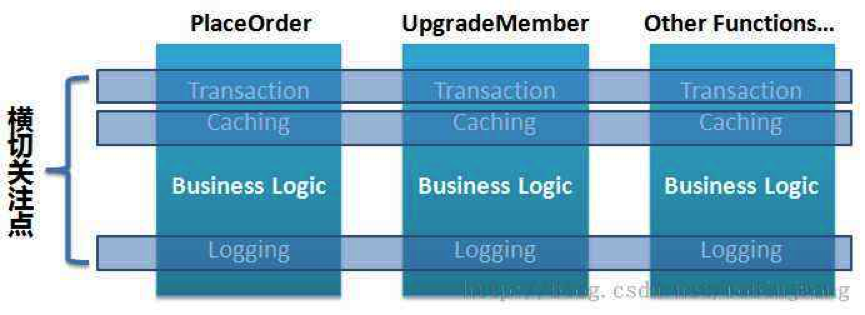
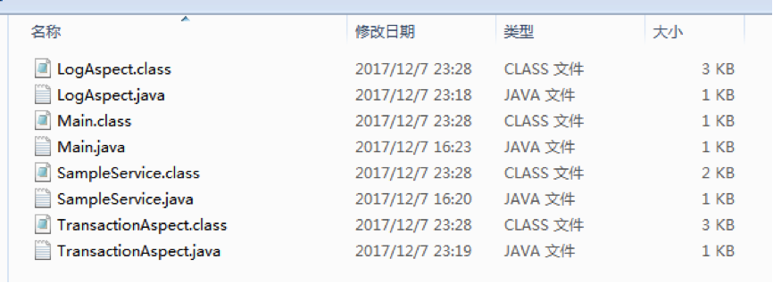
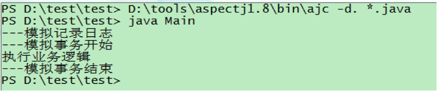
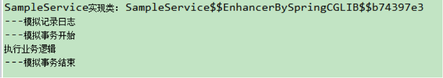
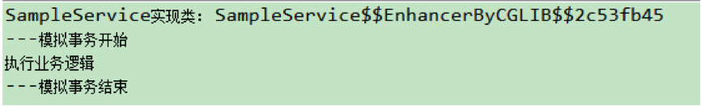
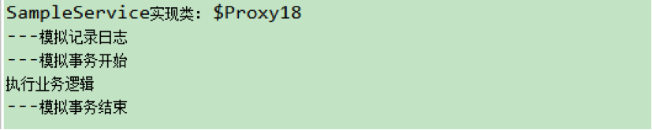
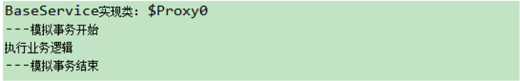

# 切面

# 1 概念解析

**AOP**（Aspect Oriented Programming），即**面向切面编程**，可以说是 OOP（Object Oriented Programming，面向对象编程）的补充和完善。OOP 引入封装、继承、多态等概念来建立一种对象层次结构，用于模拟公共行为的一个集合。不过 OOP 允许开发者定义纵向的关系，但并不适合定义横向的关系，例如日志功能。日志代码往往横向地散布在所有对象层次中，而与它对应的对象的核心功能毫无关系。对于其他类型的代码，如安全性、异常处理和透明的持久化也都是如此。在 OOP 设计中，它导致了大量代码的重复，不利于各个模块的重用。

AOP 技术恰恰相反，它利用一种称为“**横切**”的技术，剖解开封装的对象内部，将那些影响了多个类的公共行为封装到一个可重用模块，并将其命名为“Aspect”，即“**切面**”。所谓切面，简单说就是将那些与业务无关，却为业务模块所共同调用的逻辑或责任封装起来，便于减少系统的重复代码，降低模块之间的耦合度，并有利于未来的可扩展性和可维护性。



使用横切技术，AOP 把软件系统分为两个部分：**核心关注点**和**横切关注点**。业务处理的主要流程是核心关注点，与之关系不大的部分是横切关注点。横切关注点的一个特点是，它们经常发生在核心关注点的多处，而各处基本相似，比如权限认证、日志、事务。AOP 的作用在于分离系统中的各种关注点，将核心关注点和横切关注点分离开来。

首先让我们从一些重要的 AOP 概念和术语开始：

## 1.1 切面（Aspect）

一个关注点的模块化，这个关注点可能会横切多个对象。类是对物体特征的抽象，切面就是对横切关注点的抽象，事务管理是企业级 Java 应用中一个关于横切关注点的很好的例子。

## 1.2 连接点（Joinpoint）

在程序执行过程中某个特定的点，比如某方法调用的时候或者处理异常的时候。因为 **Spring 只支持方法类型的连接点，所以在 Spring 中连接点指的就是被拦截到的方法**，实际上连接点还可以是字段或者构造器。

## 1.3 通知（Advice）

在切面的某个特定的连接点上执行的动作。许多 AOP 框架（包括 Spring）都是**以拦截器（Interceptor）做通知模型**，并维护一个以连接点为中心的拦截器链。

## 1.4 切入点（Pointcut）

匹配连接点的断言。通知和一个切入点表达式关联，并在满足这个切入点的连接点上运行，例如，当执行某个特定名称的方法时。切入点表达式如何和连接点匹配是 AOP 的核心：Spring 默认使用 AspectJ 切入点语法。

## 1.5 引入（Introduction）

用来给一个类型声明额外的方法或属性（也被称为类型间声明（inter-type declaration））。Spring 允许引入新的接口（以及一个对应的实现）到任何被代理的对象。在不修改代码的前提下，引入可以在运行期为类动态地添加一些方法或字段。

## 1.6 目标对象（Target Object）

被一个或者多个切面所通知的对象，也被称作被通知对象。既然 Spring AOP 是通过运行时代理实现的，这个对象永远是一个被代理对象。

## 1.7 AOP 代理（AOP Proxy）

AOP 框架创建的对象，用来实现切面契约（例如通知方法执行等等）。Spring Framework 默认的策略是：目标对象实现了接口时使用 JDK 动态代理，没有实现接口时使用 CGLIB 代理。不过 Spring Boot 2.0 起将 `spring.aop.proxy-target-class` 默认设为 `true`，即无论是否实现接口都优先使用 CGLIB 代理，因此在如今的 Spring Boot 项目中，CGLIB 代理反而更常见。

## 1.8 织入（Weave）

把切面连接到其它的应用程序类型或者对象上，并创建一个被通知对象。根据不同的实现技术，AOP 织入有三种方式：

1. 编译期织入，需要有特殊的 Java 编译器；
2. 类加载期织入，需要有特殊的类加载器（或 Java Agent）；
3. 运行期织入，通过动态代理（实现相同接口或生成子类）为目标对象添加通知。

Spring AOP 采用运行期动态代理织入，而 AspectJ 采用编译期织入和类加载期织入。

## 1.9 举个栗子

**在 Spring AOP 中，所有的方法执行都是 Joinpoint**。而 Pointcut 是一个描述信息，它修饰的是 Joinpoint，通过 Pointcut，我们可以确定哪些 Joinpoint 可以被织入 Advice。

**Advice** 是在 **Joinpoint** 上执行的，而 **Pointcut** 规定了哪些 **Advice** 可以在哪些 **Joinpoint** 上执行。

以上概念比较抽象，不易理解，下面用一个生活中的例子描述 Joinpoint、Pointcut、Advice、Aspect 的作用：

杭州市区发生一起交通事故，肇事者驾车逃逸，据目击者称，肇事车辆是一辆车牌尾号为“110”的黑色轿车，现在警方已在高速公路的各个收费站设卡，拦截可疑车辆。

如果将该事件当做一个 AOP 处理流程，角色解释如下：

- Joinpoint：所有通过收费站的车辆。Joinpoint 是所有可能被织入 Advice 的候选点，在 Spring AOP 中，则可以认为所有方法执行点都是 Joinpoint。在上例中，所有经过收费站的车辆都可能是嫌疑车辆。
- Pointcut：车牌尾号为“110”、车身颜色为黑色。所有的 Joinpoint 都可以织入 Advice，但是我们并不希望在所有方法上都织入 Advice，而 Pointcut 的作用就是提供一组规则来匹配 Joinpoint，将满足规则的 Joinpoint 织入 Advice。在上例中，警方不需要拦截所有车辆，只需要拦截符合特征的部分车辆。
- Advice：拦截嫌疑车辆，审问司机。Advice 是一个动作，即一段 Java 代码，这段 Java 代码是作用于 Pointcut 所限定的那些 Joinpoint 上的。在上例中，“拦截并审问”这个动作只会针对那些“车牌尾号为 110、车身颜色为黑色”的嫌疑车辆而执行。
- Aspect：Pointcut 与 Advice 的组合。因此在这里我们就可以类比：凡是发现车牌尾号为“110”、车身颜色为黑色的车辆都要拦截并审问，这一系列的整体动作可以看做是一个 Aspect。

# 2 AspectJ 引入

**AspectJ** 是 Java 语言的一个 AOP 实现，定义了 AOP 编程中的语法规范，并提供特殊的代码编译器、调试工具等来支持 AspectJ 语法。而 **@AspectJ** 指的是用普通 Java 类加注解来声明切面的风格，由 AspectJ 5 引入，Spring 也采用了这套注解。

在 Spring 中，通过 Java 注解或 XML 配置都可以启用 @AspectJ 支持。

注解方式支持 @AspectJ：

```java
@Configuration
@EnableAspectJAutoProxy
public class AppConfig {

}
```

XML 方式支持 @AspectJ：

```xml
<aop:aspectj-autoproxy/>
```

如果使用 Spring Boot，只需引入 AOP 相关的 starter（Spring Boot 3.x 及之前为 `spring-boot-starter-aop`，Spring Boot 4.0 起改名为 `spring-boot-starter-aspectj`），自动配置会默认开启 @AspectJ 支持，无需再手动添加 `@EnableAspectJAutoProxy`。

下面用 @AspectJ 来模拟客人去饭店吃饭的一个场景。

作为食客，他们应该只关注自己的事情，比如，怎么点菜、怎么吃饭。而点菜后怎么通知后厨，吃完后怎么收拾桌子，不是食客关注的重点，这些动作应该有另外一个角色——服务员来完成。在这个场景中，以 AOP 的视角来看，食客吃饭应该被看作核心关注点，而服务员提供的各种服务应该被看作横切关注点。

食客实现类：

```java
@Service("restaurantCustomer")
public class RestaurantCustomer {
    /* 食客吃饭 */
    public void eat() {
        System.out.println("客人开始吃饭");
        try {
            Thread.sleep(2000);
        } catch (InterruptedException e) {
            e.printStackTrace();
        }
        System.out.println("客人结束吃饭");
    }
}
```

服务员切面实现类：

```java
@Component
@Aspect
public class WaiterAspect {
    /* 该方法是一个 pointcut 标志：表示应用程序执行到 RestaurantCustomer.eat() 方法时织入 advice */
    @Pointcut(value = "execution(* clf.learning.winner.springbase.aspect.RestaurantCustomer.eat())")
    public void eatPointcut() {
    }

    /* 该方法是一个前置通知，在 RestaurantCustomer.eat() 之前执行 */
    @Before(value = "eatPointcut()")
    public void beforeAdvice() {
        System.out.println("---服务员引导客人入座、点菜");
    }

    /* 该方法是一个后置通知，在 RestaurantCustomer.eat() 之后执行 */
    @AfterReturning(value = "eatPointcut()")
    public void afterAdvice() {
        System.out.println("---服务员收拾餐桌");
    }
}
```

`@Aspect` 注解用于标明该类是一个切面实现类。注意 `@Aspect` 本身不会让该类被 Spring 扫描注册，所以还需要加上 `@Component`。

需要注意的是，被 `@Aspect` 标注的类不能作为其他切面的目标对象，因为使用 `@Aspect` 后，这个类就会被排除在自动代理（auto-proxying）机制之外。

当 `RestaurantCustomer.eat()` 执行时，会得到以下的打印结果：


# 3 Aspect 语法

## 3.1 类型匹配

所谓类型匹配就是匹配符合某些要求的类或者接口。语法规则为：

```text
注解? 类的全限定名
```

- 注解：可选，代表类上持有的注解，如 `@Deprecated`；
- 类的全限定名：必填，可以是任何类全限定名。

类型匹配可以使用的通配符：

- `*`：匹配任何数量字符；
- `..`：匹配任何数量字符的重复，如在类型模式中匹配任何数量子包；而在方法参数模式中匹配任何数量参数；
- `+`：匹配指定类型的子类型，仅能作为后缀放在类型模式后边。

例子：

- `java.lang.String`：匹配 `String` 类型；
- `java.*.String`：匹配 `java` 包下的任何一级子包下的 `String` 类型，如匹配 `java.lang.String`，但不匹配 `java.lang.ss.String`；
- `java..*`：匹配 `java` 包及任何子包下的任何类型，如匹配 `java.lang.String`、`java.lang.annotation.Annotation`；
- `java.lang.*ing`：匹配任何 `java.lang` 包下的以 `ing` 结尾的类型；
- `java.lang.Number+`：匹配 `java.lang.Number` 的任何子类型，如匹配 `java.lang.Integer`，也匹配 `java.math.BigInteger`。

## 3.2 方法匹配

语法规则为：

```text
注解? 修饰符? 返回值类型 类型声明? 方法名(参数列表) 异常列表?
```

- 注解：可选，方法上持有的注解，如 `@Deprecated`；
- 修饰符：可选，如 `public`、`protected`；
- 返回值类型：必填，可以是任何类型模式，`*` 表示所有类型；
- 类型声明：可选，可以是任何类型模式；
- 方法名：必填，可以使用 `*` 进行模式匹配；
- 参数列表：`()` 表示方法没有任何参数；`(..)` 表示匹配接受任意个参数的方法；`(..,java.lang.String)` 表示匹配以 `java.lang.String` 类型的参数结束，且其前边可以接受任意个参数的方法；`(java.lang.String,..)` 表示匹配以 `java.lang.String` 类型的参数开始，且其后边可以接受任意个参数的方法；`(*,java.lang.String)` 表示匹配以 `java.lang.String` 类型的参数结束，且其前边接受一个任意类型参数的方法；
- 异常列表：可选，以 `throws 异常全限定名列表` 声明，异常全限定名列表如有多个以 `,` 分隔，如 `throws java.lang.IllegalArgumentException, java.lang.ArrayIndexOutOfBoundsException`。

## 3.3 组合表达式

AspectJ 使用且（`&&`）、或（`||`）、非（`!`）来组合切入点表达式。

在 Schema 风格下，由于在 XML 中使用 `&&` 需要使用转义字符 `&amp;&amp;` 来代替，很不方便，因此 Spring AOP 提供了 `and`、`or`、`not` 来代替 `&&`、`||`、`!`。

# 4 Pointcut 声明

一个 Pointcut 声明由两部分组成：

- 一个方法签名，包括方法名和相关参数；
- 一个切入点表达式，用来指定哪些方法执行是我们感兴趣的，即在哪里可以织入 Advice。

在 @AspectJ 风格的 AOP 中，我们使用一个方法来描述 Pointcut，如上例中：

```java
@Pointcut(value = "execution(* clf.learning.winner.springbase.aspect.RestaurantCustomer.eat())")
public void eatPointcut() {

}
```

`@Pointcut` 注解标明该方法是一个切入点，该方法的返回类型必须为 `void`。

`execution(* clf.learning.winner.springbase.aspect.RestaurantCustomer.eat())` 是一个切入点表达式，切入点表达式由标志符和操作参数组成。`execution` 就是一个标志符，而括号里的 `* clf.learning.winner.springbase.aspect.RestaurantCustomer.eat()` 就是操作参数。

切点表达式也可以在 Advice 声明中直接使用：

```java
@Pointcut(value = "execution(* clf.learning.winner.springbase.aspect.RestaurantCustomer.eat())")
public void eatPointcut() {
    /* 该方法是一个 pointcut 标志：表示应用程序执行到 RestaurantCustomer.eat() 方法时织入 advice */
}

@Before(value = "eatPointcut()")
public void beforeAdvice() {
    System.out.println("---服务员引导客人入座、点菜");
}
```

等同于：

```java
@Before(value = "execution(* clf.learning.winner.springbase.aspect.RestaurantCustomer.eat())")
public void beforeAdvice() {
    System.out.println("---服务员引导客人入座、点菜");
}
```

Spring AOP 支持的切入点指示符有以下几种：

## 4.1 execution

匹配特定的方法执行。

- 任意公共方法的执行：`execution(public * *(..))`
- 任意公共的，只有一个参数且类型为 `java.util.Date` 的方法执行：`execution(public * *(java.util.Date))`
- 任何一个名字以“set”开始的方法的执行：`execution(* set*(..))`
- `AccountService` 接口定义的任意方法的执行：`execution(* com.xyz.service.AccountService.*(..))`
- 在 `service` 包中定义的任意方法的执行：`execution(* com.xyz.service.*.*(..))`
- 在 `service` 包或其子包中定义的任意方法的执行：`execution(* com.xyz.service..*.*(..))`

## 4.2 within

匹配特定类型内的方法执行，常用于限定包或类。

- 在 `service` 包中的任意方法执行：`within(com.xyz.service.*)`
- 在 `service` 包或其子包中的任意方法执行：`within(com.xyz.service..*)`

## 4.3 this

匹配代理对象是特定类型的方法执行，**不支持通配符**。

- 代理对象实现了 `AccountService` 接口的任意方法执行：`this(com.xyz.service.AccountService)`

该指示符还可以将代理对象传入到 Advice 方法当中，如：

```java
@Before("before() && this(proxy)")
public void beforeAdvice(JoinPoint point, Object proxy) {

}
```

## 4.4 target

匹配目标对象是特定类型的方法执行，**不支持通配符**。

- 目标对象实现了 `AccountService` 接口的任意方法执行：`target(com.xyz.service.AccountService)`

该指示符还可以将目标对象传入到 Advice 方法当中，如：

```java
@Before("before() && target(target)")
public void beforeAdvice(JoinPoint point, Object target) {

}
```

## 4.5 args

匹配参数是指定类型的方法执行。

- 任何一个只接受一个参数，并且运行时所传入的参数是 `Serializable` 接口的方法执行：`args(java.io.Serializable)`

该指示符还可以将目标方法的入参传入到 Advice 方法当中。

```java
// 匹配只有一个参数且类型为 String 的方法执行
@Before(value = "args(name)")
public void doSomething(String name) {

}

// 匹配第一个参数为 String 类型的方法执行
@Before(value = "args(name, ..)")
public void doSomething(String name) {

}

// 匹配第二个参数为 String 类型的方法执行
@Before(value = "args(*, name, ..)")
public void doSomething(String name) {

}
```

注意，该标识符是匹配运行时传入的参数类型，不是匹配方法签名的参数类型；参数类型列表中的参数必须是类型全限定名，**不支持通配符**；`args` 属于动态切入点，这种切入点开销比较大，非特殊情况最好不要使用。

## 4.6 @target

匹配目标对象的类上持有特定注解的方法执行，注解的保留策略必须为 `RUNTIME`，**不支持通配符**。

- 目标对象的类上标有 `@Transactional` 注解的任意方法执行：`@target(org.springframework.transaction.annotation.Transactional)`

需要注意的是，`@target` 需要在运行时才能判断目标对象的类型，单独使用时 Spring 会尝试为容器中所有 Bean 创建代理，遇到 `final` 类等无法代理的 Bean 时会导致启动失败，因此通常与 `within` 组合使用以缩小范围。

## 4.7 @within

匹配声明方法的类型上持有特定注解的方法执行，用法与 `@target` 类似。二者的区别在于：`@within` 判断的是方法声明所在的类型，`@target` 判断的是运行时目标对象的类型。例如注解标在父类上，子类继承且未重写父类方法时，`@within` 能匹配从父类继承来的方法，而 `@target` 只有在子类本身持有该注解时才会匹配。

## 4.8 @args

匹配运行时入参持有特定注解的方法执行，**不支持通配符**。

- 任何一个只接受一个参数，并且运行时所传入的参数类型具有 `@Classified` 注解的方法执行：`@args(com.xyz.security.Classified)`

## 4.9 @annotation

匹配持有特定注解（方法级别）的方法执行，**不支持通配符**。

- 任何一个被 `@Transactional` 注解的方法执行：`@annotation(org.springframework.transaction.annotation.Transactional)`

## 4.10 bean

Spring AOP 扩展的，在 AspectJ 中无相应概念，匹配 Bean 名字满足特定要求的方法执行。

- 匹配以“Service”或“ServiceImpl”结尾的 Bean：`bean(*Service) || bean(*ServiceImpl)`

# 5 Advice 声明

Advice 是和一个 Pointcut 表达式关联在一起的，并且在切入点匹配的方法执行之前或者之后或者前后运行。Pointcut 表达式可以是简单的一个 Pointcut 名字的引用，也可以是完整的 Pointcut 表达式。

Spring AOP 支持五种通知模型：**前置通知**（Before advice）、**后置通知**（After returning advice）、**异常通知**（After throwing advice）、**最终通知**（After (finally) advice）、**环绕通知**（Around Advice）。

## 5.1 前置通知

在某连接点之前执行的通知，但这个通知不能阻止执行流程继续到连接点（除非它抛出一个异常）。

使用 `@Before` 注解声明前置通知：

```java
// 将 pointcut 和 advice 同时定义
@Before("within(com.xyz.service..*)")
public void doSomething() {

}
```

## 5.2 后置通知

在某连接点正常完成后执行的通知，例如，一个方法没有抛出任何异常，正常返回。

使用 `@AfterReturning` 注解来声明，`returning` 属性指定的参数名用于绑定返回值：

```java
@AfterReturning(pointcut = "within(com.xyz.service..*)", returning = "retVal")
public void doSomething(Object retVal) {

}
```

## 5.3 异常通知

抛出异常通知在一个方法抛出异常后执行。

使用 `@AfterThrowing` 注解来声明：

```java
@AfterThrowing(pointcut = "com.xyz.CommonPointcuts.dataAccessOperation()", throwing = "ex")
public void doRecoveryActions(DataAccessException ex) {
    // ...
}
```

`throwing` 属性指定的参数名用于绑定异常，而通知方法中该参数的类型同时限制了匹配的异常类型，上例中只有抛出 `DataAccessException` 时才会执行。

## 5.4 最终通知

当某连接点退出的时候执行的通知，类似 `finally` 代码块，不论是正常返回还是异常退出都会执行。

```java
@After("com.xyz.CommonPointcuts.dataAccessOperation()")
public void doReleaseLock() {
    // ...
}
```

## 5.5 环绕通知

包围一个连接点的通知，如方法调用。这是最强大的一种通知类型。它使得通知有机会在一个方法执行之前和执行之后运行，而且它可以决定这个方法在什么时候执行，如何执行，甚至是否执行。

环绕通知使用 `@Around` 注解来声明。**通知的第一个参数必须是 `ProceedingJoinPoint` 类型**。在通知体内，调用 `ProceedingJoinPoint` 的 `proceed()` 方法使得连接点方法执行。如果不调用 `proceed()` 方法，连接点方法则不会执行。

```java
@Around("com.xyz.CommonPointcuts.dataAccessOperation()")
public Object doAroundAccessCheck(ProceedingJoinPoint pjp) throws Throwable {
    StopWatch stopWatch = new StopWatch();
    stopWatch.start();

    // 开始
    Object retVal = pjp.proceed();
    stopWatch.stop();

    // 结束
    System.out.println("invoke method: " + pjp.getSignature().getName() + ", elapsed time: " + stopWatch.getTotalTimeMillis());

    return retVal;
}
```

## 5.6 通知参数的获取

有很多场景下，我们需要获取连接点的方法参数，传递到 Advice 中以作判断、处理等。

通过切入点表达式可以将相应的参数自动传递给通知方法，例如上文中将返回值和异常传递给通知方法，以及通过切入点标识符 `args` 传递运行时参数。

需要注意的是，**在 Spring AOP 中，`execution` 和 `bean` 指示符不支持自动传递参数**。不过，可以利用组合表达式达到目的：

```java
@Before(value = "execution(* test(*)) && args(param)", argNames = "param")
public void before1(String param) {
    System.out.println("param:" + param);
}
```

首先 `execution(* test(*))` 匹配任何方法名为 `test`，且有一个任何类型的参数；然后 `args(param)` 将查找通知方法上同名的参数，并在方法执行时（运行时）判断传入的参数是否为该同名参数的类型，即 `java.lang.String`；如果匹配，将把该被通知参数传递给通知方法上的同名参数。

`argNames` 用于指定参数名称，避免参数绑定的二义性，如：

```java
@Before(value = "args(param) && target(bean) && @annotation(secure)", argNames = "jp,param,bean,secure")
public void before(JoinPoint jp, String param, IPointcutService bean, Secure secure) {
    // ...
}
```

如果第一个参数类型是 `JoinPoint`、`ProceedingJoinPoint` 或 `JoinPoint.StaticPart` 类型，可以从 `argNames` 属性中省略该参数名（写上也对），这些类型对象会自动传入，但必须作为第一个参数：

```java
@Before(value = "args(param)", argNames = "param")
public void before(JoinPoint jp, String param) {
    System.out.println("param:" + param);
}
```

不写 `argNames` 时，Spring 需要通过反射获取通知方法的参数名。Spring 6.1 起不再支持从字节码调试信息（局部变量表）中解析参数名，因此需要使用 `-parameters` 参数编译（Spring Boot 的 Maven/Gradle 插件默认已开启），否则参数绑定可能失败，此时显式指定 `argNames` 是最稳妥的做法。

此外，Spring AOP 提供使用 `org.aspectj.lang.JoinPoint` 类型获取连接点数据，任何通知方法的第一个参数都可以是 `JoinPoint`（环绕通知是 `ProceedingJoinPoint`，它是 `JoinPoint` 的子接口），当然第一个参数位置也可以是 `JoinPoint.StaticPart` 类型，这个只返回连接点的静态部分。

- **JoinPoint**：提供访问当前被通知方法的目标对象、代理对象、方法参数等数据；
- **ProceedingJoinPoint**：用于环绕通知，使用 `proceed()` 方法来执行目标方法；
- **JoinPoint.StaticPart**：提供访问连接点的静态部分，如被通知方法签名、连接点类型等。

```java
@Before("execution(* com.abc.service.*.many*(..))")
public void permissionCheck(JoinPoint point) {
    System.out.println("@Before：模拟权限检查...");
    System.out.println("@Before：目标方法为：" + point.getSignature().getDeclaringTypeName() +
            "." + point.getSignature().getName());
    System.out.println("@Before：参数为：" + Arrays.toString(point.getArgs()));
    System.out.println("@Before：被织入的目标对象为：" + point.getTarget());
}

@Around("execution(* com.abc.service.*.many*(..))")
public Object process(ProceedingJoinPoint point) throws Throwable {
    System.out.println("@Around：执行目标方法之前...");

    /* 访问目标方法的参数 */
    Object[] args = point.getArgs();
    if (args != null && args.length > 0 && args[0].getClass() == String.class) {
        args[0] = "改变后的参数1";
    }

    /* 用改变后的参数执行目标方法 */
    Object returnValue = point.proceed(args);
    System.out.println("@Around：执行目标方法之后...");
    System.out.println("@Around：被织入的目标对象为：" + point.getTarget());

    return "原返回值：" + returnValue + "，这是返回结果的后缀";
}
```

# 6 实现原理

有人可能会奇怪，Spring 不是有自己原生的 AOP 组件吗，为什么还要引入 AspectJ 呢？

早期（Spring 1.x）的 Spring AOP 需要切面实现 `MethodBeforeAdvice`、`MethodInterceptor` 等接口，再通过 `ProxyFactoryBean` 等 XML 配置组装代理，使用繁琐、侵入性强，与 Spring 一直秉承的无侵入、低耦合原则不太相符。而 AspectJ 的切入点表达式语法表达能力强，已经是 Java 领域事实上的 AOP 标准。

因此 Spring 2.0 开始支持 AspectJ 的注解和切入点表达式，也就是我们后来所说的基于纯 POJO 的 AOP。但要注意，Spring 只是借用了 AspectJ 的注解和切入点表达式的解析、匹配能力（所以需要依赖 `aspectjweaver` 包），织入方式仍然是自己基于代理的实现。

二者不同的是，Spring AOP 采用的是**动态织入**，利用其强大的动态代理功能，在程序运行期间将 Advice 织入到 Joinpoint；而 AspectJ 采用的是**静态织入**，它有专门的编译器，将 Advice 以字节码的形式织入到 class 文件中。

## 6.1 AspectJ 与静态织入

AspectJ 的下载、安装很简单，在此不再赘述。

安装目录的 `bin` 文件夹下包含 AspectJ 支持的命令：


其中 `ajc` 命令最常用，它的作用类似于 `javac`，用于对普通 Java 类进行编译时增强。

事务管理与日志记录是开发中经常涉及的功能，而且很适合通过切面来实现。下面通过一个简单的例子来模拟这两个流程。

`SampleService` 用于模拟一个业务组件：

```java
public class SampleService {
    public void doBusiness() {
        System.out.println("执行业务逻辑");
    }
}

// 日志切面
public aspect LogAspect {
    before(): execution(void *.doBusiness()) {
        System.out.println("---模拟记录日志");
    }
}

// 事务切面
public aspect TransactionAspect {
    void around(): execution(void *.doBusiness()) {
        System.out.println("---模拟事务开始");
        proceed(); // AspectJ 的回调函数
        System.out.println("---模拟事务结束");
    }
}

// 启动类
public class Main {
    public static void main(String[] args) {
        SampleService sampleService = new SampleService();
        sampleService.doBusiness();
    }
}
```

切面类当中，用到了 AspectJ 的特有语法，实际上跟切入点表达式没什么两样。日志用到的是前置通知，事务用到的是环绕通知，两个通知都会织入到任何名为 `doBusiness()` 的方法当中。

将这四个类放在一个文件夹下面，运行命令：

```bash
ajc -d . *.java
```

我们可以把 `ajc` 理解成 `javac` 命令，都用于编译 Java 程序，区别是 `ajc` 命令可识别 AspectJ 的语法。

`ajc` 命令会将以上四个类编译成 `.class` 文件：



此时，用 `java Main` 命令启动程序：



可见，日志记录与事务管理已经织入到 `SampleService` 当中了。

使用反编译工具查看 `SampleService.class`、`TransactionAspect.class`、`LogAspect.class` 三个文件，一探究竟：

```java
import java.io.PrintStream;
import org.aspectj.runtime.internal.AroundClosure;

public class SampleService {

    public void doBusiness() { // 该方法只是保留了方法名，内部实现已经被 AspectJ 改造
        LogAspect.aspectOf().ajc$before$LogAspect$1$a18068bd(); // 执行日志切面逻辑
        doBusiness_aroundBody1$advice(this, TransactionAspect.aspectOf(), null);
    }

    // 原来的 doBusiness() 逻辑被移到了这个方法当中
    private static final void doBusiness_aroundBody0(SampleService ajc$this) {
        System.out.println("执行业务逻辑");
    }

    private static final void doBusiness_aroundBody1$advice(SampleService ajc$this,
            TransactionAspect ajc$aspectInstance, AroundClosure ajc$aroundClosure) {
        System.out.println("---模拟事务开始");
        AroundClosure localAroundClosure = ajc$aroundClosure;
        doBusiness_aroundBody0(ajc$this); // 执行核心业务逻辑，语句前后加入了 TransactionAspect 的切面代码
        System.out.println("---模拟事务结束");
    }
}

import java.io.PrintStream;
import org.aspectj.lang.NoAspectBoundException;
import org.aspectj.runtime.internal.AroundClosure;

public class TransactionAspect {

    private static Throwable ajc$initFailureCause;
    public static final TransactionAspect ajc$perSingletonInstance;

    static {
        try {
            ajc$postClinit(); // 事务切面类在静态代码块中被初始化，单例模式
        } catch (Throwable localThrowable) {
            ajc$initFailureCause = localThrowable;
        }
    }

    public void ajc$around$TransactionAspect$1$a18068bd(AroundClosure ajc$aroundClosure) {
        System.out.println("---模拟事务开始");
        ajc$around$TransactionAspect$1$a18068bdproceed(ajc$aroundClosure); // 调用目标方法
        System.out.println("---模拟事务结束");
    }

    static void ajc$around$TransactionAspect$1$a18068bdproceed(AroundClosure this) throws Throwable {

    }

    public static TransactionAspect aspectOf() { // 获取单例
        if (ajc$perSingletonInstance == null)
            throw new NoAspectBoundException("TransactionAspect", ajc$initFailureCause);
        return ajc$perSingletonInstance;
    }

    public static boolean hasAspect() {
        return (ajc$perSingletonInstance != null);
    }

    private static void ajc$postClinit() {
        ajc$perSingletonInstance = new TransactionAspect();
    }
}

import java.io.PrintStream;
import org.aspectj.lang.NoAspectBoundException;

public class LogAspect {

    private static Throwable ajc$initFailureCause;
    public static final LogAspect ajc$perSingletonInstance;

    static {
        try {
            ajc$postClinit(); // 日志切面类在静态代码块中被初始化，单例模式
        } catch (Throwable localThrowable) {
            ajc$initFailureCause = localThrowable;
        }
    }

    public void ajc$before$LogAspect$1$a18068bd() { // 执行切面逻辑
        System.out.println("---模拟记录日志");
    }

    public static LogAspect aspectOf() { // 获取单例
        if (ajc$perSingletonInstance == null)
            throw new NoAspectBoundException("LogAspect", ajc$initFailureCause);
        return ajc$perSingletonInstance;
    }

    public static boolean hasAspect() {
        return (ajc$perSingletonInstance != null);
    }

    private static void ajc$postClinit() {
        ajc$perSingletonInstance = new LogAspect();
    }
}
```

不出所料，AspectJ 的编译器果然对代码动了手脚，相当于把 `TransactionAspect` 与 `LogAspect` 的代码整合到了 `SampleService` 当中，这就是所谓的静态织入。如此一来，虚拟机加载 `SampleService.class` 时，加载的就是改造后的 class，运行时调用该服务，切面逻辑自然包括其中。

实际项目中一般不会手动调用 `ajc`，而是通过 Maven/Gradle 的 AspectJ 插件在构建时织入；或者使用加载期织入（LTW，Load-Time Weaving）：启动时添加 `-javaagent:aspectjweaver.jar`，由 Java Agent 在类加载时修改字节码，无需特殊编译。

与 AspectJ 相对的还有另外一种 AOP 框架，它们不需要在编译时对目标类进行增强，而是运行时生成目标类的代理类，该代理类要么与目标类实现相同的接口，要么是目标类的子类——总之，代理类的实例可作为目标类的实例来使用。一般来说，编译时增强的 AOP 框架在性能上更有优势：切面代码直接写进了目标类，调用时没有代理转发和拦截器链的开销，而运行时增强的 AOP 框架需要在启动时生成代理类，每次调用还要经过代理对象。

## 6.2 Spring AOP 与动态织入

与 AspectJ 相同的是，Spring AOP 同样需要对目标类进行增强，也就是生成新的 AOP 代理类；与 AspectJ 不同的是，Spring AOP 无需使用任何特殊命令对 Java 源代码进行编译，它采用运行时动态地、在内存中临时生成“代理类”的方式来生成 AOP 代理。

Spring 允许使用 AspectJ Annotation 用于定义切面（Aspect）、切入点（Pointcut）和通知（Advice），Spring 框架则可识别并根据这些 Annotation 来生成 AOP 代理。Spring 只是使用了和 AspectJ 一样的注解，但并没有使用 AspectJ 的编译器或者织入器（Weaver），底层依然使用的是 Spring AOP，依然是在运行时动态生成 AOP 代理。

简单地说，Spring 依然采用运行时生成动态代理的方式来增强目标对象，所以它不需要增加额外的编译，也不需要 AspectJ 的织入器支持；而 AspectJ 采用编译时增强，所以 AspectJ 需要使用自己的编译器来编译 Java 文件，还需要织入器。

在 Spring 容器中对 `SampleService` 织入日志与事务管理逻辑，代码：

```java
import org.springframework.stereotype.Service;

// 核心业务类
@Service("sampleService")
public class SampleService {

    public void doBusiness() {
        System.out.println("执行业务逻辑");
    }
}

import org.aspectj.lang.annotation.Aspect;
import org.aspectj.lang.annotation.Before;
import org.springframework.stereotype.Component;

// 日志切面
@Component
@Aspect
public class LogAspect {

    @Before(value = "execution(void *.doBusiness())")
    public void log() {
        System.out.println("---模拟记录日志");
    }
}

import org.aspectj.lang.ProceedingJoinPoint;
import org.aspectj.lang.annotation.Around;
import org.aspectj.lang.annotation.Aspect;
import org.springframework.stereotype.Component;

// 事务管理切面
@Component
@Aspect
public class TransactionAspect {

    @Around(value = "execution(void *.doBusiness())")
    public void doTransaction(ProceedingJoinPoint pjp) throws Throwable {
        System.out.println("---模拟事务开始");
        pjp.proceed();
        System.out.println("---模拟事务结束");
    }
}

// 启动类
@ComponentScan(basePackages = { "clf.learning.winner.springbase" })
@EnableAspectJAutoProxy
public class SpringBaseApp {

    public static void main(String[] args) throws Exception {
        ApplicationContext context = new AnnotationConfigApplicationContext(SpringBaseApp.class);
        SampleService sampleService = context.getBean(SampleService.class);
        System.out.println("SampleService实现类： " + sampleService.getClass().getSimpleName());
        sampleService.doBusiness();
    }
}
```

运行程序，打印结果如下：



可见，虽然调用的是 `SampleService` 类的 `doBusiness()` 方法，但实际执行操作的却是另外一个名为 `SampleService$$EnhancerBySpringCGLIB$$b74397e3` 的类，这个类也就是 Spring AOP 动态生成的 AOP 代理类，从类名可以看出是由 CGLIB 来生成的。Spring 6.0 起，CGLIB 代理类的命名改为固定格式的 `SampleService$$SpringCGLIB$$0`，便于 AOT 编译和 GraalVM 原生镜像提前生成代理类。与 AspectJ 的静态织入不同，Spring AOP 的动态织入过程不会对 `SampleService.class` 字节码做任何改动，而是将 CGLIB 生成的动态代理类置于内存当中。

### 6.2.1 CGLIB 动态代理

**CGLIB**（Code Generation Library）底层使用了 **ASM**（一个短小精悍的字节码操作框架）来操作字节码生成新的类。除了 CGLIB 库外，脚本语言（如 Groovy 和 BeanShell）也使用 ASM 生成字节码。

下面通过 CGLIB 来实现对 `SampleService` 的动态代理，模拟一下 Spring AOP 的底层实现。

```java
import java.lang.reflect.Method;
import net.sf.cglib.proxy.Enhancer;
import net.sf.cglib.proxy.MethodInterceptor;
import net.sf.cglib.proxy.MethodProxy;

public class TransactionInterceptor implements MethodInterceptor {

    @Override
    public Object intercept(Object obj, Method method, Object[] args, MethodProxy proxy) throws Throwable {
        // 入参分别代表：动态代理对象、被拦截的方法、方法入参、代理方法对象
        System.out.println("---模拟事务开始");
        Object result = proxy.invokeSuper(obj, args); // 调用被代理对象的方法
        System.out.println("---模拟事务结束");
        return result;
    }

    public static void main(String[] args) {
        Enhancer enhancer = new Enhancer();
        enhancer.setSuperclass(SampleService.class); // 设置被代理对象
        enhancer.setCallback(new TransactionInterceptor()); // 设置方法拦截器，等同于 AOP 中的 Advice
        SampleService sampleService = (SampleService) enhancer.create(); // 生成动态代理
        sampleService.doBusiness();
    }
}
```

打印结果如下：



从上面输出结果来看，CGLIB 生成的代理完全可以作为 `SampleService` 对象来使用，这个 CGLIB 代理其实就是 Spring AOP 所生成的 AOP 代理。

代理对象的生成过程由 `Enhancer` 类实现，大概步骤如下：

- 生成代理类 Class 的二进制字节码；
- 通过类加载器定义（`defineClass`）该字节码，生成 Class 对象；
- 通过反射机制获取构造方法，并初始化代理类对象。

这就是 Spring AOP 的根本所在：Spring AOP 就是通过 CGLIB 来动态地生成代理对象，这个代理对象就是所谓的 AOP 代理，而 AOP 代理的方法则通过在目标对象的切入点动态地织入增强处理，从而完成了对目标方法的增强。

需要注意的是，上例中的 `net.sf.cglib` 是原版 CGLIB，该项目已停止维护，官方说明其在 JDK 17 及以上版本中无法正常工作，建议迁移到 ByteBuddy。Spring 并不依赖原版 CGLIB，而是自 3.2 起将 CGLIB 重新打包进了 `spring-core`（包名为 `org.springframework.cglib`），并由 Spring 团队自行维护，因此在 Spring 项目中无需额外引入 CGLIB 依赖。

### 6.2.2 JDK 动态代理

将上面程序稍作修改，让业务逻辑类 `SampleService` 实现任意一个接口，看看有什么变化：

```java
public interface BaseService {
    void doBusiness();
}

import org.springframework.stereotype.Service;

@Service("sampleService")
public class SampleService implements BaseService {

    @Override
    public void doBusiness() {
        System.out.println("执行业务逻辑");
    }
}
```

运行程序：



可见，此时的 AOP 代理并不是由 CGLIB 生成的，而是由 JDK 动态代理生成的。注意，这是纯 Spring Framework 环境下的结果；在 Spring Boot 2.0 及以上版本中，由于默认 `spring.aop.proxy-target-class=true`，即使实现了接口也仍然会使用 CGLIB 代理，如需使用 JDK 动态代理，可将该属性设为 `false`。

下面通过 JDK 自带的工具来实现对 `SampleService` 的动态代理。

```java
import java.lang.reflect.InvocationHandler;
import java.lang.reflect.Method;
import java.lang.reflect.Proxy;

public class TransactionHandler implements InvocationHandler {

    private Object target; // 被代理的对象

    public TransactionHandler(Object target) {
        this.target = target;
    }

    @Override
    public Object invoke(Object proxy, Method method, Object[] args) throws Throwable {
        // 入参分别代表：动态代理对象、被拦截的方法、方法入参
        System.out.println("---模拟事务开始");
        Object result = method.invoke(target, args); // 调用被代理对象的方法
        System.out.println("---模拟事务结束");
        return result;
    }

    public static void main(String[] args) {
        BaseService sampleService = new SampleService();

        TransactionHandler transactionHandler = new TransactionHandler(sampleService);
        ClassLoader loader = sampleService.getClass().getClassLoader();
        Class<?>[] interfaces = sampleService.getClass().getInterfaces();

        // 实例化代理类
        BaseService proxyService = (BaseService) Proxy.newProxyInstance(loader, interfaces, transactionHandler);
        System.out.println("BaseService实现类： " + proxyService.getClass().getSimpleName());
        proxyService.doBusiness();
    }
}
```

打印结果如下：



`InvocationHandler` 是 JDK 动态代理的核心接口，可以看作 CGLIB 低配版的 `MethodInterceptor`。`Proxy` 是 JDK 提供的静态工具类，功能类似于 CGLIB 的 `Enhancer`，用于实例化代理类。

`Proxy.newProxyInstance` 方法会做如下几件事：

1. 根据传入的第二个参数 `interfaces` 动态生成一个类，实现 `interfaces` 中的接口，该例中即 `BaseService` 接口的 `doBusiness` 方法。并且继承了 `Proxy` 类，重写了 `hashCode`、`equals`、`toString` 三个方法；
2. 通过传入的第一个参数 `ClassLoader` 将刚生成的类（即 `$Proxy0` 类）加载到 JVM 中；
3. 利用第三个参数，调用 `$Proxy0` 的 `$Proxy0(InvocationHandler)` 构造函数创建 `$Proxy0` 的对象。代理类在静态初始化时会通过反射获取各接口方法的 `Method` 对象，调用代理方法时，再将对应的 `Method` 对象和参数一起传给 `InvocationHandler.invoke`。

### 6.2.3 两种动态代理的区别

JDK 动态代理与 CGLIB 动态代理有什么区别呢？

- JDK 动态代理只能对实现了接口的类生成代理，而 CGLIB 则没有这项要求；
- JDK 动态代理是通过接口中的方法名，在动态生成的代理类中调用业务实现类的同名方法；
- CGLIB 动态代理是通过继承业务类，生成的动态代理类是业务类的子类，通过重写业务方法进行代理。但因为采用的是继承，所以 CGLIB 不能对 `final` 修饰的类或方法进行代理，`private` 方法同样无法被增强。

Spring Framework 对 AOP 代理类的处理原则是：如果目标对象的实现类实现了接口，Spring AOP 将会采用 JDK 动态代理来生成 AOP 代理类；如果目标对象的实现类没有实现接口，Spring AOP 将会采用 CGLIB 来生成 AOP 代理类。也可以通过 `@EnableAspectJAutoProxy(proxyTargetClass = true)` 强制使用 CGLIB。而 Spring Boot 2.0 起默认使用 CGLIB，这样做可以避免一个常见问题：使用 JDK 动态代理时，代理对象只实现了接口，如果按实现类类型注入（如 `@Autowired SampleService`）就会因类型不匹配而失败。

## 6.3 自调用失效

由于 Spring AOP 基于代理实现，只有通过代理对象调用的方法才会被拦截。如果在同一个类中，一个方法通过 `this` 调用另一个被增强的方法，调用不会经过代理，切面逻辑也就不会生效，这是 `@Transactional`、`@Async`、`@Cacheable` 等注解“失效”最常见的原因：

```java
@Service
public class OrderService {

    public void createOrder() {
        // 通过 this 调用，不经过代理，saveOrder 上的事务不会生效
        this.saveOrder();
    }

    @Transactional
    public void saveOrder() {
        // ...
    }
}
```

常见的解决办法有：

- 将被调用的方法拆分到另一个 Bean 中，通过注入的 Bean 调用（官方推荐）；
- 将当前 Bean 自身注入进来（自注入），通过注入的引用而不是 `this` 调用；
- 开启 `@EnableAspectJAutoProxy(exposeProxy = true)` 后，通过 `AopContext.currentProxy()` 获取当前代理对象再调用，但这会让业务代码与 Spring AOP 耦合，不推荐；
- 改用 AspectJ 的编译期或加载期织入，切面代码直接写入目标类，不存在代理问题。

# 7 新版本中的 Spring AOP

与早期版本相比，近几年 Spring AOP 的主要变化如下：

| 版本               | 变化                                                         |
| ------------------ | ------------------------------------------------------------ |
| Spring Boot 2.0    | `spring.aop.proxy-target-class` 默认为 `true`，默认使用 CGLIB 代理 |
| Spring 6.0         | 最低要求 JDK 17；CGLIB 代理类命名改为 `$$SpringCGLIB$$0` 格式，支持 AOT 编译和 GraalVM 原生镜像提前生成代理类 |
| Spring 6.1         | 不再从字节码局部变量表解析参数名，切面参数绑定需要 `-parameters` 编译参数或显式指定 `argNames` |
| Spring Boot 4.0    | `spring-boot-starter-aop` 改名为 `spring-boot-starter-aspectj` |
| Spring 7.0         | 新增 `@Proxyable` 注解，可以针对单个 Bean 指定使用接口代理（`INTERFACES`）还是类代理（`TARGET_CLASS`），覆盖全局默认设置 |

此外，原版 CGLIB 已停止维护，对于需要自己编写字节码增强逻辑的场景，ByteBuddy 已成为更主流的选择，Mockito、Hibernate 等框架都基于它实现动态代理。

# 8 总结

- AOP 将日志、事务、权限等横切关注点从业务逻辑中分离出来，核心概念包括切面（Aspect）、连接点（Joinpoint）、切入点（Pointcut）、通知（Advice）和织入（Weave）。
- Spring AOP 借用了 AspectJ 的注解和切入点表达式，常用的切入点指示符有 `execution`、`within`、`@annotation`、`args`、`bean` 等，通知分为前置、后置、异常、最终和环绕五种。
- AspectJ 采用静态织入，在编译期或类加载期直接修改字节码，功能更完整、运行时开销更小；Spring AOP 采用动态织入，运行时通过 JDK 动态代理或 CGLIB 生成代理对象，使用简单，但只支持方法级连接点。
- JDK 动态代理要求目标类实现接口；CGLIB 通过生成子类实现代理，无法代理 `final` 类和 `final`、`private` 方法。Spring Framework 默认按是否实现接口选择代理方式，Spring Boot 2.0 起默认使用 CGLIB。
- 由于基于代理，Spring AOP 存在自调用失效的问题，同类方法间通过 `this` 调用时切面不会生效。
