# NIO

# 1 Buffer

## 1.1 概述

Java NIO 中的 `Buffer` 用于和 NIO 通道进行交互，**是将数据移进移出通道的唯一方式**。缓冲区本质上是一块可以写入数据，然后可以从中读取数据的内存。这块内存被包装成 NIO `Buffer` 对象，并提供了一组方法，用来方便地访问该块内存。

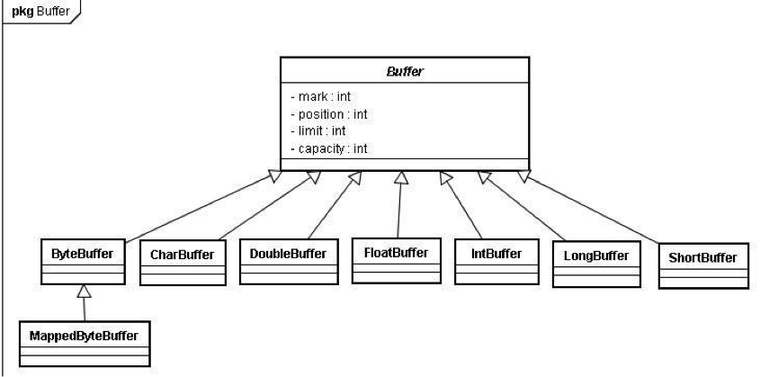

Java 的 NIO 使用 `ByteBuffer`、`CharBuffer`、`DoubleBuffer`、`FloatBuffer`、`IntBuffer`、`LongBuffer`、`ShortBuffer` 覆盖了能通过 IO 发送的基本数据类型（`boolean` 除外），还有个 `MappedByteBuffer` 用于表示内存映射文件。

## 1.2 实现原理

所有继承自 `java.nio.Buffer` 的缓冲区都有 4 个属性：`capacity`、`limit`、`position`、`mark`，并遵循：

```text
mark <= position <= limit <= capacity
```

- `capacity`：可以容纳的最大数据量，创建时被设定并且不能改变
- `limit`：能写入或者读取的数据上限
- `position`：当前正读到或者写到的位置，会随着读写操作而自增
- `mark`：通过 `mark()` 记录下的 `position`，之后可以用 `reset()` 让 `position` 回到这里；未设置时为 -1

再来看看 `Buffer` 的操作方法，与上面列举的索引密切相关。

分配一个容量为 12 的缓冲区，初始化状态：


通过 `put()` 方法载入数据或从 `Channel` 中读取数据：

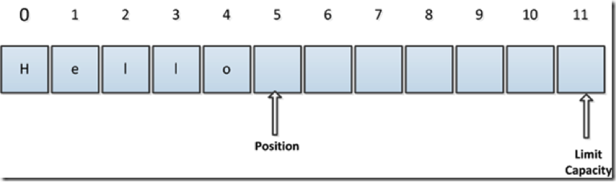

在上图的基础上进行 `flip()` 操作，由写模式转入读模式，则会进入下面的状态：


在上图基础上，进行 `get()` 操作或向 `Channel` 中写入数据，`position` 会后移，直到 `position = limit`，如下图：

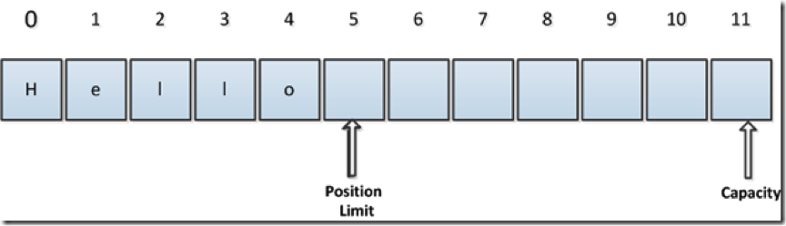

在上图基础上，进行 `rewind()` 的操作，`position` 为 0，`limit` 不变，如下图，如需多次读取缓冲区数据，可以在两次读取之间使用 `rewind()`。

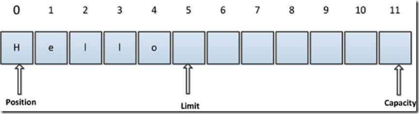

假设新的状态如下图：

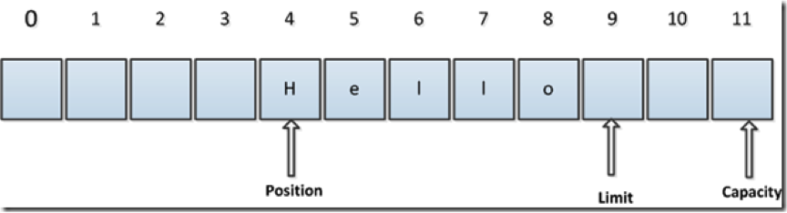

在新状态下进行 `compact()` 操作，进入下面状态：

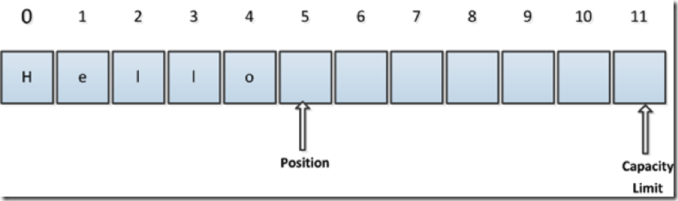

在新状态下进行 `clear()` 操作，返回到初始状态，即 `position = 0`，`limit = capacity`：

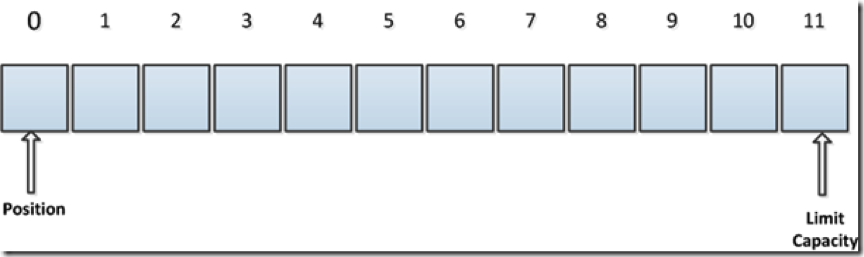

除此之外，`Buffer` 还有两个特殊的方法：`mark()` 与 `reset()` 方法，通过调用 `mark()` 方法，可以标记 `Buffer` 中的一个特定 `position`，之后可以通过调用 `reset()` 方法恢复到这个 `position`。

## 1.3 使用方法

针对 `Buffer` 的操作有两种模式：**读模式**与**写模式**。

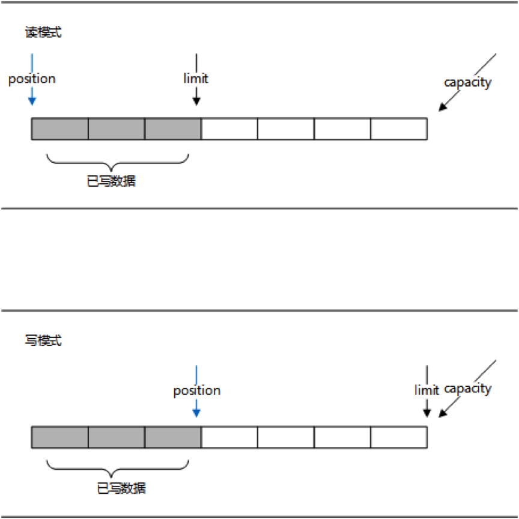

读模式的目标区域为数据填充区，`position` 游标在数据填充区移动，`limit` 为已写数据的边界；写模式的目标区域为数据空白区，`position` 游标在数据空白区移动，`limit` 为 `Buffer` 的容量边界。

当向 `Buffer` 写入数据时，`Buffer` 会记录下写了多少数据。一旦要读取数据，需要通过 `flip()` 方法将 `Buffer` 从写模式切换到读模式。在读模式下，可以读取之前写入到 `Buffer` 的所有数据。

一旦读完了所有的数据，就需要清空缓冲区，让它可以再次被写入。有两种方式能清空缓冲区：调用 `clear()` 或 `compact()` 方法。**`clear()` 方法会清空整个缓冲区**；**`compact()` 方法只会清除已经读过的数据**，任何未读的数据都被移到缓冲区的起始处，新写入的数据将放到缓冲区未读数据的后面。一个典型的例子如下：

```java
Path file = Paths.get("test.txt");
try (FileChannel fc = FileChannel.open(file, StandardOpenOption.READ)) {
    ByteBuffer buf = ByteBuffer.allocate(128); // 分配一个容量为 128 字节的 Buffer
    while (fc.read(buf) != -1) { // 循环载入内容到 Buffer
        buf.flip(); // 使 Buffer 由写模式转为读模式
        while (buf.hasRemaining()) {
            System.out.print((char) buf.get()); // 循环读取 Buffer，仅适用于 ASCII 内容
        }
        buf.clear(); // 清理 Buffer，为下一次写入做准备
    }
} catch (IOException e) {
    e.printStackTrace();
}
```

`clear()` 这个方法命名给人的感觉就是将数据清空了，但是实际上却不是的，它并没有清空缓冲区中的数据，只是重置了对象中的索引值（`position = 0`、`limit = capacity`、`mark = -1`）。因此，假设此次该 `Buffer` 中的数据是满的，下次读取的数据不足以填满缓冲区，那么就会存在上一次遗留下来的数据，所以在判断缓冲区中是否还有可用数据时，使用 `hasRemaining()` 方法，在 JDK 中，这个方法的代码如下：

```java
public final boolean hasRemaining() {
    return position < limit;
}
```

在该方法中，比较了 `position` 和 `limit` 的值，用以判断是否还有可用数据，上次的遗留数据被隔离在 `limit` 之外，所以不会干扰本次的数据处理。

## 1.4 堆缓冲区与直接缓冲区

`ByteBuffer` 有两种分配方式：

- `ByteBuffer.allocate(n)`：**堆缓冲区**（Heap Buffer），底层是 JVM 堆上的 `byte[]`，分配和回收都很快，但与通道交互时，JDK 会先把数据拷贝到一块临时的直接内存，再交给操作系统
- `ByteBuffer.allocateDirect(n)`：**直接缓冲区**（Direct Buffer），内存分配在堆外，IO 时可以直接交给操作系统，省去一次拷贝；但分配和释放成本更高，且只在 `ByteBuffer` 对象被 GC 回收时才释放，总量受 `-XX:MaxDirectMemorySize` 限制

因此直接缓冲区适合长期存在、反复用于 IO 的场景，Netty 等框架会配合池化来复用它们。

# 2 Channel

## 2.1 概述

Java NIO 的通道类似流，但又有些不同：

- 既可以从通道中读取数据，又可以写数据到通道。但流的读写通常是单向的。
- 网络通道可以设置为非阻塞模式，配合 `Selector` 使用；Java 7 起还提供了真正的异步通道（见第 4 章）。
- 通道中的数据总是要先读到一个 `Buffer`，或者总是要从一个 `Buffer` 中写入。

这些是 Java NIO 中最重要的通道的实现：

- `FileChannel`：从文件中读写数据
- `DatagramChannel`：通过 UDP 读写网络中的数据
- `SocketChannel`：通过 TCP 读写网络中的数据
- `ServerSocketChannel`：可以监听新进来的 TCP 连接，像 Web 服务器那样。对每一个新进来的连接都会创建一个 `SocketChannel`

Java NIO 相对于旧的 `java.io` 库来说，并不是要取代，而是提出了三个新的设计思路：

- 对原始类型的读/写缓冲的封装
- 基于 `Channel` 的读写机制，对 `Stream` 的进一步抽象
- 事件轮询/反应设计模式（即 `Selector` 机制）

按上述思路，`Channel` 机制是作为 `Stream` 的进一步抽象而产生的，那么 `Channel` 和 `Stream` 相比有什么不同呢？按字面理解实际上就可以获得信息：`Stream` 作为流是有方向的，而 `Channel` 则只是通道，并没有指明方向。因此，读写操作都可以在同一个 `Channel` 里实现。`Channel` 的命名强调了 NIO 中数据输入输出对象的通用性，为非阻塞的实现提供基础。

在 `Channel` 的实现里，也存在只读通道和只写通道，这两种通道实际上抽象了 `Channel` 的读写行为。

至于 `Channel` 的阻塞模式读写，则和传统的 `java.io` 包类似，只是多了一层缓冲而已。因此，按照原来的设计思路来用 NIO 也是可行的，不过 NIO 的设计本质上还是非阻塞输入输出控制，把控制权重新交给程序员。

因此，`java.nio` 从设计角度看，就不是替代 `java.io` 包，而是为 `java.io` 提供更多的控制选择。

## 2.2 Scatter/Gather

Java NIO 开始支持 Scatter/Gather，Scatter/Gather 用于描述从 `Channel` 中读取或者写入到 `Channel` 的操作。

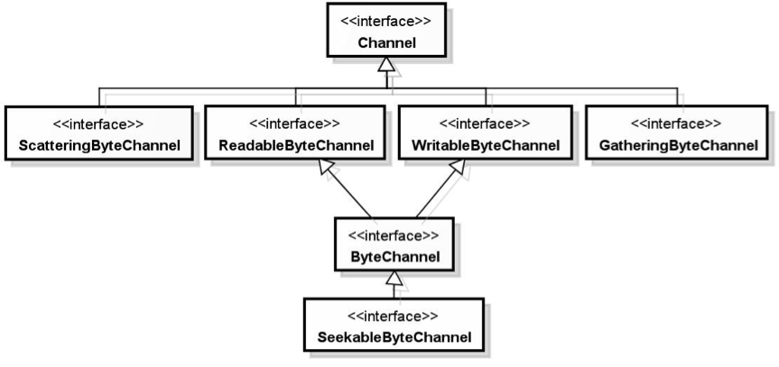

`ReadableByteChannel`、`WritableByteChannel` 接口提供了通道的读写功能，而 `ScatteringByteChannel`、`GatheringByteChannel` 接口都新增了两个以缓冲区数组作为参数的相应方法。

Scatter/Gather 经常用于需要将传输的数据分开处理的场合，例如传输一个由消息头和消息体组成的消息，你可能会将消息体和消息头分散到不同的 `Buffer` 中，这样你可以方便地处理消息头和消息体。

**分散（Scatter）**：在读操作时将读取的数据写入多个 `Buffer` 中。因此，`Channel` 将从 `Channel` 中读取的数据“分散（Scatter）”到多个 `Buffer` 中。如下图描述：

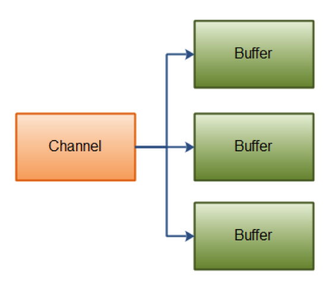

例如：

```java
ByteBuffer header = ByteBuffer.allocate(128);
ByteBuffer body = ByteBuffer.allocate(1024);

ByteBuffer[] bufferArray = { header, body };

channel.read(bufferArray);
```

注意 `Buffer` 首先被插入到数组，然后再将数组作为 `channel.read()` 的输入参数。`read()` 方法按照 `Buffer` 在数组中的顺序将从 `Channel` 中读取的数据写入到 `Buffer`，当一个 `Buffer` 被写满后，`Channel` 紧接着向另一个 `Buffer` 中写。

Scattering Reads 在移动到下一个 `Buffer` 前，必须填满当前的 `Buffer`，这也意味着它不适用于动态消息（消息大小不固定）。换句话说，如果存在消息头和消息体，消息头必须完成填充（例如 128 byte），Scattering Reads 才能正常工作。

**聚集（Gather）**：在写操作时将多个 `Buffer` 的数据写入同一个 `Channel`，因此，`Channel` 将多个 `Buffer` 中的数据“聚集（Gather）”后发送到 `Channel`。如下图描述：

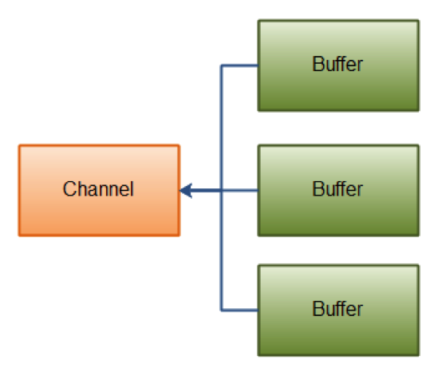

例如：

```java
ByteBuffer header = ByteBuffer.allocate(128);
ByteBuffer body = ByteBuffer.allocate(1024);

ByteBuffer[] bufferArray = { header, body };

channel.write(bufferArray);
```

`Buffer` 数组是 `write()` 方法的入参，`write()` 方法会按照 `Buffer` 在数组中的顺序，将数据写入到 `Channel`，注意只有 `position` 和 `limit` 之间的数据才会被写入。因此，如果一个 `Buffer` 的容量为 128 byte，但是仅仅包含 58 byte 的数据，那么这 58 byte 的数据将被写入到 `Channel` 中。因此与 Scattering Reads 相反，Gathering Writes 能较好地处理动态消息。

## 2.3 FileChannel

Java NIO 中的 `FileChannel` 是一个连接到文件的通道。可以通过文件通道读写文件。

**`FileChannel` 无法设置为非阻塞模式，它总是运行在阻塞模式下**。

在使用 `FileChannel` 之前，必须先打开它。Java 7 之前无法直接打开一个 `FileChannel`，需要通过 `InputStream`、`OutputStream` 或 `RandomAccessFile` 来获取一个 `FileChannel` 实例；Java 7 起可以使用 `FileChannel.open()` 直接打开。

`open()` 方法的第一个参数是要打开的文件的路径，第二个参数是打开文件时的选项。不同的选项会对通道的能力产生影响。比如，当一个文件通道以只读的方式打开时，就不能通过 `write()` 方法来写入数据。

```java
Path file = Paths.get("my.txt");
FileChannel channel = FileChannel.open(file, StandardOpenOption.CREATE, StandardOpenOption.WRITE);
```

在打开文件通道时可以选择的选项有很多，其中最常见的是读取和写入模式的选择，分别通过 `java.nio.file.StandardOpenOption` 枚举类型中的 `READ` 和 `WRITE` 来声明。

另外一种创建文件通道的方式是从已有的 `FileInputStream`、`FileOutputStream` 和 `RandomAccessFile` 对象中得到。这 3 个类都有一个 `getChannel()` 方法来获取对应的 `FileChannel` 对象，所得到的 `FileChannel` 对象的能力取决于其来源流的特征。`FileInputStream` 得到的通道是只读的，`FileOutputStream` 得到的通道是可写的，`RandomAccessFile` 得到的通道的能力则取决于文件打开时的模式。

```java
RandomAccessFile file = new RandomAccessFile("my.txt", "rw");
FileChannel inChannel = file.getChannel();
```

### 2.3.1 通道间传输

在 Java NIO 中，如果两个通道中有一个是 `FileChannel`，那你可以直接将数据从一个 `Channel` 传输到另外一个 `Channel`。

`FileChannel` 的 `transferFrom()` 方法可以将数据从源通道传输到 `FileChannel` 中，这个方法在 JDK 文档中的解释为将字节从给定的可读取字节通道传输到此通道的文件中。下面是一个简单的例子：

```java
RandomAccessFile fromFile = new RandomAccessFile("fromFile.txt", "rw");
FileChannel fromChannel = fromFile.getChannel();

RandomAccessFile toFile = new RandomAccessFile("toFile.txt", "rw");
FileChannel toChannel = toFile.getChannel();

long position = 0;
long count = fromChannel.size();

toChannel.transferFrom(fromChannel, position, count);
```

方法的输入参数 `position` 表示从 `position` 处开始向目标文件写入数据，`count` 表示最多传输的字节数。如果源通道的剩余字节数小于 `count`，则所传输的字节数要小于请求的字节数。

此外要注意，如果源通道是非阻塞模式的 `SocketChannel`，它只会传输此刻已经在接收缓冲区中准备好的数据（可能不足 `count` 字节）。因此，`SocketChannel` 可能不会将请求的所有数据（`count` 个字节）全部传输到 `FileChannel` 中。

`transferTo()` 方法将数据从 `FileChannel` 传输到其他的 `Channel` 中。下面是一个简单的例子：

```java
RandomAccessFile fromFile = new RandomAccessFile("fromFile.txt", "rw");
FileChannel fromChannel = fromFile.getChannel();

RandomAccessFile toFile = new RandomAccessFile("toFile.txt", "rw");
FileChannel toChannel = toFile.getChannel();

long position = 0;
long count = fromChannel.size();

fromChannel.transferTo(position, count, toChannel);
```

是不是发现这个例子和前面那个例子特别相似？除了调用方法的 `FileChannel` 对象和参数顺序不一样外，其他的都一样。

`transferTo()` 也有类似的问题：如果目标通道是非阻塞模式的 `SocketChannel`，那么只会传输其发送缓冲区当前能容纳的字节数，因此需要根据返回值循环调用，直到全部传完。

在 Linux 上，`transferTo()` 到 `SocketChannel` 的传输底层会使用 `sendfile` 系统调用，数据不需要经过用户态，这就是常说的“零拷贝”，Kafka 向消费者发送日志数据就利用了这一点。

### 2.3.2 位置、截断与强制刷盘

有时可能需要在 `FileChannel` 的某个特定位置进行数据的读/写操作。可以通过调用 `position()` 方法获取 `FileChannel` 的当前位置。也可以通过调用 `position(long pos)` 方法设置 `FileChannel` 的当前位置。

如果将位置设置在文件结束符之后，然后试图从文件通道中读取数据，读方法将返回 -1 —— 文件结束标志。

如果将位置设置在文件结束符之后，然后向通道中写数据，文件将撑大到当前位置并写入数据。这可能导致“文件空洞”，磁盘上物理文件中写入的数据间有空隙。

可以使用 `FileChannel.truncate()` 方法截取一个文件。截取文件时，文件中指定长度后面的部分将被删除。如：

```java
channel.truncate(1024);
```

这个例子截取文件的前 1024 个字节。

出于性能方面的考虑，操作系统会将数据缓存在内存（页缓存）中，所以无法保证写入到 `FileChannel` 里的数据一定会即时写到磁盘上。如果在同步之前发生系统崩溃，所做的修改就可能丢失。因此，在执行完某些重要文件内容的更新操作之后，应该调用 `FileChannel.force()` 方法将通道里尚未写入磁盘的数据强制写到磁盘上。`force()` 方法有一个 `boolean` 类型的参数，指明是否同时将文件元数据（修改时间、权限信息等）写到磁盘上。

### 2.3.3 内存映射文件

在对大文件进行操作时，性能问题一直比较难处理。通过操作系统的内存映射文件支持，可以比较快速地对大文件进行操作。内存映射文件的原理在于把进程的一段虚拟内存地址映射到要操作的文件上。读取这些内存地址就相当于读取文件的内容，而改变这些内存地址的值就相当于修改文件中的内容。访问尚未加载的页时会触发缺页中断，由操作系统负责把对应的文件内容调入内存，脏页也由操作系统负责写回。这样就省去了 `read()`/`write()` 系统调用以及用户态与内核态之间的数据拷贝，因此能大大提高操作文件的性能。

`FileChannel` 类的 `map()` 方法可以把一个文件的全部或部分内容映射到内存中，所得到的是一个 `ByteBuffer` 类的子类 `MappedByteBuffer` 的对象，程序只需要对这个 `MappedByteBuffer` 对象进行操作即可。对这个 `MappedByteBuffer` 对象所做的修改会自动同步到文件内容中。

在进行内存映射时需要指定映射的模式，一共有 3 种可用的模式，由 `FileChannel.MapMode` 这个枚举类型来表示：

- `READ_ONLY`：表示只能对映射之后的 `MappedByteBuffer` 对象进行读取操作
- `READ_WRITE`：表示是可读可写的
- `PRIVATE`：写时复制，通过 `MappedByteBuffer` 对象所做的修改不会被同步到文件中，而是被同步到一个私有的副本中。这些修改对其他同样映射了该文件的程序是不可见的

内存映射文件的使用示例：

```java
public void mapFile() throws IOException {
    try (FileChannel channel = FileChannel.open(Paths.get("src.data"), StandardOpenOption.READ,
            StandardOpenOption.WRITE)) {
        MappedByteBuffer buffer = channel.map(FileChannel.MapMode.READ_WRITE, 0, channel.size());
        byte b = buffer.get(1024 * 1024);
        buffer.put(5 * 1024 * 1024, b);
        buffer.force();
    }
}
```

如果希望更加高效地处理映射到内存中的文件，把文件的内容加载到物理内存中是一个好办法。通过 `MappedByteBuffer` 类的 `load()` 方法可以把该缓冲区所对应的文件内容加载到物理内存中，以提高文件操作时的性能。由于物理内存的容量受限，不太可能直接把一个大文件的全部内容一次性地加载到物理内存中。可以每次只映射文件的部分内容，把这部分内容完全加载到物理内存中进行处理。完成处理之后，再映射其他部分的内容。

`MappedByteBuffer` 有两个众所周知的限制：

- 单次映射的大小不能超过 `Integer.MAX_VALUE`（约 2GB），更大的文件只能分段映射
- 没有公开的解除映射（unmap）方法，映射只有在 `MappedByteBuffer` 对象被 GC 回收时才会释放，在此之前文件可能无法删除（Windows 上尤其明显）

RocketMQ 的 CommitLog 就是用 `MappedByteBuffer` 按固定大小（默认 1GB）分段映射文件的。Java 22 正式发布的 FFM API 解决了上述两个限制，详见第 5 章。

## 2.4 SocketChannel 与 ServerSocketChannel

Java NIO 中的 `SocketChannel` 是一个连接到 TCP 网络套接字的通道。可以通过以下 2 种方式创建：

- 打开一个 `SocketChannel` 并连接到互联网上的某台服务器
- 一个新连接到达 `ServerSocketChannel` 时，会创建一个 `SocketChannel`

```java
SocketChannel socketChannel = SocketChannel.open();
socketChannel.connect(new InetSocketAddress("192.168.0.1", 80));
```

`SocketChannel` 的 `read()` 与 `write()` 操作与 `FileChannel` 类似，不同的是可以设置 `SocketChannel` 为非阻塞模式。设置之后，`connect()`、`read()` 和 `write()` 都会立即返回，而不是等待操作完成。非阻塞模式与选择器搭配会工作得更好，通过将一个或多个 `SocketChannel` 注册到 `Selector`，可以询问选择器哪个通道已经准备好了读取、写入等。

而 `ServerSocketChannel` 是一个可以监听新进来的 TCP 连接的通道，就像标准 IO 中的 `ServerSocket` 一样。通过调用 `ServerSocketChannel.open()` 方法来打开 `ServerSocketChannel`，通过 `ServerSocketChannel.accept()` 方法监听新进来的连接。

下面的代码使用 `SocketChannel` 与 `ServerSocketChannel` 以非阻塞的方式实现客户端向服务端发送消息：

```java
public class Server {

    ServerSocketChannel serverSocketChannel;

    private void initServer(int port) throws IOException {
        serverSocketChannel = ServerSocketChannel.open();
        serverSocketChannel.bind(new InetSocketAddress(port));
        serverSocketChannel.configureBlocking(false); // 设置成非阻塞模式
        System.out.println("Server 初始化成功");
    }

    private void listen() throws IOException {
        while (true) {
            // 如果是阻塞模式，程序会阻塞在这里，直到有连接进来，
            // 现在为非阻塞模式，无论有没有连接都会返回，socketChannel 可能为 null
            SocketChannel socketChannel = serverSocketChannel.accept();
            if (socketChannel != null) {
                read(socketChannel);
            }
        }
    }

    private void read(SocketChannel socketChannel) throws IOException {
        ByteBuffer buf = ByteBuffer.allocate(1024);

        // 非阻塞模式下，read() 方法可能在尚未读取到任何数据时就返回 0，直到对端关闭连接才返回 -1
        while (socketChannel.read(buf) != -1) {
            buf.flip();
            if (buf.hasRemaining()) {
                System.out.println("收到消息: " + StandardCharsets.UTF_8.decode(buf));
            }
            buf.clear();
        }
        socketChannel.close();
    }

    public static void main(String[] args) throws IOException {
        Server server = new Server();
        server.initServer(8000);
        server.listen();
    }
}
```

```java
public class Client {

    SocketChannel socketChannel;

    private void initClient(String ip, int port) throws IOException {
        socketChannel = SocketChannel.open();
        socketChannel.configureBlocking(false);
        socketChannel.connect(new InetSocketAddress(ip, port));
    }

    private void sendMsg(String msg) throws IOException {
        ByteBuffer buf = ByteBuffer.wrap(msg.getBytes(StandardCharsets.UTF_8));
        while (buf.hasRemaining()) { // 非阻塞模式下 write() 可能只写出一部分
            socketChannel.write(buf);
        }
    }

    public static void main(String[] args) throws IOException {
        Client client = new Client();
        client.initClient("127.0.0.1", 8000);

        while (!client.socketChannel.finishConnect()) {
            System.out.println("等待连接...");
        }
        client.sendMsg("今晚暗号:");
        client.sendMsg("天王盖地虎");
        client.sendMsg("宝塔镇河妖");
        client.socketChannel.close();
    }
}
```

这个例子只是为了演示非阻塞模式的 API：服务端的 `accept()` 和 `read()` 都在一个死循环里反复空转，会把一个 CPU 核心跑满，而且一次只能处理一个连接；TCP 是字节流，三条消息也可能被合并成一次读到（粘包）。实际开发中，非阻塞通道总是与第 3 章的 `Selector` 搭配使用。

## 2.5 DatagramChannel

Java NIO 中的 `DatagramChannel` 是一个能收发 UDP 包的通道。因为 UDP 是无连接的网络协议，所以通常不使用 `read()`/`write()`，而是用 `receive()`/`send()` 收发数据包，每次调用都对应一个完整的数据包。

下面是 `DatagramChannel` 的打开方式：

```java
DatagramChannel channel = DatagramChannel.open();
channel.bind(new InetSocketAddress(9999));
```

这个例子打开的 `DatagramChannel` 可以在 UDP 端口 9999 上接收数据包。

通过 `receive()` 方法从 `DatagramChannel` 接收数据，如：

```java
ByteBuffer buf = ByteBuffer.allocate(48);
buf.clear();
channel.receive(buf);
```

`receive()` 方法会将接收到的数据包内容复制到指定的 `Buffer`，如果 `Buffer` 容不下收到的数据，多出的数据将被丢弃。

通过 `send()` 方法从 `DatagramChannel` 发送数据，如：

```java
String newData = "New String to write to file..." + System.currentTimeMillis();
ByteBuffer buf = ByteBuffer.allocate(48);
buf.clear();
buf.put(newData.getBytes(StandardCharsets.UTF_8));
buf.flip();
int bytesSent = channel.send(buf, new InetSocketAddress("127.0.0.1", 80));
```

这个例子发送一串字符到“127.0.0.1”服务器的 UDP 端口 80。因为服务端并没有监控这个端口，所以什么也不会发生。也不会通知你发出的数据包是否已收到，因为 UDP 在数据传送方面没有任何保证。

可以将 `DatagramChannel`“连接”到网络中的特定地址。由于 UDP 是无连接的，连接到特定地址并不会像 TCP 通道那样创建一个真正的连接，而是锁住 `DatagramChannel`，让其只能从特定地址收发数据。比如：

```java
channel.connect(new InetSocketAddress("127.0.0.1", 80));
```

连接后，也可以使用 `read()` 和 `write()` 方法，就像在用传统的通道一样，只是在数据传送方面仍然没有任何保证。

## 2.6 Pipe

管道的概念对于 Unix 和类 Unix 操作系统的用户来说早就很熟悉了。Unix 系统中，管道被用来连接一个进程的输出和另一个进程的输入。Java NIO 中的 `Pipe` 类实现了一个管道范例，不过它所创建的管道是进程内（在 Java 虚拟机进程内部）而非进程间使用的，也就是说，`Pipe` 通常用于两个线程之间的通信。

`Pipe` 类定义了两个嵌套的通道类来实现管道。这两个类是 `Pipe.SourceChannel`（管道负责读的一端）和 `Pipe.SinkChannel`（管道负责写的一端）。

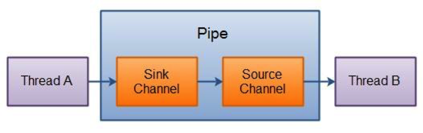

这两个通道实例是在 `Pipe` 对象创建的同时被创建的，可以通过在 `Pipe` 对象上分别调用 `source()` 和 `sink()` 方法来取回。用法示例如下：

```java
public class PipeTest {
    public static void main(String[] args) throws IOException {
        Pipe pipe = Pipe.open();
        PipeWriter pipeWriter = new PipeWriter(pipe);
        PipeReader pipeReader = new PipeReader(pipe);

        ExecutorService exec = Executors.newFixedThreadPool(2);
        exec.submit(pipeWriter);
        exec.submit(pipeReader);
        exec.shutdown();
    }
}

class PipeWriter implements Callable<Boolean> {

    Pipe pipe;

    public PipeWriter(Pipe pipe) {
        this.pipe = pipe;
    }

    @Override
    public Boolean call() {
        try (SinkChannel sinkChannel = pipe.sink()) { // 关闭写端后，读端的 read() 才会返回 -1
            for (int i = 10; i >= 0; i--) {
                String msg = "嫦娥六号探测器发射倒计时：" + i;
                sinkChannel.write(ByteBuffer.wrap(msg.getBytes(StandardCharsets.UTF_8)));
                TimeUnit.SECONDS.sleep(1);
            }
            String msg = "嫦娥六号探测器发射成功！";
            sinkChannel.write(ByteBuffer.wrap(msg.getBytes(StandardCharsets.UTF_8)));
        } catch (Exception e) {
            return false;
        }
        return true;
    }

}

class PipeReader implements Callable<Boolean> {

    Pipe pipe;

    public PipeReader(Pipe pipe) {
        this.pipe = pipe;
    }

    @Override
    public Boolean call() {
        try (SourceChannel sourceChannel = pipe.source()) {
            ByteBuffer buf = ByteBuffer.allocate(128);
            while (sourceChannel.read(buf) != -1) {
                buf.flip();
                System.out.println(StandardCharsets.UTF_8.decode(buf));
                buf.clear();
            }
        } catch (Exception e) {
            return false;
        }
        return true;
    }

}
```

# 3 Selector

## 3.1 概述

Java NIO 的选择器允许一个单独的线程来监视多个输入通道，多个通道可以共用一个选择器，然后使用一个单独的线程来“选择”通道：这些通道里已经有可以处理的输入，或者选择已准备写入的通道。这种选择机制，使得一个单独的线程很容易来管理多个通道。

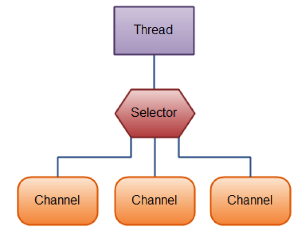

`Selector` 是对操作系统 IO 多路复用机制的封装：Linux 上基于 epoll，macOS 上基于 kqueue，Windows 上另有单独的实现。

## 3.2 register

要使用 `Selector`，得向 `Selector` 注册 `Channel`，然后调用它的 `select()` 方法。这个方法会一直阻塞到某个注册的通道有事件就绪。一旦这个方法返回，线程就可以处理这些事件，事件的例子有如新连接进来、数据接收等。

在通道上可以注册我们感兴趣的事件。一共有以下四种事件：

- `SelectionKey.OP_ACCEPT`：服务端接收客户端连接事件
- `SelectionKey.OP_CONNECT`：客户端连接服务端事件
- `SelectionKey.OP_READ`：读事件
- `SelectionKey.OP_WRITE`：写事件

**与 `Selector` 一起使用时，`Channel` 必须处于非阻塞模式下**。这意味着不能将 `FileChannel` 与 `Selector` 一起使用，因为 `FileChannel` 不能切换到非阻塞模式，而套接字通道都可以。

```java
Selector selector = Selector.open();
channel.configureBlocking(false);
SelectionKey key = channel.register(selector, SelectionKey.OP_READ);
```

如果对不止一种事件感兴趣，那么可以用“位或”操作符将常量连接起来，如下：

```java
int interestSet = SelectionKey.OP_READ | SelectionKey.OP_WRITE;
SelectionKey key = channel.register(selector, interestSet);
```

需要注意，只要套接字发送缓冲区还有空间，`OP_WRITE` 就一直处于就绪状态。如果长期注册 `OP_WRITE`，`select()` 会不停地立即返回，造成空转。通常的做法是：直接调用 `write()`，只有在数据没能一次写完时才注册 `OP_WRITE`，写完后再通过 `key.interestOps()` 取消。

可以将一个对象或者更多信息附着到 `SelectionKey` 上，这样就能方便地识别某个给定的通道。例如，可以附加与通道一起使用的 `Buffer`，或是包含聚集数据的某个对象。使用方法如下：

```java
selectionKey.attach(theObject);
Object attachedObj = selectionKey.attachment();
```

还可以在用 `register()` 方法向 `Selector` 注册 `Channel` 的时候附加对象。如：

```java
SelectionKey key = channel.register(selector, SelectionKey.OP_READ, theObject);
```

`SelectionKey` 有四个方法来判断是否为某个事件，与上面的四种事件相对应：

```java
selectionKey.isAcceptable();
selectionKey.isConnectable();
selectionKey.isReadable();
selectionKey.isWritable();
```

## 3.3 select

一旦向 `Selector` 注册了一个或多个通道，就可以调用 `select()` 方法返回你所感兴趣的事件（如连接、接受、读或写）已经准备就绪的那些通道。

- `select()`：阻塞到至少有一个通道在你注册的事件上就绪了，或者被其他线程调用 `wakeup()` 唤醒
- `select(long timeout)`：和 `select()` 一样，只是最长会阻塞 `timeout` 毫秒
- `selectNow()`：不会阻塞，不管什么通道就绪都立刻返回；如果没有任何通道就绪，则返回零

`select()` 方法返回的 `int` 值表示本次调用中有多少个键的就绪状态被更新了，而不是已选择键集的总大小。例如，第一次调用 `select()` 时有一个通道就绪，返回 1；如果没有处理也没有移除这个键，再次调用 `select()` 时另一个通道就绪，返回的仍然是 1，但此时已选择键集中已经有两个键了。因此不要依赖返回值来判断要处理多少事件，而应该遍历 `selectedKeys()`；返回 0 也是正常情况（例如被 `wakeup()` 唤醒或超时）。

调用 `Selector` 的 `selectedKeys()` 方法，可以访问“已选择键集（selected key set）”中的就绪通道：

```java
Set<SelectionKey> selectedKeys = selector.selectedKeys();
Iterator<SelectionKey> keyIterator = selectedKeys.iterator();
while (keyIterator.hasNext()) {
    SelectionKey key = keyIterator.next();
    if (key.isAcceptable()) {
        // a connection was accepted by a ServerSocketChannel.
    } else if (key.isConnectable()) {
        // a connection was established with a remote server.
    } else if (key.isReadable()) {
        // a channel is ready for reading
    } else if (key.isWritable()) {
        // a channel is ready for writing
    }
    keyIterator.remove();
}
```

注意每次迭代末尾的 `keyIterator.remove()` 调用。`Selector` 不会自己从已选择键集中移除 `SelectionKey` 实例，必须在处理完通道时自己移除。下次该通道变成就绪时，`Selector` 会再次将其放入已选择键集中。

`SelectionKey.channel()` 方法返回的通道需要转型成要处理的类型，如 `ServerSocketChannel` 或 `SocketChannel` 等。

一个完整的例子：

```java
public class NIOServer {
    // 通道管理器
    private Selector selector;

    /**
     * 获得一个 ServerSocket 通道，并对该通道做一些初始化的工作
     *
     * @param port 绑定的端口号
     */
    public void initServer(int port) throws IOException {
        // 获得一个 ServerSocket 通道
        ServerSocketChannel serverChannel = ServerSocketChannel.open();
        // 设置通道为非阻塞
        serverChannel.configureBlocking(false);
        // 将该通道绑定到 port 端口
        serverChannel.bind(new InetSocketAddress(port));
        // 获得一个通道管理器
        this.selector = Selector.open();
        // 将通道管理器和该通道绑定，并为该通道注册 SelectionKey.OP_ACCEPT 事件，注册该事件后，
        // 当该事件到达时，selector.select() 会返回，如果该事件没到达 selector.select() 会一直阻塞
        serverChannel.register(selector, SelectionKey.OP_ACCEPT);
    }

    /**
     * 采用轮询的方式监听 selector 上是否有需要处理的事件，如果有，则进行处理
     */
    public void listen() throws IOException {
        System.out.println("服务端启动成功！");
        // 轮询访问 selector
        while (true) {
            // 当注册的事件到达时，方法返回；否则，该方法会一直阻塞
            selector.select();
            // 获得 selector 中选中的项的迭代器，选中的项为注册的事件
            Iterator<SelectionKey> ite = this.selector.selectedKeys().iterator();
            while (ite.hasNext()) {
                SelectionKey key = ite.next();
                // 删除已选的 key，以防重复处理
                ite.remove();
                // 客户端请求连接事件
                if (key.isAcceptable()) {
                    ServerSocketChannel server = (ServerSocketChannel) key.channel();
                    // 获得和客户端连接的通道
                    SocketChannel channel = server.accept();
                    // 设置成非阻塞
                    channel.configureBlocking(false);

                    // 在这里可以给客户端发送信息
                    channel.write(ByteBuffer.wrap("向客户端发送了一条信息".getBytes(StandardCharsets.UTF_8)));
                    // 在和客户端连接成功之后，为了可以接收到客户端的信息，需要给通道注册读事件
                    channel.register(this.selector, SelectionKey.OP_READ);

                } else if (key.isReadable()) {
                    // 获得了可读的事件
                    read(key);
                }
            }
        }
    }

    /**
     * 处理读取客户端发来的信息的事件
     */
    public void read(SelectionKey key) throws IOException {
        // 服务器可读取消息：得到事件发生的 Socket 通道
        SocketChannel channel = (SocketChannel) key.channel();
        // 创建读取的缓冲区
        ByteBuffer buffer = ByteBuffer.allocate(1024);
        int n = channel.read(buffer);
        if (n == -1) { // 客户端已关闭连接，必须关闭通道，否则该通道会一直处于可读状态
            key.cancel();
            channel.close();
            return;
        }
        buffer.flip();
        String msg = StandardCharsets.UTF_8.decode(buffer).toString();
        System.out.println("服务端收到信息：" + msg);
        channel.write(ByteBuffer.wrap(msg.getBytes(StandardCharsets.UTF_8))); // 将消息回送给客户端
    }

    /**
     * 启动服务端测试
     */
    public static void main(String[] args) throws IOException {
        NIOServer server = new NIOServer();
        server.initServer(8000);
        server.listen();
    }

}
```

这就是 Reactor 模式最朴素的单线程版本：一个线程既负责 `select()`，又负责处理读写。Netty 在此基础上演化出主从 Reactor 多线程模型，并处理了半包/粘包、写缓冲、空轮询等大量细节，生产环境一般直接使用 Netty，而不是手写 `Selector` 循环。

# 4 AsynchronousChannel

NIO 除了提供非阻塞 IO，Java 7 引入的 NIO.2 还提供了异步 IO（AIO）。阻塞/非阻塞、同步/异步是两对比较容易混淆的概念，在此解释一下。

## 4.1 同步/异步

**同步/异步，关注的是消息的通知机制。**

所谓同步，就是在发出一个功能调用时，在没有得到结果之前，该调用就不返回，或者需要调用者自己去查询结果。按照这个定义，其实绝大多数函数都是同步调用。但是一般而言，我们在说同步、异步的时候，特指那些需要其他部件协作或者需要一定时间完成的任务。

异步的概念和同步相对，当一个异步过程调用发出后，调用者不会立刻得到结果。实际处理这个调用的部件是在调用发出后，通过状态、消息、回调函数等来通知调用者来处理结果。

举个例子，小明他妈（调用方）派小明（被调用方）去车站迎接客人。妈妈要么一直等小明把客人带回家，要么每隔五分钟打电话问小明客人到没到——无论哪种，结果都要妈妈自己去等、去问（后者叫轮询），这就是同步调用。

后来小明说：“你别管了，接到客人我给你打电话。”妈妈发出请求后就不再过问，客人接到后由小明主动通知她，这就是异步调用。

## 4.2 阻塞/非阻塞

**阻塞/非阻塞，关注的是程序在等待结果（无所谓同步或者异步）时的状态。**

阻塞调用是指调用结果返回之前，当前线程会被挂起。有人也许会把阻塞调用和同步调用等同起来，实际上它们是不同的。对于同步调用来说，很多时候当前线程还是激活的（比如在轮询），只是从逻辑上当前函数没有返回而已。

非阻塞和阻塞的概念相对应，指在不能立刻得到结果之前，该函数不会阻塞当前线程，而会立刻返回。

还是小明他妈（调用方）派小明（被调用方）去车站迎接客人，在客人到来之前，小明他妈什么都不干，专心等待客人，这就是阻塞调用。

后来，小明他妈变聪明了，在客人到来之前，她可以洗菜、拖地、听听歌，客人来了之后再招待客人，这就是非阻塞调用。

**同步大部分是阻塞的，异步大部分是非阻塞的，但是它们之间并没有必然的因果关系**。对应到 Java 的三种 IO 模型：

| 模型 | 类型 | 说明 |
| ---- | ---- | ---- |
| BIO（`java.io`、阻塞的 `Channel`） | 同步阻塞 | 线程一直等到数据读写完成 |
| NIO（非阻塞 `Channel` + `Selector`） | 同步非阻塞 | 由 `Selector` 告知哪些通道就绪，但读写数据仍由用户线程完成，也就是 IO 多路复用 |
| AIO（`AsynchronousChannel`） | 异步非阻塞 | 发起读写后立即返回，操作完成后通过 `Future` 或回调通知 |

## 4.3 异步通道

Java NIO 中有三种异步通道：`AsynchronousFileChannel`、`AsynchronousServerSocketChannel`、`AsynchronousSocketChannel`。

异步调用主要有两种方式：**将来式**和**回调式**。

将来式用 `java.util.concurrent` 包下的 `Future` 接口来保存异步操作的处理结果。这意味着当前线程不会因为比较慢的 IO 操作而停止，发起 IO 操作的方法会立即返回一个 `Future`，操作完成时结果被写入其中。与此同时，主线程可以继续执行其他需要完成的任务。

至于底层由谁来完成 IO，取决于操作系统：Windows 上使用 IOCP，是真正的内核级异步 IO；而 Linux 上，`AsynchronousFileChannel` 实际是把阻塞的读写提交给线程池执行，异步套接字通道则是基于 epoll 模拟的。

从硬盘上的文件里读取 100000 字节，将来式可以这么做：

```java
Path file = Paths.get("/Users/winner/Desktop/foobar.txt");
try (AsynchronousFileChannel channel = AsynchronousFileChannel.open(file)) {
    ByteBuffer buffer = ByteBuffer.allocate(100_000);
    Future<Integer> result = channel.read(buffer, 0);

    System.out.println("do something else"); // 读取期间主线程可以做其他事

    int bytesRead = result.get(); // 需要结果时再阻塞等待
    buffer.flip();
    System.out.println(bytesRead + " bytes: " + StandardCharsets.UTF_8.decode(buffer));
} catch (IOException | InterruptedException | ExecutionException e) {
    e.printStackTrace();
}
```

`AsynchronousFileChannel` 会关联线程池，可以在创建时指定，如果没有指定，JVM 会为其分配一个系统默认的线程池（可能会与其他通道共享），默认线程池是由 `AsynchronousChannelGroup` 类定义的系统属性进行配置的。

回调式的基本思想是：发起 IO 操作时传入一个 `CompletionHandler`，方法立即返回；当 IO 操作完成后，由线程池中的线程调用 `CompletionHandler` 的 `completed()` 方法，失败时则调用 `failed()` 方法。

异步事件一成功或失败就需要马上采取行动时，一般会采用回调式。

接口 `java.nio.channels.CompletionHandler<V, A>` 中，`V` 是结果类型（读写操作为实际读写的字节数），`A` 是附件（attachment）类型，即发起操作时传入、回调时原样带回的对象。

同样从硬盘上的文件里读取 100000 字节，回调式可以这么做：

```java
Path file = Paths.get("/Users/winner/Desktop/foobar.txt");
try {
    AsynchronousFileChannel channel = AsynchronousFileChannel.open(file);
    ByteBuffer buffer = ByteBuffer.allocate(100_000);

    channel.read(buffer, 0, buffer, new CompletionHandler<Integer, ByteBuffer>() {

        @Override
        public void completed(Integer result, ByteBuffer attachment) {
            attachment.flip();
            System.out.println(StandardCharsets.UTF_8.decode(attachment));
        }

        @Override
        public void failed(Throwable exc, ByteBuffer attachment) {
            System.out.println("Read file failed:");
            exc.printStackTrace();
        }
    });
    // 回调在其他线程执行，通道需要在回调完成后再关闭
} catch (IOException e) {
    e.printStackTrace();
}
```

由于 Linux 上的 AIO 并不比 epoll 更高效，编程模型又更复杂，AIO 在 Java 服务端一直没有流行起来，Netty 等主流网络框架在 Linux 上使用的仍然是 NIO（以及基于 JNI 的原生 epoll、io_uring 传输）。

# 5 新版本中的 NIO

NIO 诞生于 Java 1.4（JSR 51），此后的主要演进如下：

| 版本 | 特性 | 说明 |
| ---- | ---- | ---- |
| Java 7 | NIO.2（JSR 203） | 新增 `Path`、`Files`、`WatchService` 文件系统 API，`FileChannel.open()`、`bind()` 等便捷方法，以及第 4 章的异步通道 |
| Java 11 | `Files.readString()`/`writeString()` | 一行代码读写文本文件 |
| Java 13 | JEP 353 | 用 NIO 的实现重写了传统的 `Socket`/`ServerSocket` |
| Java 14 | JEP 352 | 支持映射非易失性内存（NVM）的 `MappedByteBuffer` |
| Java 15 | JEP 373 | 重写了传统的 `DatagramSocket`/`MulticastSocket` |
| Java 16 | JEP 380 | `SocketChannel`/`ServerSocketChannel` 支持 Unix 域套接字（`UnixDomainSocketAddress`），用于本机进程间通信 |
| Java 21 | JEP 444 | 虚拟线程正式发布 |
| Java 22 | JEP 454 | 外部函数与内存（FFM）API 正式发布 |

## 5.1 NIO.2 文件 API

日常的文件操作，现在基本不需要直接使用 `FileChannel` 了，`Files` 工具类覆盖了绝大多数场景：

```java
Path path = Path.of("my.txt"); // Java 11 起推荐 Path.of()

String content = Files.readString(path);
Files.writeString(path, "hello", StandardOpenOption.APPEND);

try (Stream<String> lines = Files.lines(path)) { // 惰性读取大文件，记得关闭
    lines.filter(line -> line.contains("ERROR")).forEach(System.out::println);
}

Files.copy(path, Path.of("my-copy.txt"), StandardCopyOption.REPLACE_EXISTING);
```

`WatchService` 则可以监听目录中文件的创建、修改和删除事件，常用于配置文件热加载。

## 5.2 虚拟线程与 NIO

NIO 的初衷是用少量线程管理大量连接，因为平台线程与操作系统线程一一对应，成本很高，“一个连接一个线程”的 BIO 模型撑不起高并发。

Java 21 正式发布的虚拟线程改变了这一点：虚拟线程在执行阻塞的套接字读写时，JDK 会在内部把套接字切换为非阻塞模式并注册到 poller 上，同时让出底层的载体线程，数据就绪后再恢复执行。于是开发者可以重新用最直观的同步阻塞代码，获得接近 NIO 的伸缩性：

```java
try (ServerSocket server = new ServerSocket(8000);
     ExecutorService executor = Executors.newVirtualThreadPerTaskExecutor()) {
    while (true) {
        Socket socket = server.accept();
        executor.submit(() -> handle(socket)); // 每个连接一个虚拟线程
    }
}
```

需要注意，文件 IO 在大多数平台上仍然会暂时占住载体线程（JDK 会临时扩充载体线程池来补偿）。对于业务代码，虚拟线程 + 阻塞 IO 已经足够；而 Netty 这类框架以及需要精细控制内存和事件循环的场景，NIO 依然是基础。

## 5.3 FFM API 与内存映射

Java 22 正式发布的 FFM API 提供了 `Arena` 和 `MemorySegment`，可以作为 `MappedByteBuffer` 和直接缓冲区的替代方案：

```java
try (FileChannel channel = FileChannel.open(Path.of("big.data"), StandardOpenOption.READ);
     Arena arena = Arena.ofConfined()) {
    MemorySegment segment = channel.map(FileChannel.MapMode.READ_ONLY, 0, channel.size(), arena);
    byte b = segment.get(ValueLayout.JAVA_BYTE, 3L * 1024 * 1024 * 1024); // 偏移量为 long，可超过 2GB
} // arena 关闭时立即解除映射
```

与 `MappedByteBuffer` 相比：

- 偏移量和大小都是 `long`，单次映射不再受 2GB 限制
- 内存的生命周期由 `Arena` 显式管理，关闭即释放，不再依赖 GC，也不需要借助 `Unsafe.invokeCleaner()` 之类的内部 API
- 访问越界和访问已释放的内存都会抛出异常，而不是导致 JVM 崩溃

# 6 总结

- `Buffer` 是 NIO 读写数据的载体，通过 `capacity`、`limit`、`position`、`mark` 四个属性在读写模式间切换，`flip()`、`clear()`、`compact()`、`rewind()` 只是在移动这些索引
- `Channel` 是双向的，`FileChannel` 只能阻塞，网络通道可以非阻塞；`transferTo()`/`transferFrom()` 和内存映射是 NIO 高性能文件操作的两大利器，也是 Kafka、RocketMQ 等中间件的基础
- `Selector` 封装了操作系统的 IO 多路复用（epoll/kqueue），让一个线程可以管理大量连接，属于同步非阻塞模型；Reactor 模式和 Netty 都建立在它之上
- AIO 是异步非阻塞模型，但在 Linux 上缺乏真正的内核支持，实际很少使用
- 在新版本 Java 中，日常文件操作优先使用 `Files`；高并发阻塞式网络编程可以考虑虚拟线程；大文件映射和堆外内存可以使用 FFM API
