# 1 以太坊模型

## 1.1 状态机

**以太坊的本质就是一个基于交易的状态机**。在计算机科学中，状态机可以读取一系列的输入，然后根据这些输入，会转换成一个新的状态出来。

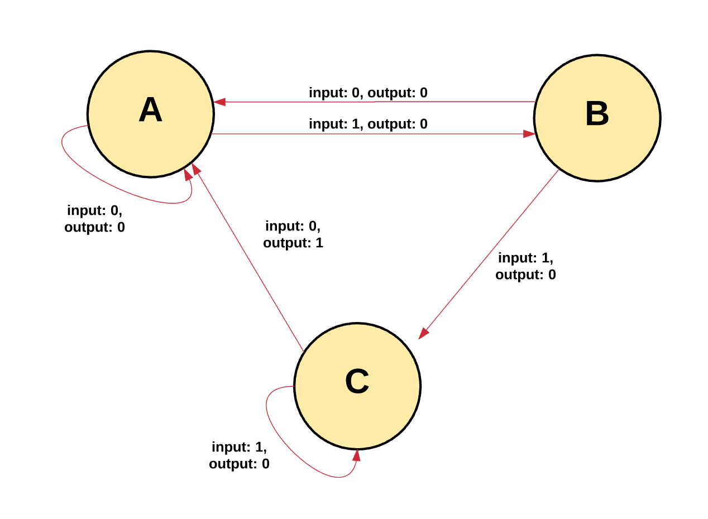

以太坊的状态机从一片空白的**创世状态**（genesis state）开始，被一笔笔交易推动，从一个状态转变为另一个状态。

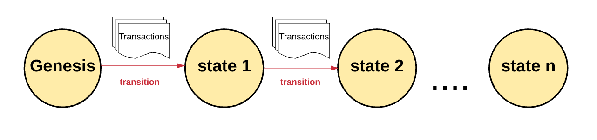

以太坊的每个状态携带有大量交易信息，这些信息都被组装到一个区块中。一个区块包含了一系列的交易，每个区块都与它的前一个区块链接起来。

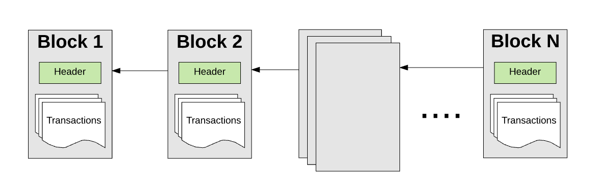

为了让一个交易被认为是有效的，它必须被打包进区块并由网络达成共识。在 2022 年 9 月的“合并”（The Merge）之前，以太坊像比特币一样使用**工作量证明**（PoW），由矿工通过算力竞争来打包区块；合并之后，以太坊正式转变为**权益证明**（PoS）。

在 PoS 机制下，消耗算力的“矿工”不复存在，取而代之的是**验证者**（Validator）。验证者需要质押 32 个**以太币**（Ether）作为担保，通过伪随机算法被选中来提议新区块，并由其他验证者组成的委员会进行证明（Attestation）。如果验证者诚实工作，将获得以太币作为奖励；如果作恶或离线，其质押的以太币将被罚没（Slashing）。

## 1.2 分叉选择与共识机制（Gasper）

如前面所言，以太坊是一个被全球节点共享的状态机，它的状态必须具有唯一性，拥有多个状态（或多个链）会摧毁这个系统。如果链分叉了，你有可能在一条链上拥有 10 个币，一条链上拥有 20 个币，另一条链上拥有 40 个币。在这种场景下，是没有办法确定哪个链才是最“有效的”。

不论什么时候只要多个路径产生了，一个“分叉”就会出现。我们通常都想避免分叉，因为它们会破坏系统，强制人们去选择哪条链是他们相信的链。

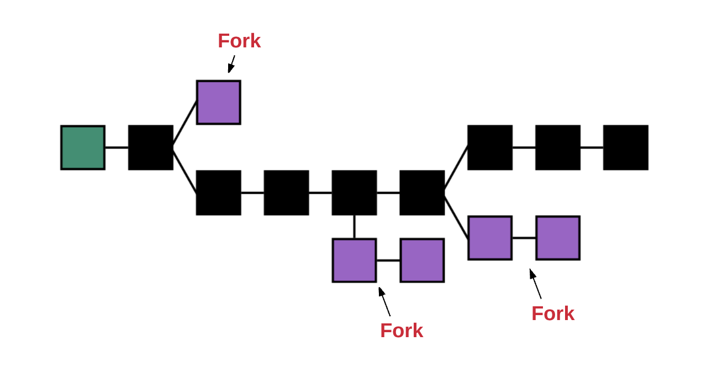

在 PoW 时代，以太坊使用 **GHOST 协议**（`Greedy Heaviest Observed Subtree`）来选择**在其上完成计算最多的路径**，以防止多条链的产生；而在 2022 年“合并”之后，决定主链的职责交给了验证者，以太坊改用一套名为 **Gasper** 的共识机制。

Gasper 由两部分组合而成：

* **LMD-GHOST 分叉选择规则**：节点总是选择拥有最多验证者投票权重（即质押量最重）的分支作为主链。
* **Casper FFG 最终性机制**：确保一旦某个区块被网络最终确认，就具有“绝对最终性”，无法被回滚或篡改，从而消除了旧版 PoW 时代潜在的链重组风险。

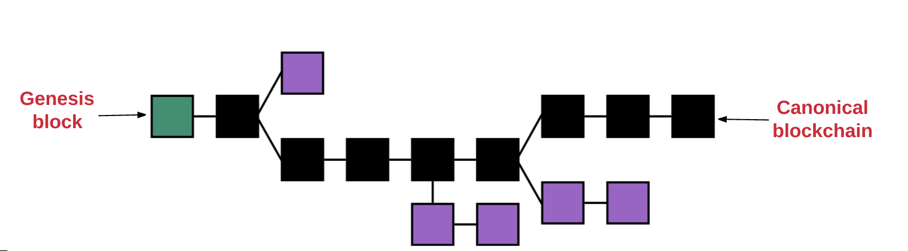

# 2 账户

一个以太坊账户是一个具有以太币（ETH）余额的实体，可以在以太坊上发送交易。账户可以由用户控制，也可以作为智能合约部署。

以太坊的账户有两种类型：

* **外部账户**：被私钥控制且没有任何代码与之关联。
* **合约账户**：被它们的合约代码控制且有代码与之关联。

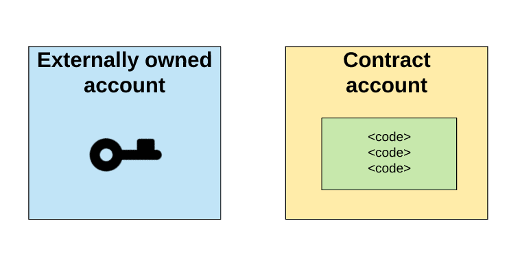

这两种账户类型都能接收、持有和发送 ETH 和 token，与已部署的智能合约进行交互。

一个外部账户可以发送消息给另一个外部账户或合约账户。在两个外部账户之间传送的消息只是一个简单的价值转移。但是**从外部账户到合约账户的消息会激活合约账户的代码**，允许它执行各种动作（比如转移代币、写入内部存储、挖出一个新代币、执行一些运算、创建一个新的合约等等）。而合约账户不可以自己发起一个交易。因此，**在以太坊上任何的动作，总是被外部账户触发的交易所发动的**。

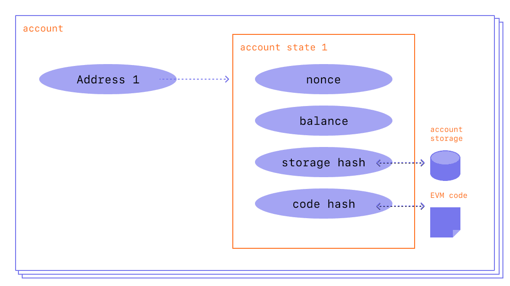

以太坊账户有四个字段：
* **nonce**：显示从账户发送的交易数量的计数器，这将确保交易只处理一次。在合约账户中，这个数字代表该账户创建的合约数量。
* **balance**：此地址拥有 `Wei` 的数量。Wei 是以太币的计数单位，`1 Ether = 10^18 Wei`。
* **storageRoot**：也被称为存储哈希，`Merkle Patricia` 树的根节点哈希值。
* **codeHash**：此账户 EVM 代码的哈希值。对于合约账户，就是被哈希的代码并作为 codeHash 保存。对于外部账户，codeHash 域是一个空字符串的哈希值。

**前沿补充：账户抽象（Account Abstraction）**

长期以来，以太坊严格区分外部账户（EOA）和合约账户。但这给用户带来了极高的门槛：必须妥善保管私钥，且必须持有 ETH 才能支付 Gas 费。2023 年部署的 **ERC-4337** 标准实现了“账户抽象”，让用户账户可以原生就是一个智能合约。

由此带来了革命性的体验升级：支持社交恢复（丢失私钥可通过好友找回）、允许使用 USDT 等代币代付 Gas 费、甚至可以实现交易的批量处理（一键完成授权和兑换）。2025 年 5 月的 Pectra 升级进一步通过 **EIP-7702** 让传统 EOA 也能临时设置代码委托，像智能合约一样执行逻辑，把账户抽象的能力带给了老账户。账户抽象正在模糊 EOA 和合约账户的界限，是以太坊迈向 Web3 大规模普及的关键基础设施。

# 3 区块

所有的交易都被组成一个“块”。一个区块链包含了一系列这样链在一起的区块。

## 3.1 区块头

每个区块都有一个区块“头”，包含以下字段：
* **parentHash**：父区块头的哈希值（这也是使得区块变成区块链的原因）
* **beneficiary**（现多称为 **feeRecipient**）：接收此区块优先费的账户地址
* **stateRoot**：状态树根节点的哈希值
* **transactionsRoot**：包含此区块所有交易的 Merkle 树的根节点哈希值
* **receiptsRoot**：包含此区块所有交易收据的 Merkle 树的根节点哈希值
* **logsBloom**：由日志信息组成的一个 Bloom 过滤器
* **prevRandao**：由信标链提供的随机数（合并后替代了 PoW 时代的 mixHash）
* **number**：当前区块的计数（创世区块的区块序号为 0，对于每个后续区块，区块序号都增加 1）
* **gasLimit**：每个区块的当前 gas limit
* **gasUsed**：此区块中交易所用的总 gas 量
* **timestamp**：此区块成立时的 Unix 时间戳
* **baseFeePerGas**：此区块的基础费用单价（自 2021 年伦敦升级 / EIP-1559 引入）
* **withdrawalsRoot**：包含验证者质押提款数据的 Merkle 树的根节点哈希值（自 2023 年上海升级引入）
* **blobGasUsed** / **excessBlobGas**：记录 Blob 数据的使用情况（自 2024 年坎昆升级引入）
* **parentBeaconBlockRoot**：父级信标区块的根哈希，让 EVM 能够访问信标链状态（自坎昆升级引入）
* **requestsHash**：各类执行层请求（存款、提款、验证者合并）的哈希值（自 2025 年 Pectra 升级引入）
* **extraData**：与此区块相关的附加数据

> 注：合并之后，PoW 时代的部分字段已退出历史舞台——`mixHash` 被 `prevRandao` 取代；`ommerHash`、`difficulty`、`nonce` 虽在协议中保留占位，但已固化为常数，不再具有实际作用。下方的经典区块头示意图仍按旧布局标注，未反映以上变化。

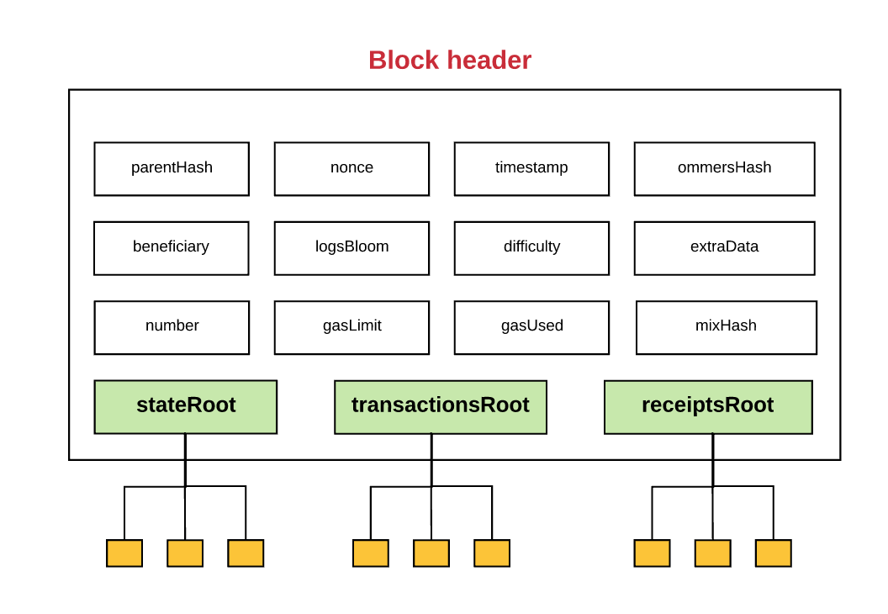

每个区块包含三个树形结构，分别对应：
* **状态**（stateRoot）
* **交易**（transactionsRoot）
* **收据**（receiptsRoot）

## 3.2 MPT 树

以太坊使用 **Merkle Patricia Tree**（MPT）的数据结构来存储。MPT 是一种经过改良的、融合了默克尔树和前缀树两者优点的数据结构，是以太坊中用来管理账户数据、生成交易集合哈希的重要数据结构。

MPT 中存储信息的高效性在以太坊的“轻客户端”和“轻节点”中相当有用。宽泛地说，以太坊有两种节点类型：**全节点**和**轻节点**。

全节点通过下载整条链来进行同步，从创世区块到当前区块，执行其中包含的所有交易。通常，验证者会运行全节点，因为验证和出块都离不开完整的状态数据。

比起下载和存储整个链以及执行其中所有的交易，轻节点仅仅下载链的头，从创世区块到当前区块的头，不执行任何的交易或检索任何相关联的状态。由于轻节点可以访问区块头，而头中包含了 3 个 MPT 树的根哈希值，所以轻节点依然可以很容易生成和接收关于交易、事件、余额等可验证的答案。

这个可以行得通是因为在 MPT 树中哈希值是向上传播的——如果一个恶意用户试图用一个假交易来交换 MPT 树底部的交易，这会改变它上面节点的哈希值，而它上面节点值的改变也会导致上上一个节点哈希值的改变，以此类推，一直到树的根节点。

总之，使用 MPT 树的好处就是，该结构根节点的哈希值取决于存储在树中的数据，而且根节点的哈希值还可以作为该数据的安全标识。由于块的头包含了状态树、交易树、收据树的根哈希值，所以任何节点都可以验证以太坊的一小部分状态而不用保存整个状态，整个状态的大小可能是非常大的。

尽管 MPT 树在过去几年表现优异，但随着以太坊状态数据膨胀至数百 GB，MPT 的证明体积变得过于庞大，导致运行全节点的硬件要求越来越高。为了解决这一问题，以太坊路线图中的“边缘（The Verge）”阶段计划将数据结构从 MPT 迁移到 **Verkle Trees（维克尔树）**。

Verkle 树结合了向量承诺（Vector Commitments）和默克尔树的优点，能够将密码学证明（witness）的体积缩减一个数量级以上。这将使得手机或极低配置的电脑也能轻松运行以太坊的“无状态客户端”（Stateless Clients），真正实现极致的去中心化。需要说明的是，截至 2026 年，Verkle 迁移仍处于开发推进阶段，尚未排入已确认的硬分叉计划。

## 3.3 出块时间与节拍（Slots & Epochs）

在工作量证明（PoW）时代，出块时间是带有概率性的（平均约 13~15 秒），由挖矿难度动态调节。但在如今的权益证明（PoS）机制下，以太坊的时间流逝变得像钟表一样精确。

以太坊将时间划分为固定的单位：

* **时隙（Slot）**：每个时隙固定为 **12 秒**，这是系统尝试创建一个新区块的时间窗口。在每个时隙中，系统会伪随机选出一名验证者来提议区块，其余验证者则对该区块进行证明（Attestation）。
* **时期（Epoch）**：每 32 个时隙组成一个时期，即 **6.4 分钟**。Epoch 是系统进行验证者奖惩结算、洗牌（重新分配验证者职责）以及实现区块“最终确定性”的基本周期。

这种固定节拍的设计，使得以太坊网络的运行更加可预测：验证者的轮值职责、交易的确认时间、奖励与罚没的结算，都有了明确的节奏。

# 4 Gas 和费用

在以太坊中一个比较重要的概念就是费用，由以太坊网络上的交易而产生的每一次计算都会产生费用。这个费用是以 `Gas` 来支付的。

Gas 就是用来衡量一个具体计算所需费用的单位。`Wei` 是 Ether 的最小单位，`1 Ether = 10^18 Wei`；gas 的单价通常以 `gwei` 来衡量，`1 gwei = 10^9 Wei`。

在 2021 年的伦敦升级（EIP-1559）之后，以太坊的费用市场发生了根本性改变。现在的交易费用由两部分组成：

1. **基础费用（Base Fee）**：由协议根据上一个区块的拥堵程度自动计算，同一个区块内的所有交易统一适用。这部分费用不会被支付给验证者，而是直接被网络销毁（Burned）。
2. **优先费（Priority Fee / Tip）**：用户自愿额外支付给区块提议者（验证者）的小费，以激励他们优先打包自己的交易。

因此，用户发送交易时设置的不再是单一的 `gasPrice`，而是 `maxFeePerGas`（愿意为每单位 gas 支付的最高总单价）和 `maxPriorityFeePerGas`（愿意给出的最高小费）；同时，每笔交易仍然要设置 `gasLimit`，代表发送者愿意为执行交易支付 gas 数量的最大值。

例如，假设发送者设置 `gasLimit` 为 50,000，`maxFeePerGas` 为 20 `gwei`，这就表示发送者愿意最多支付 `50,000 × 20 gwei = 1,000,000,000,000,000 Wei = 0.001 Ether` 来执行此交易。

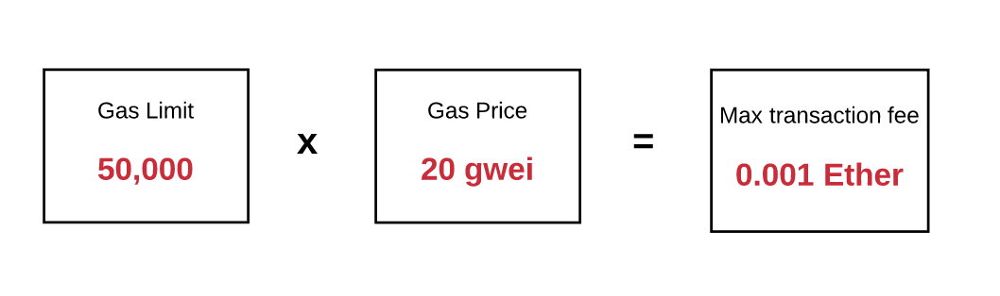

交易实际支付的单价为 `min(maxFeePerGas, Base Fee + maxPriorityFeePerGas)`。如果用户的账户余额有足够的 Ether 来支付这个最大值费用，那么就没问题；在交易结束时，任何未使用的 gas 都会被返还给发送者。

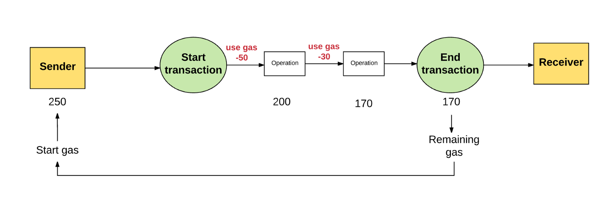

如果发送者没有提供足够的 gas 来执行交易，那么交易执行就会出现“gas 不足”然后被认为是无效的。在这种情况下，交易处理就会被终止，所有已改变的状态将会被恢复，最后我们就又回到了交易之前的状态——完完全全的之前状态，就像这笔交易从来没有发生过。因为机器在耗尽 gas 之前已经为计算做出了努力，所以理论上不会有任何 gas 被返还给发送者。

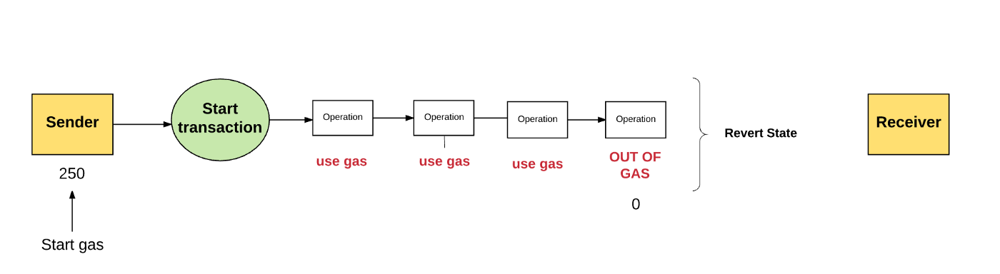

这些 gas 的钱到底去了哪里？

* **基础费用**：被永久销毁（Burned），从 ETH 的总供应量中移除。在链上活动活跃时，销毁量甚至会推动 ETH 进入通缩状态。
* **优先费**：支付给了成功提议该区块的验证者（也就是旧时的“矿工”）。因为提议者为了打包、执行和验证交易付出了计算与带宽成本，所以获得这部分奖励作为回报。

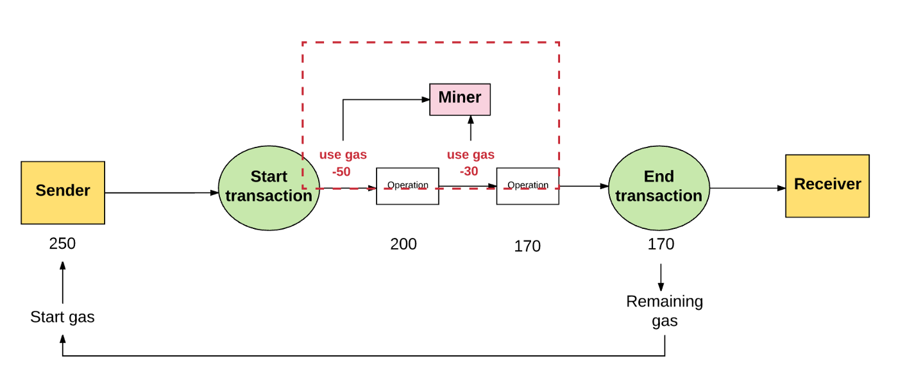

通常，发送者愿意支付更高的优先费，验证者从这笔交易中就能获得更多的价值，因此也就更加愿意优先打包这笔交易——验证者可以自由地选择自己愿意验证或忽略的交易，优先费就是对这种选择权的竞价。

以太坊的费用有什么价值呢？

其一，以太坊可以运作的一个重要方面就是每个网络执行的操作同时也被所有全节点重复执行。然而，计算的操作在以太坊虚拟机上是非常昂贵的。因此，以太坊智能合约最好是用来执行最简单的任务，比如运行一个简单的业务逻辑或者验证签名和其他密码学对象，而不是用于复杂的操作，比如文件存储、电子邮件或机器学习，这些会给网络造成压力。因此，施加费用可以防止网络超负荷运转。

其二，以太坊的智能合约语言是图灵完备的（简而言之，图灵机器就是一个可以模拟任何电脑算法的机器），这意味着代码中可以有循环；如果没有费用的话，恶意的执行者通过执行一个包含无限循环的交易就可以让网络瘫痪。因此，施加费用还可以保护网络不受蓄意攻击。

其三，Gas 不仅仅是用来支付计算这一步的费用，而且也用来支付存储的费用，存储的总费用与数据大小成比例，用以激励用户尽可能降低存储量。因为存储容量的扩大会增加所有节点上的以太坊状态数据库的大小，这是整个网络都必须要负担的成本。

# 5 交易和消息

以太坊是一个基于交易的状态机。换句话说，**不同账户之间发生的交易，是将以太坊的全局状态从一种状态转移到另一种状态的原因**。

**交易是由外部账户生成、序列化、然后提交到区块链的加密签名指令**，可分为两种类型：**消息调用**（message calls）和**合约创建**（contract creations）。

所有交易都包含以下组件，无论其类型如何：
* **nonce**：发送者发送交易数的计数
* **gasPrice**：发送者愿意支付执行交易所需的每个 `gas` 的 `Wei` 数量。EIP-1559 之后，它已逐步被 `maxFeePerGas` 和 `maxPriorityFeePerGas` 取代（详见第 4 节）
* **gasLimit**：发送者愿意为执行交易支付 gas 数量的最大值。此值设置之后在任何计算完成之前就会被提前扣掉
* **to**：接收者的地址。在创建合约的交易中，合约账户地址尚不存在，因此使用空值
* **value**：从发送者转移到接收者 Wei 的数量。在合约创建交易中，value 作为新建合约账户的初始余额
* **v, r, s**：用于产生标识交易发送者的签名
* **init**：只有在合约创建交易中存在，用来初始化新合约账户的 EVM 代码片段。init 值会执行一次，然后就会被丢弃。当 init 第一次执行的时候，它返回一个账户代码体，也就是永久与合约账户关联的一段代码
* **data**：可选域，只有在消息通信中存在，消息通信中的输入数据（也就是参数）。例如，如果智能合约就是一个域名注册服务，那么调用合约可能就会期待输入参数：域名和 IP 地址

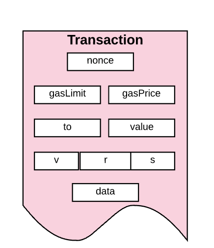

无论是消息通信还是合约创建，**交易都是被外部账户触发并提交到区块链的**。换种说法，**交易是外部世界和以太坊内部状态的桥梁**。

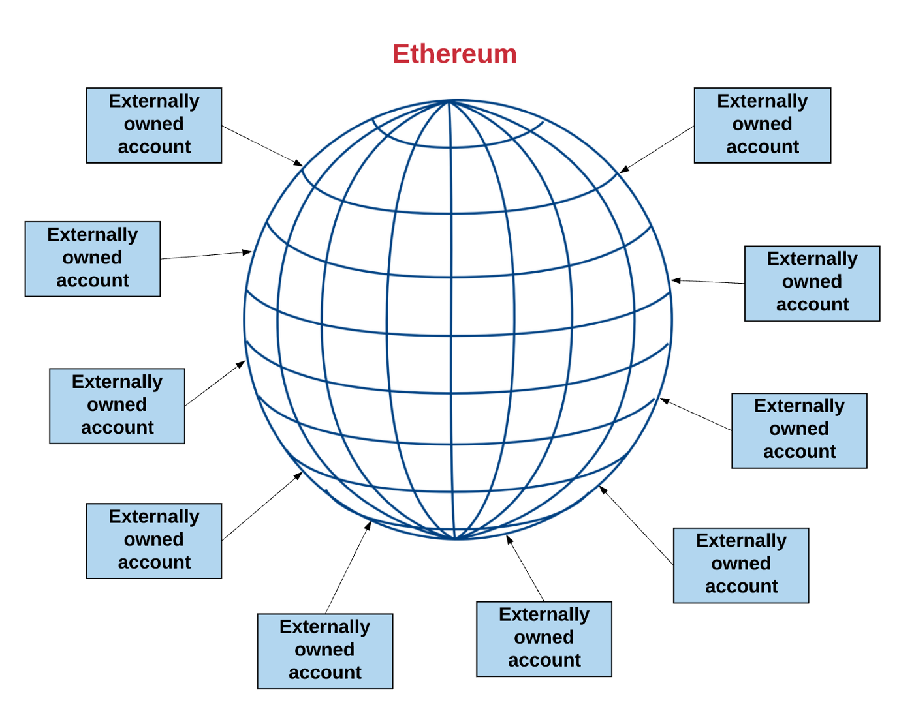

但是这也并不代表一个合约与另一个合约无法通信。在以太坊状态全局范围内的合约可以与在相同范围内的合约进行通信。它们是通过“消息”或者“内部交易”进行通信的。当一个合约发送一个内部交易给另一个合约，存在于接收者合约账户相关联的代码就会被执行。

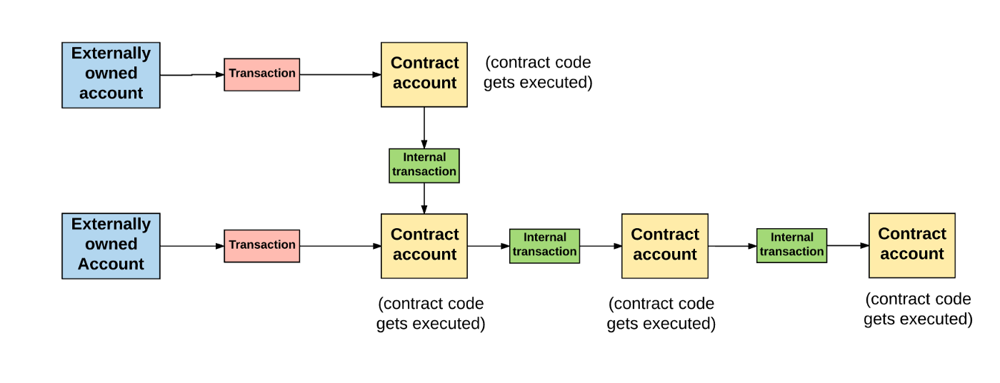

一件需要注意的重要事情是内部交易或者消息不包含 gasLimit。因为 gas limit 是由原始交易的外部创建者决定的（也就是外部账户）。外部账户设置的 gas limit 必须高到足以将交易完成，包括由于此交易而产生的任何“子执行”，例如合约到合约的消息。

随着以太坊确立“以 Rollup（二层网络）为中心”的扩容路线，Layer 2 需要将大量数据发布到主网上以确保安全。过去，这些数据只能挤在昂贵的常规交易中（占用 `calldata`）。

2024 年 3 月的坎昆升级引入了全新的交易类型——**Blob 交易（Type 3 Transaction）**。Blob（Binary Large Object）是一种专门用来携带大块数据的临时存储空间。它的核心特点是：数据只在链上保留约 18 天，随后就会被节点自动丢弃，不永久增加以太坊的状态负担。这一创新将 Layer 2 的交易手续费降低了 90% 以上，标志着以太坊正式进入了低成本应用时代。

2025 年 12 月的 Fusaka 升级又引入了 **PeerDAS**（对等数据可用性采样），使 Blob 数据容量再提升约一个数量级，让 Layer 2 的成本进一步下探。

# 6 以太坊虚拟机

以太坊协议本身的存在仅仅是为了让这个特殊状态机保持连续、不间断和不可变的运行。

**以太坊虚拟机则是所有以太坊账户和智能合约依存的环境**。在链上任何给定的区块处，以太坊有且只有一个“规范”状态，而**以太坊虚拟机定义从一个区块到另一个区块计算新的有效状态的规则**。

通常使用“分布式账簿”的类比来描述像比特币这样的区块链。以太坊也有自己的本机加密货币（ETH），遵循几乎完全相同的规则，但它还支持更强大的功能——智能合约。所以**以太坊不仅仅是分布式账本而已，更确切地说法是分布式状态机**。

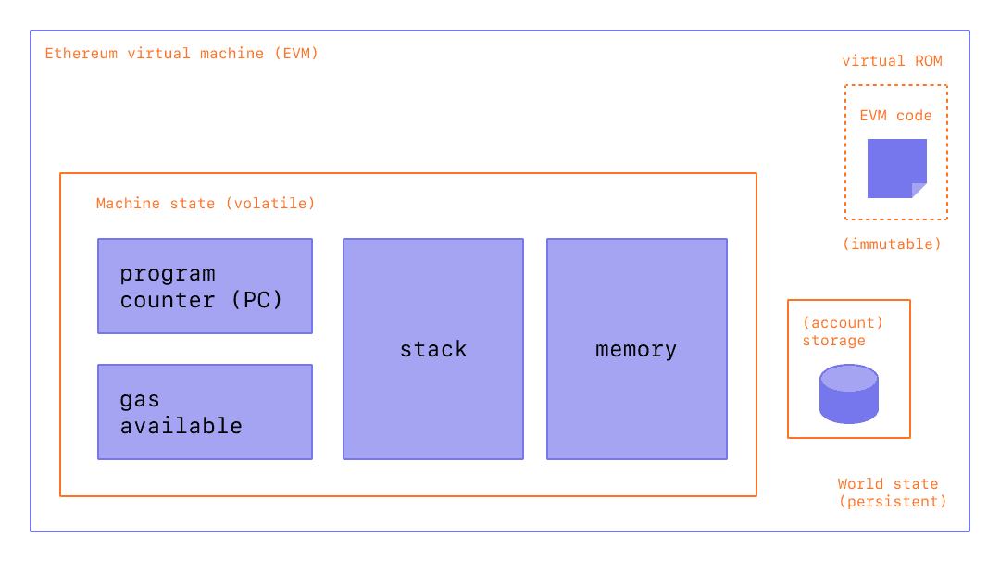

以太坊的状态是一个被称为 MPT 树的巨大数据结构，它不仅保存所有账户和余额，而且还保存一个**机器状态**，它可以根据预定义的一组规则在不同的区块之间进行更改，并且可以执行任意的机器代码。在区块中更改状态的具体规则由 EVM 定义。

**EVM 作为一个堆栈机运行**，其栈的深度为 1024 个项，每一项都是一个 256 位的字，为了便于使用，选择了 256 位加密技术。

EVM 具有内存，其中存储的条目是**按字寻址的字节数组**（word-addressed byte arrays）。内存是易失性的，不会在交易之间持久存在。

EVM 还有存储空间。与内存不同，**存储是非易失性的，并作为系统状态的一部分来维护**。EVM 在一个虚拟 ROM 中独立存储程序代码，只能通过特殊的指令访问虚拟 ROM。这就是 EVM 与典型的冯·诺伊曼结构的不同，冯·诺伊曼结构中程序代码是在内存或存储中。

EVM 也有自己的语言——**EVM 字节码**。当程序员在以太坊上写智能合约的时候，通常用高级语言写代码，比如 **Solidity**。然后可以将其编译成 EVM 字节码，以便 EVM 可以理解执行。

已编译的智能合约字节码作为许多 EVM opcodes 执行，它们执行标准的堆栈操作，例如 `XOR`、`AND`、`ADD`、`SUB` 等。EVM 还实现了一些区块链特定的堆栈操作，如 `ADDRESS`、`BALANCE`、`BLOCKHASH` 等。

虽然 EVM 极其成功，但其底层的字节码格式自诞生以来几乎没有进行过结构性优化，导致代码解析效率低且容易引发漏洞。以太坊开发者正在推进 **EOF（EVM Object Format）** 升级：为智能合约引入明确的“容器”结构，将代码段、数据段和类型信息分离开来。这不仅能降低合约部署的 Gas 消耗，还能从根本上消除某些类型的跳转漏洞，让审计更安全。不过由于牵涉面广，EOF 曾计划随 2025 年底的 Fusaka 升级上线，但最终因时间线风险被移出，截至 2026 年仍未随任何硬分叉落地。

此外，虽然 Solidity 仍是主流，但 EVM 生态正变得更加多元。注重安全的 **Vyper** 语言，以及利用 RISC-V 架构运行 Rust/C++ 编译代码的探索，都在不断拓展以太坊虚拟机的边界。
