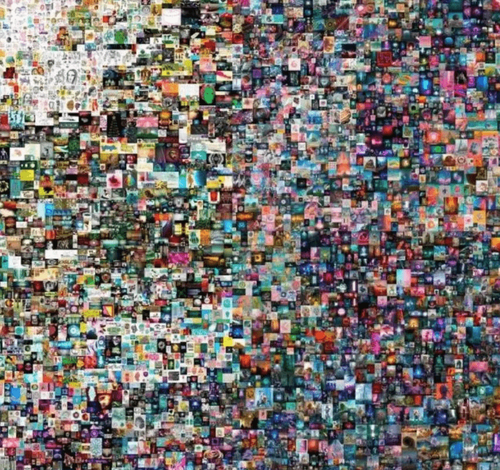
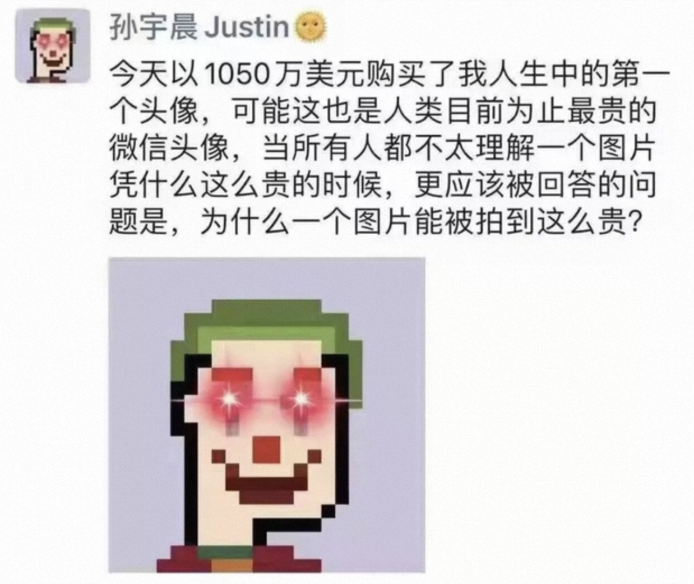
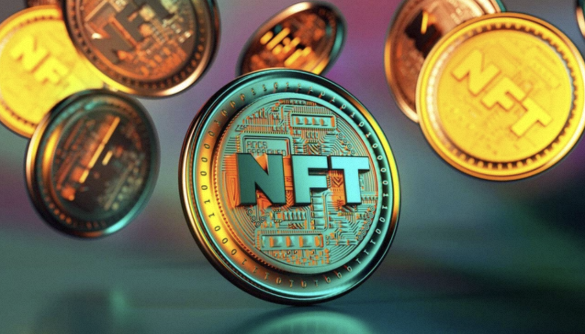

# 1 NFT 的狂热与退潮

NFT 曾在 2021 年前后备受全世界的关注和追捧，那一年也被称为 NFT 的“元年”。

2021 年 3 月 11 日，一幅名为《Everydays: The First 5000 Days》的虚拟画在佳士得以 6900 万美元的惊人价拍出后，NFT 市场迅速获得了大量关注，还吸引了诸如 Visa、耐克、LVMH 等众多知名企业进军 NFT 市场，资本巨头们的投资也吸引了不少的人前往这个虚拟领域进行探索。

这幅画的作者名叫 Beeple，是位来自南卡罗莱纳州的平面设计师兼动态艺术家，作品以创新前卫见长，擅长将流行文化、科技、时事融入创作，在业内颇有名气。

根据作者自述，从 2007 年 5 月 1 日开始，他每天原创并上传一幅数码艺术作品，并取名为《Everydays》。这些作品有的是他的随笔，有的是精细度很高的艺术作品。截至 2021 年 1 月 7 日，13 年半的时间里，坚持了整整 5000 天，最后把这 5000 张数码作品拼贴到一起，并取名《The First 5000 Days》，完成了这幅数码大作。

Beeple 在组合时以时间顺序为基础，将主题和颜色相近的作品放在一起，整幅作品左半边偏亮，右半边偏暗，带有强烈的个人艺术风格。

2021 年 8 月 31 日，孙宇晨花 1050 万美元买了一个 Tpunk 的 NFT 作品，并且设置成自己的微信和推特头像。孙宇晨就是那位花了 3000 万拍下巴菲特的午餐，最后又放了巴菲特鸽子的币圈大佬。

这个价值 1050 万美元的头像，尺寸是 24×24 像素，其中每个像素的价格高达一万七千多美元。

其实这不是 NFT 第一次出圈。

首先是加密猫（CryptoKitties）大火，乃至整个以太坊的网络甚至都因为这款游戏崩溃，最贵的一只猫以 246.9255 以太币成功出售，折合约 12 万美元；之后，彩虹猫的梗图更是卖到了 300 以太币，当时约合 56 万美元；2021 年 8 月，NBA 球星斯蒂芬·库里（Stephen Curry）买了一张猴子头像，花费 55 ETH，按照当时的以太坊价格换算，价值约为 18 万美元……

然而，这场狂热并没有持续太久。自 2022 年下半年起，随着加密市场整体步入熊市，NFT 经历了剧烈的泡沫破裂：全市场年交易额从 2021 年约 250 亿美元的峰值持续下滑，到 2025 年后已萎缩九成以上；上文中那些天价作品——孙宇晨的 Tpunk、库里的猴子头像等——如今大多已大幅缩水，头部蓝筹项目“无聊猿”（Bored Ape Yacht Club）的地板价按美元计较峰值下跌了九成以上，大量靠名人效应炒作起来的 NFT 变得无人问津。名人天价炒作头像的现象在熊市中原形毕露，成为市场回归理性的反面教材。

进入 2023 年之后，市场呈现明显的结构性分化：纯投机性的 PFP（Profile Picture，头像类）项目持续式微，而具有实际效用的方向却在升温——比特币生态的 Ordinals（铭文）一度引爆市场，真实世界资产代币化（RWA）则吸引着传统金融机构不断入场。NFT 正在从投机炒作的标的，回归为一项务实的“数字凭证”技术。

另外需要说明的是中国市场的特殊性。受监管政策限制，国内的 NFT 剥离了“Token（代币）”的金融属性，普遍以“数字藏品”的形态出现：多基于蚂蚁链、至信链、长安链等联盟链发行，平台通常禁止或严格限制二级市场交易，以规避炒作风险，腾讯幻核等头部平台也已于 2022 年宣布停售。因此在中文语境下，“数字藏品”可以理解为“去金融化”的 NFT。

# 2 NFT 的定义

在区块链上，数字加密货币分为**原生币**和**代币**两大类。前者如 BTC、ETH 等拥有自己的主链，使用链上的交易来维护账本数据；代币则是依附于现有的区块链，使用智能合约来进行账本的记录。以太坊是最早也是最大的代币发行平台，如今 Solana、Polygon 等其他公链上也运行着大量代币。

代币之中又可分为**同质化代币**和**非同质化代币**两种。

同质化代币即 **FT**（Fungible Token），互相可以替代、可接近无限拆分的 token。例如，你手里有一个 BTC 与我手里的一个 BTC，本质上没有任何区别，这就是同质化。

而非同质化代币即 **NFT**（Non-Fungible Token），在原生状态下则是唯一的、不可拆分的 token，如加密猫、token 化的数字门票等。也就相当于带有编号的人民币，不会存在两张编号一样的人民币。

因此，相较于 FT，NFT 的关键创新之处在于提供了一种**标记原生数字资产所有权（即存在于数字世界，或发源于数字世界的资产）的方法**，且该所有权可以存在于中心化服务或中心化库之外。NFT 的所有权并不阻止其他人查看它或阅读它，NFT 并不是捕获信息然后把它藏起来，只是**捕捉信息然后发现该信息与链上所有其他信息的关系和价值**。

同时，NFT 由于其非同质化、原生不可拆分的特性，使得它**可以锚定现实世界中商品的概念**，简单来理解，就是发行在区块链上的数字资产，这个资产可以是游戏道具、数字艺术品、门票等，并且**具有唯一性和不可复制性**。由于 NFT 具备天然的收藏属性和便于交易，加密艺术家们可以利用 NFT 创造出独一无二的数字艺术品。

从承载网络来看，NFT 早已不再局限于以太坊。Solana、Polygon、Tezos 等公链都发展出了各具特色的 NFT 生态；2023 年上线的 **Ordinals**（铭文）协议更是把 NFT 直接“写”进了比特币网络——利用比特币最小单位“聪”（satoshi）携带数据的能力，让比特币原生的数字藏品成为 2023-2024 年市场的最大热点之一；2024 年上线的 **Runes**（符文）协议则进一步补齐了比特币生态发行同质化代币的能力。

从技术标准来看，NFT 也在持续演进。最早的 **ERC-721** 确立了 NFT 的基本范式；随后成为主流的 **ERC-1155** 支持在同一个合约里混合管理同质化与非同质化代币，并支持批量铸造和批量转账，大幅降低了 Gas 费用；2023 年提出的 **ERC-6551**（Token Bound Accounts，代币绑定账户）则颇具革命性——它让每一个 NFT 都拥有一个属于自己的链上钱包账户，可以持有代币、其他 NFT 甚至域名等资产，NFT 由此从“一张静态图片”升级为“一个可以不断积累资产的链上容器”。

# 3 NFT 的特点

## 3.1 唯一性

传统艺术作品的数字文件可以被随意复制，NFT 则以区块链确权的方式让这些艺术品获得具有独特标识的“数字身份证”。其创作者可以自行决定某一作品的发行数量并进行编号，流通、交易的每一个环节都通过区块链完整记录，因而每份 NFT 自身都是独特的。

## 3.2 稀缺性

开发者有权利限制发行数量，NFT 具有稀缺性，这是 NFT 玩家和买家的最大吸引力之一。这不仅有利于加密资产的长远发展，也不会有供过于求的隐患。

## 3.3 不可分割性

在原生状态下，每一个 NFT 的最小单位都以一个整体存在，无法像比特币等其他加密货币一样以“1”以下的计量单位流通。不过这一特性并非绝对：通过**碎片化**（Fractionalization）方案，可以把一枚 NFT 锁入智能合约，再按份额发行出若干同质化代币，供多人共同持有和交易。需要注意的是，此时市场上流通的其实是代表所有权的份额代币（FT），NFT 本身依然保持完整。

## 3.4 可拥有

NFT 将分散式区块链技术的最佳功能与不可替代的资产相结合。与由集中式实体发行和监管的普通数字资产不同，NFT 加密资产可以在使用时获得，也可以赋予所有者真正的所有权；真正的所有权是任何 NFT 的关键组成部分之一。

## 3.5 可转让

由于 NFT 是分散的，因此不需要中央发行人，也没有第三方干预，这也使它们更容易转移（个人之间的直接转移）。例如，在游戏领域，NFT 让资产的所有权记录摆脱了游戏厂商的中心化数据库，玩家之间的资产交易无需依赖官方渠道。至于“把一个游戏里的 NFT 武器拿到另一个游戏里直接使用”的跨游戏互操作愿景，理论上可行，但由于不同游戏的引擎、美术风格和经济模型差异巨大，实际落地仍面临技术和商业壁垒，目前大多停留在小规模试点阶段。

## 3.6 可验真

技术可以为这些原生的数字艺术品进行唯一性认证、确权，这是作品价值来源的根基。数字作品的唯一性，可以防止其他假冒作品，有效保护了创作者。

## 3.7 可编程性与动态性

NFT 由智能合约定义，天然可编程。早期的 NFT 铸造之后属性便固定不变，本质上只是一张静态图片；如今兴起的**动态 NFT**（Dynamic NFT，dNFT）则可以通过预言机（Oracle，如 Chainlink）读取链外数据，依据现实世界的变化自动更新自身状态：某位球员在真实比赛中进球后，他对应的 NFT 球员卡会自动升级；天气变化可以改变一幅 NFT 艺术品的画面；游戏里的装备 NFT 能随角色战绩不断成长。可编程性让 NFT 从“静态的收藏凭证”进化为“与真实世界联动的动态实体”。

# 4 NFT 的应用价值

NFT 标记了某一用户对于特定资产的所有权，使得 NFT 成为该特定资产公认的可交易性实体。凭借区块链技术不可篡改、记录可追溯等特点记录产权并确保真实性与唯一性，并通过 NFT 的交易流转实现特定资产的价值流转。这种思想对目前产品的形态及拓展有着极大的作用，出现了大量对于资产、财富、所有权的新诠释形式。其作为承载物品价值的新型数字凭证，越来越受到投资者关注。

在 2021-2022 年的狂热期，NFT 项目主要集中在**数字收藏品**、**游戏资产**与**虚拟世界元宇宙**三大领域，一度形成了颇为完善的生态和成熟的交易流转平台。但随着“元宇宙”概念在 2023 年后大幅降温、纯投机性的头像类项目式微，NFT 的应用重心正转向更务实的方向：真实世界资产代币化（RWA）、身份凭证（SBT），以及带有真实权益的品牌会员（Utility NFT）。

NFT 的应用发展可以划分为以下三个层次：
* **第一层：虚拟收藏品**。比如 Punk、猿猴、Azuki 等。在 2021-2022 年的巅峰期，这一层曾创下惊人的交易纪录——仅 2021 年全市场的 NFT 交易额就约有 250 亿美元；泡沫破裂后市值大幅缩水，头部蓝筹项目按美元计的价格较峰值普遍下跌九成左右，不过它们至今仍是 NFT 市场最成熟的品类。
* **第二层：金融服务**。金融票据、金融证券可以通过 NFT 做技术表征，在数字世界以现行 NFT 的方式呈现、流转，同时利用区块链的可追踪、不可篡改、不可分割、独立的特性，保证全过程可信，避免传统行业通过纸质或者合同等方式遇到的一些弊端。相信 NFT 技术能够创造的价值、涉及的价值主张以及价值范围会越来越宽。
* **第三层：实物资产**。早在 2016 年或 2017 年，国内就有人提出用 NFT 的方式来标记一套房子的所有权，这在技术层面上的问题不大，但是需要权力机关来接受和背书。这一层如今有了更响亮的名字——**RWA**（Real World Assets，真实世界资产代币化），并且正在从设想走向规模化落地。

NFT 具体的应用场景如下：
* **游戏**：例如可用作游戏中的宠物、武器道具、服装和其他的物品。2018 年红极一时的加密猫，用的就是 NFT 技术，他们给每个猫进行特殊的标记编号，让它成为独一无二的猫。
* **知识产权领域**：NFT 可以代表一幅画、一首歌、一项专利、一段影片、一张照片，或者其他的知识产权。在这个领域，NFT 起到的是专利局的作用，帮助每一个独一无二的东西进行版权登记，帮助其识别专利。
* **实体资产（RWA）**：房屋等不动产及其他实物、金融资产，可以用代币化的方式在链上表示和流通。这是目前 Web3 与传统金融结合的核心前沿：贝莱德（BlackRock）2024 年 3 月推出的 BUIDL 基金把美国国债收益权搬上以太坊，管理规模如今已超过 25 亿美元；摩根大通（JPMorgan）在质押品代币化、日内回购等机构结算场景持续落地；富兰克林邓普顿（Franklin Templeton）的链上货币基金也已运行多年。据 RWA.xyz 统计，截至 2026 年年中，链上 RWA 总规模（不含稳定币）已突破 300 亿美元，其中仅代币化美国国债就超过 120 亿美元。严格来说，当下的 RWA 多采用同质化代币形态，但“一份资产对应一个链上凭证”的思路与 NFT 一脉相承。
* **记录和身份证明**：NFT 也可以用来验证身份和出生证明、驾照、学历证书等方面，用数字形式进行安全保存，防止被滥用或篡改。针对这一场景，以太坊创始人 Vitalik Buterin 等人在 2022 年提出了**灵魂绑定代币**（Soulbound Token，SBT）的概念：一种**不可转让**的 NFT，铸造后与钱包地址永久绑定，专门用于承载学历、信用记录、医疗档案等本就不应被买卖的身份凭证，从机制上杜绝了身份的造假与交易。
* **金融票据**：各类金融票据在流通和交易过程中承载大量信息，如果与 NFT 结合，不仅能够确权，还便于追踪。另外，未来各类 NFT 资产的交易本身就可以形成一个细分的金融市场。
* **票务**：演唱会门票、电影票、话剧票等等，都可以用 NFT 来标记——看起来长得一样的票据，实际上有不同的座位号，自然 NFT 也是可以在此得到应用……所有的票都一样，但是座位号不同。
* **品牌忠诚度与会员权益（Utility NFT）**：相比单纯的“炒图”，越来越多品牌把 NFT 用作带有真实权益的会员凭证：星巴克 2022 年底推出的 Odyssey 计划，让会员通过完成任务获得可兑换饮品和活动资格的 NFT（该计划于 2024 年宣布关停，说明只有营销噱头、缺乏持续权益设计的尝试难以持久）；耐克、LVMH 等品牌也以 NFT 门票、实体商品兑换凭证、奢侈品“数字护照”（防伪溯源）等方式，把 NFT 与真实业务结合起来。
* **创作者版税生态**：早期 NFT 的一大卖点是创作者可以从每一笔二级市场交易中自动抽取 5%-10% 的版税；但 2022 年末起，Blur 等新兴交易平台为争夺市场份额发起“零版税/可选版税”战争，多数主流平台随后将版税改为默认可选，创作者的链上版税收入大幅缩水。这场变革深刻改变了加密艺术家的生存模式，也倒逼他们转向品牌合作、实体联名、发行实用型 NFT 等新的变现方式。

回顾 NFT 短短数年的发展：它始于 2021 年的投机狂热，在泡沫破裂后经历残酷洗牌，如今正沿着 RWA、动态 NFT、多链基础设施等方向回归务实。作为一项“数字确权”技术，NFT 的长期价值也许不在于某一个天价头像，而在于它让数字世界的资产与凭证第一次具备了可验证、可编程、可流转的产权基础。
