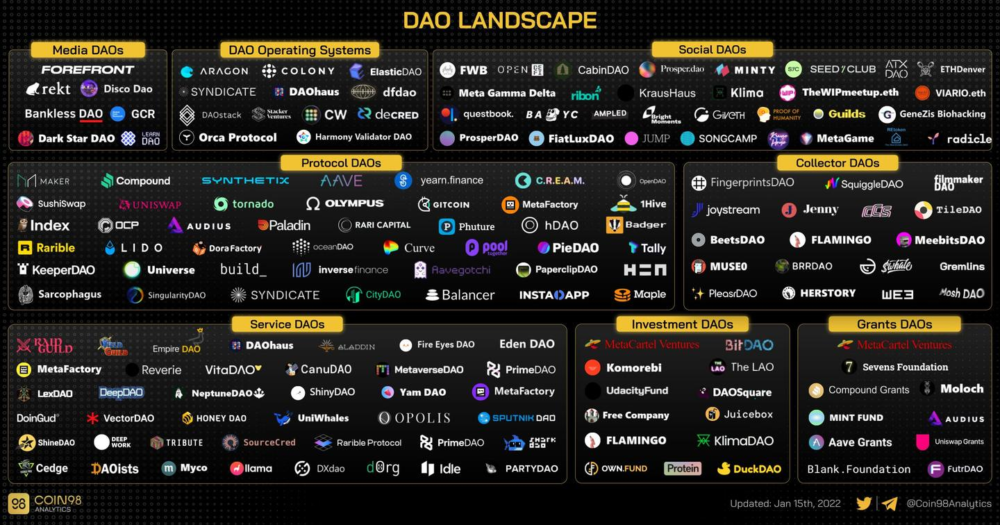
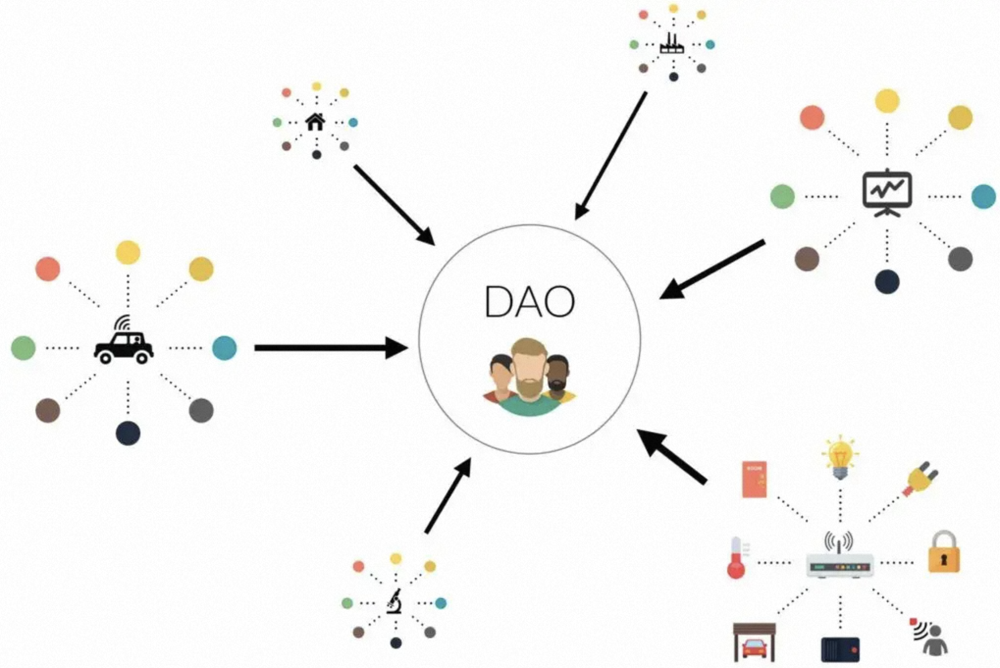
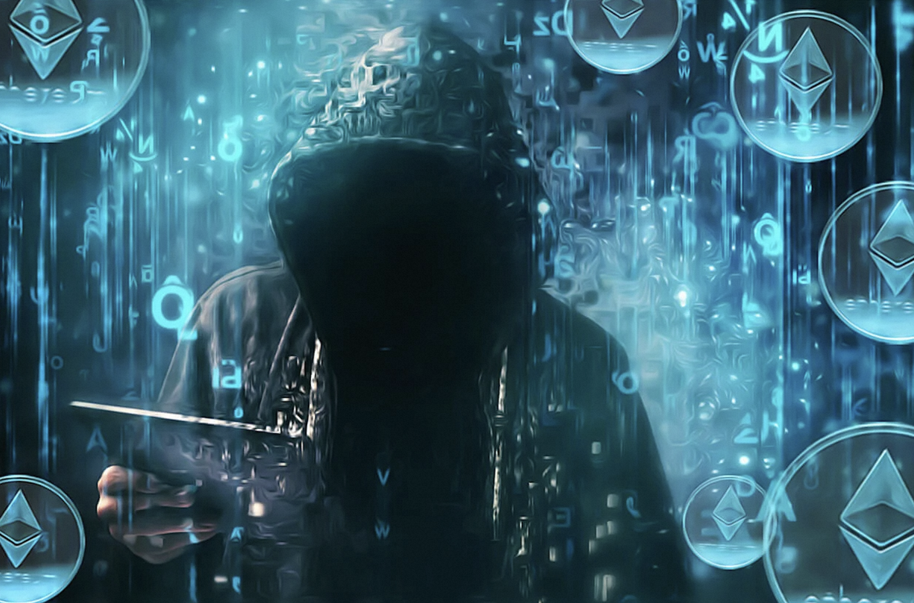

# 1 引言

2021 年至 2022 年初，是 DAO 风起云涌的时期。

从 PleasrDAO 迅速众筹购买知名 NFT、ConstitutionDAO 众筹竞拍美国宪法副本，到 a16z 投资泛兴趣文化社区 FWB DAO，一连串标志性事件见证了 DAO 这一新型组织形式的演化和活跃。DAO 的范围最初集中在 DeFi 项目治理，随后扩展到投资、众筹、兴趣社群等多个领域，一度呈现万物皆可 DAO 的趋势。Messari 的 2021 年终报告中甚至认为：如果说 **2020 年的主题是 DeFi，2021 年的主题是 NFT，那么 2022 年的主题则是 DAO**。

然而，随着 2022 年加密市场进入深度调整期，DAO 的发展从“万物皆可 DAO”的狂热叙事，转向了**务实的基础设施建设与治理效率优化**。如今，DAO 已从单纯的 DeFi 治理，演变为涵盖去中心化科学（DeSci）、AI 代理协作、创作者经济等多个领域的组织范式。

# 2 DAO 是什么

**DAO** 的全称是 `Decentralized Autonomous Organization`，意为**去中心化自治组织**。

关于 DAO 概念的讨论，最早来自链圈传奇人物 BM（Dan Larimer）。2013 年，BM 在对人解释 Bitshares 的机制时，将之类比为 **DAC**（Decentralized Autonomous Corporation），并且归纳 DAC 的核心是“有自己的区块链来交换 DAC 的股份（注：即代币）”，必须不能依赖于“任何个体、公司或组织来拥有价值”、“不能拥有私钥”、“不能依赖任何法律合约”。DAC 是 BM 的首创，虽然定义并不完全清晰，但值得注意的是，DAC 是用来描述如 Bitshares 这样一个完整的产品，认为**产品即公司**，不再依赖人为管理，具有明显的 Autonomous 内涵。

其后，Vitalik 借用并微调了这个词汇，开始在以太坊基金会博客中使用“DAO”这个概念，并认为 DAC 是 DAO 的一个子集，DAC 以盈利为目的，而 DAO 不限于此。除此之外，Vitalik 和 BM 的理解基本是在一个方向上的，而 Vitalik 在更抽象的层面定义了 DAO。根据 Vitalik 的定义，DAO 及相关概念的核心区别点在于：是否拥有内部资本，是自治为主还是人治为主。Vitalik 认为 DAO 所在的象限为：**自治为主、人治为辅、拥有内部资本**。

**大多数 DAO 依赖于区块链技术和智能合约，它们是在区块链上运行的代码集合**。

我们知道，在传统组织中，通常有一个层次结构：正式的董事会、高管或高层管理人员决定结构并有权做出改变。

而 DAO 是去中心化的，这意味着它们不受个人或实体的管理，**每个 DAO 的规则和治理都编码在区块链上的智能合约中**，除非由 DAO 成员投票通过，否则无法更改。每个 DAO 的成员可以共同对决策进行投票。最基础的机制是“一币一票”的代币投票，但这种机制下持币大户的话语权远超普通成员，容易导致巨鲸垄断。为了追求更公平和高效的治理，现代 DAO 还演化出多种更复杂的投票模型，例如：**二次方投票（Quadratic Voting）**以削弱大户权重、**信念投票（Conviction Voting）**根据支持时间长短计算权重，以及**委托投票（Delegation）**让普通成员将投票权委托给专业代表。规则由智能合约编码，但治理模型正变得越来越精细和多元。

对于 DAO 来说，区块链可以充当主干，保持每个链上的结构和规则。一个 DAO 的诞生，必须具备三个基本要素：

* 拥有内部资本，通过利益分配来激励参与者的行为，保证组织运行；
* 拥有一定程度的自治，即不依赖人类意志和行为的自动决策及执行能力；
* 拥有一定程度的人治，且人治模式是去中心化的，即所有成员均拥有参与决策的途径。

# 3 DAO 的应用场景

由 DAO 的功能可以看到，**所有需要人类合作的组织，都可以通过 DAO 的形式来建立**，因而 DAO 的使用场景将极其广泛。例如投资、慈善、筹款、借贷等，所有这些都没有“中介”参与：
* 一个慈善 DAO 可以接受来自世界各地的人们的捐赠，成员们可以决定如何使用捐赠；
* 风险投资 DAO 可以创建一个风险基金，汇集投资资本并投票支持风险投资，偿还的钱可以在 DAO 成员之间重新分配；
* 传统众筹方式，会担心组织者跑路，或者出现各种意想不到的问题，但 DAO 本质是一种写在区块链上的计算机代码，是一种电子合同，而执行合同是代码程序决定的，不会有人为干预，满足代码条件就自动执行了。

通过归类 DAO 的主要使用场景，也即人们的合作目标，可以对 DAO 进行如下分类：

* **项目治理类 DAO**：依托于一个独立产品而建立的治理社区，如 DeFi 领域的 CurveDAO。
* **资源调度类 DAO**：筹集资源来完成共同目的，如专注 DApp 投资的 MetaCartel、专注 NFT 收藏的 PleasrDAO、众筹竞拍美国宪法副本的 ConstitutionDAO、购买大额游戏 NFT 资产的 YGG DAO。
* **文化兴趣类 DAO**：用户围绕相近的文化兴趣而聚集社交，但没有单一固定目的，如 FWB DAO。

近年来，DAO 的形态还在持续扩展，出现了由 AI 代理运营或深度参与的 AI DAO、聚焦科研资助的 DeSci DAO 等新类型，详见第 5 节。

# 4 DAO 面对的挑战

尽管 DAO 越来越受欢迎，但要达到完全主流采用还有很长的路要走。无论区块链技术如何发展，“安全”都放在第一位。

投票系统的一个潜在问题是，即使在其初始代码中发现了安全漏洞，也无法在多数人投票之前予以纠正。在投票过程中，黑客可以利用代码中的漏洞进行攻击。

2016 年 5 月，德国初创公司 Slock.it 推出了创意命名的“**The DAO**”，以支持他们的去中心化版 Airbnb。当时，众筹活动取得了巨大的成功，筹集了价值超过 1.5 亿美元的以太坊。

不幸的是，他们在 DAO 中使用的代码存在某些问题。不可避免地，在 2016 年 6 月，黑客基于这些漏洞攻击了 DAO。黑客获得了 360 万个 ETH，当时价值约 5000 万美元。

这在 DAO 投资者中引发了一场大规模且有争议的争论，一些人提出了各种解决黑客问题的方法，另一些人则呼吁永久解散 DAO。

当时，DAO 建立在以太坊网络上，使用智能合约算法来确保其治理结构和经济激励。为了阻止网络攻击，以太坊区块链进行了**硬分叉**，**导致以太坊分裂成两个不同的区块链**：一条为原链（以太坊经典，ETC），一条为新的分叉链（ETH），各自代表不同的社区共识以及价值观。这仍然被称为加密货币中最大的黑客攻击之一，暴露了 DAO 的风险并削弱了投资者的信任。

除了安全问题，DAO 还有很多其他需要完善的地方：

* 1）从初始阶段很难做出完整的 DAO。在项目的早期阶段，需要有人领导和发展。否则 DAO 会没有方向。我们更倾向于说，一个项目应该先成立，后续慢慢向 DAO 发展。

* 2）法律法规不明确。过去，DAO 的法律主体地位模糊不清：DAO 通常会创建“社区钱包”，但这个钱包的归属无法界定，当收入累积在社区钱包中时，谁来支付应该征收的税款也无从谈起。近年来，**全球多地已出台针对 DAO 的明确法律框架**：美国怀俄明州、犹他州，以及马绍尔群岛、瑞士等地均已通过立法，允许 DAO 注册为有限责任公司（LLC）或基金会，赋予其合法签署合同、开设银行账户和纳税的能力。此外，像 **doola** 这样的合规服务平台，已经能够帮助 DAO 在全球范围内快速完成法律实体的封装（Legal Wrapping），解决了社区钱包归属和税务合规的痛点。

* 3）运营 DAO 的工具开发不足。2022 年初，当你真正尝试运行 DAO 时，就会意识到工具匮乏的挑战；但如今，**DAO 工具栈（Tooling Stack）已高度成熟**：**Aragon** 和 **DAOhaus** 提供了无代码的 DAO 创建平台；**Snapshot** 实现了免 Gas 费的链下投票；**Safe**（原 Gnosis Safe）成为多签国库管理的行业标准；**Coordinape** 和 **SourceCred** 解决了贡献者薪酬分配问题；**Tally** 则提供了专业的链上治理看板。工具的完善极大降低了 DAO 的启动门槛。

* 4）DAO 基础设施仍不够完善，仍存在很大的技术壁垒；

* 5）普通用户参与积极度不高，治理仍具有中心化属性；

* 6）DAO 的运作机制仍不完善，可借鉴案例有限；

* 7）DAO 的周期性没有持续性赋能。

* 8）跨组织的协作交易困难。早期 DAO 只解决了组织内部运营的信任和内驱问题，组织之间的协作交易难以开展，一度被认为极其致命，甚至有“自给自足的农耕干不过贸易的企业制”、DAO“适合政治组织、不适宜商业组织”这样的质疑。但如今，DAO 之间的协作已通过跨链互操作协议和 B2B 服务赏金模式得到明显改善，证明去中心化组织在商业运作中同样具备强大的生命力。

* 9）集体决策效率与“去中心化组织”的内在张力。早期 DAO 的集体决策效率确实常常不如个体决策，甚至有人断言“去中心化”和“组织”在逻辑上矛盾，“并不存在‘去中心化的组织’，就像不存在发光的影子”。但这一痛点已随治理机制的进化而大幅缓解：**渐进式去中心化（Progressive Decentralization）**让核心团队负责早期的高效执行、随后逐步放权；MakerDAO 等大型 DAO 则通过 **SubDAO（子 DAO）架构**将特定业务拆分为独立的子组织，兼顾效率与去中心化。

* 10）DAO 作为一个去中心化的组织，治理机制相当于公司的规章制度，十分关键，而其中最要紧的一点是激励机制，很多人加入一个 DAO 组织更多是为了利益，有的人追求长久利益，有的追求短期利益，如何针对这些人的贡献设计激励机制是一个 DAO 能否长期发展最为关键的要素，就目前市面上而言，共识 DAO 无疑是最成功的之一，其他应用场景尚在探索。

# 5 DAO 的前沿发展与未来趋势

自 2022 年以来，DAO 领域发生了范式级别的演进，最值得关注的有以下几个方向。

## 5.1 AI Agent DAO

这是目前最前沿的趋势：AI 不再仅仅是工具，而是作为独立实体参与 DAO 的治理和经济活动，**AI 驱动的自治组织（AI DAO）**正在重塑我们对“Autonomous（自治）”的理解。2023 至 2024 年间，随着大语言模型的成熟，出现了完全由 AI 代理（AI Agent）运营或深度参与的 DAO。例如，**ai16z** 作为一个由 AI 代理管理的风险投资基金，其投资决策和市场互动均由 AI 驱动，人类仅扮演监督角色。此外，许多传统 DAO 开始引入 AI 代理来处理提案摘要生成、情绪分析、自动化财务审计等繁琐工作，极大提升了治理效率。未来的 DAO 可能是“人类设定目标，AI 代理自动执行”的混合形态。

## 5.2 DeSci（去中心化科学）

DAO 的应用场景已经从 Web3 原生领域破圈，进入传统的科学研究领域。**去中心化科学（DeSci）**是 DAO 最具社会价值的落地场景之一。传统科研面临资金分配不透明、论文发表被出版商垄断等问题，而 **VitaDAO** 专注于资助长寿研究，**ValleyDAO** 致力于合成生物学，**ResearchHub** 推动开放科学。这些 DeSci DAO 通过发行 IP-NFT（知识产权 NFT），让资助者共同拥有科研成果的专利权，不仅打破了传统学术壁垒，还为早期科研项目提供了全新的众筹与激励机制。

## 5.3 渐进式去中心化与 SubDAO 架构

针对“早期需要人领导”和“集体决策效率低下”的问题，业界已经摸索出成熟的组织架构。为了平衡“去中心化”与“高效率”之间的矛盾，现代 DAO 普遍采用**渐进式去中心化（Progressive Decentralization）**策略：项目初期由核心团队集中决策以保证生存，产品成熟后再逐步将控制权移交给社区。在组织架构上，**SubDAO（子 DAO）模式**成为主流。例如，**MakerDAO** 启动了著名的“Endgame（终局）”重组计划，将其庞大的生态系统拆分为多个职责单一的 SubDAO。这种“联邦制”结构既保留了母 DAO 的资金优势，又赋予了子 DAO 极高的敏捷性和执行力。

## 5.4 基于声誉的治理：SBT 与灵魂绑定代币

为了解决“一币一票”带来的“财阀统治（Plutocracy）”问题，DAO 的治理凭证正在从同质化代币（Token）向**非转移性声誉凭证**演变，投票模式也从按持币数量投票向“一人一票”或“按贡献投票”演进。以太坊联合创始人 Vitalik 等人提出的**灵魂绑定代币（Soulbound Token，简称 SBT）**概念已被广泛应用。例如，**Gitcoin Passport** 和各类 DAO 的声誉系统，会根据成员的代码提交量、会议参与度、历史投票记录等链上和链下行为，为其铸造不可交易的声誉积分。治理权重开始与“真实贡献”挂钩，而非单纯与“持币数量”挂钩，这让 DAO 更加接近真正的精英共治。
