# 一致性协议

# 1 引言

在传统单体应用下，请求从客户端到服务层，再到数据库，很多时候通过关系型数据库自身的事务机制，保证了数据在读写层面的一致性（ACID）。

而对于分布式系统来说，在实际的场景中很容易出现以下问题：

* 节点之间的网络通信是不可靠的，包括消息延迟、乱序、内容错误等；
* 节点的处理时间无法保障，结果可能出现错误，甚至节点自身宕机。

所以就需要通过一些协议和算法来保证数据的一致性，换句话说，就是保证集群里的节点存储的数据是一模一样的。

一致性协议可以有多种分类方法，关键要看我们选取的是哪个观察角度，这里我们从单主和多主的角度对协议进行分类。

单主协议：即整个分布式集群中只存在一个主节点，主节点发出数据，传输给其余从节点，能保证数据传输的有序性。采用这个思想的主要有 **2PC**、**Paxos**、**Raft** 等。

多主协议：即整个集群中不只存在一个主节点，从多个主节点出发传输数据，传输顺序具有随机性，因而数据的有序性无法得到保证，只保证最终数据的一致性。典型代表是 **PoW** 协议以及著名的 **Gossip** 协议。

# 2 Gossip 协议

## 2.1 基本概念

> `Gossip protocol` 也叫 `Epidemic Protocol`（流行病协议）。Gossip protocol 于 1987 年由施乐公司发表在 ACM 上的论文《Epidemic Algorithms for Replicated Database Maintenance》中提出。原本用于分布式数据库中节点同步数据，后被广泛用于数据库复制、信息扩散、集群成员身份确认、故障探测等。

Gossip 协议是**六度分隔理论**（Six Degrees of Separation）哲学的体现。简单地说，一个人通过 6 个中间人就可以认识世界上任何一个人。假设每个人认识 150 人，其六度就是 `150⁶ = 11,390,625,000,000`（约 11.4 万亿）。

基于六度分隔理论，任何信息的传播其实非常迅速，而且网络交互次数不会很多。比如 Facebook 在 2016 年 2 月 4 日发布了一项研究：分析了当时 15.9 亿用户的资料，发现用户之间的平均距离是 4.57，翻成白话文意味着每个人与其他任何人之间平均只隔 3.57 个人。

Gossip 协议的消息传播方式有两种：

* **Anti-Entropy（反熵传播）**：以固定的概率传播所有的数据。所有参与节点只有两种状态：Susceptible（易感）、Infective（感染）。这种节点状态模型又叫作 simple epidemics（SI model）。过程是种子节点会把所有的数据都跟其他节点共享，以便消除节点之间数据的任何不一致，它可以保证最终、完全的一致。缺点是消息数量非常庞大，且无限制；**通常只用于新加入节点的数据初始化**。
* **Rumor-Mongering（谣言传播）**：以固定的概率仅传播新到达的数据。所有参与节点有三种状态：Susceptible（易感）、Infective（感染）、Removed（移除）。这种节点状态模型又叫作 complex epidemics（SIR model）。过程是消息只包含最新的 update，谣言消息在某个时间点之后会被标记为 removed，并且不再被传播。缺点是系统有一定的概率会不一致，**通常用于节点间数据增量同步**。

Gossip 协议的最终目的是将数据分发到网络中的每一个节点。根据不同的具体应用场景，网络中两个节点之间存在三种通信方式：

* **Push**：节点 A 将数据 `(key, value, version)` 推送给 B 节点，B 节点更新 A 中比自己新的数据；
* **Pull**：A 仅将数据 `(key, version)` 推送给 B，B 将本地比 A 新的数据 `(key, value, version)` 推送给 A，A 更新本地；
* **Push/Pull**：与 Pull 类似，只是多了一步，A 再将本地比 B 新的数据推送给 B，B 则更新本地。

如果把两个节点数据同步一次定义为一个周期，则在一个周期内，Push 需通信 1 次，Pull 需 2 次，Push/Pull 则需 3 次。虽然消息数增加了，但从效果上来讲，Push/Pull 最好，理论上一个周期内可以使两个节点完全一致。直观上，Push/Pull 的收敛速度也是最快的。

## 2.2 执行过程

Gossip 协议执行过程：

1. 种子节点周期性地散播消息。
2. 被感染节点随机选择 `N` 个邻接节点散播消息。
3. 节点只接收消息不反馈结果。
4. 每次散播消息都选择尚未发送过的节点进行散播。
5. 收到消息的节点不再往发送节点散播：`A -> B`，那么 B 进行散播的时候，不再发给 A。

接下来通过多张图片剖析 Gossip 协议是如何运行的。如下图所示，Gossip 协议是周期循环执行的。图中的公式表示 Gossip 协议把信息传播到每一个节点需要多少次循环动作，需要说明的是，公式中的 20 表示整个集群有 20 个节点，4 表示某个节点会向 4 个目标节点传播消息：

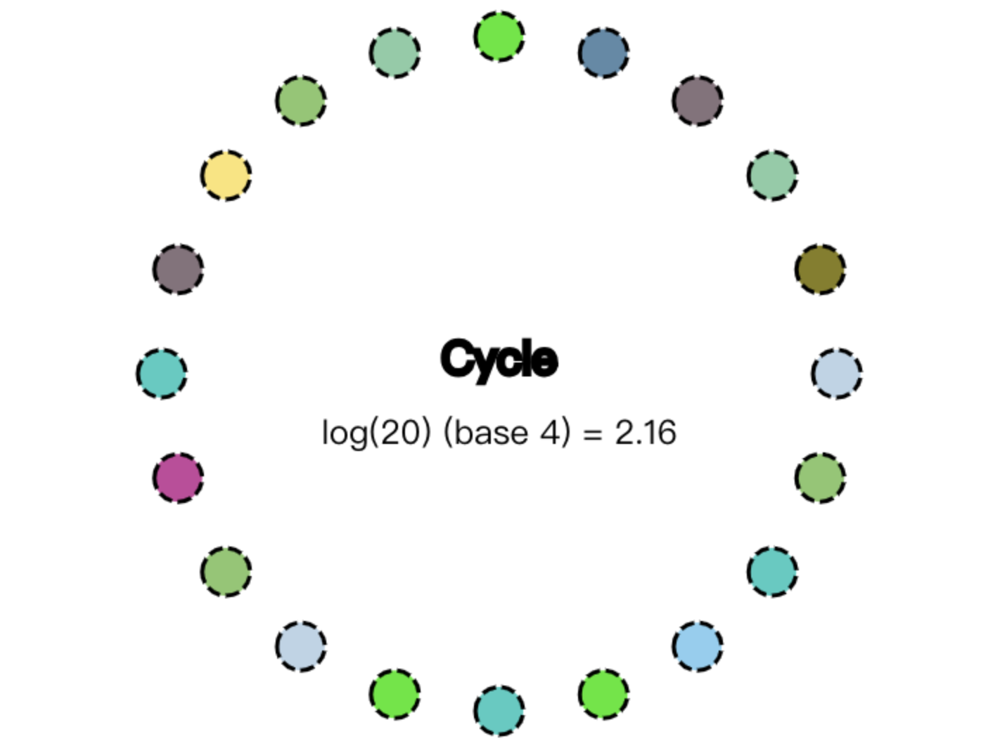

如下图所示，红色的节点表示其已经“受到感染”，即接下来要传播信息的源头，连线表示这个初始化感染的节点能正常连接的节点（其不能连接的节点只能靠接下来感染的节点向其传播消息）。并且 `N` 等于 4，我们假设 4 根较粗的线路，就是它第一次传播消息的线路：

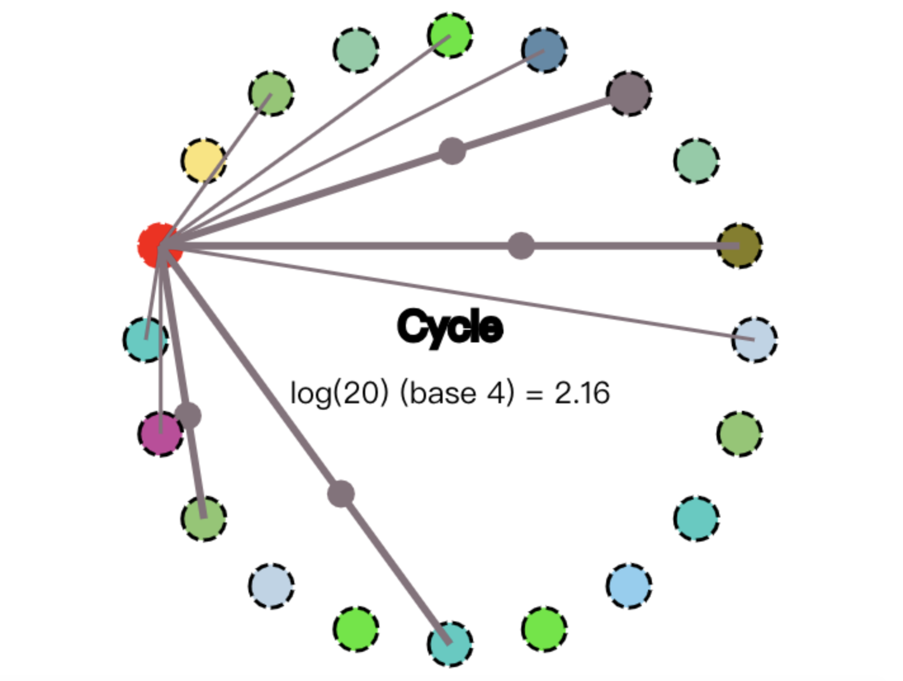

第一次消息完成传播后，新增了 4 个节点会被“感染”，即这 4 个节点也收到了消息。这时候，总计有 5 个节点变成红色：

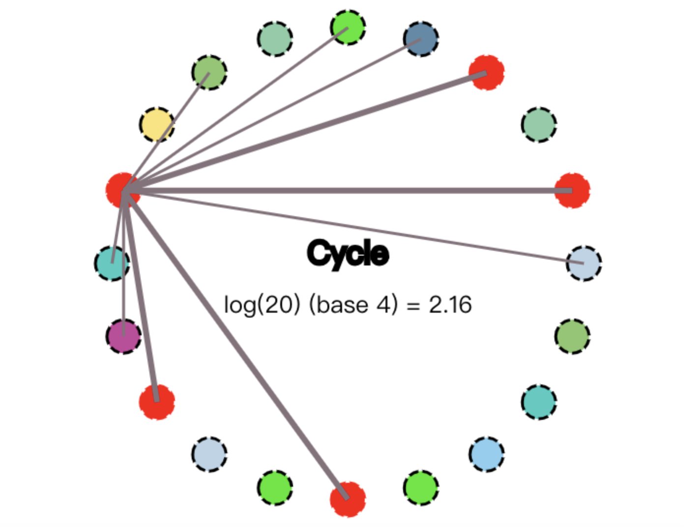

那么在下一次传播周期时，总计有 5 个节点，且这 5 个节点每个节点都会向 4 个节点传播消息。最后，经过 3 次循环，20 个节点全部被感染（都变成红色节点），即说明需要传播的消息已经传播给了所有节点：

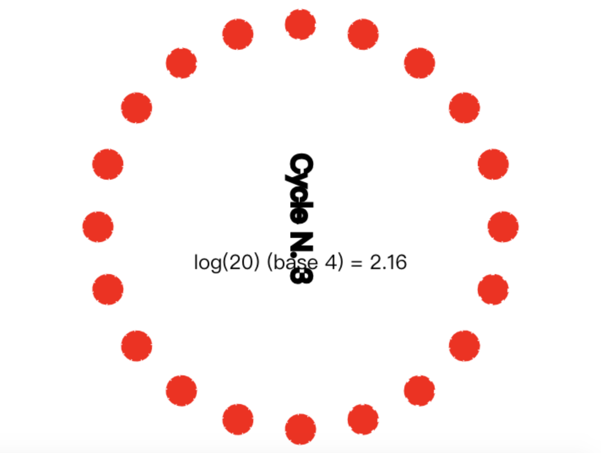

需要说明的是，20 个节点且设置 `fanout = 4`，公式结果是 2.16，这只是个近似值。真实传递时，可能需要 3 次甚至 4 次循环才能让所有节点收到消息。这是因为每个节点在传播消息的时候，是随机选择 `N` 个节点的，这样的话，就有可能某个节点会被选中 2 次甚至更多次。

Gossip 协议的信息传播和扩散通常需要由种子节点发起。整个传播过程可能需要一定的时间，虽然不能保证某个时刻所有节点都收到消息，但理论上最终所有节点都会收到消息，因此它是一个**最终一致性**协议。

Gossip 协议是一个多主协议，所有写操作可以由不同节点发起，并且同步给其他副本。Gossip 内组成的网络节点都是对等节点，是非结构化网络。

## 2.3 总结

综上所述，我们可以得出 Gossip 是一种去中心化的分布式协议，数据通过节点像病毒一样逐个传播。因为是指数级传播，整体传播速度非常快。

它具备以下优势：

* **可扩展性**：允许节点的任意增加和减少，新增节点的状态最终会与其他节点一致。
* **容错性**：任意节点的宕机和重启都不会影响 Gossip 消息的传播，具有天然的分布式系统容错特性。
* **去中心化**：无需中心节点，所有节点都是对等的，任意节点无需知道整个网络状况，只要网络连通，任意节点可把消息散播到全网。

同样也存在以下缺点：

* **消息延迟**：节点随机向少数几个节点发送消息，消息最终是通过多个轮次的散播而到达全网，不可避免地造成消息延迟。
* **消息冗余**：节点定期随机选择周围节点发送消息，而收到消息的节点也会重复该步骤，不可避免地引起同一节点多次接收同一消息，增加消息处理压力。
* **拜占庭问题**：如果有一个恶意传播消息的节点，基于 Gossip 协议的分布式系统就会出问题。

Gossip 协议由于以上的优缺点，适合于 AP 场景的数据一致性处理，常见应用有：P2P 网络通信、Apache Cassandra、Redis Cluster、Consul。

# 3 Paxos 协议

## 3.1 基本概念

**Paxos** 算法是分布式领域的大师 **Lamport** 提出的一种基于消息传递的一致性算法。Lamport 于 2013 年因其在分布式系统理论方面的奠基性贡献获得图灵奖，Paxos 正是其中的代表性成果之一。

有一种说法，说**所有共识算法都是 Paxos**。这种说法的来源，一方面是由于 Paxos 提出得非常早，另一方面则是因为，Paxos 解决的其实是在分布式环境下，所有服务就某个值达成一次共识的过程，而这一过程，可以说每种共识算法都绕不开。

在 Raft 出现之前，Paxos 长期主导着分布式一致性算法领域，Paxos 这个名词几乎等同于分布式一致性。Google 的很多大型分布式系统都采用了 Paxos 算法来解决分布式一致性问题，如 Chubby、Megastore 以及 Spanner 等。MySQL 5.7 推出的用来取代传统主从复制的 MySQL Group Replication 也采用了 Paxos 的变种；开源的 ZooKeeper 使用的 ZAB 协议同样借鉴了 Paxos 的思想。

Paxos 采取了一个我们非常熟悉的达成共识的方法：**少数服从多数**。只要有超过一半的机器认可某一个消息，那么最终所有机器都会接受这条消息并将它作为本次的结论。而竞选失败的少数派消息，就会被拒绝，并由第一个从客户端处接收到该消息的机器，向客户端发送失败结果，由客户端进行重试，去尝试在下一轮竞选中胜出。

Paxos 算法运行在允许宕机故障的异步系统中，不要求可靠的消息传递，可容忍消息丢失、延迟、乱序以及重复。它利用多数派机制保证了 `2F + 1` 的容错能力，即 `2F + 1` 个节点的系统最多允许 `F` 个节点同时出现故障。

Paxos 将系统中的角色分为**提议者**（Proposer）、**决策者**（Acceptor）和**学习者**（Learner）：

* **Proposer**：提出提案（Proposal）。Proposal 信息包括提案编号（Proposal ID）和提议的值（Value）。
* **Acceptor**：参与决策，回应 Proposer 的提案。收到 Proposal 后可以接受提案，若 Proposal 获得多数 Acceptor 的接受，则称该 Proposal 被批准。
* **Learner**：不参与决策，从 Proposer/Acceptor 学习最新达成一致的提案（Value）。

在多副本状态机中，每个副本同时具有 Proposer、Acceptor、Learner 三种角色。

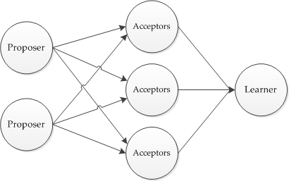

Paxos 算法达成一个决议分为两个阶段：

* **Prepare 阶段**：Proposer 向 Acceptor 发出 Prepare 请求，Acceptor 针对收到的 Prepare 请求进行 Promise 承诺。
* **Accept 阶段**：Proposer 收到多数 Acceptor 承诺的 Promise 后，向 Acceptor 发出 Propose 请求，Acceptor 针对收到的 Propose 请求进行 Accept 处理。

Proposer 在收到多数 Acceptor 的 Accept 之后，标志着本次 Accept 成功，决议形成，将形成的决议发送给所有 Learner。

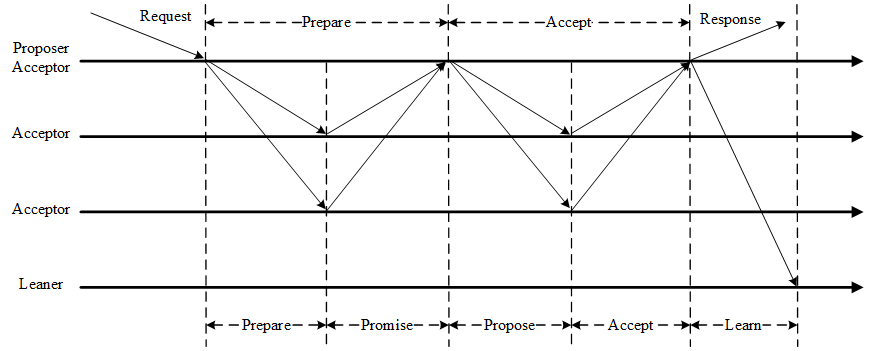

Paxos 算法流程中的每条消息描述如下：

* **Prepare**：Proposer 生成**全局唯一且递增**的 Proposal ID（可使用时间戳加 Server ID），向所有 Acceptor 发送 Prepare 请求，这里无需携带提案内容，只携带 Proposal ID 即可。
* **Promise**：Acceptor 收到 Prepare 请求后，做出“两个承诺，一个应答”。

**两个承诺：**

1. 不再接受 Proposal ID 小于等于（注意：这里是 `<=`）当前请求的 Prepare 请求。
2. 不再接受 Proposal ID 小于（注意：这里是 `<`）当前请求的 Propose 请求。

**一个应答：**

在不违背以前作出的承诺的前提下，回复已经 Accept 过的提案中 Proposal ID 最大的那个提案的 Value 和 Proposal ID，没有则返回空值。

* **Propose**：Proposer 收到多数 Acceptor 的 Promise 应答后，从应答中选择 Proposal ID 最大的提案的 Value，作为本次要发起的提案。如果所有应答的提案 Value 均为空值，则可以自己随意决定提案 Value。然后携带当前 Proposal ID，向所有 Acceptor 发送 Propose 请求。
* **Accept**：Acceptor 收到 Propose 请求后，在不违背自己之前作出的承诺的前提下，接受并持久化当前 Proposal ID 和提案 Value。
* **Learn**：Proposer 收到多数 Acceptor 的 Accept 后，决议形成，将形成的决议发送给所有 Learner。

## 3.2 执行过程

### 3.2.1 一个简单的提案

先描述最简单的情况，假设现在有四台机器，其中一台收到了来自客户端的写操作请求，需要同步给其他机器。

此时这台收到请求的机器，我们称它为 Proposer，因为它将要开始将收到的请求，作为一个提案，提给其他的机器。这里为了方便，我们假设这个请求是要将一个地址设置为“深圳”，那么如下图所示：

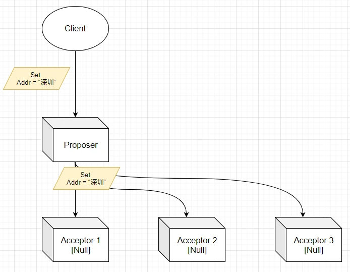

此时，其他的 Acceptor 都闲着呢，也没其他人找，所以当它们收到 Proposer 的提案时，就直接投票了，说可以可以，我是空的，赞成提案（同意提议）：

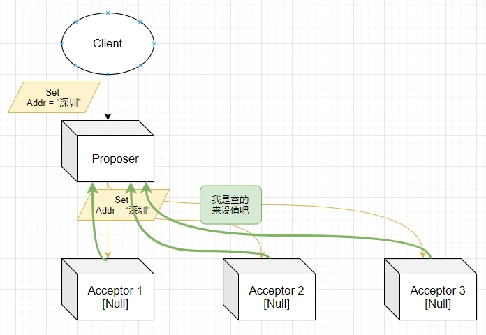

到这里还只是一个简单的同步故事，但需要注意，在这个简单的提案过程中，Proposer 其实经历了两个阶段：

* **Prepare 阶段**：Proposer 告诉所有其他机器，我这里有一个提案（操作），想请你们投票支持一下，听听大家的意见。Acceptor 看自己是 NULL，也就是目前还没有接受过其他的提案，就说我肯定支持。
* **Accept 阶段**：Proposer 收到其他机器的回复，说它们都是空的，也就是都可以支持接受 Proposer 的提案（操作），于是正式通知大家这个提案被集体通过了，可以生效了，操作就会被同步到所有机器正式生效。

### 3.2.2 两个提案并发进行

现在考虑一个更复杂的场景，因为我们处于一个分布式的场景，每台机器都可能会收到请求，那如果有两台机器同时收到了两个客户端的不同请求，该怎么处理呢？大家听谁的呢？最后的共识以谁的为准呢？如下图所示：

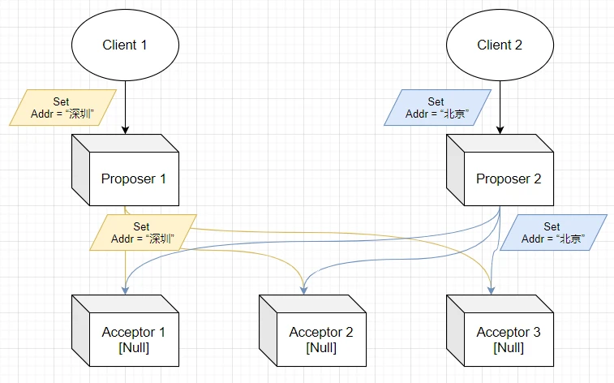

在这种情况下，由于网络传输的时间问题，两个 Proposer 的提案到达各个机器，是会存在先后顺序的。假设 Proposer 1 的提案先到达了 Acceptor 1 和 Acceptor 2，而 Proposer 2 的提案先到达了 Acceptor 3，其到达 Acceptor 1 和 Acceptor 2 时，由于机器已经投票给 Proposer 1 了，所以 Proposer 2 的提案遭到拒绝，Proposer 1 到达 Acceptor 3 的时候同样被拒。

Acceptor 们迷了，Proposer 们也迷了，到底应该接受谁？此时，还是遵循自由民主的法则——少数服从多数。

Proposer 1 发现超过半数的 Acceptor 都接受了自己，所以放心大胆地发起要求，让所有 Acceptor 都按照自己的值来操作。而 Proposer 2 发现只有不到半数的 Acceptor 支持自己，而有超过半数是支持 Proposer 1 的值的，因此只能拒绝 Client 2，并将自己也改为 Proposer 1 的操作：

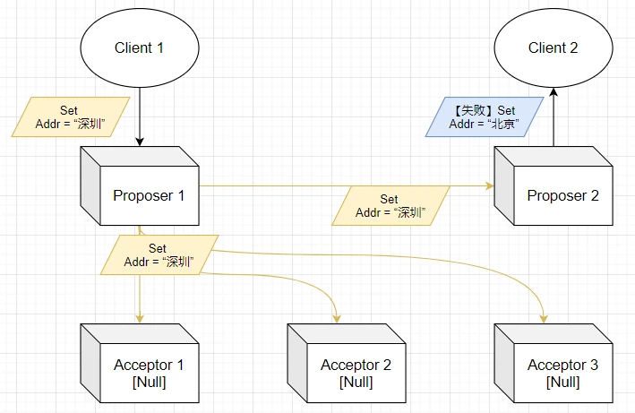

到此为止，看起来没有问题，但是，这是因为恰好 Acceptor 的数量是奇数，可以选出“大多数”。由于同时成为 Proposer 的机器数量是不确定的，因此无法保证 Acceptor 的数量一定是奇数，如下面这种情况就无法选出“大多数”了：

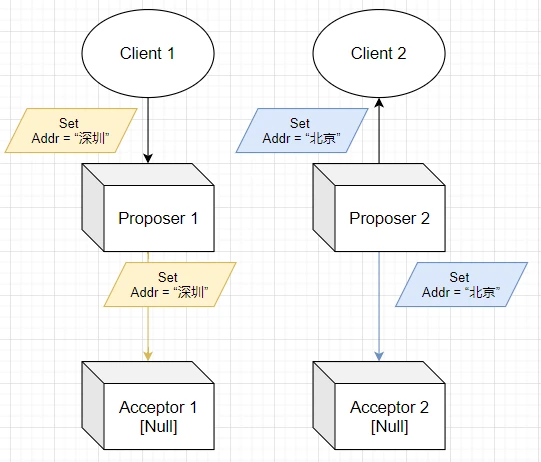

这时，两个 Proposer 有可能总是先抢到一个 Acceptor 的支持，然后在另一个 Acceptor 处折戟沉沙，算法就一直循环死锁下去了。为了解决这种情况，Paxos 给提案加了一个编号。

### 3.2.3 给提案加上编号

之前我们 Proposer 的提案都是只有操作内容的，现在我们给它加一个编号，即：

* Proposer 1 的提案为：`[n1, v1]`
* Proposer 2 的提案为：`[n2, v2]`

假设 Proposer 1 接到 Client 1 的消息稍微早一点，那么它的编号就是 1，Proposer 2 的编号就是 2，那么它们的提案实际就是：

* Proposer 1 的提案为：`[1, {Set Addr = "深圳"}]`
* Proposer 2 的提案为：`[2, {Set Addr = "北京"}]`

此时，Paxos 加上一条规则：

> Acceptor 如果还没有正式通过提案（即还没有 Accept 使操作生效），就可以接受编号更大的 Prepare 请求。

所以，回到上面的困境。

当 Proposer 1 想要向 Acceptor 2 寻求支持时，Acceptor 2 一看你的编号（1）比我已经支持的编号（2）要小，拒绝。此时 Proposer 1 由于没有得到过半数的支持，会重新寻求支持。

而当 Proposer 2 想要向 Acceptor 1 寻求支持时，Acceptor 1 一看你的编号（2）比我已经支持的编号（1）要大，好的你是老大我听你的。此时 Proposer 2 已经得到了超过半数的支持，可以进入正式生效的 Accept 阶段了。

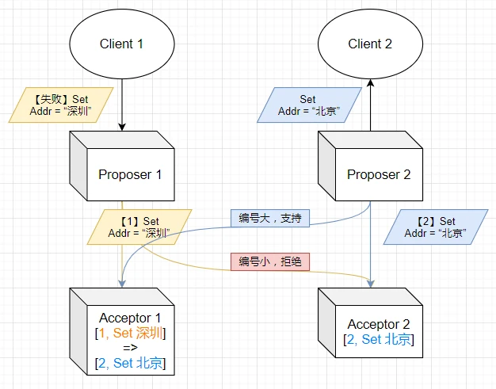

这里需要补充一下，Proposer 1 这里支持提案失败，它是怎么让自己也接受 Proposer 2 的提案的呢？

后续会发生的事情是：

1. Proposer 2 发现得到了过半数的支持，开始向所有 Acceptor 发送 Accept 请求。
2. 所有 Acceptor 接收到 Accept 请求后，按照之前 Prepare 时收到的信息与承诺，去生效 Proposer 2 的提案内容（即 `Set Addr = "北京"` 的操作）。
3. Proposer 1 之前已经收到了所有 Acceptor 的回复，发现没有得到过半数的支持，直接回复 Client 1 请求失败，并变成一个 Acceptor（或者说 Learner），接受 Proposer 2 的 Accept 请求。

再进一步，考虑另一种场景：假设 Proposer 2 的 Accept 请求先到达了 Acceptor 2，然后 Proposer 1 向 Acceptor 2 发送的 Prepare 请求才到达 Acceptor 2，会发生什么呢？

最直观的处理是，Acceptor 2 直接拒绝，然后 Proposer 1 走上面的流程，但 Paxos 为了效率，又增加了另一条规则：

> 如果一个 Prepare 请求到达 Acceptor 时，发现该 Acceptor 已经接受生效了另一个提案，那么它除了回复提案被拒绝外，还会带上 Acceptor 已经通过的编号最大的那个提案的内容回到 Proposer。Proposer 收到带内容的拒绝后，需要修改自己的提案为返回的内容。

此时会发生的事情就变成了：

1. Acceptor 2 除了会拒绝它的请求，还会告诉 Proposer 1，说我已经通过并生效了另一个编号为 2 的提案，内容是 `Set Addr = "北京"`。
2. Proposer 1 查看回复时，发现已经有 Acceptor 生效提案了，于是就修改自己的提案，也改为 `Set Addr = "北京"`，并告知 Client 1 你的请求失败了。
3. 接着 Proposer 1 开始充当 Proposer 2 的小帮手，帮它一起传播 Proposer 2 的提案，加快达成共识的过程。

这里需要注意，编号需要保证全局唯一，而且全局递增，否则在比较编号大小的时候就会出现问题。保证编号唯一且递增有很多方法，比如都向一个统一的编号生成器请求新编号；又比如每个机器的编号用机器 ID 拼接一个数字，该数字按一个比总机器数更大的数字间隔递增。

### 3.2.4 异常情况

上面的规则是不是就能保证整个算法解决所有问题了呢？恐怕不是，这里再看看一些异常情况。

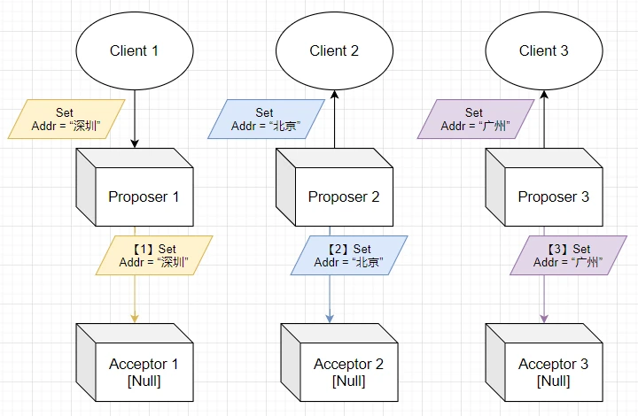

**异常情况一**：假设现在有三个 Proposer 同时收到客户端的请求，那么它们会生成全局唯一的不同编号，带着各自接收到的请求提案，去寻求 Acceptor 的支持。但假设它们都分别争取到了一个 Acceptor 的支持，此时由于 Prepare 阶段只会接受编号更大的提案，所以正常情况下只有 Proposer 3 的提案会得到所有 Acceptor 的支持。但假设这时候 Proposer 3 所在机器宕机了，无法进行下一步的 Accept 了，怎么办呢？那么所有 Acceptor 就会陷入持续的等待，而其他的 Proposer 也会一直重试然后一直失败。

为了解决这个问题，Paxos 决定，**允许 Proposer 在提案遭到过半数的拒绝时，更新自己的提案编号，用新的更大的提案编号，去发起新的 Prepare 请求**。

那么此时 Proposer 1 和 Proposer 2 就会更新自己的编号，从【1】与【2】，改为比如【4】和【5】，重新尝试提案。这时即使 Proposer 3 所在机器宕机了，没有完成 Accept，Acceptor 也会由于接收到了编号更大的提案，从而覆盖掉 Proposer 3 的提案，进入新的投票支持阶段。

**异常情况二**：虽然更新编号解决了上面的问题，但却又引入了**活锁**的问题。由于可以更新编号，那么有概率出现这种情况，即每个 Proposer 都在被拒绝时，增大自己的编号，然后每个 Proposer 在新的编号下又争取到了小于半数的 Acceptor，都无法进入 Accept，又重新加大编号发起提案，一直这样往复循环，就成了活锁（和死锁的区别是，它们的状态一直在变化，尝试解锁，但还是被锁住了）。

要解决活锁的问题，有几种常见的方法：

* 当 Proposer 接收到回复，发现支持它的 Acceptor 小于半数时，可以不立即更新编号重试，而是随机延迟一小段时间，来错开彼此的冲突。
* 可以**设置一个 Proposer 的 Leader，全部由它来进行提案**，这即是共识算法的常见套路：选择一个 Leader。这需要进行 Leader 的选举，以及解决存活性检查以及换届的问题。实际上就已经演变成 **Multi-Paxos** 了。

**异常情况三**：由于在提案时，Proposer 都是根据是否得到超过半数的 Acceptor 的支持，来作为是否进入 Accept 阶段的依据，那如果在算法进行中新增或下线了机器呢？如果此时一些 Proposer 知道机器数变了，一些 Proposer 不知道，那么大家对半数的判断就会不一致，导致算法出错。

因此在实际运行中，机器节点数的变动，也需要作为一条要达成共识的请求提案，通过 Paxos 算法本身，传达到所有机器节点上。

为了使 Paxos 运行得更稳定，不需要时刻担心是否有节点数变化，可以固定一个周期，要求只有在达到固定周期时才允许变更节点数，比如只有在经过十次客户端请求的提案与接受后，才处理一次机器节点数变化的提案。

那如果这个间隔设置得相对过久，导致现在想要修改节点数时，一直要苦等提案数，怎么办呢？毕竟有时候机器坏了是等不了的。那么可以支持主动填充空提案，来让节点变更的提案尽早生效。

## 3.3 总结

抽象和完善一下这个过程，就是：

### 3.3.1 Prepare 准备阶段

1. 在该阶段，Proposer 会尝试告诉所有的其他机器，我现在有一个提案（操作），请告诉我你们是否支持（是否能接受）。其他机器会看看自己是否已经支持其他提案了（是否接受过其他操作请求），并回复给 Proposer（如果曾经接受过其他值，就告诉 Proposer 接受过什么值/操作）；
2. Acceptor 如果已经支持了编号 N 的提案，那么不会再支持编号小于 N 的提案，但可以支持编号更大的提案；
3. Acceptor 如果生效了编号为 N 的提案，那么不会再接受编号小于 N 的提案，且会在回复时告知当前已生效的提案编号与内容。

### 3.3.2 Accept 提交阶段

1. 在该阶段，Proposer 根据上一阶段接收到的回复，来决定行为；
2. 如果上一阶段超过半数的机器回复说接受提案，那么 Proposer 就正式通知所有机器去生效这个操作；
3. 如果上一阶段超过半数的机器回复说它们已经先接受了其他编号更大的提案，那么 Proposer 会更新一个更大的编号去重试（随机延时）；
4. 如果上一阶段的机器回复说它们已经生效了其他编号的提案，那么 Proposer 就也只能接受这个其他人的提案，并告知所有机器直接接受这个新的提案；
5. 如果上一阶段都没收到半数的机器回复，那么提案取消。

接受其他提案，以及提案取消的情况下，Proposer 就要直接告诉客户端该次请求失败了，等待客户端重试即可。

这里可以看到，超过半数的机器是个很重要的决定结果走向的条件。至此，已经描述完了针对一次达成共识的过程，这被称为 **Basic-Paxos**。

那如果有多个值需要达成共识呢？答案是升级为 **Multi-Paxos**。

如果有多个值要不断地去针对一次次请求达成共识，使用 Basic-Paxos 也是可以的，无非就是一遍遍地执行算法取得共识并生效嘛，但在分布式系统下，容易由于多轮通信造成响应过慢的问题，何况还有活锁问题存在。因此 Lamport 给出的解法是：

* 先选择一个 Leader 来担当 Proposer 的角色，取消多 Proposer，只有一个 Leader 来提交提案，这样就没有了竞争（也没有了活锁）。同时，由于无需协商判断，有了稳定的 Leader 后，后续提案就可以省去 Prepare 阶段，两阶段变一阶段，提高效率。
* 对于每一次要确定的值/操作，使用唯一的一个标识来区分，保证其单调递增即可。

对于选择 Leader 的过程，简单的做法很多，复杂的也只需要进行一次 Basic-Paxos 即可。选出 Leader 后，直到 Leader 宕机或者租期到期，都可以保持由它来进行简化的 Paxos 协议。

如果有多个机器节点都由于某些问题自认为自己是 Leader，从而都提交了提案，也没关系，可以令其退化成 Basic-Paxos，也可以在发现后再次选择 Leader 即可。

# 4 Raft 协议

## 4.1 基本概念

**Raft** 协议由斯坦福大学的 Diego Ongaro、John Ousterhout 两人于 2013 年提出，Raft 的作者也曾研究过 Paxos，可以认为 **Raft 是 Multi-Paxos 的改进版**。不得不说，Raft 作为一种易于理解，且工程上能够快速实现一个较完整原型的算法，受到业界的广泛追捧，大量基于 Raft 的一致性框架层出不穷，etcd、Consul、TiKV、Kafka 的 KRaft 模式等都基于 Raft 实现。

既然 Paxos 是前辈，为什么应用的反而要少呢？这是因为 Basic-Paxos 相对比较耗时，而 Multi-Paxos，作者并没有给出具体的实现细节，这虽然给了开发者发挥的空间，但同样可能会在实现的过程中由于开发者不同的实现方式带来不同的问题，对于一个分布式共识算法，谁也不知道潜在的问题会不会就影响到一致性了。而 Raft 算法给出了大量实现细节，简单说就是，实现起来更不容易出错。

Raft 协议同样是需要选举出 Leader 的，从这里也能看到，**共识算法大都会走向选举出一个 Leader 的方向，来提升效率和稳定性**。不同之处可能只在于选举的方式，以及消息同步的方式。

Raft 的算法逻辑主要可以分成两个部分，一个是选举部分，另一个是日志复制部分。和 Paxos 不同的是，这里的**日志是连续并且按序传输的**。

Raft 中定义了一个叫作**任期**（Term）的概念，**一个任期实际上相当于一个时间片**，如下图所示，这个时间片被分成两个部分，第一部分是选举部分，第二部分是正常的日志复制部分。

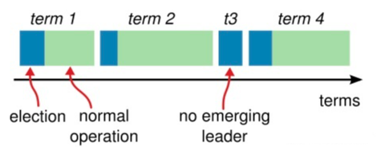

Raft 算法为节点定义了三种角色：

* **领导者**（Leader）：负责处理写请求、管理日志复制和不断地发送心跳信息，通知其他节点“我是领导者，我还活着，你们现在不要发起新的选举来找新领导者替代我”。
* **跟随者**（Follower）：接收和处理来自领导者的消息，当等待领导者心跳信息超时的时候，就主动站出来，推荐自己当候选人。
* **候选人**（Candidate）：候选人将向其他节点发送请求投票（RequestVote）RPC 消息，通知其他节点来投票，如果赢得了大多数选票，就晋升当领导者。

**Raft 算法是强领导者模型，集群中只能有一个领导者，通过一切以领导者为准的方式，实现一系列值的共识和各节点日志的一致**。

## 4.2 执行过程

### 4.2.1 领导者选举

在初始状态下，集群中所有的节点都是跟随者状态：

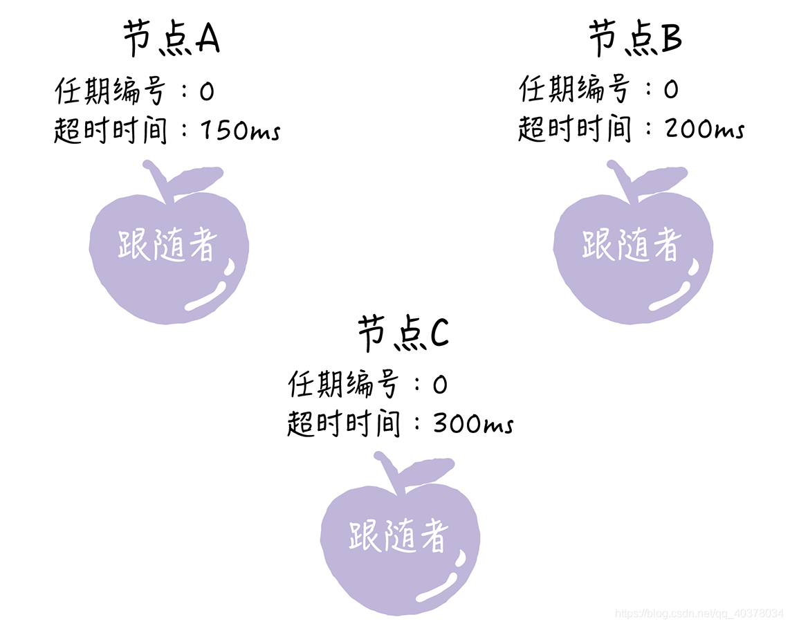

Raft 算法实现了随机超时时间的特性，**每个节点等待领导者心跳信息的超时时间间隔是随机的**。上图中，集群中没有领导者，而节点 A 的等待超时时间最小，它会最先因为没有等到领导者的心跳信息，发生超时。

这时，节点 A 增加自己的任期编号，并推举自己为候选人，先给自己投上一张选票，然后向其他节点发送请求投票 RPC 消息，请它们选举自己为领导者。

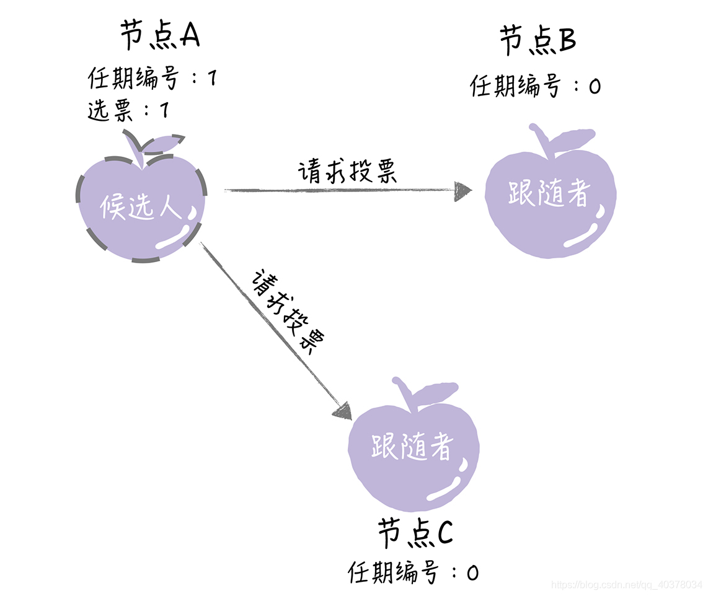

如果其他节点接收到候选人 A 的请求投票 RPC 消息，在编号为 1 的这届任期内，也还没有进行过投票，那么它将把选票投给节点 A，并增加自己的任期编号。

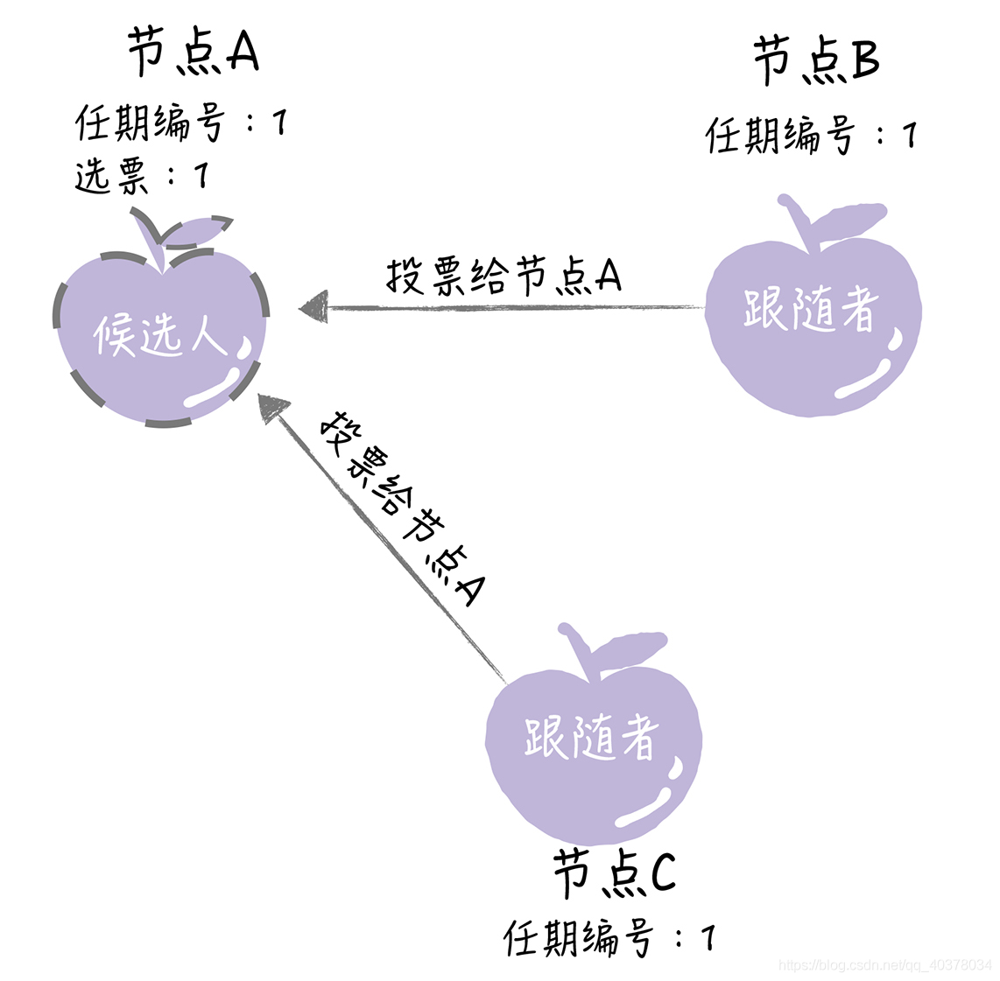

如果候选人在选举超时时间内赢得了大多数的选票，那么它就会成为本届任期内新的领导者。节点 A 当选领导者后，它将周期性地发送心跳消息，通知其他服务器我是领导者，阻止跟随者发起新的选举。

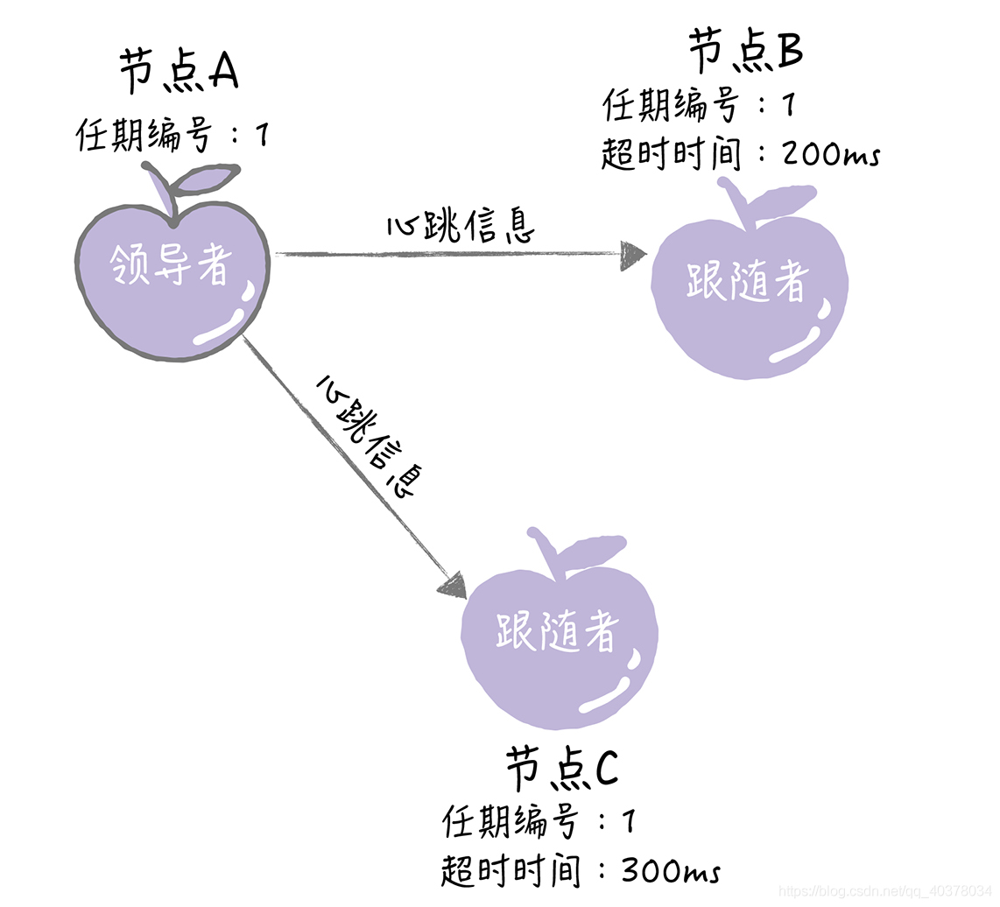

Raft 算法中每个任期由单调递增的数字（任期编号）标识，任期编号是随着选举的举行而变化的：

1. 跟随者在等待领导者心跳信息超时后，推举自己为候选人时，会增加自己的任期编号，比如节点 A 的任期编号为 0，那么在推举自己为候选人时，会将自己的任期编号增加为 1。
2. 如果一个服务器节点，发现自己的任期编号比其他节点小，那么它会更新自己的任期编号到较大的编号值，比如节点 B 的任期编号是 0，当收到来自节点 A 的请求投票 RPC 消息时，因为消息中包含了节点 A 的任期编号，且编号为 1，那么节点 B 将把自己的任期编号更新为 1。
3. 如果一个候选人或者领导者，发现自己的任期编号比其他节点小，那么它会立即恢复成跟随者状态。比如分区错误恢复后，任期编号为 3 的领导者节点 B，收到来自新领导者的包含任期编号为 4 的心跳消息，那么节点 B 将立即恢复成跟随者状态。
4. 如果一个节点接收到一个包含较小的任期编号值的请求，那么它会直接拒绝这个请求。比如节点 C 的任期编号为 4，收到包含任期编号为 3 的请求投票 RPC 消息，那么它将拒绝这个消息。

在一次选举中，**每一个服务器节点最多会对一个任期编号投出一张选票**，并且按照先来先服务的原则进行投票。比如节点 C 的任期编号为 3，先收到了一个包含任期编号为 4 的投票请求（来自节点 A），然后又收到了一个包含任期编号为 4 的投票请求（来自节点 B）。那么节点 C 将会把唯一一张选票投给节点 A，当再收到节点 B 的投票请求 RPC 消息时，对于编号为 4 的任期，已没有选票可投了。

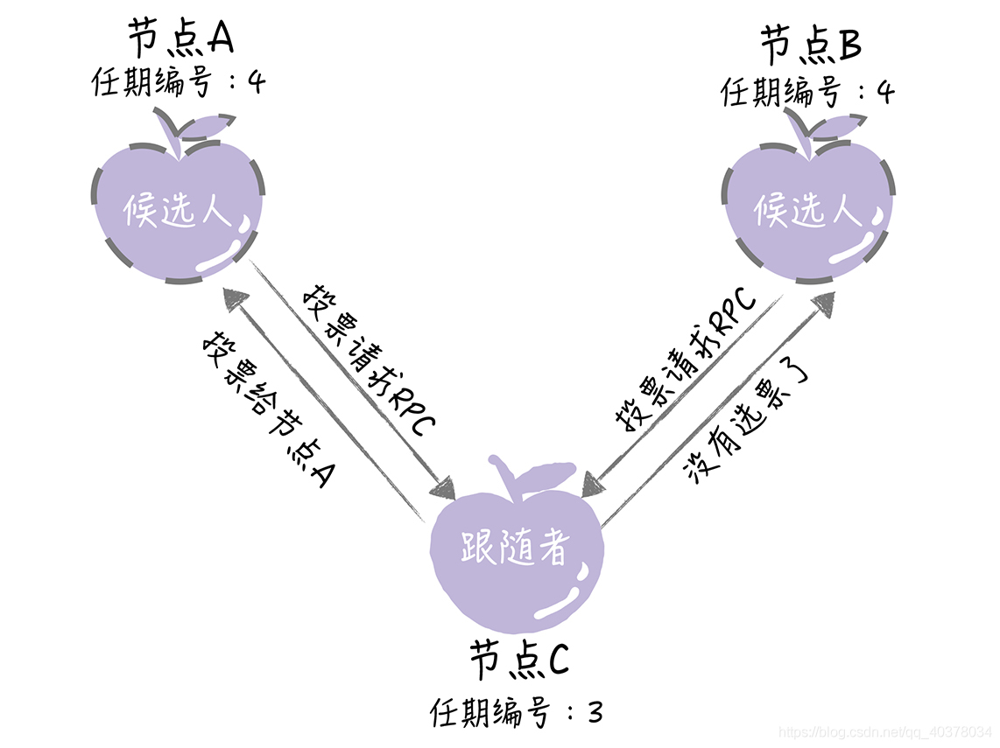

**日志完整性高的跟随者（也就是最后一条日志项对应的任期编号值更大，索引号更大）拒绝投票给日志完整性低的候选人**。比如节点 B 的任期编号为 3，节点 C 的任期编号为 4，节点 B 的最后一条日志项对应的任期编号为 3，而节点 C 为 2，那么当节点 C 请求节点 B 投票给自己时，节点 B 将拒绝投票。

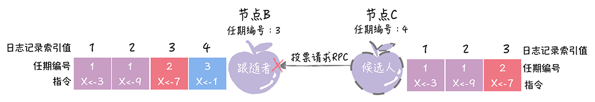

### 4.2.2 日志复制

副本数据是以日志的形式存在的，日志由日志项组成，日志项是一种数据格式，它主要包含用户指定的数据，也就是指令（Command），还包含一些附加信息，比如索引值（Log Index）、任期编号（Term）。

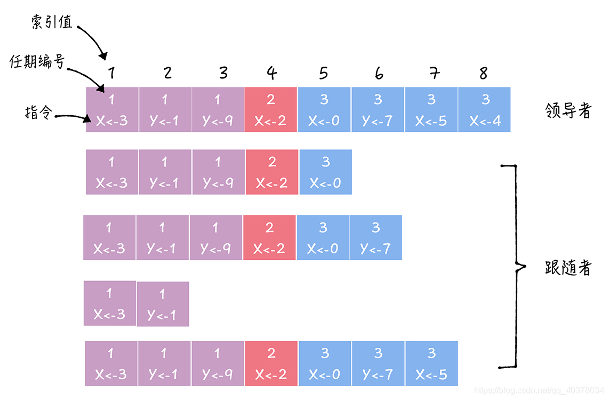

* **指令**：一条由客户端请求指定的、状态机需要执行的指令，可以理解成客户端指定的数据。
* **索引值**：日志项对应的整数索引值，用来标识日志项，是一个连续的、单调递增的整数。
* **任期编号**：创建这条日志项的领导者的任期编号。

首先，领导者通过日志复制消息，将日志项复制到集群其他节点上。

接着，如果领导者接收到大多数的复制成功响应后，它将日志项应用到它的状态机，并返回成功给客户端。如果领导者没有接收到大多数的复制成功响应，那么就返回错误给客户端。

领导者将日志项应用到它的状态机，怎么没通知跟随者应用日志项呢？

因为领导者的日志复制 RPC 消息或心跳消息，包含了当前最大的、将会被提交的日志项索引值。所以通过日志复制 RPC 消息或心跳消息，跟随者就可以知道领导者的日志提交位置信息。

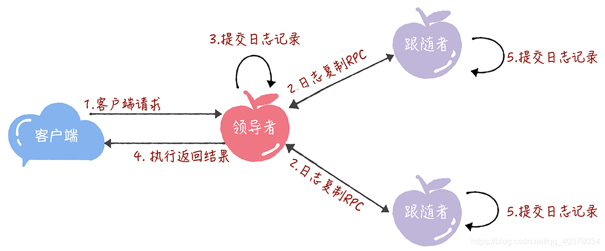

1. 接收到客户端请求后，领导者基于客户端请求中的指令，创建一个新日志项，并附加到本地日志中。
2. 领导者通过日志复制 RPC，将新的日志复制到其他的服务器。
3. 当领导者将日志项成功复制到大多数的服务器上的时候，领导者会将这条日志项应用到它的状态机中。
4. 领导者将执行的结果返回给客户端。
5. 当跟随者接收到心跳消息，或者新的日志复制 RPC 消息后，如果跟随者发现领导者已经提交了某条日志项，而它还没应用，那么跟随者就将这条日志项应用到本地的状态机上。

在 Raft 算法中，领导者通过强制跟随者直接复制自己的日志项，处理不一致日志。跟随者中的不一致日志项会被领导者的日志覆盖，而且领导者从来不会覆盖或者删除自己的日志。

也就是说，**Raft 是通过以领导者的日志为准，来实现各节点日志的一致性的**。

## 4.3 总结

Raft 算法强领导者模型的限制和局限如下：

* 读写请求和数据转发压力落在领导者节点，相当于单机，性能和吞吐量也会受到限制；
* 大规模跟随者的集群，领导者需要承担大量元数据维护和心跳通知的成本；
* 领导者单点问题，故障后直到新领导者选举出来期间集群不可用；
* 随着候选人规模增长，收集半数以上投票的成本更大。

强领导者模型会限制集群的写性能，有什么办法能突破 Raft 集群的写性能瓶颈呢？

可以参考 Kafka 的分区和 ES 的主分片、副本分片机制：虽然写入只能通过 Leader，但把数据分成多个分片，每个分片各自组成一个 Raft 组、各有自己的 Leader，就能分散写入压力。这就是 TiKV、CockroachDB 等分布式数据库采用的 Multi-Raft 思路。

Paxos 算法和 Raft 算法有显而易见的相同点和不同点。二者的共同点在于，它们本质上都是单主的一致性算法，且**都以不存在拜占庭将军问题作为前提条件**。二者的不同点在于，Paxos 算法相对于 Raft，更加理论化，原理上理解比较抽象，仅仅提供了一套理论原型，这导致很多人在工业上实现 Paxos 时，不得已需要做很多针对性的优化和改进，但是改进完却发现算法整体和 Paxos 相去甚远，无法从原理上保证新算法的正确性，这一点是 Paxos 难以工程化的一个很大原因。相比之下 Raft 描述清晰，作者将算法原型的实现步骤完整地列在论文里，极大地方便了业界的工程师实现该算法，因而能够受到更广泛的应用。同时 Paxos 日志的传输过程中允许有空洞，而 Raft 传输的日志却一定是需要有连续性的，这个区别致使它们确认日志传输的过程产生差异。

但其实从根本上来看，Raft 的核心思想和 Paxos 是非常一致的，甚至可以说，Raft 是基于 Paxos 的一种具体化实现和改进，它让一致性算法更容易为人所接受，更容易得到实现。由此亦可见，Paxos 在一致性算法中的奠基地位是不可撼动的。

# 5 PoW 协议

## 5.1 引言

Gossip、Paxos、Raft 及其变种在生产环境得到了广泛的应用，但是，这类经典的一致性协议头上始终悬着一把达摩克利斯之剑——无法解决**拜占庭将军问题**。这也就意味着**它们只能用于不存在恶意节点的可信环境：可以容忍消息的乱序、丢失，但是不能容忍消息被篡改**。

拜占庭将军问题，是 Lamport 在论文中抽象出来的一个著名例子：

> 拜占庭帝国想要进攻一个强大的敌人，为此派出了 10 支军队去包围这个敌人。这个敌人虽不比拜占庭帝国，但也足以抵御 5 支常规拜占庭军队的同时袭击。这 10 支军队在分开的包围状态下同时攻击。他们任一支军队单独进攻都毫无胜算，除非有至少 6 支军队（一半以上）同时袭击才能攻下敌国。他们分散在敌国的四周，依靠通信兵骑马相互通信来协商进攻意向及进攻时间。困扰这些将军的问题是，他们不确定他们中是否有叛徒，叛徒可能擅自变更进攻意向或者进攻时间。在这种状态下，拜占庭将军们如何才能保证至少有 6 支军队在同一时间一起发起进攻，从而赢取战斗？

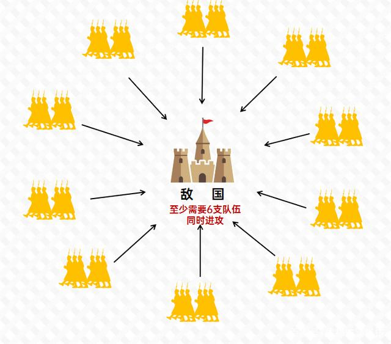

拜占庭将军问题中并不去考虑通信兵是否会被截获或无法传达信息等问题，即消息传递的信道绝无问题。因为“两将军问题”已经证明了**在消息可能丢失的不可靠信道上试图通过消息传递的方式达到一致性是不可能的**。所以，在研究拜占庭将军问题的时候，已经假定了信道是没有问题的。

单从上面的说明可能无法理解这个问题的复杂性，我们来简单分析一下：

1. 先看在没有叛徒情况下，假如一个将军 A 提一个进攻提议（如：明日下午 1 点进攻，你愿意加入吗？）由通信兵分别告诉其他的将军，如果幸运中的幸运，加上自己共有 6 位以上将军同意，就可以发起进攻。如果不幸，其他的将军也在此时发出不同的进攻提议（如：明日下午 2 点、3 点进攻，你愿意加入吗？），由于时间上的差异，不同的将军收到（并认可）的进攻提议可能是不一样的，这时可能出现 A 提议有 3 个支持者，B 提议有 4 个支持者，C 提议有 2 个支持者等等。
2. 再加一点复杂性，在有叛徒情况下，一个叛徒会向不同的将军发出不同的进攻提议（通知 A 明日下午 1 点进攻，通知 B 明日下午 2 点进攻等等），一个叛徒也可能同意多个进攻提议（既同意下午 1 点进攻又同意下午 2 点进攻）。

叛徒发送前后不一致的进攻提议，被称为“拜占庭错误”，而能够处理拜占庭错误的这种容错性称为**拜占庭容错**（Byzantine Fault Tolerance，简称 BFT）。

对于拜占庭容错，往往都需要通过其他方面的激励或惩罚，来让“诚实”表达的节点利益最大化。

在出现比特币之前，解决分布式系统一致性问题主要是 Lamport 提出的 Paxos 算法或其衍生算法。Paxos 类算法仅适用于中心化的分布式系统，这样的系统中没有不诚实的节点（不会发送虚假错误消息，但允许出现网络不通或宕机出现的消息延迟）。

**中本聪**在比特币中创造性地引入了“**工作量证明**”（Proof of Work，PoW）来解决这个问题，大量的节点参与竞争，通过自身的工作量大小来证明自己的能力，最终能力最大的节点获得优胜，其他节点的信息需要与该节点统一。

通过工作量证明就增加了发送信息的成本，降低节点发送消息速率，这样就可以保证在一个时间只有一个节点（或是很少）在进行广播，同时在广播时会附上自己的签名。

这个过程就像一位将军 A 在向其他的将军（B、C、D…）发起一个进攻提议一样，将军 B、C、D…看到将军 A 签过名的进攻提议书，如果是诚实的将军就会立刻同意进攻提议，而不会发起自己新的进攻提议。

我们稍微把将军问题改一下：假设攻下一个城堡需要多次的进攻，每次进攻的提议必须基于之前最多次数的胜利进攻下提出的（只有这样敌方已有损失最大，我方进攻胜利的可能性就更大），这样约定之后，将军 A 在收到进攻提议时，就会检查一下这个提议是不是基于最多的胜利提出的，如果不是（基于最多的胜利）将军 A 就不会同意这样的提议，如果是的，将军 A 就会把这次提议记下来。

这就是比特币网络的**最长链选择**。

## 5.2 执行过程

如何构建一个安全、稳定、有效的匿名电子现金系统，前辈们孜孜以求，一直进行尝试但每次都以失败告终。直到 2008 年 10 月 31 日，中本聪（化名）第一次出现，他在一个密码朋克邮件组中发帖，写道：

> 我一直在研究一种全新的电子现金系统，它完全是点对点的，没有可信赖的第三方。I've been working on a new electronic cash system that's fully peer-to-peer, with no trusted third party.

从软件工程上，比特币是一个分布式系统。中本聪利用密码学知识解决了分布式共识问题，而且是在零信任环境中。他巧妙地利用了加密哈希算法的特性（比特币使用的哈希算法是 **SHA-256**，这类 SHA-2 算法族是一种“单向”操作）。**对于给定的哈希值，没有实用的方法可以反向计算出原始输入**，也就是说很难伪造，且不同的原始输入值对应的哈希值差异大，无规律可循。

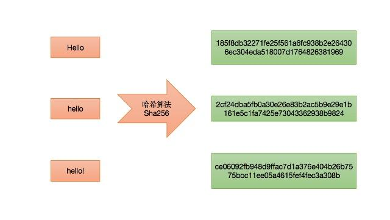

从上图中，我们可以看到只有细微差异的三个输入值：`hello`、`Hello`、`Hello!`，其对应的哈希值天壤之别。

按照工作量证明的策略，中本聪在比特币系统中，给每一个节点出了一个难题。

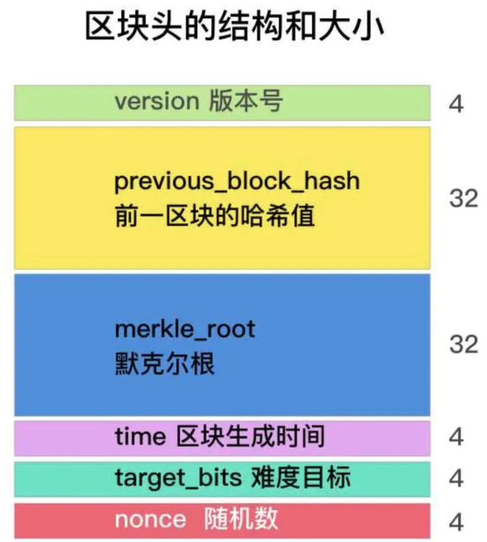

上图是一个区块头的数据结构，里面有个 Nonce 字段。中本聪的难题就是：在其他字段值不变的前提下，通过不断调节 Nonce 的值，来对 BlockHeader 这个结构体值算哈希，要求找到一个 Nonce 值，使得算出来的哈希值小于等于某个目标值，在 BlockHeader 结构体中由 `target_bits` 来表示，这个目标值就是**难度目标**，每 2016 个区块（约两周）调整一次。

因为哈希算法的单向性，无法根据哈希值逆向计算原始输入。因此为了寻找一个符合要求的哈希值，矿工就不得不在已知的前一区块哈希、交易集哈希（Merkle 根）、时间戳之上附加一个数字，不断地更换 Nonce 随机数，使得用这个值计算出的哈希值能满足那个难度目标。

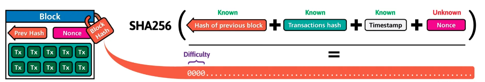

找出那个数字的耗时只取决于计算机哈希计算速度和难度系数，计算速度越快能越早找出，难度越大，查找的次数越多，时间越长。这个数字是不确定的，称之为随机数 Nonce。Nonce 字段是一个 32 位整数（取值范围 `0 ~ 2³² − 1`），遍历完仍找不到时，矿工会调整时间戳或 Coinbase 交易中的额外随机数，再继续尝试。

有了这个随机数，矿工立即将随机数记录到区块上并立即广播这个区块，其他节点收到这个区块后，只需要执行一次哈希运算就可以验证这个区块是否符合难度要求。一旦符合要求，节点便放弃本地的挖矿工作，立即进入下一个区块的挖矿。找出这个随机数的矿工，将获得奖励（比特币）。随着后续区块不断在其之上延伸（通常认为 6 个确认后），该区块被推翻的概率趋近于零，全网就此达成共识。

这就是工作量证明：只有劳动才有收获，多劳多得，没有不劳而获。

工作量证明的思想早已有之（如 1997 年 Adam Back 提出的 Hashcash），主要用于防止 DoS 攻击以及过滤垃圾邮件：强迫每个邮件发送者必须进行一段无意义的运算，人为造成一小段时间的延迟，比如 1 秒。正常发送邮件的人，每天只发几封十几封，几乎不会察觉什么。但是，发送垃圾邮件的人就惨了，之前限制他发送速度的是网速，每秒能发 1000 封，现在又多了个 CPU 性能的限制，速度变成了每秒 1 封。速度降低 1000 倍，也就减少了垃圾邮件的影响。类似的策略也可以用于反爬虫、反机器人一类的场景。

PoW 算法革命性地解决了分布式共识决策问题。在一个充满欺诈的分布式环境中，不需要任何第三方介入，也不需要任何节点间的协作，就让各个节点间达成一致性共识。

如何达成共识的呢？因为有成千上万的矿工同时在对同一高度的区块寻找随机数，意味着只要时间充足，总能找到。很有可能有多个矿工相继找到随机数。这样网络中便存在多个符合要求的区块，造成区块链分叉。

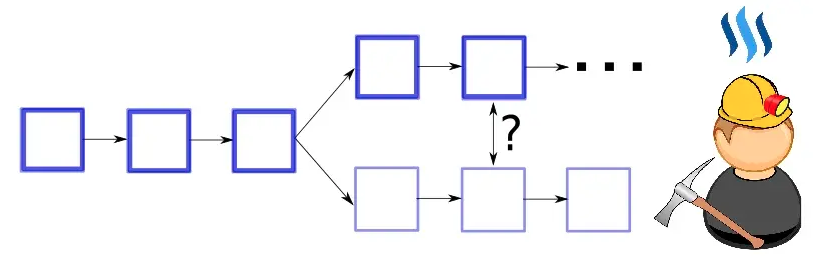

到底该选哪一条继续延伸？此时就看网络中的大部分矿工如何选择，**默认原则是选择最长的一个分支继续挖矿**（准确地说是累计工作量最大的链）。经过短暂分叉后又走在一起，分分合合，携手共进。

## 5.3 总结

工作量证明其实相当于提高了做叛徒（发布虚假区块）的成本。在工作量证明下，只有第一个完成证明的节点才能广播区块，竞争难度非常大，需要很高的算力，如果不成功其算力就白白地耗费了（算力是需要成本的）；而如果拿这样的算力去做诚实的节点，同样也可以获得很大的收益（这就是矿工所做的工作），这样实际上就不会有做叛徒的动机，整个系统也因此而更稳定。

依靠 PoW 算法，比特币很大程度上保证了账本的安全性。因为如果要对账本数据进行篡改或者毁坏，篡改者至少需要获得比特币全网一半以上的算力，这是非常难以达到的。

但是同样 PoW 存在很多缺点：首先，PoW 达成一致性的速度很慢，应用在比特币中每秒钟只能处理约 7 笔交易，这在大部分的商业应用中都是达不到要求的；其次，PoW 造成了很大的资源浪费，所有的竞争者夺取记账权需要付出巨大的硬件算力，这在背后是大量的硬件成本、电力损耗，而一旦记账权确定，其余没有获得记账权的节点的算力等于白白浪费；最后，算力逐渐向大规模的专业矿场和矿池集中，增大了账本被篡改（51% 攻击）的可能性。正因如此，以太坊已于 2022 年 9 月通过“合并”（The Merge）从 PoW 转向权益证明（Proof of Stake，PoS）。

# 6 总结

| 协议 | 类型 | 一致性 | 容错类型 | 典型应用 |
|------|------|--------|----------|----------|
| Gossip | 多主、去中心化 | 最终一致性 | 节点宕机、网络分区，不能容忍拜占庭错误 | Cassandra、Redis Cluster、Consul |
| Paxos | 单主（Multi-Paxos 选主） | 强一致性 | `2F + 1` 个节点容忍 `F` 个宕机，不能容忍拜占庭错误 | Chubby、Spanner、MySQL Group Replication |
| Raft | 单主、强领导者 | 强一致性 | `2F + 1` 个节点容忍 `F` 个宕机，不能容忍拜占庭错误 | etcd、Consul、TiKV、Kafka KRaft |
| PoW | 多主、去中心化 | 概率性最终一致性 | 拜占庭容错（诚实算力过半） | 比特币 |

简单来说，在可信的内网环境里，追求强一致选 Raft/Paxos，追求高可用与扩展性选 Gossip；在存在恶意节点的开放网络中，则需要 PoW、PoS 这类拜占庭容错的共识机制。
