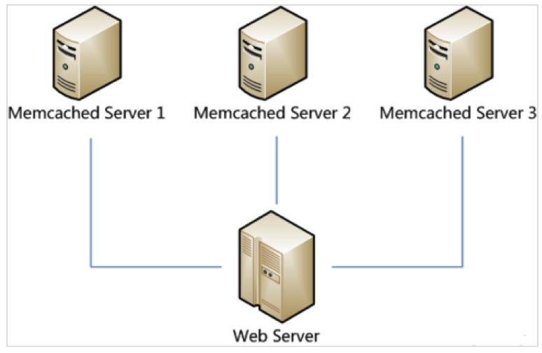
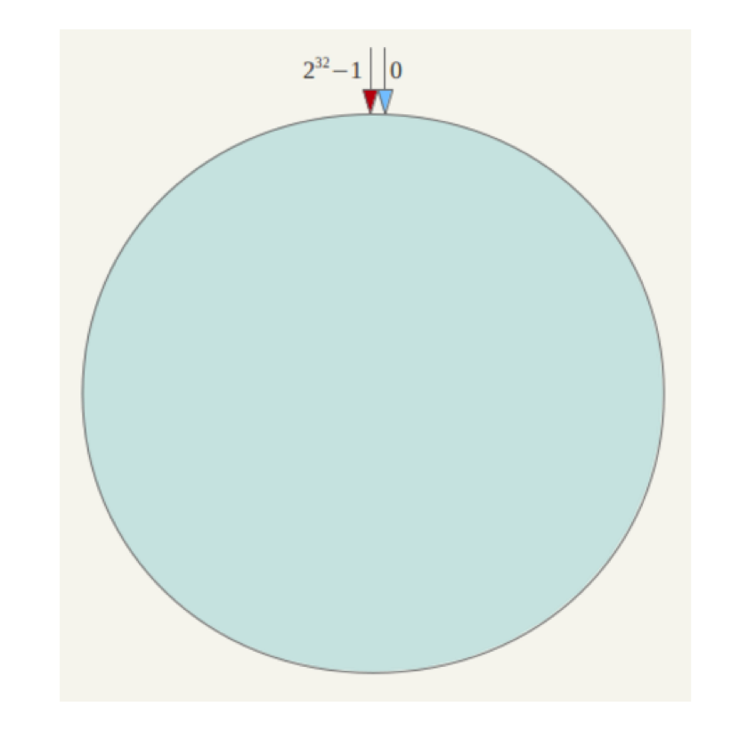
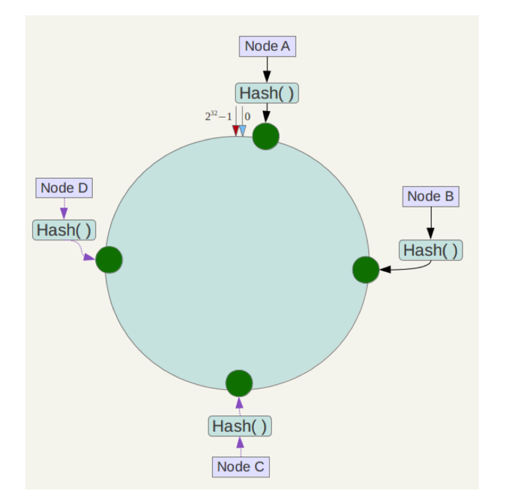
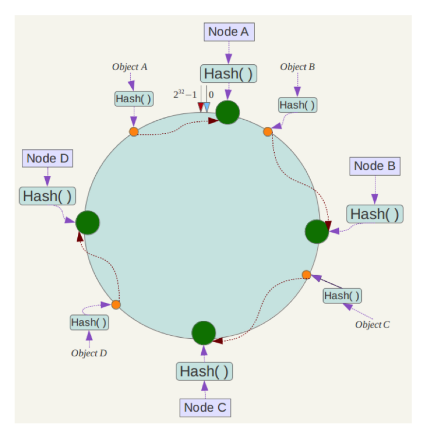
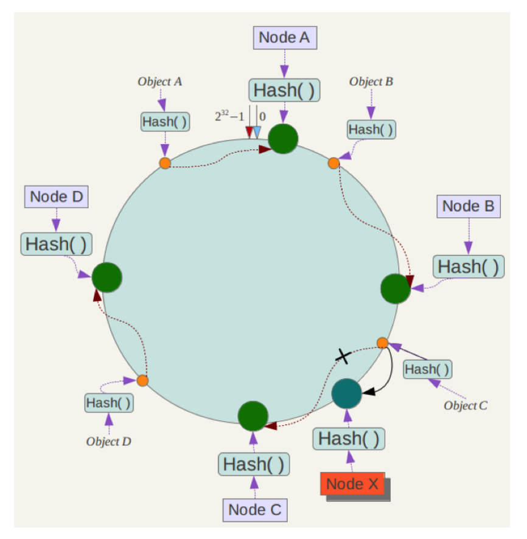
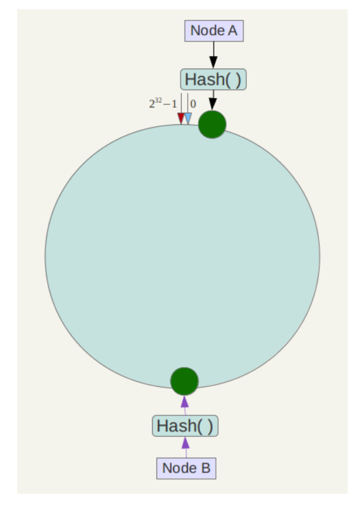
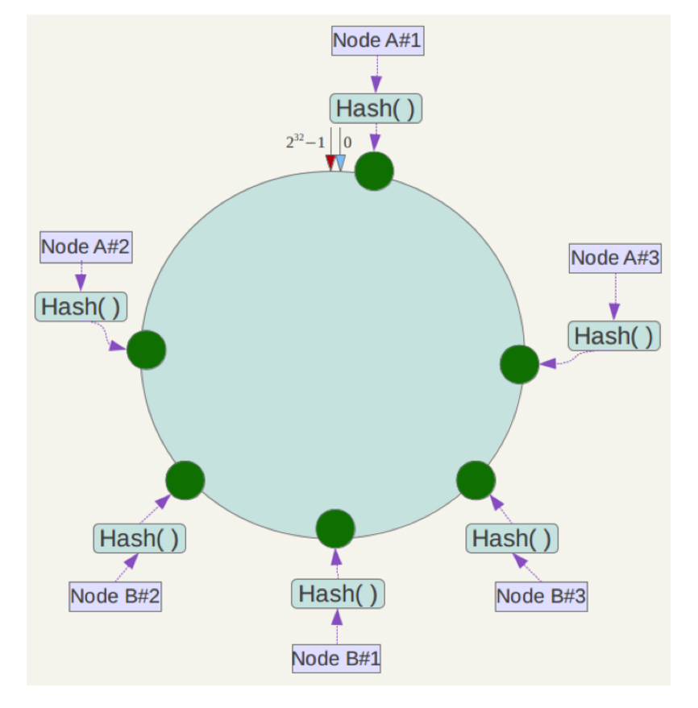

# 一致性哈希

# 1 分布式缓存问题

在做服务器负载均衡时，可供选择的负载均衡算法有很多，如：

- 轮询算法（Round Robin）
- 哈希算法（Hash）
- 最少连接算法（Least Connections）
- 响应速度算法（Response Time）
- 加权法（Weighted）

假如现在有这样的应用场景：有 N 台服务器提供分布式缓存服务，例如早期的 Memcached 集群或自定义缓存层，需要对服务器进行负载均衡，将请求平均分发到每台服务器上，每台机器负责 `1/N` 的服务。下面以三台缓存服务器为例：

很显然，最简单的策略是将每一次缓存请求随机发送到一台服务器，但是这种策略可能会带来两个问题：一是同一份数据可能被存在不同的机器上而造成数据冗余；二是有可能某数据已经被缓存但访问却没有命中，因为无法保证对相同 key 的所有访问都被发送到相同的服务器。因此，随机策略在时间效率和空间效率上都表现较差。

要解决上述问题只需做到如下一点：**保证对相同 key 的访问会被发送到相同的服务器**。很多方法可以实现这一点，最常用的方法是计算哈希。例如对于每次访问，可以按如下算法计算其哈希值：

`h = Hash(key) % 3`

其中 `Hash` 是一个从字符串到非负整数的哈希映射函数。这样，如果我们将三台缓存服务器分别编号为 0、1、2，那么就可以根据上式和 key 计算出服务器编号 `h`，然后去访问。

这个方法虽然解决了上面提到的两个问题，但是存在一些其他的问题。如果将上述方法抽象，可以认为通过：

`h = Hash(key) % N`

这个算式计算每个 key 的请求应该被发送到哪台服务器，其中 N 为服务器的台数，并且服务器按照 `0 ~ N-1` 编号。

这个算法的问题在于容错性和扩展性不好。所谓容错性，是指当系统中某一个或几个服务器变得不可用时，整个系统是否可以正确高效地运行；而扩展性是指当加入新的服务器后，整个系统是否可以正确高效地运行。

现假设有一台服务器宕机了，那么为了填补空缺，要将宕机的服务器从编号列表中移除，后面的服务器按顺序前移一位并将其编号值减 1，此时每个 key 就要按 `h = Hash(key) % (N-1)` 重新计算；同样，如果新增了一台服务器，虽然原有服务器编号不用改变，但是要按 `h = Hash(key) % (N+1)` 重新计算哈希值。因此系统中一旦有服务器变更，大量的 key 会被重定位到不同的服务器（从 N 台变为 N+1 台时，约有 `N/(N+1)` 的 key 需要迁移），从而造成大量的缓存不命中。而这种情况在分布式系统中是非常糟糕的。

那么，如何设计一个负载均衡策略，使得受到影响的请求尽可能地少呢？正是为了解决传统取模哈希在节点增减时引发大规模数据迁移的问题，一致性哈希应运而生，并逐渐应用于分布式缓存、数据分片和负载均衡等场景。

Memcached 客户端（如 libmemcached 的 Ketama 算法）、Amazon Dynamo、Cassandra 等键值存储（Key-Value Store）、Nginx（`hash $key consistent`）和 Dubbo（`ConsistentHashLoadBalance`）都采用了一致性哈希算法或其变种。Linux IPVS 从 4.18 版本起还提供了基于 Maglev 哈希的可选 `mh` 调度器；这并不意味着 Maglev 是 LVS 传统调度算法的默认行为。BitTorrent DHT 所用的 Kademlia 协议也借鉴了“把节点和数据映射到同一标识空间”的思想。可以说，一致性哈希是分布式系统中做数据分片与负载均衡的常用算法。

在网络负载均衡领域，Google 于 2016 年公开了 Maglev 软件负载均衡器。Maglev 会根据后端节点集合预先生成固定大小的查找表，转发数据包时只需根据流的哈希值查询目标后端；当后端集合变化时，查找表会尽量保留原有映射，从而减少连接被重新分配的范围。Maglev 追求的是高速查表、较均匀的流量分布和较小的映射扰动，其数据结构与经典的哈希环并不相同。

值得注意的是，并非所有分布式键值存储都选择一致性哈希。例如 Redis Cluster 采用哈希槽（Hash Slot）：用 `CRC16(key) % 16384` 把 key 映射到 16384 个槽中，再把槽分配给各个节点，扩缩容时以槽为单位迁移数据。

# 2 一致性哈希算法

一致性哈希算法于 1997 年由麻省理工学院的 David Karger 等人在论文 *Consistent Hashing and Random Trees* 中提出，设计目标是解决因特网中的热点（Hot Spot）问题，初衷和 **CARP**（缓存阵列路由协议，Cache Array Routing Protocol）十分类似。一致性哈希修正了 CARP 使用的简单哈希算法带来的问题，使得 **DHT**（分布式哈希表，Distributed Hash Table）可以在 P2P 环境中真正得到应用。

## 2.1 标准

一致性哈希提出了在动态变化的缓存（Cache）环境中，哈希算法应该满足的 4 个适应条件：

- **平衡性（Balance）**：平衡性是指哈希的结果应该能够尽可能均匀地分布到所有缓存中，使所有缓存空间都得到利用，即负载均衡。不引入虚拟节点的一致性哈希可以做到每个服务器都处理请求，但是不能保证每个服务器处理的请求数量大致相同（解决办法见 2.2.3 节）。

- **单调性（Monotonicity）**：单调性是指如果已经有一些内容通过哈希分派到了相应的缓存中，又有新的缓存加入到系统中，那么哈希的结果应该能够保证已分配的内容要么保持不变，要么被映射到新的缓存中去，而不会被映射到旧的缓存集合中的其他缓存。

  比如，之前有三台服务器 A、B、C，某个 key 被映射到 B 当中，当新增服务器 D 后，这个 key 要么被映射到之前的 B 中，要么被映射到新增的 D 中，而不应该映射到 A 或者 C 当中。

  简单的哈希算法往往不能满足单调性的要求，如最简单的线性哈希：`x → (ax + b) mod P`。

  在上式中，P 表示全部缓存的大小。不难看出，当缓存大小发生变化时（从 `P₁` 到 `P₂`），原来绝大部分的哈希结果都会发生变化，从而不满足单调性的要求。哈希结果的变化意味着当缓存空间发生变化时，所有的映射关系需要在系统内全部更新。

- **分散性（Spread）**：分布式环境中的客户端可能只感知到全部服务器中的一部分，从而对服务器集合形成不同的视图。不同客户端根据各自的视图计算映射时，可能把同一个 key 路由到不同的服务器，增加同一份数据在系统中的冗余副本数量。分散性描述的就是一个 key 在不同视图下可能被映射到多少个服务器，好的哈希算法应尽量降低这种程度。

- **负载（Load）**：负载从服务器的角度衡量不同客户端视图所造成的影响。当客户端对服务器集合的认知不一致时，一台服务器可能接收超出预期数量的不同 key，形成负载集中。好的哈希算法应限制任一服务器承载的数据量，避免局部过载。

## 2.2 实现原理

### 2.2.1 环形哈希空间

简单来说，一致性哈希将整个哈希值空间组织成一个虚拟的圆环。例如，假设某哈希函数 H 的值空间为 `0 ~ 2³² - 1`（即 32 位无符号整数），整个哈希空间环如下：

整个空间按顺时针方向组织，`0` 和 `2³² - 1` 在零点方向重合。

下一步将机器也映射到环中（一般情况下，对机器做哈希计算时采用机器的 IP 或者机器唯一的别名作为输入值）。这里假设有四台服务器（Node A、Node B、Node C、Node D），使用 IP 地址哈希后在环空间的位置如下：

接下来使用如下算法将数据定位到相应服务器：使用相同的哈希函数计算数据 key 的哈希值，确定其在环上的位置，再沿环顺时针方向寻址，遇到的第一台服务器就是该数据应分配到的目标节点。

例如我们有 Object A、Object B、Object C、Object D 四个数据对象，经过哈希计算后，在环空间上的位置如下：

根据一致性哈希算法，数据 A 会被定位到 Node A 上，B 被定位到 Node B 上，C 被定位到 Node C 上，D 被定位到 Node D 上。

### 2.2.2 容错性与可扩展性

下面分析一致性哈希算法的容错性和可扩展性。现假设 Node C 不幸宕机，可以看到此时对象 A、B、D 不会受到影响，只有对象 C 被重定位到 Node D。一般地，在一致性哈希算法中，如果一台服务器不可用，则受影响的数据仅仅是此服务器到其环空间中前一台服务器（即沿着逆时针方向行走遇到的第一台服务器）之间的数据，其他数据不会受到影响。

下面考虑另外一种情况，如果在系统中增加一台服务器 Node X，如下图所示：

此时对象 A、B、D 不受影响，只有对象 C 需要重定位到新的 Node X。一般地，在一致性哈希算法中，如果增加一台服务器，则受影响的数据仅仅是新服务器到其环空间中前一台服务器（即沿着逆时针方向行走遇到的第一台服务器）之间的数据，其他数据也不会受到影响。

综上所述，一致性哈希算法对于节点的增减都只需重新定位环空间中的一小部分数据（平均约 `1/N`），具有较好的容错性和可扩展性。

### 2.2.3 虚拟节点

根据上面的图解分析，一致性哈希算法满足了单调性，也能较好地控制分散性和负载，但这还不足以成为其被广泛应用的缘由，因为还缺少了平衡性。一致性哈希算法在服务节点太少时，容易因为节点分布不均匀而造成数据倾斜问题。例如系统中只有两台服务器，其环分布如下：

此时很可能造成大量数据集中到 Node A 上，而只有少量数据定位到 Node B 上。为了解决这种数据倾斜问题，一致性哈希算法引入了虚拟节点（Virtual Node）。虚拟节点是实际节点（机器）在哈希空间中的复制品，一个实际节点（机器）对应了若干个虚拟节点。比如对每一个服务节点计算多个哈希，每个计算结果位置都放一个服务节点，称为**虚拟节点**。具体做法可以在服务器 IP 或主机名的后面增加编号来实现。例如上面的情况，可以为每台服务器计算三个虚拟节点，于是可以分别计算“Node A#1”、“Node A#2”、“Node A#3”、“Node B#1”、“Node B#2”、“Node B#3”的哈希值，从而形成六个虚拟节点：

同时数据定位算法不变，只是多了一步虚拟节点到实际节点的映射，例如定位到“Node A#1”、“Node A#2”、“Node A#3”三个虚拟节点的数据均定位到 Node A 上。这样就解决了服务节点少时数据倾斜的问题。在实际应用中，每个实际节点通常会设置几十到几百个虚拟节点，例如 Ketama、Nginx 的 `consistent` 模式和 Dubbo 的一致性哈希实现都采用了虚拟节点。即使实际节点较少，也能获得相对均匀的数据分布。此外，还可以按机器性能为不同节点分配不同数量的虚拟节点，从而实现加权负载均衡；当某个节点宕机时，它的数据也会被分散到多个其他节点上，而不是全部压到环上的下一个节点。

经典一致性哈希需要维护虚拟节点及其有序索引。Google 的 John Lamping 和 Eric Veach 于 2014 年提出了 Jump Consistent Hash，它接收一个 key 和连续编号的桶数量，不需要保存节点映射表，以 `O(1)` 的空间复杂度和平均 `O(log N)` 的时间复杂度完成映射。当桶数量从 `N` 增加到 `N + 1` 时，只有约 `1/(N + 1)` 的 key 会移动到新桶。它的限制是桶必须从 0 开始连续编号，因此更适合分片数量整体增减的场景，不适合直接处理任意节点删除、复杂权重或成员身份频繁变化的情况。

# 3 总结

| 方案 | 节点增减时的数据迁移量 | 数据分布均匀性 | 典型应用 |
| --- | --- | --- | --- |
| 取模哈希 `Hash(key) % N` | 大，绝大部分 key 需要迁移 | 取决于哈希函数，较均匀 | 节点数固定的简单场景 |
| 一致性哈希（无虚拟节点） | 小，平均约 `1/N` | 节点少时容易倾斜 | 原理演示 |
| 一致性哈希 + 虚拟节点 | 小，且迁移压力分散到多个节点 | 均匀，可按权重调整 | Memcached 客户端（Ketama）、Nginx、Dubbo、Apache Cassandra |
| Jump Consistent Hash | 桶数量增加时只迁移到新增桶 | 均匀，不支持复杂权重 | 连续编号的分片或桶 |
| 哈希槽（16384 个槽） | 以槽为单位迁移，可控 | 均匀，可手动调整槽分配 | Redis Cluster |

- 取模哈希实现简单，但节点数一变就会引发大规模缓存失效。
- 一致性哈希把节点和数据映射到同一个哈希环上，数据顺时针归属于遇到的第一个节点，节点增减只影响相邻的一小段数据。
- 虚拟节点解决了节点较少时的数据倾斜问题，同时支持按权重分配负载，是一致性哈希落地的重要手段。
- Jump Consistent Hash 无需维护哈希环，但要求桶连续编号，适用范围与经典一致性哈希不同。
- 实际选型时要注意区分：Redis Cluster 使用的是哈希槽而非一致性哈希。

在 Kubernetes 和服务网格环境中，Ring Hash 或 Maglev 可以根据控制面下发的端点、健康状态和静态权重更新路由结构，但一致性哈希本身并不会根据 Pod 的 CPU 利用率、请求延迟或队列深度自动调节权重。基于实时指标的调度属于负载感知算法，需要额外的指标采集与控制逻辑；如果频繁改变一致性哈希的成员或权重，反而会增加 key 或连接的重新映射。因此，数据亲和性与实时负载均衡需要根据业务目标分别设计。
