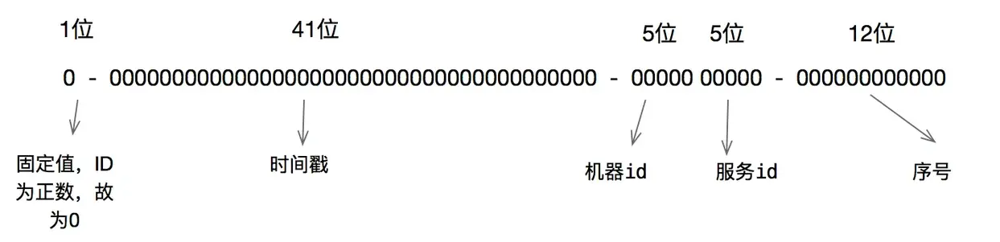

# 雪花算法

# 1 引言

## 1.1 分布式 ID 的常见方案

现在的服务基本都是分布式、微服务形式的，而且数据量的增长也催生了分库分表，进行水平分表后就需要保证表中 ID 的全局唯一性。

对于 MySQL 而言，表的主键 ID 一般采用自增的方式，但是水平分表之后，多张表会各自生成重复的 ID 值。那么如何保证水平分表后多张表中的 ID 全局唯一呢？

如果仍借助数据库主键自增的形式，可以为不同的表设置不同的初始值，然后按指定的步长自增。例如有 3 张拆分表，初始主键值分别为 1、2、3，自增步长为 3。这种方式的缺点是扩容时需要重新规划初始值和步长，而且依赖数据库的可用性。

也有人使用通用唯一识别码（UUID）作为主键，但常用的 UUIDv4 是一个随机、无序的字符串（标准格式为 36 个字符），而 MySQL（InnoDB）推荐使用递增的数值类型作为主键，无序主键会导致 B+ 树频繁页分裂，因此并不适合。RFC 9562 于 2024 年标准化的 UUIDv7 引入了时间有序性，可以缓解这一问题，但其 128 位的长度仍大于 64 位的 `long`。

还可以利用 Redis 自增命令的原子性来生成唯一 ID，但这种方式需要额外依赖 Redis，并且要考虑持久化与高可用，否则在重启或主从切换时可能产生重复 ID，因此业内用得相对较少。

当然还有其他解决方案，不少互联网公司也有自己内部的实现。雪花算法是其中一种用于生成分布式 ID 的高效方案，也被许多互联网公司广泛采用。

## 1.2 雪花算法的 ID 结构

> 雪花算法（Snowflake）是 Twitter（2023 年已更名为 X）于 2010 年开源的一种算法，用于在分布式、高并发环境中生成趋势递增的 64 位 ID。

64 位 ID 的构成如下图所示：



* 最高 1 位为符号位，固定为 0。因为生成的 ID 是正整数，如果是 1 就是负数了。
* 接下来 41 位存储毫秒级时间戳（当前时间与自定义起始时间之差），`2⁴¹ / (1000 × 60 × 60 × 24 × 365) ≈ 69.7`，**大约可以使用 69 年**。
* 再接下来 10 位存储机器码，包括 5 位 `datacenterId` 和 5 位 `workerId`，**最多可以部署 `2¹⁰ = 1024` 个节点**。
* 最后 12 位存储序列号。时间戳相同（同一毫秒）时，通过这个递增的序列号来区分。即对于同一个节点而言，**同一毫秒内可以生成 `2¹² = 4096` 个不重复的 ID**。

可以将雪花算法作为一个单独的服务进行部署，需要全局唯一 ID 的系统请求雪花算法服务获取 ID 即可。

对于每一个雪花算法服务，需要先指定 10 位的机器码，根据自身业务进行设定即可，例如“机房号 + 机器号”“机器号 + 服务号”，或者其他能够区分各节点的 10 位整数值。需要注意的是，同一时刻不能有两个节点使用相同的机器码，否则会生成重复 ID。

# 2 算法实现

```java
public class IdWorker{
    //下面两个每个5位，加起来就是10位的工作机器id
    private long workerId;    //工作id
    private long datacenterId;   //数据id
    //12位的序列号
    private long sequence;

    public IdWorker(long workerId, long datacenterId, long sequence){
        // sanity check for workerId
        if (workerId > maxWorkerId || workerId < 0) {
            throw new IllegalArgumentException(String.format("worker Id can't be greater than %d or less than 0",maxWorkerId));
        }
        if (datacenterId > maxDatacenterId || datacenterId < 0) {
            throw new IllegalArgumentException(String.format("datacenter Id can't be greater than %d or less than 0",maxDatacenterId));
        }
        System.out.printf("worker starting. timestamp left shift %d, datacenter id bits %d, worker id bits %d, sequence bits %d, workerid %d",
                timestampLeftShift, datacenterIdBits, workerIdBits, sequenceBits, workerId);

        this.workerId = workerId;
        this.datacenterId = datacenterId;
        this.sequence = sequence;
    }

    //初始时间戳
    private long twepoch = 1288834974657L;

    //长度为5位
    private long workerIdBits = 5L;
    private long datacenterIdBits = 5L;
    //最大值
    private long maxWorkerId = -1L ^ (-1L << workerIdBits);
    private long maxDatacenterId = -1L ^ (-1L << datacenterIdBits);
    //序列号id长度
    private long sequenceBits = 12L;
    //序列号最大值
    private long sequenceMask = -1L ^ (-1L << sequenceBits);
    
    //工作id需要左移的位数，12位
    private long workerIdShift = sequenceBits;
   //数据id需要左移位数 12+5=17位
    private long datacenterIdShift = sequenceBits + workerIdBits;
    //时间戳需要左移位数 12+5+5=22位
    private long timestampLeftShift = sequenceBits + workerIdBits + datacenterIdBits;
    
    //上次时间戳，初始值为负数
    private long lastTimestamp = -1L;

    public long getWorkerId(){
        return workerId;
    }

    public long getDatacenterId(){
        return datacenterId;
    }

    public long getTimestamp(){
        return System.currentTimeMillis();
    }

     //下一个ID生成算法
    public synchronized long nextId() {
        long timestamp = timeGen();

        //获取当前时间戳如果小于上次时间戳，则表示时间戳获取出现异常
        if (timestamp < lastTimestamp) {
            System.err.printf("clock is moving backwards.  Rejecting requests until %d.", lastTimestamp);
            throw new RuntimeException(String.format("Clock moved backwards.  Refusing to generate id for %d milliseconds",
                    lastTimestamp - timestamp));
        }

        //获取当前时间戳如果等于上次时间戳（同一毫秒内），则序列号加一；否则序列号赋值为0，从0开始。
        if (lastTimestamp == timestamp) {
            sequence = (sequence + 1) & sequenceMask;
            if (sequence == 0) {
                timestamp = tilNextMillis(lastTimestamp);
            }
        } else {
            sequence = 0;
        }
        
        //将上次时间戳值刷新
        lastTimestamp = timestamp;

        /**
          * 返回结果：
          * ((timestamp - twepoch) << timestampLeftShift) 表示将时间戳减去初始时间戳，再左移相应位数
          * (datacenterId << datacenterIdShift) 表示将数据id左移相应位数
          * (workerId << workerIdShift) 表示将工作id左移相应位数
          * | 是按位或运算符，例如：x | y，只有当x，y都为0的时候结果才为0，其它情况结果都为1。
          * 因为各部分只有相应位上的值有意义，其它位上都是0，所以将各部分的值进行 | 运算就能得到最终拼接好的id
        */
        return ((timestamp - twepoch) << timestampLeftShift) |
                (datacenterId << datacenterIdShift) |
                (workerId << workerIdShift) |
                sequence;
    }

    //获取时间戳，并与上次时间戳比较
    private long tilNextMillis(long lastTimestamp) {
        long timestamp = timeGen();
        while (timestamp <= lastTimestamp) {
            timestamp = timeGen();
        }
        return timestamp;
    }

    //获取系统时间戳
    private long timeGen(){
        return System.currentTimeMillis();
    }
}
```

上述代码中，`twepoch = 1288834974657L` 对应 UTC 时间 2010-11-04 01:42:54.657，是 Twitter 原始实现所用的起始时间；41 位时间戳从该时刻起约可用到 2080 年。自行实现时一般将起始时间设为系统上线前的某个时刻，以充分利用这约 69 年。各部分的左移位数与 ID 结构一一对应：`workerId` 左移 12 位，`datacenterId` 左移 `12 + 5 = 17` 位，时间戳左移 `12 + 5 + 5 = 22` 位。

其实雪花算法每一部分占用的比特位数并不是固定不变的。例如业务的生命周期可能达不到 69 年之久，那么可以减少时间戳占用的位数（如 39 位时间戳约可使用 17 年）；如果雪花算法服务需要部署的节点超过 1024 个，那么可以把减少的位数补充给机器码。

对于机器码，可以根据自身情况做调整，例如机房号、服务器号、业务号、机器 IP 等都可以使用，只要部署的各个雪花算法服务最终计算出来的机器码能够区分开即可。

# 3 算法改进

## 3.1 雪花算法的优缺点

雪花算法有很多优点：

* 在高并发分布式环境下生成不重复的 ID，单个节点理论上每秒可生成约 409.6 万（`4096 × 1000`）个 ID。
* 基于时间戳以及同一时间戳下的序列号自增，单个节点内 ID 严格递增，全局范围内趋势递增。
* 不依赖第三方库或者中间件。
* 算法简单，在内存中计算，效率高。

但是，雪花算法也有一个严重的缺点：**依赖服务器时间，服务器时钟回拨时可能会生成重复 ID**。时钟回拨通常由网络时间协议（NTP）同步校时、闰秒处理或人工修改系统时间等引起。前面的实现在检测到回拨时直接抛出异常、拒绝服务，虽然保证了不重复，却牺牲了可用性。

为了避免时钟回拨导致的错误，需要对算法进行改进。

## 3.2 改进方案一：利用空闲的序列号区间

首先，雪花算法的末尾 12 位是序列号，用来区分同一毫秒内产生的不同 ID，同一毫秒总共可以产生 4096 个 ID，每一毫秒的序列号都从基础序列号 0 开始递增。假设业务系统在单机上的每秒请求数（QPS）为 3 万，那么平均每毫秒只需要产生 30 个 ID，远没有达到设计上限 4096，也就是说通常情况下序列号的使用都处在低水位，当发生时钟回拨时，这些尚未被使用的序列号就可以派上用场了。

因此，可以对基础序列号稍加修改，每发生一次时钟回拨，就将基础序列号加上指定的步长。例如开始时从 0 递增，发生一次时钟回拨后从 1024 开始递增，再发生一次则从 2048 开始递增，以此类推，这样最多能够容忍 3 次回拨到同一时间点（4096 个序列号被划分为 4 个区间，第 4 次回拨时 `basicSequence` 达到 4096，归零并等待下一毫秒）。该方案的前提是每毫秒实际使用的序列号不超过步长 1024，否则不同区间的序列号可能重叠。

```java
    /** 步长, 1024 */
    private static long stepSize = 2 << 9;
    /** 基础序列号, 每发生一次时钟回拨, basicSequence += stepSize */
    private long basicSequence = 0L;

    private long handleMovedBackwards(long currStmp) {
        basicSequence += stepSize;
        if (basicSequence == MAX_SEQUENCE + 1) {
            basicSequence = 0;
            currStmp = getNextMill();
        }
        sequence = basicSequence;
        lastStmp = currStmp;
        return (currStmp - START_STMP) << TIMESTMP_LEFT
                | workId << WORK_LEFT 
                | sequence; 
    }
```

> 注：该片段中的机器码 `workId` 占满 10 位，不再拆分为 `datacenterId` 和 `workerId`，与第 2 章的实现略有不同。

## 3.3 改进方案二：启用备用 workerId

如果上面的解法还是不足以满足要求，还有一种更彻底的解法。

雪花算法给 `workerId` 预留了 10 位，即 `workerId` 的取值范围为 `[0, 1023]`。事实上，实际生产环境不大可能需要部署 1024 个分布式 ID 服务，所以可以将 `workerId` 的取值范围缩小为 `[0, 511]`，把 `[512, 1023]` 这个范围的 `workerId` 当作备用 `workerId`：`workerId` 为 0 的备用 `workerId` 是 512，`workerId` 为 1 的备用 `workerId` 是 513，以此类推。

具体逻辑是：若回拨时间小于阈值 `MAX_BACKWARD_MS`，则直接休眠等待时间追上；若回拨过多，则切换到备用 `workerId`，并使用该 `workerId` 上一次记录的时间戳继续判断。由于两个 `workerId` 的 ID 空间互不重叠，切换后即使时间戳重复也不会生成重复 ID。下面的代码基于 Sharding-JDBC（现为 Apache ShardingSphere 的一部分）的雪花算法实现修改而来：

```java
// 修改处: workerId原则上上限为1024, 但是为了每台sequence服务预留一个workerId, 所以实际上workerId上限为512
private static final long WORKER_ID_MAX_VALUE = 1L << WORKER_ID_BITS >> 1;
    
/**
  * 保留workerId和lastTime, 以及备用workerId和其对应的lastTime
  */
 private static Map<Long, Long> workerIdLastTimeMap = new ConcurrentHashMap<>();
 
/**
 * Generate key. 考虑时钟回拨, 与sharding-jdbc源码的区别就在这里</br>
 * 缺陷: 如果连续两次时钟回拨, 可能还是会有问题, 但是这种概率极低极低
 */
@Override
public synchronized Number generateKey() {
    long currentMillis = System.currentTimeMillis();

    // 当发生时钟回拨时
    if (lastTime > currentMillis){
        // 如果时钟回拨在可接受范围内, 等待即可
        if (lastTime - currentMillis < MAX_BACKWARD_MS){
            try {
                Thread.sleep(lastTime - currentMillis);
            } catch (InterruptedException e) {
                e.printStackTrace();
            }
        }else {
            // 如果时钟回拨太多, 那么换备用workerId尝试

        // 当前workerId和备用workerId的值的差值为512
            long interval = 512L;
            // 发生时钟回拨时, 计算备用workerId[如果当前workerId小于512,
            // 那么备用workerId=workerId+512; 否则备用workerId=workerId-512, 两个workerId轮换用]
            if (MyKeyGenerator.workerId >= interval) {
                MyKeyGenerator.workerId = MyKeyGenerator.workerId - interval;
            } else {
                MyKeyGenerator.workerId = MyKeyGenerator.workerId + interval;
            }

            // 取得备用workerId的lastTime
            Long tempTime = workerIdLastTimeMap.get(MyKeyGenerator.workerId);
            lastTime = tempTime==null?0L:tempTime;
            // 如果在备用workerId也处于过去的时钟, 那么抛出异常
            // [这里也可以增加时钟回拨是否超过MAX_BACKWARD_MS的判断]
            Preconditions.checkState(lastTime <= currentMillis, "Clock is moving backwards, last time is %d milliseconds, current time is %d milliseconds", lastTime, currentMillis);
            // 备用workerId上也处于时钟回拨范围内的逻辑还可以优化: 比如摘掉当前节点. 运维通过监控发现问题并修复时钟回拨
        }
    }

    // 如果和最后一次请求处于同一毫秒, 那么sequence+1
    if (lastTime == currentMillis) {
        if (0L == (sequence = ++sequence & SEQUENCE_MASK)) {
            currentMillis = waitUntilNextTime(currentMillis);
        }
    } else {
        // 如果是一个更近的时间戳, 那么sequence归零
        sequence = 0;
    }

    lastTime = currentMillis;
    // 更新map中保存的workerId对应的lastTime
    workerIdLastTimeMap.put(MyKeyGenerator.workerId, lastTime);

    if (log.isDebugEnabled()) {
        log.debug("{}-{}-{}", new SimpleDateFormat("yyyy-MM-dd HH:mm:ss.SSS").format(new Date(lastTime)), workerId, sequence);
    }
    System.out.println(new SimpleDateFormat("yyyy-MM-dd HH:mm:ss.SSS").format(new Date(lastTime))
                +" -- "+workerId+" -- "+sequence+" -- "+workerIdLastTimeMap);
    return ((currentMillis - EPOCH) << TIMESTAMP_LEFT_SHIFT_BITS) | (workerId << WORKER_ID_LEFT_SHIFT_BITS) | sequence;
}
```

> 注：上述代码在回拨较小、`Thread.sleep` 等待之后，没有重新获取 `currentMillis`，仍会使用回拨后的旧时间戳生成 ID，存在重复风险。参考 ShardingSphere 的实现，等待结束后应重新读取当前时间。

# 4 总结

* 雪花算法用“1 位符号位 + 41 位时间戳 + 10 位机器码 + 12 位序列号”拼成一个 64 位 `long`，无需依赖中间件即可在本地高效生成全局唯一、趋势递增的 ID；时间戳约可使用 69 年，单个节点每毫秒最多生成 4096 个 ID。
* 各部分的位数可以按业务需要调整，但必须保证各节点的机器码不重复。
* 雪花算法最大的问题是依赖系统时钟，时钟回拨可能导致 ID 重复，可以通过短暂等待、预留序列号区间、切换备用 `workerId` 等方式缓解。上述方案都只在内存中记录上次的时间戳，如果服务在回拨期间重启则无法察觉，生产环境中可以将时间戳定期持久化，或在启动时进行校验。
* 实际选型时也可以参考业界的开源方案：美团 Leaf 提供号段模式和 Snowflake 模式，后者借助 ZooKeeper 分配 `workerId` 并在启动时校验时钟；百度 UidGenerator 采用“1 位符号位 + 28 位秒级时间 + 22 位机器 ID + 13 位序列号”的结构，并通过 RingBuffer 预先生成 ID 来提升性能。这两个项目的开源仓库近年更新已很少，选用时需自行评估维护成本；Apache ShardingSphere 等框架也内置了雪花算法实现。
