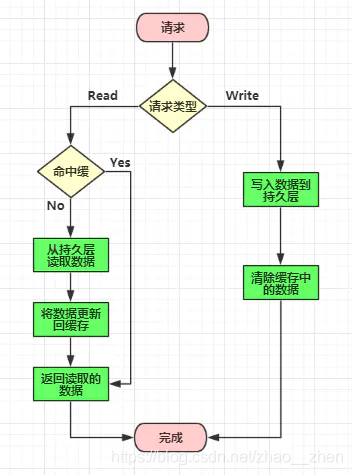
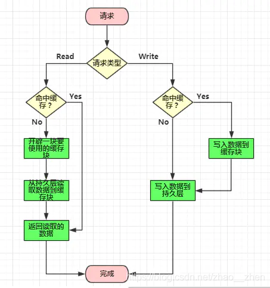
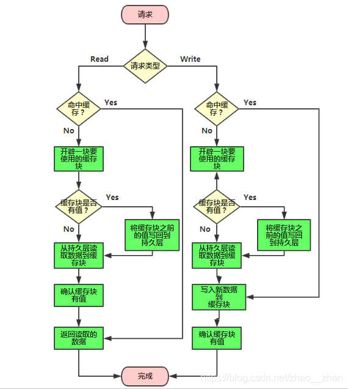
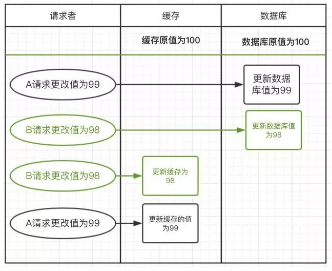
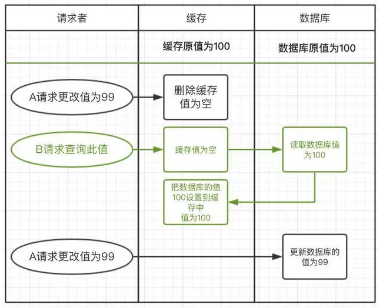
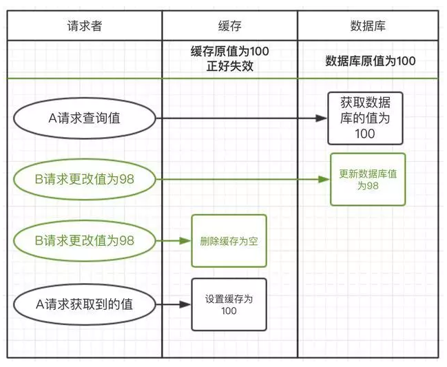
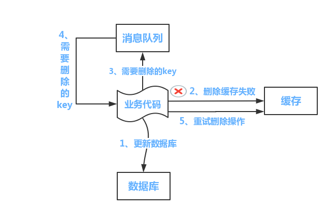
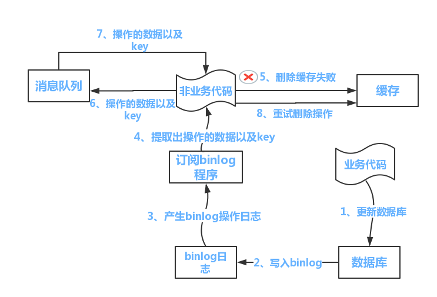

# 缓存一致性与更新策略

# 1 为什么需要缓存

一般在项目中，最消耗性能的地方就是后端服务的数据库了。而数据库的读写频率常常是不均匀分布的，大多数情况下是读多写少，并且读操作还会带有一些复杂的条件，比如 `LIKE`、`GROUP BY`、`JOIN` 等，这些语法非常消耗性能，因此数据库很容易在读操作的环节遇到瓶颈。

那么通过给数据库加一个前置缓存，就可以有效地吸收不均匀的请求，抵挡流量波峰。

另外，如果应用与数据源不在同一台服务器上，中间还会有很多网络消耗，也会对应用的响应速度有很大影响。如果当前应用对数据实时性的要求不那么高，在应用侧加上缓存就能快速地提升效率。

# 2 更新策略

既然是缓存，就意味着缓存中暂存的数据只是个副本，相当于把数据存放了 2 份，一份存放在数据库中，另一份存放在缓存中。当有新的数据要写入或者旧数据需要更新的时候，如果我们只更新了其中一份数据源，两边的数据就会不一致。所以使用缓存必然要面对一个问题：缓存数据与数据库数据如何进行有效且快速的同步。

一般来说，缓存的更新策略有以下三种模式：

- 旁路缓存（Cache Aside）更新模式：由应用程序同时维护缓存和数据库，读时未命中则从数据库加载并回填缓存，写时先更新数据库再删除缓存。
- 读穿/写穿（Read/Write Through）更新模式：应用程序只与缓存交互，由缓存负责同步读取和更新数据库。
- 异步写回（Write Behind，又称 Write Back）更新模式：只更新缓存，由缓存定时异步批量更新数据库。

## 2.1 Cache Aside 更新模式

- 失效：应用程序先从缓存取数据，没有得到，则从数据库中取数据，成功后放到缓存中。
- 命中：应用程序从缓存中取数据，取到后返回。
- 更新：先把数据存到数据库中，成功后再去删除缓存或者让缓存失效。

这种策略下，在读写并发时（读请求未命中缓存的同时有写请求）仍可能出现脏数据的问题，具体推演见 3.4 节。

## 2.2 Read/Write Through 更新模式

应用程序只需要维护缓存，数据库的维护工作由缓存代理：

### 2.2.1 Read Through

Read Through 模式就是在查询操作中更新缓存。也就是说，当缓存失效的时候，Cache Aside 模式是由调用方负责把数据加载到缓存，而 Read Through 模式则由缓存服务自己来加载，对应用程序透明。

### 2.2.2 Write Through

Write Through 模式和 Read Through 相仿，不过是在更新数据时发生。当有数据更新的时候，如果没有命中缓存，直接更新数据库，然后返回；如果命中了缓存，则更新缓存，然后由缓存自己更新数据库（这是一个同步操作）。

## 2.3 Write Behind 更新模式

Write Behind 更新模式就是在更新数据的时候，只更新缓存，不更新数据库，而缓存会异步地批量更新数据库。这个设计的好处是直接操作内存，速度快。因为是异步的，Write Behind 更新模式还可以把对同一个数据的多次操作合并后再写入数据库，所以性能的提升是相当可观的。

但其带来的问题是，数据不是强一致的，而且可能会丢失：如果缓存节点在脏数据刷入数据库之前宕机，这部分尚未持久化的更新就会丢失。另外，Write Behind 更新模式的实现逻辑比较复杂，因为它需要跟踪哪些数据被更新了、哪些数据需要刷到持久层上。通常只有在缓存数据被淘汰或到达刷新周期时，才会把它真正持久化。

# 3 场景推演

以上的理论知识准备完毕，下面用具体场景推演一下缓存更新的细节问题。

理论是美好的，现实是残酷的，现实最终会把“美好”的理论变成“没好”的，不信走着瞧。

缓存怎么更新，在实际应用中有很多种做法，但是归根结底，就是当数据发生变化时如何考虑以下两个问题：

- 对缓存是删除，还是更新？
- 先操作数据库，还是先操作缓存？

组合起来有以下四种方案。

## 3.1 先更新数据库，后更新缓存

第一种场景：更新数据库成功，更新缓存失败，则出现缓存与数据库不一致。

第二种场景：请求 A 更新值为 99，请求 B 更新值为 98。

- 请求 A 先发起，更新数据库为 99，但还没有来得及更新缓存。
- 请求 B 发起，更新数据库为 98，又更新了缓存值为 98。
- 请求 A 这时才更新缓存的值为 99。

这样数据库的值为 98，但缓存的值为 99，数据不一致出现了。

## 3.2 先更新缓存，后更新数据库

第一种场景：更新缓存成功，更新数据库失败，则出现缓存与数据库不一致。

第二种场景：与上面的流程类似，出现的问题也很类似。

- 请求 A 先更新缓存为 99，但还没有来得及更新数据库。
- 请求 B 更新缓存为 98，又更新了数据库为 98。
- 请求 A 这时才更新数据库为 99。

这样缓存的值为 98，数据库的值为 99，导致不一致。

## 3.3 先删除缓存，后更新数据库

第一种场景：删除缓存成功，更新数据库失败。此时缓存为空、数据库仍是旧值，下一次读请求发现缓存中没有数据，会从数据库重新加载旧值，缓存与数据库并不会出现不一致，因而影响不大。但即使数据库更新成功，也存在另一个问题：在旧缓存被删除后、数据库更新完成之前，这段时间内如果有读操作，旧值会被重新加载到缓存中，这就相当于没更新缓存（即下面的第二种场景）。

第二种场景：请求 A 更新值为 99，请求 B 获取值。

- 请求 A 更新值，先把缓存中的值删除，但还没有来得及更新数据库。
- 此时请求 B 过来查询此值，发现缓存中不存在，就到数据库中查询。
- 请求 B 在数据库中获取到旧值 100，再把该值设置到缓存中。
- 请求 A 这时才更新数据库里面的值为 99。

这样就导致了缓存和数据库的不一致问题：数据库已是 99，而缓存中的值在过期之前一直是旧数据 100。

## 3.4 先更新数据库，后删除缓存

第一种场景：更新数据库成功，删除缓存失败，则出现缓存与数据库不一致。

第二种场景：请求 A 查询值，请求 B 更新值。

- 请求 A 发起查询请求，此时缓存恰好失效，直接到数据库查询到 100，但还没有来得及去设置缓存。
- 请求 B 更新值，先更新数据库为 98，再删除缓存。
- 请求 A 这时才设置缓存为 100。

这样数据库的值为 98，而缓存中却是旧值 100，同样出现了不一致。

## 3.5 总结

推演完毕。

结果发现，没有一个方案走得通，这还怎么用？这么一看，现实不只把理论给打残了，而且是按在地上摩擦啊！

通过上面的推演，可以发现这些方案主要存在两种问题：

（1）第一种问题：**操作的原子性无法保证**

对数据库与缓存的操作是分两步操作的，并没有类似数据库事务那样的控制，一旦第一步成功，第二步失败，必然导致数据不一致。

（2）第二种问题：**并发请求导致数据覆盖**

并发环境下，多个请求的处理顺序无法保证，会导致旧数据覆盖掉新数据的情况。但是，并发不一定导致数据覆盖，这是一个概率问题，如何将概率降至最低，或者降为零（比如加锁），需要我们根据具体的业务场景来分析。

但是，**任何脱离实际业务的推演都是耍流氓**。

下面逐个分析。

### 3.5.1 先更新数据库，后更新缓存

相对来讲，理论上这种方式比“先更新数据库，后删除缓存”有着更高的读性能，因为它事先在缓存中准备好了数据。

但是缺点也很明显：

- 如果是一个写多读少的场景，采用这种方案可能会导致更新了十次缓存，但只读了一次，其余九次的更新是没必要的，浪费性能。
- 如果写入数据库的值并不是直接写入缓存的，而是要经过一系列复杂的计算再写入缓存，那么每次写入数据库后都重新计算写入缓存的值，同样是浪费性能的，这种情况下显然删除缓存更为适合。

那更新缓存与删除缓存到底哪种更好呢？实际上主要取决于“更新缓存的复杂度”。

- 如果更新缓存的代价很小，一般更倾向于更新缓存，以保证更高的缓存命中率，但需要通过分布式锁或版本号等手段规避 3.1 中并发写导致的覆盖问题。
- 如果缓存是通过很复杂的数据计算得出来的，更新缓存的代价很大，一般更倾向于删除缓存。

### 3.5.2 先更新缓存，后更新数据库

既然我们把缓存当作副本，所有数据必须以数据库为准。“先更新缓存，后更新数据库”在数据库更新失败时会导致“缓存有新数据，而数据库没有”，这是绝对不能容忍的，所以该方案在实际业务当中基本没法用。

### 3.5.3 先删除缓存，后更新数据库

该方案导致的不一致可以依靠“**延迟双删策略**”解决：

- 先淘汰缓存。
- 再写数据库（这两步和原来一样）。
- 休眠 1 秒，再次淘汰缓存。

这么做，可以将 1 秒内所造成的缓存脏数据再次删除。

第 1 个问题：这个 1 秒是怎么确定的，具体该休眠多久呢？

需要根据读数据业务逻辑的耗时综合判断，写数据的休眠时间在读数据业务逻辑耗时的基础上加几百毫秒即可；如果采用读写分离架构，还要再加上主从同步的延迟时间。这么做的目的，就是确保读请求结束后，写请求可以删除读请求造成的缓存脏数据。

第 2 个问题：采用这种同步淘汰策略，吞吐量降低怎么办？

将第二次删除改为异步执行：自己起一个线程（或使用延迟队列）异步删除。这样，写请求就不用休眠一段时间后再返回了，可以提高吞吐量。

第 3 个问题：第二次删除如果失败了怎么办？

可以依靠消息队列（MQ）的重试机制或者定时任务来兜底；如果对缓存的准确性要求不高，也可以直接依赖缓存过期时间来自动修正。

### 3.5.4 先更新数据库，后删除缓存

这种方案在实际业务当中使用率最高，原因有两点：

- 先更新数据库，首先保证了数据源头一定是正确的。
- 并发导致数据不一致的概率非常低。

回头看看上面的场景，如果发生不一致，需要同时具备以下四个条件：

- 读操作时，缓存恰好失效。
- 有一个并发的写操作。
- 写操作比读操作更快。
- 读操作早于写操作进入数据库，晚于写操作更新缓存。

而实际上数据库的写操作通常比读操作慢得多，而且可能还要锁行、锁表。读操作必须在写操作之前进入数据库，又要晚于写操作更新缓存，这些条件同时具备的概率并不大。并且即使出现这个问题，还可以设置缓存过期时间来自动兜底；对一致性要求更高的场景，也可以在此基础上叠加延迟双删。

但是该方案还有个问题要解决：第二步删除缓存失败怎么办？

答案是提供一个重试机制即可，比如借助 MQ：

- 更新数据库数据。
- 缓存因为种种问题删除失败。
- 将需要删除的 key 发送至消息队列。
- 自己消费消息，获得需要删除的 key。
- 继续重试删除操作，直到成功。

然而，该方案有一个缺点：对业务线代码造成大量的侵入。于是有了方案二：启动一个订阅程序去订阅数据库的二进制日志（binlog），获得需要操作的数据（如使用 Canal、Debezium 等 CDC 工具）。在应用程序之外另起一段程序，获得这个订阅程序传来的信息，进行删除缓存操作。

- 更新数据库数据。
- 数据库会将操作信息写入 binlog 当中。
- 订阅程序提取出所需要的数据以及 key。
- 另起一段非业务代码，获得该信息。
- 尝试删除缓存操作，发现删除失败。
- 将这些信息发送至消息队列。
- 重新从消息队列中获得该数据，重试操作。

### 3.5.5 小结

- **方案 1**：先更新数据库，后更新缓存，**最好不用**。
- **方案 2**：先更新缓存，后更新数据库，**坚决不用**。
- **方案 3**：先删除缓存，后更新数据库，**适度使用**。
- **方案 4**：先更新数据库，后删除缓存，**推荐使用**。

但是也不能盲从，正所谓：具体问题，具体分析。

没有完美的方案，只有合适的方案。

# 4 主从架构下的问题

上面的各种场景都是只有一个数据库实例的情况，而实际生产环境中往往是一主多从的。

按照写主读从，缓存加载数据的时候应该从从库中读，而主从同步本来就有延迟，于是读从库很有可能读到的是旧数据。

为了解决这种问题，可以考虑以下几种方案。

## 4.1 强制缓存读主数据库

这样一来，就不必考虑主从同步的问题了，可行，代价是主库的读压力会增大。

## 4.2 选择性地读主数据库

之所以要强制读主库，是因为在主从同步完成之前从库中的数据还是旧的，当主从同步完成后再读从库就没什么问题了。那么在主从同步的这段时间内，如果没有请求读这个 key 就没有问题；如果这段时间内有请求读取这个 key，那么在同步完成后要删除这个 key。

如何判断在主从同步这段时间内有没有请求读取这个 key 呢？

在更新数据库的时候，往缓存中设置一个标记 key，格式为“缓存 key + 业务数据 ID”，其生存时间是主从同步的延迟时间。在读的时候，首先判断缓存中有没有这样一个标记 key，如果有，则从主库中重新加载数据到缓存；如果没有，则直接从从库中加载数据到缓存。

## 4.3 订阅从库的 binlog

可以通过工具（比如 Canal）订阅从库的 binlog，这种方式是比较准确的：从库数据有更新，则立即删除或更新对应的缓存，此时从库已是新数据，回源不会再读到旧值。需要注意，从库要开启 `log_replica_updates`（MySQL 8.0.26 之前名为 `log_slave_updates`），才会把复制过来的变更写入自身的 binlog。

# 5 总结

| 策略 | 写操作 | 一致性 | 主要风险 | 适用场景 |
| --- | --- | --- | --- | --- |
| Cache Aside（先更新数据库，后删除缓存） | 应用更新数据库后删除缓存 | 最终一致，不一致窗口小 | 删除缓存失败、读写并发的小概率脏数据 | 绝大多数读多写少的业务，最常用 |
| Read/Write Through | 由缓存同步更新数据库 | 较强 | 依赖缓存组件支持，写延迟较高 | 有成熟缓存中间件、希望对应用透明的场景 |
| Write Behind | 只写缓存，异步批量刷库 | 弱 | 缓存宕机导致数据丢失 | 写多、可容忍少量丢失的场景（如计数、点赞） |
| 先删除缓存，后更新数据库 | 删除缓存后更新数据库 | 读写并发易脏 | 旧值被回填到缓存 | 配合延迟双删适度使用 |
| 更新缓存类方案 | 写数据库与写缓存 | 并发写易覆盖 | 并发覆盖、浪费计算 | 更新代价小且能加锁或版本控制时 |

总体而言，缓存与数据库无法做到无代价的强一致，实际工程中一般选择“先更新数据库，后删除缓存”，并配合缓存过期时间、MQ 重试或订阅 binlog 异步删除来保证最终一致；在主从架构下，还需额外考虑主从同步延迟带来的旧数据回填问题。
