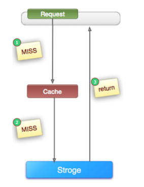
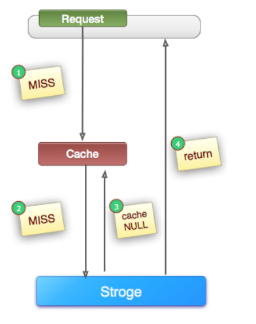
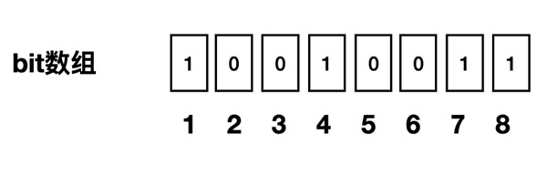
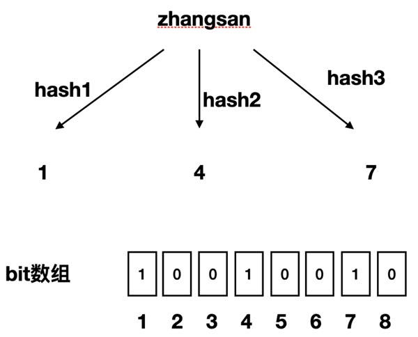
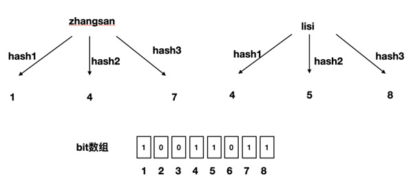
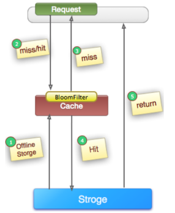

# 缓存穿透、击穿与雪崩

# 1 缓存穿透

> **缓存穿透**是指查询一个不存在的数据，由于缓存不命中，请求全部打到数据库上的情况。缓存起不到作用，请求每次都会走到数据库，流量大时数据库可能会被压垮。此时缓存就好像被“穿透”了一样，起不到任何作用。

缓存未命中（Cache Miss）是一个更宽泛的概念：数据可能存在于数据库中，只是尚未写入缓存、已经过期或被淘汰。受缓存容量和过期策略限制，Cache Miss 无法完全避免。缓存穿透则特指查询数据库中根本不存在的数据；正常业务中，用户偶尔输错 ID 也会产生少量穿透。

如果系统被恶意攻击，攻击者可能不断构造不存在的 ID。由于缓存和数据库中都没有对应数据，每次请求都会落到数据库，持续的大流量可能压垮数据库。

下图是一个比较典型的 cache-storage 架构，即 cache（例如 Redis、Memcached 等）+ storage（例如 MySQL、HBase 等）。查询一个根本不存在的值时，如果不做处理，请求永远会落到 storage 上：



应对恶意穿透需要纵深防御。流量入口处可以通过 API 网关或 WAF 按 IP、用户、设备以及请求频率识别异常扫描并执行限流或封禁；应用层仍要进行参数校验，并采用缓存空值或布隆过滤器（Bloom Filter）。入口防护只能减少异常流量，不能替代应用层对数据是否存在的判断。

## 1.1 缓存空值



如上图所示，当第 2 步在 Storage 中也未命中（MISS）后，仍然将空对象写入 Cache 中（保留几分钟或者一段时间，具体视业务而定），下次同一个 Key 的新请求（Request）将直接从 Cache 中获取到数据，从而保护了后端的 Storage。

这种方案适用于数据命中率不高、数据变化较频繁的场景。

下面是一段伪代码：

```java
        Object nullValue = new Object();
        try {
            //从数据库中查询数据
            Object valueFromDB = getFromDB(uid); 
            if (valueFromDB == null) {
                //如果从数据库中查询到空值，就把空值写入缓存，设置较短的超时时间
                cache.set(uid, nullValue, 10);   
            } else {
                cache.set(uid, valueFromDB, 1000);
            }
        } catch (Exception e) {
            cache.set(uid, nullValue, 10);
        }
```

这种方式也存在弊端：如果攻击者使用大量不同的 Key 发起请求，缓存中会存入大量空值，浪费缓存的存储空间，甚至可能把真实有效的数据逐出缓存，反而造成缓存命中率下降。另外，空值缓存在有效期内可能与数据库不一致（例如该数据随后被写入数据库），因此空值的过期时间要设置得较短，也可以在新增数据时主动删除对应的空值缓存。

## 1.2 布隆过滤器

1970 年，布隆（Burton Howard Bloom）提出了一种概率型数据结构，即布隆过滤器，用来判断一个元素是否在一个集合中。布隆过滤器底层是一个很长的 bit 数组（位数组），默认值都是 0，一个元素通过多个哈希函数映射到这个 bit 数组上，并将对应位置由 0 改成 1。

相比于传统的 List、Set、Map 等数据结构，布隆过滤器只是一个 bit 数组，它更高效、占用空间更少，代价是存在一定的误判率，并且无法取出元素本身。



如果我们要映射一个值到布隆过滤器中，需要使用多个不同的哈希函数生成多个哈希值，并将每个哈希值指向的 bit 位置为 1。例如针对值“zhangsan”，三个不同的哈希函数分别生成了哈希值 1、4、7：



我们现在再存一个值“lisi”，如果哈希函数返回 4、5、8 的话，图继续变为：



当我们想要判断布隆过滤器是否记录了某个数据时，布隆过滤器会先对该数据进行同样的哈希处理。比如“wangwu”经哈希函数返回了 2、5、8 三个值，结果我们发现 2 这个 bit 位上的值为 0，说明没有任何一个值映射到这个 bit 位上，因此可以很确定地说“wangwu”这个数据**一定不存在**。

但同时我们会发现，“zhangsan”和“lisi”的哈希值都包含 4，因此 4 这个 bit 位被重复置位了。随着布隆过滤器保存的数据不断增多，重复的概率会不断增大，所以当我们过滤某个数据时，即使发现其三个哈希值对应的 bit 位都为 1，也只能说明过滤器中**可能包含该数据，并不能绝对肯定**，因为哈希碰撞可能导致误判。

也就是说，布隆过滤器可以做到以下两点：

- 判断某个值不存在时，它一定不存在；
- 判断某个值存在时，它只是可能存在（存在误判）。

误判率与位数组长度 m、已插入元素个数 n、哈希函数个数 k 有关，近似为 `p ≈ (1 − e^(−kn/m))^k`；当 `k = (m/n) · ln2` 时误判率最低。实际使用时通常根据预期元素数量和可接受的误判率来反推 m 和 k。

需要注意，标准布隆过滤器**不支持删除元素**，因为将某个 bit 位重置为 0 可能会影响其他共用该位的元素。如果业务需要删除，可以使用计数布隆过滤器（Counting Bloom Filter，用计数器代替单个 bit），或者定期重建布隆过滤器。工程上可以直接使用 Guava 的 `BloomFilter`（单机）、Redisson 的 `RBloomFilter`，或 Redis 的布隆过滤器能力。Redis 7.4 及更早版本通常通过 Redis Stack 或 RedisBloom 模块提供 `BF.ADD`、`BF.EXISTS` 等命令；Redis Open Source 8 已将布隆过滤器等概率数据结构集成到官方二进制发行版中，不再需要单独安装 RedisBloom 模块。

利用布隆过滤器的这个特点可以解决缓存穿透的问题：在服务启动时，先把数据的查询条件（例如数据的 ID）映射到布隆过滤器中；新增数据时，除了写入数据库之外，也需要将数据的 ID 同步写入布隆过滤器。

我们在查询某条数据时，先判断这个查询的 ID 是否存在于布隆过滤器中，如果不存在就直接返回空值，而不需要继续查询缓存和数据库；存在于布隆过滤器中才继续查询缓存和数据库，这样就解决了缓存穿透的问题。由于存在误判，仍会有少量不存在的数据穿透到数据库，实践中可以与缓存空值结合使用。



# 2 缓存击穿

> **缓存击穿**是指某一个**热点 Key** 在缓存过期的一瞬间，同时有大量的请求打进来，由于此时缓存已经过期，请求最终都会走到数据库，造成数据库瞬时请求量大、压力骤增，甚至可能压垮数据库。

注意与缓存穿透的区别：

- 导致缓存穿透的数据**在数据库中不存在，在缓存中也不存在**；
- 导致缓存击穿的数据**在数据库中存在，而在缓存中不存在**，一般是热点数据的缓存时间到期了。

缓存击穿的解决方案主要有两类：通过互斥锁或 Singleflight 控制并发回源，或者让热点数据不过期并异步刷新。

## 2.1 互斥锁

业界比较常用的做法是使用互斥锁（Mutex）。简单来说，就是在缓存失效的时候（判断取出的值为空），只有第一个请求线程能拿到锁并执行数据库查询操作，其他线程拿不到锁就等待一段时间后重试；等到第一个线程将数据写入缓存后，其他线程就可以直接走缓存。拿到锁的线程还应再查询一次缓存（双重检查），避免等待期间缓存已经被其他线程重建。

可以利用缓存组件中带有成功/失败返回值的原子操作设置 mutex key。Redis 的 `SETNX` 是 `SET if Not eXists` 的缩写，但它本身不能同时设置过期时间；如果将 `SETNX` 和 `EXPIRE` 分成两步执行，客户端在两步之间故障就可能留下无法自动释放的锁。Redis 2.6.12 起可以使用 `SET key token NX EX seconds`，原子地完成加锁和设置过期时间。锁的 value 应使用本次请求的唯一 token，释放时通过 Lua 脚本原子地校验 token 并删除，避免误删其他请求后来获得的锁。

下面用简化的 Java 伪代码表示循环重试、双重检查和安全释放的完整流程：

```java
public String get(String key) throws InterruptedException {
    String mutexKey = "mutex:" + key;

    while (true) {
        String value = redis.get(key);
        if (value != null) {
            return value;
        }

        String token = UUID.randomUUID().toString();
        if (!tryLockForSeconds(mutexKey, token, 180)) {
            Thread.sleep(50);
            continue;
        }

        try {
            value = redis.get(key);
            if (value != null) {
                return value;
            }

            value = db.get(key);
            if (value != null) {
                redis.set(key, value, expireSeconds);
            }
            return value;
        } finally {
            unlockIfOwner(mutexKey, token);
        }
    }
}
```

手写分布式锁还要处理业务执行时间超过锁租期、客户端故障和网络分区等边界问题。生产环境通常优先使用经过验证的客户端库，例如 Redisson 的 `RLock`；其 Watchdog 可以在持锁的 Redisson 实例存活期间自动续期，并限制只有持有锁的线程才能解锁。不过成熟框架只能减少实现错误，仍需合理设置等待时间、租期和失败处理策略。

如果使用 Memcached，也可以利用 `add(mutexKey, token, expiration)` 的原子性实现类似的互斥效果，无需为其单独维护一套流程示例。

互斥锁之外，还可以使用 Singleflight（请求合并）模式。Go 的 `golang.org/x/sync/singleflight` 会抑制同一个 key 的重复函数调用：第一个调用负责查询数据库，进程内其他并发调用等待并共享其结果。Singleflight 不需要维护 Redis 锁，但它通常只在单个进程内生效；应用部署多个实例时，每个实例仍可能各自发起一次数据库查询。是否还需要分布式锁，应根据实例数量和数据库承压能力决定。

## 2.2 设置热点数据永不过期

直接将缓存设置为不过期，然后由定时任务去异步加载数据、更新缓存。

这种方式适用于比较极端的场景，例如流量特别大的场景，使用时需要考虑业务能够接受的数据不一致时长，以及异常情况（如定时任务执行失败）的处理。

另一种常见做法是“逻辑过期”：缓存在 Redis 中不设置物理过期时间，而是在 value 中额外存储一个逻辑过期时间。读取时若发现数据已逻辑过期，由获取到互斥锁的线程开启异步任务去重建缓存，当前请求以及其他请求则直接返回旧数据。这样既不会让请求阻塞等待，也不会有大量请求同时打到数据库，代价是重建完成前会短暂返回旧数据。

# 3 缓存雪崩

> **缓存雪崩**是指在某一个时刻，缓存大面积失效（比如大量 Key 采用了相同的过期时间），或者缓存服务本身宕机，从而导致大量请求直接落到数据库，造成数据库 CPU 和内存负载过高，甚至宕机。

缓存雪崩其实有点像“升级版的缓存击穿”：缓存击穿针对的是单个热点 Key，缓存雪崩则是大量 Key 同时失效，甚至整个缓存层不可用。

解决方案有以下几种：

## 3.1 加锁/队列

加锁或排队只能限制同时回源数据库的请求数量，并不能提高系统吞吐量。如果缓存大面积失效，大量请求等待锁或进入队列仍可能造成超时，因此它只适合控制局部热点或作为数据库的最后一道保护，不能作为缓存雪崩的主要预防手段。更重要的是通过随机过期时间避免大量 Key 同时失效，并配合后续的高可用、限流和降级措施。

## 3.2 为 Key 设置不同的缓存失效时间

在缓存的时候给过期时间加上一个随机值（例如基础过期时间 30 分钟，再叠加 0～5 分钟的随机值），将缓存失效时间分散开，避免大量 Key 在同一时刻集中过期。

## 3.3 双缓存

- 主缓存：有效期按照经验值设置，是主要读取的缓存，主缓存失效后从数据库加载最新值。
- 备份缓存：有效期长，获取锁失败时读取的缓存，主缓存更新时需要同步更新备份缓存。

其本质是一种缓存降级策略。

## 3.4 数据预热

数据预热的含义就是在系统正式上线之前，先把可能被大量访问的数据预先加载一遍，使这部分数据进入缓存。在即将发生大并发访问前（比如“双十一”零点之前），手动触发加载不同 Key 的缓存，并设置不同的过期时间，让缓存失效的时间点尽量均匀。

## 3.5 缓存高可用与多级缓存

上述方案主要针对“大量 Key 同时过期”，而对于缓存服务宕机导致的雪崩，需要从架构层面保障缓存本身的可用性：一是搭建高可用的缓存集群，例如 Redis 哨兵（Sentinel）或 Redis Cluster，避免单点故障；二是引入多级缓存，例如“本地缓存（如 Caffeine）+ 分布式缓存（如 Redis）”，即使分布式缓存不可用，本地缓存仍能挡住一部分请求。

## 3.6 限流与降级

当缓存层出现故障时，可以在应用层对访问数据库的请求进行限流、熔断，并对非核心业务进行降级（如直接返回默认值或友好提示），保证数据库不被瞬时流量压垮，待缓存恢复后再逐步放开流量。常用的组件有 Sentinel（阿里开源的流量治理组件）、Resilience4j 等。

限流阈值可以结合数据库连接池占用率、请求延迟和错误率动态调整，但必须设置明确的保护上限。Kubernetes HPA、Serverless 应用或弹性数据库可以补充计算资源，却存在扩容延迟，而且盲目扩容应用实例还可能向数据库施加更大压力，因此弹性扩容不能替代缓存高可用、限流与降级。

# 4 总结

| 问题 | 成因 | 数据状态 | 主要解决方案 |
| --- | --- | --- | --- |
| 缓存穿透 | 查询根本不存在的数据（常见于恶意攻击） | 数据库中不存在，缓存中也不存在 | 网关限流、参数校验、缓存空值、布隆过滤器 |
| 缓存击穿 | 单个热点 Key 过期的瞬间涌入大量并发请求 | 数据库中存在，缓存中刚过期 | 互斥锁、Singleflight、热点数据永不过期（逻辑过期） |
| 缓存雪崩 | 大量 Key 同时过期，或缓存服务宕机 | 大面积数据在缓存中不可用 | 随机过期时间、数据预热、缓存高可用与多级缓存、限流降级 |

三者的共同点是请求绕过缓存直接压到数据库，区别在于“查的数据是否存在”以及“失效的范围是单个 Key 还是大面积”。实际项目中通常组合使用多种手段，并配合监控告警及时发现缓存命中率的异常波动。加锁、弹性扩容等措施只能缓解故障影响，不能替代随机过期、高可用和流量保护等预防机制。
