# 服务降级、熔断与限流

# 1 引言

在微服务架构中，系统根据业务被拆分成一个个的服务，服务与服务之间可以相互调用（RPC）。为了保证高可用，单个服务通常会集群部署。由于网络原因或者服务自身的原因，服务并不能保证 100% 可用，如果单个服务出现问题，调用这个服务就会出现线程阻塞，此时若有大量的请求涌入，Servlet 容器的线程资源会被消耗完毕，导致服务瘫痪。由于服务与服务之间存在依赖，故障会沿着调用链传播，对整个微服务系统造成灾难性的严重后果，这种现象就是“**服务雪崩**”。

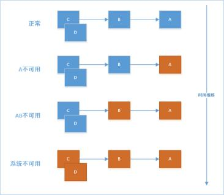

如上图所示：A 作为服务提供者，B 为 A 的服务消费者，C 和 D 是 B 的服务消费者。A 不可用引起了 B 的不可用，并将不可用像滚雪球一样放大到 C 和 D 时，雪崩效应就形成了。

另外，在大中型分布式系统中，系统通常有很多依赖（HTTP、Hessian、Netty、Dubbo 等），如下图：

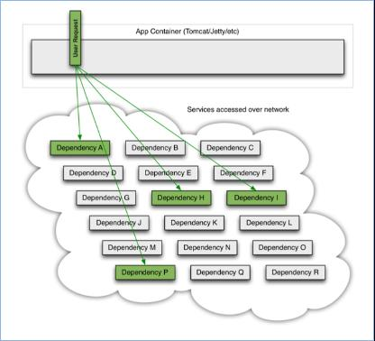

在高并发访问下，这些依赖稳定与否对系统的影响非常大，但是依赖有很多不可控问题，如网络连接缓慢、资源繁忙、暂时不可用、服务脱机等。

如下图：QPS 为 50 的依赖 I 出现不可用，但是其他依赖仍然可用：

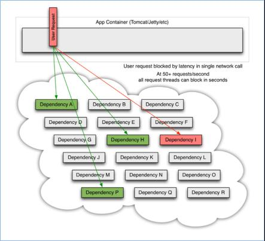

当依赖 I 阻塞时，大多数服务器的线程池就会出现阻塞，影响整个线上服务的稳定性。如下图：

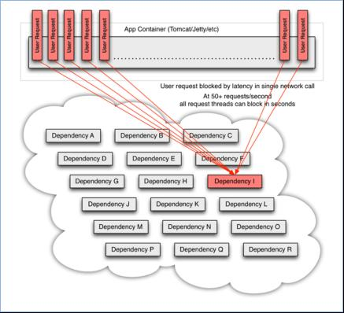

复杂分布式架构中的应用程序有很多依赖，这些依赖都不可避免地会在某些时候失败。高并发的依赖失败时如果没有隔离措施，当前应用服务就有被拖垮的风险。

很多服务框架会提供服务重试机制，在很大程度上解决了网络瞬时不可达带来的问题。但是**在很多情况下，造成服务雪崩的元凶正是服务重试机制**。

某个服务本来就已经出现问题了，造成资源占用无法释放、请求延时等问题。这时在请求失败之后又不断地发送重试请求，在原本就无法释放的资源基础上继续膨胀式占用，导致整个系统资源耗尽，最终引发服务雪崩。因此，重试通常需要配合重试次数上限、退避（Backoff）策略以及熔断一起使用。

要防止系统发生雪崩，就必须要有**容错设计**。如果遇到突增流量，一般的做法是对非核心业务功能采用**熔断**和**降级**的措施来保护核心业务功能正常服务，而对于核心功能服务，则需要采用**限流**的措施。

# 2 熔断

**熔断**对应的英文是 circuit breaker，在电工学里就是断路器的意思，因此熔断器也常被称为断路器（Circuit Breaker）。它就相当于一个开关，打开后可以阻止流量通过。比如保险丝，当电流过大时，就会熔断，从而避免元器件损坏。

服务熔断是指调用方访问服务时通过断路器做代理进行访问，断路器会持续观察服务返回的成功、失败状态，当失败超过设置的阈值时断路器打开，请求就不能真正地访问到服务了，而是被快速失败（Fail Fast）。

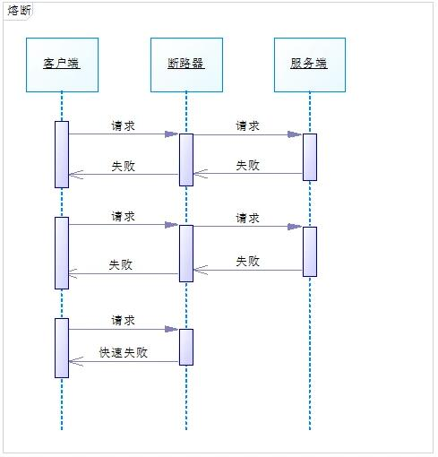

一般而言，熔断状态不会一直持续，而是有一个时间范围，时间过了以后再去尝试请求服务提供者，一旦服务提供者的服务能力恢复，请求就又可以继续调用服务提供者。

断路器的状态转换图如下：

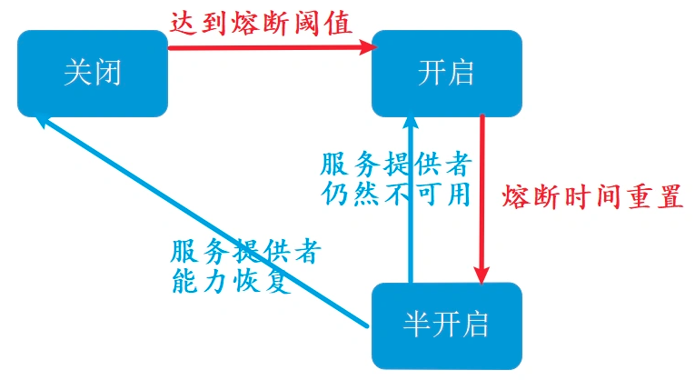

* 断路器默认处于“关闭”（Closed）状态，当统计窗口内的请求数达到最小请求数，且服务提供者的错误率（或慢调用比例）达到阈值时，就会触发断路器“开启”（Open）。
* 断路器开启后进入熔断时间，期间所有请求直接失败或走降级逻辑；熔断时间结束后，断路器进入“半开启”（Half-Open）状态。
* 在半开启状态下，断路器会放行少量试探请求，如果试探请求成功，说明服务提供者的服务能力已恢复，则断路器关闭，进入正常的服务状态。
* 在半开启状态下，如果试探请求失败，说明服务提供者的服务能力未能恢复，则断路器再次开启，并重新计时熔断时间。

# 3 降级

服务熔断通常与服务降级配合使用。在服务发生熔断后，一般会让请求走事先配置的处理方法，这个处理方法就是一个降级逻辑。

简言之，**服务降级是一种兜底的服务策略，体现了一种“实在不行就怎么样”的思想**。想去北京买不到飞机票，实在不行就坐高铁去吧；感冒了想去看病挂不上号，实在不行就先回家吃点药睡一觉吧。这种“实在不行”之后的处理方法，被称为**降级方法（fallback）**。

当服务提供者故障触发了调用方的熔断机制，服务调用者就不再调用远程服务方法，而是调用本地的 fallback 方法。此时你需要预先提供一个处理方法，作为服务降级之后的执行方法，fallback 的返回值一般是预设的默认值或者来自缓存。

需要注意的是，熔断只是触发降级的原因之一：调用超时、异常、被限流拒绝，甚至人工开关（如大促期间主动关闭评论、推荐等非核心功能）都可以触发降级。熔断关注的是“何时停止调用故障依赖”，降级关注的是“停止调用之后返回什么”。

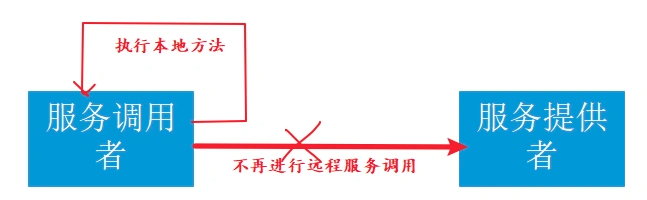

除了可以在服务调用端实现服务降级，还可以在服务提供端实现服务降级。

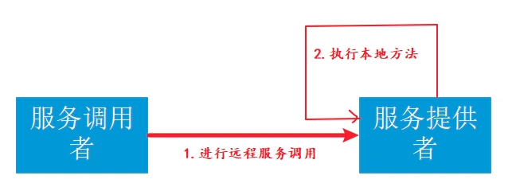

实际上在大型的微服务系统中，服务提供者和服务消费者并没有严格的区分，很多服务既是提供者，也是消费者。

# 4 限流

## 4.1 为什么需要限流

举一个我们生活中的例子：一些热门的旅游景点，往往会对每日的旅游参观人数有严格的限制，比如厦门的鼓浪屿、北京的故宫等，每天只会卖出固定数目的门票，如果你去得晚了，可能当天的票就已经卖完了，当天就无法进去游玩了。

为什么旅游景点要做这样的限制呢？多卖一些门票多赚一些钱岂不是更好？

原因在于景点的服务资源是有限的，每日能服务的人数是有限的，一旦放开限制，景点的工作人员就会不够用，卫生情况也得不到保障，安全也有隐患，超密集的人群也会严重地影响游客的体验。但由于景区名气大，来游玩的旅客络绎不绝，远超出了景区的承载能力，因此景区只好做出限制每日人员流量的举措。

同理，在 IT 软件行业中，系统服务也是这样的。

> 服务限流是指当系统资源不够，不足以应对大量请求，即系统资源与访问量出现矛盾的时候，我们为了保证有限的资源能够正常服务，按照预设的规则对系统进行流量限制或功能限制的一种方法。

如果你的系统理论上单位时间内可服务 100 万用户，但是今天却突然来了 300 万用户，由于用户流量的随机性，如果不加以限流，很有可能这 300 万用户一下子就压垮了系统，导致所有人都得不到服务。

因此为了保证系统至少还能为 100 万用户提供正常服务，我们需要对系统进行限流设计。

有的人可能会想，既然会有 300 万用户来访问，那为什么不干脆把系统设计成足以支撑这么大量用户的集群呢？

这是个好问题。如果系统长期有 300 万用户来访问，肯定是要做上述升级的，但是常常面临的情况是，系统的日常访问量就是 100 万，只不过偶尔会因为一些不可预知的特定原因导致短时间的流量激增，这个时候，公司往往出于节约成本的考虑，不会为了一个不常见的尖峰来把系统扩容到最大的尺寸。

## 4.2 计数器算法

计数器算法也称固定窗口（Fixed Window）算法，是最简单的实现方式：维护一个计数器，来一个请求计数加 1，达到阈值时，直接拒绝请求。比如限流 QPS 为 100，算法的实现思路就是从第一个请求进来开始计时，在接下来的 1s 内，每来一个请求，就把计数加 1，如果累加的数字达到了 100，那么后续的请求就会被全部拒绝。等到 1s 结束后，把计数恢复成 0，重新开始计数。

但是这个方法存在 2 个明显的问题。

（1）临界问题：单位时间（比如 1s）的边界很难把控，如下图：

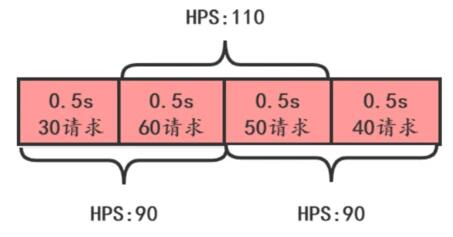

图中 HPS 即每秒请求数（与 QPS 含义相同）。从下面按固定窗口划分的时间看，每个 1s 窗口的 HPS 都是 90，没有超过 100；但是从上面跨越窗口边界的 1s 看，HPS 达到了 110，超过了 100。极端情况下，如果请求集中在前一个窗口的末尾和后一个窗口的开头，跨边界的 1s 内实际通过的请求数可以接近阈值的 2 倍。

（2）突刺现象

如果在单位时间 1s 内的前 10ms 已经通过了 100 个请求，那后面的 990ms 只能眼睁睁地把请求拒绝，我们把这种现象称为“突刺现象”。

## 4.3 滑动时间窗口

滑动时间窗口算法是目前比较流行的限流算法，主要思想是把时间看作是一个向前滚动的窗口，如下图：

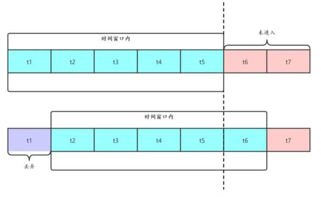

开始的时候，我们把 `t1~t5` 看作一个时间窗口，每个时间片为 1s，如果我们定的限流目标是每秒 50 个请求，那 `t1~t5` 这个窗口的请求总和不能超过 250 个。

这个窗口是滑动的，下一秒的窗口成了 `t2~t6`，这时把 `t1` 时间片的统计抛弃，加入 `t6` 时间片进行统计。这段时间内的请求数量也不能超过 250 个。

滑动时间窗口的优点是缓解了计数器算法的临界问题：时间片划分得越细，窗口滑动就越平滑，限流统计也越精确，但需要保存的时间片统计数据也越多。它也有 2 个问题：

* 流量超过阈值后就必须抛弃或者走降级逻辑。
* 对流量控制不够精细，不能限制集中在短时间内的流量，也不能削峰填谷。

## 4.4 漏桶算法

为了消除“突刺现象”，可以采用漏桶（Leaky Bucket）算法实现限流。漏桶算法这个名字就很形象，算法内部有一个容器，类似生活中用到的漏斗，当请求进来时，相当于水倒入漏斗，然后从下端小口慢慢匀速地流出。不管上面流量多大，下面流出的速度始终保持不变。

不管服务调用方多么不稳定，通过漏桶算法进行限流，比如每 10 毫秒处理一次请求。因为处理的速度是固定的，请求进来的速度是未知的，可能突然进来很多请求，没来得及处理的请求就先放在桶里，既然是个桶，肯定是有容量上限，如果桶满了，那么新进来的请求就丢弃。

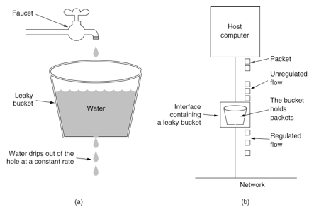

在算法实现方面，可以准备一个队列，用来保存请求，另外通过一个线程池来定期从队列中获取请求并执行，可以一次性获取多个并发执行。

漏桶算法的优点是实现简单，可以使用消息队列来削峰填谷，但是也有 4 个问题需要考虑：

* 漏桶的大小：如果太大，可能给服务端带来较大处理压力；如果太小，可能会有大量请求被丢弃。
* 漏桶给服务端的请求发送速率。
* 使用缓存请求的方式，会使请求响应时间变长。
* 无法应对突发流量：流出速率是恒定的，即使服务端此时有空闲的处理能力，也只能按固定速率处理，突发请求只能排队或被丢弃。

## 4.5 令牌桶算法

从某种意义上讲，令牌桶（Token Bucket）算法是对漏桶算法的一种改进，漏桶算法能够限制请求调用的速率，而令牌桶算法能够在限制调用的平均速率的同时还允许一定程度的突发调用。

在令牌桶算法中，存在一个容量固定的桶，用来存放令牌。算法中存在一种机制，以一定的速率往桶中放令牌。每次请求调用需要先获取令牌，只有拿到令牌，才有机会继续执行，否则选择等待可用的令牌，或者直接拒绝。

放令牌这个动作是持续不断地进行的，如果桶中令牌数达到上限，就丢弃令牌。所以就存在这种情况：桶中一直有大量的可用令牌，这时进来的请求就可以直接拿到令牌执行。比如设置 QPS 为 100，那么限流器初始化完成一秒后，桶中就已经有 100 个令牌了，这时服务还没完全启动好，等启动完成对外提供服务时，该限流器可以抵挡瞬时的 100 个请求。所以，只有桶中没有令牌时，请求才会进行等待，最后相当于以一定的速率执行。桶的容量决定了允许的最大突发量，放令牌的速率决定了长期的平均速率。

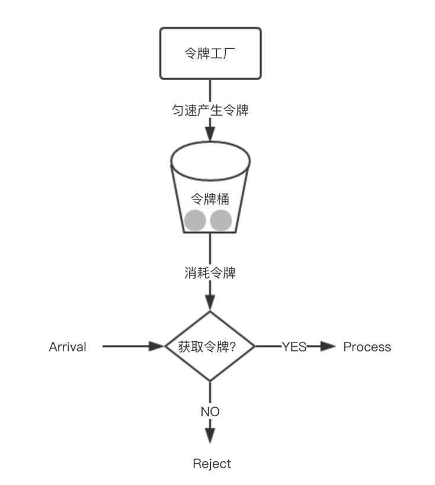

令牌桶算法实现并不复杂，通常并不需要真的用一个定时线程往桶里放令牌，而是在每次请求到来时，根据距离上次放令牌的时间差惰性计算应补充的令牌数。令牌桶在实际限流场景中使用最多，比如 Google Guava 中的 `RateLimiter` 就是基于令牌桶算法实现的（提供 `SmoothBursty` 和带预热的 `SmoothWarmingUp` 两种模式），感兴趣可以研究一下。

## 4.6 分布式限流

前面讨论的几种算法都属于单机限流的范畴，如果在分布式系统场景下，上面介绍的几种限流算法是否还适用呢？

以令牌桶算法为例，假如在电商系统中客户下了一笔订单，如下图：

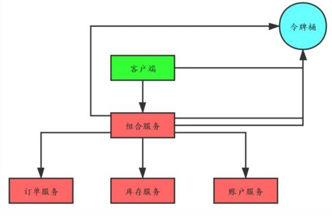

比如为了限制每个用户或者商户对某个资源的访问次数，5s 只能访问 2 次，或者一天只能调用 1000 次，这种需求，单机限流是无法实现的，这时就需要通过集群限流（分布式限流）来实现。

如果我们把令牌桶单独保存在一个地方（比如 Redis 中）供整个分布式系统使用，那么客户端调用组合服务、组合服务再调用订单、库存和账户服务时都需要跟令牌桶交互，交互次数明显增加了很多。基于 Redis 实现时，通常借助 Lua 脚本保证“计算并扣减令牌”这一操作的原子性；Sentinel 也提供了基于 Token Server 的集群流控能力。

有一种改进就是客户端调用组合服务之前首先获取四个令牌，调用组合服务时减去一个令牌并且传递给组合服务三个令牌，组合服务调用下面三个服务时依次消耗一个令牌。

# 5 开源框架

## 5.1 Hystrix

### 5.1.1 概述

> Hystrix 是由 Netflix 开源的一个工具类库，经常被用于服务的熔断、降级等领域，基于 **RxJava**（一种基于观察者模式的响应式编程框架）实现，具备服务降级、服务熔断、线程与信号量隔离、请求缓存、请求合并以及服务监控等强大功能。

需要说明的是，Hystrix 已于 2018 年进入维护模式，不再开发新功能，官方推荐新项目改用 Resilience4j 等仍在积极维护的项目；Spring Cloud 也已移除了对 Hystrix 的支持，改用 Spring Cloud CircuitBreaker 抽象。下文将 Hystrix 作为经典实现来介绍熔断降级的原理。


Hystrix 对应的中文名字是“豪猪”，豪猪周身长满了刺，能保护自己不受天敌的伤害，代表了一种防御机制，这与 Hystrix 本身的功能不谋而合，因此 Netflix 团队将该框架命名为 Hystrix，并使用了对应的卡通形象作为 Logo。

Hystrix 具有以下特征：

1. 通过 `HystrixCommand` 或者 `HystrixObservableCommand` 来封装对外部依赖的访问请求，这个访问请求一般会运行在独立的线程中，实现资源隔离。
2. 对于超出设定阈值的服务调用，直接进行超时处理，不允许其耗费过长时间阻塞住。默认超时时间为 1000 毫秒，官方建议将各依赖的超时时间设置为略高于其实测 99.5 分位的响应时间。
3. **为每一个依赖服务维护一个独立的线程池**（或者信号量），当线程池已满时，直接拒绝对这个服务的调用。
4. 对依赖服务调用的成功次数、失败次数、拒绝次数、超时次数进行统计。
5. 如果对一个依赖服务调用的错误率超过了一定的阈值，自动进行熔断，在一定时间内对该服务的调用直接降级，一段时间后再自动尝试恢复。
6. 当一个服务调用出现失败、被拒绝、超时、短路等异常情况时，自动调用 fallback 降级机制。
7. 对属性和配置的修改提供近实时的支持。

### 5.1.2 原理与使用

Hystrix 服务调用的内部逻辑如下图所示：

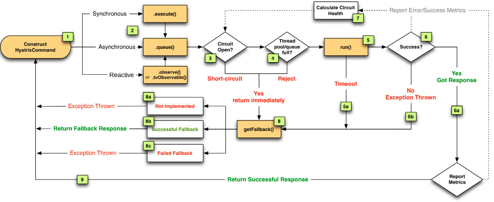

1. 构建 Hystrix 的 Command 对象，调用执行方法。
2. Hystrix 检查当前服务的熔断器开关是否开启，若开启，则执行降级服务 `getFallback` 方法。
3. 若熔断器开关关闭，则 Hystrix 检查当前服务的线程池（或信号量）是否能接收新的请求，若线程池已满，则执行降级服务 `getFallback` 方法。
4. 若线程池接受请求，则 Hystrix 开始执行服务调用具体逻辑 `run` 方法。
5. 若服务执行失败，则执行降级服务 `getFallback` 方法，并将执行结果上报 Metrics 更新服务健康状况。
6. 若服务执行超时，则执行降级服务 `getFallback` 方法，并将执行结果上报 Metrics 更新服务健康状况。
7. 若服务执行成功，返回正常结果。
8. 若服务降级方法 `getFallback` 执行成功，则返回降级结果。
9. 若服务降级方法 `getFallback` 执行失败，则抛出异常。

Hystrix 提供了两个请求命令：`HystrixCommand` 和 `HystrixObservableCommand`，可以使用这两个对象来包裹待执行的任务。`HystrixCommand` 用于依赖服务返回单个操作结果的场景，而 `HystrixObservableCommand` 用于依赖服务返回多个操作结果的场景。

下面的代码示例，通过在方法上加上 `@HystrixCommand` 注解和 `@HystrixProperty` 注解来实现某个方法的服务熔断配置：

```java
@PostMapping(value = "/pwd/reset")
@HystrixCommand(
  commandProperties = {
    @HystrixProperty(name = "metrics.rollingStats.timeInMilliseconds", value = "10000"), // 统计窗口时间
    @HystrixProperty(name = "circuitBreaker.enabled", value = "true"),  // 启用熔断功能
    @HystrixProperty(name = "circuitBreaker.requestVolumeThreshold", value = "20"),  // 统计窗口内至少 20 个请求才进行熔断判断
    @HystrixProperty(name = "circuitBreaker.errorThresholdPercentage", value = "60"),  // 请求错误率达到 60% 触发熔断
    @HystrixProperty(name = "circuitBreaker.sleepWindowInMilliseconds", value = "300000"),// 熔断后开始尝试恢复的时间
  }
)
public AjaxResponse pwdreset(@RequestParam Integer userId) {
  sysuserService.pwdreset(userId);
  return AjaxResponse.success("重置密码成功!");
}
```

* 熔断开关：`enabled=true`，打开断路器状态转换的功能。
* 熔断阈值配置：
    * `requestVolumeThreshold=20`，表示在 10 秒的统计窗口内，请求总数至少达到 20 个，断路器才会进行熔断判断；请求数不足 20 个时，即使全部失败也不会触发熔断。
    * `errorThresholdPercentage=60`，表示在请求数满足上述条件的前提下，10 秒统计窗口内的请求错误率（失败、超时、被拒绝等没能正常返回结果的请求占比）达到 60% 时触发熔断，断路器由“关闭状态”进入“开启状态”。
* 熔断恢复时间：`sleepWindowInMilliseconds=300000`，表示断路器开启 300 秒（5 分钟）之后进入半开启状态，放行一个试探请求：成功则关闭断路器，失败则重新开启并再次等待该时长。

## 5.2 Sentinel

### 5.2.1 概述

> Sentinel 是阿里中间件团队研发的面向分布式服务架构的轻量级高可用流量控制组件，于 2018 年 7 月正式开源。Sentinel 主要以流量为切入点，从流量控制、熔断降级、系统负载保护等多个维度来帮助用户提升服务的稳定性。

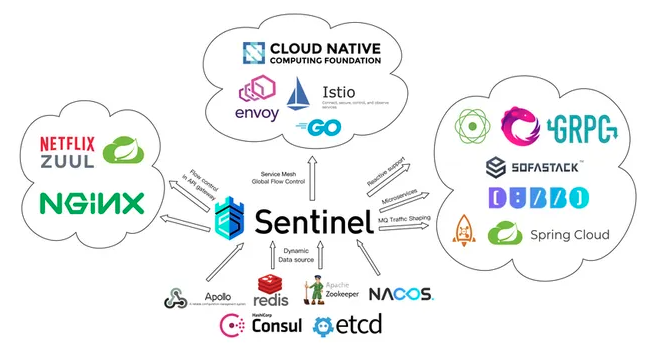

Sentinel 具有以下特征：

1. 轻量级，核心库无多余依赖，性能损耗小。
2. 方便接入，开源生态广泛。
3. 丰富的流量控制场景。
4. 易用的控制台，提供实时监控、机器发现、规则管理等能力。
5. 完善的扩展性设计，提供多样化的 SPI 接口，方便用户根据需求给 Sentinel 添加自定义的逻辑。

### 5.2.2 原理与使用

Sentinel 总体的框架如下：

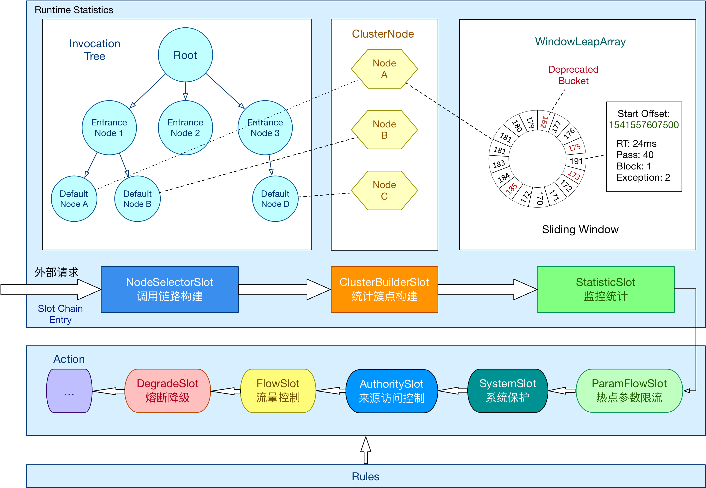

在 Sentinel 里面，所有的资源都对应一个资源名称以及一个 `Entry`。`Entry` 可以通过对主流框架的适配自动创建，也可以通过注解的方式或调用 API 显式创建；每一个 `Entry` 创建的时候，同时也会创建一系列**功能插槽**（Slot Chain）。这些插槽有不同的职责，例如：

* **NodeSelectorSlot**：负责收集资源的路径，并将这些资源的调用路径以树状结构存储起来，用于根据调用路径来限流降级。
* **ClusterBuilderSlot**：用于存储资源的统计信息以及调用者信息，例如该资源的 RT、QPS、线程数等，这些信息将作为多维度限流、降级的依据。
* **StatisticSlot**：用于记录、统计不同维度的运行时（runtime）指标监控信息。
* **FlowSlot**：用于根据预设的限流规则以及前面 Slot 统计的状态，来进行流量控制。
* **AuthoritySlot**：根据配置的黑白名单和调用来源信息，来做黑白名单控制。
* **DegradeSlot**：通过统计信息以及预设的规则，来做熔断降级。
* **SystemSlot**：通过系统的状态，例如 load1 等，来控制总的入口流量。

Sentinel 将 `ProcessorSlot` 作为 SPI 接口进行扩展，使得 Slot Chain 具备了扩展的能力。可以自行加入自定义的 Slot 并编排 Slot 间的顺序，从而给 Sentinel 添加自定义的功能。

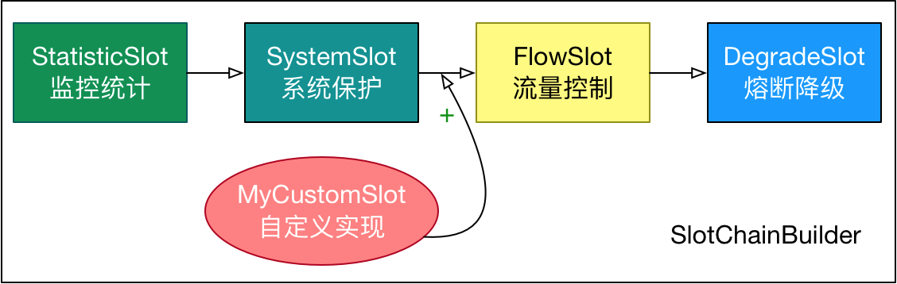

## 5.3 Hystrix 与 Sentinel 的对比

### 5.3.1 资源模型和执行模型上的对比

Hystrix 的资源模型设计上采用了命令模式，其底层的执行是基于 RxJava 实现的。每个 Command 创建时都要指定 `commandKey` 和 `groupKey`（用于区分资源）以及对应的隔离策略（线程池隔离或信号量隔离）。线程池隔离模式下需要配置线程池对应的参数（线程池名称、容量、排队超时等），然后 Command 就会在指定的线程池按照指定的容错策略执行；信号量隔离模式下需要配置最大并发数，执行 Command 时 Hystrix 就会限制其并发调用。

Sentinel 的设计则更为简单。相比 Hystrix Command 强依赖隔离规则，Sentinel 的资源定义与规则配置的耦合度更低。Hystrix 的 Command 强依赖于隔离规则配置的原因是隔离规则会直接影响 Command 的执行。在执行的时候 Hystrix 会解析 Command 的隔离规则来创建 RxJava Scheduler 并在其上调度执行，若是线程池模式则 Scheduler 底层的线程池为配置的线程池，若是信号量模式则简单包装成当前线程执行的 Scheduler。而 Sentinel 并不指定执行模型，也不关注应用是如何执行的。Sentinel 的原则非常简单：根据对应资源配置的规则来为资源执行相应的限流/降级/负载保护策略。**在 Sentinel 中资源定义和规则配置是分离的**。用户先通过 Sentinel API 给对应的业务逻辑定义资源（埋点），然后可以在需要的时候配置规则。

Sentinel 提供多样化的规则配置方式。除了直接通过 `loadRules` API 将规则注册到内存态之外，用户还可以注册各种外部数据源来提供动态的规则。用户可以根据系统当前的实时情况去动态地变更规则配置，数据源会将变更推送至 Sentinel 并即时生效。

### 5.3.2 隔离设计上的对比

**隔离是 Hystrix 的核心功能之一**。Hystrix 提供两种隔离策略：**线程池隔离**和**信号量隔离**，其中最推荐也是最常用的是线程池隔离。Hystrix 的线程池隔离针对不同的资源分别创建不同的线程池，不同服务调用都发生在不同的线程池中，在出现线程池排队、超时等阻塞情况时可以快速失败，并可以提供 fallback 机制。线程池隔离的好处是隔离度比较高，可以针对某个资源的线程池去进行处理而不影响其他资源，但是代价就是线程上下文切换的开销比较大，特别是对低延时的调用有比较大的影响。

但是，实际情况下，线程池隔离并没有带来非常多的好处。首先就是过多的线程池会非常影响性能。考虑这样一个场景，在 Tomcat 之类的 Servlet 容器中使用 Hystrix，Tomcat 自身的线程数目就非常多了（可能到几十或一百多），如果加上 Hystrix 为各个资源创建的线程池，总共线程数目会非常多（几百个线程），这样上下文切换会有非常大的损耗。另外，线程池模式比较彻底的隔离性使得 Hystrix 可以针对不同资源线程池的排队、超时情况分别进行处理，但这其实是超时熔断和流量控制要解决的问题，如果组件具备了超时熔断和流量控制的能力，线程池隔离就显得没有那么必要了。

Sentinel 可以通过并发线程数模式的流量控制来提供信号量隔离的功能。这样的隔离非常轻量级，仅限制对某个资源调用的并发数，而不是显式地去创建线程池，所以开销比较小，但是效果不错。并且结合基于响应时间的熔断降级模式，可以在不稳定资源的响应时间比较高的时候自动降级，防止过多的慢调用占满并发数，影响整个系统。而 Hystrix 的信号量隔离比较简单，无法对慢调用自动进行降级，只能等待客户端自己超时，因此仍然可能会出现级联阻塞的情况。

### 5.3.3 熔断降级对比

Sentinel 和 Hystrix 的熔断降级功能本质上都是基于熔断器模式。

**Sentinel 与 Hystrix 都支持基于失败比率（异常比率）的熔断降级**，在调用达到一定量级并且失败比率达到设定的阈值时自动进行熔断，此时所有对该资源的调用都会被拒绝（block），直到过了指定的时间窗口后才进入半开启状态，放行试探请求来判断服务是否恢复。上面提到过，Sentinel 还支持基于响应时间的熔断降级（早期版本为平均响应时间策略，1.8.0 版本起改为慢调用比例策略，同时引入了半开启状态），可以在服务响应时间持续飙高的时候自动熔断，拒绝掉更多的请求，直到一段时间后才恢复。这样可以防止调用非常慢造成级联阻塞的情况。

### 5.3.4 实时指标统计实现对比

**Hystrix 和 Sentinel 的实时指标数据统计实现都是基于滑动窗口的**。

Hystrix 1.5 以后对实时指标统计的实现进行了重构，将指标统计数据结构抽象成了响应式流（reactive stream）的形式，方便消费者去利用指标信息。同时底层改造成了基于 RxJava 的事件驱动模式，在服务调用成功/失败/超时的时候发布相应的事件，通过一系列的变换和聚合最终得到实时的指标统计数据流，可以被熔断器或 Dashboard 消费。

Sentinel 抽象出了 Metric 指标统计接口，底层可以有不同的实现，默认的实现是基于 LeapArray 的滑动窗口（用环形数组保存各个时间片的统计数据）。

### 5.3.5 对比小结

Hystrix 与 Sentinel 的关键特性对比如下：

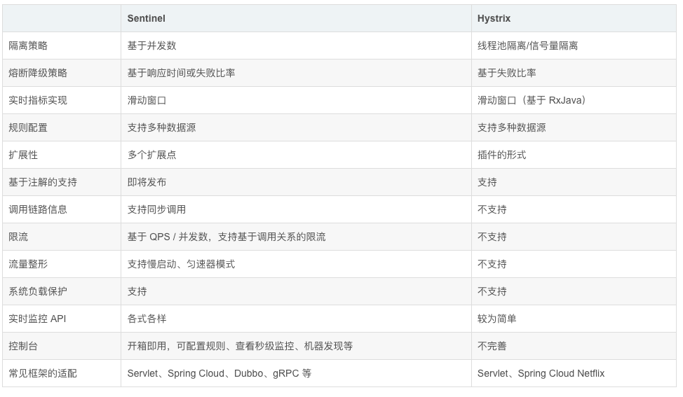

通过上面的对比不难看出，Sentinel 在很多方面的设计与实现上都超越了老前辈 Hystrix。**Hystrix 自 2018 年起已进入维护模式，不再开发新功能**，Netflix 官方推荐改用 Resilience4j；Spring Cloud 也移除了 Hystrix 支持，转而通过 Spring Cloud CircuitBreaker 抽象接入 Resilience4j 等实现。在国内，Sentinel（常配合 Spring Cloud Alibaba 使用）是更常见的选择。

即便如此，Hystrix 的很多概念和设计思想都非常有价值，Sentinel、Resilience4j 也有所借鉴，仍然值得学习。

# 6 总结

服务降级、熔断与限流都是保障系统高可用的容错手段，三者经常配合使用，但关注点各不相同：

| 手段 | 关注点 | 触发条件 | 典型处理方式 | 典型实现 |
| --- | --- | --- | --- | --- |
| 熔断 | 下游依赖故障时及时“断开”，防止故障蔓延 | 统计窗口内错误率、慢调用比例达到阈值 | 关闭 → 开启 → 半开启状态转换，开启期间快速失败 | Hystrix、Sentinel、Resilience4j |
| 降级 | 调用失败或被拒绝之后返回什么 | 熔断、超时、异常、限流拒绝或人工开关 | 执行 fallback，返回默认值、缓存数据或友好提示 | fallback 方法、降级开关 |
| 限流 | 保护自身不被超出承载能力的流量压垮 | 请求速率或并发数超过阈值 | 拒绝、排队等待或走降级逻辑 | 计数器、滑动窗口、漏桶、令牌桶；Guava `RateLimiter`、Sentinel |

简单来说，限流是“控制进来多少”，熔断是“下游不行就先别调了”，降级是“实在不行就怎么样”的兜底方案。
