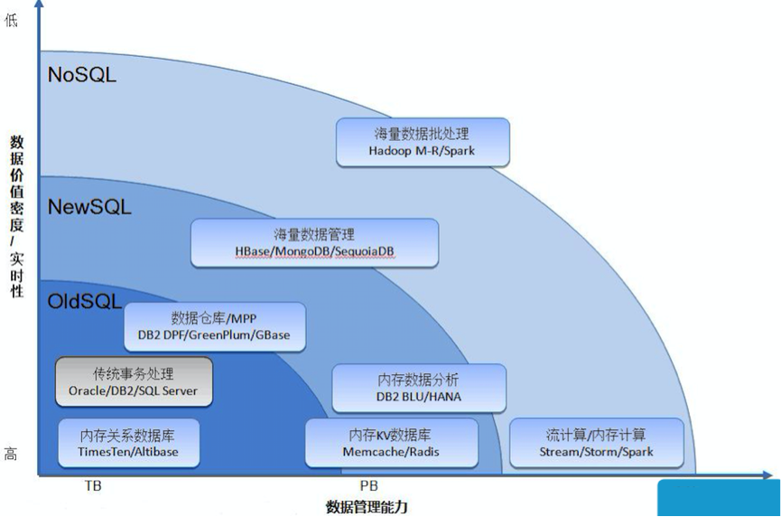
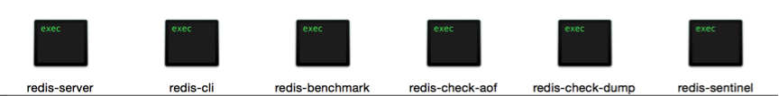
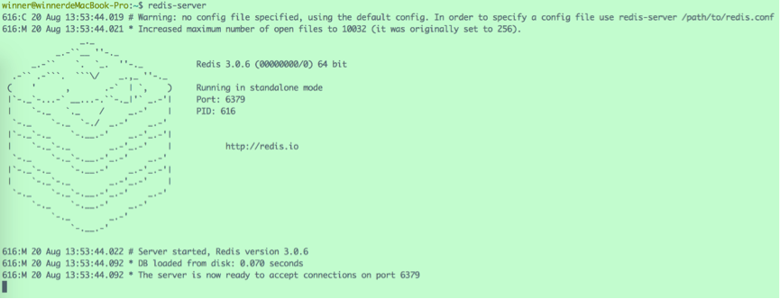
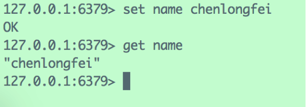
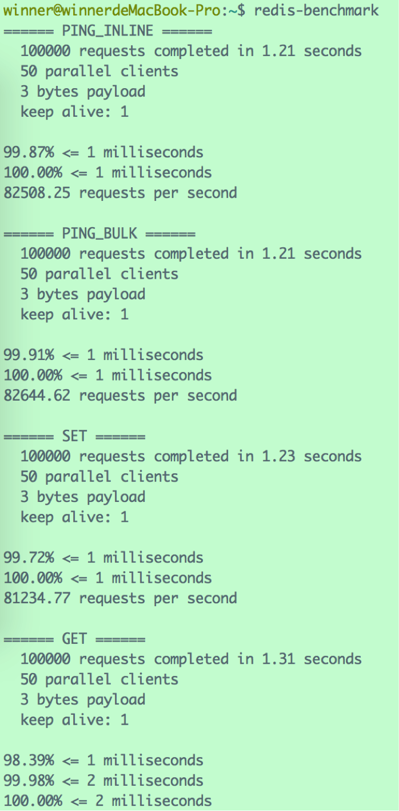

# Redis 引言

# 1 概述

我们知道，内存是电脑主板上的存储部件，用于存储当前正在使用的数据和程序，CPU 可以与内存直接沟通，所以访问速度非常高；而外存数据必须加载到内存以后程序才能使用。如果把 CPU 当作一个吃货，那么内存是碗，而外存是锅，这个吃货再能吃，也得先把饭从锅里盛到碗里再下嘴，而不能直接跳到锅里大快朵颐。但是很多时候 CPU 吃得并不爽，一是因为碗不够大，没吃两嘴就没了；二是从锅里往碗里盛饭是个比较耗时的过程，等待很痛苦。正经点说，就是内存大小、I/O 速度、网络响应时间等常常成为应用系统的性能瓶颈。

传统的关系型数据库如 MySQL、Oracle、DB2 等，数据存储在磁盘的文件系统中，增删改查需要频繁地在内存与外存之间交换数据，很费时间。试想，如果有一种小巧而功能强大的存储结构，用于**在内存中管理数据量不太大但是访问量特别大的热点数据**，岂不妙哉？

在以上背景下，Redis 应运而生。

Redis 是 **Re**mote **Di**ctionary **S**erver 的简称，是一个由意大利人 Salvatore Sanfilippo（网名 antirez）开发的 key-value 存储系统，具有极高的读写性能，单实例通常可以达到每秒 10 万级的读写请求（QPS），具体数值取决于硬件、命令类型和网络环境。

需要注意的是，Redis 的开源许可证近年有过几次变化：2024 年 Redis 7.4 起由 BSD 改为 RSALv2/SSPLv1 双许可，Linux 基金会随即基于 7.2 分叉出了完全开源的 Valkey；2025 年 Redis 8 又增加了 AGPLv3 许可选项，重新回归开源。目前各大云厂商同时提供 Redis 与 Valkey 服务，二者在协议和命令上基本兼容。

与 Redis 类似的产品还有 Memcached，同样是一个基于内存的 key-value 存储系统。但由于 Memcached 数据结构单一、不支持持久化等原因，Redis 已基本取代它成为最主流的缓存方案。

Redis 与其他 key-value 缓存产品相比，有以下特点：

- Redis 支持数据的持久化，周期性地把更新的数据写入磁盘或者把修改操作写入追加的记录文件，重启的时候可以再次加载进行使用。
- Redis 不仅仅支持简单的 key-value 类型的数据，同时还提供 String、List、Set、ZSet、Hash 等数据结构，以及 Bitmap、HyperLogLog、GEO、Stream（5.0 引入）等扩展类型。
- Redis 支持主从复制（master-replica），可以把数据同步到从节点上。
- Redis 单个命令的执行是原子性的，同时还可以通过 MULTI/EXEC 事务或 Lua 脚本把多个操作合并执行。
- Redis 还支持发布/订阅（Pub/Sub）、键空间通知、Key 过期等高级特性。

互联网发展到现在，仅靠传统的关系型数据库已经远不能应对各种复杂多变的需求，一个大型的互联网应用往往需要各类数据库相互合作，才能达到高可用、高性能的标准。



比如，使用 MySQL/Oracle/DB2 管理核心数据，使用 Redis 管理热点数据，使用 HBase 等管理海量数据……总之，在合适的地方选择合适的数据库。

# 2 Redis 管理工具

Redis 安装好之后，进入安装目录的 `src` 文件夹，可以找到下面几个主要的可执行文件（下图为旧版本截图，新版本中 `redis-check-dump` 已改名为 `redis-check-rdb`）：



它们对应着以下几个管理 Redis 的工具：

## 2.1 redis-server

该工具用于启动 Redis 服务器，处理与客户端的对话，一个服务器可以与多个客户端连接。

在终端输入该命令，如果启动成功，就会看到 Redis 标志性的 ASCII 字符画 Logo：



Redis 提示说：

> *Warning: no config file specified, using the default config. In order to specify a config file use ./redis-server /path/to/redis.conf*

没有指定配置文件，当前使用的是默认配置。假如想使用位于路径 `/winner/setting/` 下的 `redis.conf` 作为配置文件，使用命令 `redis-server /winner/setting/redis.conf` 即可。

最后一行，Redis 提示服务器已经准备好在端口 6379 接受客户端的连接，**6379 是 Redis 的默认端口**。

至于为什么使用 6379 当作默认端口还有段传闻。Redis 的作者 antirez 是意大利人，意大利有个女艺人名叫 Alessia Merz，长期以来被 antirez 及其朋友当作愚蠢的代名词，MERZ 在手机键盘上对应的按键就是 6379，后来 antirez 开发 Redis 时就用这四个数字作为默认端口。

## 2.2 redis-cli

该工具用于启动 Redis 客户端，发起与服务器的对话。可以使用参数来指定目标服务器的详细信息，例如使用参数 `-h` 指定服务器 IP 地址、`-p` 指定服务器端口、`-a` 指定登录密码等，如：

```bash
redis-cli -h 192.168.1.2 -p 6300
```

如不指定任何参数，则默认连接 127.0.0.1 的 6379 端口。

Redis 6 起引入了 ACL 权限控制，可以用 `--user` 配合 `-a` 以指定用户身份登录。另外，`-a` 会把密码明文暴露在命令行历史和进程列表中，生产环境更推荐连接后再执行 `AUTH` 命令，或通过 `REDISCLI_AUTH` 环境变量传入密码。

与 Redis 服务器取得连接后，就可以通过命令进行数据的存取、更改等操作了：



## 2.3 redis-benchmark

该工具用于测试 Redis 在本机的性能，类似于硬件跑分程序。运行之后会得到一组数据存取效率的报告：



## 2.4 redis-check-aof

Redis 虽然是基于内存的数据库，但是会把数据持久化到硬盘上。持久化有两种方式：一种是 RDB 快照，把内存中的数据保存到 `dump.rdb` 文件中；另一种是 AOF 日志，把每个执行过的写命令追加到 AOF 文件中。Redis 7.0 起 AOF 改为多文件（Multi-Part AOF）结构，默认存放在 `appendonlydir` 目录下。

该工具用于检查、修复 AOF 文件。

## 2.5 redis-check-rdb

与 `redis-check-aof` 类似，该工具用于检查 RDB 文件。Redis 3.2 之前它叫 `redis-check-dump`。

## 2.6 redis-sentinel

该工具用于启动哨兵（Sentinel），为 Redis 主从架构提供监控、通知和自动故障转移（failover）服务：持续监控主节点和从节点的工作状态，主节点宕机时自动把某个从节点提升为新的主节点，从而提高系统的可用性。注意，哨兵服务于主从复制架构，与 Redis Cluster 是两套不同的高可用方案。

# 3 小结

Redis 是一个基于内存的 key-value 数据库，凭借极高的读写性能、丰富的数据结构和完善的持久化与高可用机制，成为当下最主流的缓存与热点数据存储方案。后续文章会依次介绍它的数据结构、数据管理、事务、集群和配置。
