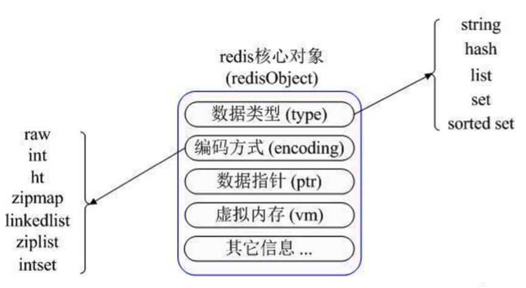
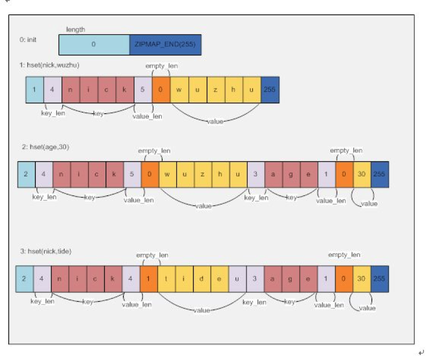
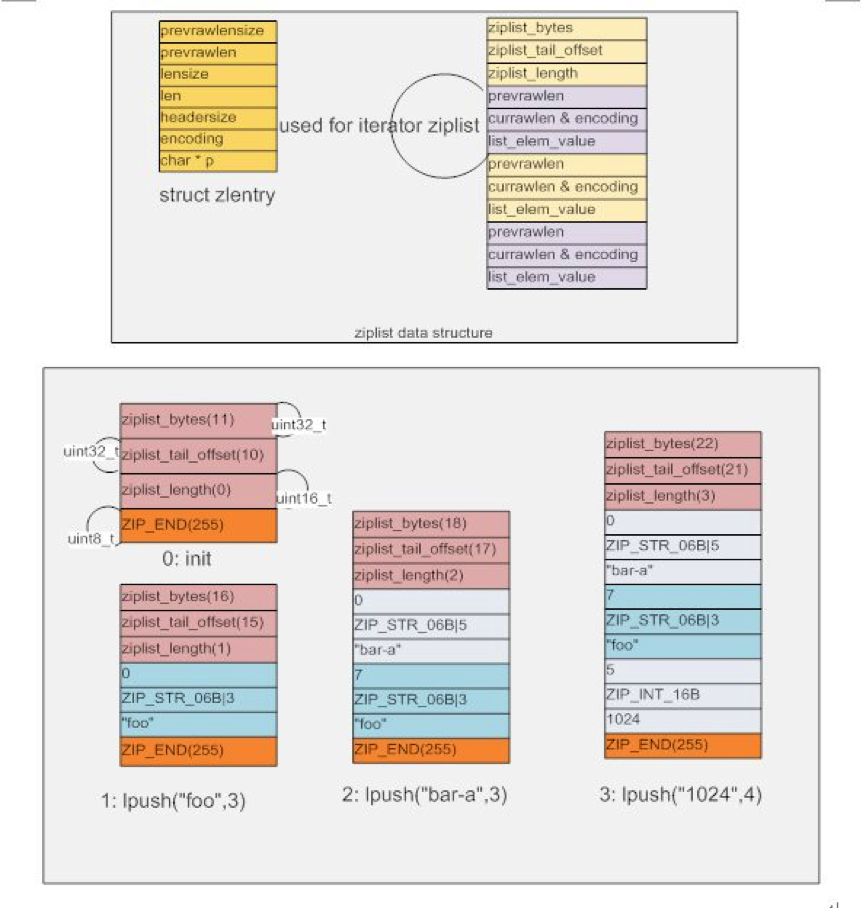
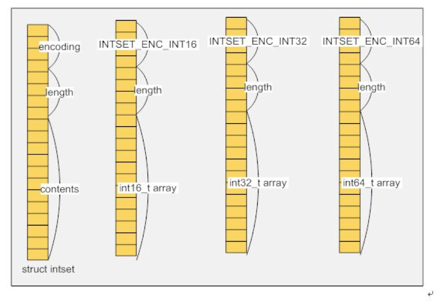
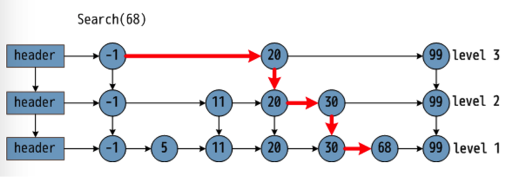

# Redis 数据结构

Redis 支持五种基本数据类型：

- String（字符串）
- Hash（哈希）
- List（列表）
- Set（集合）
- ZSet（Sorted Set，有序集合）

此外，Redis 还提供了 Bitmap、HyperLogLog、GEO、Stream（5.0 引入）等扩展类型；Redis 8 起又把 JSON、时间序列、布隆过滤器等概率型数据结构直接集成进了社区版，并新增了向量集合（Vector Set）。本文只介绍上面五种基本类型。

Redis 定义了丰富的原语命令，可以直接与 Redis 服务器交互。实际应用中，我们不太会直接使用这些原语命令，Redis 提供了 Java、C/C++、C#、PHP、JavaScript、Perl、Objective-C、Python、Ruby、Erlang 等客户端，大多情况下我们是通过各式各样的客户端来操作 Redis。但是，任何语言的客户端实际上都是对 Redis 原语命令的封装，了解原语命令有助于理解客户端的设计原理，知其然，知其所以然。

# 1 字符串

String 是 Redis 最基本的数据类型，结构为一个 key 对应一个 value。

String 类型是二进制安全的，意味着可以包含任何数据，比如 JPG 图片或者序列化的对象。

String 类型的值最大能存储 512 MB。

不像 Linux 有那么多充满想象力的命令，还喜欢带一堆莫名其妙的参数。Redis 的原语命令很简单，而且有规律可循，一句话概括，就是干净利索脆。

比如我们想往 Redis 中存放一个用户名，用 String 类型存储：

```text
127.0.0.1:6379> SET name chenlongfei
OK
```

“OK”是 Redis 返回的响应，代表设置成功。

取出这个 `name` 的值：

```text
127.0.0.1:6379> GET name
"chenlongfei"
```

想修改 `name` 的值为“clf”，重新 `SET` 一遍，覆盖掉原来的值：

```text
127.0.0.1:6379> SET name clf
OK
127.0.0.1:6379> GET name
"clf"
```

想删除该条数据：

```text
127.0.0.1:6379> DEL name
(integer) 1      -- 该数字代表删除的 key 的数量
127.0.0.1:6379> GET name
(nil)            -- nil 代表为空，不存在该对象
```

增删改查命令一分钟学会，想忘记都难，妈妈再也不用担心我的学习。

| 命令格式 | 说明 |
| --- | --- |
| `SET key value [NX \| XX] [EX seconds \| PX milliseconds]` | 设置指定 `key` 的值；2.6.12 起可通过 `NX`（不存在才设置）、`XX`（存在才设置）、`EX`/`PX`（过期时间）等选项一步完成，6.2 起还支持 `GET` 选项返回旧值 |
| `GET key` | 获取指定 `key` 的值 |
| `SETNX key value` | （**Set** if **N**ot E**x**ist）只有在 `key` 不存在时设置 `key` 的值；官方已标记为弃用，推荐 `SET key value NX` |
| `SETRANGE key offset value` | 用 `value` 参数覆写给定 `key` 所储存的字符串值，从偏移量 `offset` 开始 |
| `GETRANGE key start end` | 返回 `key` 中字符串值的子字符串 |
| `GETSET key value` | 将给定 `key` 的值设为 `value`，并返回 `key` 的旧值；6.2 起已弃用，推荐 `SET key value GET` |
| `MSET key value [key value ...]` | （**M**ulti **Set**）同时设置一个或多个 key-value 对 |
| `MGET key1 [key2 ...]` | 获取所有（一个或多个）给定 `key` 的值 |
| `APPEND key value` | 如果 `key` 已经存在并且是一个字符串，`APPEND` 命令将 `value` 追加到 `key` 原来的值的末尾 |
| `SETEX key seconds value` | （**Set Ex**pire）将值 `value` 关联到 `key`，并将 `key` 的过期时间设为 `seconds`（以秒为单位）；官方已标记为弃用，推荐 `SET key value EX seconds` |
| `PSETEX key milliseconds value` | （**P**recise **Set Ex**pire）这个命令和 `SETEX` 命令相似，但它以毫秒为单位设置 `key` 的生存时间；官方已标记为弃用，推荐 `SET key value PX milliseconds` |
| `STRLEN key` | 返回 `key` 所储存的字符串值的长度 |
| `INCR key` | 将 `key` 中储存的数字值增一，前提是 `value` 是一个整数 |
| `INCRBY key increment` | 将 `key` 所储存的值加上给定的增量值，前提是 `value` 是一个整数 |
| `INCRBYFLOAT key increment` | 将 `key` 所储存的值加上给定的浮点增量值，前提是 `value` 是一个数字 |
| `DECR key` | 将 `key` 中储存的数字值减一，前提是 `value` 是一个整数 |
| `DECRBY key decrement` | 将 `key` 所储存的值减去给定的减量值，前提是 `value` 是一个整数 |

# 2 哈希

Redis 的哈希是 field 和 value 之间的映射，即键值对的集合，所以特别适合用于存储对象。

Redis 中每个 Hash 最多可以存储 `2^32 - 1` 个键值对（40 多亿）。

例如，我们想在 Redis 中存储一个用户信息，包括用户 ID、用户名、邮箱地址三个字段：

```text
127.0.0.1:6379> HSET user_1 userId 123 userName clf email chenlongfei@163.com
(integer) 3      -- 新增的字段数量
127.0.0.1:6379> HGETALL user_1
1) "userId"
2) "123"
3) "userName"
4) "clf"
5) "email"
6) "chenlongfei@163.com"
```

4.0 起 `HSET` 已支持一次设置多个 field-value 对，`HMSET` 被官方标记为弃用（仍可使用，返回 `OK`）。

| 命令格式 | 说明 |
| --- | --- |
| `HSET key field1 value1 [field2 value2 ...]` | 将哈希表 `key` 中一个或多个字段 `field` 的值设为 `value`，返回新增字段的数量 |
| `HMSET key field1 value1 [field2 value2 ...]` | （**H**ash **M**ulti **Set**）同时将多个 field-value 对设置到哈希表 `key` 中；4.0 起已弃用，直接用 `HSET` 即可 |
| `HMGET key field1 [field2 ...]` | 获取所有给定字段的值 |
| `HGET key field` | 获取存储在哈希表中指定字段的值 |
| `HGETALL key` | 获取在哈希表中指定 `key` 的所有字段和值 |
| `HDEL key field1 [field2 ...]` | 删除一个或多个哈希表字段 |
| `HSETNX key field value` | 只有在字段 `field` 不存在时，设置哈希表字段的值 |
| `HKEYS key` | 获取所有哈希表中的字段 |
| `HVALS key` | 获取哈希表中所有值 |
| `HEXISTS key field` | 查看哈希表 `key` 中，指定的字段是否存在 |
| `HLEN key` | 获取哈希表中字段的数量 |
| `HINCRBY key field increment` | 为哈希表 `key` 中的指定字段的整数值加上增量 |
| `HINCRBYFLOAT key field increment` | 为哈希表 `key` 中的指定字段的浮点数值加上增量 |

此外，7.4 起 Hash 支持为单个字段设置过期时间（`HEXPIRE`、`HTTL`、`HPERSIST` 等命令）。

# 3 列表

Redis 列表是简单的字符串列表，按照插入顺序排序。支持添加一个元素到列表头部（左边）或者尾部（右边）的操作。

一个列表最多可以包含 `2^32 - 1` 个元素，即超过 40 亿个元素。

例如，我们想用一个名为“Continents”的列表盛放五大洲的名字：

```text
127.0.0.1:6379> LPUSH Continents Asia Africa America Oceania Antarctica
(integer) 5
127.0.0.1:6379> LRANGE Continents 0 4      -- 获取下标为 0~4 的元素
1) "Antarctica"
2) "Oceania"
3) "America"
4) "Africa"
5) "Asia"
```

Redis 列表其实是一个双端列表，下标 0 永远代表头部（左边）的元素。`LPUSH` 每次都把元素插入到头部，所以上例中依次放进去的五个元素 Asia、Africa、America、Oceania、Antarctica，下标分别为 4、3、2、1、0，看起来像是倒序排列；如果换成 `RPUSH` 从尾部插入，下标顺序就与插入顺序一致，和 Java 中 List 的概念相同，需要特别注意区分。

正因为两端都可以操作，Redis 列表既可以当栈用，也可以当队列用：`LPUSH` + `LPOP` 是栈，后进先出，弹出的是最新放进去的元素；`LPUSH` + `RPOP` 则是队列，先进先出。

Redis 列表还支持一种**阻塞式操作**，比如 `BLPOP`（**B**locking **L**ist **Pop** 之缩写），移出并获取列表的第一个元素，如果列表没有元素（或列表不存在），会阻塞当前客户端连接，直到等待超时或发现可弹出元素为止。

例如，我们对一个不存在的列表“myList”执行 `BLPOP` 命令：

```text
BLPOP myList 20      -- 弹出 myList 列表的第一个元素，如果没有，阻塞 20 秒
```

该客户端会进入阻塞状态，如果 20 秒之内该列表存入了元素，则弹出：

```text
127.0.0.1:6379> BLPOP myList 20      -- 若无元素则进入阻塞状态，限时 20 秒
1) "myList"
2) "hello"
(6.20s)
```

如果超时后仍然没有等到元素，则结束阻塞，返回 nil：

```text
127.0.0.1:6379> BLPOP myList 20
(nil)
(20.07s)
```

| 命令格式 | 说明 |
| --- | --- |
| `LPUSH key value1 [value2 ...]` | 将一个或多个值插入到列表头部 |
| `LPOP key [count]` | 移出并获取列表的第一个元素；6.2 起可通过 `count` 一次弹出多个 |
| `LPUSHX key value1 [value2 ...]` | （**L**ist **Push** if e**x**ist）将一个或多个值插入到已存在的列表头部 |
| `LINDEX key index` | 通过索引获取列表中的元素 |
| `LRANGE key start stop` | 获取列表指定范围内的元素 |
| `LSET key index value` | 通过索引设置列表元素的值 |
| `LTRIM key start stop` | 只保留指定区间内的元素，不在指定区间之内的元素都将被删除 |
| `RPOP key [count]` | （**R**ight **Pop**）移除并获取列表最后一个元素 |
| `RPUSH key value1 [value2 ...]` | 将一个或多个值插入到列表尾部 |
| `RPUSHX key value1 [value2 ...]` | 将一个或多个值插入到已存在的列表尾部 |
| `LREM key count value` | 从列表中删除值为 `value` 的元素，删除 `count` 的绝对值个后结束：`count > 0` 从表头开始删除；`count < 0` 从表尾开始删除；`count = 0` 全部删除 |
| `RPOPLPUSH source destination` | 移除列表的最后一个元素，并将该元素添加到另一个列表并返回；6.2 起已弃用，推荐 `LMOVE source destination RIGHT LEFT` |
| `LMOVE source destination LEFT \| RIGHT LEFT \| RIGHT` | （6.2 引入）从 `source` 的一端弹出元素并推入 `destination` 的一端，是 `RPOPLPUSH` 的通用版本 |
| `BLPOP key1 [key2 ...] timeout` | 移出并获取列表的第一个元素，如果列表没有元素会阻塞连接直到等待超时或发现可弹出元素为止，如果 `timeout` 为 0 则一直等待下去 |
| `BRPOP key1 [key2 ...] timeout` | 移出并获取列表的最后一个元素，如果列表没有元素会阻塞连接直到等待超时或发现可弹出元素为止，如果 `timeout` 为 0 则一直等待下去 |
| `LINSERT key BEFORE \| AFTER pivot value` | 在列表 `key` 中寻找 `pivot`，并在 `pivot` 值之前或之后插入 `value` |
| `LLEN key` | 获取列表长度 |

# 4 集合

Redis 集合是 String 类型的无序集合。**集合成员是唯一的**，这就意味着集合中不能出现重复的数据。

Redis 集合主要是通过哈希表实现的，所以添加、删除、查找的复杂度都是 `O(1)`。

集合中最大的成员数为 `2^32 - 1`，即每个集合最多可存储 40 多亿个成员。

集合的一大特点就是不能有重复元素，如果插入重复元素，Redis 会忽略该操作：

```text
127.0.0.1:6379> SADD direction east west south north
(integer) 4
127.0.0.1:6379> SMEMBERS direction
1) "west"
2) "east"
3) "north"
4) "south"
127.0.0.1:6379> SADD direction east
(integer) 0      -- east 元素已经存在，该操作无效
127.0.0.1:6379> SMEMBERS direction
1) "west"
2) "east"
3) "north"
4) "south"
```

Redis 集合还有两大特点，一是支持随机获取元素，二是支持集合间的取差集、交集与并集操作。

| 命令格式 | 说明 |
| --- | --- |
| `SADD key member1 [member2 ...]` | 向集合添加一个或多个成员 |
| `SREM key member1 [member2 ...]` | 移除集合中一个或多个成员 |
| `SPOP key [count]` | 移除并返回集合中的一个（或 `count` 个）随机元素 |
| `SMEMBERS key` | 返回集合中的所有成员 |
| `SRANDMEMBER key [count]` | 返回集合中 `count` 个随机元素，如 `count` 为空，则只返回一个 |
| `SCARD key` | （**S**et **Card**inality）返回集合中的元素总数 |
| `SISMEMBER key member` | 判断 `member` 元素是否是集合 `key` 的成员 |
| `SMOVE source destination member` | 将 `member` 元素从 `source` 集合移动到 `destination` 集合 |
| `SDIFF key1 [key2 ...]` | 返回给定所有集合的差集，即以 `key1` 为基准，返回 `key1` 有且 `[key2 ...]` 没有的元素 |
| `SDIFFSTORE destination key1 [key2 ...]` | 返回给定所有集合的差集并存储在 `destination` 中 |
| `SINTER key1 [key2 ...]` | 返回给定所有集合的交集 |
| `SINTERSTORE destination key1 [key2 ...]` | 返回给定所有集合的交集并存储在 `destination` 中 |
| `SUNION key1 [key2 ...]` | 返回所有给定集合的并集 |
| `SUNIONSTORE destination key1 [key2 ...]` | 将所有给定集合的并集存储在 `destination` 集合中 |

注意，`SMEMBERS`、`SINTER` 等命令会一次性返回整个结果集，大集合在生产环境中慎用，可以用 `SSCAN` 渐进式遍历。

# 5 有序集合

Redis 有序集合和集合一样也是 String 类型元素的集合，且不允许重复的成员。

不同的是每个元素都会关联一个 double 类型的分数（score）。Redis 正是通过分数来为集合中的成员进行从小到大的排序。有序集合的成员是唯一的，但分数却可以重复。

有序集合是通过哈希表加跳跃表实现的，按成员查分数的复杂度为 `O(1)`，添加、删除以及按分数或名次查找的复杂度为 `O(log N)`。

集合中最大的成员数为 `2^32 - 1`，即每个集合最多可存储 40 多亿个成员。

例如，使用有序集合来存储学生的成绩单：

```text
127.0.0.1:6379> ZADD scoreList 82 Tom
(integer) 1
127.0.0.1:6379> ZADD scoreList 65.5 Jack
(integer) 1
127.0.0.1:6379> ZADD scoreList 43.5 Rubby
(integer) 1
127.0.0.1:6379> ZADD scoreList 99 Winner
(integer) 1
127.0.0.1:6379> ZADD scoreList 78 Linda
(integer) 1
127.0.0.1:6379> ZRANGE scoreList 0 100 WITHSCORES      -- 获取名次在 0~100 之间的记录
 1) "Rubby"
 2) "43.5"
 3) "Jack"
 4) "65.5"
 5) "Linda"
 6) "78"
 7) "Tom"
 8) "82"
 9) "Winner"
10) "99"
```

需要注意的是，Redis 有序集合是默认升序的，**score 越低排名越靠前**，即 score 越低的元素下标越小。

| 命令格式 | 说明 |
| --- | --- |
| `ZADD key score1 member1 [score2 member2 ...]` | 添加一个或多个成员到有序集合，如果成员已经存在则更新其分数 |
| `ZRANGE key start stop [BYSCORE \| BYLEX] [REV] [LIMIT offset count] [WITHSCORES]` | 把集合排序后，返回名次在 `[start, stop]` 之间的元素，`WITHSCORES` 是把 score 也打印出来；6.2 起通过 `BYSCORE`、`REV` 等选项统一了按分数、倒序查询 |
| `ZREVRANGE key start stop [WITHSCORES]` | 倒序排列（分数越大排名越靠前），返回名次在 `[start, stop]` 之间的元素；6.2 起已弃用，推荐 `ZRANGE ... REV` |
| `ZRANGEBYSCORE key min max [WITHSCORES] [LIMIT offset n]` | 集合（升序）排序后取 score 在 `[min, max]` 内的元素，并跳过 `offset` 个，取出 `n` 个；6.2 起已弃用，推荐 `ZRANGE ... BYSCORE` |
| `ZREM key member [member ...]` | 从有序集合中删除一个或多个成员 |
| `ZRANK key member` | 确定 `member` 在集合中的升序名次 |
| `ZREVRANK key member` | 确定 `member` 在集合中的降序名次 |
| `ZSCORE key member` | 获取 `member` 的分数 |
| `ZCARD key` | 获取有序集合中成员的数量 |
| `ZCOUNT key min max` | 计算分数在 `min` 与 `max` 之间的元素总数 |
| `ZINCRBY key increment member` | 给 `member` 的分数增加 `increment` |
| `ZREMRANGEBYRANK key start stop` | 移除名次在 `start` 与 `stop` 之间的元素 |
| `ZREMRANGEBYSCORE key min max` | 移除分数在 `min` 与 `max` 之间的元素 |

# 6 存储结构

Redis 的一种对象类型可以有不同的存储结构来实现，从而同时兼顾性能和内存。下图为早期版本的对应关系，7.0 之后的变化见本章各小节及 6.6 的总结表。



**字典**又名映射（map）或关联数组（associative array），是一种抽象数据结构，由一集键值对（key-value pairs）组成，各个键值对的键各不相同，程序可以添加新的键值对到字典中，或者基于键进行查找、更新或删除等操作。

字典在 Redis 中的应用广泛，使用频率可以说和 SDS 以及双端链表不相上下，基本上各个功能模块都有用到字典的地方。

字典的主要用途有以下两个：

- 实现数据库键空间（key space）
- 用作 Hash 类型键的底层实现之一

**Redis 字典采用哈希表实现**，针对碰撞问题，采用的方法为“链地址法”，即将多个哈希值相同的节点串连在一起，从而解决冲突问题。

“链地址法”的问题在于当碰撞剧烈时，性能退化严重，例如：当有 n 个数据、m 个槽位时，如果 `m = 1`，则整个哈希表退化为链表，查询复杂度为 `O(n)`。为了避免哈希碰撞攻击，Redis 随机化了哈希函数的种子（4.0 起使用 SipHash）。

Redis 的方案是**双哈希表加渐进式 rehash**：正常流程只使用 0 号哈希表，当负载因子（key 数量与槽位数之比）过高时，分配一个更大的 1 号哈希表，然后在后续的增删改查操作和定时任务中逐步将数据从旧表迁移到新表。也就是说，只有在 rehash 进行时，才会同时使用 0 号和 1 号哈希表。

**redisObject** 是真正存储 Redis 各种类型的结构。早期版本定义在源码的 `redis.h` 文件中，3.2 起改名为 `server.h`，常量前缀也由 `REDIS_` 改为 `OBJ_`。以 7.x 的 `server.h` 为例：

```c
#define LRU_BITS 24

struct redisObject {
    unsigned type:4;
    unsigned encoding:4;
    unsigned lru:LRU_BITS; /* LRU time (relative to global lru_clock) or
                            * LFU data (least significant 8 bits frequency
                            * and most significant 16 bits access time). */
    int refcount;
    void *ptr;
};
```

其中 `lru` 字段在 4.0 引入 LFU 淘汰策略后，也会被用来存放访问频率。`type` 即 Redis 支持的逻辑类型，包括：

```c
#define OBJ_STRING 0    /* String object. */
#define OBJ_LIST 1      /* List object. */
#define OBJ_SET 2       /* Set object. */
#define OBJ_ZSET 3      /* Sorted set object. */
#define OBJ_HASH 4      /* Hash object. */
#define OBJ_MODULE 5    /* Module object. */
#define OBJ_STREAM 6    /* Stream object. */
```

前五种即前面所列举的五种数据类型。`type` 定义的只是逻辑类型，`encoding` 才是物理存储方式，**一种逻辑类型可以使用不同的存储方式**，包括：

```c
#define OBJ_ENCODING_RAW 0     /* Raw representation */
#define OBJ_ENCODING_INT 1     /* Encoded as integer */
#define OBJ_ENCODING_HT 2      /* Encoded as hash table */
#define OBJ_ENCODING_ZIPMAP 3  /* No longer used: old hash encoding. */
#define OBJ_ENCODING_LINKEDLIST 4 /* No longer used: old list encoding. */
#define OBJ_ENCODING_ZIPLIST 5 /* No longer used: old list/hash/zset encoding. */
#define OBJ_ENCODING_INTSET 6  /* Encoded as intset */
#define OBJ_ENCODING_SKIPLIST 7  /* Encoded as skiplist */
#define OBJ_ENCODING_EMBSTR 8  /* Embedded sds string encoding */
#define OBJ_ENCODING_QUICKLIST 9 /* Encoded as linked list of listpacks */
#define OBJ_ENCODING_STREAM 10 /* Encoded as a radix tree of listpacks */
#define OBJ_ENCODING_LISTPACK 11 /* Encoded as a listpack */
```

可以用 `OBJECT ENCODING key` 命令查看某个 key 当前实际使用的编码。下面逐一介绍（为简洁起见省略 `OBJ_ENCODING_` 前缀）：

- **RAW** 即原生态的存储结构，就是以字符串形式存储，字符串类型在 Redis 中用 **SDS**（**S**imple **D**ynamic **S**tring，简单动态字符串）封装，主要为了解决长度计算和追加效率的问题。
- **INT** 代表整数，以 `long` 型存储。
- **HT** 代表哈希表（**H**ash **T**able），以哈希表结构存储，与字典的实现方法一致。
- **ZIPMAP**（已废弃，2.6 起 Hash 的小对象改用 ziplist）其实质是用一个字符串数组来依次保存 key 和 value，查询时是依次遍历每个 key-value 对，直到查到为止。

  

- **LINKEDLIST**（已废弃，3.2 起 List 改用 quicklist）代表链表，以典型的双向链表结构存储。
- **ZIPLIST**（已废弃，7.0 起全部被 listpack 取代）代表一种压缩列表，通过特殊的格式定义在一块连续内存中存放多个元素，以时间换空间。ziplist 适合小数据量的读场景，不适合大数据量的多写/删除场景；另外由于每个节点都记录了前一个节点的长度，插入或修改元素时可能引发“连锁更新”。

  

- **LISTPACK**（5.0 随 Stream 引入，7.0 起取代 ziplist）是 ziplist 的改进版，同样是一块连续内存，但每个元素只记录自身的长度，不再记录前一个元素的长度，从根本上避免了连锁更新问题。目前 Hash、List、Set、ZSet 的小对象都使用 listpack 编码。
- **QUICKLIST**（3.2 引入）是 List 的底层实现，本质是一个双向链表，每个节点保存一个 listpack（7.0 之前为 ziplist），兼顾了链表插入删除的灵活性和压缩列表的内存效率。
- **INTSET** 是用一个有序的整数数组来实现的。

  

- **SKIPLIST** 同时采用字典和跳跃表两种数据结构来保存数据元素。跳跃表（SkipList）是一个特殊的链表，相比一般的链表，有更高的查找效率，其效率可比拟于二叉查找树。一张关于跳表和跳表搜索过程的示意图如下：

  

  在图中，需要寻找 68，在给出的查找过程中，利用跳表数据结构优势，只比较了 3 次，横箭头不比较，竖箭头比较。由此可见，跳表预先间隔地保存了有序链表中的节点，从而在查找过程中能达到类似于二分搜索的效果，而二分搜索思想就是通过比较中点数据放弃另一半的查找，从而节省一半的查找时间。缺点即浪费了空间，自古空间和时间两难全。

- **EMBSTR** 代表使用 embstr 编码的简单动态字符串。好处有如下几点：embstr 的创建只需分配一次内存，而 raw 为两次（一次为 redisObject 分配，另一次为 SDS 分配，embstr 把二者放在同一块连续内存中一次分配）；相对地，释放内存的次数也由两次变为一次；embstr 的 redisObject 和 SDS 放在一起，能更好地利用 CPU 缓存。需要注意的是，Redis 并未提供任何修改 embstr 的方式，即 embstr 是只读的形式，对 embstr 的修改实际上是先转换为 raw 再进行修改。

## 6.1 字符串的存储结构

**Redis 的所有 key 都采用字符串保存**，而值可以是字符串、列表、哈希、集合和有序集合对象中的一种。

字符串存储的逻辑类型即 `OBJ_STRING`，其物理实现（encoding）可以为 INT、EMBSTR 或 RAW。

Redis 在保存字符串时，首先会尝试将其转化为 `long`，如果可以转换（如“26”“180”等），就保存为 INT；否则，如果字符串长度不超过 44 字节（3.2 之前为 39 字节），就使用 EMBSTR 保存，如“chenlongfei”“Redis”等；超过该长度的字符串才保存为 RAW。

## 6.2 哈希的存储结构

Hash 可以有两种 encoding 方式：LISTPACK（7.0 之前为 ZIPLIST）和 HT。

Hash 默认的编码格式为 LISTPACK，在收到来自用户的插入数据的命令时，满足以下任意条件，则将 Hash 的数据结构从 LISTPACK 转为 HT：

1. 某个 field 或 value 的长度大于配置项 `hash-max-listpack-value`（默认 64 字节）
2. field 的数量大于配置项 `hash-max-listpack-entries`（默认 128）

7.0 之前对应的配置项为 `hash-max-ziplist-value`、`hash-max-ziplist-entries`，新版本中旧名称仍作为别名保留。

## 6.3 列表的存储结构

3.2 之前，List 有 ZIPLIST 和 LINKEDLIST 两种 encoding 方式，元素较少较小时用 ziplist，超过阈值后转为双向链表。这种双编码方式已经过时：

- 3.2 起 List 统一使用 QUICKLIST，即“双向链表 + 压缩列表”的组合，每个节点的大小由 `list-max-listpack-size` 控制（7.0 之前为 `list-max-ziplist-size`，默认 -2，即每个节点不超过 8 KB），`list-compress-depth` 控制两端之外的节点是否压缩（默认 0，不压缩）
- 7.2 起，元素很少的 List 会直接使用单个 LISTPACK 存储，超过 `list-max-listpack-size` 的限制后再转为 QUICKLIST

## 6.4 集合的存储结构

Set 有三种 encoding 方式：INTSET、LISTPACK（7.2 引入）和 HT。

集合的元素类型和数量决定了 encoding 方式：

1. 所有元素都是整数，且元素个数不超过 `set-max-intset-entries`（默认 512）时，采用 INTSET
2. 7.2 起，含有非整数元素，但元素个数不超过 `set-max-listpack-entries`（默认 128）且每个元素长度不超过 `set-max-listpack-value`（默认 64 字节）时，采用 LISTPACK
3. 不满足以上条件时，转换为 HT

## 6.5 有序集合的存储结构

ZSet 有两种 encoding 方式：LISTPACK（7.0 之前为 ZIPLIST）和 SKIPLIST。

由于有序集合每一个元素包括 `<member, score>` 两个属性，为了保证对 member 和 score 都有很好的查询性能，SKIPLIST 编码同时采用字典和跳跃表两种数据结构来保存数据元素。字典和跳跃表通过指针指向同一个数据节点来避免数据冗余。

字典中使用 member 作为 key、score 作为 value，从而保证在 `O(1)` 时间内完成对 member 的查找；跳跃表基于 score 做排序，从而保证在 `O(log N)` 时间内完成通过 score 对 member 的查询。

有序集合默认采用 LISTPACK 实现，当满足以下任意条件时，转换为 SKIPLIST：

1. 数据元素个数超过配置项 `zset-max-listpack-entries` 的值（默认 128）
2. 新添加元素的 member 的长度大于配置项 `zset-max-listpack-value` 的值（默认 64 字节）

7.0 之前对应的配置项为 `zset-max-ziplist-entries`、`zset-max-ziplist-value`。

## 6.6 总结

针对同一种数据类型，Redis 会根据元素类型、大小、个数采用不同的编码方式，不同的编码方式在内存使用效率、查询效率上差距巨大，可以通过配置文件调整参数来达到最优。以 Redis 7.2 及之后的版本为例：

| 逻辑类型 | 实现方式一 | 实现方式二 | 实现方式三 |
| --- | --- | --- | --- |
| 字符串 | INT | EMBSTR | RAW |
| 哈希 | LISTPACK | HT | |
| 列表 | LISTPACK | QUICKLIST | |
| 集合 | INTSET | LISTPACK | HT |
| 有序集合 | LISTPACK | SKIPLIST | |

总的来说，小对象用紧凑的连续内存编码（listpack、intset）节省空间，大对象用哈希表、跳跃表、quicklist 等结构保证性能，这正是 Redis 在内存和速度之间做出的权衡。
