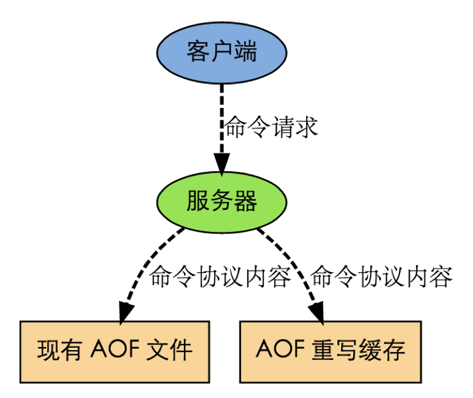

# Redis 数据管理

# 1 键管理

通过学习五种数据类型的操作命令，可以发现，Redis 对每种数据处理之前，都要先指定该数据的 key，然后再指定对该数据进行何种操作。

Redis 中的 key 有点类似于 Java 中的变量名，起到提纲挈领的作用，对某个数据的处理都是以 key 作为切入点。所以 Redis 把 key 作为单独的处理对象，抽象出了一套操作命令。key 可以想象成一个指向实际数据的指针，对 key 的操作会直接影响它所指向的数据的状态。

比如，我们想删除某个数据，就可以通过删除它的 key 来达到目的：

```text
127.0.0.1:6379> SET name chenlongfei
OK
127.0.0.1:6379> GET name
"chenlongfei"
127.0.0.1:6379> DEL name
(integer) 1
127.0.0.1:6379> GET name
(nil)
```

想要查看某个数据的类型：

```text
127.0.0.1:6379> SADD direction east west south north
(integer) 4
127.0.0.1:6379> TYPE direction
set
```

想要更改某个数据的 key 的名字：

```text
127.0.0.1:6379> RENAME direction direct
OK
127.0.0.1:6379> SMEMBERS direct
1) "north"
2) "west"
3) "south"
4) "east"
```

| 命令格式 | 说明 |
| --- | --- |
| `DEL key [key ...]` | 删除一个或多个键，不存在的键会被忽略 |
| `UNLINK key [key ...]` | （4.0 引入）与 `DEL` 类似，但真正的内存回收在后台线程中异步进行，删除大 key 时不会阻塞主线程 |
| `EXISTS key [key ...]` | 检查键是否存在，3.0.3 起可传入多个键，返回其中存在的键的数量 |
| `EXPIRE key seconds` | 指定键的过期时间（秒） |
| `PEXPIRE key milliseconds` | 指定键的过期时间（毫秒） |
| `EXPIREAT key timestamp` | 以 Unix 时间戳格式（秒）指定键的过期时间 |
| `PEXPIREAT key milliseconds-timestamp` | 以 Unix 时间戳格式（毫秒）指定键的过期时间 |
| `KEYS pattern` | 查找与指定模式匹配的所有键。`pattern` 支持 glob 风格的通配符格式，如 `*` 表示任意一个或多个字符，`?` 表示任意一个字符，`[abc]` 表示方括号中任意一个字母。`KEYS` 会遍历整个键空间并阻塞服务器，生产环境应改用 `SCAN` |
| `SCAN cursor [MATCH pattern] [COUNT count] [TYPE type]` | （2.8 引入）基于游标渐进式地遍历键空间，每次只返回一小批键，不会长时间阻塞服务器 |
| `RENAME key newkey` | 更改键的名称 |
| `RENAMENX key newkey` | 仅当 `newkey` 不存在时，将 `key` 重命名为 `newkey` |
| `TYPE key` | 返回键所存储的值的数据类型 |
| `RANDOMKEY` | 从当前数据库中随机返回一个键的名字 |
| `PERSIST key` | 如果 key 存在过期时间，该命令会将其过期时间消除，使该 key 不再有超时，而是可以持久化存储 |
| `TTL key` | （**T**ime **T**o **L**ive）返回该键的剩余存活时间（秒）。2.8 起，键不存在时返回 -2，键存在但没有设置过期时间时返回 -1 |
| `PTTL key` | 返回该键的剩余存活时间（毫秒），返回值规则同 `TTL` |

在这里有必要了解一下过期键的清理机制。

如果一个键过期了，那它什么时候会被删除？

这个问题有三种可能的答案：

- 定时删除：在设置键的过期时间时，创建一个定时事件，当过期时间到达时，由事件处理器自动执行键的删除操作。
- 惰性删除：放任键过期不管，但是在每次从 dict 字典中取出键值时，要检查键是否过期，如果过期的话，就删除它，并返回空；如果没过期，就返回键值。
- 定期删除：每隔一段时间，对 expires 字典进行检查，删除里面的过期键。

## 1.1 定时删除

定时删除策略对内存是最友好的：因为它保证过期键会在第一时间被删除，过期键所消耗的内存会立即被释放。

这种策略的缺点是，它对 CPU 时间是最不友好的：因为删除操作可能会占用大量的 CPU 时间——在内存不紧张、但是 CPU 时间非常紧张的时候（比如说，进行交集计算或排序的时候），将 CPU 时间花在删除那些和当前任务无关的过期键上，这种做法毫无疑问会是低效的。

除此之外，Redis 事件处理器对时间事件的实现方式——无序链表，查找一个时间事件的时间复杂度为 `O(N)`——并不适合用来处理大量时间事件。

## 1.2 惰性删除

惰性删除对 CPU 时间来说是最友好的：它只会在取出键时进行检查，这可以保证删除操作只会在非做不可的情况下进行——并且删除的目标仅限于当前处理的键，这个策略不会在删除其他无关的过期键上花费任何 CPU 时间。

惰性删除的缺点是，它对内存是最不友好的：如果一个键已经过期，而这个键又仍然保留在数据库中，那么 dict 字典和 expires 字典都需要继续保存这个键的信息，只要这个过期键不被删除，它占用的内存就不会被释放。

在使用惰性删除策略时，如果数据库中有非常多的过期键，但这些过期键又正好没有被访问的话，那么它们就永远也不会被删除（除非用户手动执行），这对于性能非常依赖于内存大小的 Redis 来说，肯定不是一个好消息。

举个例子，对于一些按时间点来更新的数据，比如日志（log），在某个时间点之后，对它们的访问就会大大减少，如果大量的这些过期数据积压在数据库里面，用户以为它们已经过期了（已经被删除了），但实际上这些键却没有真正地被删除（内存也没有被释放），那结果肯定是非常糟糕的。

## 1.3 定期删除

从上面对定时删除和惰性删除的讨论来看，这两种删除方式在单一使用时都有明显的缺陷：定时删除占用太多 CPU 时间，惰性删除浪费太多内存。

定期删除是这两种策略的一种折中：它每隔一段时间执行一次删除操作，并通过限制删除操作执行的时长和频率，借此来减少删除操作对 CPU 时间的影响。另一方面，通过定期删除过期键，它有效地减少了因惰性删除而带来的内存浪费。

## 1.4 Redis 使用的策略

Redis 使用的过期键删除策略是**惰性删除加上定期删除**，这两个策略相互配合，可以很好地在合理利用 CPU 时间和节约内存空间之间取得平衡。其中定期删除由定时任务 `serverCron` 驱动，执行频率由配置项 `hz` 控制（默认每秒 10 次），每次随机抽查一批设置了过期时间的键，并限制单次执行的时长。

需要注意的是，过期删除只负责清理过期的键。如果内存使用达到了 `maxmemory` 上限，Redis 还会按照 `maxmemory-policy` 配置的淘汰策略来腾出空间，共 8 种：`noeviction`（默认，不淘汰，写入直接报错）、`allkeys-lru`、`volatile-lru`、`allkeys-lfu`、`volatile-lfu`（LFU 两种为 4.0 引入）、`allkeys-random`、`volatile-random`、`volatile-ttl`。其中 `allkeys-*` 在所有键中挑选，`volatile-*` 只在设置了过期时间的键中挑选。

# 2 发布订阅管理

发布订阅（Pub/Sub）是一种消息通信模式，主要目的是解除消息发布者和消息订阅者之间的耦合，这点和设计模式中的观察者模式比较相似。

Redis 作为一个 server，在订阅者和发布者之间起到了消息路由的功能。订阅者可以通过 `SUBSCRIBE` 和 `PSUBSCRIBE` 命令向 Redis server 订阅自己感兴趣的消息类型，Redis 将消息类型称为**通道（channel）**。当发布者通过 `PUBLISH` 命令向 Redis server 发送特定类型的消息时，订阅该消息类型的全部 client 都会收到此消息。这里消息的传递是多对多的，一个 client 可以订阅多个 channel，也可以向多个 channel 发送消息。

例如，一个客户端订阅了“CCTV-5”频道的消息：

```text
127.0.0.1:6379> SUBSCRIBE CCTV-5
Reading messages... (press Ctrl-C to quit)
1) "subscribe"
2) "CCTV-5"
3) (integer) 1
```

另一个客户端在“CCTV-5”发布了两条消息：

```text
127.0.0.1:6379> PUBLISH CCTV-5 "Kobe will say good bye to NBA in 2016.4.4"
(integer) 1
127.0.0.1:6379> PUBLISH CCTV-5 "Cavaliers Cleveland won the championship"
(integer) 1
```

第一个客户端就会收到这两条消息：

```text
127.0.0.1:6379> SUBSCRIBE CCTV-5
Reading messages... (press Ctrl-C to quit)
1) "subscribe"
2) "CCTV-5"
3) (integer) 1
1) "message"
2) "CCTV-5"
3) "Kobe will say good bye to NBA in 2016.4.4"
1) "message"
2) "CCTV-5"
3) "Cavaliers Cleveland won the championship"
```

| 命令格式 | 说明 |
| --- | --- |
| `PUBLISH channel message` | 将消息 `message` 发布到频道 `channel` |
| `SUBSCRIBE channel [channel ...]` | 订阅一个或多个频道上的消息 |
| `UNSUBSCRIBE [channel [channel ...]]` | 退订频道上的消息 |
| `PSUBSCRIBE pattern [pattern ...]` | （**P**attern **Subscribe**）以模式匹配的方式订阅多个频道 |
| `PUNSUBSCRIBE [pattern [pattern ...]]` | 以模式匹配的方式退订频道消息 |
| `PUBSUB subcommand [argument [argument ...]]` | 查看活动的频道信息。比如 `PUBSUB CHANNELS`，会列出所有活动的频道名称，所谓“活动的”，是指至少有一个订阅者的频道 |

需要注意的是，Pub/Sub 的消息不会持久化，订阅者离线期间发布的消息会直接丢失。如果需要消息持久化、消费确认等可靠性保证，可以使用 5.0 引入的 Stream 类型。另外，7.0 起还新增了分片发布订阅（`SPUBLISH`、`SSUBSCRIBE` 等），用于在集群模式下按槽位转发消息。

# 3 连接管理

默认情况下，Redis 没有密码要求，意味着无需通过密码验证就可以连接到 Redis 服务。不过 3.2 起默认开启了保护模式（`protected-mode`），在没有设置密码且没有显式绑定地址时，只接受本机回环地址的连接。

可以通过更改配置文件中的 `requirepass` 配置项来设置密码。

```text
winner@winnerdeMacBook-Pro:~$ redis-cli
127.0.0.1:6379> CONFIG GET requirepass
1) "requirepass"
2) ""                                  -- 默认没有密码
127.0.0.1:6379> CONFIG SET requirepass "chenlongfei"      -- 设置密码
OK
127.0.0.1:6379> QUIT                   -- 退出重新连接
winner@winnerdeMacBook-Pro:~$ redis-cli
127.0.0.1:6379> SET name "clf"
(error) NOAUTH Authentication required.      -- 提示没权限
127.0.0.1:6379> AUTH chenlongfei       -- 验证密码
OK
127.0.0.1:6379> SET name "clf"         -- 之后才能进行操作
OK
127.0.0.1:6379> GET name
"clf"
```

注意，`CONFIG SET` 只修改运行时配置，重启后会失效，需要执行 `CONFIG REWRITE` 或修改 `redis.conf` 才能持久保存。6.0 起 Redis 引入了 ACL 权限控制，可以通过 `ACL SETUSER` 创建多个用户并分别授权，`requirepass` 实际上就是在设置默认用户 `default` 的密码。

| 命令格式 | 说明 |
| --- | --- |
| `AUTH [username] password` | 验证密码；6.0 起可同时指定用户名，以 ACL 用户身份登录 |
| `ECHO message` | 打印字符串 |
| `PING` | 检验连接状况，正常情况下服务器会返回“PONG” |
| `QUIT` | 关闭当前连接；7.2 起已弃用，客户端直接断开连接即可 |
| `SELECT index` | 切换到指定的数据库，数据库索引号 `index` 用数字值指定，以 0 作为起始索引值，默认使用 0 号数据库。集群模式下只能使用 0 号数据库 |

# 4 服务器管理

Redis 定义了一组与服务器相关的命令，用于查询服务器信息，如当前时间、客户端连接数量，以及修改配置文件、手动触发某些操作等。

| 命令格式 | 说明 |
| --- | --- |
| `INFO [section]` | 打印服务器的详细信息，可指定 `memory`、`replication` 等部分 |
| `CONFIG GET name` | 获取配置项 `name` 的内容 |
| `CONFIG SET name value` | 将配置项 `name` 的值设为 `value`，无需重启 |
| `CONFIG REWRITE` | 将当前运行时的配置写回 `redis.conf` |
| `BGSAVE` | 在后台异步保存当前数据库的数据到磁盘。`BGSAVE` 命令执行之后立即返回 OK，然后 Redis fork 出一个新子进程，原来的 Redis 进程（父进程）继续处理客户端请求，而子进程则负责将数据保存到磁盘，然后退出 |
| `SAVE` | `SAVE` 命令执行一个同步操作，以 RDB 文件的方式保存所有数据的快照。很少在生产环境直接使用 `SAVE` 命令，因为它会**阻塞所有客户端的请求**，可以使用 `BGSAVE` 命令代替 |
| `FLUSHALL [ASYNC \| SYNC]` | 删除所有数据库的所有 key；4.0 起可加 `ASYNC` 在后台异步释放内存 |
| `FLUSHDB [ASYNC \| SYNC]` | 删除当前数据库的所有 key；4.0 起可加 `ASYNC` 在后台异步释放内存 |
| `SHUTDOWN [NOSAVE \| SAVE]` | 停止所有客户端，如果配置了 save 策略，则执行一个阻塞的 save 命令，如果开启了 AOF，则刷新 AOF 文件，关闭 Redis 服务进程（`redis-server`）。如果配置了持久化策略，那么这个命令将能够保证在关闭 Redis 服务进程的时候数据不会丢失。如果仅仅在客户端执行 `SAVE` 命令，然后执行 `QUIT` 命令，那么数据的完整性将不会被保证，因为其他客户端可能在执行这两个命令的期间修改数据库的数据。7.0 起还新增了 `NOW`、`FORCE`、`ABORT` 等选项 |

# 5 持久化

Redis 提供了两种持久化的方式：

- **RDB**（**R**edis **D**ata**B**ase）模式，就是在不同的时间点，将 Redis 存储的数据生成快照并存储到磁盘等介质上。
- **AOF**（**A**ppend **O**nly **F**ile）模式，则换了一个角度来实现持久化，那就是将 Redis 执行过的所有写指令记录下来，在下次 Redis 重新启动时，只要把这些写指令从前到后再重复执行一遍，就可以实现数据恢复了。

RDB 和 AOF 两种方式可以同时使用，在这种情况下如果 Redis 重启，则会**优先采用 AOF 方式来进行数据恢复**，这是因为 AOF 方式的数据恢复完整度更高。

4.0 起还支持 RDB 与 AOF 混合持久化（`aof-use-rdb-preamble`，5.0 起默认开启）：AOF 重写时先以 RDB 格式写入全量数据，再以 AOF 格式追加增量命令，兼顾了 RDB 的恢复速度和 AOF 的数据完整性。

没有数据持久化的需求，也完全可以关闭 RDB 和 AOF 方式，这样的话，Redis 将变成一个纯内存数据库，就像 Memcached 一样。

## 5.1 RDB 模式

Redis 在进行数据持久化的过程中，会先将数据写入到一个临时文件中，待持久化过程都结束了，才会用这个临时文件替换上次持久化好的文件。正是这种特性，让我们可以随时来进行备份，因为快照文件总是完整可用的。

对于 RDB 方式，Redis 会单独创建（fork）一个子进程来进行持久化，而主进程是不会进行任何 I/O 操作的，这样就确保了 Redis 极高的性能。

如果需要进行大规模数据的恢复，且对于数据恢复的完整性不是非常敏感，那 RDB 方式要比 AOF 方式更加高效。

虽然 RDB 有不少优点，但它的缺点也是不容忽视的。如果对数据的完整性非常敏感，那么 RDB 方式就不太适合，因为即使每 5 分钟都持久化一次，当 Redis 故障时，仍然会有近 5 分钟的数据丢失。所以，Redis 还提供了另一种持久化方式，那就是 AOF。

## 5.2 AOF 模式

通过配置 `redis.conf` 中的 `appendonly yes` 就可以打开 AOF 功能。如果有写操作（如 `SET` 等），Redis 就会把该命令追加到 AOF 文件的末尾。

默认的 AOF 持久化策略是每秒钟 fsync 一次（`appendfsync everysec`，fsync 是指把缓存中的写指令记录到磁盘中），因为在这种情况下，Redis 仍然可以保持很好的处理性能，即使 Redis 故障，也只会丢失最近 1 秒钟的数据。另外两个可选值是 `always`（每条写命令都 fsync，最安全但最慢）和 `no`（交给操作系统决定何时刷盘）。

如果在追加日志时，恰好遇到磁盘空间满、inode 满或断电等情况导致日志写入不完整，也没有关系，Redis 提供了 `redis-check-aof` 工具，可以用来进行日志修复。

因为采用了追加方式，如果不做任何处理的话，AOF 文件会变得越来越大，为此，Redis 提供了 AOF 文件**重写（rewrite）机制**，即当 AOF 文件的大小超过所设定的阈值时（由 `auto-aof-rewrite-percentage` 和 `auto-aof-rewrite-min-size` 控制，也可以用 `BGREWRITEAOF` 命令手动触发），Redis 就会启动 AOF 文件的内容压缩，只保留可以恢复数据的最小指令集。举个例子或许更形象，假如我们调用了 100 次 `INCR` 指令，在 AOF 文件中就要存储 100 条指令，但这明显是很低效的，完全可以把这 100 条指令合并成一条 `SET` 指令，这就是重写机制的原理。在进行 AOF 重写时，仍然是采用先写临时文件，全部完成后再替换的流程，所以断电、磁盘满等问题都不会影响 AOF 文件的可用性。

AOF 重写的内部运行原理，有必要了解一下。以下是 Redis 7.0 之前的流程。

在重写即将开始之际，Redis 会创建（fork）一个“重写子进程”，这个子进程会根据当前内存中的数据，生成能恢复这些数据的最小指令集，并写入到一个临时文件中。

与此同时，主工作进程会将新接收到的写指令一边累积到内存缓冲区（AOF 重写缓冲区）中，一边继续写入到原有的 AOF 文件中，这样做是保证原有的 AOF 文件的可用性，避免在重写过程中出现意外。



当“重写子进程”完成重写工作后，它会给父进程发一个信号，父进程收到信号后就会将内存中缓存的写指令追加到新 AOF 文件中。

当追加结束后，Redis 就会用新 AOF 文件来代替旧 AOF 文件，之后再有新的写指令，就都会追加到新的 AOF 文件中了。

7.0 起，Redis 改用了 Multi-Part AOF 机制，AOF 不再是单个文件，而是存放在 `appendonlydir` 目录下的一组文件：一个 base 文件（RDB 或 AOF 格式的全量数据）、若干 incr 文件（增量写命令）以及一个记录文件清单的 manifest 文件。重写时，主进程直接打开一个新的 incr 文件来记录期间的写命令，子进程只负责生成新的 base 文件，完成后更新 manifest 即可。这样就不再需要上面的 AOF 重写缓冲区，也省去了重写结束时把缓冲区数据追加到新文件的开销。

虽然优点多多，但 AOF 方式也同样存在缺陷，比如在同样数据规模的情况下，AOF 文件要比 RDB 文件的体积大。而且，AOF 方式的恢复速度也要慢于 RDB 方式。

如果运气比较差，AOF 文件出现了被写坏的情况，也不必过分担忧，Redis 并不会贸然加载这个有问题的 AOF 文件。如果只是文件末尾不完整（比如断电导致最后一条命令没写完），在默认配置 `aof-load-truncated yes` 下，Redis 会丢弃末尾不完整的命令并记录日志，然后正常启动；如果是文件中间出现损坏，Redis 会报错退出，这时可以通过 `redis-check-aof` 工具来修复文件，确认问题点后再重启 Redis。

# 6 小结

本文介绍了 Redis 的键管理、过期删除与内存淘汰、发布订阅、连接与服务器管理命令，以及 RDB 和 AOF 两种持久化方式。实际使用中，生产环境一般同时开启 RDB 与 AOF（或直接使用混合持久化），在性能和数据安全之间取得平衡。
