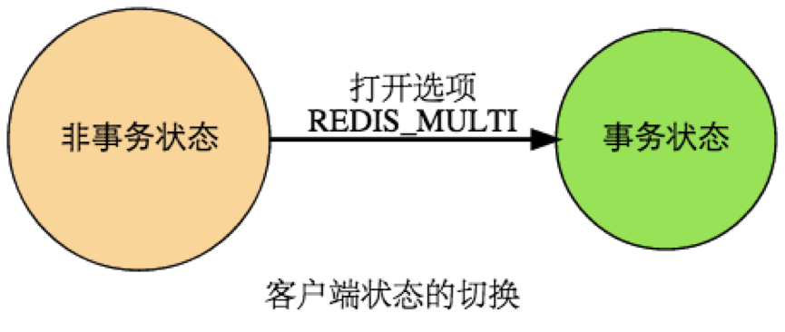
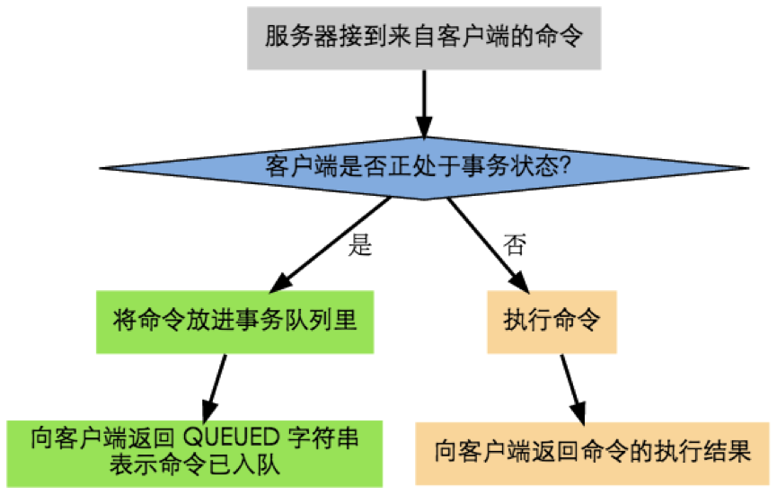
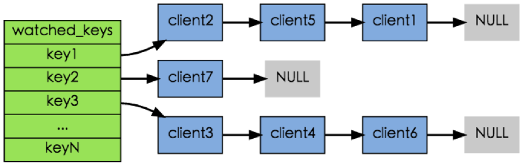
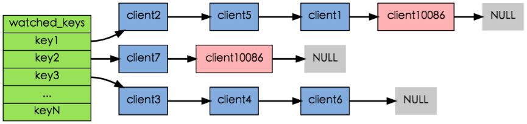
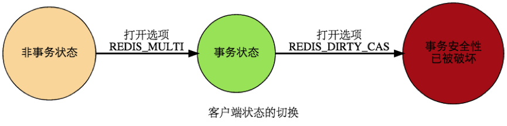

# Redis 事务

所谓事务，就是一个非黑即白的定义：一组命令，要么全做，要么全不做，不存在半做半不做的灰色地带。

这一点对于保持数据库的一致性非常重要。比如，两个银行账户之间转账，至少需要分成两个步骤：

1. 从 A 银行账户扣除一定的金额；
2. 将等额资金添加到 B 银行账户中。

这就是一个事务的应用场景。这两步是完成一个事件的整体，具有不可分割的原子性。假设在执行完步骤 1 之后因为某种原因导致步骤 2 无法执行，这笔资金从原账户已经扣除，但是没有转到预定的账户 B 中，一笔钱就这么人间蒸发，客户岂能答应？

Redis 通过四个命令来支持事务操作：

- `MULTI`
- `DISCARD`
- `EXEC`
- `WATCH`

Redis 以 `MULTI` 开始一个事务，然后将多个命令入队到事务中，最后由 `EXEC` 命令触发事务，一并执行事务中的所有命令：

```text
127.0.0.1:6379> MULTI                    -- 开始事务
OK
127.0.0.1:6379> SET accountA 10000       -- A 账户存入 10000
QUEUED
127.0.0.1:6379> SET accountB 8000        -- B 账户存入 8000
QUEUED
127.0.0.1:6379> DECRBY accountA 2000     -- A 账户扣除 2000
QUEUED
127.0.0.1:6379> INCRBY accountB 2000     -- B 账户添加 2000
QUEUED
127.0.0.1:6379> GET accountA             -- 获取 A 账户金额
QUEUED
127.0.0.1:6379> GET accountB             -- 获取 B 账户金额
QUEUED
127.0.0.1:6379> EXEC                     -- 执行事务
1) OK
2) OK
3) (integer) 8000
4) (integer) 10000
5) "8000"
6) "10000"
```

# 1 开始事务

`MULTI` 命令的执行标记着事务的开始：



当客户端处于非事务状态下时，所有发送给服务器端的命令都会立即被服务器执行。

**Redis 的事务不可嵌套**：当客户端已经处于事务状态，而客户端又再向服务器发送 `MULTI` 时，服务器只是简单地向客户端返回一个错误，然后继续等待其他命令的入队。`MULTI` 命令的发送不会造成整个事务失败，也不会修改事务队列中已有的数据。

# 2 命令入队

但是，当客户端进入事务状态之后，服务器在收到来自客户端的命令时，不会立即执行命令，而是将这些命令全部放进一个事务队列里，然后返回 `QUEUED`，表示命令已入队：



事务队列是一个数组，每个数组项都包含三个属性：

- 要执行的命令（cmd）
- 命令的参数（argv）
- 参数的个数（argc）

例如，客户端执行以下命令：

```text
127.0.0.1:6379> MULTI
OK
127.0.0.1:6379> SET name "chenlongfei"
QUEUED
127.0.0.1:6379> GET name
QUEUED
127.0.0.1:6379> SADD tag "master" "Java" "engineer"
QUEUED
127.0.0.1:6379> SMEMBERS tag
QUEUED
```

程序将为客户端创建以下事务队列：

| 数组索引 | 命令     | 命令参数                         | 参数个数 |
| -------- | -------- | -------------------------------- | -------- |
| 0        | SET      | [name "chenlongfei"]             | 2        |
| 1        | GET      | [name]                           | 1        |
| 2        | SADD     | [tag "master" "Java" "engineer"] | 4        |
| 3        | SMEMBERS | [tag]                            | 1        |

# 3 命令执行

如果客户端正处于事务状态，那么当 `EXEC` 命令执行时，服务器根据客户端所保存的事务队列，以先进先出（FIFO）的方式执行事务队列中的命令：最先入队的命令最先执行，而最后入队的命令最后执行。

对于上面的命令队列而言，程序会首先执行 `SET` 命令，然后执行 `GET` 命令，再然后执行 `SADD` 命令，最后执行 `SMEMBERS` 命令。

执行事务中的命令所得的结果会以 FIFO 的顺序保存到一个回复队列中。

上面给出的事务队列，会得到如下回复队列：

| 数组索引 | 回复类型          | 回复内容                      |
| -------- | ----------------- | ----------------------------- |
| 0        | status code reply | OK                            |
| 1        | bulk reply        | chenlongfei                   |
| 2        | integer reply     | (integer) 3                   |
| 3        | multi-bulk reply  | ["engineer" "Java" "master"]  |

当事务队列里的所有命令被执行完之后，`EXEC` 命令会将回复队列作为自己的执行结果返回给客户端，客户端从事务状态返回到非事务状态，至此，事务执行完毕。

# 4 事务命令与非事务命令

无论在事务状态下，还是在非事务状态下，Redis 命令都由同一个函数执行，所以它们共享很多服务器的一般设置，比如 AOF 的配置、RDB 的配置，以及内存限制等。

事务中的命令和普通命令在执行上还是有一点区别的，其中最重要的两点是：

1. 非事务状态下的命令以单个命令为单位执行，前一个命令和后一个命令的客户端不一定是同一个；而事务状态则是以一个事务为单位，执行事务队列中的所有命令，**除非当前事务执行完毕，否则服务器不会中断事务，也不会执行其他客户端的其他命令**。
2. 在非事务状态下，执行命令所得的结果会立即被返回给客户端；而事务则是将所有命令的结果集合到回复队列，再作为 `EXEC` 命令的结果返回给客户端。

# 5 取消事务

`DISCARD` 命令用于取消一个事务，它清空客户端的整个事务队列，然后将客户端从事务状态调整回非事务状态，最后返回字符串 `OK` 给客户端，说明事务已被取消。

```text
127.0.0.1:6379> SET name chenlongfei     -- 设置姓名
OK
127.0.0.1:6379> MULTI
OK
127.0.0.1:6379> SET name clf             -- 在事务中更改姓名
QUEUED
127.0.0.1:6379> GET name
QUEUED
127.0.0.1:6379> DISCARD                  -- 取消事务
OK
127.0.0.1:6379> GET name
"chenlongfei"                            -- 可见姓名并没有被更改
```

# 6 WATCH 命令

`WATCH` 命令用于在事务开始之前监视任意数量的键：当调用 `EXEC` 命令执行事务时，如果任意一个被监视的键已经被修改了，那么整个事务不再执行，直接返回失败。这里的“修改”既包括其他客户端（以及本客户端自己）执行的写命令，也包括 Redis 自身触发的过期删除和内存淘汰。

例如：

```text
127.0.0.1:6379> WATCH name               -- 监视 name 键
OK
127.0.0.1:6379> MULTI
OK
127.0.0.1:6379> SET name chenlongfei
QUEUED
127.0.0.1:6379> GET name
QUEUED
127.0.0.1:6379> EXEC
(nil)                                    -- 由于其他客户端对 name 键做了更新，导致事务失败
```

以下执行序列展示了上面的例子是如何失败的：

| 时间 | 客户端 A             | 客户端 B     |
| ---- | -------------------- | ------------ |
| T1   | WATCH name           |              |
| T2   | MULTI                |              |
| T3   | SET name chenlongfei |              |
| T4   |                      | SET name clf |
| T5   | GET name             |              |
| T6   | EXEC                 |              |

在客户端 A 监视 `name` 键之后，客户端 B 修改了 `name` 键的值，当客户端 A 在 T6 执行 `EXEC` 时，Redis 发现 `name` 这个被监视的键已经被修改，因此客户端 A 的事务不会被执行，直接返回失败。

使用 `UNWATCH` 命令可以清除之前设置的所有监视。另外，执行 `EXEC` 或 `DISCARD` 之后，当前连接的所有监视也会被自动清除。

在每个代表数据库的 `redisDb` 结构（早期版本定义在 `redis.h` 中，3.2 起源码重构为 `server.h`）中，保存了一个 `watched_keys` 字典，字典的键是这个数据库被监视的键，而字典的值则是一个链表，链表中保存了所有监视这个键的客户端。

如：



其中，键 `key1` 正在被 client1、client2 和 client5 三个客户端监视，其他一些键也分别被别的客户端监视着。

`WATCH` 命令的作用，就是将当前客户端和要监视的键在 `watched_keys` 中进行关联。

例如，如果当前客户端为 client10086，那么当客户端执行 `WATCH key1 key2` 时，前面展示的 `watched_keys` 将被修改成这个样子：



通过 `watched_keys` 字典，如果程序想检查某个键是否被监视，那么它只要检查字典中是否存在这个键即可；如果程序要获取监视某个键的所有客户端，那么只要取出键的值（一个链表），然后对链表进行遍历即可。

在任何对数据库键空间（key space）进行修改的命令成功执行之后（比如 `FLUSHDB`、`SET`、`DEL`、`LPUSH`、`SADD`、`ZREM` 等），`multi.c/touchWatchedKey` 函数都会被调用：它检查数据库的 `watched_keys` 字典，看是否有客户端在监视已经被命令修改的键，如果有的话，程序将所有监视这个（或这些）被修改键的客户端的 `REDIS_DIRTY_CAS` 标志打开（新版本源码中该标志已改名为 `CLIENT_DIRTY_CAS`，原理不变）：



当客户端发送 `EXEC` 命令、触发事务执行时，服务器会对客户端的状态进行检查：

- 如果客户端的 `REDIS_DIRTY_CAS` 标志已经被打开，那么说明被客户端监视的键至少有一个已经被修改了，事务的安全性已经被破坏。服务器会放弃执行这个事务，直接向客户端返回空回复，表示事务执行失败。
- 如果 `REDIS_DIRTY_CAS` 标志没有被打开，那么说明所有监视键都安全，服务器正式执行事务。

这种“先监视、提交时再检查”的做法属于乐观锁（optimistic locking），类似于 CAS（check-and-set）操作：事务失败后，客户端通常只需重试即可。

# 7 ACID 性质

在传统的关系型数据库中，常常用 ACID 性质来检验事务功能的安全性：原子性（Atomicity）、一致性（Consistency）、隔离性（Isolation）、持久性（Durability）。

**Redis 事务保证了其中的一致性和隔离性；原子性只在“要么全部执行、要么全部不执行”的意义上成立，Redis 不支持回滚；持久性则取决于所使用的持久化模式**。

## 7.1 原子性（Atomicity）

单个 Redis 命令的执行是原子性的。对于事务，Redis 官方文档给出的保证是：`EXEC` 被调用之前客户端断开连接，事务中的命令一条都不会执行；`EXEC` 被调用后，事务中的命令会被全部执行。从这个意义上说，Redis 事务是原子的。

但它和关系型数据库的原子性并不相同：**Redis 不支持事务回滚**。如果事务中某条命令在执行时出错（见 7.2 节的“执行错误”），已经执行的命令不会被撤销，后续命令也会照常执行。官方的解释是，支持回滚会显著影响 Redis 的简洁性和性能。

如果一个事务队列中的所有命令都被成功地执行，那么称这个事务执行成功。

另一方面，如果 Redis 服务器进程在执行事务的过程中被停止，比如接到 KILL 信号、宿主机器停机等，那么事务执行失败。

**当事务失败时，Redis 也不会进行任何的重试或者回滚动作。**

## 7.2 一致性（Consistency）

Redis 的一致性问题可以分为三部分来讨论：入队错误、执行错误、Redis 进程被终结。

**（1）入队错误**

在命令入队的过程中，如果客户端向服务器发送了错误的命令，比如命令的参数数量不对等，服务器将向客户端返回一个出错信息，并且将客户端的事务状态设为 `REDIS_DIRTY_EXEC`（新版本源码中为 `CLIENT_DIRTY_EXEC`）。

当客户端执行 `EXEC` 命令时，Redis 会拒绝执行状态为 `REDIS_DIRTY_EXEC` 的事务，并返回 `EXECABORT` 错误（该行为自 2.6.5 起提供）。

因此，带有不正确入队命令的事务不会被执行，也不会影响数据库的一致性。

**（2）执行错误**

如果命令在事务执行的过程中发生错误，比如说对一个不同类型的 key 执行了错误的操作，那么 Redis 只会将错误包含在事务的结果中，这不会引起事务中断或整个失败，不会影响已执行事务命令的结果，也不会影响后面要执行的事务命令，所以它对事务的一致性也没有影响。

**（3）Redis 进程被终结**

如果 Redis 服务器进程在执行事务的过程中被其他进程终结，或者被管理员强制杀死，那么根据 Redis 所使用的持久化模式，可能有以下情况出现：

- 内存模式：如果 Redis 没有采取任何持久化机制，那么重启之后的数据库总是空白的，所以数据总是一致的。
- RDB 模式：在执行事务时，Redis 不会中断事务去执行保存 RDB 的工作，只有在事务执行之后，保存 RDB 的工作才有可能开始。所以当 RDB 模式下的 Redis 服务器进程在事务中途被杀死时，事务内执行的命令，不管成功了多少，都不会被保存到 RDB 文件里。恢复数据库需要使用现有的 RDB 文件，而这个 RDB 文件的数据保存的是最近一次的数据库快照，所以它的数据可能不是最新的，但只要 RDB 文件本身没有因为其他问题而出错，那么还原后的数据库就是一致的。
- AOF 模式：Redis 会使用一次 `write` 系统调用把整个事务写入 AOF 文件，但如果进程被强行杀死，仍有可能只写入了事务的一部分。根据事务语句是否被写入并保存到 AOF 文件，有以下两种情况：
   1. 如果事务语句未写入到 AOF 文件，或 AOF 未被 `fsync` 调用保存到磁盘，那么当进程被杀死之后，Redis 可以根据最近一次成功保存到磁盘的 AOF 文件来还原数据库，只要 AOF 文件本身没有因为其他问题而出错，那么还原后的数据库总是一致的，但其中的数据不一定是最新的。
   2. 如果事务的部分语句被写入到 AOF 文件，并且 AOF 文件被成功保存，那么不完整的事务执行信息就会遗留在 AOF 文件里。重启 Redis 时，程序会检测到 AOF 文件末尾的事务并不完整：在 `aof-load-truncated yes`（默认值）时，新版本 Redis 会自动丢弃这段不完整的事务并继续启动；否则 Redis 会退出并报告错误，需要使用 `redis-check-aof --fix` 将部分成功的事务命令移除之后，才能再次启动服务器。还原之后的数据总是一致的，而且数据也是最新的（直到事务执行之前为止）。

## 7.3 隔离性（Isolation）

Redis 使用单线程执行命令（6.0 引入的 I/O 多线程只负责网络读写，命令执行仍在主线程），并且它保证在执行事务时，不会对事务进行中断，事务可以运行直到执行完所有事务队列中的命令为止。因此，Redis 的事务总是带有隔离性的。

## 7.4 持久性（Durability）

因为事务不过是用队列包裹起了一组 Redis 命令，并没有提供任何额外的持久性功能，所以事务的持久性由 Redis 所使用的持久化模式决定：

- 在单纯的内存模式下，事务肯定是不持久的。
- 在 RDB 模式下，服务器可能在事务执行之后、RDB 文件更新之前的这段时间宕机，所以 RDB 模式下的 Redis 事务也是不持久的。
- 在 AOF 的 `appendfsync always` 模式下，Redis 会在命令执行之后、向客户端返回结果之前，由主线程同步调用 `fsync` 将数据写入磁盘，所以客户端收到 `EXEC` 的回复时，事务数据已经落盘，这种模式下的事务可以认为是持久的，代价是性能明显下降。（一些早期资料认为该模式下的 `fsync` 由后台线程执行、因此不持久，这一说法并不准确。）
- 在 `appendfsync everysec` 模式下，`fsync` 由后台线程每秒执行一次，宕机时可能丢失最近约 1 秒的数据；`appendfsync no` 模式则完全交给操作系统决定何时刷盘。所以这两种模式下的事务都是不持久的。

# 8 小结

Redis 事务通过 `MULTI`、`EXEC`、`DISCARD`、`WATCH` 四个命令，把一组命令打包后按顺序、不被打断地执行，并借助 `WATCH` 实现乐观锁；但它不支持回滚，也不能在事务中根据前一条命令的结果决定后续逻辑（入队时还拿不到执行结果）。

如果需要“读取—判断—写入”这类带条件的原子操作，更推荐使用 Lua 脚本（2.6 起提供 `EVAL`/`EVALSHA`）或 7.0 引入的 Redis Functions（`FUNCTION LOAD` 加载、`FCALL` 调用）：它们同样会被原子地执行，而且通常比事务更简单、更快。对于只针对单个字符串键的“比较后再设置/删除”，8.4 起还可以直接使用 `SET` 的 `IFEQ` 等选项和 `DELEX` 命令。另外，在 Redis Cluster 中，一个事务（或脚本）涉及的所有键必须位于同一个哈希槽中，通常借助哈希标签（hash tag，如 `{user1}:a`、`{user1}:b`）来保证。
