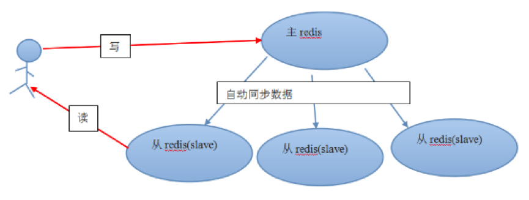
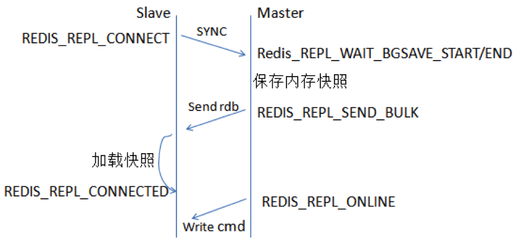
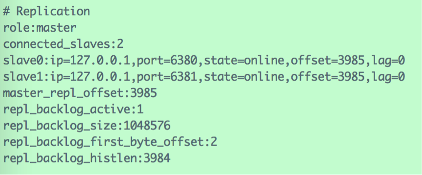
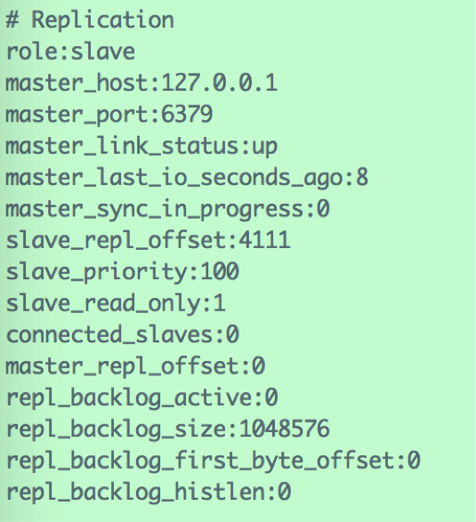
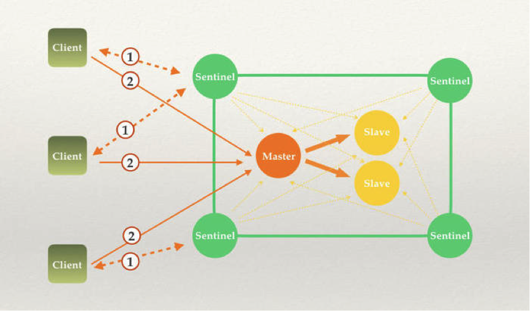
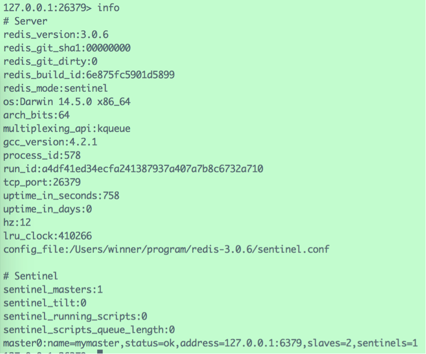
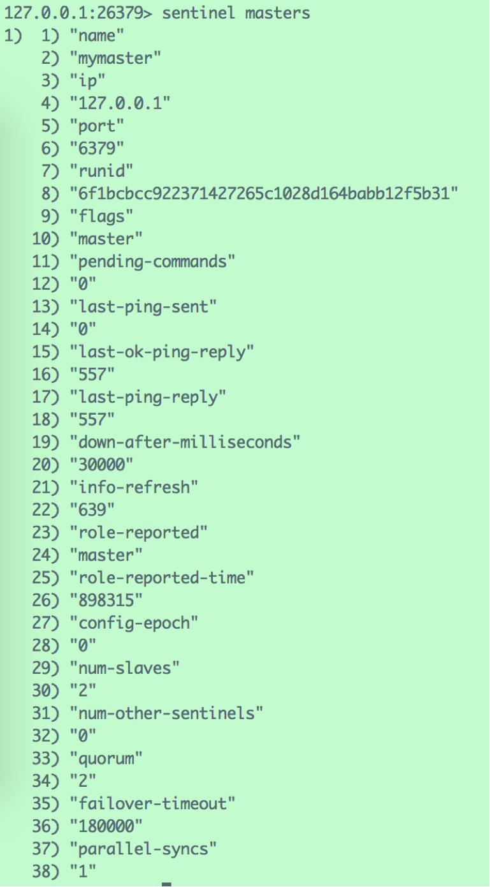
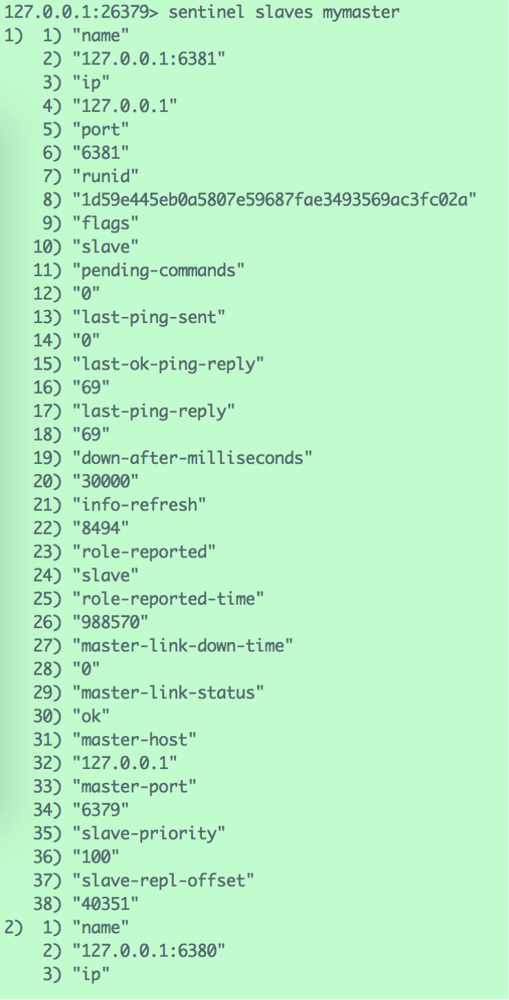
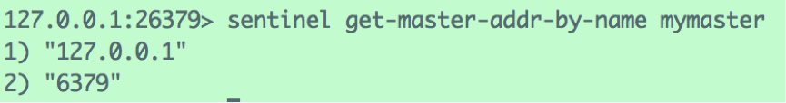

# Redis 集群

# 1 主从同步原理

像 MySQL 一样，Redis 是支持**主从同步**的，而且也支持一主多从以及多级从结构。

> 说明：Redis 早期把从服务器称为 Slave，5.0 起官方统一改称 Replica（对应的命令和配置项也改为 `REPLICAOF`、`replicaof`、`replica-read-only` 等，旧名称仍作为别名保留）。下文统一使用 Master（主服务器）和 Replica（从服务器）的叫法，截图中仍会看到旧版本的 slave 字样。

主从结构，一是为了纯粹的冗余备份，二是为了提升读性能，比如很消耗性能的 `SORT` 就可以由从服务器来承担。

Redis 的主从同步是异步进行的，这意味着主从同步不会影响主逻辑，也不会降低 Redis 的处理性能。

主从架构中，可以考虑关闭主服务器的数据持久化功能，只让从服务器进行持久化，这样可以提高主服务器的处理性能。但要特别注意：如果关闭了主服务器的持久化，就不要让它在宕机后被自动拉起，否则主服务器会以空数据集重启，从服务器随后同步时也会把自己的数据清空，导致数据全部丢失。

在主从架构中，从服务器通常被设置为只读模式，这样可以避免从服务器的数据被误修改。但是从服务器仍然可以接受 `CONFIG` 等管理命令，所以还是不应该将从服务器直接暴露到不安全的网络环境中。如果必须如此，可以考虑给重要命令重命名，或者使用 6.0 引入的 ACL 限制用户可执行的命令，来避免命令被外人误执行。



从服务器会向主服务器发出同步请求（2.8 之前为 `SYNC` 命令，2.8 起为 `PSYNC` 命令），需要全量同步时，主服务器就会执行 `BGSAVE` 来创建一个子进程专门进行数据持久化工作，也就是将主服务器的数据写入 RDB 文件中。在数据持久化期间，主服务器将执行的写命令都缓存在内存中。

在 `BGSAVE` 执行完成后，主服务器会将持久化好的 RDB 文件发送给从服务器，从服务器接到此文件后会将其存储到磁盘上，然后再将其读取到内存中。这个动作完成后，主服务器会将这段时间缓存的写命令再以 Redis 协议的格式发送给从服务器。

> 新版本中还支持无盘复制（diskless replication）：主服务器由子进程直接通过网络把 RDB 数据发送给从服务器，不再先落盘，由 `repl-diskless-sync` 控制，7.0 起默认开启；从服务器端也可以通过 `repl-diskless-load` 选择不落盘直接加载（默认 `disabled`）。



另外，要说的一点是，即使有多个从服务器同时发来同步请求，主服务器也只会执行一次 `BGSAVE`，然后把持久化好的 RDB 文件发给多个下游。在 Redis 2.8 版本之前，如果从服务器与主服务器因某些原因断开连接的话，都会进行一次主从之间的全量数据同步；而在 2.8 版本之后，Redis 支持了效率更高的增量同步策略，这大大降低了连接断开的恢复成本。

主服务器会在内存中维护一个缓冲区，缓冲区中存储着将要发给从服务器的内容。从服务器在与主服务器出现网络瞬断之后，会尝试再次与主服务器连接，一旦连接成功，从服务器就会把“希望同步的主服务器 ID”和“希望请求的数据的偏移位置（replication offset）”发送出去。主服务器接收到这样的同步请求后，首先会验证主服务器 ID 是否和自己的 ID 匹配，其次会检查“请求的偏移位置”是否存在于自己的缓冲区中，如果两者都满足的话，主服务器就会向从服务器发送增量内容。

增量同步功能，需要服务器端支持全新的 `PSYNC` 命令。这个命令，只有在 Redis 2.8 之后才具有。

Redis 复制工作原理的总结如下：

- 如果设置了一个 Replica，无论是第一次连接还是重连到 Master，它都会发出一个 `PSYNC` 命令（2.8 之前为 `SYNC`）；
- 当 Master 需要进行全量同步时，会做两件事：
  - Master 执行 `BGSAVE`，即在后台保存数据到磁盘（RDB 快照文件）；
  - Master 同时将新收到的写入和修改数据集的命令（非查询类）存入缓冲区；
- 当 Master 在后台把数据保存到快照文件完成之后，Master 会把这个快照文件传送给 Replica，而 Replica 则把内存清空后，加载该文件到内存中；
- 而 Master 也会把此前收集到缓冲区中的命令，通过 Redis 命令协议形式转发给 Replica，Replica 执行这些命令，实现和 Master 的同步；
- Master/Replica 此后会不断通过异步方式进行命令的同步，达到最终数据的同步一致；
- 需要注意的是，2.8 之前 Master 和 Replica 之间一旦发生重连都会引发全量同步操作；2.8 之后的版本，则会优先尝试部分同步。

2.8 开始，当 Master 和 Replica 之间的连接断开之后，它们之间可以采用部分重同步（partial resynchronization）的方式代替全量同步。

Master 端为复制流维护一个内存缓冲区（in-memory backlog），记录最近发送的复制流命令；同时，Master 和 Replica 之间都维护一个复制偏移量（replication offset）和当前 Master 服务器 ID（Master run ID）。当网络断开，Replica 尝试重连时：

- 如果 Master ID 相同（即仍是断网前的 Master 服务器），并且从断开时到当前时刻的历史命令依然在 Master 的内存缓冲区中存在，则 Master 会将缺失的这段时间的所有命令发送给 Replica 执行，然后复制工作就可以继续执行了；
- 否则，依然需要全量复制操作。

Redis 2.8 的这个部分重同步特性用到的就是新增的 `PSYNC` 内部命令。到了 4.0 版本，Redis 又引入了 PSYNC2：用复制 ID（replication ID）代替原来的 run ID，并且节点会同时记住新旧两个复制 ID，因此在发生主从切换（Replica 晋升为新 Master）后，其他 Replica 也能向新 Master 进行部分重同步；Replica 正常重启后，也可以利用 RDB 文件中保存的复制信息尝试部分重同步，而不必每次都全量复制。

# 2 主从同步配置

可以在一台机器上使用不同的端口来模拟多台机器的主从同步。

下面以默认端口 6379 为 Master，以 6380、6381 端口为两个 Replica。

找到 Redis 安装路径下的 `redis.conf`，复制两份，分别命名为 `redis-6380.conf` 与 `redis-6381.conf`。

`redis.conf` 相关配置：

```conf
pidfile /var/run/redis.pid
port 6379
bind 127.0.0.1
logfile /Users/winner/program/redis-3.0.6/log/redis.log
# Master 不进行持久化，关闭 RDB 与 AOF
save ""
appendonly no
```

`redis-6380.conf` 相关配置：

```conf
pidfile /var/run/redis-6380.pid
port 6380
bind 127.0.0.1
logfile /Users/winner/program/redis-3.0.6/log/redis-6380.log
# Replica 同时开启 RDB 与 AOF
dbfilename dump-6380.rdb
dir /Users/winner/program/redis-3.0.6/db/
appendonly yes
appendfilename "appendonly-6380.aof"
# 指定 Master 的 IP 与端口（5.0 之前写作 slaveof）
replicaof 127.0.0.1 6379
# Replica 设为只读模式（5.0 之前写作 slave-read-only）
replica-read-only yes
```

`redis-6381.conf` 与 `redis-6380.conf` 的配置类似。

使用命令 `redis-server redis.conf` 启动 Master 实例，再使用 `redis-server redis-6380.conf` 与 `redis-server redis-6381.conf` 启动两个 Replica 实例。

在 Master 的客户端使用 `INFO` 命令（也可以用 `INFO replication` 只查看复制相关信息）：



信息显示，Master 有两个 Replica，端口分别为 6380 与 6381。

在 Replica 的客户端使用 `INFO` 命令：



信息显示，该实例为 `127.0.0.1:6379` 的 Replica。

在 Master 上执行命令：

```text
127.0.0.1:6379> set name 'chenlongfei'
OK
```

然后在任何一个 Replica 上都可以获取到该数据：

```text
127.0.0.1:6380> get name
"chenlongfei"
```

证明 Replica 与 Master 的数据库保持一致。

# 3 Sentinel 实现机制与用法

## 3.1 Sentinel 概述

Redis Sentinel（哨兵）是 Redis 官方推荐的高可用性（HA，High Availability）解决方案。当用 Redis 做 Master-Replica 的高可用方案时，假如 Master 宕机了，Redis 本身（包括它的很多客户端）都没有实现自动进行主备切换，而 Redis Sentinel 本身是一个独立运行的进程，它能监控多个 Master-Replica 集群，发现 Master 宕机后能进行自动切换。现在使用的是 2.8 起提供的 Sentinel 2，早期的 Sentinel 1 已被淘汰。

它的主要功能有以下几点：

- 不时地监控 Redis 是否按照预期良好地运行；
- 如果发现某个 Redis 节点运行出现状况，能够通知另外一个进程（例如它的客户端）；
- 能够进行自动切换。当一个 Master 节点不可用时，能够选举出 Master 的多个 Replica（如果有超过一个 Replica 的话）中的一个来作为新的 Master，其他的 Replica 节点会将它所追随的 Master 的地址改为被提升为 Master 的 Replica 的新地址。

很显然，只使用单个 Sentinel 进程来监控 Redis 集群是不可靠的，当 Sentinel 进程宕机后（Sentinel 本身也有单点问题，single point of failure），整个集群系统将无法按照预期的方式运行，所以有必要将 Sentinel 集群化：



Sentinel 其实就是 Client 和 Redis 之间的桥梁：客户端先向 Sentinel 查询当前 Master 的地址，再直接连接 Master 进行读写（Sentinel 本身并不代理数据请求）。首先 Sentinel 是集群部署的，Client 连接任何一个 Sentinel 服务所获得的结果都是一致的。其次，所有的 Sentinel 服务都会对 Redis 的主从服务进行监控，当监控到 Master 服务无响应的时候，Sentinel 内部进行仲裁，从所有的 Replica 中选举出一个作为新的 Master，并且把其他的 Replica 作为新的 Master 的 Replica，最后通知所有的客户端新的 Master 服务地址。如果旧的 Master 服务重新启动，这个时候，它将被设置为 Replica 服务。

## 3.2 配置文件

运行 Sentinel 有两种方式：

```bash
redis-sentinel /path/to/sentinel.conf
```

或

```bash
redis-server /path/to/sentinel.conf --sentinel
```

以上两种方式，都必须指定一个 Sentinel 的配置文件 `sentinel.conf`，如果不指定，将无法启动 Sentinel。Sentinel 默认监听 **26379** 端口，所以运行前必须确定该端口没有被别的进程占用。

Redis 源码包中包含了一个 `sentinel.conf` 文件作为 Sentinel 的配置文件，配置文件自带了关于各个配置项的解释。典型的配置项如下所示：

```conf
port 26379
```

工作端口，默认值为 26379。

```conf
dir "/private/tmp"
```

工作路径。

```conf
sentinel monitor mymaster 127.0.0.1 6379 2
```

这一行代表 Sentinel 监控的 Master 的名字叫做 mymaster，地址为 `127.0.0.1:6379`，行尾最后的一个 2 代表什么意思呢？我们知道，网络是不可靠的，有时候一个 Sentinel 会因为网络堵塞而误以为一个 Master 已经宕机了。当 Sentinel 以集群方式部署时，解决这个问题的方法就变得很简单，只需要多个 Sentinel 互相沟通来确认某个 Master 是否真的宕机了。这个 2 代表，当集群中有 2 个 Sentinel 认为 Master 宕机时，才能真正认为该 Master 已经不可用了（这个数量称为 quorum）。

```conf
sentinel down-after-milliseconds mymaster 1800
```

Sentinel 会向 Master 发送心跳 `PING` 来确认 Master 是否存活，如果 Master 在“一定时间范围”内不回应 `PONG` 或者是回复了一个错误消息，那么这个 Sentinel 会主观地（单方面地）认为这个 Master 已经不可用了（subjectively down，简称为 **SDOWN**）。而这个 `down-after-milliseconds` 就是用来指定这个“一定时间范围”的，单位是毫秒，默认值为 30000（30 秒）。

不过需要注意的是，这个时候 Sentinel 并不会马上进行 failover 主备切换，这个 Sentinel 还需要参考 Sentinel 集群中其他 Sentinel 的意见，如果超过某个数量的 Sentinel 也主观地认为该 Master 宕机了，那么这个 Master 就会被客观地（与刚才的 subjectively down 相对，这次是 objectively down，简称为 **ODOWN**）认为已经宕机了。需要一起做出决定的 Sentinel 数量在上一条配置中进行配置。

```conf
sentinel failover-timeout mymaster 36000
```

若 Sentinel 在该配置值内未能完成 failover 操作（即故障时 Master/Replica 自动切换），则认为本次 failover 失败。

```conf
sentinel parallel-syncs mymaster 1
```

在发生 failover 主备切换时，这个选项指定了最多可以有多少个 Replica 同时对新的 Master 进行同步。这个数字越小，完成 failover 所需的时间就越长；这个数字越大，就意味着越多的 Replica 因为复制（replication）而暂时不可用。可以通过将这个值设为 1 来保证每次只有一个 Replica 处于不能处理命令请求的状态。

其余配置项可参考配置文件中的注释。

所有的配置都可以在运行时用命令 `SENTINEL SET <master-name> <option> <value>` 动态修改。

Sentinel 集群中各个 Sentinel 都互相连接彼此来检查对方的可用性以及互相发送消息。但是不用在任何一个 Sentinel 中配置任何其他 Sentinel 的节点，因为 **Sentinel 利用了 Master 的发布/订阅机制去自动发现其他也监控了同一 Master 的 Sentinel 节点**，这是通过向名为 `__sentinel__:hello` 的频道中发送消息来实现的。同样，也不需要在 Sentinel 中配置某个 Master 的所有 Replica 的地址，Sentinel 会通过询问 Master 来得到这些 Replica 的地址。

每个 Sentinel 通过向每个 Master 和 Replica 的发布/订阅频道 `__sentinel__:hello` 每 2 秒发送一次消息，来宣布它的存在。每个 Sentinel 也订阅了每个 Master 和 Replica 的频道 `__sentinel__:hello` 的内容，来发现未知的 Sentinel，当检测到了新的 Sentinel，则将其加入到自身维护的 Master 监控列表中。每个 Sentinel 发送的消息中也包含了其当前维护的最新的 Master 配置。如果某个 Sentinel 发现自己的配置版本低于接收到的配置版本，则会用新的配置更新自己的 Master 配置。为一个 Master 添加一个新的 Sentinel 前，Sentinel 总是检查是否已经有 Sentinel 与新的 Sentinel 的运行 ID 或者是地址是一样的。如果是那样，这个 Sentinel 将会被删除，而把新的 Sentinel 添加上去。

需要注意的是，配置文件在 Sentinel 运行期间是会被动态修改的，例如当发生主备切换的时候，配置文件中的 Master 会被修改为另外一个 Replica。这样，之后 Sentinel 如果重启，就可以根据这个配置来恢复其之前所监控的 Redis 集群的状态。

启动 Redis Sentinel 之后，使用 `redis-cli -p 26379` 登录 26379 端口，查看集群状态：



查看 Master 状态：



查看 Replica 状态（截图中为旧命令 `SENTINEL slaves mymaster`，5.0 起推荐使用 `SENTINEL replicas mymaster`）：



查看 Master 的 IP 与端口：



## 3.3 failover 机制

前面我们谈到，当一个 Master 被 Sentinel 集群监控时，需要为它指定一个参数，这个参数指定了当需要判决 Master 为不可用并且进行 failover 时所需要的 Sentinel 数量，本文中我们暂时称这个参数为**票数**（即 quorum）。

不过，当 failover 主备切换真正被触发后，failover 并不会马上进行，还需要 Sentinel 中的大多数 Sentinel 授权后才可以进行 failover。

当 ODOWN 时，failover 被触发。failover 一旦被触发，尝试去进行 failover 的 Sentinel 会去获得“大多数”Sentinel 的授权（如果票数比大多数还要大的时候，则询问更多的 Sentinel）。

例如，集群中有 5 个 Sentinel，票数被设置为 2，当 2 个 Sentinel 认为一个 Master 已经不可用了以后，将会触发 failover，但是，进行 failover 的那个 Sentinel 必须先获得至少 3 个 Sentinel 的授权才可以实行 failover。

如果票数被设置为 5，要达到 ODOWN 状态，必须所有 5 个 Sentinel 都主观认为 Master 为不可用，要进行 failover，那么得获得所有 5 个 Sentinel 的授权。

而且，Sentinel 集群都遵守一个规则：如果 Sentinel A 投票支持 Sentinel B 去执行 failover，那么 A 会等待一段时间后，才会自行再次去对同一个 Master 执行 failover，这个等待的时间是 **failover-timeout** 配置值的 2 倍。从这个规则可以看出，Sentinel 集群中的 Sentinel 不会在同一时刻并发去 failover 同一个 Master，第一个进行 failover 的 Sentinel 如果失败了，另外一个将会在一定时间内重新进行 failover，以此类推。

1. Redis Sentinel 保证了活跃性：如果大多数 Sentinel 能够互相通信，最终将会有一个被授权去进行 failover。
2. Redis Sentinel 也保证了安全性：每个试图去 failover 同一个 Master 的 Sentinel 都会得到一个独一无二的版本号（configuration epoch，配置纪元）。

一旦一个 Sentinel 成功地对一个 Master 进行了 failover，它将会把关于 Master 的最新配置通过广播形式通知其他 Sentinel，其他的 Sentinel 则更新对应 Master 的配置。

一个 failover 要想被成功实行，Sentinel 必须能够向选为 Master 的 Replica 发送 `REPLICAOF NO ONE` 命令（5.0 之前为 `SLAVEOF NO ONE`），然后能够通过 `INFO` 命令看到新 Master 的配置信息。

当将一个 Replica 选举为 Master 并发送 `REPLICAOF NO ONE` 后，即使其他的 Replica 还没针对新 Master 重新配置自己，failover 也被认为是成功了的，然后所有 Sentinel 将会发布新的配置信息。

新配置在集群中相互传播的方式，就是为什么我们需要当一个 Sentinel 进行 failover 时必须被授权一个版本号的原因。

每个 Sentinel 使用**发布/订阅**的方式持续地传播 Master 的配置版本信息，配置传播的发布/订阅频道是 `__sentinel__:hello`。

因为每一个配置都有一个版本号，所以以版本号最大的那个为标准。

例如：假设有一个名为 mymaster 的 Master，地址为 `192.168.1.50:6379`。一开始，集群中所有的 Sentinel 都知道这个地址，于是为 mymaster 的配置打上版本号 1。一段时间后 mymaster 宕机了，有一个 Sentinel 被授权用版本号 2 对其进行 failover。如果 failover 成功了，假设地址改为了 `192.168.1.50:9000`，此时配置的版本号为 2，进行 failover 的 Sentinel 会将新配置广播给其他的 Sentinel，由于其他 Sentinel 维护的版本号为 1，发现新配置的版本号为 2 时，版本号变大了，说明配置更新了，于是就会采用最新的版本号为 2 的配置。

# 4 小结

主从复制解决了数据冗余和读扩展的问题，Sentinel 在此基础上实现了故障自动转移，二者组合是中小规模场景下常用的高可用方案。但在这种架构下，所有写请求和全部数据仍然集中在一个 Master 上，容量和写性能受限于单机。

如果需要水平扩展，可以使用 3.0 起官方提供的 Redis Cluster：它把整个键空间划分为 16384 个哈希槽（hash slot），分散到多个 Master 上，每个 Master 再配若干 Replica，并内置了故障转移，不再需要 Sentinel。5.0 起可以直接用 `redis-cli --cluster create` 等命令创建和管理集群，早期的 Ruby 脚本 `redis-trib.rb` 已被取代；而 Twemproxy、Codis 等早期的代理分片方案如今已较少使用（Codis 已多年未更新）。
