# MongoDB 基本概念

# 1 NoSQL

## 1.1 NoSQL 的诞生背景

传统的关系数据库在应付 Web 2.0 网站，特别是超大规模和高并发的动态网站时已经显得力不从心，暴露了很多难以克服的问题，例如：

### 1.1.1 High Performance - 对数据库高并发读写的需求

Web 2.0 网站要根据用户个性化信息来实时生成动态页面和提供动态信息，所以基本上无法使用动态页面静态化技术，因此数据库并发负载非常高，往往要达到每秒上万次读写请求。关系数据库应付上万次 SQL 查询还勉强顶得住，但是应付上万次 SQL 写数据请求，硬盘 I/O 就已经无法承受了。

### 1.1.2 Huge Storage - 对海量数据的高效率存储和访问的需求

类似 Facebook、微信这样的社交网络，用户每天产生的动态数据堪称海量，对于关系数据库来说，在一张数亿条记录的表里面进行 SQL 查询，效率是极其低下乃至不可忍受的。

### 1.1.3 High Scalability && High Availability - 对数据库的高可扩展性和高可用性的需求

在基于 Web 的架构当中，数据库是最难进行横向扩展的，当一个应用系统的用户量和访问量与日俱增的时候，数据库却没有办法像 Web Server 和 App Server 那样简单地通过添加更多的硬件和服务节点来扩展性能和负载能力。对于很多需要提供 24 小时不间断服务的网站来说，对数据库系统进行升级和扩展是非常痛苦的事情。

在上面提到的“三高”需求面前，关系数据库遇到了难以克服的障碍，而对于 Web 2.0 网站来说，关系数据库的很多主要特性却往往无用武之地，例如：

### 1.1.4 数据库事务一致性需求

很多 Web 实时系统并不要求严格的数据库事务，对读一致性的要求很低，有些场合对写一致性要求也不高。因此数据库事务管理成了数据库高负载下一个沉重的负担。

### 1.1.5 数据库的写实时性和读实时性需求

对关系数据库来说，插入一条数据之后立刻查询，是肯定可以读出来这条数据的，但是对于很多 Web 应用来说，并不要求这么高的实时性，比方说我发一条微博之后，过几秒乃至十几秒之后订阅者才看到这条动态是完全可以接受的。

### 1.1.6 对复杂的 SQL 查询，特别是多表关联查询的需求

任何大数据量的 Web 系统，都非常忌讳多个大表的关联查询，以及复杂的数据分析类型的 SQL 报表查询，特别是社交网络，从需求以及产品设计角度就避免了这种情况的产生。往往更多的只是单表的主键查询，以及单表的简单条件分页查询，SQL 的功能被极大地弱化了。

因此，关系数据库在这些越来越多的应用场景下显得不那么合适了，为了解决这类问题，**NoSQL** 应运而生。

## 1.2 NoSQL 的特点

> **NoSQL**（Not Only SQL）是对非关系型数据库的统称。其中最重要的是 NoSQL 通常不使用 SQL 作为查询语言。其数据存储可以**不需要固定的表格模式**，也经常会**避免使用 JOIN 操作**，一般有**水平可扩展性**的特征。

### 1.2.1 易扩展

NoSQL 数据库种类繁多，但是一个共同的特点都是去掉关系数据库的关系型特性。数据之间无关系，这样就非常容易扩展，也无形之中在架构的层面上带来了可扩展的能力。

### 1.2.2 大数据量，高性能

NoSQL 数据库通常具有非常高的读写性能，尤其在大数据量下同样表现优秀，这得益于它的无关系性，数据库的结构简单。以 MySQL 为例，早期版本的 Query Cache 在每次表更新时都会失效，是一种大粒度的 Cache，在 Web 2.0 这类交互频繁的应用中，Cache 性能不高（该功能已在 MySQL 8.0 中移除）。而 NoSQL 的 Cache 是记录级的，是一种细粒度的 Cache，所以 NoSQL 在这个层面上来说性能要高很多。

### 1.2.3 灵活的数据模型

NoSQL 无需事先为要存储的数据建立字段，随时可以存储自定义的数据格式。而在关系数据库里，增删字段是一件非常麻烦的事情。如果是非常大数据量的表，增加字段简直就是一个噩梦。这点在大数据量的 Web 2.0 时代尤其明显。

### 1.2.4 高可用

NoSQL 在不太影响性能的情况下，就可以方便地实现高可用的架构。比如 Cassandra、HBase 模型，通过复制模型也能实现高可用。

NoSQL 数据库的出现，弥补了关系数据库（比如 MySQL）在某些方面的不足，在某些方面能极大地节省开发成本和维护成本。MySQL 和 NoSQL 都有各自的特点和适用的应用场景，让关系数据库关注在关系上，NoSQL 关注在存储上。

## 1.3 NoSQL 的分类

常见的 NoSQL 数据库包括**键值数据库**、**列族数据库**、**文档数据库**和**图形数据库**。

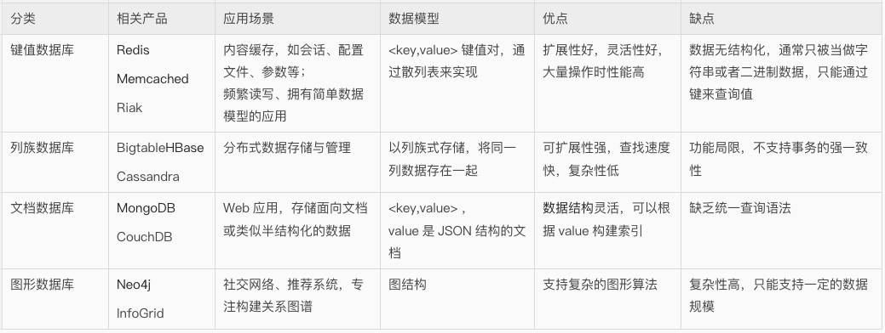

NoSQL 数据库并没有一个统一的架构，两种不同的 NoSQL 数据库之间的差异程度，远远超过两种关系型数据库之间的不同。

可以说，NoSQL 数据库各有所长，一个优秀的 NoSQL 数据库必然特别适用于某些场合或者某些应用，在这些场合中会远远胜过关系型数据库和其他的 NoSQL 数据库。

### 1.3.1 键值数据库

这一类数据库主要会使用到一个散列表，这个表中有一个特定的键和一个指针指向特定的数据。

键值模型的优势在于简单、易部署。键值数据库可以按照键对数据进行定位，还可以通过对键进行排序和分区，以实现更快速的数据定位。

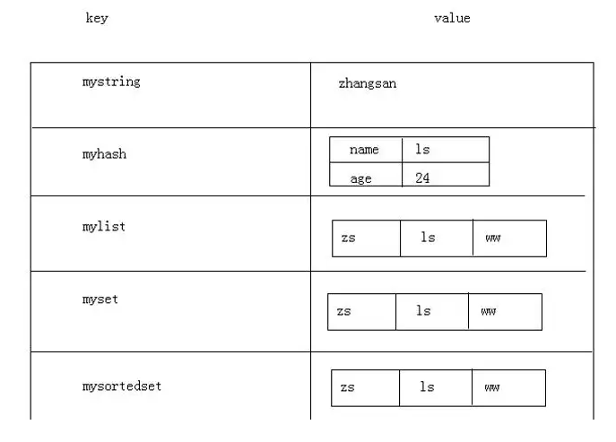

### 1.3.2 列族数据库

列族数据库通常用来应对分布式存储的海量数据。键仍然存在，但是它们的特点是指向了多个列，如图所示。

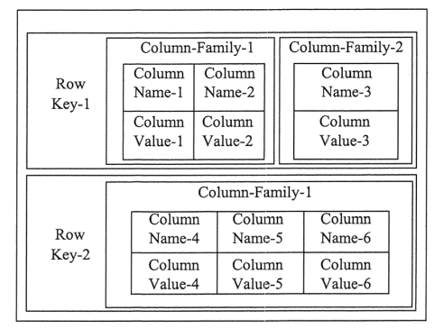

### 1.3.3 文档数据库

文档数据库与键值数据库类似。该类型的数据模型是版本化的文档，文档以特定的格式存储，如 JSON。

文档数据库可以看作键值数据库的升级版，允许键值之间嵌套。

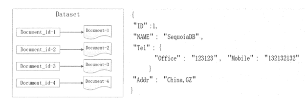

文档数据库比键值数据库的查询能力更强，因为文档数据库不仅可以根据键创建索引，同时还可以根据文档内容创建索引。

### 1.3.4 图形数据库

图形数据库来源于图论中的拓扑学，以节点、边及节点之间的关系来存储复杂网络中的数据。

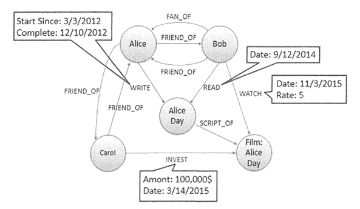

这种拓扑结构类似 E-R 图，但在图形模式中，关系和节点本身就是数据，而在 E-R 图中，关系描述的是一种结构。

# 2 MongoDB 是什么

MongoDB 是流行的 NoSQL 解决方案之一，是一种源码公开的**面向文档**的数据存储系统。需要注意的是，MongoDB 社区版的许可证自 2018 年 10 月起由 AGPL v3 改为 SSPL（Server Side Public License），SSPL 未被 OSI 认定为开源许可证，因此严格来说它已不再是传统意义上的“开源”数据库。

MongoDB 的名字来自英文单词 `Humongous`，中文含义是“庞大”，即命名者的意图是可以处理大规模的数据。

[DB-Engines](https://db-engines.com/en/ranking) 是全球知名的数据库流行度排行榜网站，排名每月更新一次。

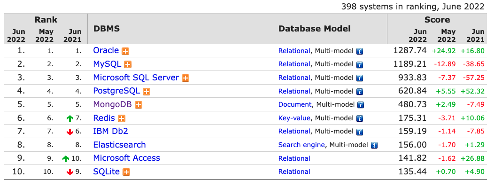

可以看到，MongoDB 长期稳居前五名，而排在它前面的是 Oracle、MySQL、SQL Server、PostgreSQL 这些传统的关系型数据库。也就是说，MongoDB 是全球范围内最受欢迎的 NoSQL 数据库，连 Redis 都难以与其争锋。

另外，MongoDB 的社区一直比较活跃，加上商业上的驱动（MongoDB 公司于 2017 年在纳斯达克上市），这些因素都推动了该数据库的发展。

# 3 MongoDB 的数据模型

MongoDB 在概念模型上参考了 SQL 数据库，但并非完全相同。关于这点，也有人说，**MongoDB 是 NoSQL 中最像 SQL 的数据库**。

在传统的关系型数据库中，数据以表的形式存放，而在 MongoDB 中，数据以文档的形式存在。

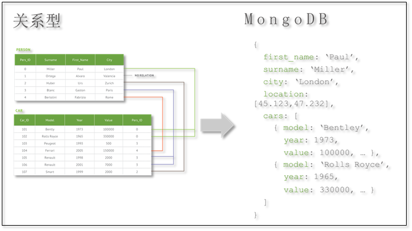

MongoDB 与关系型数据库的模型对应关系如下：

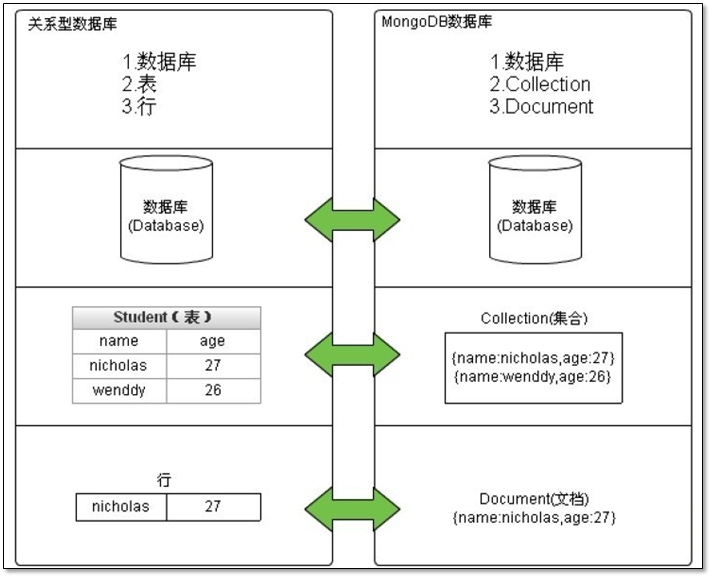

- **Database**：与 SQL 的数据库（database）概念相同，一个数据库包含多个集合（表）。
- **Collection**：相当于 SQL 中的表（table），一个集合可以存放多个文档（行）。不同之处在于集合的结构（schema）是动态的，不需要预先声明一个严格的表结构。更重要的是，默认情况下 MongoDB 并不会对写入的数据做任何 schema 的校验（3.6 起可以通过 `$jsonSchema` 按需开启 Schema 校验）。
- **Document**：相当于 SQL 中的行（row），一个文档由多个字段（列）组成，并采用 BSON（类 JSON）格式表示，单个文档大小上限为 16MB。
- **Field**：相当于 SQL 中的列（column），差别在于 Field 的类型可以更加灵活，比如支持嵌套的文档、数组。

此外，MongoDB 中字段的值区分类型、字段名区分大小写，并且文档中的字段是有序的。

另外，SQL 还有一些其他的概念，对应关系如下：

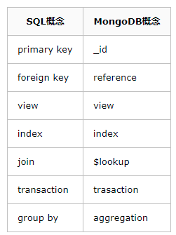

- **_id**：MongoDB 默认使用一个 `_id` 字段来保证文档的唯一性。
- **reference**：勉强可以对应于外键（foreign key）的概念，之所以是勉强，是因为 reference 并没有实现任何外键的约束，而只是由客户端（driver）进行关联查询、转换的一个特殊类型。
- **view**：MongoDB 3.4 开始支持视图，视图是基于集合之上通过聚合管道进行动态查询的一层只读对象，本身不存储数据；如果需要物化视图，可以在 4.2 起借助 `$merge` 实现按需物化视图（On-Demand Materialized View）。
- **index**：与 SQL 的索引相同。
- **$lookup**：这是一个聚合操作符，可以用于实现类似 SQL JOIN 连接的功能。
- **transaction**：从 MongoDB 4.0 版本开始支持副本集上的多文档事务，4.2 起进一步支持分片集群上的分布式事务。
- **aggregation**：MongoDB 提供了强大的聚合计算框架，GROUP BY 是其中的一类聚合操作。

从底层存储来讲，每个 Document 都是一个类 JSON 结构的 **BSON**（Binary JSON）。

BSON 是 MongoDB 首创的一种二进制存储格式，数据组织和访问方式与 JSON 基本一致，支持动态地添加字段、支持内嵌对象和数组对象。同时它也对 JSON 做了一些扩充，如支持 Date 和 BinData 数据类型。

因此，**BSON 实际上是一种扩展式的 JSON**。

除了文档模型本身，对于数据的操作命令也是基于 JSON/BSON 格式的语法。下面的命令在 MongoDB Shell `mongosh` 中执行（旧版 `mongo` Shell 已在 6.0 中移除），并使用当前推荐的 CRUD 方法（旧的 `insert()`、`update()`、`remove()` 等方法已弃用）。

比如插入文档的操作（插入多条使用 `insertMany()`）：

```javascript
db.book.insertOne(
{
  title: "My first blog post",
  published: new Date(),
  tags: [ "NoSQL", "MongoDB" ],
  type: "Work",
  author : "James",
  viewCount: 25,
  commentCount: 2
}
)
```

执行文档查找：

```javascript
db.book.find({author : "James"})
```

更新文档的命令（更新多条使用 `updateMany()`）：

```javascript
db.book.updateOne(
   {"_id" : ObjectId("5c61301c15338f68639e6802")},
   {"$inc": {"viewCount": 3} }
)
```

删除文档的命令（删除多条使用 `deleteMany()`）：

```javascript
db.book.deleteOne({"_id":
     ObjectId("5c612b2f15338f68639e67d5")})
```

在传统的 SQL 语法中，可以限定返回的字段，MongoDB 可以使用 Projection 来表示：

```javascript
db.book.find({"author": "James"},
    {"_id": 1, "title": 1, "author": 1})
```

实现简单的分页查询：

```javascript
db.book.find({})
    .sort({"viewCount" : -1})
    .skip(10).limit(5)
```

这种基于 BSON/JSON 的语法格式并不复杂，它的表达能力或许要比 SQL 更加强大。与 MongoDB 做法类似的还有 Elasticsearch，后者是搜索数据库的佼佼者。

# 4 MongoDB 的特性

MongoDB 的三大核心特性是：

- **No Schema**：MongoDB 没有固定的 Schema，少了很多约束条件，可以让数据的存储结构更灵活，存储速度更快。
- **高可用**：MongoDB 能将数据分布在多台机器上实现冗余，同时检测主节点是否存活，当主节点失效时能自动将从节点提升为主节点，达到自动故障转移的目的。
- **分布式**（可水平扩展）：MongoDB 使用分片技术对数据进行扩展，能自动分片、自动迁移分片里面的数据块，让每一个服务器里面存储的数据量大致均衡。

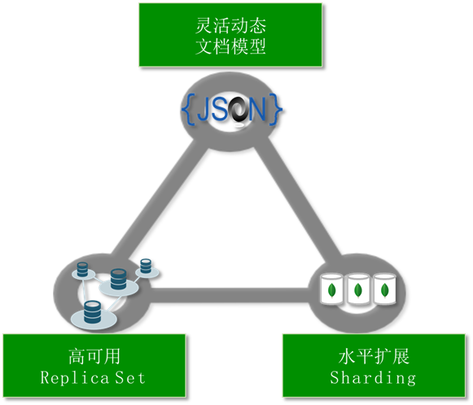

除了上图所示，MongoDB 还支持数据压缩、二级索引、全文搜索、地理分布等一系列强大的功能。较新的版本还陆续加入了时间序列集合（5.0）、可查询加密 Queryable Encryption（7.0 正式发布）等能力。

# 5 MongoDB 的适用场景

从目前阿里云 MongoDB 云数据库上的用户看，MongoDB 的应用已经渗透到各个领域，比如游戏、物流、电商、内容管理、社交、物联网、视频直播等，以下是几个实际的应用案例。

- **游戏场景**：使用 MongoDB 存储游戏用户信息，用户的装备、积分等直接以内嵌文档的形式存储，方便查询、更新。
- **物流场景**：使用 MongoDB 存储订单信息，订单状态在运送过程中会不断更新，以 MongoDB 内嵌数组的形式来存储，一次查询就能将订单所有的变更读取出来。
- **社交场景**：使用 MongoDB 存储用户信息，以及用户发表的朋友圈信息，通过地理位置索引实现附近的人、地点等功能。
- **物联网场景**：使用 MongoDB 存储所有接入的智能设备信息，以及设备汇报的日志信息，并对这些信息进行多维度的分析。
- **视频直播**：使用 MongoDB 存储用户信息、礼物信息等。

到底该不该使用 MongoDB，下面的几道选择题可以辅助决策（来自 MongoDB 公司的技术分享）：

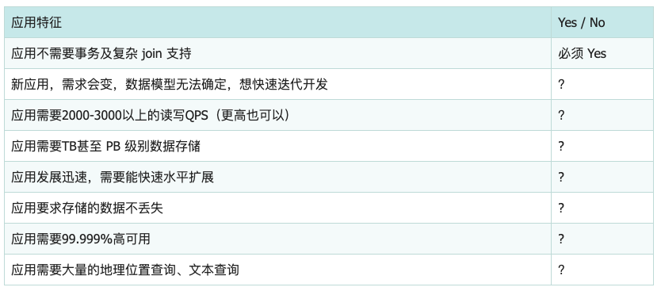

如果上述有 1 个 Yes，可以考虑 MongoDB；有 2 个及以上的 Yes，选择 MongoDB 绝不会后悔。

当然，MongoDB 也有自身的局限性，以下是 MongoDB 不适用的场景：

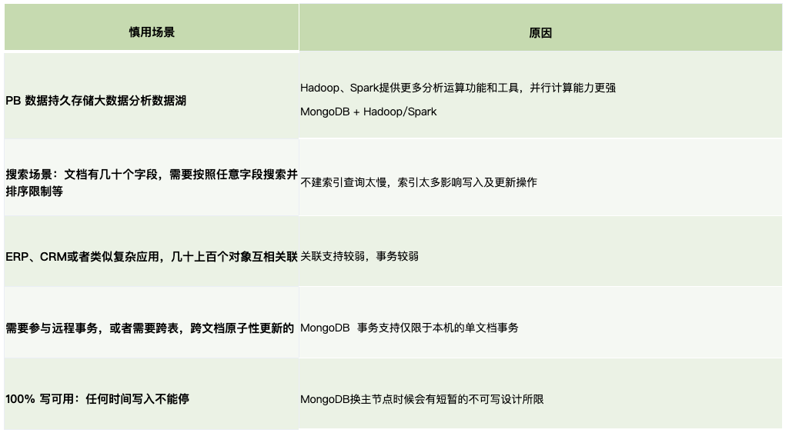

总的来说，MongoDB 以灵活的文档模型、副本集高可用和分片水平扩展见长，适合数据结构多变、数据量大、读写并发高的业务；而对强关系、复杂多表关联和传统报表分析类业务，关系型数据库依然是更稳妥的选择。
