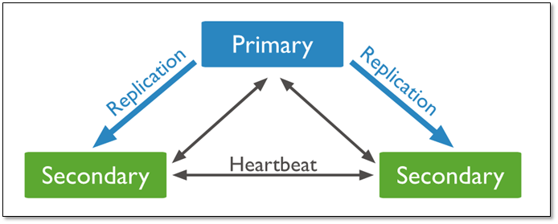
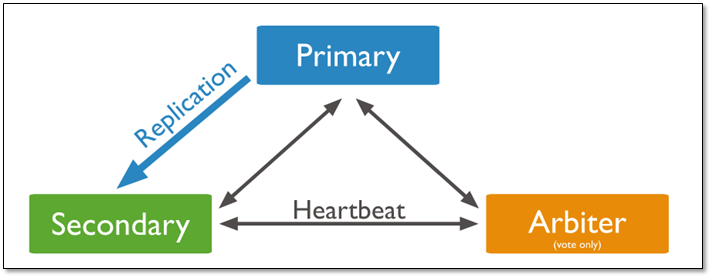
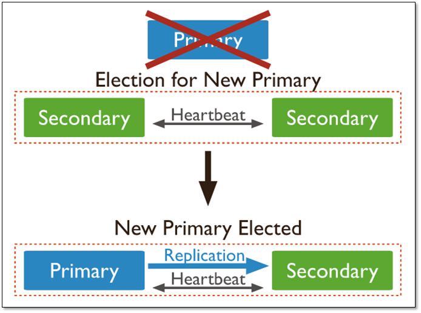
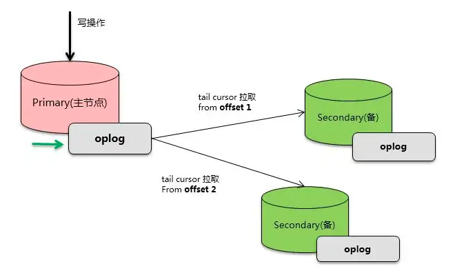
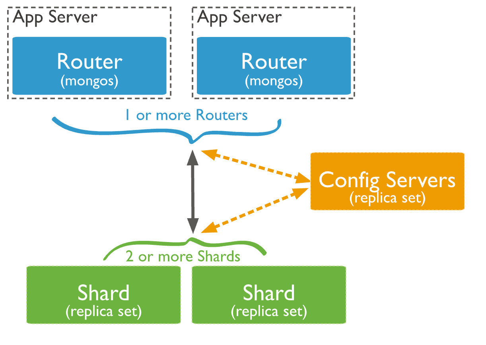
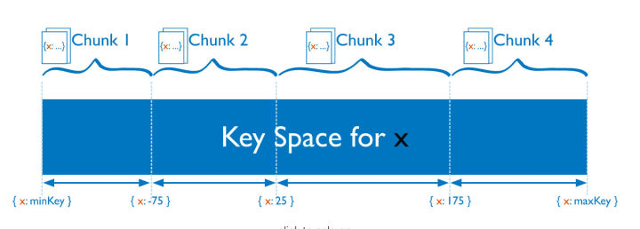
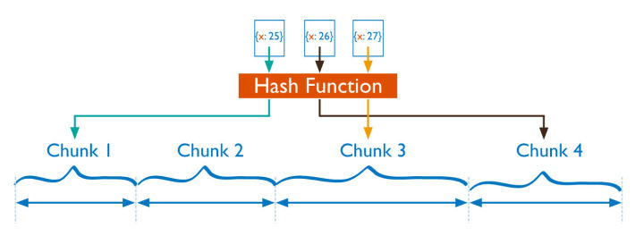
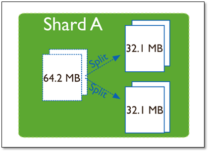
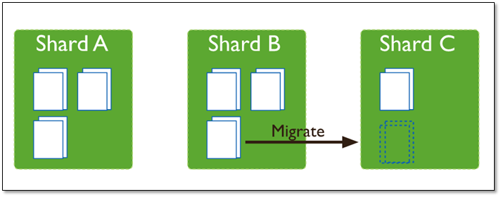

# MongoDB 集群

# 1 副本集

## 1.1 典型架构

MongoDB 高可用的基础是**副本集**（Replica Set），**副本集本质上就是一份数据存多份**，**保证数据在生产部署时的冗余和可靠性**。早期版本中的主从复制（Master-Slave）已在 4.0 中移除，目前官方只推荐使用副本集。

利用副本集可以实现：

- **高可用**：通过在不同的机器上保存副本来保证数据不会因为单点损坏而丢失，主节点宕机后，由备节点自动选举成为新的主节点。
- **读写分离**：通过读偏好（Read Preference）设置，读请求可以分流到备节点，减轻主节点的单点压力（代价是可能读到稍旧的数据）。而且，由不同的服务器为不同的用户提供服务，提高整个系统的负载能力。

副本集的典型架构有以下三种角色：

- **一个主节点（Primary）**：负责整个集群的写操作入口，主节点宕机之后会自动选出新的主节点。
- **一个或多个从节点（Secondary）**：一般是 2 个或以上，从主节点同步数据，在主节点宕机之后参与选举，并可能被选为新的主节点。
- **零个或 1 个仲裁节点（Arbiter）**：这个是为了节约资源或者多机房容灾用，只负责在主节点选举时投票，不存数据，保证能有节点获得多数赞成票。

从上面的节点类型可以看出，一个三节点的副本集可能是 PSS 或者 PSA 结构。

PSS 架构：

PSA 架构：

PSA 结构的优点是节约成本，但是缺点是 Primary 宕机之后，依赖 majority（多数）特性的功能（如 `w: "majority"` 写关注、majority 读关注）会出现问题，因此官方一般不建议使用 Arbiter，生产环境优先选择 PSS 架构。

在 PSS 架构中，当主节点宕机后，两个从节点都会参与竞选，其中一个变为主节点，当原主节点恢复后，作为从节点重新加入当前的副本集即可。

副本集中的每个节点都会定时向其他节点发送**心跳**（heartbeat），以此来感知其他节点的变化，比如是否失效，或者角色发生了变化。

默认情况下，节点会每 2 秒向其他节点发出心跳，这其中包括了主节点。如果备节点在 10 秒内（`electionTimeoutMillis`，默认 10000 毫秒）没有收到主节点的响应，就会主动发起选举。

MongoDB 副本集使用基于 **Raft 算法**的选举协议（Protocol Version 1，即 pv1）来完成主节点的选举，旧的 pv0 协议已在 4.0 中移除。整个过程对于上层是透明的，应用并不需要感知，因为驱动程序（分片集群中则是 `mongos`）会自动发现这些变化。

## 1.2 主从同步

### 1.2.1 Oplog

MongoDB 的主从同步机制是确保数据一致性和可靠性的重要机制。其同步的基础是 **Oplog**，类似 MySQL 的 Binlog。

在每一个副本集的节点中，都会存在一个名为 `local.oplog.rs` 的特殊集合。当 Primary 上的写操作完成后，会向该集合中写入一条 Oplog，而 Secondary 则持续从 Primary 拉取新的 Oplog 并在本地进行回放，以达到同步的目的。

MongoDB 对于 Oplog 的设计是比较仔细的，比如：

- Oplog 必须保证有序，通过 optime 来保证。
- Oplog 必须包含能够进行数据回放的完整信息。
- Oplog 必须是幂等的，即多次回放同一条日志产生的结果相同。
- Oplog 集合是固定大小的，为了避免对空间占用太大，旧的 Oplog 记录会被滚动式地清理。

主从同步的本质实际上就是，Primary 节点接收客户端请求，将更新操作写到 Oplog，然后 Secondary 从同步源拉取 Oplog 并在本地回放，实现数据的同步。

### 1.2.2 Checkpoint

MongoDB（WiredTiger 存储引擎）的写操作首先写入内存和日志（Journal/Oplog），并不会立即将数据文件持久化，**Checkpoint 就是将内存变更刷新到磁盘持久化的过程**。MongoDB 默认每 60 秒将内存中的变更刷盘一次，并记录当前持久化点（checkpoint），以便数据库在重启后能快速恢复数据。

MongoDB 宕机重启之后，可以通过 checkpoint 快速恢复到最近一次 checkpoint 时的数据状态。

最后一个 checkpoint 到宕机期间的数据，可以通过 Journal 和 Oplog 回放恢复。

Journal（Oplog 的写入同样依赖 Journal 持久化）默认每 100 毫秒刷盘一次（`storage.journal.commitIntervalMs`），**因此在极端情况下至多会丢失约 100 毫秒的数据**（可以通过写关注 WriteConcern 的 `j: true` 参数保证写入 Journal 后再返回，从而不丢失，只是性能会受影响，适合可靠性要求非常严格的场景）。

如果写数据时开启了**多数写**（`w: "majority"`，5.0 起已是大多数部署的默认写关注），已确认的写入已经同步到多数节点，即使 Primary 宕机，新选出的主节点上也会保有这些数据，不会被回滚。

# 2 分片

水平扩展是 MongoDB 的另一个核心特性，它是 MongoDB 支持海量数据存储的基础。MongoDB 天然的分布式特性使得它几乎可以无限地横向扩展。

尽管分片起源于关系型数据库分区，但 MongoDB 的分片完全是另一回事。和 MySQL 分区方案相比，MongoDB 的最大区别在于它几乎能自动完成所有事情，只要告诉 MongoDB 要分配数据，它就能自动维护数据在不同服务器之间的均衡。

## 2.1 分片集群

MongoDB 的分片集群由如下三个部分组成：

**mongos**：路由服务，不存具体数据，从 Config Server 获取集群配置，将请求转发到特定的分片，并且整合分片结果返回给客户端。

**Config Server**：保存集群的元数据（metadata），包含各个 Shard 的路由规则，配置服务器由一个副本集（Replica Set）组成（3.4 起必须部署为副本集，早期三台镜像服务器的 SCCC 方式已被移除）。

**Shard**：用于存储真正的集群数据，可以是一个单独的 `mongod` 实例，也可以是一个副本集。生产环境下 Shard 一般是一个 Replica Set，以防止该数据片的单点故障。

## 2.2 分片算法

**分片集群上的数据管理单元叫 chunk**，一个 chunk 默认 128MB（6.0 之前默认为 64MB）。

`mongos` 在操作分片集合时，会自动根据分片键找到对应的 chunk，并向该 chunk 所在的分片发起操作请求。

数据是根据分片策略来进行切分的，而分片策略则由**分片键**（Shard Key）+ **分片算法**（Shard Strategy）组成。

分片键就是在集合中选一个键，用该键的值作为数据拆分的依据，所以一个好的分片键对分片至关重要。**分片键必须有对应的索引支持**。早期版本中分片键一经选定便无法修改，4.4 起可以通过 `refineCollectionShardKey` 为分片键追加后缀字段，5.0 起更是支持通过 `reshardCollection` 在线重新分片。

MongoDB 支持两种分片算法：区间分片与哈希分片。

### 2.2.1 区间分片

如上图所示，假设集合根据 x 字段来分片，x 的取值范围为 `[minKey, maxKey]`（x 为整型，这里的 minKey、maxKey 为整型的最小值和最大值），将整个取值范围划分为多个 chunk，每个 chunk 包含其中一小段的数据：

如 Chunk1 包含 x 的取值在 `[minKey, -75)` 的所有文档，而 Chunk2 包含 x 取值在 `[-75, 25)` 之间的所有文档……

区间分片（Ranged Sharding，也称范围分片）能很好地满足范围查询的需求，比如想查询 x 的值在 `[-30, 10]` 之间的所有文档，这时 `mongos` 直接能将请求路由到 Chunk2，就能查询出所有符合条件的文档。区间分片的缺点在于，如果分片键有明显递增（或者递减）趋势，则新插入的文档多会分布到同一个 chunk，无法扩展写的能力。比如使用 `_id` 作为分片键，而 MongoDB 自动生成的 ObjectId 高位是时间戳，是持续递增的。

### 2.2.2 哈希分片

哈希分片（Hashed Sharding）是根据用户的分片键先计算出哈希值（64 位整型），再根据哈希值按照区间分片的策略将文档分布到不同的 chunk。

由于哈希值的分布近似随机，因此哈希分片具有很好的离散性，可以将数据随机分发到不同的 chunk 上。哈希分片可以充分地扩展写能力，弥补了区间分片的不足，但不能高效地服务范围查询，所有的范围查询要查询多个 chunk 才能找出满足条件的文档。

## 2.3 自动均衡

MongoDB 的分片集群有个非常重要的特性，就是数据的**自动均衡**。

早期版本中，当一个 chunk 的大小超过配置中的 chunk size 时，MongoDB 的后台进程会把这个 chunk 切分成更小的 chunk（6.0.3 起不再自动拆分，改为由均衡器在需要迁移时按需拆分）。

早期版本中，MongoDB 在运行时会自动检测不同分片上的 chunk 数，当发现最多和最少的差异超过阈值时，就会启动均衡（balance），通过 chunk 迁移使得每个分片上的 chunk 数差不多。6.0.3 起，均衡器改为依据各分片上集合的**数据量**而非 chunk 数来判断是否需要迁移。

MongoDB 的均衡器（Balancer）运行于 Primary Config Server（配置服务器的主节点）上，而该节点也同时会控制 chunk 数据的迁移流程。

总的来说，副本集解决了 MongoDB 的高可用问题，分片集群解决了水平扩展问题，生产环境中通常将二者结合使用：每个 Shard 和 Config Server 都部署为副本集，再由 `mongos` 统一对外提供服务。
