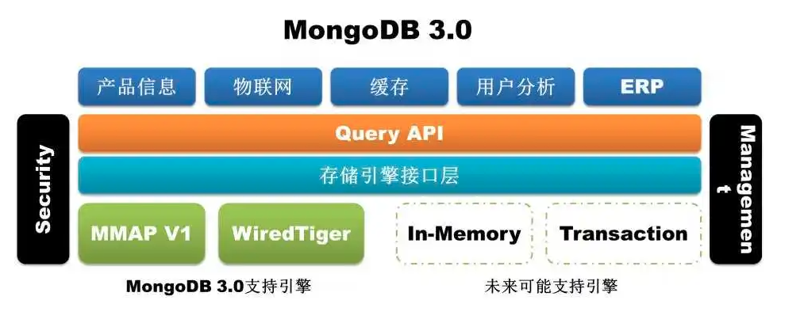
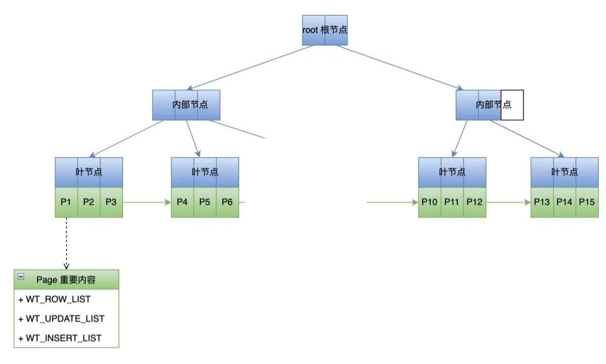
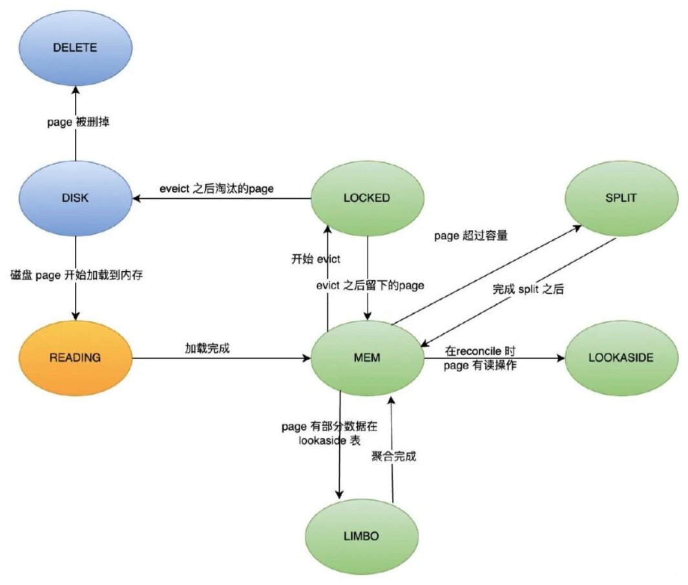
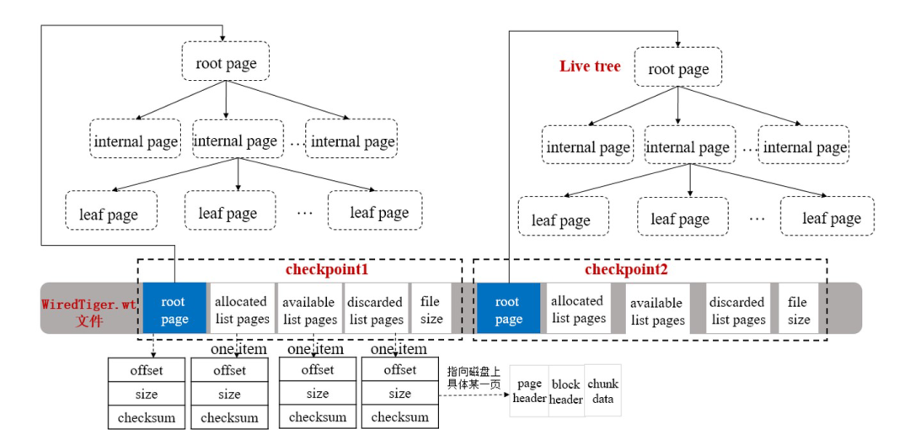
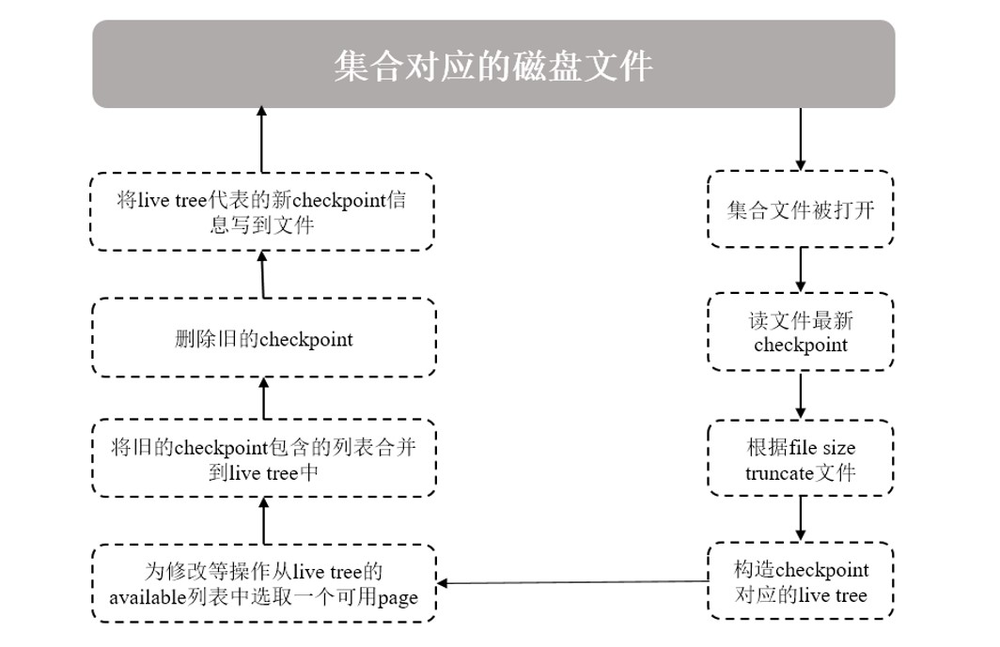
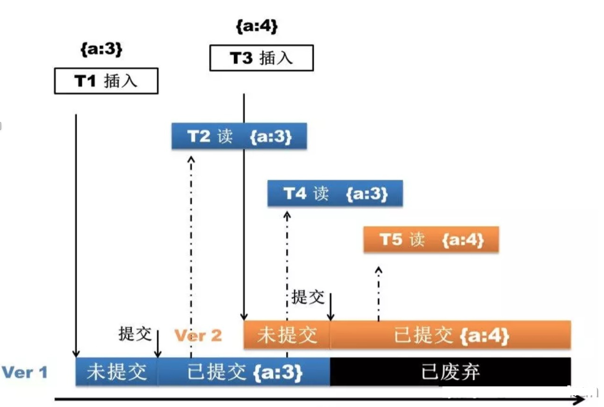

# MongoDB 存储引擎

从 MongoDB 3.2 版本开始，**WiredTiger** 成为 MongoDB 默认存储引擎。早期默认的 MMAPv1 引擎已在 4.0 中被弃用、4.2 中被移除；此外 MongoDB 企业版还提供基于内存的 In-Memory 存储引擎。

存储引擎要做的事情无外乎是将磁盘上的数据读到内存并返回给应用，或者将应用修改的数据由内存写到磁盘上。如何设计一种高效的数据结构和算法是所有存储引擎要考虑的根本问题，目前大多数流行的存储引擎是基于 **B+Tree** 或 **LSM**（Log Structured Merge）Tree 这两种数据结构来设计的。

像 Oracle、SQL Server、DB2、MySQL（InnoDB）和 PostgreSQL 这些传统的关系数据库依赖的底层存储引擎是基于 B+Tree 开发的；而像 Cassandra、Elasticsearch（Lucene）、Google Bigtable、Apache HBase、LevelDB 和 RocksDB 这些当前比较流行的 NoSQL 数据库存储引擎是基于 LSM 开发的。当然有些数据库采用了插件式的存储引擎架构，实现了 Server 层和存储引擎层的解耦，可以支持多种存储引擎，如 MySQL 既可以支持 B+Tree 结构的 InnoDB 存储引擎，还可以支持 LSM 结构的 RocksDB 存储引擎。

# 1 数据结构

WiredTiger 在内存和磁盘上的数据结构都是 B+Tree，B+Tree 的特点是中间节点只有索引，数据都存在叶子节点。**WiredTiger 管理数据结构的基本单元是 Page**。

上图是 Page 在内存中的数据结构，是一个典型的 B+Tree，从上往下依次为 **Root 节点**、**内部节点**和**叶子节点**，每个节点就是一个 Page，数据以 Page 为单位在内存和磁盘间进行调度，每个 Page 的大小决定了相应节点的分支数量，每条索引记录会包含一个数据指针，指向一条数据记录所在文件的偏移量。

如上图，假设每个节点 100 个分支，那么所有叶子节点合起来可以包含 100 万个键值（等于 `100 * 100 * 100`）。通常情况下 Root 节点和内部节点的 Page 会驻留在内存中，所以查找一条数据可能只需 2 次磁盘 I/O。但随着数据不断地插入、删除，会涉及 B+Tree 节点的分裂、位置提升及合并等操作，因此维护一个 B+Tree 的平衡也是比较耗时的。

叶子 Page 上有 3 个重要的列表：

- **WT_ROW**：是从磁盘加载进来的数据数组。
- **WT_UPDATE**：是记录数据加载之后到下个 checkpoint 之间被修改的数据。
- **WT_INSERT**：是记录数据加载之后到下个 checkpoint 之间新增的数据。

上面说了 Page 的基本结构，接下来再看下 Page 的生命周期和状态流转，这个生命周期和 WiredTiger 的缓存息息相关。

Page 在磁盘和内存中的整个生命周期状态机如上图：

- **DISK**：初始状态，Page 在磁盘上的状态，必须被读到内存后才能使用，当 Page 被 evict 后，状态也会被设置为这个。
- **DELETE**：Page 在磁盘上，但是已经从内存 B+Tree 上删除，当我们不再需要读某个 leaf page 时，可以将其删除。
- **READING**：Page 正在被某个线程从磁盘读到内存，其他的读线程等待它被读完，不需要重复去读。
- **MEM**：Page 在内存中，且能正常读写。
- **LOCKED**：当 Page 被 evict 时，会将 Page 锁住，其他线程不可访问。
- **LOOKASIDE**：在执行 reconcile 的时候，如果 Page 正在被其他线程读取被修改的部分，这个时候会把数据存储在 lookaside table 里面。当页面再次被读时可以通过 lookaside table 重构出内存 Page。
- **LIMBO**：在执行完 reconcile 之后，Page 会被刷到磁盘。这个时候如果 Page 有 lookaside table 数据，并且还没合并过来之前就又被加载到内存了，就会是这个状态，需要先从 lookaside table 重构内存 Page 才能正常访问。
- **SPLIT**：当 Page 变得过大时，会被 split，原来指向的 Page 不再被使用。

注意：LOOKASIDE 和 LIMBO 两个状态依赖于 MongoDB 4.2 及之前版本的 lookaside table 机制。4.4 起 WiredTiger 改用历史存储（History Store，对应文件 `WiredTigerHS.wt`）来保存数据的旧版本，lookaside table 及相关状态已被移除。

其中两个比较重要的过程是 **reconcile** 和 **evict**。

其中 reconcile 发生在 checkpoint（以及 evict 脏 Page）的时候，将内存中 Page 的修改转换成磁盘需要的 B+Tree 结构。前面说了 Page 的 WT_UPDATE 和 WT_INSERT 列表存储了数据被加载到内存之后的修改，类似一个内存级的 Oplog，而数据在磁盘中时显然不可能是这样的结构。因此 reconcile 会新建一个 Page 来将修改了的数据做整合，然后原 Page 就会被丢弃（discarded），新 Page 会被刷新到磁盘，同时加入 LRU 队列。

evict 是在内存不够用或者脏数据过多的时候触发的，根据 LRU 规则将内存 Page 淘汰到磁盘。

# 2 Checkpoint

MongoDB 的读写都是操作的内存，因此必须要有一定的机制将内存数据持久化到磁盘，这个功能就是由 WiredTiger 的 Checkpoint 来实现的。

总的来说，Checkpoint 主要有两个目的：

- 将内存里面发生修改的数据写到数据文件进行持久化保存，确保数据一致性。
- 在数据库某个时刻意外发生故障、再次启动时，缩短数据库的恢复时间。

本质上来说，Checkpoint 相当于一个日志，记录了上次 Checkpoint 后相关数据文件的变化。

一个 Checkpoint 包含的关键信息如下图所示：

一个 Checkpoint 就是一个内存 B+Tree，其结构就是前面提到的 Page 组成的树，它有几个重要的字段：

- **root page**：就是指向 B+Tree 的根节点。
- **allocated list pages**：上个 Checkpoint 结束之后到本 Checkpoint 结束前新分配的 Page 列表。
- **available list pages**：WiredTiger 分配了但是没有使用的 Page，新建 Page 时直接从这里取。
- **discarded list pages**：上个 Checkpoint 结束之后到本 Checkpoint 结束前被删掉的 Page 列表。

Checkpoint 是数据库中一个比较耗资源的操作，一个 Checkpoint 典型执行流程如下图所述：

1. 查询集合数据时，会打开集合对应的数据文件并读取其最新 Checkpoint 数据；
2. 集合文件会按 Checkpoint 信息指定的大小（file size）被 truncate 掉，所以系统发生意外故障，恢复时可能会丢失 Checkpoint 之后的数据（如果没有开启 Journal；6.1 起 Journal 始终开启，`--nojournal` 选项已被移除）；
3. 在内存构造一棵包含 root page 的 live tree，表示这是当前可以修改的 Checkpoint 结构，用来跟踪后面写操作引起的文件变化；其他历史的 Checkpoint 信息只能读，可以被删除；
4. 内存里面的 Page 随着增删改查被修改后，写入并需分配新的磁盘 Page 时，将会从 live tree 中的 available 列表中选取可用的 Page 供其使用。随后，这个新的 Page 被加入到 Checkpoint 的 allocated 列表中；
5. 如果一个 Checkpoint 被删除，它所包含的 allocated 和 discarded 两个列表信息将被合并到最新 Checkpoint 的对应列表上；任何不再需要的磁盘 Page，也会将其引用添加到 live tree 的 available 列表中；
6. 当新的 Checkpoint 生成时，会重新刷新其 allocated、available、discarded 三个列表中的信息，并计算此时集合文件的大小以及 root page 的位置、大小、checksum 等信息，将这些信息作为 Checkpoint 元信息写入文件；
7. 生成的 Checkpoint 默认名称为 `WiredTigerCheckpoint`，如果不明确指定其他名称，则新的 Checkpoint 将自动取代上一次生成的 Checkpoint。

触发 Checkpoint 执行，通常有如下几种情况：

- 按一定时间周期：默认 **60 秒**执行一次 Checkpoint；
- 按一定日志文件大小：早期版本（3.6 之前）中，当 Journal 日志写入量达到 2GB 时也会执行一次 Checkpoint，3.6 起只按时间周期触发；
- 任何打开的数据文件被修改，关闭时将自动执行一次 Checkpoint。

Checkpoint 是一个相当重量级的操作，当对集合文件执行 Checkpoint 时，会在文件上获得一个排他锁，其他需要等待此锁的操作，可能会出现 `EBUSY` 的错误。

# 3 预写日志

WiredTiger 采用预写日志（Write-Ahead Logging）的机制：在数据更新的时候，先将数据更新写入到日志文件，再由 Checkpoint 将内存中的数据刷新到数据文件。也就是说，通过预写日志和 Checkpoint 将数据更新持久化到数据文件中，实现数据的一致性。WiredTiger 日志文件会记录从上一次 Checkpoint 之后发生的所有数据更新，在 MongoDB 系统崩溃时，通过日志文件能够还原上次 Checkpoint 之后发生的数据更新。

Journal 是顺序写入的日志文件，用于记录上一个 Checkpoint 之后发生的数据更新，能够将数据库从系统异常终止事件中还原到一个有效的状态。在数据更新时，先将数据更新写入到 Journal 文件（默认每 100 毫秒刷盘一次）。

WiredTiger 创建 Checkpoint，能够将 MongoDB 数据库还原到上一个 Checkpoint 创建时的一致性状态。如果 MongoDB 在上一个 Checkpoint 之后异常终止，必须使用 Journal 日志文件，重做从上一个 Checkpoint 之后发生的数据更新操作，将数据还原到 Journal 记录的一致性状态。使用 Journal 日志还原的过程是：

1. 获取上一个 Checkpoint 创建的标识值：从数据文件（Data Files）中查找上一个 Checkpoint 发生的标识值（Identifier）；
2. 根据标识值匹配日志记录：从 Journal Files 中搜索日志记录（Record），查找匹配上一个 Checkpoint 的标识值的日志记录；
3. 重做日志记录：重做从上一个 Checkpoint 之后，记录在 Journal Files 中的所有日志记录。

# 4 多版本并发控制

WiredTiger 为写操作使用**文档级别的并发控制**。因此，多个客户端可以同时修改集合的不同文档。对于大多数读写操作，WiredTiger 使用乐观并发控制。

WiredTiger 的乐观锁机制与其他乐观锁实现机制大同小异，WiredTiger 会在更新 Document 前记住即将被更新的所有 Document 当前版本号，并在更新前再次验证当前的版本号。若当前版本号没有发生改变，则说明该 Document 在该原子事件中没有被其他请求更新，可以顺利写入，并且修改版本号；如果版本号发生改变，则说明该 Document 在更新发生之前已经被其他的请求更新，由此触发一次写冲突，不过在遇到写冲突之后，WiredTiger 会自动重试更新。

但是这不代表 WiredTiger 对所有操作都采用如此宽松的乐观锁机制，对于某些全局的操作，WiredTiger 依然会使用 Collection 级、Database 级甚至是 Instance 级的互斥锁机制，但是这样的全局操作实际上很少发生，通常只在 DBA 维护的时候才触发。

总的来说，WiredTiger 以 B+Tree 和 Page 作为数据组织的基础，借助 Checkpoint 与 Journal 预写日志保证数据持久化和崩溃恢复，再通过文档级并发控制提升并发写入能力，这也是它能取代 MMAPv1 成为 MongoDB 默认存储引擎的原因。
