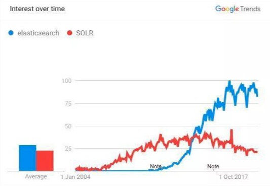
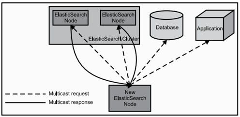
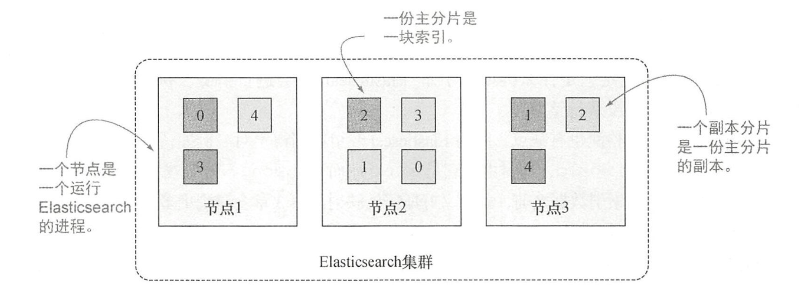
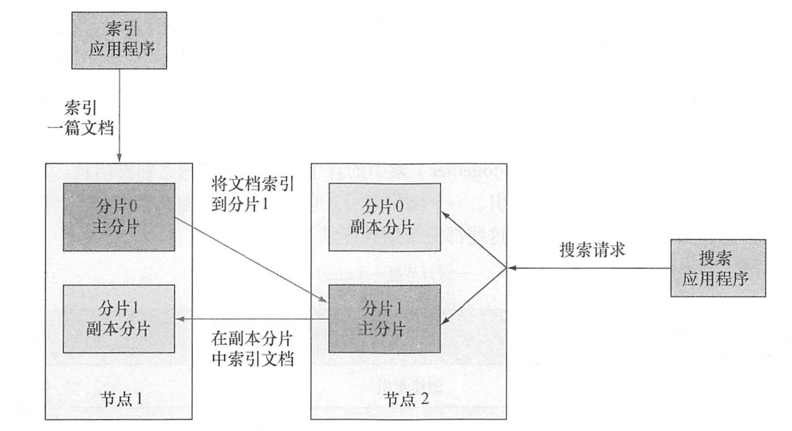

# Elasticsearch 引言

# 1 Elasticsearch 是什么

Elasticsearch（简称 ES）是一个分布式的开源搜索和分析引擎，在 *Apache Lucene* 的基础上开发而成。

Lucene 是开源的搜索引擎工具包，Elasticsearch 充分利用了 Lucene 并对其进行了扩展，使存储、索引、搜索都变得更快、更容易。而最重要的是，正如名字中的“elastic”所示，一切都是灵活、有弹性的。而且，应用代码也不是必须用 Java 书写才可以和 Elasticsearch 兼容，完全可以通过 JSON 格式的 HTTP 请求（REST API）来进行索引、搜索和管理 Elasticsearch 集群。

官方也为 Java、Python、Go、JavaScript 等主流语言提供了客户端。以 Java 为例，早期的 TransportClient 已在 8.0 移除，High Level REST Client 也在 7.15 弃用，目前推荐使用 Elasticsearch Java API Client。

需要注意的是，Elasticsearch 的许可证近年有过几次变化：2021 年 7.11 起由 Apache 2.0 改为 SSPL 与 Elastic License 双许可，AWS 随即基于 7.10.2 分叉出了 OpenSearch；2024 年 8.16 起又增加了 AGPLv3 许可选项，重新回归开源。截至 2026 年，Elasticsearch 的最新大版本为 9.x（9.0 于 2025 年发布，基于 Lucene 10），8.x 仍被广泛使用，本系列笔记的示例均以 7.x 及以上版本的语法为准。

如果你已经听说过 Lucene，那么可能也听说过 *Solr*，它也是开源的、基于 Lucene 的分布式搜索引擎，跟 Elasticsearch 有很多相似之处。



但是 Solr 诞生于 2004 年，而 Elasticsearch 诞生于 2010 年，Elasticsearch 凭借后发优势和更活跃的社区、更完备的生态系统，迅速反超 Solr，成为搜索市场的第二代霸主。

Elasticsearch 具有以下优势：

- **Elasticsearch 很快。** 由于 Elasticsearch 是在 Lucene 基础上构建而成的，所以在全文搜索方面表现十分出色。Elasticsearch 同时还是一个近实时的搜索平台，这意味着从文档索引操作到文档变为可搜索状态之间的延时很短，默认约为 1 秒（由 `refresh_interval` 控制）。因此，Elasticsearch 非常适用于对时效性有严苛要求的场景，例如安全分析和基础设施监测。
- **Elasticsearch 具有分布式的本质特征。** Elasticsearch 中存储的文档分布在不同的容器中，这些容器称为分片（Shard），分片可以进行复制以提供数据冗余副本，以防发生硬件故障。Elasticsearch 的分布式特性使得它可以扩展至数百台（甚至数千台）服务器，并处理 PB 量级的数据。
- **Elasticsearch 包含一系列广泛的功能。** 除了速度、可扩展性和弹性等优势以外，Elasticsearch 还有大量强大的内置功能（例如数据汇总和索引生命周期管理），可以帮助用户更加高效地存储和搜索数据。新版本还内置了向量检索（kNN）和语义搜索能力，常用于 AI 应用中的 RAG 检索场景。
- **Elastic Stack 简化了数据采集、可视化和报告过程。** 人们通常将 Elastic Stack 称为 *ELK Stack*（代指 *Elasticsearch*、*Logstash* 和 *Kibana*），后来 Elastic Stack 又加入了一系列轻量型数据采集代理，统称为 *Beats*，可用来向 Elasticsearch 发送数据（新版本中官方更推荐使用统一的 Elastic Agent）。通过与 Beats 和 Logstash 进行集成，用户能够在向 Elasticsearch 中索引数据之前轻松地处理数据。此外，Kibana 不仅可针对 Elasticsearch 数据提供实时可视化，还提供 UI 以便用户快速访问应用程序性能监测（APM）、日志和基础设施指标等数据。

# 2 逻辑结构

## 2.1 Document

Elasticsearch 是面向文档（Document）的，这意味着**索引和搜索数据的最小单位是文档**。

一个文档通常以 JSON 格式来表示。例如，一项技术大会的活动可以通过如下文档表达：

```json
{
    "name":"Elasticsearch技术峰会",
    "organizer":"冰河",
    "location":"中国，浙江，杭州"
}
```

一个文档中包含多个**字段**（Field），每个字段存储一项数据。

可以把文档类比为关系型数据库中包含若干列值的一行，但这样的类比不够精准，二者还是有所差别。一个区别是，与行不同，文档可以是层次型的。例如，位置可以包含地址和邮编：

```json
{
    "name":"Elasticsearch技术峰会",
    "organizer":"冰河",
    "location":{
        "address":"中国，浙江，杭州",
        "postcode":"310000"
    }
}
```

一篇单独的文档也可以包含一组数值，例如：

```json
{
    "name":"Elasticsearch技术峰会",
    "organizer":"冰河",
    "member":[
        "洪七公",
        "黄药师",
        "欧阳锋",
        "一灯"
    ]
}
```

## 2.2 Type

类型（Type）是早期版本中文档的逻辑容器，类似于表格是行的容器，不同结构的文档最好放入不同的类型中。不过 Type 已经被逐步淘汰：6.x 中一个索引只允许有一个 Type，7.0 起弃用（API 中统一用 `_doc` 作为占位），8.0 起彻底移除，原因见 2.4 节。

字段的定义称为**映射**（Mapping）。早期映射定义在 Type 上，移除 Type 之后映射直接属于索引。例如，一个人的姓名可以映射为 `text` 或 `keyword`，年龄可以映射为 `integer`（5.0 之前字符串统一为 `string` 类型，之后拆分为 `text` 和 `keyword`）。

映射包含索引中所有文档的所有字段，但并不是每篇文档都必须包含所有字段。同样，如果一篇新索引的文档拥有映射中尚不存在的字段，Elasticsearch 会自动将新字段加入映射。为了添加这个字段，Elasticsearch 必须确定它的类型，于是会进行猜测。例如，如果值是 7，Elasticsearch 会假设字段是长整型（`long`）。

这种新字段的自动检测也有缺点，因为 Elasticsearch 可能猜得不对。例如，在索引了值 7 之后，你可能想再索引 `hello world`，这时由于它是字符串而不是 `long`，索引就会失败。对于线上环境，一般在索引数据之前都会定义好所需的映射，并通过 `"dynamic": "strict"` 禁止动态添加字段。

## 2.3 Index

索引（Index）是文档的容器，是独立的大量文档的集合。早期一个索引下可以包含多个 Type，因此常被类比为关系型数据库中的“库”；移除 Type 之后，它的定位更接近关系型数据库中的“表”。每个索引由一个或多个分片组成，存储了文档数据、映射，以及分片数、副本数等设置。

## 2.4 与关系数据库的类比

| Elasticsearch | 关系数据库 |
| -------- | ---------- |
| Field    | Column     |
| Document | Row        |
| Index    | Table      |
| Mapping  | Schema     |
| Type     | 无（8.0 起已移除） |

需要特别注意的是：早期教程常把 Index 类比为 Database、Type 类比为 Table，这一类比已经过时。Elasticsearch 6 以前每个 Index 可以有多个 Type，**6.x 中一个 Index 仅能包含一个 Type，7.0 起弃用 Type，8.0 起彻底移除**。

为什么要移除 Type 呢？

我们一直拿 Elasticsearch 与关系数据库作类比，说“索引”和关系数据库的“库”是相似的，“类型”和“表”是对等的。实际上这是一个不太准确的对比。在关系型数据库里，“表”是相互独立的，一个“表”里的列和另外一个“表”里的同名列没有关系，互不影响。但在 Elasticsearch 中不是这样的。

在同一个 Index 下，不管有多少个 Type，底层共用同一套 Lucene 索引，也就是说，所有 Type 的同名字段在内部使用的是同一个 Lucene 字段存储，这就要求同名字段必须属于同一种数据类型。这可能导致一些问题，例如同一个索引下有两个结构不同的 Type，都拥有一个名为 `deleted` 的字段，如果期望它在一个 Type 里存储日期值，在另一个 Type 里存储布尔值，是做不到的。

还有一个更重要的原因：在同一个索引中存储仅有小部分字段相同或者全部字段都不相同的文档，会导致数据稀疏，影响 Lucene 有效压缩数据的能力。因此，现在的做法是把不同结构的数据放到不同的索引中。

# 3 物理结构

## 3.1 Node

一个节点（Node）就是一个 Elasticsearch 实例。在服务器上启动 Elasticsearch 之后，就拥有了一个节点；如果在另一台服务器上启动 Elasticsearch，就是另一个节点。甚至可以在一台服务器上启动多个 Elasticsearch 进程，即在一台服务器上拥有多个节点。多个节点可以加入同一个集群。

当 Elasticsearch 的节点启动后，它会寻找集群中的其他节点，并与之建立连接。早期版本默认使用多播（multicast）发现节点，过程如下图所示：



多播方式在 2.0 起不再默认使用（多播插件也已在 5.0 移除），现在节点通过 `discovery.seed_hosts` 配置的种子节点列表以单播方式发现彼此。此外，7.0 起原来的 Zen Discovery 被新的集群协调层取代，`discovery.zen.minimum_master_nodes` 参数已经移除，由集群自动维护选举所需的投票配置，新集群首次启动时只需通过 `cluster.initial_master_nodes` 指定初始的候选主节点即可。

节点主要有以下几种角色：

- **Master-eligible Node**：候选主节点，被选为主节点（Master）后负责管理集群范畴的变更，例如创建或删除索引、向集群添加或删除节点，以及决定将哪些分片分配给哪些节点。每个节点都保存了集群状态，但是只有 Master 节点才能修改集群状态。
- **Data Node**：保存包含索引文档的分片数据，执行 CRUD、搜索、聚合相关的操作，属于内存、CPU、I/O 密集型，对硬件资源要求高。新版本中还可以细分为 `data_content`、`data_hot`、`data_warm`、`data_cold`、`data_frozen` 等数据层（Data Tier）角色。
- **Coordinating Node**：搜索请求分两个阶段执行（query 和 fetch），由接收客户端请求的节点，即协调节点来协调。在 query 阶段，协调节点将请求转发到保存数据的数据节点，每个数据节点在本地执行查询，并把命中文档的 ID 和排序值返回给协调节点，由协调节点合并出全局结果；在 fetch 阶段，协调节点再向相关数据节点拉取所需的完整文档，汇集为最终结果集返回给客户端。每个节点默认都可以充当协调节点。
- **Ingest Node**：可以看作是数据前置处理转换的节点，支持设置 pipeline 管道，可以对数据进行过滤、转换等操作，类似于 Logstash 中 filter 的作用，功能相当强大。可以把 Ingest 节点的功能抽象为大数据处理环节的 ETL（抽取、转换、加载）。

7.9 起，节点角色统一通过 `node.roles` 参数配置（如 `node.roles: [ master, data ]`），取代了原来的 `node.master`、`node.data` 等布尔参数。

## 3.2 Shard

一个索引可以存储超出单个节点硬件限制的大量数据。比如，一个具有 10 亿文档的索引占据 1 TB 的磁盘空间，而任一节点都没有这么大的磁盘空间；或者单个节点处理搜索请求时响应太慢。

为了解决这个问题，Elasticsearch 提供了将索引划分成多份的能力，每一份就叫做**分片**（Shard）。创建索引时可以指定分片的数量。每个分片本身也是一个功能完善并且独立的 Lucene 索引，可以被放置到集群中的任何节点上。

基于分片可以进行分布式的、并行的操作，进而提高性能和吞吐量。至于分片如何分布、文档如何聚合回搜索请求，完全由 Elasticsearch 管理，对用户来说是透明的。

在网络或云环境中，故障随时都可能发生，某个分片或节点可能突然离线，或者由于某种原因消失。这种情况下，有一个故障转移机制是非常有用并且强烈推荐的。

为此，Elasticsearch 允许为分片创建一份或多份拷贝。一旦有了拷贝，每个索引就有了**主分片**（Primary Shard）和**副本分片**（Replica Shard）之分。

副本之所以重要，主要有两方面的原因：

- 容灾：主分片挂掉时，副本分片会被提升为新的主分片，同时集群会根据新的主分片创建新的副本，集群数据安然无恙。
- 提高查询性能：副本分片和主分片的数据是相同的，所以一个查询既可以查主分片也可以查副本分片，在合适的范围内，多个副本可以提升查询性能。另外，写入请求只能先在主分片上执行，再由主分片同步给副本分片，副本分片不能直接处理写入请求。

在索引创建之后，可以在任何时候动态地改变副本分片的数量，但是**不能直接改变主分片的数量**（如需调整，可以通过 `_split`、`_shrink` API 或 reindex 生成一个新索引）。

7.0 之前，Elasticsearch 中的每个索引默认分配 5 个主分片和 1 份副本；**7.0 起默认改为 1 个主分片和 1 份副本**。以旧默认值为例，如果集群中至少有两个节点，索引将会有 5 个主分片和另外 5 个副本分片，每个索引总共就有 10 个分片。一个索引的多个分片可以存放在集群中的一台主机上，也可以分布在多台主机上，这取决于集群的机器数量（但同一个分片的主分片和副本分片不会分配到同一个节点上）。主分片和副本分片的具体位置是由 Elasticsearch 内部的分配策略决定的。

下图是一个有 3 个节点、5 个主分片和 1 份副本的集群示意图：



默认情况下，当索引一篇文档的时候，系统首先根据文档 ID 的散列值选择一个主分片（简化来说就是 `shard = hash(_routing) % 主分片数`，`_routing` 默认为文档 ID，这也是主分片数不能随意修改的原因），并将文档发送到该主分片。这个主分片可能位于另一个节点，就像上图节点 2 上的主分片，不过对于应用程序来说这一点是透明的。

然后文档被发送到该主分片的所有副本分片进行索引，使得副本分片和主分片之间保持数据同步。数据同步使得副本分片可以服务于搜索请求，并在原有主分片无法访问时自动升级为主分片。



当搜索一个索引时，Elasticsearch 需要在该索引的完整分片集合中进行查找。这些分片可以是主分片，也可以是副本分片，原因是对应的主分片和副本分片通常包含一样的文档。Elasticsearch 在索引的主分片和副本分片之间对搜索请求进行负载均衡，使得副本分片对搜索性能和容错都有所帮助。

## 3.3 Cluster

集群（Cluster）由若干节点组成，这些节点在同一个网络内，且 `cluster.name` 相同。

8.0 起，新集群默认开启安全功能：首次启动时会自动生成 TLS 证书和内置用户 `elastic` 的密码，客户端需要通过 HTTPS 并使用用户名密码（或 API Key）访问集群。

Elasticsearch 的集群监控信息中包含了许多统计数据，其中最为重要的一项就是集群健康（可通过 `GET _cluster/health` 查看），它在 `status` 字段中展示为 `green`、`yellow` 或者 `red`。

- **Green**：所有主分片和副本分片都准备就绪（分配成功）。此时即使有一台机器挂了（假设一台机器一个实例），数据也不会丢失，但集群会变成 Yellow 状态。
- **Yellow**：所有主分片准备就绪，但至少有一个主分片（假设是 A）对应的副本分片没有就绪。此时集群处于警告状态，意味着集群的高可用和容灾能力下降，如果刚好 A 所在的机器挂了，并且只设置了一份副本（已处于未就绪状态），那么 A 的数据就会丢失（查询结果不完整），集群进入 Red 状态。
- **Red**：至少有一个主分片没有就绪（直接原因是找不到对应的副本分片来接替成为新的主分片），此时查询结果会出现数据缺失（不完整）。

# 4 小结

Elasticsearch 是基于 Lucene 的分布式搜索与分析引擎。逻辑上，数据以文档为单位存储在索引中，由映射定义字段结构（Type 已在 8.0 移除）；物理上，索引被拆分为主分片和副本分片，分布在集群的各个节点上，从而实现水平扩展和高可用。后续文章会依次介绍它的数据类型、查询、聚合以及索引与存储原理。
