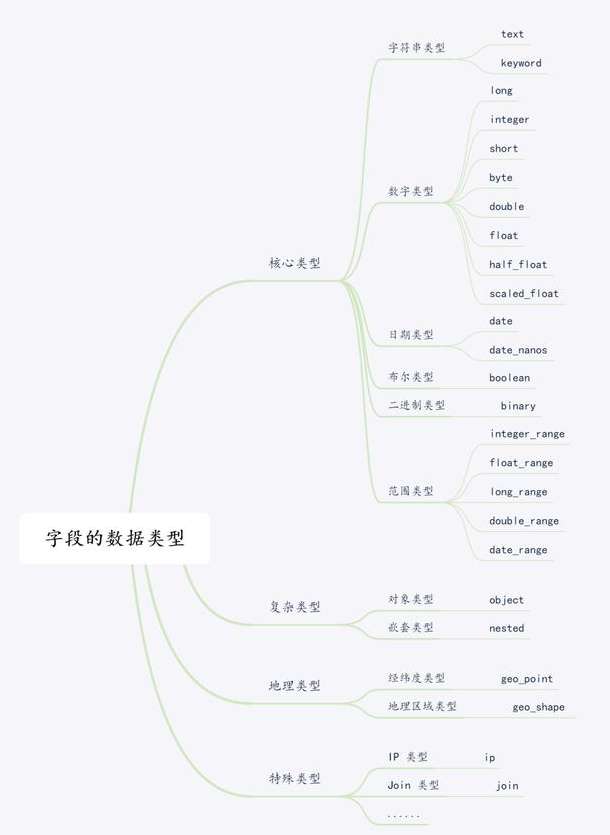

# Elasticsearch 数据类型

# 1 Mapping

## 1.1 Mapping 的作用

Elasticsearch（以下简称 ES）中的 Mapping（映射）类似于数据库中的表结构定义（Schema），它有以下几个作用：

- 定义索引中字段的名称。
- 定义字段的数据类型，比如字符串、数字、布尔等。
- 定义字段的属性，比如某个字段要不要被分词、要不要被索引等。

在 ES 早期版本中，一个索引下可以有多个 Type；6.x 起一个索引只能有一个 Type，7.0 起 Type 被弃用，8.0 起彻底移除，因此不需要（也不能）在 Mapping 中指定 Type 信息。

一个简单的例子如下：

```json
{
    "mappings":{
        "dynamic": "strict",          // 是否可以动态添加字段
        "properties":{
            "name":{                  // 字段名
                "type":"keyword"      // 字段的数据类型
            },
            "message":{
                "type":"text"
            },
            "age":{
                "type":"integer"
            }
        }
    }
}
```

Mapping 中**字段类型一旦设定后禁止直接修改**，因为 Lucene 生成的倒排索引不允许修改。如需修改，只能新建一个索引并定义新的映射，然后通过 reindex 迁移数据。不过向已有 Mapping 中新增字段是允许的。

## 1.2 Dynamic Mapping

Dynamic Mapping 机制使我们不需要手动定义 Mapping，ES 会自动根据文档信息来推断字段合适的类型。但有时也会推断得不对，比如地理位置信息可能会被识别为 `text`，当类型设置不对时，会导致一些功能无法正常工作，比如 Range 查询。

ES 类型的自动识别是基于 JSON 格式的：如果输入的 JSON 字段是字符串且符合日期格式，ES 会自动设置成 `date` 类型；当输入的字符串是数字的时候，ES 默认会当成字符串来处理，可以通过设置 `numeric_detection` 转换成合适的类型；其他字符串会被设置为 `text` 类型，并自动增加 `keyword` 子字段。完整的自动识别规则如下表所示：

| JSON 类型 | ES 类型 |
| ------ | ---------------------------- |
| 字符串 | 匹配日期格式的设置为 `date`；开启 `numeric_detection` 后，匹配数字的设置为 `float` 或 `long`（该选项默认关闭）；其余设置为 `text`，并增加 `keyword` 子字段 |
| 布尔值 | `boolean`                      |
| 浮点数 | `float`                        |
| 整数   | `long`                         |
| 对象   | `object`                       |
| 数组   | 由第一个非空值的类型决定 |
| 空值   | 忽略                         |

```json
// 写入文档
PUT mapping_test/_doc/1
{
  "firstName":"Lee",
  "lastName":"Crazy",
  "loginDate":"2020-08-26T21:08:48"
}

// 查看 Mapping
GET mapping_test/_mapping

// 返回结果
{
  "mapping_test" : {
    "mappings" : {
      "properties" : {
        "firstName" : {
          "type" : "text",
          "fields" : {
            "keyword" : {
              "type" : "keyword",
              "ignore_above" : 256
            }
          }
        },
        "lastName" : {
          "type" : "text",
          "fields" : {
            "keyword" : {
              "type" : "keyword",
              "ignore_above" : 256
            }
          }
        },
        "loginDate" : {
          "type" : "date"
        }
      }
    }
  }
}
```

```json
// Dynamic Mapping 推断字段的类型（先删除上例中的索引）
DELETE mapping_test

PUT mapping_test/_doc/1
{
  "uid":"123",
  "isVip": false,
  "isAdmin":"true",
  "age": 18,
  "height" : 180
}

GET mapping_test/_mapping

// 返回结果
{
  "mapping_test" : {
    "mappings" : {
      "properties" : {
        "age" : {
          "type" : "long"
        },
        "height" : {
          "type" : "long"
        },
        "isAdmin" : {
          "type" : "text",
          "fields" : {
            "keyword" : {
              "type" : "keyword",
              "ignore_above" : 256
            }
          }
        },
        "isVip" : {
          "type" : "boolean"
        },
        "uid" : {
          "type" : "text",
          "fields" : {
            "keyword" : {
              "type" : "keyword",
              "ignore_above" : 256
            }
          }
        }
      }
    }
  }
}
```

Dynamic Mapping 机制由参数 `dynamic` 控制，它的可选值如下：

- `true`：允许自动将检测到的新字段加到映射中（默认值）。
- `false`：不会自动新增字段。文档可以写入，新字段会保留在 `_source` 中，但不会被添加到映射中，也无法对其进行搜索等操作。
- `strict`：如果文档中包含映射中没有的新字段，写入会报错。
- `runtime`（7.11 起）：新字段以运行时字段（Runtime Field）的形式加入映射，不建立索引，在查询时再从 `_source` 中解析。

## 1.3 字段控制参数

在字段层面也有很多可以设置的参数，下面只列举几个重要的，其余可以参考官方文档的说明。

### 1.3.1 index

控制当前字段是否被索引，默认为 `true`。如果设置成 `false`，该字段不可被搜索（新版本中，数值、日期、`keyword` 等开启了 `doc_values` 的字段即使不建索引也仍可被查询，只是速度较慢）。

```json
{
  "mappings" : {
    "properties" : {
      "firstName" : {
        "type" : "text"
      },
      "lastName" : {
        "type" : "text"
      },
      "mobile" : {
        "type" : "text",
        "index": false
      }
    }
  }
}
```

### 1.3.2 Index Options

通过 `index_options` 参数可以设置四种不同级别的配置，控制倒排索引记录的内容：

- `docs`：记录 doc id。
- `freqs`：记录 doc id 和 term frequencies。
- `positions`：记录 doc id、term frequencies 和 term position。
- `offsets`：记录 doc id、term frequencies、term position 和 character offsets。

`text` 类型默认记录 `positions`，其他类型默认为 `docs`。

记录的内容越多，占用的存储空间越大。

### 1.3.3 null_value

需要对 null 值实现搜索时，可以通过 `null_value` 参数为 null 指定一个替代值。**`text` 类型不支持设定 `null_value`**，`keyword`、数值、日期、布尔等类型都支持。

```json
// 设置 Mapping
PUT users
{
  "mappings" : {
    "properties" : {
      "firstName" : {
        "type" : "text"
      },
      "lastName" : {
        "type" : "text"
      },
      "mobile" : {
        "type" : "keyword", // 如果是 text 类型，则无法设置 null_value
        "null_value": "NULL"
      }
    }
  }
}

// 添加记录
PUT users/_doc/2
{
  "firstName":"Li",
  "lastName": "Sunke",
  "mobile": null
}

// 搜索空值
GET users/_search?q=mobile:NULL

// 返回结果（节选）
"_source" : {
  "firstName" : "Li",
  "lastName" : "Sunke",
  "mobile" : null
}
```

### 1.3.4 copy_to

`_all` 字段在 6.0 中被弃用、7.0 中被移除，可以使用 `copy_to` 实现类似的功能。

`copy_to` 将字段的值拷贝到目标字段，实现类似 `_all` 的作用，用于满足一些特定的搜索需求，类似于数据库中的 `title like "%a%" or title2 like "%a%"`。

```json
// 设置 Mapping
PUT users
{
  "mappings": {
    "properties": {
      "firstName":{
        "type": "text",
        "copy_to": "fullName"
      },
      "lastName":{
        "type": "text",
        "copy_to": "fullName"
      }
    }
  }
}

// 添加记录
PUT users/_doc/1
{
  "firstName":"Kobe",
  "lastName": "Bryant"
}

// 使用 fullName 查询
GET users/_search?q=fullName:(Kobe Bryant)

// 查看文档，_source 中不会有 fullName 字段
GET users/_doc/1

// 返回结果
{
  "_index" : "users",
  "_id" : "1",
  "_version" : 1,
  "_seq_no" : 0,
  "_primary_term" : 1,
  "found" : true,
  "_source" : {
    "firstName" : "Kobe",
    "lastName" : "Bryant"
  }
}
```

# 2 数据类型

ES 支持的数据类型可以做如下分类：



## 2.1 核心数据类型

### 2.1.1 字符串类型

#### 2.1.1.1 text

当一个字段需要用于全文搜索（会被分词），比如产品名称、产品描述信息，就应该使用 `text` 类型。

`text` 类型的字段默认不能用于排序，也很少用于聚合。

```json
{
    "mappings":{
        "properties":{
            "summary":{
                "type":"text",
                "index":true
            }
        }
    }
}
```

#### 2.1.1.2 keyword

当一个字段需要按照精确值进行过滤、排序、聚合等操作时，就应该使用 `keyword` 类型。

`keyword` 与 `text` 最大的区别就是**不会被分词**，而是当作一个整体来索引。

```json
{
    "mappings":{
        "properties":{
            "tags":{
                "type":"keyword",
                "index":true
            }
        }
    }
}
```

在 5.0 之前，字符串统一使用 `string` 类型，并通过 `"index": "analyzed"` 或 `"not_analyzed"` 控制是否分词；5.0 起拆分为 `text` 和 `keyword` 两种类型，`index` 参数也只接受 `true` 或 `false`，表示是否建立索引。网上的旧资料中仍常见这种写法，需注意甄别。

### 2.1.2 数字类型

| 类型         | 说明                                                         |
| ------------ | ------------------------------------------------------------ |
| byte         | 有符号的 8 位整数，范围：`[-128 ~ 127]`                          |
| short        | 有符号的 16 位整数，范围：`[-32768 ~ 32767]`                     |
| integer      | 有符号的 32 位整数，范围：`[-2^31 ~ 2^31-1]`                     |
| long         | 有符号的 64 位整数，范围：`[-2^63 ~ 2^63-1]`                     |
| unsigned_long | 无符号的 64 位整数，范围：`[0 ~ 2^64-1]`（7.10 起支持）       |
| float        | 32 位单精度浮点数                                             |
| double       | 64 位双精度浮点数                                             |
| half_float   | 16 位半精度 IEEE 754 浮点数                                   |
| scaled_float | 带缩放因子的浮点数，比如 price 字段只需精确到分，57.34 在缩放因子为 100 时存储结果为 5734 |

- 尽可能选择范围小的数据类型，字段的长度越短，索引和搜索的效率越高。
- 对于精度固定的浮点数（如金额），优先考虑使用带缩放因子的 `scaled_float` 类型。

```json
{
    "mappings": {
        "properties": {
            "name": {"type": "text"},
            "quantity": {"type": "integer"},  // integer 类型
            "price": {
                "type": "scaled_float",       // scaled_float 类型
                "scaling_factor": 100
            }
        }
    }
}
```

### 2.1.3 日期类型

#### 2.1.3.1 date

JSON 没有日期数据类型，所以在 ES 中，日期可以是：

- 包含格式化日期的字符串，如 `"2020-08-26"` 或 `"2020/08/26 12:00:00"`；
- 代表时间毫秒数的长整型数字；
- 代表时间秒数的整数（需指定 `epoch_second` 格式）。

`date` 类型的默认格式为 `strict_date_optional_time||epoch_millis`，像 `"2020/08/26 12:00:00"` 这类其他格式需要通过 `format` 参数显式指定。

```json
PUT my_index
{
  "mappings": {
    "properties": {
      "date": {
        "type": "date"
      }
    }
  }
}

PUT my_index/_doc/1
{ "date": "2015-01-01" }

PUT my_index/_doc/2
{ "date": "2015-01-01T12:10:30Z" }

PUT my_index/_doc/3
{ "date": 1420070400001 }
```

同时，ES 的 `date` 类型允许我们规定格式：

```json
// 规定格式如下，|| 表示或者
PUT my_index
{
  "mappings": {
    "properties": {
      "date": {
        "type":   "date",
        "format": "yyyy-MM-dd HH:mm:ss||yyyy-MM-dd||epoch_millis"
      }
    }
  }
}
```

一旦我们规定了格式，如果新增数据不符合这个格式，ES 将会报错。

#### 2.1.3.2 date_nanos

ES 7.0 新增的时间类型，可精确到纳秒，用法类似 `date`。

### 2.1.4 布尔类型

布尔类型（`boolean`）可以接受 JSON 中的 `true`、`false`，以及字符串形式的 `"true"`、`"false"`：

- 真值：`true`、`"true"`
- 假值：`false`、`"false"`、`""`（空字符串）

6.0 之前还可以接受 `"on"`、`"yes"`、`"1"`、`0` 等写法，6.0 起已不再支持。

### 2.1.5 二进制类型

二进制类型（`binary`）接受以 Base64 编码字符串形式表示的二进制值，默认不单独存储，且不能被搜索。

有 2 个设置项：

- `doc_values`：该字段是否需要存储到磁盘上，方便以后用来排序、聚合或脚本查询。接受 `true` 和 `false`（默认）。
- `store`：该字段的值是否要和 `_source` 分开存储、检索，意思是除了 `_source` 中的值以外，是否要单独再存储一份。接受 `true` 或 `false`（默认）。

使用示例：

```json
// 添加映射
PUT website
{
    "mappings": {
        "properties": {
            "blob": {"type": "binary"}   // 二进制
        }
    }
}

// 添加数据
PUT website/_doc/1
{
    "title": "Some binary blog",
    "blob": "hED903KSrA084fRiD5JLgY=="
}
```

注意：Base64 编码的二进制值中不能嵌入换行符 `\n`。

### 2.1.6 范围类型

范围类型（range）支持以下几种：

| 类型          | 范围                                           |
| ------------- | ---------------------------------------------- |
| integer_range | `-2^31 ~ 2^31-1`                                 |
| long_range    | `-2^63 ~ 2^63-1`                                 |
| float_range   | 32 位单精度浮点数                               |
| double_range  | 64 位双精度浮点数                               |
| date_range    | 64 位整数，以毫秒计时                             |
| ip_range      | IP 值的范围，支持 IPv4 和 IPv6，或者两者混合 |

添加映射：

```json
PUT company
{
    "mappings": {
        "properties": {
            "expected_number": {  // 预期员工数
                "type": "integer_range"
            },
            "time_frame": {       // 发展时间线
                "type": "date_range",
                "format": "yyyy-MM-dd HH:mm:ss"
            },
            "ip_whitelist": {     // IP 白名单
                "type": "ip_range"
            }
        }
    }
}
```

添加数据：

```json
PUT company/_doc/1
{
    "expected_number" : {
        "gte" : 10,
        "lte" : 20
    },
    "time_frame" : {
        "gte" : "2020-08-01 12:00:00",
        "lte" : "2020-09-01 12:00:00"
    },
    "ip_whitelist": "192.168.0.0/16"
}
```

查询数据：

```json
GET company/_search
{
    "query": {
        "term": {
            "expected_number": {
                "value": 12
            }
        }
    }
}

GET company/_search
{
    "query": {
        "range": {
            "time_frame": {
                "gte": "2020-08-10 12:00:00",
                "lte": "2020-08-20 12:00:00",
                "relation": "within"
            }
        }
    }
}
```

## 2.2 复杂数据类型

### 2.2.1 数组类型

在 ES 中，数组不需要专用的字段数据类型。默认情况下，任何字段都可以包含零个或多个值。

**数组中所有的值必须是同一种数据类型，不支持混合数据类型的数组**：

- 字符串数组：`["one", "two"]`
- 整数数组：`[1, 2]`
- 由数组组成的数组：`[1, [2, 3]]`，等价于 `[1, 2, 3]`
- 对象数组：`[{"name": "Tom", "age": 20}, {"name": "Jerry", "age": 18}]`

### 2.2.2 对象类型

JSON 文档是分层的：文档可以包含内部对象，内部对象也可以包含内部对象。

添加示例：

```json
PUT employee/_doc/1
{
    "name": "Winner",
    "address": {
        "region": "China",
        "location": {"province": "ZheJiang", "city": "HangZhou"}
    }
}
```

存储方式：

```json
{
    "name":                       "Winner",
    "address.region":             "China",
    "address.location.province":  "ZheJiang",
    "address.location.city":      "HangZhou"
}
```

文档的映射结构类似于：

```json
PUT employee
{
    "mappings":{
        "properties":{
            "name":{
                "type":"text",
                "index":true
            },
            "address":{
                "properties":{
                    "region":{
                        "type":"keyword",
                        "index":true
                    },
                    "location":{
                        "properties":{
                            "province":{
                                "type":"keyword",
                                "index":true
                            },
                            "city":{
                                "type":"keyword",
                                "index":true
                            }
                        }
                    }
                }
            }
        }
    }
}
```

### 2.2.3 嵌套类型

嵌套类型（`nested`）是对象数据类型的一个特例，可以让对象数组中的每个对象被独立索引和搜索。

先来看下对象数据类型是怎么存储的。

添加数据：

```json
PUT game_of_thrones/_doc/1
{
    "group":"stark",
    "performer":[
        {
            "first":"John",
            "last":"Snow"
        },
        {
            "first":"Sansa",
            "last":"Stark"
        }
    ]
}
```

内部存储结构：

```json
{
    "group":"stark",
    "performer.first":[
        "john",
        "sansa"
    ],
    "performer.last":[
        "snow",
        "stark"
    ]
}
```

可以看出，`performer.first` 和 `performer.last` 会被平铺为多值字段，这样一来，John 和 Snow 之间的**关联性丢失**了，在查询时可能出现 John Stark 的结果。

嵌套数据类型可以解决关联性丢失的问题。嵌套对象实质上是将每个对象分离出来，作为隐藏文档进行索引。

创建映射（需先删除上例中自动创建的索引）：

```json
PUT game_of_thrones
{
    "mappings":{
        "properties":{
            "performer":{
                "type":"nested"
            }
        }
    }
}
```

添加数据：

```json
PUT game_of_thrones/_doc/1
{
    "group":"stark",
    "performer":[
        {
            "first":"John",
            "last":"Snow"
        },
        {
            "first":"Sansa",
            "last":"Stark"
        }
    ]
}
```

检索数据：

```json
GET game_of_thrones/_search
{
    "query":{
        "nested":{
            "path":"performer",
            "query":{
                "bool":{
                    "must":[
                        {
                            "match":{
                                "performer.first":"John"
                            }
                        },
                        {
                            "match":{
                                "performer.last":"Snow"
                            }
                        }
                    ]
                }
            }
        }
    }
}
```

## 2.3 空间数据类型

### 2.3.1 地理点类型

地理点类型（`geo_point`）用于存储地理位置的经纬度对，可用于：

- 查找一定范围内的地理点；
- 通过地理位置或相对某个中心点的距离聚合文档；
- 将距离整合到文档的相关性评分中；
- 通过距离对文档进行排序。

添加映射：

```json
PUT employee
{
    "mappings": {
        "properties": {
            "location": {"type": "geo_point"}
        }
    }
}
```

存储地理位置：

```json
// 方式一：纬度 + 经度键值对
PUT employee/_doc/1
{
    "location": {
        "lat": 23.11, "lon": 113.33     // 纬度：latitude，经度：longitude
    }
}

// 方式二："纬度, 经度" 形式的字符串
PUT employee/_doc/2
{
  "location": "23.11, 113.33"           // 纬度, 经度
}

// 方式三：[经度, 纬度] 形式的数组，注意顺序与字符串相反
PUT employee/_doc/3
{
  "location": [ 113.33, 23.11 ]         // 经度, 纬度
}
```

查询示例：

```json
GET employee/_search
{
    "query": {
        "geo_bounding_box": {
            "location": {
                "top_left": { "lat": 24, "lon": 113 },      // 地理矩形框的左上角
                "bottom_right": { "lat": 22, "lon": 114 }   // 地理矩形框的右下角
            }
        }
    }
}
```

除此之外，还有用于多边形等复杂形状的 `geo_shape` 类型、用于笛卡尔点的 `point` 类型、用于笛卡尔几何的 `shape` 类型，使用较少，这里省略。

## 2.4 专用数据类型

### 2.4.1 IP 类型

IP 类型（`ip`）的字段用于存储 IPv4 或 IPv6 地址，内部统一以 128 位的二进制形式存储（IPv4 会映射为 IPv6 格式），支持按 CIDR 网段查询。

添加映射：

```json
PUT employee
{
    "mappings":{
        "properties":{
            "ip_addr":{
                "type":"ip"
            }
        }
    }
}
```

添加数据：

```json
PUT employee/_doc/1
{
    "ip_addr":"192.168.1.1"
}
```

查询数据：

```json
GET employee/_search
{
    "query": {
        "term": { "ip_addr": "192.168.0.0/16" }
    }
}
```

### 2.4.2 计数数据类型

`token_count` 类型用于统计字符串中的词元（token）数量。

它本质上是一个整数型字段，接受字符串值并进行分析，然后索引字符串中词元的个数。

添加映射：

```json
PUT employee
{
    "mappings":{
        "properties":{
            "name":{
                "type":"text",
                "fields":{
                    "length":{
                        "type":"token_count",
                        "analyzer":"standard"
                    }
                }
            }
        }
    }
}
```

添加数据：

```json
PUT employee/_doc/1
{ "name": "John Snow" }
PUT employee/_doc/2
{ "name": "Tyrion Lannister" }
```

查询数据：

```json
GET employee/_search
{
    "query":{
        "term":{
            "name.length":2
        }
    }
}
```

### 2.4.3 其他新增类型

近几个大版本中，ES 陆续新增了不少专用类型，常见的有：

- `flattened`（7.3 起）：把整个 JSON 对象作为一个字段索引，避免对象字段过多导致的映射膨胀。
- `wildcard`（7.9 起）：针对通配符、正则查询优化的 `keyword` 变体，适合日志等非结构化长文本的模糊匹配。
- `match_only_text`（7.14 起）：不记录词频、位置和评分信息的 `text` 变体，占用空间更小，适合日志消息。
- `version`（7.10 起）：按语义化版本号（如 `1.2.10` 大于 `1.2.9`）排序和范围查询。
- `dense_vector`、`sparse_vector`：分别存储稠密向量和稀疏向量，用于 kNN 向量检索和语义搜索（8.0 起支持基于 `dense_vector` 的近似 kNN 检索）。
- `semantic_text`（8.15 起）：写入时自动调用推理模型生成向量，简化语义搜索的使用。

除此之外，还有 `join`、`percolator`、`search_as_you_type` 等十余种其他的专用数据类型，具体可以参考官方文档，此处不再一一列举。

# 3 小结

Mapping 定义了索引中字段的名称、类型和属性，既可以手动定义，也可以由 Dynamic Mapping 自动推断，线上环境建议提前定义好并通过 `dynamic` 参数加以控制。数据类型方面，最常用的是 `text`、`keyword`、数值、日期等核心类型，以及处理层次数据的 `object` 和 `nested`，而向量等新类型则为语义检索提供了支持。由于字段类型一旦确定便不能修改，设计 Mapping 时需要提前规划。
