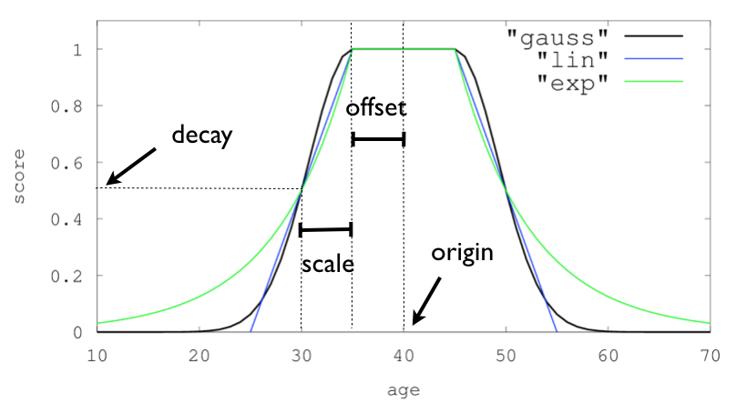

# Elasticsearch 基本查询

# 1 DSL 概述

Elasticsearch（简称 ES）提供了一套基于 JSON 的**查询 DSL**（Domain Specific Language，领域特定语言）。可以把它看作一棵由查询子句组成的抽象语法树（Abstract Syntax Tree，AST），其中包含两种类型的语句：

- **叶子查询语句**：用于查询某个特定的字段，如 `match`、`term`、`range` 等，可以单独使用。
- **复合查询语句**：用于合并其他的叶子查询或复合查询语句，也就是说复合语句之间可以嵌套，从而实现非常复杂的查询逻辑。

一个查询语句究竟具有什么样的行为、得到什么样的结果，主要取决于它处于**查询上下文**（Query Context）还是**过滤上下文**（Filter Context），两者有很大区别。

在查询上下文中，查询语句关心的是“文档与查询语句的匹配程度如何”，它会判断文档是否匹配，并计算相关性评分 `_score`。

例如：

- 查找与 `full text search` 这个词语最佳匹配的文档
- 查找包含单词 `run` 的文档，同时也匹配 `runs`、`running`、`jog` 或 `sprint`
- 同时包含 `quick`、`brown` 和 `fox`——单词间离得越近，该文档的相关性越高
- 标记着 `lucene`、`search` 或 `java`——标记词越多，该文档的相关性越高

一条查询语句会计算每个文档与查询语句的相关性，给出一个相关性评分 `_score`，并且按照相关性对匹配到的文档进行排序。

而在过滤上下文中，查询语句只解决“文档是否匹配”的问题，**不会计算相关性评分**。

例如：

- `created` 的日期范围是否在 2013 到 2014 之间？
- `status` 字段中是否包含单词 `published`？
- `lat_lon` 字段中的地理位置与目标点相距是否不超过 10 km？

两者相比较而言：

- `filter` 性能更好，不计算相关性评分，也就不需要按评分排序，同时 ES 内部还会缓存常用的过滤结果
- `query` 性能较差，要计算相关性评分，还要根据评分进行排序，并且结果不会被缓存

原则上，全文搜索或其他需要相关性评分的场景使用查询语句，其余条件全部使用过滤语句。

在进行搜索时，常常会在查询语句中，结合查询和过滤来达到查询目的：

```json
{
    "query":{
        "bool":{
            "must":[
                {
                    "match":{
                        "title":"Search"
                    }
                },
                {
                    "match":{
                        "content":"Elasticsearch"
                    }
                }
            ],
            "filter":[
                {
                    "term":{
                        "status":"published"
                    }
                },
                {
                    "range":{
                        "publish_date":{
                            "gte":"2015-01-01"
                        }
                    }
                }
            ]
        }
    }
}
```

- `query` 参数表示整个语句处于查询上下文中
  - `bool` 和 `match` 语句被用在查询上下文中，也就是说它们会计算每个文档的匹配度
- `filter` 参数则表示这个子查询处于过滤上下文中
  - `filter` 语句中的 `term` 和 `range` 语句用在过滤上下文中，它们只起到过滤的作用，并不会计算文档的得分

# 2 match 查询

## 2.1 match_all

`match_all` 是最简单的查询，会匹配全部文档，并且每个文档的评分都是 1.0。

```json
{
    "query": {
        "match_all": {}
    }
}
```

## 2.2 match

`match` 查询属于全文查询。与 `term` 查询不同，Elasticsearch 在处理全文搜索时，首先分析查询字符串，然后根据分词结果构建查询，最终返回查询结果。

默认的匹配查询是布尔类型，例如，对于以下 `match` 查询：

```json
{
    "query":{
        "match":{
            "address":"浙江 杭州 西湖"
        }
    }
}
```

查询字符串是“浙江 杭州 西湖”，假设被分析器分词之后产生三个词语：浙江、杭州、西湖，然后根据分析的结果构造一个布尔查询。默认情况下，引擎内部执行的查询逻辑是：只要 `address` 字段值中包含任意一个关键字，就会返回该文档。

匹配查询的行为受到两个参数的控制：

- `operator`：用来控制 `match` 查询匹配词条的逻辑条件，默认值是 `or`，如果设置为 `and`，表示需要满足所有条件
- `minimum_should_match`：当 `operator` 参数设置为 `or` 时，该参数用来控制应该匹配的分词的最少数量

默认情况下 `operator` 的值是 `or`，它决定了构造查询时分词之间的逻辑运算符。如果设置为 `and`，那么引擎内部执行的查询逻辑是：`address` 字段值中包含全部关键字，才会返回该文档。

对于 `minimum_should_match` 属性，默认值是 1，如果将其设置为 2，表示至少要匹配 2 个分词，这意味着文档的 `address` 字段包含任意两个关键字才能满足查询条件。

```json
{
    "query":{
        "match":{
            "address":{
                "query":"浙江 杭州 西湖",
                "operator":"or",
                "minimum_should_match":2
            }
        }
    }
}
```

## 2.3 match_phrase

也称为**短语搜索**。Elasticsearch 首先分析查询字符串，从分析后的文本中构建短语查询，这意味着必须匹配短语中的所有分词，并且保证**各个分词的相对位置不变**。

```json
{
  "query": {
    "match_phrase": {
      "address": "浙江杭州"
    }
  }
}
```

“浙江省杭州”“浙江杭州市”“杭州 浙江”等都不会匹配上面的查询，文档必须同时包含“浙江”与“杭州”，且先后顺序不变，中间无其他间隔（可以通过 `slop` 参数允许分词之间间隔若干个位置）。

## 2.4 match_phrase_prefix

除了把查询文本的最后一个分词只做前缀匹配之外，`match_phrase_prefix` 和 `match_phrase` 查询基本一样。参数 `max_expansions` 控制最后一个分词最多会被扩展成多少个词条，默认值是 50。扩展的数量越多，找到的文档就越多；如果扩展的数量太少，可能查找不到相应的文档，遗漏数据。

```json
{
  "query": {
    "match_phrase_prefix": {
      "message": {
        "query": "quick brown f"
      }
    }
  }
}
```

以上语句在 `message` 字段中搜索以 `quick brown f` 开头的短语的文档。

该搜索可以匹配到 `quick brown fox` 或 `two quick brown ferrets`，但是不会匹配 `the fox is quick and brown`。

## 2.5 multi_match

基于 `match` 查询，ES 允许在多个字段上搜索关键词：

```json
{
  "query": {
    "multi_match" : {
      "query":    "浙江 杭州 西湖",
      "fields": [ "tag", "content" ],
      "type": "best_fields"
    }
  }
}
```

参数 `type` 用于控制评分策略，默认为 `best_fields`。

常用的可选值为：

- `best_fields`：默认值，在各个字段分别搜索，以评分最高的字段为最终分数，忽略其余字段的评分，相当于 `dis_max`
- `most_fields`：在各个字段分别搜索，将各字段的评分累加
- `cross_fields`：把多个字段当作一个大字段来处理，每个分词可以出现在任意字段中，适合姓名、地址等被拆分到多个字段的场景

此外还有 `phrase`、`phrase_prefix`、`bool_prefix`，分别相当于在每个字段上执行 `match_phrase`、`match_phrase_prefix`、`match_bool_prefix`。

# 3 term 查询

term 级别的查询与 `match` 查询最大的不同之处在于：`match` 查询会将查询字符串分词，只要文档的字段值能够匹配任意一个词条，该文档就匹配查询条件；而 term 级别的查询不会分词，只有当字段的词条与查询字符串完全一致时，Elasticsearch 才判定文档匹配查询条件。

## 3.1 term

单词条查询，主要用于精确匹配，比如数字、日期、布尔值或 `keyword` 类型的字符串。注意不要对 `text` 字段使用 `term` 查询，因为 `text` 字段在索引时已经被分词，用完整字符串去精确匹配往往查不到结果。

```json
{
    "query":{
        "term":{
            "age":20
        }
    }
}
```

## 3.2 terms

相当于多个 `term` 查询，类似于 SQL 中 `IN` 关键字的用法，只要文档匹配任意一个词条，就匹配查询条件：

```json
{
    "query":{
        "terms":{
            "age":[20,21,22]
        }
    }
}
```

## 3.3 range

范围查询，是指查询字段值落在一定范围内的文档：

```json
{
    "query":{
        "range":{
            "age":{
                "gte":10,
                "lte":20
            }
        }
    }
}
```

范围查询使用的比较操作符：

- `gte`：大于或等于
- `gt`：大于
- `lte`：小于或等于
- `lt`：小于

## 3.4 exists

用于查找那些指定字段中有值或无值的文档。

指定 `title` 字段有值：

```json
{
    "query":{
        "exists":{
            "field":"title"
        }
    }
}
```

指定 `title` 字段无值（早期版本的 `missing` 查询已在 5.0 移除，改用 `must_not` + `exists`）：

```json
{
    "query":{
        "bool":{
            "must_not":{
                "exists":{
                    "field":"title"
                }
            }
        }
    }
}
```

## 3.5 prefix

前缀匹配查询是指，文档的字段包含以指定字符为前缀的分词。前缀匹配适用于已分词的字段，此时只能匹配单个分词的前缀；也适用于未分词的字段，此时将从原始值的第一个字符开始做前缀匹配。

比如有一个不分词字段 `product_name`，分别有两个文档的值是 `iphone-6`、`iphone-7`。我们搜索 `iphone` 这个前缀关键字就可以搜索到结果：

```json
{
    "query":{
        "prefix":{
            "product_name":{
                "value":"iphone"
            }
        }
    }
}
```

## 3.6 wildcard

Elasticsearch 支持的通配符（wildcard）有 2 个，分别是：

- `*`：0 个或多个任意字符
- `?`：任意单个字符

在通配符查询中，Elasticsearch 不会分析查询字符串，当文档的字段匹配通配符查询条件时，文档匹配。通配符查询会使查询性能变差，为了提高查询性能，查询字符串一般不以通配符开头，只在查询字符串中间或末尾使用通配符。

```json
{
    "query":{
        "wildcard":{
            "product_name":{
                "value":"iphone-*"
            }
        }
    }
}
```

## 3.7 regexp

Elasticsearch 支持正则表达式查询。它同样是针对词条进行匹配的，这就意味着，在已分词的文本字段上，正则表达式只能匹配单个分词。

```json
{
    "query":{
        "regexp":{
            "product_name":{
                "value":"iphone-[1-9]"
            }
        }
    }
}
```

## 3.8 fuzzy

在实际的搜索中，我们有时候会打错字，从而导致搜索不到。在 Elasticsearch 中可以使用模糊查询来应对搜索词中有错别字的情形。

```json
{
    "query":{
        "fuzzy":{
            "product_name":{
                "value":"iphone",
                "fuzziness": 2
            }
        }
    }
}
```

`fuzziness` 用于设置允许的最大编辑距离（Edit Distance），即搜索文本最多可以纠正几个字符，默认为 `AUTO`。可以设置为 `0`、`1`、`2` 或 `AUTO`（最大只能为 2）。`AUTO` 是推荐的选项，它会根据查询词的长度决定允许的距离。

# 4 复合查询

## 4.1 bool

布尔查询是最常用的组合查询，它不仅将多个查询条件组合在一起，还将各个查询的结果和评分组合在一起。

`must`、`filter`、`must_not` **子查询之间的逻辑关系是 and**：只有当一个文档满足这些子查询条件时，Elasticsearch 才认为该文档满足查询条件（`should` 的规则稍有不同，见下文）。

布尔查询支持的子查询共有四种：

- `must` 子句：文档必须匹配 `must` 查询条件
- `should` 子句：文档应该匹配 `should` 子句查询中的一个或多个
- `must_not` 子句：文档不能匹配该查询条件
- `filter` 子句：过滤器，文档必须匹配该过滤条件，跟 `must` 子句的唯一区别是，**`filter` 不影响查询的评分**

通常情况下，`should` 子句是一个数组，包含多个 `should` 子查询。如果布尔查询中没有 `must` 或 `filter` 子句，匹配的文档默认至少要满足其中一个 `should` 子查询；如果有 `must` 或 `filter` 子句，`should` 默认可以一个都不满足，只用于提高评分。参数 `minimum_should_match` 可以控制一个文档必须匹配的 `should` 子查询的数量。

例如，对于以下 `should` 查询，一个文档必须至少满足 `should` 子句中的两个词条查询：

```json
{
    "query":{
        "bool":{
            "should":[
                {"term":{ "tag":"docker"}},
                {"term":{"tag":"elasticsearch"}},
                {"term":{"tag":"cloud"}}
            ],
            "minimum_should_match":2
        }
    }
}
```

布尔查询可以嵌套，意味着可以组装出很复杂的查询逻辑。例如：

```json
{
    "query":{
        "bool":{
            "must":[
                {
                    "match":{
                        "name":"Java"
                    }
                }
            ],
            "must_not":[
                {
                    "match":{
                        "desc":"编程"
                    }
                }
            ],
            "should":[
                {
                    "match":{
                        "publisher":"机械工业"
                    }
                }
            ],
            "filter":{
                "bool":{
                    "must":[
                        {
                            "range":{
                                "date":{
                                    "gte":"2010-01-01"
                                }
                            }
                        },
                        {
                            "range":{
                                "price":{
                                    "lte":99
                                }
                            }
                        }
                    ]
                }
            }
        }
    }
}
```

## 4.2 constant_score

当我们不关心检索词频率 TF（Term Frequency）对搜索结果排序的影响时，可以使用 `constant_score` 将查询条件包装在 `filter` 中，所有匹配的文档都获得相同的评分（默认为 1.0，可通过 `boost` 调整）。这样可以省掉评分过程，提高查询速度。（早期版本的 `constant_score` 还可以包装 `query`，5.0 起只支持 `filter`。）

```json
{
    "query":{
        "constant_score":{
            "filter":{
                "term":{
                    "price":20
                }
            }
        }
    }
}
```

## 4.3 boosting query

我们可以通过 `must` + `must_not` 先剔除不想匹配的文档，再获取匹配的文档。但是有一种场景是，我们并不需要完全剔除，而是把需要剔除的那部分文档的分数降低。

构建测试数据：

```json
POST /news/_bulk
{ "index": { "_id": 1 }}
{ "content":"Apple Mac" }
{ "index": { "_id": 2 }}
{ "content":"Apple iPad" }
{ "index": { "_id": 3 }}
{ "content":"Apple employee like Apple Pie and Apple Juice" }
```

我们需要的是文档中包含 apple，但是不包含 pie，那么可以这么做：

```json
{
    "query":{
        "bool":{
            "must":{
                "match":{
                    "content":"apple"
                }
            },
            "must_not":{
                "match":{
                    "content":"pie"
                }
            }
        }
    }
}
```

在实际开发中，如果出现 pie，我们可能并不想把这条记录完全过滤掉，而是希望降低它的分数，让它也出现在列表中，只是排名比较靠后：

```json
{
    "query":{
        "boosting":{
            "positive":{
                "match":{
                    "content":"apple"
                }
            },
            "negative":{
                "match":{
                    "content":"pie"
                }
            },
            "negative_boost":0.5
        }
    }
}
```

`boosting` 查询需要搭配三个关键字：`positive`、`negative`、`negative_boost`。

只有匹配了 `positive` 查询的文档才会被包含到结果集中，但是同时匹配了 `negative` 查询的文档会被降低相关度，即将文档原本的 `_score` 和 `negative_boost` 参数相乘来得到新的 `_score`。因此，`negative_boost` 参数取值在 0 到 1.0 之间。在上面的例子中，任何包含了指定负面词条的文档的 `_score` 都会是其原本 `_score` 的一半。

## 4.4 dis_max

分离最大化查询（Disjunction Max Query），也称**最佳字段查询**：只将最佳匹配的评分作为查询的评分结果返回，其他匹配子句的评分乘以 `tie_breaker` 后再累加进来。

```json
{
    "query": {
        "dis_max" : {
            "queries" : [
                { "term" : { "title" : "Quick pets" }},
                { "term" : { "body" : "Quick pets" }}
            ],
            "tie_breaker" : 0.7
        }
    }
}
```

假设一条文档的 `title` 查询得分是 1，`body` 查询得分是 1.6，那么总得分为：`1.6 + 1 * 0.7 = 2.3`。

如果去掉 `"tie_breaker" : 0.7`，那么 `tie_breaker` 默认为 0，这条文档的得分就是：`1.6 + 1 * 0 = 1.6`。

## 4.5 function_score

`function_score` 查询可以帮助我们更好地控制相关度，其中预定义了一些函数，用来修改或者替换原始评分。

### 4.5.1 字段函数

该函数的作用是按照文档中的某个字段值来影响该文档的相关度。比如搜索博客时，我们希望点赞更多的博客排在搜索结果的前面，就可以使用该函数，使文档的相关度与点赞数相结合。

```json
{
  "title":   "About popularity",
  "content": "In this post we will talk about...",
  "votes":   6  // 点赞数
}
```

然后使用以下命令来控制点赞数对文档评分的影响：

```json
{
    "query":{
        "function_score":{
            "query":{
                "multi_match":{
                    "query":"popularity",
                    "fields":[
                        "title",
                        "content"
                    ]
                }
            },
            "field_value_factor":{
                "field":"votes",
                "missing": 0
            }
        }
    }
}
```

每个文档的 `votes` 都必须有值才能进行该函数的计算，如果该字段没有值，应该使用 `missing` 提供默认值进行计算。

评分的计算规则：`new_score = old_score * votes`

但是这样可能带来意想不到的结果：全文评分 `_score` 通常处于 0 到 10 之间，有 10 个赞的文档会掩盖掉全文评分的作用，而没有赞的文档评分会被置为零。所以我们应该想办法使点赞数对评分的影响随着点赞数的升高而逐渐减弱。可以给该函数提供一个 `modifier` 来修正初始的得分，比如 `log`、`log1p`、`log2p` 等。

```json
{
    "query":{
        "function_score":{
            "query":{
                "multi_match":{
                    "query":"popularity",
                    "fields":[
                        "title",
                        "content"
                    ]
                }
            },
            "field_value_factor":{
                "field":"votes",
                "modifier":"log1p",
                "factor":2
            },
            "boost_mode":"sum",
            "max_boost":1.5
        }
    }
}
```

评分的计算规则：`new_score = old_score + min(log10(1 + factor * votes), max_boost)`

ES 预设的 `modifier` 列表如下（其中 `log` 系列以 10 为底，`ln` 系列为自然对数）：

- `none`：默认值，不做修正
- `log`：`log(x)`
- `log1p`：`log(1 + x)`
- `log2p`：`log(2 + x)`
- `ln`：`ln(x)`
- `ln1p`：`ln(1 + x)`
- `ln2p`：`ln(2 + x)`
- `square`：x 的平方
- `sqrt`：x 的平方根
- `reciprocal`：x 的倒数

我们还可以通过 `boost_mode` 参数来控制函数值和旧分数之间如何合并，默认是乘积。它的可选值如下：

- `multiply`：新分数为旧分数与函数值的乘积
- `sum`：新分数为旧分数与函数值的和
- `avg`：新分数为旧分数与函数值的平均值
- `min`：新分数为旧分数与函数值的最小值
- `max`：新分数为旧分数与函数值的最大值
- `replace`：新分数为函数值，函数值会替代旧分数

如果函数值过大，也可以使用 `max_boost` 来限制函数值，意思是函数值的结果如果大于该值，则使用该值作为函数值。

### 4.5.2 权重函数

上面的例子中，每一个文档都使用同一个函数计算，有时候我们需要对满足不同条件的文档采用不同的权重。这时，使用 `functions` 是一种不错的选择。

比如我们想要在北京租一间房，Wi-Fi、独立卫生间、游泳池等都会提升该文档的相关度。我们可能会这么写：

```json
{
    "query":{
        "function_score":{
            "query":{
                "constant_score":{
                    "filter":{
                        "term":{
                            "city":"北京"
                        }
                    }
                }
            },
            "functions":[
                {
                    "filter":{
                        "term":{
                            "desc":"wifi"
                        }
                    },
                    "weight":1
                },
                {
                    "filter":{
                        "term":{
                            "desc":"独立卫生间"
                        }
                    },
                    "weight":1
                },
                {
                    "filter":{
                        "term":{
                            "features":"游泳池"
                        }
                    },
                    "weight":2
                }
            ],
            "score_mode":"sum"
        }
    }
}
```

首先会使用过滤条件对文档进行过滤，筛选出城市为北京的所有房间（这里用 `constant_score` 包装，使每个文档的初始评分都为 1.0）。

`functions` 参数是一个函数数组，ES 会遍历这个数组，如果该文档符合某个函数的 `filter` 条件，则使用对应的 `weight` 参与相关度的计算。`weight` 和 `boost` 的不同在于：`weight` 是指定的值直接参与相关度计算，而 `boost` 是相对权重。

`score_mode` 用于指定多个函数结果的合并规则，可选值如下：

- `multiply`：对所有函数值求乘积，默认值
- `sum`：函数值求和
- `avg`：使用平均值作为函数值
- `max`：使用函数值的最大值
- `min`：使用函数值的最小值
- `first`：使用首个匹配的函数的结果作为最终结果

### 4.5.3 随机函数

使用 `random_score` 可以让不同的人请求得到不同的排序结果，而同一个人多次请求得到相同的结果，如：

```json
{
    "query":{
        "function_score":{
            "query":{
                "match":{
                    "title":"喜欢"
                }
            },
            "random_score":{
                "seed":10086,
                "field":"_seq_no"
            },
            "boost_mode":"replace"
        }
    }
}
```

其中 `seed` 是随机种子，通常设置为当前用户的 ID 等值，`seed` 相同则排序结果相同；`field` 指定参与随机计算的文档字段。从 7.0 开始，设置 `seed` 时必须同时指定 `field`，常用 `_seq_no`（注意文档更新后 `_seq_no` 会变化，排序也会随之变化）。

### 4.5.4 衰减函数

很多变量都可以影响用户对于酒店的选择，比如用户可能希望酒店离市中心近一点，但是如果价格足够便宜，也愿意为了省钱，妥协选择一个更远的住处。

如果我们只是使用一个 `filter` 排除所有市中心方圆 100 米以外的酒店，再用一个 `filter` 排除每晚价格超过 100 元的酒店，这种做法太过强硬。可能有一间房在 500 米外，但是超级便宜，一晚只要 10 元，用户可能会因此愿意妥协住这间房。

为了解决这个问题，`function_score` 查询提供了一组衰减函数（Decay Functions），让我们有能力在两个滑动标准（如地点和价格）之间权衡。

`function_score` 支持的衰减函数有三种：

- `linear`：线性函数是一条直线，一旦直线与横轴相交，所有其他值的评分都是 0
- `exp`：指数函数，先剧烈衰减然后变缓
- `gauss`：高斯函数，是钟形的，最常用，衰减速率先缓慢，然后变快，最后又放缓



`linear`、`exp`、`gauss` 三种衰减函数的差别只在于衰减曲线的形状，在 DSL 语法上的用法完全一样。

衰减函数支持的参数：

- `origin`：中心点，或是字段可能的最佳值，落在原点 `origin` 上的文档评分 `_score` 为满分 1.0，支持数值、时间以及经纬度地理坐标点（最常用）类型的字段
- `offset`：以 `origin` 为中心，设置一个偏移量 `offset` 覆盖一个范围，在此范围内所有文档的评分 `_score` 也都和 `origin` 一样是满分 1.0
- `scale`：衰减的距离尺度，即文档离开 `origin ± offset` 的范围后，再偏离 `scale` 的距离时，评分 `_score` 降为 `decay`
- `decay`：文档距离 `origin` 为 `offset + scale` 时得到的评分 `_score`，默认为 0.5（一般不需要改变，使用默认值即可）

以上面的图为例，所有曲线（`linear`、`exp`、`gauss`）的 `origin` 都是 40，`offset` 是 5，因此范围在 `40 - 5 <= value <= 40 + 5` 的文档的评分 `_score` 都是满分 1.0。而在此范围之外，评分会开始衰减，衰减程度由 `scale` 值（此处是 5）和 `decay` 值（此处是默认值 0.5）决定，在 `origin ± (offset + scale)` 处的评分是 `decay` 值，也就是在 30、50 处的评分是 0.5 分。也就是说，在 `origin + offset + scale` 或是 `origin - offset - scale` 的点上，得到的分数仅有 `decay` 分。

假设有一个用户希望租一个离市中心近一点、且每晚不超过 100 元的酒店，而且与距离相比，用户对价格更敏感，那么使用衰减函数 `gauss` 查询如下：

```json
{
    "query":{
        "function_score":{
            "functions":[
                {// 第一个 gauss 加强函数，决定距离的衰减率
                    "gauss":{
                        "location":{
                            "origin":{// origin 点设成市中心的经纬度坐标
                                "lat":51.5,
                                "lon":0.12
                            },
                            "offset":"2km",// 距离中心点 2km 以内都是满分 1.0，2km 外开始衰减
                            "scale":"3km"// 衰减尺度
                        }
                    }
                },
                {// 第二个 gauss 加强函数，决定价格的衰减率
                    "gauss":{
                        "price":{
                            "origin":"50",
                            "offset":"50",
                            "scale":"20"
                        }
                    },
                    "weight":2 // 因为用户对价格更敏感，所以给了这个 gauss 加强函数 2 倍的权重
                }
            ]
        }
    }
}
```

其中把 `price` 语句的 `origin` 点设为 50 是有原因的：由于价格一定是越低越好，所以 0~100 元的所有酒店都应该被认为是比较好的，而 100 元以上的酒店才慢慢衰减。

如果我们将 `price` 的 `origin` 点设置成 100，那么价格低于 100 元的酒店的评分反而会变低，这不是我们期望的结果。与其这样，不如将 `origin` 和 `offset` 同时设成 50，只让 `price` 大于 100 元时评分才会变低。

虽然这样设置也会使得 `price` 小于 0 元的酒店评分降低，不过现实生活中价格不会是负数，因此就算 `price < 0` 的评分会下降，也不会对我们的搜索结果造成影响（酒店的价格一定都是正的）。

换句话说，其实只要把 `origin + offset` 的值设为 100，`origin` 或 `offset` 是什么样的值都无所谓，只要能确保价格在 100 元以上的酒店会衰减就好了。

### 4.5.5 脚本评分

当以上的 `function_score` 函数仍然无法满足我们的业务需求时，Elasticsearch 还为我们准备了终极武器——Painless 脚本，可以随意定制评分的计算规则。

一个简单的用法如下：

```json
{
    "query":{
        "function_score":{
            "query":{
                "match":{
                    "title":"喜欢"
                }
            },
            "boost_mode":"replace",
            "script_score":{
                "script":{
                    "params":{
                        "a":1,
                        "b":2
                    },
                    "source":"_score + params.b * doc['rating'].value"
                }
            }
        }
    }
}
```

脚本中可以通过 `_score` 获取原始评分，通过 `doc['字段名'].value` 读取文档字段值，通过 `params` 传入参数（传参而不是把常量写死在脚本里，可以让脚本被编译缓存复用）。如果只需要脚本评分，7.0 起也可以直接使用独立的 `script_score` 查询，写法更简洁。

# 5 小结

本文介绍了 Elasticsearch 查询 DSL 的基本用法：查询上下文与过滤上下文的区别、以 `match` 为代表的全文查询、以 `term` 为代表的词条级查询，以及 `bool`、`constant_score`、`boosting`、`dis_max`、`function_score` 等复合查询。实际使用时，记住一条原则：需要相关性评分的条件放进 `query`，其余精确条件尽量放进 `filter`。

另外，8.x 之后 Elasticsearch 在传统 DSL 之外还提供了向量检索（`knn`）、语义检索（`semantic`）、`retriever` 组合检索以及管道式查询语言 ES|QL 等新能力，可以按需了解。
