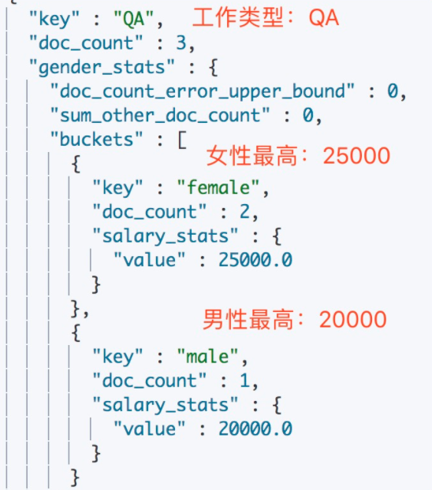
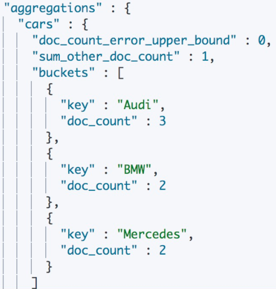
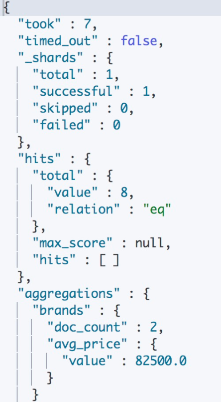
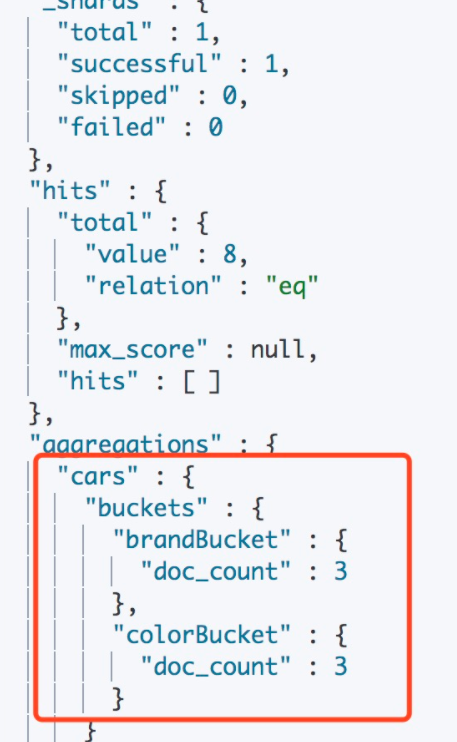
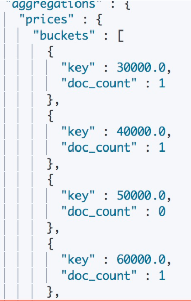
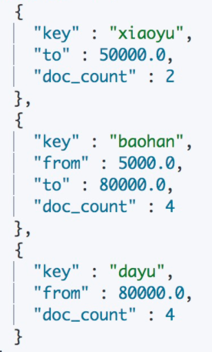

# Elasticsearch 聚合查询

在数据库领域，借助 SQL 我们可以获取表中的最大值（Max）、最小值（Min），还可以对数据进行分组（Group）。在 ES 中使用**聚合**（Aggregations）来实现类似的功能，而且比 SQL 更灵活、更强大。

目前官方文档将聚合分为三类：

- **指标聚合**（Metrics Aggregations）：对文档字段进行数学运算和统计分析，如计算最大值、最小值、平均值等，类似于 SQL 中的 `COUNT()`、`SUM()`、`MAX()` 等统计方法
- **桶聚合**（Bucket Aggregations）：把满足特定条件的文档分到同一个组（桶）中，类似 SQL 中的 `GROUP BY`
- **管道聚合**（Pipeline Aggregations）：基于其他聚合的结果进行再分析，它处理的是其他聚合的计算结果，而不是文档集合

早期版本（如 ES 7）中还有一类**矩阵聚合**（Matrix Aggregations），用于操作多个字段并根据从文档字段中提取的值生成矩阵结果，目前其唯一成员 `matrix_stats` 已被归入指标聚合。

实际开发中，指标聚合和桶聚合用途最广泛；管道聚合用于对聚合结果做二次计算（如求导、累计求和、桶排序等），按需使用即可。

# 1 指标聚合

按照输出结果的数量，指标聚合可以分为两类：

- **单值分析**，只输出一个分析结果：
  - **Min**：最小值
  - **Max**：最大值
  - **Avg**：平均值
  - **Sum**：累加值
  - **Cardinality**：不同值的个数，相当于 SQL 中的 `COUNT(DISTINCT)`，注意它基于 HyperLogLog++ 算法，结果是近似值
- **多值分析**，输出多个分析结果：
  - **Stats**：基本统计，可以一次性得到文档数、最小值、最大值、平均值、总和
  - **Extended Stats**：对 Stats 的扩展，包含了更多的统计数据，比如方差、标准差等
  - **Percentiles**：百分位统计，按从小到大累计每个值对应的文档数占比，返回指定占比对应的值
  - **Percentile Ranks**：Percentiles 是通过百分比求文档值，Percentile Ranks 是通过文档值求百分比
  - **Top Hits**：一般用于分桶后获取桶内最匹配的顶部文档列表

计算最大值：

```json
{
    "aggs":{
        "max_price":{
            "max":{
                "field":"price"
            }
        }
    }
}
```

可以与 `query` 结合使用，比如先过滤，再求和：

```json
{
    "query":{
        "constant_score":{
            "filter":{
                "match":{
                    "type":"hat"
                }
            }
        }
    },
    "aggs":{
        "hat_prices":{
            "sum":{
                "field":"price"
            }
        }
    }
}
```

再来看一下 Percentiles 与 Percentile Ranks 的用法。假如有一批消费者数据，其中有一个字段记录了日均消费金额，现在想知道日均消费金额的分布占比情况：

```json
{
    "size":0,
    "aggs":{
        "money_stat":{
            "percentiles":{
                "field":"money"
            }
        }
    }
}
```

返回结果：

```json
{
    ...
   "aggregations": {
      "money_stat": {
         "values" : {
            "1.0": 5.0,
            "5.0": 25.0,
            "25.0": 165.0,
            "50.0": 445.0,
            "75.0": 725.0,
            "95.0": 945.0,
            "99.0": 985.0
         }
      }
   }
}
```

默认按照 `[1, 5, 25, 50, 75, 95, 99]` 这几个百分位来统计，也可以通过 `percents` 参数自定义。

统计结果反映：1% 的人消费金额在 5 元以内、5% 的人消费金额在 25 元以内……95% 的人消费金额在 945 元以内、99% 的人消费金额在 985 元以内。注意百分位统计基于 TDigest 算法，数据量大时结果是近似值。

如果想知道日均消费金额在 500 以内以及 600 以内的人群占比是多少呢？可以使用 Percentile Ranks 来统计：

```json
{
    "size":0,
    "aggs":{
        "money_ranks":{
            "percentile_ranks":{
                "field":"money",
                "values":[
                    500,
                    600
                ]
            }
        }
    }
}
```

返回结果：

```json
{
    ...
   "aggregations": {
      "money_ranks": {
         "values" : {
            "500.0": 55.1,
            "600.0": 64.0
         }
      }
   }
}
```

统计结果反映：日均消费金额在 500 以内的人群占比为 55.1%，日均消费金额在 600 以内的人群占比为 64%。

结合桶聚合，还可以进行更复杂的统计。例如，根据工作类型分桶，然后按照性别分桶，计算每个桶中的最高薪资：

```json
{
    "size":0,
    "aggs":{
        "Job_gender_stats":{
            "terms":{
                "field":"job.keyword"
            },
            "aggs":{
                "gender_stats":{
                    "terms":{
                        "field":"gender"
                    },
                    "aggs":{
                        "salary_stats":{
                            "max":{
                                "field":"salary"
                            }
                        }
                    }
                }
            }
        }
    }
}
```

返回结果：



注意：对字符串字段做 `terms` 等聚合时，需要使用 `keyword` 类型的字段（如动态映射自动生成的 `job.keyword` 子字段）。`text` 字段默认禁用了 fielddata，直接对其聚合会报错。上例能直接对 `gender` 聚合，前提是该字段已被映射为 `keyword` 类型。

# 2 桶聚合

准备一组汽车销售数据用于测试，包含汽车的价格、颜色、品牌、销售时间（下文假设已提前将 `color`、`brand` 映射为 `keyword` 类型，`sellTime` 映射为 `date` 类型；如果使用动态映射，聚合和 `term` 查询时请改用 `color.keyword`、`brand.keyword`）：

```json
POST /cars/_bulk
{ "index": {}}
{ "price" : 80000, "color" : "red", "brand" : "BMW", "sellTime" : "2014-01-28" }
{ "index": {}}
{ "price" : 85000, "color" : "green", "brand" : "BMW", "sellTime" : "2014-02-05" }
{ "index": {}}
{ "price" : 120000, "color" : "green", "brand" : "Mercedes", "sellTime" : "2014-03-18" }
{ "index": {}}
{ "price" : 105000, "color" : "blue", "brand" : "Mercedes", "sellTime" : "2014-04-02" }
{ "index": {}}
{ "price" : 72000, "color" : "green", "brand" : "Audi", "sellTime" : "2014-05-19" }
{ "index": {}}
{ "price" : 60000, "color" : "red", "brand" : "Audi", "sellTime" : "2014-06-05" }
{ "index": {}}
{ "price" : 40000, "color" : "red", "brand" : "Audi", "sellTime" : "2014-07-01" }
{ "index": {}}
{ "price" : 35000, "color" : "blue", "brand" : "Honda", "sellTime" : "2014-08-12" }
```

## 2.1 Terms Aggregation

基于某个字段，该字段内的每一个唯一词条为一个桶，并计算每个桶内的文档个数，默认按照文档个数降序返回。需要注意的是，生产环境中数据一般分布在多个分片上，**当不返回所有桶时（由 `size` 控制），文档个数可能不准确**。

按照汽车品牌聚合，按照数量排序，只返回前三名：

```json
{
    "aggs":{
        "cars":{
            "terms":{
                "field":"brand",
                "order":{
                    "_count":"desc"
                },
                "size":3
            }
        }
    }
}
```

`order` 除了按 `_count`（文档个数）排序，还可以按 `_key`（桶的键值）排序。早期版本中按键排序写作 `_term`，6.0 起已弃用，7.0 起移除，请改用 `_key`。

返回结果：



## 2.2 Filter Aggregation

Filter 聚合是一种单桶聚合：它把满足过滤条件的文档放到一个桶中，通常再在这个桶内做子聚合。

过滤获取品牌为 BMW 的桶，并求该桶内的平均价格：

```json
{
    "aggs":{
        "brands":{
            "filter":{
                "term":{
                    "brand":"BMW"
                }
            },
            "aggs":{
                "avg_price":{
                    "avg":{
                        "field":"price"
                    }
                }
            }
        }
    }
}
```

返回结果：



如果想要指定多个过滤条件，可以使用 Filters Aggregation：

```json
{
    "size":0,
    "aggs":{
        "cars":{
            "filters":{
                "filters":{
                    "colorBucket":{
                        "match":{
                            "color":"red"
                        }
                    },
                    "brandBucket":{
                        "match":{
                            "brand":"Audi"
                        }
                    }
                }
            }
        }
    }
}
```

返回结果：



## 2.3 Histogram Aggregation

直方图聚合，与 Terms 聚合类似，都是对数据分组，区别是 Terms 按照字段的值分组，而 Histogram 可以按照指定的间隔对字段进行分组。

根据价格区间为 10000 分桶：

```json
{
    "aggs":{
        "prices":{
            "histogram":{
                "field":"price",
                "interval":10000
            }
        }
    }
}
```

返回结果：



对日期字段分桶要使用 Date Histogram Aggregation。注意它的 `interval` 参数从 7.2 起已弃用，8.0 起移除，需要改用 `calendar_interval`（按日历单位，如 `month`、`quarter`）或 `fixed_interval`（按固定时长，如 `30d`、`12h`）。例如按月统计销量：

```json
{
    "size":0,
    "aggs":{
        "sales_per_month":{
            "date_histogram":{
                "field":"sellTime",
                "calendar_interval":"month",
                "format":"yyyy-MM"
            }
        }
    }
}
```

## 2.4 Range Aggregation

范围聚合，根据用户传递的范围参数作为桶，进行相应的聚合。在同一个请求中，可以传递多组范围，每组范围作为一个桶（每个范围包含 `from`，不包含 `to`）。

根据价格区间分桶：

```json
{
    "aggs":{
        "price_ranges":{
            "range":{
                "field":"price",
                "ranges":[
                    {
                        "to":50000
                    },
                    {
                        "from":5000,
                        "to":80000
                    },
                    {
                        "from":80000
                    }
                ]
            }
        }
    }
}
```

返回结果：



## 2.5 Nested Aggregation

一个特殊的单桶（Single Bucket）聚合，可以对嵌套文档进行聚合。

例如，假设我们有一个产品索引 `products`，每个产品都包含一个分销商列表，每个分销商对该产品都有自己的报价。映射可能是：

```json
PUT /products
{
    "mappings" : {
        "properties" : {
            "resellers" : {
                "type" : "nested",
                "properties" : {
                    "name" : { "type" : "text" },
                    "price" : { "type" : "double" }
                }
            }
        }
    }
}
```

> `resellers` 是一个在产品文档中保存嵌套文档的数组。（早期教程中的映射常写成 `"product" : { "properties" : ... }` 的形式，其中 `product` 是 type 名称，8.0 起已不再支持 type。）

以下聚合将返回能买到该产品的最低价格：

```json
{
    "query" : {
        "match" : { "name" : "led tv" }
    },
    "aggs" : {
        "resellers" : {
            "nested" : {
                "path" : "resellers"
            },
            "aggs" : {
                "min_price" : { "min" : { "field" : "resellers.price" } }
            }
        }
    }
}
```

如上所述，嵌套聚合需要指定嵌套文档在顶层文档中的路径 `path`，然后就可以在这些嵌套文档上定义任何类型的子聚合。

响应结果：

```json
{
    "aggregations": {
        "resellers": {
            "min_price": {
                "value" : 350
            }
        }
    }
}
```

# 3 小结

聚合是 ES 做统计分析的核心能力：指标聚合负责“算”，桶聚合负责“分”，二者可以任意嵌套组合，管道聚合则在聚合结果之上再做二次计算。使用时还需要注意以下几点：

- 对字符串字段聚合要使用 `keyword` 类型，`text` 字段默认不能直接聚合
- `cardinality`、`percentiles` 等聚合返回的是近似值，`terms` 聚合在多分片下的计数也可能存在误差
- 如果需要遍历全部分组（例如导出所有品牌的统计结果），推荐使用 Composite Aggregation，通过 `after_key` 进行分页，而不是把 `terms` 的 `size` 设得很大
