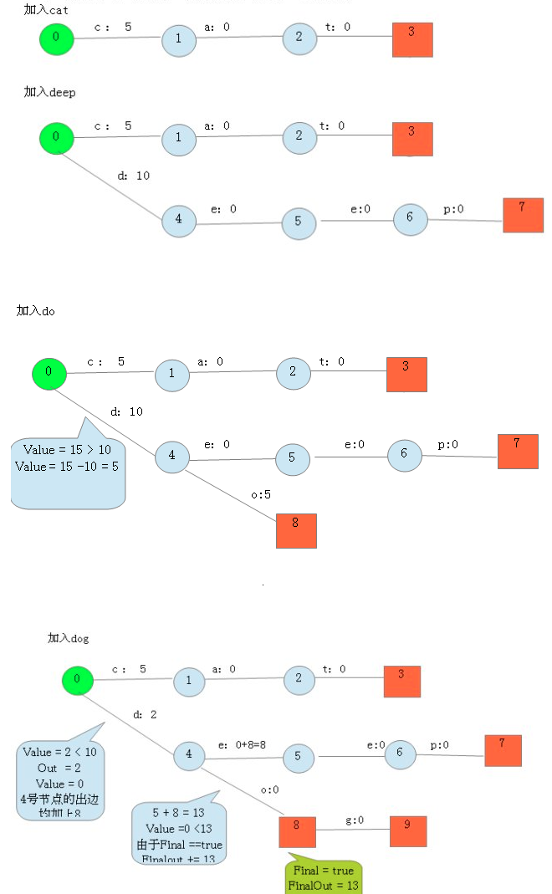
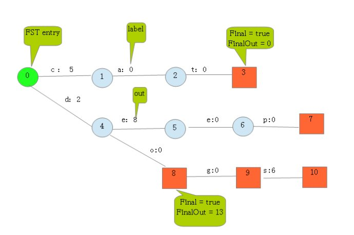
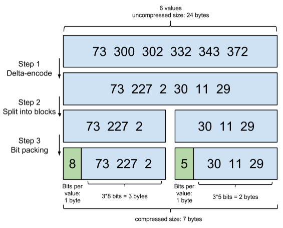
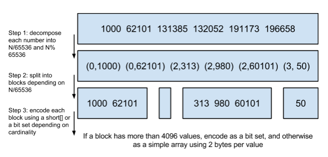
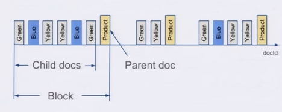

# Elasticsearch 数据压缩算法

# 1 Term Index 的压缩

Lucene 使用 FST 算法以字节的方式来存储 Term Index（即 Term 的前缀），重复利用 Term 的前缀和后缀，使 Term Index 小到可以放进内存，减少存储空间，不过相应地也会占用更多的 CPU 资源。FST 从 Lucene 4.0 开始用于快速定位所查单词在 Term Dictionary 中的位置（Lucene 10.3 起 BlockTree 的 Term Index 已改用专用的 trie 结构，但 FST 的原理仍值得了解，Lucene 的同义词、自动补全等功能也仍在使用 FST）。

有限状态转换器（Finite State Transducer，FST），在语音识别和自然语言搜索、处理等方向被广泛应用。

FST 的功能类似于字典，可以表示成 `FST<Key, Value>` 的形式。其最大的特点是，可以用 `O(length(key))` 的复杂度找到 key 对应的 value，也就是说查找复杂度仅取决于所查找的 key 的长度。

假设我们现在要将以下 Term Index 映射到 Term Dictionary 的 block 序号：

> “cat” —— > 5
>
> “deep” —— > 10
>
> “do” —— > 15
>
> “dog” —— > 2
>
> “dogs” —— > 8

最简单的做法就是定义一个 `Map<String, Integer>`，大家找到自己的位置对号入座就好了。但从减少内存占用的角度想想，有没有更优的办法呢？答案就是 FST。

对于经典 FST 算法来说，要求 **Key 必须按字典序从小到大加入 FST** 中。上面的例子中 key 已经排好序了。

按照以下步骤建立 FST：

```text
1. 建一个空节点，表示 FST 的入口，所有的 Key 都从这个入口开始。
2. 如果还有未处理的 Key，则枚举 Key 的每一个 label。处理流程如下：
   2.1 如果当前节点存在含此 label 的边，则
       2.1.1 如果 Value 包含该边的 out 值，则
             Value = Value - out
       2.1.2 否则
             令 temp = out - Value；
             out = Value，并使下一个节点的所有边 out 都加上 temp。
             如果下一节点是 Final 节点，则 FinalOut += temp
       2.1.3 进入下一个节点
   2.2 否则：新建一个节点，令其 out = Value，Value = 0。
```



最后加入 `dogs`，得到最终的结果：



从上图可以看出，每条边有两个属性，一个表示 label（key 的元素），另一个表示 Value（out）。注意 Value 不一定是数字，还可以是另一个字符串，但要求 Value 必须满足叠加性，如这里的正整数 2 + 8 = 10，字符串的叠加行为：aa + b = aab。

建完这个图之后，我们就可以很容易地查找出任意一个 key 的 Value 了。例如查找 dog，我们查找的路径为：0 → 4 → 8 → 9，其权值和为 2 + 0 + 0 + 0 = 2，其中最后一个 0 表示 `node[9].finalOut = 0`，所以“dog”的 Value 为 2。

# 2 Posting List 的压缩

## 2.1 Frame Of Reference

Lucene 除了上面说到的用 FST 压缩 Term Index 外，对 Posting List 也会进行压缩。

有人可能会有疑问：“Posting List 不是已经只存储文档 ID 了吗？还需要压缩吗？”设想这样一种情况：Lucene 需要对一千万个同学的性别进行索引，而性别只有男、女两种，每个 Posting List 都会有数百万个文档 ID，这里显然有很大的压缩空间与价值，对于减少索引尺寸有非常重要的意义。

Lucene 使用 **Frame Of Reference**（FOR）编码来实现对 Posting List 的压缩，其思路简单来说就是：**增量编码压缩，将大数变小数，按字节存储**。

示意图如下：



- Step 1：Posting List 中的文档 ID 本身是有序的，对其做增量编码（Delta-encode），除第一个数 73 外，后面的数都只存与前一个数的差值，大数就变成了小数。
- Step 2：将增量值切分成若干块（Split into blocks），示例中每 3 个数为一块。
- Step 3：按位压缩（Bit packing），每块取最大的数所需的位数作为该块统一的位宽：第一块最大的 227 需要 8 位，所以这 3 个数每个都占 8 位；第二块最大的 30 需要 5 位，所以这 3 个数每个都占 5 位。每块再用 1 个字节记录位宽，最终 6 个数从 24 字节压缩到了 7 字节。

实际实现中，Lucene 从 4.1 开始使用 FOR 编码 Posting List，每块固定为 128 个文档 ID，不足 128 个的尾部用 VInt 变长编码。较新的版本（如 Lucene 10.x）中，文档 ID 增量块使用不带“补丁”（patching）的 FOR，而词频块使用 PFOR（Patched FOR，允许少数异常大的值单独存储，避免整块位宽被拉高）；Lucene 8.4 起编解码还做了向量化（SIMD 风格）优化。

## 2.2 Roaring Bitmap

除此之外，Lucene 在缓存 Filter 结果时（即 ES 的节点查询缓存 Node Query Cache），还会使用一种叫作 **Roaring Bitmap** 的数据结构来存储文档 ID，同样可以达到压缩存储空间的目的。

说到 Roaring Bitmap，就必须先从 Bitmap 说起。Bitmap 是一种很直观的数据结构，假设有某个 Posting List：

> [1,3,4,7,10]

对应的 Bitmap 就是：

> [1,0,1,1,0,0,1,0,0,1]

非常直观，用 0/1 表示某个值是否存在，比如 10 这个值就对应第 10 位，对应的 bit 值是 1，这样用一个字节就可以代表 8 个文档 ID。Lucene 5.0 之前就是用这样的方式来缓存 Filter 结果的，但这样的压缩方式仍然不够高效：如果有 1 亿个文档，那么需要 12.5MB 的存储空间，而这仅仅对应一个索引字段（我们往往会有很多个索引字段）。于是有人想出了 Roaring Bitmap 这样更高效的数据结构。

Bitmap 的缺点是存储空间随着文档个数线性增长，Roaring Bitmap 要打破这个魔咒，思路是先分块，再根据每一块的稠密程度选择最省空间的存储方式：

将 Posting List 按照 65536 为界限分块，比如第一块所包含的文档 ID 范围在 0~65535 之间，第二块的 ID 范围在 65536~131071 之间，以此类推。再用 <商，余数> 的组合表示每一个 ID，这样每块里的 ID（余数）范围都在 0~65535 内了。剩下的就好办了，既然每块的 ID 不会变得无限大，那么我们就可以用最有效的方式对这里的 ID 进行存储。



- Step 1：将每个数除以 65536，用得到的商和余数（`N/65536` 和 `N%65536`）来表示这个数。
- Step 2：按商进行分块，商相同的数分在同一块中。
- Step 3：根据每块中元素的个数，选择用 `short[]` 或者 Bitset 来编码。

为什么是以 65536 为界限呢？

程序员的世界里除了 1024 外，65535 也是一个经典值，因为它等于 `2¹⁶ - 1`，正好是用 2 个字节能表示的最大数，即一个 short 的存储单位。注意到上图里的最后一行“If a block has more than 4096 values, encode as a bit set, and otherwise as a simple array using 2 bytes per value”：如果是元素很多的大块，就用 Bitset 存，更节省空间；如果是小块，就用 2 个字节存一个值，直接用一个 `short[]` 存着更方便。

那为什么用 4096 来区分大块还是小块呢？

因为一块最多包含 65536 个值，用 Bitset 存储固定需要 65536 bit = 8192 字节（8KB）；而用 `short[]` 存储，每个值占 2 字节，`4096 × 2 bytes = 8192 bytes`，也正好是 8KB。所以元素个数超过 4096 时 Bitset 更省空间，不超过 4096 时数组更省空间。

# 3 文档数量的压缩

一种常见的压缩存储时间序列的方式是把多个数据点合并成一行。OpenTSDB 支持海量数据的一个绝招就是定期把很多行数据合并成一行，这个过程叫 compaction。类似地，VividCortex 使用 MySQL 存储的时候，也把一分钟的很多数据点合并存储到 MySQL 的一行里以减少行数。

这个过程可以示例如下：

| 12:05:00 | 10   |
| -------- | ---- |
| 12:05:01 | 15   |
| 12:05:02 | 14   |
| 12:05:03 | 16   |

合并之后就变成了：

| 12:05 | 10   | 15   | 14   | 16   |
| ----- | ---- | ---- | ---- | ---- |

可以看到，行变成了列，每一列可以代表这一分钟内一秒的数据。

Elasticsearch 有一个功能可以实现类似的优化效果，那就是嵌套文档（Nested Document）。我们可以把一段时间内的很多个数据点打包存储到一个父文档里，变成其嵌套的子文档。示例如下：

```json
{"timestamp": "12:05:01", "idc": "sz", "value1": 10, "value2": 11}
{"timestamp": "12:05:02", "idc": "sz", "value1": 9, "value2": 9}
{"timestamp": "12:05:03", "idc": "sz", "value1": 18, "value2": 17}
```

可以打包成：

```json
{
  "max_timestamp": "12:05:03",
  "min_timestamp": "12:05:01",
  "idc": "sz",
  "records": [
    {"timestamp": "12:05:01", "value1": 10, "value2": 11},
    {"timestamp": "12:05:02", "value1": 9, "value2": 9},
    {"timestamp": "12:05:03", "value1": 18, "value2": 17}
  ]
}
```

这样可以把数据点公共的维度字段上移到父文档里，而不用在每个子文档里重复存储，从而减少索引的尺寸。



在存储的时候，无论父文档还是子文档，对于 Lucene 来说都是文档，都会有文档 ID。但是对于嵌套文档来说，可以保证子文档和父文档的文档 ID 是连续的，而且父文档总是最后一个。有这样的有序性作为保障，用一个包含所有父文档的 Posting List 就可以跟踪所有的父子关系，也可以很容易地在父子文档 ID 之间做转换。把父子关系也理解为一个 Filter，那么查询时不过是又 AND 了另外一个 Filter 而已。前面我们已经看到了 Elasticsearch 可以非常高效地处理多 Filter 的情况，充分利用底层的索引。

使用了嵌套文档之后，对于 Term 的 Posting List 只需要保存父文档的文档 ID 就可以了，可以比保存所有数据点的文档 ID 要少很多。如果我们可以在一个父文档里塞入 50 个嵌套文档，那么 Posting List 可以变成之前的 1/50。

需要注意的是，嵌套文档的代价是更新任意一个数据点都要重建整个父文档，且单个文档的嵌套对象数量默认受 `index.mapping.nested_objects.limit`（默认 10000）限制。对于指标类时间序列数据，ES 8.x 起更推荐使用时间序列数据流（TSDS），它会按维度和时间对文档排序，并结合 Doc Values 的增量、GCD 等编码以及降采样（downsampling）来压缩存储，效果通常优于手工打包嵌套文档。

总结一下：Lucene 用 FST 压缩 Term Index，用 FOR/PFOR 压缩磁盘上的 Posting List，用 Roaring Bitmap 压缩缓存中的 Filter 结果，而在业务建模层面还可以通过合并文档来减少文档数量，从多个层次共同降低索引的存储与内存开销。
