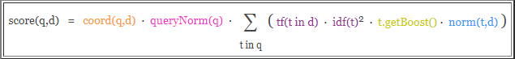
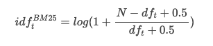
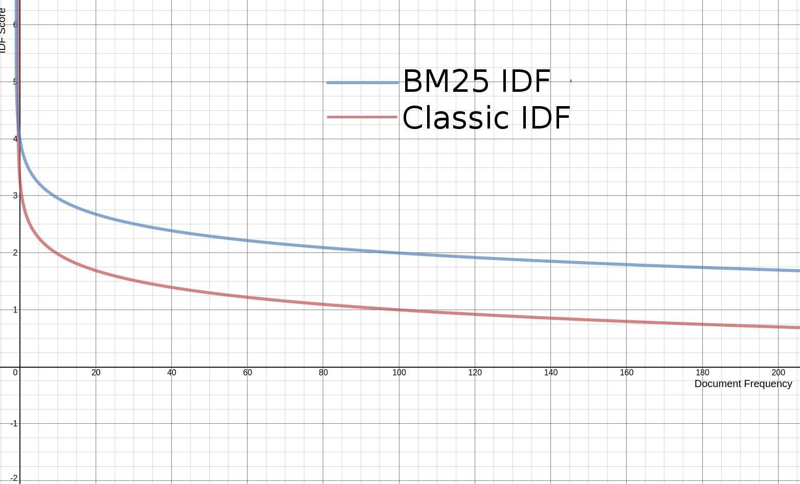
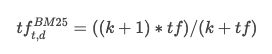
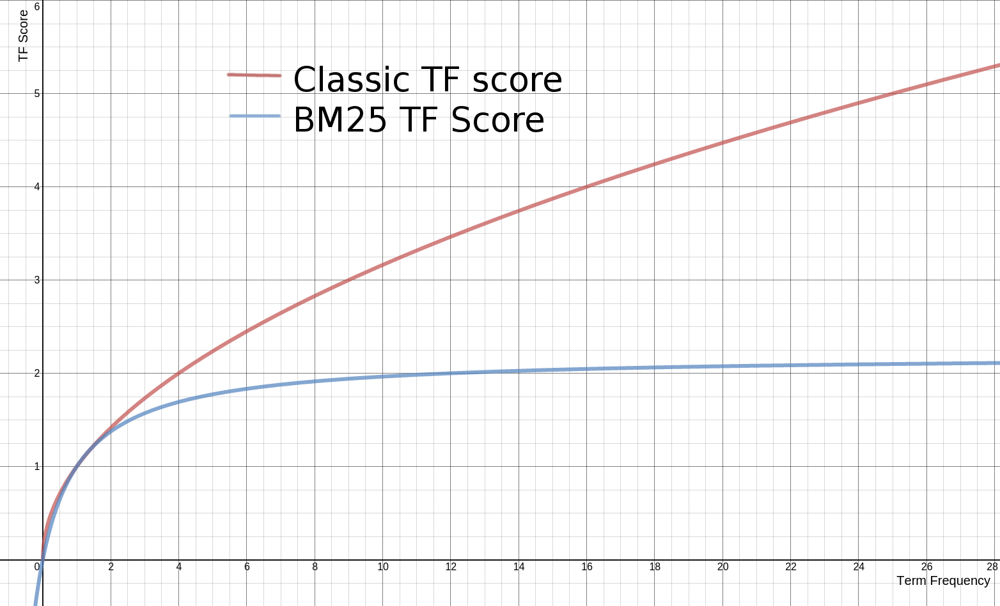
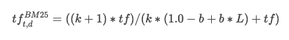
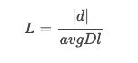

# Elasticsearch 评分机制

# 1 评分模型

评分模型以查询作为输入，将各个相关性因素通过公式综合起来，返回每个文档的最终得分。这个综合考量的过程，就是让相关的文档被优先返回的过程。

Elasticsearch 是基于 Lucene 的，所以它的评分机制也是基于 Lucene 的。在 Lucene 中把这种相关性称为**得分**（score），确定文档和查询有多大相关性的过程被称为**打分**（scoring）。

ES 中最常提到的评分模型是 TF-IDF 和 BM25，**TF-IDF 属于向量空间模型，而 BM25 属于概率模型**，但是它们的评分公式差别并不大，都使用 IDF 方法和 TF 方法的某种乘积来定义单个词项的权重，然后把和查询匹配的词项的权重相加作为整篇文档的分数。

在 ES 5.0 版本之前默认使用 TF-IDF 算法（Lucene 中的 `ClassicSimilarity`），而 5.0 之后默认使用 BM25。`classic` 相似度在 6.x 中被标记为废弃，**ES 7.0 起已被移除**，不能再作为索引的相似度配置。因此，下面介绍的 TF-IDF 主要是历史默认算法和理解 BM25 的原理铺垫，当前版本（ES 8.x/9.x）实际使用的是 BM25。

## 1.1 TF-IDF 模型

- **TF**：TF（Term Frequency），即**词频**，表示词条在文本中出现的频率。考虑一篇文档得分的首要方式，是查看一个词条在**当前文档**（注意 IDF 统计的范围是所有文档）中出现的次数。比如某篇文章是围绕 ES 的打分展开的，那么文章中肯定会多次出现相关字眼，查询时我们认为该篇文档更符合，所以这篇文档的得分会更高。TF 的值通常会被归一化，一般是词频除以文章总词数，以防止它偏向长的文件（同一个词语在长文件里可能会比短文件有更高的词频，而不管该词语重要与否）。
- **IDF**：IDF（Inverse Document Frequency），即**逆文档频率**，反映了一个词在**所有文档**中出现的频率。如果一个词在很多文本中出现，那么它的 IDF 值应该低；反过来，如果一个词在比较少的文本中出现，那么它的 IDF 值应该高。

TF-IDF 算法简单来说就是：一个词语在某一篇文档中出现次数越多，同时在所有文档中出现次数越少，那么该文档越能与其他文章区分开来，评分就会越高。

Lucene 中经典的评分公式（Lucene Practical Scoring Function）如下：



`score(q, d) = coord(q, d) × queryNorm(q) × ∑(t in q) [ tf(t in d) × idf(t)² × t.getBoost() × norm(t, d) ]`

- `coord(q, d)`：基于文档中包含查询关键词个数计算出来的调整因子。一般而言，如果一个文档相比其他文档出现了更多的查询关键词，那么其值越大。
- `queryNorm(q)`：基于查询语句的归一化因子，其值为查询语句中每一个查询词权重平方和的平方根的倒数，即 `1 / sqrt(sumOfSquaredWeights)`。这个因子不影响文档的排名，只是为了使比较不同查询语句的得分变得可行。
- `tf(t in d)`：即词频，Term t 在当前算分的文档 d 中出现的次数，Lucene 中取其平方根 `tf = sqrt(freq)`。对一个给定的 Term，出现此 Term 次数越多的文档将获得越高的分数。
- `idf(t)`：即逆文档频率，`idf(t) = 1 + log(numDocs / (docFreq + 1))`，越不常出现的 Term 将为最后的总分贡献越多的分数。
- `t.getBoost()`：查询时给查询中的 Term t 设置的权重值。
- `norm(t, d)`：长度归一化因子，`norm = 1 / sqrt(numTerms)`，其值由给定字段中 Term 的个数决定（在索引文档的时候已经计算出来，并且存储到了索引中，早期版本的索引期 boost 也会合并进这个值）。字段的文本越长，因子的权重越低，这表明 Lucene 打分公式偏向于字段包含 Term 少的文档。

需要注意的是，`coord` 和 `queryNorm` 这两个因子已在 Lucene 7.0（对应 ES 6.0）中移除，BM25 中也不存在这两个因子。

## 1.2 BM25 模型

BM25 全称 `Best Match 25`，其中“25”一般解释为该系列加权公式的第 25 个版本。该算法是在 1994 年的 TREC-3（Third Text REtrieval Conference）会议上提出的，它将文本相似度问题转化为概率模型，可以看作是 TF-IDF 的改良版，我们看下它是如何进行改良的。

### 1.2.1 对 IDF 的改良

BM25 中的 IDF 公式为：



`idf(t) = log(1 + (N - df + 0.5) / (df + 0.5))`

其中 `N` 为文档总数，`df` 为包含该 Term 的文档数。原版 BM25 的 log 中是没有加 1 的，Lucene 为了防止产生负值，做了一点小优化。虽然对公式进行了更改，但其实和原来的公式没有实质性的差异，下面是新旧函数曲线对比：



### 1.2.2 对 TF 的改良

BM25 中 TF 的公式为：



`tf(BM25) = ((k + 1) × tf) / (k + tf)`

其中 `tf` 是传统的词频值，`k` 即配置中的 `k1`。先来看下改良前后的函数曲线对比（下图中 k = 1.2）：



可以看到，传统的 tf 计算公式中，词频越高，tf 值就越大，没有上限；但 BM25 中的 tf，随着词频的增长，tf 值会无限逼近 `k + 1`，相当于是有上限的（即“词频饱和”）。这就是二者的区别。一般 `k` 取 1.2，Lucene 中也使用 1.2 作为 k 的默认值。

在传统的计算公式中，还有一个 `norm`。BM25 将这个因素加到了 TF 的计算公式中，结合了 `norm` 因素的 BM25 中的 TF 计算公式为：



`tf(BM25) = ((k + 1) × tf) / (k × (1.0 - b + b × L) + tf)`

和之前相比，就是给分母上的 `k` 加了一个乘数 `(1.0 - b + b × L)`。其中的 `L` 的计算公式为：



`L = |d| / avgDl`

其中，`|d|` 是当前文档的长度，`avgDl` 是语料库中所有文档的平均长度。

`b` 是一个常数，用来控制 `L` 对最终评分影响的大小，一般取 0~1 之间的数（取 0 则代表完全忽略 `L`）。Lucene 中 `b` 的默认值为 0.75。

综合起来，BM25 中单个 Term 的得分就是 IDF 与 TF 两部分的乘积，文档得分为所有匹配 Term 得分之和：

`score(q, d) = ∑(t in q) idf(t) × ((k1 + 1) × tf) / (tf + k1 × (1 - b + b × |d| / avgDl))`

通过这些细节上的改良，BM25 在很多实际场景中的表现都优于传统的 TF-IDF，所以从 Lucene 6.0.0 版本（对应 ES 5.0）开始，BM25 上位成为默认的相似度评分算法。

### 1.2.3 配置

```json
PUT /my_index
{
  "settings": {
    "index": {
      "similarity": {
        "my_custom_similarity": {
          "type": "BM25",
          "k1": 1.2,
          "b": 0.75,
          "discount_overlaps": false
        }
      }
    }
  },
  "mappings": {
    "properties": {
      "title": {
        "type": "text",
        "analyzer": "ik_smart",
        "similarity": "my_custom_similarity"
      }
    }
  }
}
```

上例是通过 `similarity` 属性来指定打分模型，用到了以下三个参数：

- `k1`：控制词频（TF）的饱和速度，即词频对得分的影响程度，默认为 1.2。
- `b`：介于 0~1 之间的数值，控制文档篇幅对得分的影响程度，默认为 0.75。
- `discount_overlaps`：计算字段长度用于归一化时，是否忽略出现在同一位置上的多个分词（如同义词），默认值为 `true`。

如果我们希望某个索引的所有字段默认都使用某种特定的打分模型，可以在创建索引时（或在索引模板中）配置 `index.similarity.default`：

```json
PUT /my_index
{
  "settings": {
    "index": {
      "similarity": {
        "default": {
          "type": "BM25",
          "k1": 1.2,
          "b": 0.75
        }
      }
    }
  }
}
```

早期版本可以在 `elasticsearch.yml` 中配置 `index.similarity.default.type: BM25`，但 ES 5.0 起已不允许在节点配置文件中设置索引级别的配置，需要改用上面的索引设置或索引模板。

# 2 评分中的 boosting

通过 boosting 可以人为控制某个字段在评分过程中的比重，有两种类型：

- 索引期间的 boosting
- 查询期间的 boosting

早期版本可以在 mapping 中给字段设置 `boost` 参数，在索引期间改变字段的评分权重。但这种方式问题较多：索引期的 boost 是存储在索引中的（与 norm 一起，只用一个字节存储，会损失精度），要想修改就必须重新索引文档；而且 boost 作用于每个词条，被 boost 的字段匹配上多个词条时会被重复放大，影响最终得分。因此 ES 5.0 起索引期 boost 被废弃（mapping 中的 `boost` 改为在查询时生效），**ES 8.0 起 mapping 中的 `boost` 参数已被彻底移除**，现在应统一使用查询期间的 boosting。

几乎所有的查询类型都支持 `boost`，例如：

```json
{
  "query": {
    "bool": {
      "should": [
        {
          "match": {
            "title": {
              "query": "elasticsearch rocks",
              "boost": 2.5
            }
          }
        },
        {
          "match": {
            "content": "elasticsearch rocks"
          }
        }
      ]
    }
  }
}
```

对于最终得分而言，加了 boost 的 title 查询更有影响力。boost 主要用于调整 bool 等组合查询中各子句之间的相对权重，在这类查询中才更有意义。

boost 也可以用于 `multi_match` 查询：

```json
{
  "query": {
    "multi_match": {
      "query": "elasticsearch rocks",
      "fields": [
        "title",
        "content"
      ],
      "boost": 2.5
    }
  }
}
```

除此之外，我们还可以使用特殊的语法，只为特定的字段指定一个 boost：在字段名称后添加一个 `^` 符号和 boost 的值，告诉 ES 只需对那个字段进行 boost：

```json
{
  "query": {
    "multi_match": {
      "query": "elasticsearch rocks",
      "fields": [
        "title^3",
        "content"
      ]
    }
  }
}
```

上例中，title 字段被 boost 了 3 倍。

需要注意的是：boost 是相对值。在 Lucene 7.0 移除 `queryNorm` 之后，boost 会直接乘到对应子查询的得分上，但文档的最终得分通常是多个子句得分的组合，所以把一个字段 boost 4 倍，并不意味着文档的最终得分就是原来的 4 倍；如果对所有待搜索的子句都 boost 同样的值，那么文档之间的相对排序不变，就好像没有 boost 一样。

# 3 explain 评分细节

ES 背后的评分过程比我们想象的要复杂，有时候某个查询结果可能跟我们的预期不太一样，这时候可以通过 `explain` 让 ES 解释一下评分细节（也可以使用 `GET /<index>/_explain/<id>` API 查看单个文档的评分细节）。

```json
{
  "query": {
    "match": {
      "title": "北京"
    }
  },
  "explain": true,
  "_source": "title", 
  "size": 1
}
```

由于结果太长，我们这里对结果进行了过滤（`"size": 1` 只返回一篇文档），并只查看指定的字段（`"_source": "title"` 只返回 title 字段）。下面的返回结果来自 ES 6.x（因此还能看到 `_type` 字段、默认 5 个分片以及数字形式的 `hits.total`；ES 7.0 起默认主分片数为 1，`hits.total` 变为 `{"value": 24, "relation": "eq"}` 形式，ES 8.0 起 `_type` 也已移除）：

```json
{
  "took" : 1,
  "timed_out" : false,
  "_shards" : {
    "total" : 5,
    "successful" : 5,
    "skipped" : 0,
    "failed" : 0
  },
  "hits" : {
    "total" : 24,
    "max_score" : 4.9223156,
    "hits" : [
      {
        "_shard" : "[py1][1]",
        "_node" : "NRwiP9PLRFCTJA7w3H9eqA",
        "_index" : "py1",
        "_type" : "doc",
        "_id" : "NIjS1mkBuoj17MYtV-dX",
        "_score" : 4.9223156,
        "_source" : {
          "title" : "大写的尴尬 插混为啥在北京不受待见？"
        },
        "_explanation" : {
          "value" : 4.9223156,
          "description" : "weight(title:北京 in 36) [PerFieldSimilarity], result of:",
          "details" : [
            {
              "value" : 4.9223156,
              "description" : "score(doc=36,freq=1.0 = termFreq=1.0\n), product of:",
              "details" : [
                {
                  "value" : 4.562031,
                  "description" : "idf, computed as log(1 + (docCount - docFreq + 0.5) / (docFreq + 0.5)) from:",
                  "details" : [
                    {
                      "value" : 4.0,
                      "description" : "docFreq",
                      "details" : [ ]
                    },
                    {
                      "value" : 430.0,
                      "description" : "docCount",
                      "details" : [ ]
                    }
                  ]
                },
                {
                  "value" : 1.0789746,
                  "description" : "tfNorm, computed as (freq * (k1 + 1)) / (freq + k1 * (1 - b + b * fieldLength / avgFieldLength)) from:",
                  "details" : [
                    {
                      "value" : 1.0,
                      "description" : "termFreq=1.0",
                      "details" : [ ]
                    },
                    {
                      "value" : 1.2,
                      "description" : "parameter k1",
                      "details" : [ ]
                    },
                    {
                      "value" : 0.75,
                      "description" : "parameter b",
                      "details" : [ ]
                    },
                    {
                      "value" : 12.1790695,
                      "description" : "avgFieldLength",
                      "details" : [ ]
                    },
                    {
                      "value" : 10.0,
                      "description" : "fieldLength",
                      "details" : [ ]
                    }
                  ]
                }
              ]
            }
          ]
        }
      }
    ]
  }
}
```

在新增的 `_explanation` 字段中，可以看到 `value` 值是 `4.9223156`，那么它是怎么算出来的呢？

分词“北京”在标题字段（title）中出现了 `1` 次，所以 TF 部分经过 `"description" : "tfNorm, computed as (freq * (k1 + 1)) / (freq + k1 * (1 - b + b * fieldLength / avgFieldLength)) from:"` 计算，得分是 `1.0789746`。

那么逆文档频率呢？根据 `"description" : "idf, computed as log(1 + (docCount - docFreq + 0.5) / (docFreq + 0.5)) from:"` 计算，得分是 `4.562031`。

所以最终得分是 `1.0789746 × 4.562031 = 4.9223155734126`，四舍五入后就是 `4.9223156`。

在 ES 7.x 及之后的版本（Lucene 8+）中，`explain` 的输出格式有所变化：Lucene 8 从 BM25 的分子中去掉了 `(k1 + 1)`（它对排序没有影响），ES 为保持得分与旧版本一致，把它作为一个值为 `2.2` 的 `boost` 乘回去，所以会看到 `score(freq=1.0), computed as boost * idf * tf from:`，其中 `tf, computed as freq / (freq + k1 * (1 - b + b * dl / avgdl))`。两种写法算出的最终得分是相同的。

需要注意的是，`explain` 会给 ES 带来额外的性能开销，一般只在调试时使用。

# 4 小结

TF-IDF 是理解相关性评分的基础，但当前 ES 的默认相似度是 BM25（此外还内置 DFR、DFI、IB、LM Dirichlet、LM Jelinek-Mercer 等可选模型），其核心是 IDF 与带饱和、带长度归一化的 TF 的乘积，默认参数 `k1 = 1.2`、`b = 0.75`。在此之上，可以用查询期 `boost` 调整子句权重，用 `explain` 或 `_explain` API 排查得分；如果需要融入销量、时间、距离等业务因素，可以使用 `function_score`、`script_score` 或 `rank_feature` 查询；在语义检索场景下，还可以使用 `dense_vector` 字段按向量相似度（如 cosine、dot_product）打分。
