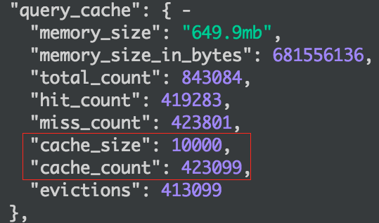
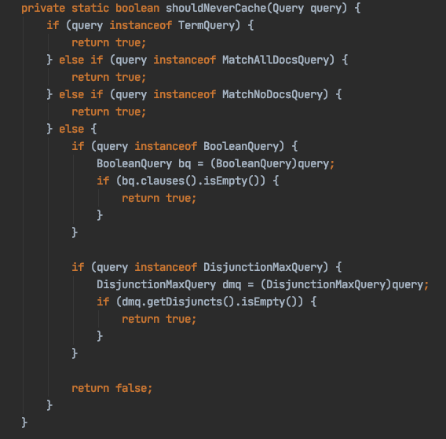
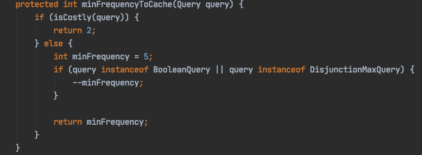
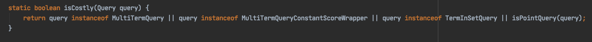
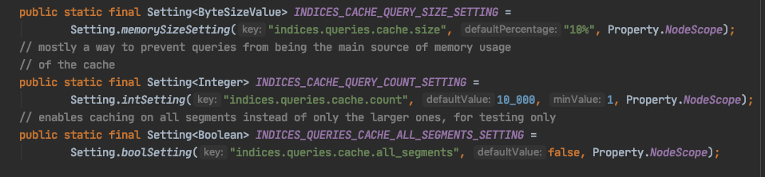
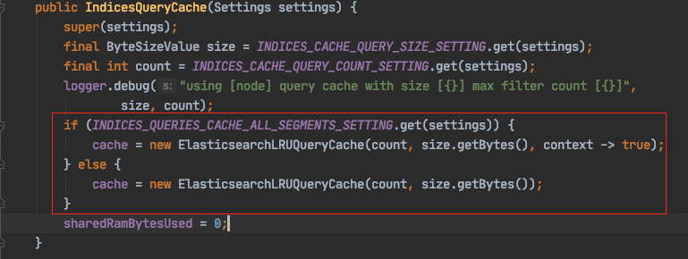
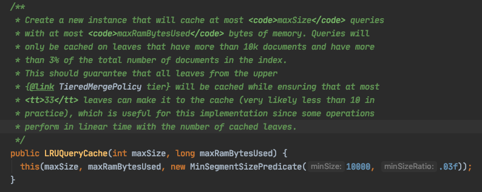

# Elasticsearch 缓存

Elasticsearch 包含三种类型的缓存，分别为：`Node Query Cache`、`Shard Request Cache`、`Fielddata Cache`。

# 1 Node Query Cache

## 1.1 作用域

Query Cache 是**节点（Node）级别的，被该节点上所有分片（Shard）共享**。

早期版本中它叫作 `Filter Cache`，顾名思义，它的作用是对**过滤器的执行结果进行缓存**。从 5.0 开始，Query Cache 只缓存 filter 上下文（如 `bool` 查询中的 `filter`、`must_not` 子句，以及 `constant_score` 查询）中的查询结果，参与相关性评分的 query 上下文不会被缓存。

Query Cache 缓存的是压缩过的 bitset，对应满足查询条件的 docID 列表。添加缓存时会注册一个回调，当 Segment 被合并或删除时，对应的缓存也会被移除。

简单来看可以这样理解：一个 ES 查询会先被解析成一系列 Lucene 的子查询（Query），对于其中的 filter 子句，只要查询条件相同，结果集就是确定的，那么这些子查询的结果就可以存放在一个地方当作缓存使用，这就是 Query Cache。

## 1.2 配置参数

既然是缓存，肯定会对数量和内存有限制。通过 `_nodes/stats/indices/query_cache` 可以查看 Query Cache 的状态：

默认情况下，ES 会用 10% 的堆（Heap）大小来存放所有的 Query Cache，可以通过参数 `indices.queries.cache.size`（默认 `10%`）控制。另外还可以通过索引级参数 `index.queries.cache.enabled`（默认 `true`）关闭某个索引的 Query Cache。

从截图中可以发现一个非常醒目的整数，这就是另外一个限制条件：缓存的最大个数，默认为 10000，可以通过参数 `indices.queries.cache.count`（默认 `10000`）控制。

有人可能会发现：为什么我配置了 10000，但是还会出现超过 10000 的情况？

前面我们提到，虽然缓存的是一个子查询，但这个查询对应的 Segment 有很多个，所以系统需要分别缓存每个 Segment 查询后对应的 bitset 结果。于是我们有了以下公式：

`cacheSize = 当前符合缓存条件的 Segment 数 * 符合缓存条件的子查询数量`

也就是说，一个子查询会缓存多份数据，每份数据来源于相应的 Segment。而 `cache_count` 则是历史上所有发生过的缓存行为的累计次数。

缓存在 ES 内部的数据结构就是一个 Map，key 是一个具体的查询，value 则是以 Segment 为 key 的另一层 K/V。上面 10000 的配置只限制到查询（Query）这一层，也就是说真正的 `cache_size` 是 `Query size * segment nums`。如果你有 2 个 Segment，那么你看到的统计数据很可能是 `cache_size: 20000`。

## 1.3 哪些 Query 会被缓存

这个问题可以拆分成 2 个子问题：

- 这个 Query 会不会被缓存
- 这个 Query 请求多少次后会被缓存

可以从 Lucene 的 `UsageTrackingQueryCachingPolicy.java` 这个类里面找答案。

第一个问题：

很明了，以下 Query 不会参与缓存：`TermQuery`、`MatchAllDocsQuery`、`MatchNoDocsQuery`，以及没有任何子句的 `BooleanQuery` 和没有任何子查询的 `DisjunctionMaxQuery`。

**ES 从 5.1.1 开始取消了对 `TermQuery` 的缓存**，官方的说法是，因为 Term 过滤执行得非常快，取消缓存在多数情况下反而可以提高性能。

对于第二个问题，继续看代码：

- `MultiTermQuery`、`MultiTermQueryConstantScoreWrapper`、`TermInSetQuery`、`Point*Query` 等查询被认为是耗时的查询，在最近的查询历史中出现 2 次就会被缓存。
- 其他 Query 需要出现 5 次才会被缓存；如果是 `BooleanQuery` 或 `DisjunctionMaxQuery`，则少 1 次，即出现 4 次就会被缓存。

## 1.4 哪些 Segment 会参与缓存

继续从代码中寻找答案，`IndicesQueryCache.java` 会从配置文件中读取三个参数：

前两个参数已经介绍过，第三个参数 `indices.queries.cache.all_segments` 用于控制是否所有的段都参与缓存，默认为 `false`。

假如 `indices.queries.cache.all_segments` 为 `false`，则进入如下代码：

符合以下条件的段才会参与缓存：

- 段中的文档数不少于 10000
- 段中的文档数占分片总文档数的比例不低于 3%

也就是说，体积太小的段不会被缓存，因为在小段上直接执行查询的开销本来就很低。

# 2 Shard Request Cache

## 2.1 作用域

Request Cache 是**分片（Shard）级别**的。

当一个查询发送到 ES 集群的某个节点上时，这个节点会把该查询扩散到其他节点并在相应分片上执行，我们姑且把在分片上执行的结果叫作“本地结果集”。这些本地结果集最终会汇集到最初接收请求的那个协调节点，这些“分片级”的结果集会合并成“全局”结果集返回给调用端。

Request Cache 就是为了缓存这些“分片级”的本地结果集。但默认情况下它**只会缓存 `size=0` 的请求**，所以不会缓存 `hits`，而是缓存 `hits.total`、聚合（aggregations）以及 suggestions 等信息。对于 `size>0` 的请求，即使索引开启了 Request Cache 也不会缓存，需要在请求上显式加上查询参数 `request_cache=true` 才行。另外，使用了 `now` 等时间相关表达式或不确定性脚本（如 `Math.random()`）的请求也不会被缓存。

对于 Request Cache 来说，它的 Cache Key 就是整个查询的 JSON 请求体（DSL），所以要命中缓存，查询生成的 DSL 必须完全一样，这里的“一样”是指 DSL 字符串一样。只要有一个字符或者子查询的顺序发生变化，都不会命中缓存。

## 2.2 缓存失效

Request Cache 非常智能，它能够保证与近实时搜索中的非缓存查询结果一致。这句话读起来很难懂，下面简单解释一下。

我们都知道 ES 是一个近实时（near real-time）搜索引擎。为什么是近实时呢？因为从我们向 ES 发送一个索引文档的请求，到这个文档变成可搜索（Searchable），默认需要 1 秒，我们可以通过 `index.refresh_interval` 参数来设置刷新时间间隔，也就是说我们在执行一个搜索请求时，数据实际上是有延迟的。回到刚才的问题，那句话其实指的是：ES 能保证使用 Request Cache 时的搜索结果和不使用 Request Cache 的近实时搜索结果相同。那 ES 是如何保证两者结果相同的呢？

Request Cache 的失效是自动的，当索引 Refresh 时就会失效（映射更新时也会失效），所以其**生命周期是一个 `refresh_interval`**，也就是说默认情况下 Request Cache 每 1 秒失效一次（注意：只有分片在这段时间内确实发生了变化才会失效）。在一个文档被索引到它变成可搜索之前的这段时间内，不管是否有请求命中缓存，该文档都不会被返回，正因为如此，ES 才能保证使用 Request Cache 执行的搜索和非缓存的近实时搜索结果一致。索引刷新间隔设置得越长，缓存失效的间隔也就越长；如果缓存被写满，将采用 LRU 策略清除。当然我们也可以手动设置参数 `indices.requests.cache.expire` 指定失效时间，但基本上没必要这样做，因为缓存在每次索引 Refresh 时都会自动失效。

## 2.3 配置参数

- `index.requests.cache.enable`：索引级参数，默认为 `true`，表示是否启用 Request Cache，可动态修改。
- `indices.requests.cache.size`：Request Cache 占用 JVM 堆内存的比例，默认为堆的 1%。
- `indices.requests.cache.expire`：缓存的过期时间（TTL），取值为时间值，如 `1m`，默认不设置。

# 3 Fielddata Cache

## 3.1 作用域

Fielddata Cache 是 **Segment 级别**的。

Fielddata 与 Doc Values 的作用一样，都是让我们在倒排索引（Inverted Index）的基础上进行聚合（aggregation）统计和排序（sort）。

当第一次在 `text` 字段（只有 `text` 字段使用 Fielddata，其余字段使用 Doc Values）上进行聚合、排序或通过脚本访问时，就会触发该字段 Fielddata Cache 的加载。需要注意的是，5.0 起 `text` 字段默认禁用 Fielddata，必须在映射中显式设置 `"fielddata": true` 才能使用，官方并不推荐这样做，一般应改用 `keyword` 子字段。这种缓存是 Segment 级别的，当有新的 Segment 打开时，旧的缓存不会重新加载，而是直接把新 Segment 对应的 Fielddata Cache 加载到内存。一个 Fielddata 被加载后，会在对应 Segment 的生命周期内一直驻留在内存中。也就是说，段合并时会触发合并后更大段的 Fielddata Cache 加载。

早期版本中，ES 没有 Doc Values 这样的数据结构，只有倒排索引。做数据聚合和排序的时候，需要将倒排索引的数据读取出来，按列构造成 `docid -> value` 的形式之后，才能高效地进行排序和聚合计算。由于这个转换工作很耗资源，转换好的列表会被缓存到 Fielddata Cache 中以提升速度。但是因为这个缓存位于堆内，海量数据聚合时生成的 Fielddata 可能连堆都放不下，很容易引起性能问题，甚至 JVM OOM。

ES 1.0 引入了 Doc Values，并从 2.0 开始默认启用。它将列式数据的构建放在了索引时（index time），并且这些数据直接存放在磁盘上，通过内存映射文件（memory-mapped file）的方式访问，使得海量数据的聚合可以有效利用堆外内存，性能和稳定性都有提高。因此 `keyword`、数值型等支持 Doc Values 的字段类型不再需要构建 Fielddata。由于 `text` 字段不支持 Doc Values，对 `text` 类型字段做排序和聚合时，依然会构造 Fielddata 并填充到缓存里。另外要注意，`keyword` 等字段在聚合时构建的全局序号（Global Ordinals）同样存放在 Fielddata Cache 中，所以即使不使用 `text` 字段的 Fielddata，这块缓存也可能有占用。

## 3.2 配置参数

- `indices.fielddata.cache.size`：设置缓存大小，默认不限制，可设置为百分比（如 `30%`）或具体数值（如 `12GB`）。
- `indices.breaker.fielddata.limit`：设置 Fielddata 断路器的限制大小（判断公式：`预估内存 + 现有内存 <= 断路器内存限制`），默认是 JVM 堆内存的 40%。当查询尝试加载更多数据到内存时会抛出异常，以此来避免 JVM OOM。
- `indices.breaker.fielddata.overhead`：内存预估值系数，是一个常数，默认为 `1.03`。比如预估要加载 100MB 数据，那么会用 `100MB * 1.03 = 103MB` 来计算是否超过断路器设置的最大值。

由于 `indices.fielddata.cache.size` 默认不限制，生产环境中建议显式设置一个比断路器限制更小的值（如 `20%`），让旧数据可以被驱逐，而不是一直累积到触发断路器。

# 4 小结

三种缓存的定位各不相同：Node Query Cache 是节点级的，缓存 filter 上下文在每个 Segment 上的匹配结果；Shard Request Cache 是分片级的，默认缓存 `size=0` 请求的聚合等结果，并随 Refresh 自动失效；Fielddata Cache 是 Segment 级的，主要服务于 `text` 字段的 Fielddata 以及全局序号。三者都位于 JVM 堆内，在排查堆内存占用时，可以通过 `_nodes/stats/indices` 分别查看它们的使用情况。
