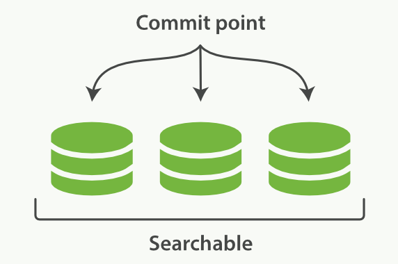
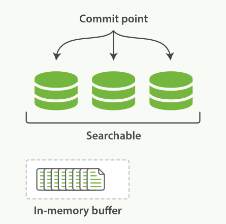
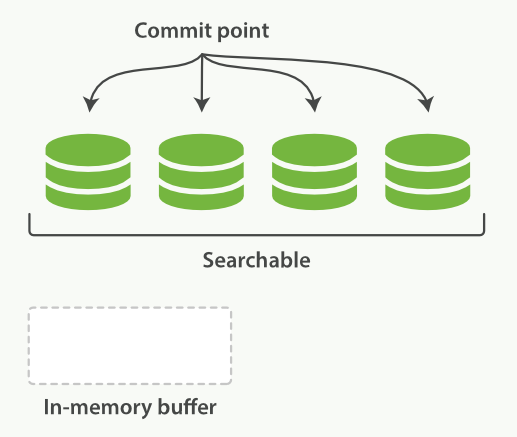
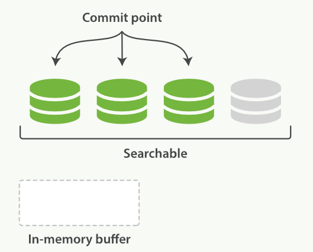
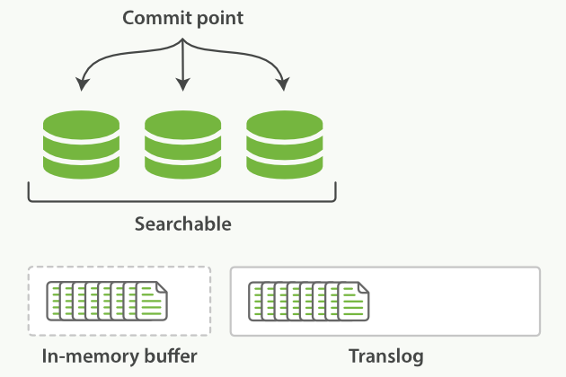
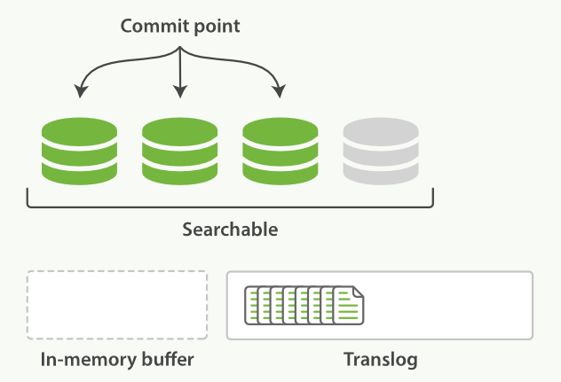
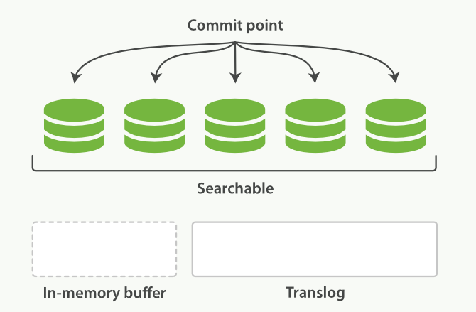
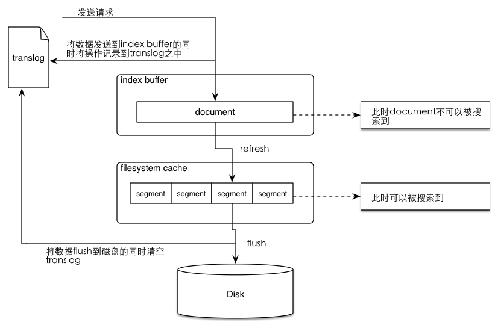
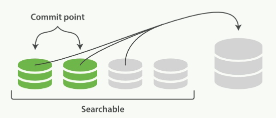
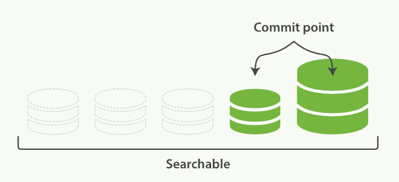

# Elasticsearch 存储原理

# 1 段

倒排索引被写入磁盘后是不可变的。ES 解决“不变性”与“更新索引”这对矛盾的方式是使用多个索引：利用新增的索引来反映修改，查询时从旧到新依次查询，最后再对结果进行合并。

ES 底层基于 Lucene，其中最核心的概念就是**段（Segment）**，每个段本身就是一个倒排索引。

一个 Lucene 索引（对应 ES 中的一个分片）由多个段的集合和**提交点（Commit Point）**文件组成。

提交点文件中有一个列表，存放着所有已知的段。下面是一个带有 1 个提交点和 3 个段的 Lucene 索引示意图：



# 2 Doc 写入

## 2.1 写入缓存

Doc 会先被收集到内存中的缓冲区（Buffer）内，这时还无法被搜索到，如下图所示：



每隔一段时间，Buffer 会被提交，在写入磁盘后打开新段，使其对搜索可见，详细过程如下：

1. 创建一个新段，作为一个追加的倒排索引，写入磁盘（文件系统缓存）
2. 将包含新段的新提交点写入磁盘（文件系统缓存）
3. 磁盘进行 `fsync`，将文件系统缓存中等待的写入操作全部物理写入磁盘
4. 打开这个新段，使段内文档对搜索可见
5. 清空内存中的 Buffer，又可以把新的 Doc 写入 Buffer 了

下面展示了这个过程完成后段和提交点的状态：



通过这种方式，新文档从被索引到可被搜索的时间间隔可以缩短到数分钟，但这还不够快，因为磁盘需要 `fsync`，这就成了性能瓶颈。前面提到，Doc 会先从 Buffer 刷入段并写入文件系统缓存（很快），那么自然就会想到：在这个阶段就让文档对搜索可见，随后再刷入磁盘（较慢）。

## 2.2 Refresh

Lucene 支持对新段进行写入和打开，可以让文档在还没有完全刷入硬盘的状态下就对搜索可见，而且这是一个开销较小的操作，可以频繁进行。

下面是一个已经将 Doc 刷入段、但还没有完全提交的示意图：



可以看到，新段虽然还没有被完全提交，但已经对搜索可见了。

引入 Refresh 操作的目的是提高 ES 的实时性，使新添加的文档尽可能快地被搜索到，同时又避免频繁 `fsync` 带来的性能开销。它依靠的是文件系统缓存（OS Cache）里缓存的文件可以被打开（open/reopen）和读取，而 OS Cache 实际上是一块内存区域而非磁盘，所以操作很快，这也是 ES 被称为近实时搜索的原因。

Refresh 默认每 1 秒执行一次，可以使用 `_refresh` API 手动触发，但一般不建议这么做。还可以通过合理设置 `index.refresh_interval`，在近实时搜索和索引速度之间做权衡。另外，从 7.0 开始，如果没有显式设置 `refresh_interval`，分片在一段时间（`index.search.idle.after`，默认 30 秒）内没有收到搜索请求就会进入“搜索空闲”状态，此时会跳过定时 Refresh，直到下一次搜索到来时才执行，以减少写多读少场景下的开销。

## 2.3 Translog

段刷入 OS Cache 后就可以打开供查询，但这个操作存在潜在风险：OS Cache 中的数据可能在意外故障中丢失，而此时数据并未真正写入磁盘，丢失将是不可逆的。这时就需要一种机制把对 ES 的操作记录下来，确保尚未持久化到磁盘的数据在故障发生后不会丢失，并在重启时可以从操作记录中恢复。ES 提供了事务日志（Translog）来记录这些操作，结合 OS Cache 中段数据的定期落盘（Flush）来保证数据的可靠性。

文档被添加到 Buffer 的同时会追加到 Translog：



执行 Refresh 操作后，Buffer 被清空，文档可以被搜索，但尚未 Flush 到磁盘，Translog 不会被清空：



每隔一段时间（例如 Translog 变得太大时），索引会被 Flush 到磁盘，并创建新的 Translog 文件。这次提交（commit）会依次发生以下事件：

- 所有内存中的 Buffer 被写入新段
- Buffer 被清空
- 一个提交点被写入磁盘
- 文件系统缓存通过 `fsync` 刷入磁盘
- 之前的旧 Translog 被删除

下面的示意图展示了这个状态：



Translog 记录的是**自上一次提交（Flush）以来的所有写操作**，其中包括已经生成段并存储到 OS Cache、但还没有写入磁盘的那部分数据。在当前版本中，每个写操作在写入 Lucene 内存缓冲区之后、向客户端确认之前就会追加到 Translog。这些新写入的数据此时可以被搜索到，但如果节点在它们落盘前宕机，这部分数据就会从 OS Cache 中丢失，此时可以通过 Translog 恢复。

当然，Translog 本身也是磁盘文件，频繁写入磁盘会带来巨大的 I/O 开销，因此对 Translog 的追加写入同样先写到 OS Cache，也需要通过 `fsync` 落盘。Translog 落盘的时机直接决定了 ES 的可靠性：如果宕机发生在两次落盘之间，这段时间内的操作既没有生成磁盘上的段文件，也没有记录到磁盘上的 Translog 文件中，就会全部丢失且无法恢复。

因此，从 2.0 开始，`index.translog.durability` 默认为 `request`：每次 index、delete、update、bulk 请求完成后，都会在主分片和所有副本分片上把 Translog `fsync` 到磁盘，之后才向客户端返回成功响应。只有将其设为 `async` 时，ES 才会按 `index.translog.sync_interval`（默认 5 秒）在后台定期 `fsync`。

当 ES 启动时，它会使用磁盘中最后一个提交点去恢复已知的段，并重放 Translog 中最后一次提交之后发生的所有变更操作。

需要注意的是，在早期版本中，Translog 还被用于副本分片的恢复（把主分片的 Translog 回放给副本）。从 7.x 开始，ES 改为基于软删除（soft-deletes）和保留租约（retention leases）来保留历史操作，用于副本恢复和跨集群复制（CCR），Translog 不再承担这一职责；8.0 起软删除已强制开启，不能关闭。

Translog 也与实时 CRUD 有关：通过 ID 读取一个 Doc 时（GET API 默认是实时的），即使该文档还没有被 Refresh，也能获取到最新版本，不受刷新间隔的影响。

默认的 `request` 模式会带来一些性能损失。可以改为异步 `fsync`，但必须接受由此带来的丢失少量数据（最多一个 `sync_interval` 内的数据）的风险：

```json
PUT /my_index/_settings
{
    "index.translog.durability": "async",
    "index.translog.sync_interval": "5s"
}
```

## 2.4 Flush

Flush 就是执行一次 Lucene 提交（commit）并清理旧 Translog 的过程。ES 会在后台根据 Translog 的大小自动 Flush，一般不需要手动干预。也可以通过 `_flush` API 手动触发，通常只在重启节点或关闭某个索引之前这样做，因为这样可以让 ES 之后恢复得更快（需要回放的 Translog 更少）。

满足下列条件之一就会触发 Flush 操作：

- 未提交的 Translog 大小达到阈值，相关参数：`index.translog.flush_threshold_size`（8.14 及之前默认为 `512mb`，8.15 起默认提高到 `10gb`）
- 分片长时间没有写入，变为不活跃状态，相关参数：`indices.memory.shard_inactive_time`（默认 5 分钟）

早期版本中还有按时间触发的 `index.translog.flush_threshold_period`（默认 30 分钟）和按操作数触发的 `index.translog.flush_threshold_ops` 参数，在 5.0 中均已移除。另外，索引缓冲区（`indices.memory.index_buffer_size`，默认为堆的 10%）写满时，ES 会把缓冲区中的数据写成新段，这一步更接近 Refresh，并不会执行 Lucene 提交。

## 2.5 总结



整体流程：

1. 数据写入 Buffer 和 Translog。当你写入一条 document 时，一方面写入内存 Buffer，另一方面同时写入 Translog 日志文件。
2. 每隔 1 秒（可配置）或 Buffer 写满时，Refresh 将内存 Buffer 中的数据生成段文件并写入 OS Cache，此时段可以被打开以供搜索，文档也就可以被搜索到了（注意，此时文档还没有写到磁盘上）；然后清空内存 Buffer 供后续使用。可见，Refresh 实现的是文档从内存移到文件系统缓存的过程。
3. 重复上面两个步骤，新的段不断添加到 OS Cache，内存 Buffer 不断被清空，而 Translog 的数据不断增加，随着时间的推移，Translog 文件会越来越大。
4. 当 Translog 大小达到一定程度时，会触发 Flush 操作，其主要过程如下：
   - 执行 Refresh 操作，将内存 Buffer 中的数据写入新段并写入 OS Cache，然后打开该段以供搜索，最后再次清空内存 Buffer。
   - 一个提交点被写入磁盘，其中标明了所有的段。
   - 文件系统缓存（OS Cache）中缓存的所有段文件被 `fsync` 强制刷到磁盘。
   - Translog 被清空和删除，并创建一个新的 Translog。

# 3 Doc 删除

删除一个 ES 文档并不会立即将其从磁盘上移除，它只是被标记成已删除。因为段是不可变的，所以文档既不能从旧的段中移除，旧的段也不能被更新以反映文档的最新版本。

ES 的做法是，每一个提交点除了包括新段外，还包括一个 `.del` 文件，记录了段上已经被标记为删除状态的文档（Lucene 4.0 起改为每个段各自的 `.liv` 存活文档（live docs）位图文件，原理相同）。所以，当一个文档被删除时，实际上只是在该文件中把它标记为删除，它依然会在查询时被匹配到，只不过在最终返回结果之前会被过滤掉。被标记删除的文档会在后台的段合并过程中被真正清理。

# 4 Doc 更新

文档的更新操作和删除是类似的：当一个文档被更新时，旧版本的文档被标记为删除，新版本的文档在新的段中被索引。该文档的不同版本都可能匹配同一个查询，但较旧的版本会在返回结果前被过滤掉。

# 5 段合并

由于每秒自动刷新都会创建新的段，用不了多久段的数量就会暴增。每个段都会消耗文件句柄、内存和 CPU 资源，更重要的是，每次搜索请求都需要依次检查每个段，段越多，查询越慢。

ES 通过在后台合并段来解决这个问题，并利用段合并的时机，真正从文件系统中删除那些旧版本或被标记为删除的文档：被删除的文档（或旧版本的文档）不会再被合并到新的更大的段中。

可见，段合并主要有两个目的：

- 一是将段的总数量保持在可控范围内，以保障查询性能
- 二是真正地删除文档

ES 对一个不断有数据写入的索引的处理流程如下：

1. 索引过程中，Refresh 会不断创建新的段，并打开它们。
2. 合并过程会在后台选择一些小的段合并成大的段，这个过程不会中断索引和搜索。

合并过程如图：



从上图可以看到，在段合并之前，已提交和未提交的小段都可以被搜索。

段合并后的操作：

- 新的段 Flush 到硬盘
- 写入一个包含新段、排除旧的较小段的新提交点
- 打开新的段供搜索
- 删除旧的段

合并完成后新的段可被搜索，旧的段被删除，如下图所示：



**注意**：段合并虽然好处明显，但大段的合并可能会占用大量的 I/O 和 CPU 资源，如果不加以控制，可能会大大降低搜索性能。ES 默认会对合并进行自动限流，默认的合并策略已经足够好。手动段合并的 `_forcemerge` API（2.1 之前叫 `_optimize`，该旧接口已在 5.0 中移除）不是非常特殊的情况千万不要使用，尤其不要对仍在写入的索引执行，否则可能会产生超大的段，并把机器的资源全部耗尽在段合并上，导致无法搜索、无法响应。它比较适合的场景是不再写入的只读索引（例如按时间滚动后的历史日志索引），把它们合并成少量的段以提升查询效率、节省资源。

# 6 小结

ES 写入的核心思路可以概括为：写入 Buffer 和 Translog 保证数据不丢；通过 Refresh 生成新段并写入 OS Cache，实现近实时搜索；通过 Flush 执行 Lucene 提交，把段真正持久化到磁盘并清理 Translog；通过段合并控制段的数量并清理已删除的文档。在此基础上，8.x 又提供了数据层（hot/warm/cold/frozen）、可搜索快照（Searchable Snapshots）以及 `synthetic _source`、logsdb 索引模式等能力，用来进一步降低大规模数据的存储成本，但底层的段、Refresh、Translog、Flush 和 Merge 机制并没有改变。
