# 1 ACID

事务是数据库区别于文件系统的重要特性之一。

InnoDB 的事务完全符合 ACID 特性。

- 原子性（**A**tomicity）：操作过程不可分割，要么全部成功，要么全部失败
- 一致性（**C**onsistency）：完整性约束不被破坏
- 隔离性（**I**solution）：事务提交前对其他事务不可见
- 持久性（**D**urability）：事务一旦提交，其结果就是永久性的

InnoDB 中的 ACID 特性依靠如下机制实现：

- 隔离性由锁来实现；
- 原子性和持久性由 redo log 来实现；
- 一致性由 undo log 来实现。

# 2 隔离级别

事务的隔离性是数据库处理数据的几大基础之一，而隔离级别其实就是提供给用户用于在性能和可靠性做出选择和权衡的配置项。

InnoDB 遵循了 SQL:1992 标准中的四种隔离级别：

- `READ UNCOMMITTED`：使用查询语句不会加锁，可能会读到未提交的行（Dirty Read）；
- `READ COMMITTED`：只对记录加记录锁，而不会在记录之间加间隙锁，所以允许新的记录插入到被锁定记录的附近，所以再多次使用查询语句时，可能得到不同的结果（Non-Repeatable Read）；
- `REPEATABLE READ`：多次读取同一范围的数据会返回第一次查询的快照，不会返回不同的数据行，但是可能发生幻读（Phantom Read）；
- `SERIALIZABLE`：InnoDB 隐式地将全部的查询语句加上共享锁，解决了幻读的问题。

MySQL 中默认的事务隔离级别就是 `REPEATABLE READ`，但是它通过 `Next-Key` 锁也能够在某种程度上解决幻读的问题。

接下来，我们将在数据库中创建如下的表并通过几个例子来展示在不同的事务隔离级别之下，会发生什么样的问题：

```mysql
CREATE TABLE test(
    id INT NOT NULL,
    UNIQUE(id)
);
```

## 2.1 脏读

当事务的隔离级别为 `READ UNCOMMITTED` 时，我们在 `SESSION 2` 中插入的**未提交**数据在 `SESSION 1` 中是可以访问的。

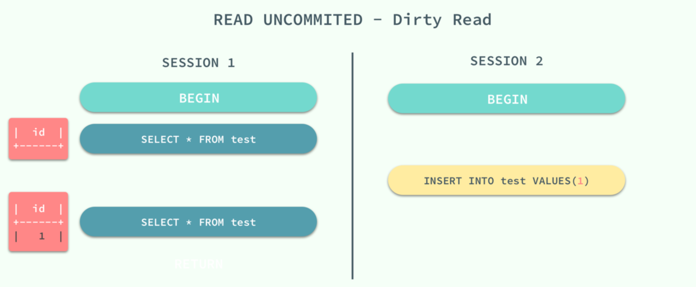

## 2.2 不可重复读

当事务的隔离级别为 `READ COMMITTED` 时，虽然解决了脏读的问题，但是如果在 `SESSION 1` 先查询了一个范围的数据，在这之后 `SESSION 2` 中插入一条数据并且提交了修改，在这时，如果 `SESSION 1` 中再次使用相同的查询语句，就会发现两次查询的结果不一样。

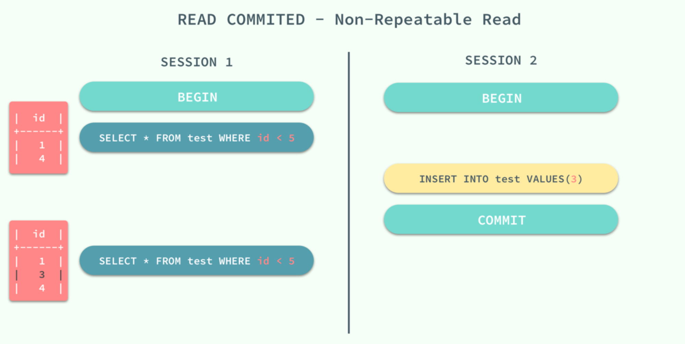

不可重复读的原因就是，在 `READ COMMITTED` 的隔离级别下，存储引擎不会在查询记录时添加间隙锁，锁定 `id < 5` 这个范围。

## 2.3 幻读

重新开启了两个会话 `SESSION 1` 和 `SESSION 2`，在 `SESSION 1` 中我们查询全表的信息，没有得到任何记录；在 `SESSION 2` 中向表中插入一条数据并提交；由于 `REPEATABLE READ` 的原因，再次查询全表的数据时，我们获得到的仍然是空集，但是在向表中插入同样的数据却出现了错误。

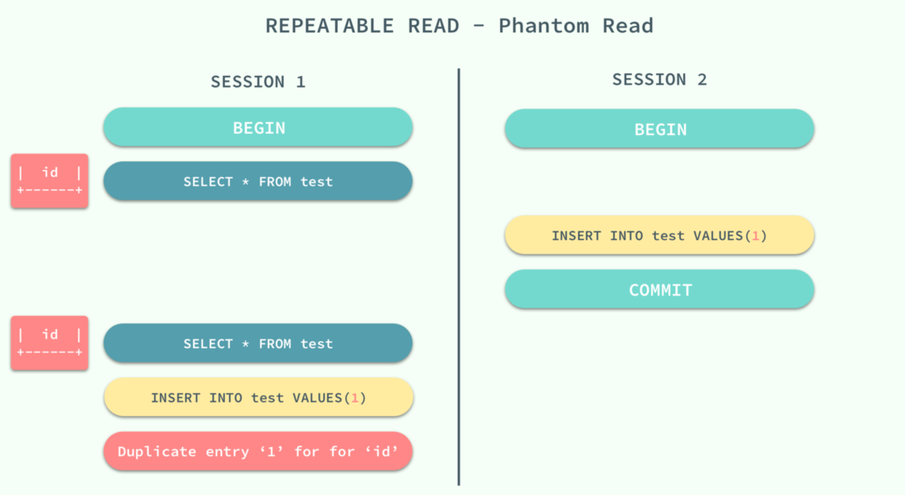

这种现象在数据库中就被称作幻读，虽然我们使用查询语句得到了一个空的集合，但是插入数据时却得到了错误，好像之前的查询是幻觉一样。

在标准的事务隔离级别中，幻读是由更高的隔离级别 `SERIALIZABLE` 解决的，但是它也可以通过 MySQL 提供的 Next-Key 锁解决：

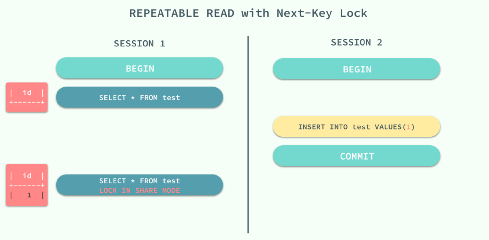

`REPEATABLE READ` 和 `READ UNCOMMITTED` 其实是矛盾的，如果保证了前者就看不到已经提交的事务，如果保证了后者，就会导致两次查询的结果不同，MySQL 为我们提供了一种折中的方式，能够在 `REPEATABLE READ` 模式下加锁访问已经提交的数据，其本身并不能解决幻读的问题，而是通过文章前面提到的 Next-Key 锁来解决。

# 3 重做日志（redo log）

## 3.1 write-ahead logging

> **预写式日志（write-ahead logging，WAL）**，是一种实现事务日志的标准方法，其中心思想是对数据文件的修改必须发生在这些修改已经记录了日志之后。

如果遵循这个过程，那么就不需要在每次事务提交的时候都把数据页冲刷到磁盘，因为即便出现宕机的情况，我们也可以用日志来恢复数据库：任何尚未附加到数据页的记录都将先从日志记录中重做（这叫向前滚动恢复，也叫做 redo）。

使用 WAL 的第一个主要的好处就是显著地减少了磁盘写的次数。因为在日志提交的时候只有日志文件需要冲刷到磁盘；而不是事务修改的所有数据文件。在多用户环境里，许多事务的提交可以用日志文件的一次 `fsync()` 来完成。而且，**日志文件是顺序写的**，因此同步日志的开销要远比同步数据页的开销要小。这一点对于许多小事务对磁盘的随机写入更是如此。

## 3.2 基本概念

MySQL 作为一个存储系统，为了保证数据的可靠性，最终得落盘；又为了数据写入的速度，需要引入基于内存的“缓冲池”。也就是说，数据是先缓存在缓冲池中，然后再以某种方式刷新到磁盘，在某个时间段之内，缓存中的数据与磁盘的数据是不一致的，如果这个时候宕机会导致缓存数据的丢失。

引入 redo log 的目的就是为了防止以上问题的发生。

当向 InnoDB 写用户数据时，先写 redo log，然后 redo log 根据一定的规则持久化到磁盘，变成 redo log file，用户数据则在 buffer 中（比如数据页、索引页）。如果发生宕机，重启后则读取磁盘上的 redo log file 进行数据的恢复。

从这个角度来说，**InnoDB 事务的持久性是通过 redo log 来实现的**。

下面以一个更新事务为例，宏观上把握 redo log 流转过程，如下图所示：

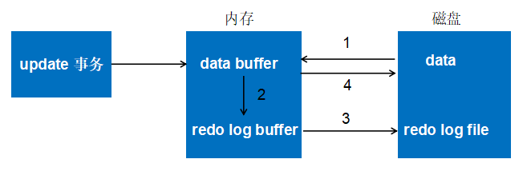

- 第一步：先将原始数据从磁盘中读入内存中来，修改数据的内存拷贝
- 第二步：生成一条重做日志并写入 redo log buffer，记录的是数据被修改后的值
- 第三步：当事务 commit 时，将 redo log buffer 中的内容刷新到 redo log file，对 redo log file 采用追加写的方式
- 第四步：定期将内存中修改的数据刷新到磁盘中

redo log 包括两部分：

- 内存中的日志缓冲（redo log buffer），该部分日志是易失性的
- 磁盘上的重做日志文件（redo log file），该部分日志是持久的

InnoDB 首先将重做日志放入重做日志缓冲，然后在下列三种情况下刷新到磁盘：

- master thread 每一秒将重做日志缓冲刷新到重做日志文件
- 每个事务提交时会刷新到重做日志文件
- 当重做日志缓冲剩余空间小于 1/2 时，重做日志缓冲会刷新到重做日志文件

重做日志缓冲大小由参数 `innodb_log_buffer_size` 控制：

```mysql
mysql> show variables like 'innodb_log_buffer_size'\G;
*************************** 1. row ***************************
Variable_name: innodb_log_buffer_size
        Value: 16777216
```

InnoDB 通过**force log at commit** 机制实现事务的持久性，即在事务提交的时候，必须先将该事务的所有事务日志写入到磁盘上的 redo log file 和 undo log file 中进行持久化。

为了确保每次日志都能写入到事务日志文件中，在每次将 log buffer 中的日志写入日志文件的过程中都会调用一次操作系统的 fsync 操作（即 fsync() 系统调用）。因为 MySQL 是工作在用户空间的，MySQL 的 log buffer 处于用户空间的内存中。要写入到磁盘上的 log file 中，中间还要经过操作系统内核空间的 os buffer，调用 fsync() 的作用就是将 OS buffer 中的日志刷到磁盘上的 log file 中。

也就是说，从 redo log buffer 写日志到磁盘的 redo log file 中，过程如下：

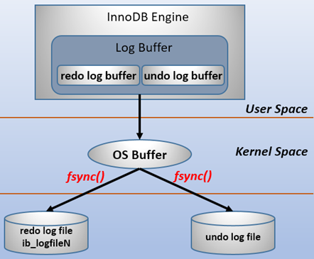

redo log buffer 刷新到磁盘的时机由参数 `innodb_flush_log_at_trx_commit` 控制，默认为 1：

- 0：事务提交时不进行写入 redo log 操作，而是依靠 master 线程周期性的刷盘来保证。由于 master 线程每 1 秒进行一次 redo log 的 fsync 操作，因此实例崩溃后最多丢失 1 秒钟内的事务
- 1：事务提交时必须调用一次 `fsync` 操作，这种方式即使系统崩溃也不会丢失任何数据，但是因为每次提交都写入磁盘，IO 的性能较差。该值是 InnoDB 的**默认值**
- 2：在事务提交时只保证将 redo log buffer 写到系统的 os buffer 中，不进行 `fsync` 操作，因此如果 MySQL 数据库宕机时不会丢失事务，但操作系统宕机则可能丢失事务

在 InnoDB 存储引擎中，重做日志都是以 512 字节进行存储的，这意味着重做日志缓冲、重做日志文件都是以块（block）的方式进行保存的，称之为**重做日志块**（redo log block）。由于重做日志块的大小和磁盘扇区大小一样，都是 512 字节，因此重做日志的写入可以保证原子性，不需要 doublewrite 技术。

## 3.3 两次写

> 当发生数据库宕机时，可能 InnoDB 存储引擎正在写入某个页到表中，而这个页只写了一部分，比如 16 KB 的页，只写了前 4 KB，之后就发生了宕机，这种情况被称为**部分写失效**（partial page write）。

部分写失效的问题，依靠重做日志无法恢复，因为重做日志是基于偏移量的物理操作。例如，写“aaaa”记录到偏移量 800 的位置，如果这个页本身已经发生了损坏，再对其进行重做是没有意义的。这就是说，在使用重做日志前，用户需要一个页的副本，当写入失效发生时，先通过页的副本来还原该页，再进行重做，这就是**doublewrite**。

下面是两次写的原理图：

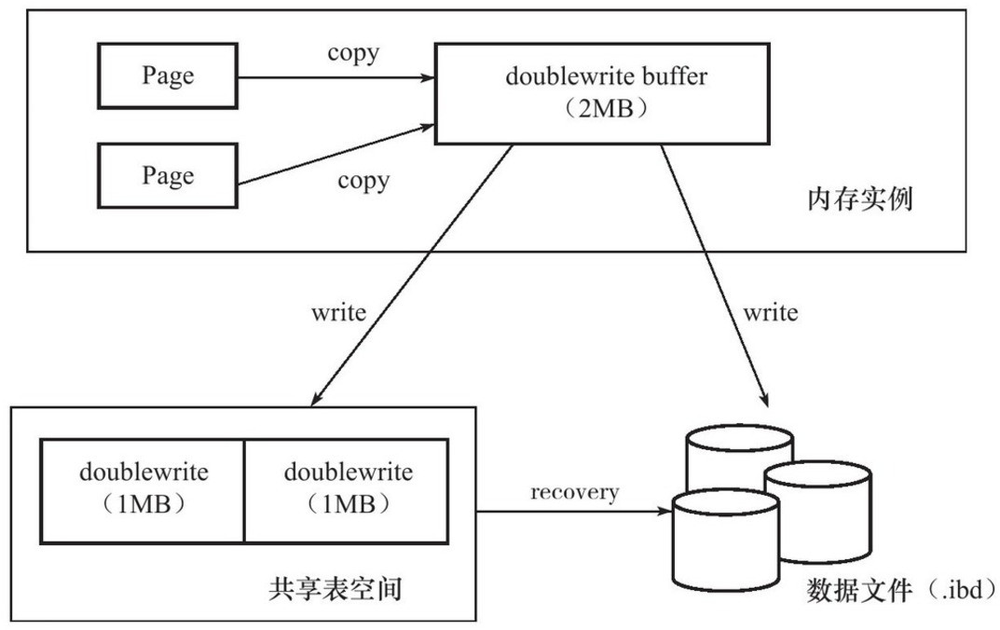

doublewrite 由两部分组成：

- 内存中的 doublewrite buffer，大小为 2 MB
- 物理磁盘上共享表空间中连续的 128 个页，即 2 个区（extent），大小同样为 2 MB

当刷新缓冲池脏页时，并不直接写到数据文件中，而是按照下面的流程执行：

1. 拷贝至内存中的两次写缓冲区；
2. 从两次写缓冲区分两次写入磁盘共享表空间中，每次 1 MB；
3. 待第 2 步完成后，再将两次写缓冲区写入数据文件。

这样就可以解决上文提到的部分写失效的问题，因为在磁盘共享表空间中已有数据页副本拷贝，如果数据库在页写入数据文件的过程中宕机，在实例恢复时，可以从共享表空间中找到该页副本，将其拷贝覆盖原有的数据页，再应用重做日志即可。

其中第 2 步是额外的性能开销，但由于磁盘共享表空间是连续的，因此开销不是很大。可以通过参数 `skip_innodb_doublewrite` 禁用两次写功能，默认是开启的。

## 3.4 LSN

缓存中未刷到磁盘的数据称为**脏数据**（dirty data）。由于数据和日志都以页的形式存在，所以**脏页**包含脏数据和脏日志。

在 InnoDB 中，由一系列的规则来判断是否到达了 `checkpoint`，到达后会将缓存中的脏数据页和脏日志页都刷到磁盘。

`LSN` 称为日志的逻辑序列号（log sequence number），随着日志的写入而逐渐增大。在 InnoDB 存储引擎中，LSN 占用 8 字节，并且单调递增。根据 LSN，可以获取到几个有用的信息：

- 数据页的版本信息。
- 写入的日志总量，通过 LSN 开始号码和结束号码可以计算出写入的日志量。
- 可知道检查点的位置。

可以通过 `show engine innodb status` 命令查看 LSN 的情况：

```mysql
mysql> show engine innodb status\G;
*************************** 1. row ***************************
...
---
LOG
---
Log sequence number 2611354
Log flushed up to   2611354
Pages flushed up to 2611354
Last checkpoint at  2611345
0 pending log flushes, 0 pending chkp writes
10 log i/o's done, 0.09 log i/o's/second
...
```

- Log sequence number 表示当前的 LSN
- Log flushed up to 表示刷新到重做日志文件的 LSN
- Pages flushed up to 表示写入磁盘的 dirty page 上的 LSN
- Last checkpoint at 表示写入磁盘的 checkpoint 上的 LSN

## 3.5 恢复过程

在启动 InnoDB 的时候，不管上次是正常关闭还是异常关闭，总是会进行恢复操作。

因为**redo log 记录的是数据页的物理变化**，因此恢复的时候速度比逻辑日志（如二进制日志）要快很多。而且，InnoDB 自身也做了一定程度的优化，让恢复速度变得更快。

重启 InnoDB 时，checkpoint 表示已经完整刷到磁盘上 data page 上的 LSN，因此恢复时仅需要恢复从 checkpoint 开始的日志部分。例如，当数据库在上一次 checkpoint 的 LSN 为 10000 时宕机，且事务是已经提交过的状态。启动数据库时会检查磁盘中数据页的 LSN，如果数据页的 LSN 小于日志中的 LSN，则会从检查点开始恢复。

还有一种情况，在宕机前正处于 checkpoint 的刷盘过程，且数据页的刷盘进度超过了日志页的刷盘进度。这时候一宕机，数据页中记录的 LSN 就会大于日志页中的 LSN，在重启的恢复过程中会检查到这一情况，这时超出日志进度的部分将不会重做，因为这本身就表示已经做过的事情，无需再重做。

另外，**事务日志具有幂等性**，所以多次操作得到同一结果的行为在日志中只记录一次。而二进制日志不具有幂等性，多次操作会全部记录下来，在恢复的时候会多次执行二进制日志中的记录，速度就慢得多。例如，某记录中 id 初始值为 2，通过 update 将值设置为了 3，后来又设置成了 2，在事务日志中记录的是无变化的页，根本无需恢复；而二进制会记录下两次 update 操作，恢复时也将执行这两次 update 操作，速度比事务日志恢复更慢。

# 4 回滚日志（undo log）

## 4.1 基本概念

重做日志记录了事务的行为，可以很好地通过其进行“重做”。但是事务有时还需要撤销，这时就需要 undo。undo 与 redo 正好相反，对数据库进行修改时，数据库不但会产生 redo，而且还会产生一定量的 undo。如果因为某些原因导致事务失败或回滚了，可以借助该 undo 进行回滚。

undo log 有两个作用：

- 提供回滚

  当事务回滚时，或者数据库崩溃后重启，可以利用 undo 日志，即旧版本数据，撤销未提交事务对数据库产生的影响。

- 多版本控制（MVCC）

  当读取的某一行被其他事务锁定时，它可以从 undo log 中分析出该行记录以前的数据是什么，从而提供该行版本信息，让用户实现非锁定一致性读取。

与 redo 不同的是，redo 存放在重做日志文件中，undo 存放在数据库内部的一个特殊的段（segment）中，称为**undo 段**（undo segment），**undo 段位于共享表空间内**。InnoDB 对 undo 的管理同样采用段的方式，称为 rollback segment。每个回滚段记录了 1024 个 undo 段，从 1.1 版本以后，InnoDB 支持最大 128 个回滚段，也就是支持同时在线的事务上限为 128 * 1024。

undo log 和 redo log 记录物理日志不一样，**它是逻辑日志**。可以认为当 delete 一条记录时，undo log 中会记录一条对应的 insert 记录，反之亦然，当 update 一条记录时，它记录一条对应相反的 update 记录。

另外，**undo log 也会产生 redo log**，因为 undo log 也要实现持久性保护。

当事务提交时，InnoDB 会做以下两件事情：

- 将 undo 放入列表中，以供之后的 purge 操作
- 判断 undo log 所在的页是否可以重用，若可以，则分配给下一个事务使用

事务提交后并不能马上删除 undo log 及 undo log 所在的页，因为可能还有其他事务需要通过 undo log 来得到行记录之前的版本。所以事务提交时将 undo log 放入一个链表中，是否可以最终删除 undo log 及 undo log 所在的页，由 purge 线程来判断（具体过程见下一节）。

InnoDB 设计中对**undo 页可以进行重用**。事务提交时，首先将 undo log 放入链表中，然后判断 undo 页的使用空间是否小于 3/4，若是则表示该 undo 页可以被重用，之后新的 undo log 记录会写在当前 undo log 的后面。由于存放 undo log 的链表是以记录进行组织的，而 undo 页中可能存放着不同事务的 undo log，因此 purge 操作需要涉及磁盘的离散读取操作，是一个比较缓慢的过程。

InnoDB 中，undo log 分为两类：

- **insert undo log**：insert 操作中产生的 undo log。因为 insert 操作的记录只对事务本身可见，对其他事务不可见（事务隔离性的要求），故该 undo log 可以在事务提交后直接删除，不需要进行 purge 操作。
- **update undo log**：delete 和 update 操作产生的 undo log。该 undo log 可能需要提供 MVCC 机制，因此不能在事务提交时就进行删除，提交时放入 undo log 链表，等待 purge 线程进行最后的删除。

与 undo 相关的配置参数如下：

```mysql
mysql> show variables like 'innodb_undo%'\G;
*************************** 1. row ***************************
Variable_name: innodb_undo_directory
        Value: ./
*************************** 2. row ***************************
Variable_name: innodb_undo_log_truncate
        Value: OFF
*************************** 3. row ***************************
Variable_name: innodb_undo_logs
        Value: 128
*************************** 4. row ***************************
Variable_name: innodb_undo_tablespaces
        Value: 0
```

- `innodb_undo_directory`：设置回滚段文件所在的路径，默认为当前 InnoDB 的目录
- `innodb_undo_log_truncate`：启用时，一个 undo 表空间超过参数 `innodb_max_undo_log_size`（默认 1024 M）设置的大小时，将被标记为 truncate
- `innodb_undo_logs`：设置回滚段的数量，默认为 128
- `innodb_undo_tablespaces`：设置回滚段文件的数量

## 4.2 purge

purge 线程的两个主要作用是：清理 undo 页和清除 page 里面带有 Delete_Bit 标识的数据行。

对插入、更新、删除操作来说，purge 操作的作用如下：

- insert

  因为 insert 操作的记录，只对事务本身可见，对其他事务不可见，所以不需要保证 MVCC。故该 undo log 可以在事务提交后直接删除，不需要进行 purge 操作。

- update

  该 undo log 可能需要服务 MVCC，因此不能在事务提交时就进行删除。提交时放入 undo log 链表，等待 purge 线程进行最后的删除。

- delete

  与 update 类似，delete 的 undo log 也可能需要服务 MVCC。在 InnoDB 中，事务中的**delete 操作实际上并不是真正地删除数据行，而是做了一个标记**，真正的删除工作需要后台 purge 线程去完成。

delete 和 update 操作可能并不直接删除原有的数据。例如下面的语句：

`delete from t where a = 1`

表 t 上列 a 有聚集索引，列 b 上有辅助索引。对于上述 delete 操作，仅是将主键列等于 1 的记录 delete flag 设置为 1，记录并没有被删除，即记录还是存在于 B+ 树中。其次，对辅助索引上的记录同样没有做任何处理，甚至没有产生 undo log。真正删除这行的操作被延迟到 purge 操作中完成。

这样设计是因为 InnoDB 存储引擎支持 MVCC，所以记录不能在事务提交时立即进行处理，这时其他事务可能正在引用这行，故 InnoDB 存储引擎需要保存记录之前的版本。而是否可以删除该条记录，通过 purge 来进行判断。若该行记录已不被任何其他事务引用，那么就可以进行真正的 delete 操作。可见，purge 操作是“最终完成”之前的 delete 和 update 操作，清理行记录的版本。

为了节省存储空间，InnoDB 的一个 undo 页上允许多个事务的 undo log 存在。此外，InnoDB 存储引擎还有一个**history 列表**，它根据事务提交的顺序，将 undo log 进行链接。

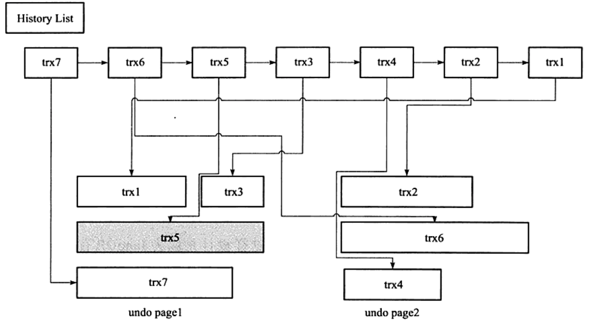

history list 按照事务提交的顺序将 undo log 进行组织，先提交的事务总在尾端。undo 页存放了 undo log，由于 undo 页可以重用，因此一个 undo 页中可能存放了多个不同事务的 undo log。上图中 trx5 的灰色阴影表示该 undo log 还被其他事务引用。

在执行 purge 的过程中，InnoDB 存储引擎首先从 history list 中找到第一个需要被清理的记录 trx1，清理之后会在 trx1 的 undo log 所在的页中继续寻找是否存在可以被清理的记录，这里会找到事务 trx3，接着找到 trx5，但是发现 trx5 被其他事务所引用而不能清理，故再次去 history list 中查找，发现这时最尾端的记录为 trx2，接着找到 trx2 所在的页，然后依次再把事务 trx6、trx4 的记录进行清理。由于 undo page2 中的记录都被清理了，因此该 undo page 可以被重用。

InnoDB 存储引擎这种先从 history list 中找 undo log、然后再从 undo 页中找 undo log 的设计模式，是为了避免大量的随机读取操作，从而提高 purge 的效率。全局动态参数 `innodb_purge_batch_size` 用来设置每次 purge 操作需要清理的 undo 页数量：

```mysql
mysql> show variables like 'innodb_purge_batch_size'\G;
*************************** 1. row ***************************
Variable_name: innodb_purge_batch_size
        Value: 300
```

通常来说，该参数设置得越大，每次回收的 undo 页也就越多，这样可供重用的 undo 页就越多，减少了磁盘存储空间与分配的开销。不过，若该参数设置得太大，则每次 purge 需要处理更多的 undo 页，从而导致 CPU 和磁盘 IO 过于集中于对 undo log 的处理，使性能下降。

## 4.3 隐式提交的语句

TRUNCATE TABLE 属于隐式提交操作，执行后无法回滚。

# 5 分布式事务

InnoDB 通过 XA 事务来支持分布式事务的实现。

XA 事务由一个或多个**资源管理器**（Resource Manager）、一个**事务管理器**（Transaction Manager）以及一个**应用程序**组成：

- 资源管理器：提供访问事务资源的方法。通常一个数据库就是一个资源管理器
- 事务管理器：协调参与全局事务中的各个事务。需要和参与全局事务的所有资源管理器进行通信
- 应用程序：定义事务的边界，指定全局事务中的操作

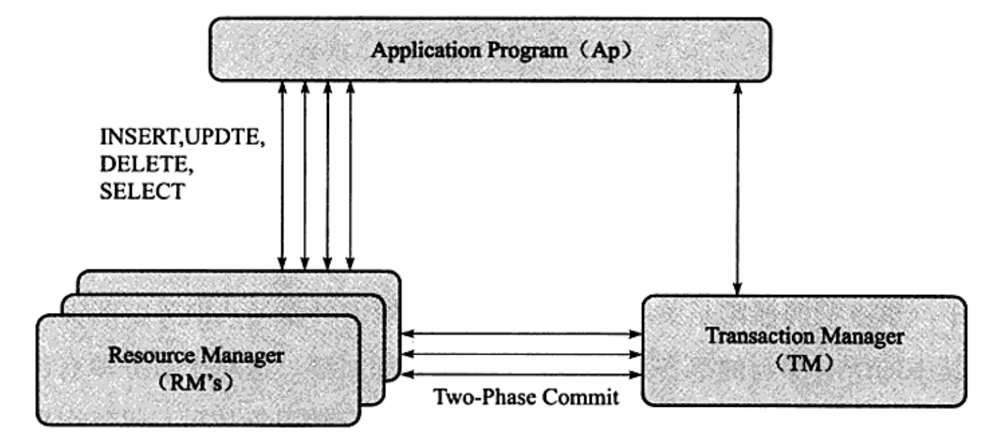

分布式事务使用**两段式提交**（two-phase commit）的方式。

- 第一个阶段，所有参与全局事务的节点都开始准备，告诉事务管理器它们准备好提交了。
- 第二个阶段，事务管理器告诉资源管理器执行 rollback 或者 commit，如果任何一个节点表示不能 commit，那么所有的节点就得全部 rollback。

在 MySQL 中还存在一种内部 XA 事务，存在于存储引擎与插件之间，又或者存储引擎与存储引擎之间。

最常见的内部 XA 事务是 binlog 与 InnoDB 之间。由于复制的需要，因此目前绝大多数的数据库都开启了 binlog 功能。在事务提交时，先写二进制日志，再写 InnoDB 存储引擎的重做日志。对上述两个操作的要求也是原子的，即二进制日志和重做日志必须同时写入。若二进制日志先写了，而在写入 InnoDB 存储引擎时发生了宕机，那么 slave 可能会接收到 master 传过去的二进制日志并执行，最终导致了主从不一致的情况。

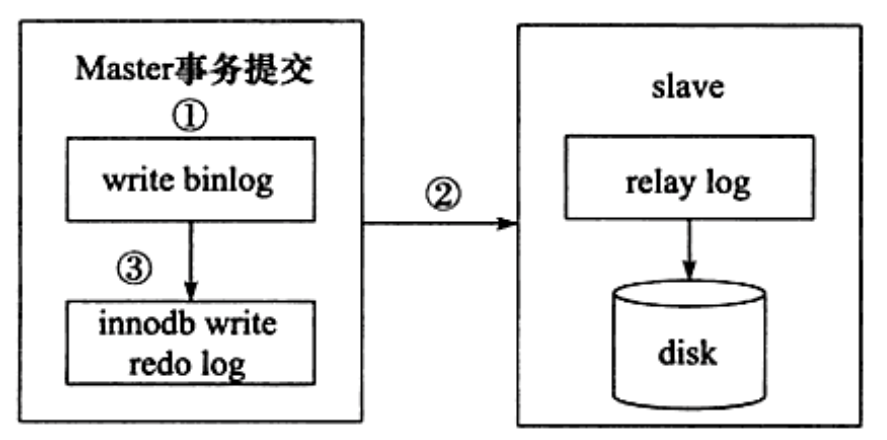

在上图中，如果执行完第二步，未执行第三步时 MySQL 数据库发生了宕机，则会发生主从不一致的情况。为了解决这个问题，MySQL 数据库在 binlog 与 InnoDB 存储引擎之间采用 XA 事务。当事务提交时，InnoDB 存储引擎会先做一个 PREPARE 操作，将事务的 xid 写入，接着进行二进制日志的写入。

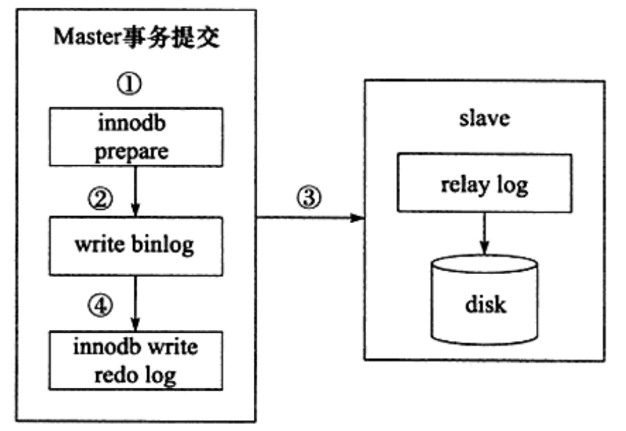

如果在 InnoDB 存储引擎提交前，MySQL 数据库宕机了，那么 MySQL 数据库在重启后会先检查准备的 UXID 事务是否已经提交，若没有，则在存储引擎层再进行一次提交操作。
