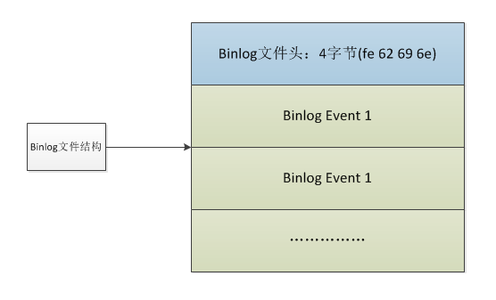
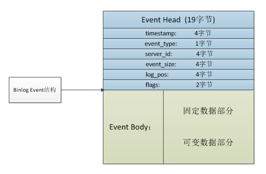
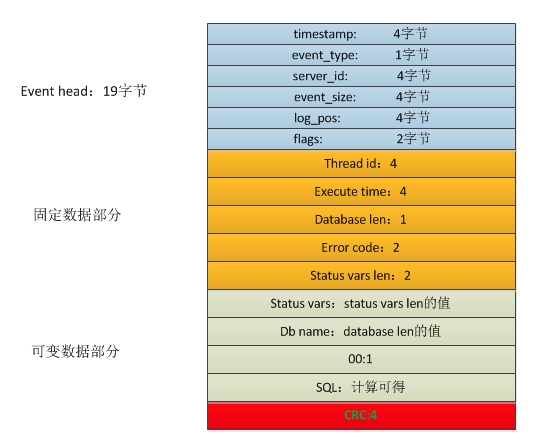
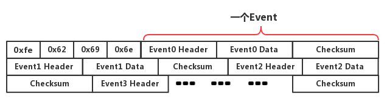
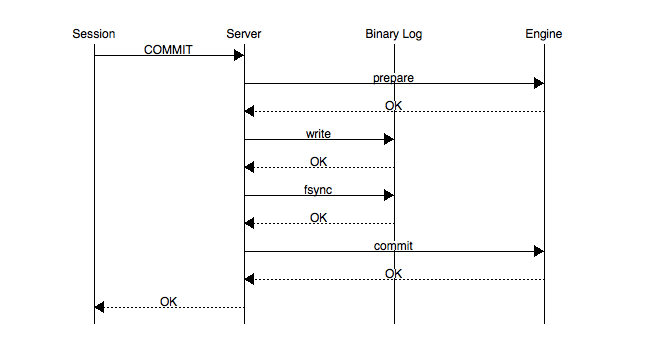
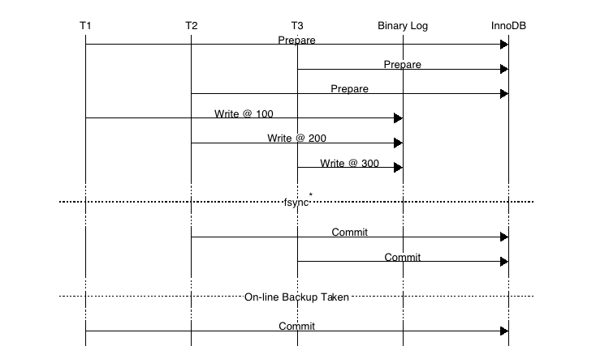
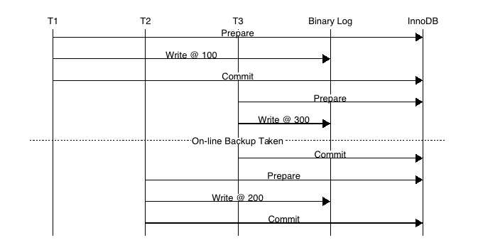
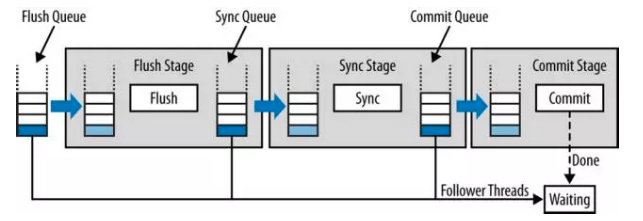
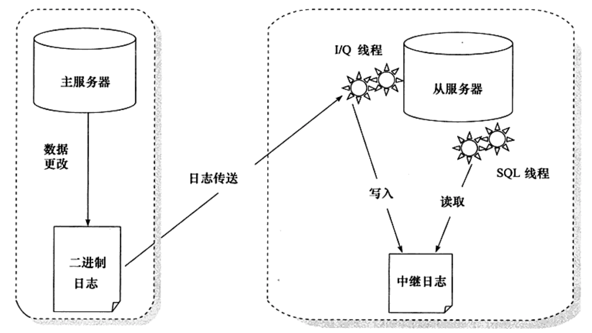

# 1 基本概念

> 二进制日志（binary log）以**事件形式**记录了对 MySQL 数据库执行更改的所有操作。

binlog 是记录所有数据库表结构变更（例如 CREATE、ALTER TABLE…）以及表数据修改（INSERT、UPDATE、DELETE…）的二进制日志。不会记录 SELECT 和 SHOW 这类操作，因为这类操作对数据本身并没有修改，但可以通过查询通用日志来查看 MySQL 执行过的所有语句。

需要注意的一点是，即便**update 操作没有造成数据变化，也是会记入 binlog**。

binlog 有两个常用的使用场景：

- 主从复制：mysql replication 在 master 端开启 binlog，master 把它的二进制日志传递给 slaves 来达到 master-slave 数据一致的目的。

- 数据恢复：通过 mysqlbinlog 工具来恢复数据。

# 2 关键参数

binlog 默认是关闭的，可以通过参数 `log_bin` 控制：

```mysql
mysql> show variables like 'log_bin'\G;
*************************** 1. row ***************************
Variable_name: log_bin
        Value: OFF
```

参数 `max_binlog_size` 指定了单个二进制日志文件的最大值：

```mysql
mysql> show variables like 'max_binlog_size'\G;
*************************** 1. row ***************************
Variable_name: max_binlog_size
        Value: 1073741824
```

默认为 1 G，如果超过该值，会写入新的文件，并记录到 .index 文件。

InnoDB 会将所有未提交的 binlog 写到一个缓存中，等事务提交后再将缓存刷新到文件。缓存大小有参数 `binlog_cache_size` 控制。

```mysql
mysql> show variables like 'binlog_cache_size'\G;
*************************** 1. row ***************************
Variable_name: binlog_cache_size
        Value: 32768
```

需要注意的是，**该值是基于 session 的**，每个事务都会分配一个大小为 binlog_cache_size 的缓存。当一个事务的记录大于该值，MySQL 会把缓冲中的日志写入一个临时文件。因此，需要根据使用场景合理设置这个参数，过大或者过小都会影响性能。

参数 `sync_binlog` 表示每写缓冲多少次就同步到磁盘：

```mysql
mysql> show variables like 'sync_binlog'\G;
*************************** 1. row ***************************
Variable_name: sync_binlog
        Value: 1
```

- N = 1：表示采用同步写磁盘的方式来写二进制日志，这时写操作不使用操作系统的缓冲来写二进制日志，每次事务提交都会写入文件。
- N = 0：表示 MySQL 不控制 binlog 的刷新，由文件系统自己控制它的缓存的刷新。这时候的性能是最好的，但是风险也是最大的。因为一旦系统 Crash，在 binlog_cache 中的所有 binlog 信息都会被丢失。

但是，即使将 sync_binlog 设为 1，还是会有一种情况会导致问题的发生。当使用 InnoDB 存储引擎时，在一个事务发出 COMMIT 动作之前，由于 sync_binlog 设为 1，因此会将二进制日志立即写入磁盘。如果这时已经写入了二进制日志，但是提交还没有发生，并且此时发生了宕机，那么在 MySQL 数据库下次启动时，因为 COMMIT 操作并没有发生，所以这个事务会被回滚掉。但是二进制日志已经记录了该事务信息，不能被回滚。这个问题可以通过将参数 `innodb_support_xa` 设为 1 来解决，虽然 innodb_support_xa 与 XA 事务有关，但它同时也确保了二进制日志和 InnoDB 存储引擎数据文件的同步。

`binlog_format` 是一个非常重要的参数，决定了记录二进制日志的格式：

```mysql
mysql> show variables like 'binlog_format'\G;
*************************** 1. row ***************************
Variable_name: binlog_format
        Value: ROW
```

可选值有：

- STATEMENT

  记录 SQL 语句。日志文件小，节约 IO，但是对一些系统函数不能准确复制或不能复制，如 now()、uuid() 等

- ROW

  记录表的行更改情况，可以为数据库的恢复、复制带来更好的可靠性，但是二进制文件的大小相较于 STATEMENT 会有所增加

- MIXED

  STATEMENT 和 ROW 模式的混合。默认采用 STATEMENT 格式进行二进制日志文件的记录，但是在一些情况下会使用 ROW 格式，可能的情况有：

  - 表的存储引擎为 NDB，这时对表的 DML 操作都会以 ROW 格式记录
  - 使用了 UUID()、USER()、CURRENT_USER()、FOUND_ROWS()、ROW_COUNT() 等不确定函数
  - 使用了 INSERT DELAYED 语句
  - 使用了用户定义函数（UDF）
  - 使用了临时表（temporary table）

业内目前推荐使用的是 `ROW` 模式，准确性高，虽然说文件大，但是现在有 SSD 和万兆光纤网络，这些磁盘 IO 和网络 IO 都是可以接受的。

# 3 文件结构

## 3.1 文件头

Binlog 文件从一个 Binlog 文件头开始，接着是一系列的 Binlog 事件。



文件头由一个四字节 `Magic Number` 构成，其值为 1852400382，在内存中就是“0xfe,0x62,0x69,0x6e”。这个 `Magic Number` 就是用来验证这个 `binlog` 文件是否有效。

其实，在 Java 的 class 文件头中，也有这么一个四个字节的 Magic Number——`0xCAFEBABE`，昵称“咖啡宝贝”。

## 3.2 事件



每个 binlog 事件都以一个**事件头**（event header）开始，然后是一个 binlog 事件类型特定的数据部分，称为**事件体**（event body）。

事件头的结构如下：

| 属性         | 字节数 | 含义                                     |
| ------------ | ------ | ---------------------------------------- |
| timestamp    | 4      | 包含了该事件的开始执行时间               |
| eventType    | 1      | 事件类型                                 |
| serverId     | 4      | 标识产生该事件的 MySQL 服务器的 server-id |
| eventLength  | 4      | 该事件的长度（Header + Data + CheckSum）  |
| nextPosition | 4      | 下一个事件在 binlog 文件中的位置           |
| flags        | 2      | 标识产生该事件的 MySQL 服务器的 server-id。|

事件体的具体结构与事件类型相关，以 `QUERY_EVENT` 类型为例，存储格式如下：



常见的事件类型有：

- **FORMAT_DESCRIPTION_EVENT**：该部分位于整个文件的头部，每个 binlog 文件都必定会有唯一一个该 event
- **PREVIOUS_GTIDS_EVENT**：包含在每个 binlog 的开头，用于描述所有以前 binlog 所包含的全部**GTID**的一个集合（包括已经删除的 binlog）
- **GTID_EVENT/ANONYMOUS_GTID_EVENT**：每一个 Query 事务前都会有这样的一个 GTID_EVENT，如果未开启则是 ANONYMOUS_GTID_EVENT。
- **QUERY_EVENT**：事务开始时，执行的 BEGIN 操作；ROW 格式中的 DDL 操作等
- **TABLE_MAP_EVENT**：每个 DML 事务之前，都会有一个 TABLE_MAP_EVENT，记录操作对应的表的信息。
- **WRITE_ROW_EVENT**：插入操作。
- **DELETE_ROW_EVENT**：删除操作。
- **UPDATE_ROW_EVENT**：更新操作。记载的是一条记录的完整的变化情况，即从**前量**变为**后量**的过程
- **XID_EVENT**：主要是事务提交的时候会在最后生成一个 xid 号，有这个便代表事务已经成功提交了
- **ROTATE_EVENT**：Binlog 结束时的事件，与 `FORMAT_DESCRIPTION_EVENT` 一样仅有一个

更多事件类型的详细介绍可以参见[MySQL 官方文档](https://dev.mysql.com/doc/internals/en/binlog-event.html)。

# 4 实战演练

默认情况下，二进制日志可能未开启，可以手动修改 `my.cnf` 文件，在 `[mysqld]` 配置段中加入如下配置，表示开启 binlog，并且设置二进制日志文件名前缀为 `mysql-bin`。

```properties
[mysqld]
server-id=1
log-bin=mysql-bin
```

重启 MySQL 服务后，可以看到二进制日志功能已经开启：

```mysql
mysql> show variables like '%log_bin%';
+---------------------------------+---------------------------------------+
| Variable_name                   | Value                                 |
+---------------------------------+---------------------------------------+
| log_bin                         | ON                                    |
| log_bin_basename                | /usr/local/mysql/data/mysql-bin       |
| log_bin_index                   | /usr/local/mysql/data/mysql-bin.index |
| sql_log_bin                     | ON                                    |
+---------------------------------+---------------------------------------+
```

此时查看对应的日志目录，会发现两个文件：

- 索引文件（文件名后缀为 .index）：用于记录哪些日志文件正在被使用
- 日志文件（文件名后缀为 .00000*）：记录数据库所有的 DDL 和 DML 语句事件。

使用如下两条命令中的任何一条，均可在 MySQL 中查看二进制日志的文件列表：

```mysql
mysql> show binary logs;
+------------------+-----------+
| Log_name         | File_size |
+------------------+-----------+
| mysql-bin.000001 |       658 |
+------------------+-----------+

mysql> show master logs;
+------------------+-----------+
| Log_name         | File_size |
+------------------+-----------+
| mysql-bin.000001 |       658 |
+------------------+-----------+

```

查看 binlog 的事件列表：

```mysql
mysql> show binlog events in 'mysql-bin.000001';
+-----+----------------+-------------+---------------------------------------+
| Pos | Event_type     | End_log_pos | Info                                  |
+-----+----------------+-------------+---------------------------------------+
|   4 | Format_desc    |         123 | Server ver: 5.7.22-log, Binlog ver: 4 |
| 123 | Previous_gtids |         154 |                                       |
| 154 | Anonymous_Gtid |         219 | SET @@SESSION.GTID_NEXT= 'ANONYMOUS'  |
| 219 | Query          |         291 | BEGIN                                 |
| 291 | Table_map      |         335 | table_id: 108 (test.t)                |
| 335 | Write_rows     |         375 | table_id: 108 flags: STMT_END_F       |
| 375 | Xid            |         406 | COMMIT /* xid=33 */                   |
| 406 | Anonymous_Gtid |         471 | SET @@SESSION.GTID_NEXT= 'ANONYMOUS'  |
| 471 | Query          |         543 | BEGIN                                 |
| 543 | Table_map      |         587 | table_id: 108 (test.t)                |
| 587 | Write_rows     |         627 | table_id: 108 flags: STMT_END_F       |
| 627 | Xid            |         658 | COMMIT /* xid=35 */                   |
+-----+----------------+-------------+---------------------------------------+
```

> 注：以上 binlog 的格式为 `ROW`，且查询结果省略了 `Log_name` 列与 `Server_id` 列。

可以把整个二进制文件想象成一个字节序列。



文件头占用了最开始的四个字节，所以第一个事件是从 `Pos` = 4 开始，到 `End_log_pos` = 123 结束；第二个事件则从 `Pos` = 123 开始，到 `End_log_pos` = 154 结束……

binlog，顾名思义，它是二进制的，所以我们不能直接使用 `cat`、`vim` 命令查看，而是需要通过 MySQL 内置的命令 `mysqlbinlog` 读取日志内容。

执行命令 `mysqlbinlog mysql-bin.000001`，看到类似下面这样的文本：

```shell
...
DELIMITER /*!*/;
# at 4
#191123 11:30:09 server id 1  end_log_pos 123 CRC32 0xaf6d52cc 	Start: binlog v 4, server v 5.7.22-log created 191123 11:30:09 at startup
# Warning: this binlog is either in use or was not closed properly.
ROLLBACK/*!*/;
BINLOG '
wafYXQ8BAAAAdwAAAHsAAAABAAQANS43LjIyLWxvZwAAAAAAAAAAAAAAAAAAAAAAAAAAAAAAAAAA
AAAAAAAAAAAAAAAAAADBp9hdEzgNAAgAEgAEBAQEEgAAXwAEGggAAAAICAgCAAAACgoKKioAEjQA
AcxSba8=
'/*!*/;
# at 123
#191123 11:30:09 server id 1  end_log_pos 154 CRC32 0x263544c0 	Previous-GTIDs
# [empty]
# at 154
#191123 15:42:40 server id 1  end_log_pos 219 CRC32 0xa887384b 	Anonymous_GTID	last_committed=0	sequence_number=1	rbr_only=yes
/*!50718 SET TRANSACTION ISOLATION LEVEL READ COMMITTED*//*!*/;
SET @@SESSION.GTID_NEXT= 'ANONYMOUS'/*!*/;
# at 219
#191123 15:42:40 server id 1  end_log_pos 291 CRC32 0x3901cdf0 	Query	thread_id=578	exec_time=0	error_code=0
SET TIMESTAMP=1574494960/*!*/;
SET @@session.pseudo_thread_id=578/*!*/;
SET @@session.foreign_key_checks=1, @@session.sql_auto_is_null=0, @@session.unique_checks=1, @@session.autocommit=1/*!*/;
SET @@session.sql_mode=1436549152/*!*/;
SET @@session.auto_increment_increment=1, @@session.auto_increment_offset=1/*!*/;
/*!\C utf8 *//*!*/;
SET @@session.character_set_client=33,@@session.collation_connection=33,@@session.collation_server=8/*!*/;
SET @@session.lc_time_names=0/*!*/;
SET @@session.collation_database=DEFAULT/*!*/;
BEGIN
/*!*/;
# at 291
...
# at 627
#191123 15:43:49 server id 1  end_log_pos 658 CRC32 0xc0b9acd9 	Xid = 35
COMMIT/*!*/;
SET @@SESSION.GTID_NEXT= 'AUTOMATIC' /* added by mysqlbinlog */ /*!*/;
DELIMITER ;
# End of log file
```

注意其中的 `at 4`、`at 123`、`at 154` 等，与 `show binlog events in 'mysql-bin.000001'` 查询结果中的 `Pos`、`End_log_pos` 是一一对应的。

# 5 二进制日志与重做日志的区别

二进制日志中也记录了 InnoDB 表的很多操作，也能实现重做的功能，但是它与重做日志之间有很大区别。

- **二进制日志是 MySQL Server 层的**，不管是什么存储引擎，对数据库进行了修改都会产生二进制日志。而**redo log 是 InnoDB 存储引擎层的**，只记录该存储引擎中表的修改。
- **二进制日志记录的是逻辑日志**。即便它是基于行格式的记录方式，其本质也还是逻辑的 SQL 设置，如该行记录的每列的值是多少。而**redo log 是在物理格式上的日志**，它记录的是数据库中每个页的修改。
- 二进制日志只在每次事务提交的时候一次性写入缓存中的日志“文件”（对于非事务表的操作，则是每次执行语句成功后就直接写入）。而 redo log 在数据准备修改前写入缓存中的 redo log 中，然后才对缓存中的数据执行修改操作；而且保证在发出事务提交指令时，先向缓存中的 redo log 写入日志，写入完成后才执行提交动作。
- 因为**二进制日志只在提交的时候一次性写入**，所以二进制日志中的记录方式和提交顺序有关，且一次提交对应一次记录。而 redo log 中是记录的物理页的修改，redo log 文件中同一个事务可能多次记录，最后一个提交的事务记录会覆盖所有未提交的事务记录。而且 redo log 是并发写入的，不同事务之间的不同版本的记录会穿插写入到 redo log 文件中，例如可能 redo log 的记录方式如下：T1-1, T1-2, T2-1, T2-2, T2, T1-3, T1。
- 事务日志记录的是物理页的情况，它具有幂等性，因此记录日志的方式极其简练。幂等性的意思是多次操作前后状态是一样的，例如新插入一行后又删除该行，前后状态没有变化。而二进制日志记录的是所有影响数据的操作，记录的内容较多。例如插入一行记录一次，删除该行又记录一次。

# 6 Redo log 与 Binlog 的一致性

## 6.1 CrashSafe

**CrashSafe** 指 MySQL 服务器宕机重启后，能够保证：

- 所有已经提交的事务的数据仍然存在。
- 所有没有提交的事务的数据自动回滚。

MySQL 没有开启 Binary log 的情况下，InnoDB 通过 Redo Log 和 Undo Log 可以保证以上两点。为了保证严格的 CrashSafe，必须要在每个事务提交的时候，将 Redo Log 写入硬件存储。

那么，在 MySQL 开启 Binary log 的主从架构中，怎么保证 CrashSafe 的呢？

首先，为了保证 master 和 slave 的数据一致性，就**必须保证 binlog 和 InnoDB redo 日志的一致性**。因为备库通过二进制日志重放主库提交的事务，而主库 binlog 写入在 commit 之前，如果写完 binlog 主库 crash，再次启动时会回滚事务。但此时从库已经执行，则会造成主备数据不一致。

为此，MySQL 引入二阶段提交，MySQL 内部会自动将普通事务当做一个 XA 事务（内部分布式事务）来处理：

- 自动为每个事务分配一个唯一的 ID（XID）。
- COMMIT 会被自动的分成 Prepare 和 Commit 两个阶段。
- Binlog 会被当做事务协调者（Transaction Coordinator），Binlog Event 会被当做协调者日志。

**Binlog 在 2PC 中充当了事务的协调者**（Transaction Coordinator）。由 Binlog 来通知 InnoDB 引擎来执行 prepare，commit 或者 rollback 的步骤。事务提交的整个过程如下：



从以上的图片中可以看到，事务的提交主要分为三个步骤：

- **步骤 1**：此时 SQL 已经成功执行，并生成 xid 信息及 redo 和 undo 的内存日志。然后调用 prepare 方法完成第一阶段，prepare 方法实际上什么也没做，将事务状态设为 TRX_PREPARED，并将 redo log 刷磁盘。
- **步骤 2**：如果事务涉及的所有存储引擎的 prepare 都执行成功，则记录协调者日志，即 Binlog 日志。此时，事务已经肯定要提交了。否则，调用 ha_rollback_trans 方法回滚事务，而 SQL 语句实际上也不会写到 binlog。
- **步骤 3**：调用引擎的 commit 完成事务的提交。会清除 undo 信息，刷 redo 日志，将事务设为 TRX_NOT_STARTED 状态。

也就是说，记录 Binlog 是在 InnoDB 引擎 Prepare（即 Redo Log 写入磁盘）之后。一旦步骤 2 中的操作完成，就确保了事务的提交，即使在执行步骤 3 时数据库宕机。

此外需要注意的是，每个步骤都需要进行一次 fsync 操作才能保证上下两层数据的一致性。步骤 2 的 fsync 参数由 `sync_binlog=1` 控制，步骤 3 的 fsync 由参数 `innodb_flush_log_at_trx_commit=1` 控制，俗称“双 1”，是保证 CrashSafe 的根本。

> `innodb_flush_log_at_trx_commit`：设置为 1，表示每次事务的 redo log 都直接持久化到磁盘（注意这里指的是 redo log 日志本身落盘），保证 MySQL 重启后数据不丢失。
>
> `sync_binlog`：设置为 1，表示每次事务的 binlog 都直接持久化到磁盘（注意这里指的是 binlog 日志本身落盘），保证 MySQL 重启后 binlog 记录是完整的。

事务的两阶段提交协议保证了无论在任何情况下，事务要么同时存在于存储引擎和 binlog 中，要么两个里面都不存在，这就保证了主库与从库之间数据的一致性。

另外，MySQL 内部两阶段提交需要开启 `innodb_support_xa=true`，默认开启。这个参数就是支持分布式事务两段式事务提交。redo 和 binlog 数据一致性就是靠这个两段式提交来完成的，如果关闭会造成事务数据的丢失。

## 6.2 故障恢复

如果数据库系统发生崩溃，当数据库系统重新启动时会进行崩溃恢复操作，存储引擎中处于 prepare 状态的事务会去查询该事务是否也同时存在于 binlog 中，如果存在就在存储引擎内部提交该事务（因为此时从库可能已经获取了对应的 binlog 内容），如果 binlog 中没有该事务，就回滚该事务。例如：当崩溃发生在第一步和第二步之间时，明显处于 prepare 状态的事务还没来得及写入到 binlog 中，所以该事务会在存储引擎内部进行回滚，这样该事务在存储引擎和 binlog 中都不会存在；当崩溃发生在第二步和第三步之间时，处于 prepare 状态的事务存在于 binlog 中，那么该事务会在存储引擎内部进行提交，这样该事务就同时存在于存储引擎和 binlog 中。

MySQL 在 prepare 阶段会生成**xid**，然后会在 commit 阶段写入到 binlog 中。在进行恢复时**事务要提交还是回滚，是由 Binlog 来决定的**。

- 事务的 Xid_log_event 存在，就要提交。
- 事务的 Xid_log_event 不存在，就要回滚。

恢复的过程非常简单：

- 从 Binlog 中读出所有的 Xid_log_event
- 告诉 InnoDB 提交这些 XID 的事务
- InnoDB 回滚其它的事务

总结一下，可能会出现的情况有三种：

- 当事务在 prepare 阶段 crash，数据库 recovery 的时候该事务未写入 Binary log 并且存储引擎未提交，将该事务 rollback。
- 当事务在 binlog 阶段 crash，此时日志还没有成功写入到磁盘中，启动时会 rollback 此事务。
- 当事务在 binlog 日志已经 fsync() 到磁盘后 crash，但是 InnoDB 没有来得及 commit，此时 MySQL 数据库 recovery 的时候将会读出二进制日志的 Xid_log_event，然后告诉 InnoDB 提交这些 XID 的事务，InnoDB 提交完这些事务后会回滚其它的事务，使存储引擎和二进制日志始终保持一致。

可以看出，如果一个事务在 prepare 阶段中落盘成功，并在 MySQL Server 层中的 binlog 也写入成功，那这个事务必定 commit 成功。

## 6.3 提交顺序一致性

上面提到单个事务的二阶段提交过程，能够保证存储引擎和 binary log 日志保持一致，但是在并发的情况下怎么保证 InnoDB 层事务日志和 MySQL 数据库二进制日志的提交顺序一致？

先来看下如果 Binary Log 和存储引擎顺序不一致会造成什么影响。

假如我们通过 xtrabackup 或 ibbackup 这种物理备份工具进行备份时，并使用备份来建立复制：



如上图，事务按照 T1、T2、T3 顺序开始执行，将二进制日志（按照 T1、T2、T3 顺序）写入日志文件系统缓冲，调用 fsync() 进行一次 group commit 将日志文件永久写入磁盘，但是存储引擎提交的顺序为 T2、T3、T1。当 T2、T3 提交事务之后，若通过在线物理备份进行数据库恢复来建立复制时，因为在 InnoDB 存储引擎层会检测事务 T3 在上下两层都完成了事务提交，不需要再进行恢复了，此时主备数据不一致（搭建 Slave 时，change master to 的日志偏移量记录 T3 在事务位置之后）。

为了解决以上问题，在早期的 MySQL 5.6 版本之前，通过 `prepare_commit_mutex` 锁以串行的方式来保证 MySQL 数据库上层二进制日志和 InnoDB 存储引擎层的事务提交顺序一致，从而导致**组提交**（group commit）特性无法生效。为了满足数据的持久化需求，一个完整事务的提交最多会导致 3 次 fsync 操作。为了提高 MySQL 在开启 binlog 的情况下单位时间内的事务提交数，就必须减少每个事务提交过程中导致的 fsync 的调用次数。所以，MySQL 从 5.6 版本开始加入了 `binlog group commit` 技术。

MySQL 数据库内部在 prepare redo 阶段获取 prepare_commit_mutex 锁，一次只能有一个事务可获取该 mutex。通过这个臭名昭著的 prepare_commit_mutex 锁，将 redo log 和 binlog 刷盘串行化，串行化的目的也仅仅是为了保证 redo log 和 Binlog 一致，继而无法实现 group commit，牺牲了性能。整个过程如下图：



上图可以看出在 prepare_commit_mutex 的保护下，只有当上一个事务 commit 后释放锁，下一个事务才可以进行 prepare 操作，从而保证二进制日志和存储引擎顺序保持一致，锁机制造成高并发提交事务的时候性能非常差而且二进制日志也无法 group commit。

## 6.4 BLGC（Binary Log Group Commit）

MySQL 5.6 引入了 BLGC（Binary Log Group Commit），不但 MySQL 数据库上层二进制日志写入是 group commit 的，InnoDB 存储引擎层也是 group commit 的。此外还移除了原先的锁 prepare_commit_mutex，从而大大提高了数据库的整体性能。其事务的提交过程分成三个阶段，Flush stage、Sync stage、Commit stage。如下图：



- Flush Stage
  将每个事务的二进制日志写入内存中。
- Sync Stage
  将内存中的二进制日志刷新到磁盘，若队列中有多个事务，那么仅一次 fsync 操作就完成了二进制日志的写入，这就是 BLGC。
- Commit Stage
  leader 根据顺序调用存储引擎层事务的提交，InnoDB 本身就支持 group commit，因此修复了原先由于锁 prepare_commit_mutex 导致 group commit 失效的问题。

BLGC 的基本思想是，**引入队列机制保证 InnoDB commit 顺序与 binlog 落盘顺序一致**，并将事务分组，组内的 binlog 刷盘动作交给一个事务进行，实现组提交目的。在 MySQL 数据库上层进行提交时首先按顺序将其放入一个队列中，每个队列各自有 mutex 保护，队列中的第一个事务称为 leader，其他事务称为 follow，leader 控制着 follow 的行为。

当有一组事务在进行 commit 阶段时，其他新事务可以进行 Flush 阶段，从而使 group commit 不断生效。当然 group commit 的效果由队列中事务的数量决定，若每次队列中仅有一个事务，那么可能效果和之前差不多，甚至会更差。但当提交的事务越多时，group commit 的效果越明显，数据库性能的提升也就越大。

# 7 备份与主从复制

## 7.1 备份的分类

根据备份的方法不同，可以将备份分为：

- **Hot Backup（热备）**：在数据库运行中直接备份，对正在进行的操作没有任何影响
- **Cold Backup（冷备）**：在数据库停止后备份，直接复制物理文件即可
- **Warm Backup（温备）**：在数据库运行中直接备份，但是会对操作有所影响，如加一个全局读锁

按照备份后的文件内容，备份又可以分为：

- **逻辑备份**：文件内容可读，一般由一条条 SQL 语句组成，恢复所需时间较长
- **裸文件备份**：直接复制物理文件，恢复时间比逻辑备份短很多

若按照备份数据库的内容来分，备份还可以分为：

- **完全备份**：每次备份数据库的全部数据
- **增量备份**：在上次完全备份的基础上，对于更改的数据进行备份
- **日志备份**：备份二进制日志

此外还需要理解数据库备份的一致性，即要求备份的时候数据在这一时间点上是一致的。对于 InnoDB 来说，因为其支持 MVCC 功能，实现一致性备份比较简单。例如，可以先开启一个事务，然后导出一组相关的表，前提是事务隔离级别必须设置为 REPEATABLE READ。

## 7.2 主从复制

复制（replication）是 MySQL 提供的一种高可用高性能解决方案，也是 binlog 最重要的使用场景之一，其工作原理分为以下三步：

- Master 把数据更改记录到 binlog
- Slave 把 Master 的 binlog 复制到自己的 relay log（中继日志）
- Slave 重做 relay log，把更改应用到自己的数据库上

复制的工作原理并不复杂，其实就是完全备份和二进制日志备份的还原。不同的是，这个二进制日志的还原操作基本上是实时进行的。注意，不是完全的实时，而是**异步的实时**，其中存在主从服务器之间的执行延时，如果主服务器的压力很大，则这个延时可能更长。



从服务器有两个线程：一个是**I/O 线程**，负责读取主服务器的二进制日志，并将其保存为中继日志；另一个是**SQL 线程**，负责执行中继日志。
