# 1 缓冲池的定义

应用系统分层架构，为了加速数据访问，会把最常访问的数据放在**缓存**（cache）里，避免每次都去访问数据库。操作系统会有**缓冲池**（buffer pool）机制，避免每次访问磁盘，以加速数据的访问。MySQL 作为一个存储系统，同样具有缓冲池机制，以避免每次查询数据都进行磁盘 IO。

> 缓冲池简单来说就是一块内存区域，通过内存的速度来弥补磁盘速度较慢对数据库性能的影响。

在数据库当中读取页的操作，首先将从磁盘读到的页存放在缓冲池中。下一次再读相同的页时，首先判断该页是不是在缓冲池中。若在，直接读取。否则，读取磁盘上的页。

对于数据库中页的修改操作，则首先修改缓冲池中的页，然后再以一定的频率刷新到磁盘上。需要注意的是，缓冲池刷新回磁盘并不是每次页发生更新时触发，而是通过一种称为**Checkpoint** 的机制刷新回磁盘。

缓冲池中缓存的数据页类型有：索引页、数据页、undo 页、插入缓冲（insert buffer）、自适应哈希索引（adaptive hash index）、InnoDB 存储的锁信息（lock info）、数据字典信息（data dictionary）等。不能简单地认为，缓冲池只是缓存索引页和数据页，它们只是占缓冲池很大的一部分而已。

下图很好地显示了 InnoDB 存储引擎中内存的结构情况。

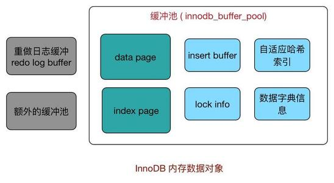

**缓冲池中页的大小默认为 16 KB**。

缓冲池大小可以通过 `innodb_buffer_pool_size` 参数来设置。

```mysql
mysql> show variables like 'innodb_buffer_pool_size'\G;
*************************** 1. row ***************************
Variable_name: innodb_buffer_pool_size
        Value: 134217728
```

为了减少数据库内部资源竞争，增加数据库并发能力，可以使用多个缓冲池实例，每个页根据哈希值平均分配到不同缓冲池实例中，设置参数为 `innodb_buffer_pool_instances`，默认为 1。

```mysql
mysql> show variables like 'innodb_buffer_pool_instances'\G;
*************************** 1. row ***************************
Variable_name: innodb_buffer_pool_instances
        Value: 1
```

**额外的内存池**

InnoDB 通过一种称为**内存堆**（memory heap）的方式管理内存。在对一些数据结构本身的内存进行分配时，需要从额外的内存池中进行申请，当该区域的内存不够时，会从缓冲池中申请。

# 2 预读

## 2.1 基本概念

InnoDB 在 I/O 的优化上有个比较重要的特性为**预读**（Read-Ahead），它会异步地在缓冲池中提前读取多个预计很快就会用到的数据页。

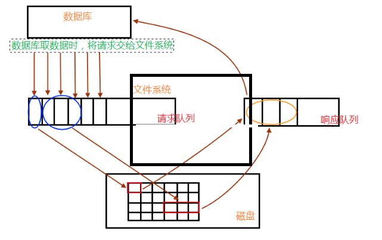

数据库请求数据的时候，会将读请求交给文件系统，放入请求队列中；相关进程从请求队列中将读请求取出，根据需求到相关数据区（内存、磁盘）读取数据；取出的数据，放入响应队列中，最后数据库就会从响应队列中将数据取走，完成一次数据读操作过程。

接着进程继续处理请求队列，判断后面几个数据读请求的数据是否相邻，再根据自身系统 IO 带宽处理量，进行预读，进行读请求的合并处理，一次性读取多块数据放入响应队列中，再被数据库取走。

## 2.2 两种算法

InnoDB 使用两种预读算法来提高 I/O 性能：**线性预读**（linear read-ahead）和**随机预读**（random read-ahead）。

为了区分这两种预读的方式，我们可以把线性预读放到以 extent 为单位，而随机预读放到以 extent 中的 page 为单位。线性预读着眼于将下一个 extent 提前读取到 buffer pool 中，而随机预读着眼于将当前 extent 中的剩余的 page 提前读取到 buffer pool 中。

### 2.2.1 线性预读

线性预读方式有一个很重要的变量控制是否将下一个 extent 预读到 buffer pool 中，通过使用配置参数 `innodb_read_ahead_threshold` 控制触发 InnoDB 执行预读操作的时间。

如果一个 extent 中的被顺序读取的 page 超过或者等于该参数变量时，InnoDB 将会异步地将下一个 extent 读取到 buffer pool 中，`innodb_read_ahead_threshold` 可以设置为 0-64 的任何值（因为一个 extent 中也就只有 64 页），默认值为 56，值越高，访问模式检查越严格。

```mysql
mysql> show variables like 'innodb_read_ahead_threshold';
+-----------------------------+-------+
| Variable_name               | Value |
+-----------------------------+-------+
| innodb_read_ahead_threshold | 56    |
+-----------------------------+-------+
```

例如，如果将值设置为 48，则 InnoDB 只有在顺序访问当前 extent 中的 48 个 pages 时才触发线性预读请求，将下一个 extent 读到内存中。如果值为 8，InnoDB 触发异步预读，即使程序段中只有 8 页被顺序访问。

在没有该变量之前，当访问到 extent 的最后一个 page 的时候，InnoDB 会决定是否将下一个 extent 放入到 buffer pool 中。

### 2.2.2 随机预读

随机预读方式则是表示当同一个 extent 中的一些 page 在 buffer pool 中发现时，InnoDB 会将该 extent 中的剩余 page 一并读到 buffer pool 中。

```mysql
mysql> show variables like 'innodb_random_read_ahead';
+--------------------------+-------+
| Variable_name            | Value |
+--------------------------+-------+
| innodb_random_read_ahead | OFF   |
+--------------------------+-------+
```

由于随机预读方式给 InnoDB code 带来了一些不必要的复杂性，同时在性能上也存在不稳定性，在 5.5 中已经将这种预读方式废弃，默认是 OFF。

# 3 缓冲刷新策略

## 3.1 LRU 算法

通常来说，缓冲池是通过**LRU**（*Least Recently Used*，最近最少使用）算法来进行管理的。即最多使用页在 LRU 列表前端，而最少使用页在 LRU 列表后端。当缓冲池不能存放新读取到的页时，将首先释放 LRU 列表中末端的页。

这里又分两种情况：

- 页已经在缓冲池里，那就只做“移至”LRU 头部的动作，而没有页被淘汰；
- 页不在缓冲池里，除了做“放入”LRU 头部的动作，还要做“淘汰”LRU 尾部页的动作；

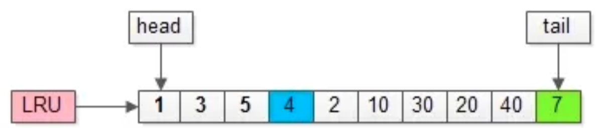

如上图，假如管理缓冲池的 LRU 长度为 10，缓冲了页号为 1、3、5…、40、7 的页。

假如，接下来要访问的数据在页号为 4 的页中：

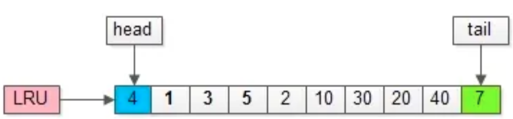

- 页号为 4 的页，本来就在缓冲池里；
- 把页号为 4 的页，放到 LRU 的头部即可，没有页被淘汰；

为了减少数据移动，LRU 一般用链表实现。

假如，再接下来要访问的数据在页号为 50 的页中：

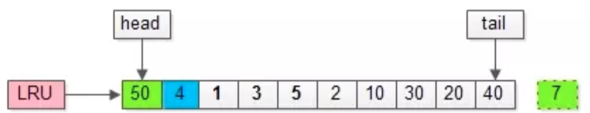

- 页号为 50 的页，原来不在缓冲池里；
- 把页号为 50 的页，放到 LRU 头部，同时淘汰尾部页号为 7 的页；

传统的 LRU 缓冲池算法十分直观，OS、memcache 等很多软件都在用，但是 InnoDB 对传统 LRU 算法做了一些优化，来应对**预读失效**与**缓冲池污染**的问题。

在 InnoDB 的实现中，这个优化点称为**midpoint 插入策略**（midpoint insertion strategy）：新读取到的页并不是直接放到 LRU 列表的首部，而是插入到 LRU 列表的 midpoint 位置。midpoint 之后的列表被称为 old 表（老生代），之前的列表被称为 new 表（新生代）；old 表中的页满足条件被移到 new 表首部的操作，称为**page made young**，反之则称为**page not young**。相关的两个参数 `innodb_old_blocks_pct` 与 `innodb_old_blocks_time` 见本章 3.4 节。

## 3.2 预读失效

> 由于预读，提前把页放入了缓冲池，但最终 MySQL 并没有从页中读取数据，称为**预读失效**。

要优化预读失效，思路是：

- 让预读失败的页，停留在缓冲池 LRU 里的时间尽可能短；
- 让真正被读取的页，才挪到缓冲池 LRU 的头部；

以此来保证真正被读取的热数据留在缓冲池里的时间尽可能长。

具体方法是：

- 将 LRU 分为两个部分：新生代（new sublist）与老生代（old sublist）
- 新老生代首尾相连，即：新生代的尾（tail）连接着老生代的头（head）；
- 新页（例如被预读的页）加入缓冲池时，只加入到老生代头部：如果数据真正被读取（预读成功），才会加入到新生代的头部；如果数据没有被读取，则会比新生代里的“热数据页”更早被淘汰出缓冲池

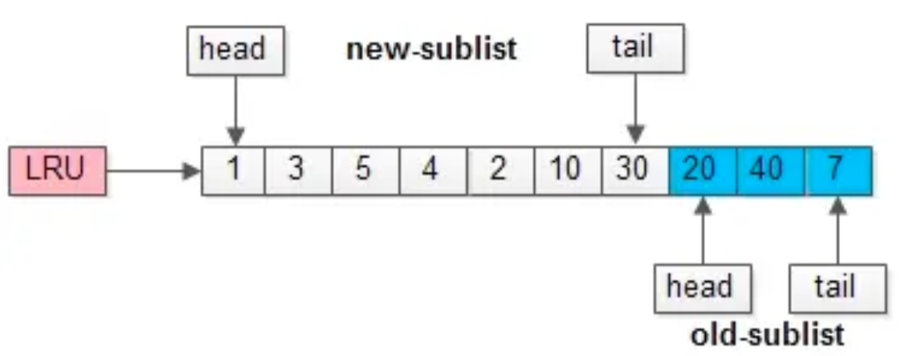

举个例子，整个缓冲池 LRU 如上图：

- 整个 LRU 长度是 10；
- 前 70%是新生代；
- 后 30%是老生代；
- 新老生代首尾相连；

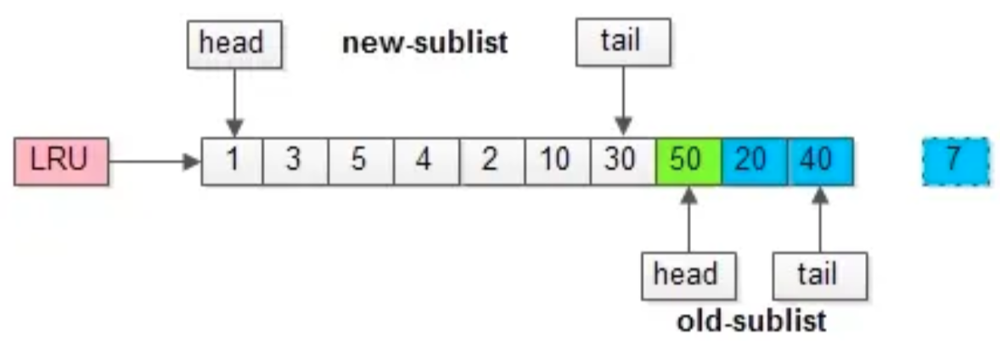

假如有一个页号为 50 的新页被预读加入缓冲池：

- 50 只会从老生代头部插入，老生代尾部（也是整体尾部）的页会被淘汰掉；
- 假设 50 这一页不会被真正读取，即预读失败，它将比新生代的数据更早淘汰出缓冲池；

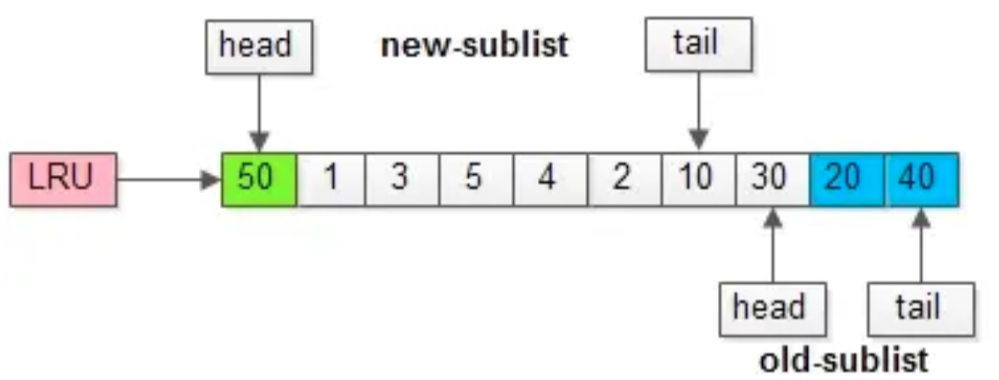

假如 50 这一页立刻被读取到，例如 SQL 访问了页内的行 row 数据：

- 它会被立刻加入到新生代的头部；
- 新生代的页会被挤到老生代，此时并不会有页面被真正淘汰；

## 3.3 缓冲池污染

> 当某一个 SQL 语句，要批量扫描大量数据时，可能导致把缓冲池的所有页都替换出去，导致大量热数据被换出，MySQL 性能急剧下降，这种情况叫**缓冲池污染**。

例如，有一个数据量较大的用户表，当执行：

`select * from user where name like "%John%";`

虽然结果集可能只有少量数据，但这类 like 不能命中索引，必须全表扫描，就需要访问大量的页：

- 把页加到缓冲池（插入老生代头部）；
- 从页里读出相关的 row（插入新生代头部）；
- row 里的 name 字段和字符串 shenjian 进行比较，如果符合条件，加入到结果集中；
- …直到扫描完所有页中的所有 row…

如此一来，所有的数据页都会被加载到新生代的头部，但只会访问一次，真正的热数据被大量换出。

怎么解决这类扫描大量数据导致的缓冲池污染问题呢？MySQL 缓冲池加入了一个“**老生代停留时间窗口**”的机制：假设 T = 老生代停留时间窗口，插入老生代头部的页，即使立刻被访问，并不会立刻放入新生代头部，只有满足“被访问”并且“在老生代停留时间”大于 T，才会被放入新生代头部。

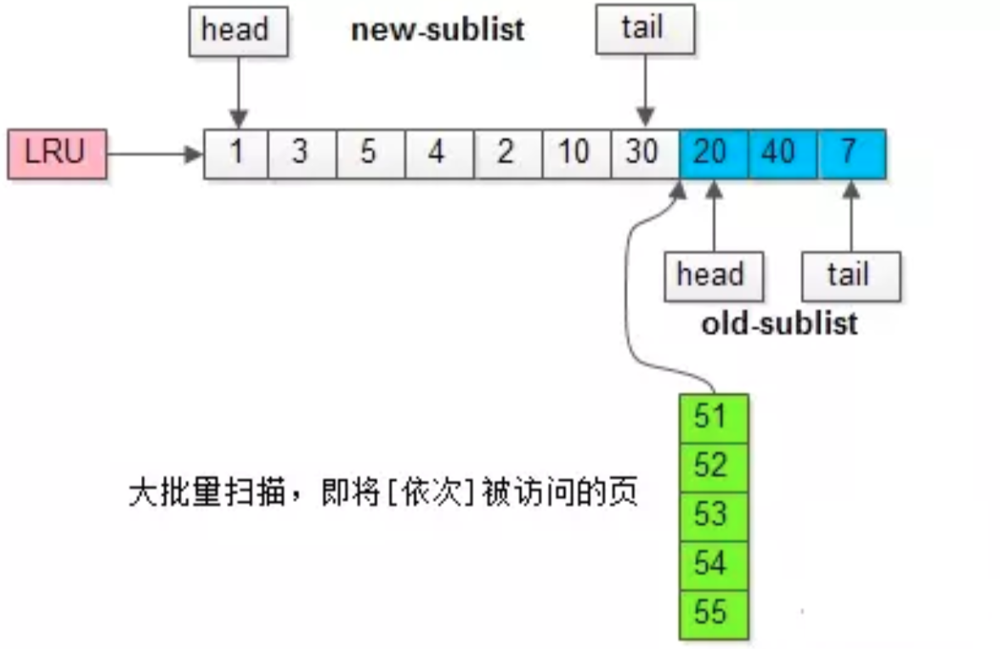

继续举例，假如批量数据扫描，有 51、52、53、54、55 等五个页面将要依次被访问。

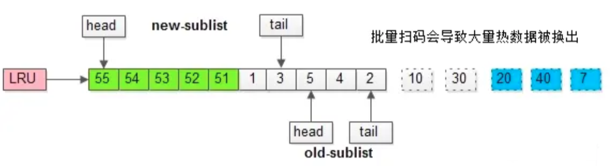

如果没有“老生代停留时间窗口”的策略，这些批量被访问的页面，会换出大量热数据。

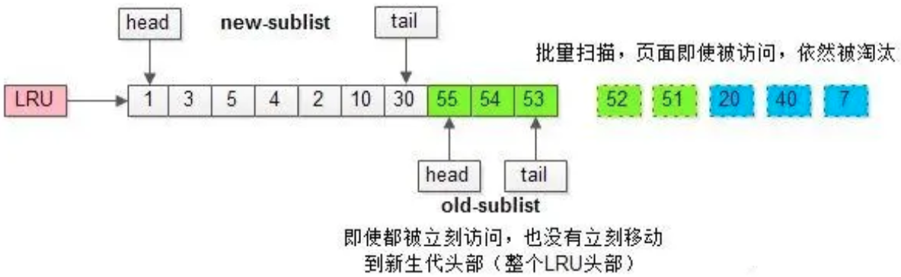

加入“老生代停留时间窗口”策略后，短时间内被大量加载的页，并不会立刻插入新生代头部，而是优先淘汰那些，短期内仅仅访问了一次的页。

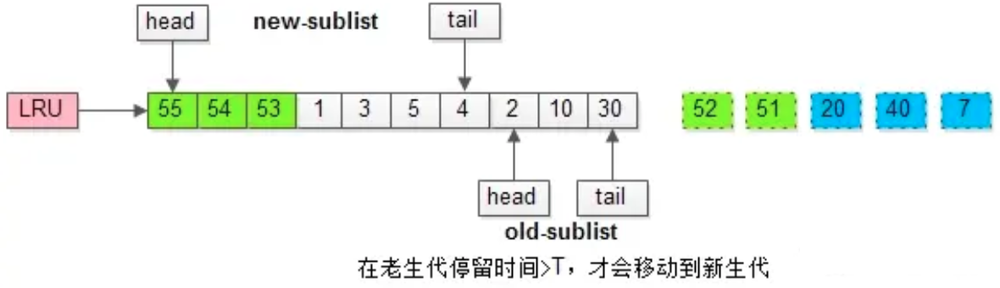

而只有在老生代待的时间足够久，停留时间大于 T，才会被插入新生代头部。

## 3.4 相关参数

```mysql
mysql> show variables like 'innodb_old_blocks_pct'\G;
*************************** 1. row ***************************
Variable_name: innodb_old_blocks_pct
        Value: 37
```

`innodb_old_blocks_pct` 控制老生代占整个 LRU 链长度的比例，默认是 37，即整个 LRU 中新生代与老生代长度比例是 63:37。如果把这个参数设为 100，就退化为普通 LRU 了。

```mysql
mysql> show variables like 'innodb_old_blocks_time'\G;
*************************** 1. row ***************************
Variable_name: innodb_old_blocks_time
        Value: 1000
```

`innodb_old_blocks_time` 代表老生代停留时间窗口，单位是毫秒，默认是 1000，即同时满足“被访问”与“在老生代停留时间超过 1 秒”两个条件，才会被插入到新生代头部。

数据库刚启动时，LRU 列表是空的，缓冲池的所有页都存放在**Free 列表**中。需要添加新的缓冲页时，若 Free 列表中有可用的空闲页，则将其移到 LRU 列表；否则，根据 LRU 算法，淘汰末尾页。

LRU 列表中的页被修改后，跟磁盘上的页就产生了不一致的情况，称该页为**脏页**（dirty page）。数据库会通过 checkpoint 机制将脏页刷新回磁盘。脏页由**Flush 列表**管理。

可以通过 `show engine innodb status` 命令查看缓冲池的状态：

```mysql
mysql> show engine innodb status\G;
*************************** 1. row ***************************
  Type: InnoDB
  Name:
Status:
=====================================
2019-03-07 22:09:08 0x7000013d8000 INNODB MONITOR OUTPUT
=====================================
Per second averages calculated from the last 3 seconds
...
----------------------
BUFFER POOL AND MEMORY
----------------------
Total large memory allocated 137428992
Dictionary memory allocated 100382
Buffer pool size   8192		//缓冲池页的总数
Free buffers       7945		//Free列表页的数量
Database pages     247		//LRU列表页的数量
Old database pages 0
Modified db pages  0		//脏页数量
Pending reads      0
Pending writes: LRU 0, flush list 0, single page 0
Pages made young 0, not young 0
0.00 youngs/s, 0.00 non-youngs/s
Pages read 213, created 34, written 36
0.00 reads/s, 0.00 creates/s, 0.00 writes/s
No buffer pool page gets since the last printout	//Buffer pool hit rate 1000 / 1000...
Pages read ahead 0.00/s, evicted without access 0.00/s, Random read ahead 0.00/s
LRU len: 247, unzip_LRU len: 0	//LRU表共有247页，unzip_LRU管理的是压缩页
I/O sum[0]:cur[0], unzip sum[0]:cur[0]
...
```

本例中的数据库是一个空数据库，所以没有缓冲池命中率的统计。实际应用中一般会打印出这样的一句话：

`Buffer pool hit rate 1000 / 1000, young-making rate 0 / 1000 not 0 / 1000…`

正常情况下缓冲池的命中率应该接近 100%，如果低于 95%，说明 LRU 表很可能存在被污染的问题。

# 4 Change Buffer

在 InnoDB 中，主键是行唯一的标识符。

通常主键被设计成自增的，页中的行记录按照聚集索引（Primary Key）顺序存放，一般情况下，聚集索引的插入不需要随机读取其他页中的记录，因此速度非常快。

但是，对于非聚集的且不是唯一的索引，插入或更新操作就需要离散地访问非聚集索引页，导致插入操作性能下降。

为了解决这个问题，InnoDB 引入了**Insert Buffer**。对于非聚集索引的插入或更新操作，不是每一次直接插入到索引页，而是先判断插入的非聚集索引页是否在缓冲池中：若在，则直接插入；若不在，则先放入到一个 Insert Buffer 对象中，然后以一定的频率将 Insert Buffer 中的记录 merge（合并）到索引页。这样就大大提高了非聚集索引插入的性能。

Insert Buffer 的使用需要同时满足以下两个条件：

- 索引是辅助索引（非聚集索引）
- 索引不是唯一索引

要求是辅助索引，因为聚集索引的插入本来就是顺序的，插入缓冲无异于画蛇添足。要求不能是唯一索引，因为在插入缓冲时，数据库并不去检查索引页来判断记录的唯一性，如果查找又会有离散读取的情况发生，Insert Buffer 也就失去了意义。

除了 Insert Buffer，InnoDB 还使用**Delete Buffer**、**Purge Buffer** 来支持删除与更新操作。例如，删除一条记录可分为两步：

- 将记录标记为删除
- 真正将记录删除

Delete Buffer 用于第一步，Purge Buffer 用于第二步。

InnoDB 提供了参数 `innodb_change_buffering` 来开启各种 Buffer 的选项，默认为 all：

```mysql
mysql> show variables like 'innodb_change_buffering'\G;
*************************** 1. row ***************************
Variable_name: innodb_change_buffering
        Value: all
```

可选值为：

- inserts：只启用 Insert Buffer
- deletes：只启用 Delete Buffer
- purges：只启用 Purge Buffer
- changes：启用 Insert Buffer、Delete Buffer
- all：全部启用
- none：全部不启用

还有一个参数 `innodb_change_buffer_max_size` 用于控制 Change Buffer 最大使用内存的比例，默认为 25%，上限为 50%：

```mysql
mysql> show variables like 'innodb_change_buffer_max_size'\G;
*************************** 1. row ***************************
Variable_name: innodb_change_buffer_max_size
        Value: 25
```

可以通过 `show engine innodb status` 命令查看 Change Buffer 的状态：

```mysql
mysql> show engine innodb status\G;
*************************** 1. row ***************************
  Type: InnoDB
  Name:
Status:
=====================================
2019-03-13 21:25:55 0x70000cec5000 INNODB MONITOR OUTPUT
=====================================
Per second averages calculated from the last 27 seconds
...
-------------------------------------
INSERT BUFFER AND ADAPTIVE HASH INDEX
-------------------------------------
Ibuf: size 1, free list len 0, seg size 2, 0 merges
merged operations:
 insert 0, delete mark 0, delete 0
discarded operations:
 insert 0, delete mark 0, delete 0
...
```

第一行，size 代表已经合并的页的总数；free list len 代表空闲列表的长度；seg size 代表 Change Buffer 有多少页；merges 代表合并的次数。merged operations 下列举了每个操作的次数；discarded operations 表示当 Change Buffer 发生 merge 时，表已被删除，就无需 merge 到辅助索引当中了。

Change Buffer 的数据结构是一棵 B+ 树，而且是全局的，存放于共享表空间，负责对所有表的辅助索引进行变更缓冲。

启用 Change Buffer 后，需要保证每次将缓冲数据 merge 到索引页的操作必须成功，也就是需要保证索引页有足够的可用空间。InnoDB 使用一个称为**Insert Buffer Bitmap** 的页来标记每个辅助索引页的可用空间。

以 Insert Buffer 为例，若待插入记录的辅助索引页不在缓冲池中，首先将索引记录插入到 Change Buffer 的 B+ 树中，然后在合适的时机再 merge 到索引页。以下几种情况可能会触发 merge 操作：

- 辅助索引页被读取到缓冲池
- Insert Buffer Bitmap 页追踪到该辅助索引页已无可用空间
- Master Thread

第一种情况，当辅助索引页被读取到缓冲池时，例如在执行正常的 select 操作时，需要检查 Insert Buffer Bitmap 页，然后确认该辅助索引页是否有记录存放于 Change Buffer 的 B+ 树中，若有，则将该页的记录插入到索引页。

第二种情况，若插入辅助索引记录时检测到插入记录后可用空间会小于 1/32 页，则会强制进行一次合并操作，即强制读取辅助索引页，将 Change Buffer B+ 树中该页的记录及待插入的记录插入到辅助索引页。

第三种情况，就是 Master Thread 每 1 秒或每 10 秒进行一次 Merge Insert Buffer 操作。

# 5 Checkpoint 技术

页的操作首先都是在缓冲池中完成的，数据库需要一种机制来同步缓冲池与磁盘间的数据。

倘若每发生一次页修改就触发一次刷新操作，数据库的性能将变得非常差；同时，如果还没来得及完成刷新数据库就发生了宕机，那么数据就不能恢复了。为了避免数据丢失的问题，当前数据库系统普遍采用了 Write Ahead Log 策略，即当事务提交时，先写重做日志，再修改页，宕机后通过重做日志来恢复数据（详见第 4 篇《事务》）。而**Checkpoint** 技术就是在这种策略下解决脏页刷盘时机的机制，其目的主要有以下几个：

- **缩短数据库的恢复时间**

  重做日志中记录了 checkpoint 的位置，这个点之前的页已经刷新回磁盘，只需要对 checkpoint 之后的重做日志进行恢复，这样就大大缩短了恢复时间。

- **缓冲池不够用时，将脏页刷新到磁盘**

  缓冲池不够用时，根据 LRU 算法会溢出最近最少使用的页，如果页为脏页，强制执行 checkpoint，将页刷新回磁盘。

- **重做日志不可用时，刷新脏页**

  重做日志是循环使用的。重做日志不可用，是指数据还未刷新到磁盘上导致这部分日志不可以被覆盖，此时必须强制执行 checkpoint，将缓冲池中的页至少刷新到当前重做日志的位置。

# 6 刷新邻接页

当刷新一个脏页时，InnoDB 存储引擎会检测该页所在区（extent）的所有页，如果是脏页，那么一起进行刷新。这样做的好处显而易见，通过 AIO 可以将多个 IO 写入操作合并为一个 IO 操作，增大写入量，减少物理写 IO，故该工作机制在传统机械磁盘下有着显著的优势：

- 在写入次数基本不增加的情况下，增加了写入的量
- 加速了脏页的回收
- 充分利用 doublewrite 每次 1 MB 写入的特征
- 这个功能打开以后会发现 iostat 里面的 wrqm（合并写）这个值会比较高

需要特别考虑的问题：

- 是不是可能将不怎么脏的页进行了写入，而该页之后又会很快变成脏页？
- 固态硬盘有着较高的 IOPS，是否还需要这个特性？

可以通过参数 `innodb_flush_neighbors` 来控制是否启用该特性：

```mysql
mysql> show variables like 'innodb_flush_neighbors'\G;
*************************** 1. row ***************************
Variable_name: innodb_flush_neighbors
        Value: 1
```
