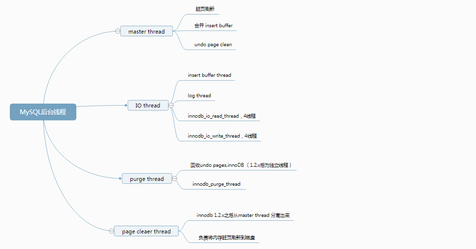

InnoDB 采用的是多线程模型，后台有多个不同的线程负责处理不同的任务。



# 1 Master Thread

Master Thread 是一个非常核心的后台线程，具有最高的线程优先级。InnoDB 存储引擎的主要工作都是在一个单独的后台线程 Master Thread 中完成的，比如将缓冲池中的数据异步刷新到磁盘，保证数据的一致性，包括脏页的刷新、合并插入缓冲、undo 页的回收等。

Master Thread 内部由多个循环（loop）组成：

- 主循环（loop）
- 后台循环（background loop）
- 刷新循环（flush loop）
- 暂停循环（suspend loop）

Master Thread 会根据数据库运行的状态在四种循环之间切换。

## 1.1 主循环

大多数的操作都是在主循环中完成，根据执行频率，可以分为两类操作：

### 1.1.1 每秒一次的操作

- 日志缓冲刷新到磁盘（总是）
- 合并插入缓冲（可能）
- 刷新脏页到磁盘（可能）
- 如果没有用户活动切换到 background loop（可能）

即使某个事务没有提交，InnoDB 仍然每秒将重做日志缓冲刷新到磁盘，这一点保证了再大的事务提交也是很快的。

只有脏页比例超过了一个阈值，InnoDB 才会执行刷新操作，该值与参数 `innodb_max_dirty_pages_pct` 有关，默认为 75%：

```mysql
mysql> show variables like 'innodb_max_dirty_pages_pct'\G;
*************************** 1. row ***************************
Variable_name: innodb_max_dirty_pages_pct
        Value: 75.000000
```

需要注意的是，在自适应刷新策略下，即使脏页比例小于 75% 也可能执行刷新操作。

而一次最多合并多少个插入缓冲、刷新多少个脏页，由另一个参数 `innodb_io_capacity` 来控制，默认为 200：

```mysql
mysql> show variables like 'innodb_io_capacity'\G;
*************************** 1. row ***************************
Variable_name: innodb_io_capacity
        Value: 200
```

- 刷新脏页数量 = innodb_io_capacity
- 合并插入缓冲数量 = innodb_io_capacity * 5%

### 1.1.2 每 10 秒一次的操作

- 刷新脏页到磁盘（可能）
- 合并至多 5 个插入缓冲（总是）
- 日志缓冲刷新到磁盘（总是）
- 删除无用的 undo 页（总是）
- 刷新 innodb_io_capacity 个或 10% 的脏页到磁盘（总是）

第一步与第五步都是刷新脏页操作，但是执行条件不一样：

- 第一步不是必现的，InnoDB 会先判断过去 10 秒之内的磁盘 IO 操作是否小于 innodb_io_capacity 次，如果是，认为当前有足够的磁盘 IO 操作能力，然后将脏页刷新到磁盘；
- 第五步是必现的，InnoDB 会判断脏页比例，如果超过 70%，则刷新 100 个脏页；否则，只刷新 10% 的脏页。

在 InnoDB 1.2.x 版本以后，刷新脏页的操作从 Master Thread 分离出来，交由单独的**Page Cleaner Thread** 执行。

其中，InnoDB 还会执行一项称为 **full purge** 的操作，即删除无用的 undo 页。InnoDB 对表进行 update、delete 这类操作时，原先的行被标记为删除，但是需要保留这些行版本的信息，有时候可能还有查询操作需要读取之前版本的 undo 信息。如果确认 undo 页可以删除，则进行回收。每次回收 undo 页的数量由参数 `innodb_purge_batch_size` 控制：

```mysql
mysql> show variables like 'innodb_purge_batch_size'\G;
*************************** 1. row ***************************
Variable_name: innodb_purge_batch_size
        Value: 300
```

## 1.2 后台循环

若当前没有用户活动或数据库关闭，就会切到这个循环，执行以下操作：

- 删除无用的 undo 页（总是）
- 合并 20 个插入缓冲（总是）
- 跳回到主循环（总是）
- 跳到 flush loop（可能）

## 1.3 刷新循环

只干一件事，就是刷新脏页到磁盘。

## 1.4 暂停循环

若 flush loop 中也没有什么事情可以做了，InnoDB 会切换到 suspend loop，将 Master Thread 挂起，等待事件的发生。

# 2 IO Thread

InnoDB 使用了大量 AIO（Async IO）来处理 IO 请求，而 IO Thread 的工作主要负责这些 IO 请求的回调处理。

可以通过 `show engine innodb status` 命令来观察 InnoDB 的状态，从中可以看到 IO Thread 的情况。

```mysql
mysql> show engine innodb status\G;
*************************** 1. row ***************************
  Type: InnoDB
  Name:
Status:
=====================================
2019-03-07 22:09:08 0x7000013d8000 INNODB MONITOR OUTPUT
=====================================
Per second averages calculated from the last 3 seconds
...
--------
FILE I/O
--------
I/O thread 0 state: waiting for i/o request (insert buffer thread)
I/O thread 1 state: waiting for i/o request (log thread)
I/O thread 2 state: waiting for i/o request (read thread)
I/O thread 3 state: waiting for i/o request (read thread)
I/O thread 4 state: waiting for i/o request (read thread)
I/O thread 5 state: waiting for i/o request (read thread)
I/O thread 6 state: waiting for i/o request (write thread)
I/O thread 7 state: waiting for i/o request (write thread)
I/O thread 8 state: waiting for i/o request (write thread)
I/O thread 9 state: waiting for i/o request (write thread)
Pending normal aio reads: [0, 0, 0, 0] , aio writes: [0, 0, 0, 0] ,
 ibuf aio reads:, log i/o's:, sync i/o's:
Pending flushes (fsync) log: 0; buffer pool: 0
242 OS file reads, 53 OS file writes, 7 OS fsyncs
0.00 reads/s, 0 avg bytes/read, 0.00 writes/s, 0.00 fsyncs/s
...
```

可以发现，默认情况下一共有 10 个 IO 线程：

- （insert buffer thread）\* 1
- （log thread）\* 1
- （read thread）\* 4
- （write thread）\* 4

read thread 与 write thread 数量可以通过参数进行调整：

```mysql
mysql> show variables like 'innodb_%io_threads'\G;
*************************** 1. row ***************************
Variable_name: innodb_read_io_threads
        Value: 4
*************************** 2. row ***************************
Variable_name: innodb_write_io_threads
        Value: 4
```

# 3 Purge Thread

事务被提交后，其所使用的 undo log（用于事务 commit 失败后回滚）可能不再需要，因此需要 purge 线程来回收 undo 页。

还可以通过参数 `innodb_purge_threads` 设置多个 purge thread 以进一步加快 undo 页回收。

```mysql
mysql> show variables like 'innodb_purge_threads'\G;
*************************** 1. row ***************************
Variable_name: innodb_purge_threads
        Value: 4
```

# 4 Page Cleaner Thread

为了减轻 Master Thread 的工作压力及对于用户查询线程的阻塞，将脏页的刷新交由单独的 Page Cleaner Thread 来完成。

# 5 异步 IO（Async IO）

为了提高磁盘操作性能，当前的数据库系统普遍采用异步 IO（Asynchronous IO，AIO）的方式来处理磁盘操作，IO Thread 正是对这些 AIO 请求做回调处理的线程。

与 AIO 对应的是 Sync IO（同步 IO），即每进行一次 IO 操作，需要等待此操作结束才能继续接下来的操作。但是如果用户发出的是一条索引扫描的查询，那么这条 SQL 查询语句可能需要扫描多个索引页，也就是需要进行多次 IO 操作。每扫描一个页并等待其完成后再进行下一次的扫描，这是没有必要的。用户可以在发出一个 IO 请求后立即再发出另一个 IO 请求，当全部 IO 请求发送完毕后，等待所有 IO 操作的完成，这就是 AIO。

AIO 的另一个优势是进行**IO Merge 操作**（也就是 IO 合并），将多个 IO 合并为 1 个 IO，这样可以提高 IOPS 的性能。例如用户需要访问页的（space, offset）为：`(8,6),(8,7),(8,8)`，每个页的大小为 16 KB，那么同步 IO 需要进行 3 次 IO 操作。而 AIO 会判断到这三个页是连续的（可以通过 space, offset 知道），因此 AIO 底层会发送一个 IO 请求，从 (8,6) 开始，直接读取 48 KB。

可以通过参数 `innodb_use_native_aio` 来控制是否启用 AIO，Linux 下默认是开启状态：

```mysql
mysql> show variables like 'innodb_use_native_aio'\G;
*************************** 1. row ***************************
Variable_name: innodb_use_native_aio
        Value: ON
```

# 6 InnoDB 的关闭

在 InnoDB 关闭时，有个非常重要的参数 `innodb_fast_shutdown` 影响着关闭的行为。该参数可取值为 0、1、2，默认值为 1。

- **0**：在 MySQL 数据库关闭时，InnoDB 需要完成所有的 full purge 和 merge insert buffer，并且将所有的脏页刷新回磁盘。这需要一些时间，有时甚至需要几个小时才能完成。
- **1**：参数 `innodb_fast_shutdown` 的默认值，表示不需要完成上述的 full purge 和 merge insert buffer 操作，但是在缓冲池中的一些数据脏页还是会刷新回磁盘。
- **2**：不完成 full purge 和 merge insert buffer 操作，也不将缓冲池中的数据脏页写回磁盘，而是将日志都写入日志文件。这样不会有任何事务的丢失，但是下次 MySQL 数据库启动时，会进行恢复操作（recovery）。

```mysql
mysql> show variables like 'innodb_fast_shutdown'\G;
*************************** 1. row ***************************
Variable_name: innodb_fast_shutdown
        Value: 1
```
