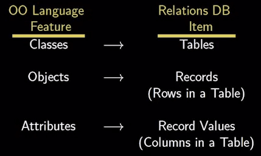
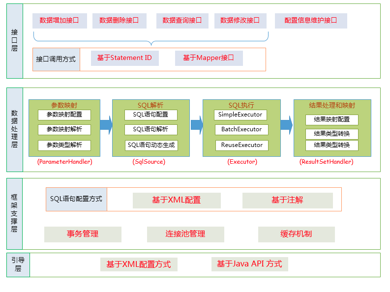
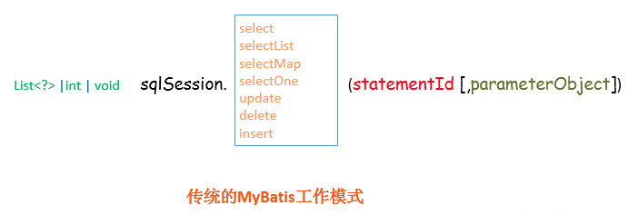
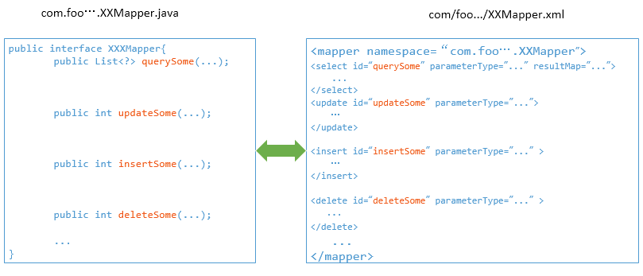
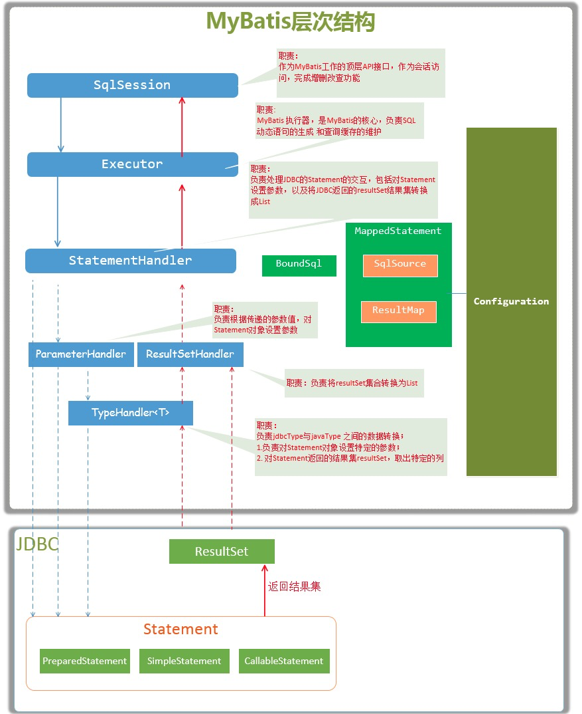
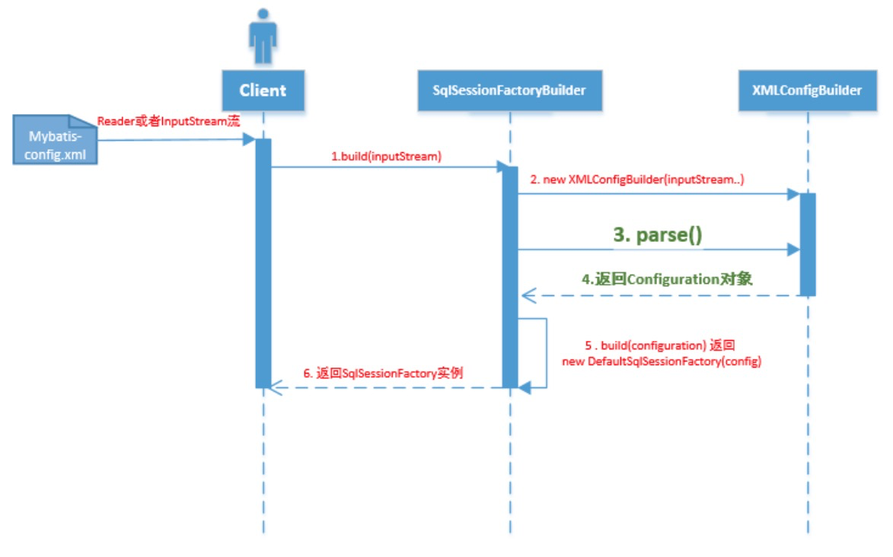
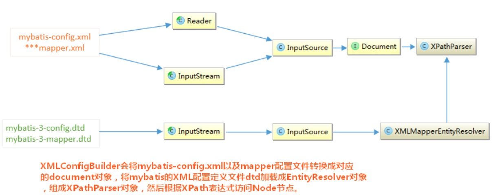
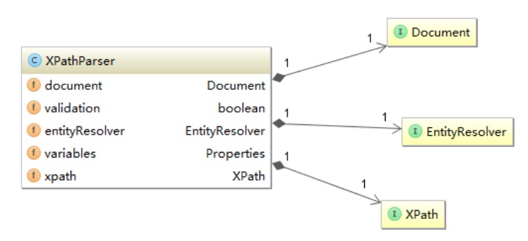
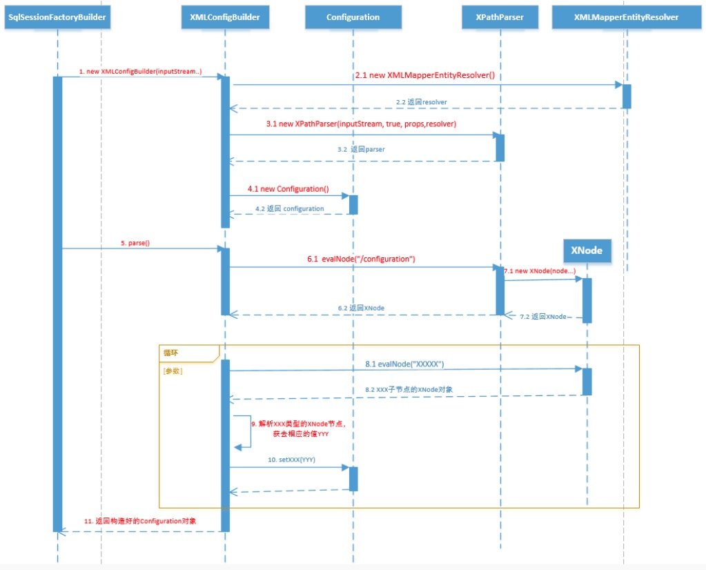
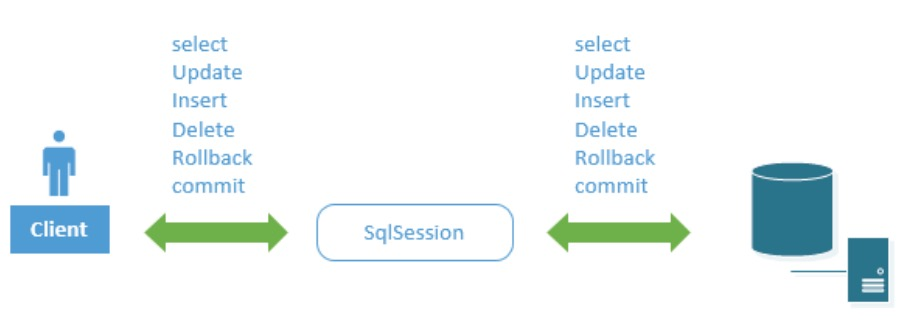

# MyBatis 架构设计

# 1 ORM

## 1.1 概述

面向对象编程把所有实体看成**对象**（Object），关系型数据库则是采用实体之间的**关系**（Relation）连接数据，两者的设计哲学是不一样的。这就导致一种困境：当使用面向对象的编程语言来进行应用开发时，从项目一开始就采用的是面向对象的思想（分析、设计、编程等），但到了持久层数据库访问时，又必须重返关系数据库的数据模型。

为了跨越面向对象程序设计语言和关系数据库之间的鸿沟，产生了 ORM 框架。

简单说，ORM 就是通过实例对象的语法完成关系型数据库操作的技术，是“对象-关系映射”（**Object/Relational Mapping**）的缩写。

ORM 把数据库映射成对象：



基于此，应用程序不再直接访问底层数据库，而是以面向对象的方式来操作持久化对象，而 ORM 框架则将这些面向对象的操作转换成底层的 SQL 操作。开发者只使用面向对象编程，与数据对象直接交互，不用关心底层数据库。

## 1.2 JPA & Hibernate & MyBatis

JPA（Jakarta Persistence，原 Java Persistence API）本身是一种 ORM 规范，并不是 ORM 产品。若应用程序是面向 JPA 编程，那么应用程序就可以在各种 ORM 框架之间切换。

MyBatis 没有实现 JPA，它和 ORM 框架的设计思路不完全一样。MyBatis 拥抱 SQL，而 ORM 则更靠近面向对象，不建议写 SQL，实在要写，则推荐用框架自带的类 SQL（如 HQL、JPQL）代替。因此 MyBatis 更准确的定位是 SQL 映射框架（常被称为“半自动 ORM”），当然 ORM 框架和 MyBatis 都是持久层框架。

最典型的 ORM 框架是 Hibernate，它是全自动 ORM 框架，而 MyBatis 是半自动的。ORM 是 Object 和 Relation 之间的映射，包括 Object → Relation 和 Relation → Object 两方面。Hibernate 是个完整的 ORM 框架，而 MyBatis 完成的是 Relation → Object，也就是其所说的 Data Mapper Framework。

Hibernate 与 MyBatis 各有适用场景：Hibernate 自动化程度高，适合领域模型清晰、以标准 CRUD 为主的业务系统；MyBatis 把 SQL 的控制权交给开发者，更适合复杂查询多、需要对 SQL 做精细化调优的项目。在国内，互联网业务普遍面临高并发、分库分表和 SQL 调优的需求，加上大厂的广泛采用形成了生态惯性，MyBatis 及其增强工具 MyBatis-Plus 至今仍是主流；海外则更多使用 Spring Data JPA/Hibernate。

# 2 架构分析

MyBatis 虽然体量不大，实现简单，但是骨骼清奇，代码优雅，很适合作为入门的开源框架来研究。

总体架构如下：



## 2.1 接口层

MyBatis 和数据库的交互有两种方式。

第一种是使用传统的 API 方式。传递 Statement ID 和查询参数给 SqlSession 对象，使用 SqlSession 对象完成和数据库的交互。MyBatis 提供了非常方便和简单的 API，供用户实现对数据库的增删改查操作，以及对数据库连接信息和 MyBatis 自身配置信息的维护操作。



第二种是使用 Mapper 接口。MyBatis 将配置文件中的每一个 `<mapper>` 节点抽象为一个 Mapper 接口，这个接口中声明的方法跟 `<mapper>` 节点中的 `<select|update|delete|insert>` 节点一一对应，即 `<select|update|delete|insert>` 节点的 id 值为 Mapper 接口中的方法名称，`parameterType` 值表示 Mapper 对应方法的入参类型，`resultType` 或 `resultMap` 则描述如何把 JDBC 返回的 ResultSet 映射为 Java 对象，映射的目标类型应与方法的返回值类型（或返回集合的元素类型）一致。



根据 MyBatis 的配置规范配置好后，通过 `SqlSession.getMapper(XXXMapper.class)` 方法，MyBatis 会根据相应的接口声明的方法信息，通过动态代理机制生成一个 Mapper 实例。我们使用 Mapper 接口的某一个方法时，MyBatis 会根据这个方法的方法名和参数类型确定 Statement ID，底层还是通过 `SqlSession.select("statementId", parameterObject);` 或者 `SqlSession.update("statementId", parameterObject);` 等方法来实现对数据库的操作。

MyBatis 引入 Mapper 接口这种调用方式，主要是为了满足面向接口编程的需要。此外，开发者可以在接口方法上使用注解来配置 SQL 语句，从而脱离 Mapper XML 文件，实现“无 XML 配置”（Mapper 接口本身仍需通过配置或 Spring 的 `@MapperScan` 等方式注册）。

## 2.2 数据处理层

数据处理层可以说是 MyBatis 的核心，从大的方面讲，它要完成三个功能：

- 通过传入参数构建动态 SQL 语句
- SQL 语句的执行
- 将查询结果集封装成 `List<E>`

动态语句生成可以说是 MyBatis 框架非常优雅的一个设计，MyBatis 通过传入的参数值，使用 OGNL 来动态地构造 SQL 语句，使得 MyBatis 有很强的灵活性和扩展性。动态 SQL 的脚本语言本身也是可插拔的：通过 `LanguageDriver` 接口，官方提供了 Velocity、Thymeleaf、FreeMarker 等模板引擎的扩展实现。

参数映射指的是 Java 数据类型和 JDBC 数据类型之间的转换，这里包括两个过程：一是查询阶段，我们要将 Java 类型的数据转换成 JDBC 类型的数据，通过 `preparedStatement.setXXX()` 来设值；二是将 ResultSet 查询结果集的 jdbcType 数据转换成 Java 数据类型。

动态 SQL 语句生成之后，MyBatis 将执行 SQL 语句，并将可能返回的结果集转换成 `List<E>` 列表。MyBatis 在对结果集的处理中，支持结果集关系一对多和多对一的转换，并且有两种支持方式，一种为嵌套查询语句的查询，还有一种是嵌套结果集的查询。

## 2.3 框架支撑层

负责最基础的功能支撑，包括连接管理、事务管理、配置加载和缓存处理。这些都是共用的东西，将它们抽取出来作为最基础的组件，为上层的数据处理层提供支撑。

## 2.4 引导层

引导层负责加载配置信息并启动 MyBatis。MyBatis 提供两种方式来引导：基于 XML 配置文件的方式和基于 Java API 的方式。

# 3 主要组件



从 MyBatis 代码实现的角度来看，MyBatis 的主要核心组件有以下几个：

- SqlSession：作为 MyBatis 工作的主要顶层 API，表示和数据库交互的会话，完成必要的数据库增删改查功能
- Executor：MyBatis 执行器，是 MyBatis 调度的核心，负责 SQL 语句的执行调度和查询缓存的维护
- StatementHandler：封装了 JDBC Statement 操作，如设置参数、将 Statement 结果集转换成 List 集合
- ParameterHandler：负责将用户传递的参数转换成 JDBC Statement 所需要的参数
- ResultSetHandler：负责将 JDBC 返回的 ResultSet 结果集对象转换成 List 类型的集合
- TypeHandler：负责 Java 数据类型和 JDBC 数据类型之间的映射和转换
- MappedStatement：维护了一条 `<select|update|delete|insert>` 节点的封装
- SqlSource：负责根据用户传递的 parameterObject 动态地生成 SQL 语句，将信息封装到 BoundSql 对象中并返回
- BoundSql：表示动态生成的 SQL 语句以及相应的参数信息
- Configuration：MyBatis 所有的配置信息都维持在 Configuration 对象之中

# 4 源码解读

下面深入源码细节，来看看 MyBatis 的各个组件如何相互协作，将上面的架构图落地实现。

## 4.1 初始化过程

任何框架的初始化，无非是加载自己运行时所需要的配置信息。

MyBatis 使用 `org.apache.ibatis.session.Configuration` 对象作为所有配置信息的容器，`Configuration` 对象的组织结构和 XML 配置文件的组织结构几乎完全一样（当然，Configuration 对象的功能并不限于此，它还负责创建一些 MyBatis 内部使用的对象，如 Executor 等）。

现在就从使用 MyBatis 的简单例子入手，深入分析一下 MyBatis 是怎样完成初始化的，都初始化了什么。

```java
String resource = "mybatis-config.xml";
InputStream inputStream = Resources.getResourceAsStream(resource);
SqlSessionFactory sqlSessionFactory = new SqlSessionFactoryBuilder().build(inputStream);
try (SqlSession sqlSession = sqlSessionFactory.openSession()) {
    List<Blog> list = sqlSession.selectList("com.foo.bean.BlogMapper.queryAllBlogInfo");
}
```

上述语句的作用是执行 `com.foo.bean.BlogMapper.queryAllBlogInfo` 定义的 SQL 语句，返回一个 List 结果集。总的来说，上述代码经历了 MyBatis 初始化 → 创建 SqlSession → 执行 SQL 语句并返回结果三个过程。

初始化的基本过程如下图所示：



SqlSessionFactoryBuilder 相关的代码如下所示：

```java
public SqlSessionFactory build(InputStream inputStream, String environment, Properties properties)
{
    try
    {
        //1. 创建XMLConfigBuilder对象用来解析XML配置文件，生成Configuration对象
        XMLConfigBuilder parser = new XMLConfigBuilder(inputStream, environment, properties);
      
        //2. 将XML配置文件内的信息解析成Java对象Configuration对象
        Configuration config = parser.parse();
      
        //3. 根据Configuration对象创建出SqlSessionFactory对象
        return build(config);
      
    } catch (Exception e) {
        throw ExceptionFactory.wrapException("Error building SqlSession.", e);
    } finally {
        //...
    }
}
//从此处可以看出，MyBatis内部通过Configuration对象来创建SqlSessionFactory,
//用户也可以自己通过API构造好Configuration对象，调用此方法创建SqlSessionFactory
public SqlSessionFactory build(Configuration config)
{
    return new DefaultSqlSessionFactory(config);
}
```

上述的初始化过程中，涉及到了以下几个对象：

- SqlSessionFactoryBuilder：SqlSessionFactory 的构造器，用于创建 SqlSessionFactory，采用了建造者（Builder）设计模式
- Configuration：该对象保存了 mybatis-config.xml 文件中的所有 MyBatis 配置信息
- SqlSessionFactory：SqlSession 工厂类，以工厂形式创建 SqlSession 对象，采用了工厂设计模式
- XMLConfigBuilder：负责将 mybatis-config.xml 配置文件解析成 Configuration 对象，供 SqlSessionFactoryBuilder 使用，创建 SqlSessionFactory

XMLConfigBuilder 的 `parse()` 方法返回了 Configuration 对象。那么 `parse()` 方法是如何处理 XML 文件，生成 Configuration 对象的呢？

XMLConfigBuilder 会将 XML 配置文件的信息转换为 Document 对象，而将 XML 配置定义文件 DTD 转换成 XMLMapperEntityResolver 对象，然后将二者封装到 XPathParser 对象中。XPathParser 的作用是提供根据 XPath 表达式获取基本的 DOM 节点 Node 信息的操作，如下图所示：





之后 XMLConfigBuilder 调用 `parse()` 方法：会从 XPathParser 中取出 `<configuration>` 节点对应的 Node 对象，然后解析此 Node 节点的子 Node：

```java
  private void parseConfiguration(XNode root) {
    try {
      //1.首先处理properties 节点	
      propertiesElement(root.evalNode("properties")); //issue #117 read properties first
      //2.处理typeAliases
      typeAliasesElement(root.evalNode("typeAliases"));
      //3.处理插件
      pluginElement(root.evalNode("plugins"));
      //4.处理objectFactory
      objectFactoryElement(root.evalNode("objectFactory"));
      //5.objectWrapperFactory
      objectWrapperFactoryElement(root.evalNode("objectWrapperFactory"));
      //6.settings
      settingsElement(root.evalNode("settings"));
      //7.处理environments
      environmentsElement(root.evalNode("environments")); // read it after objectFactory and objectWrapperFactory issue #631
      //8.database
      databaseIdProviderElement(root.evalNode("databaseIdProvider"));
      //9. typeHandlers
      typeHandlerElement(root.evalNode("typeHandlers"));
      //10 mappers
      mapperElement(root.evalNode("mappers"));
    } catch (Exception e) {
      throw new BuilderException("Error parsing SQL Mapper Configuration. Cause: " + e, e);
    }
  }
```

在上述代码中，还有一个非常重要的地方，就是解析 XML 配置文件子节点 `<mappers>` 的方法 `mapperElement(root.evalNode("mappers"))`，它将解析我们配置的 Mapper.xml 配置文件。Mapper 配置文件是 MyBatis 的核心，MyBatis 的特性和理念都体现在此 Mapper 的配置和设计上。

以上述的 `environmentsElement(root.evalNode("environments"));` 为例，看看 XML 的子节点是如何解析出来，设置到 Configuration 对象中的：

```java
/*
   解析environments节点，并将结果设置到Configuration对象中
   注意：创建environment时，如果SqlSessionFactoryBuilder指定了特定的环境（即数据源）；
         则返回指定环境（数据源）的Environment对象，否则返回默认的Environment对象；
         这种方式实现了MyBatis可以连接多数据源
*/
private void environmentsElement(XNode context) throws Exception
{
    if (context != null)
    {
        if (environment == null)
        {
            environment = context.getStringAttribute("default");
        }
        for (XNode child : context.getChildren())
        {
            String id = child.getStringAttribute("id");
            if (isSpecifiedEnvironment(id))
            {
                //1.创建事务工厂 TransactionFactory
                TransactionFactory txFactory = transactionManagerElement(child.evalNode("transactionManager"));
                DataSourceFactory dsFactory = dataSourceElement(child.evalNode("dataSource"));
                //2.创建数据源DataSource
                DataSource dataSource = dsFactory.getDataSource();
                //3. 构造Environment对象
                Environment.Builder environmentBuilder = new Environment.Builder(id)
                .transactionFactory(txFactory)
                .dataSource(dataSource);
                //4. 将创建的Environment对象设置到configuration 对象中
                configuration.setEnvironment(environmentBuilder.build());
            }
        }
    }
}
```

至此，MyBatis 的初始化流程有了一个比较清晰的脉络，时序图如下：



## 4.2 从一次 select 查询语句说起

下面用一个查询的实例，来分析 MyBatis 的架构设计。

```java
//1.加载mybatis的配置文件，初始化mybatis，创建出SqlSessionFactory，是创建SqlSession的工厂
InputStream inputStream = Resources.getResourceAsStream("mybatisConfig.xml");
SqlSessionFactoryBuilder builder = new SqlSessionFactoryBuilder();
SqlSessionFactory factory = builder.build(inputStream);

//2. 从SqlSession工厂 SqlSessionFactory中创建一个SqlSession，进行数据库操作
SqlSession sqlSession = factory.openSession();

//3.使用SqlSession查询
Map<String,Object> params = new HashMap<String,Object>();

params.put("min_salary",10000);
//4.查询工资低于10000的员工
List<Employee> result = sqlSession.selectList("test.EmployeesMapper.selectByMinSalary",params);
```

### 4.2.1 SqlSession

`SqlSession sqlSession = factory.openSession();`

MyBatis 使用 SqlSession 来封装一次数据库的会话访问，通过 SqlSession 实现事务控制与数据查询。



`List<Employee> result = sqlSession.selectList("test.EmployeesMapper.selectByMinSalary",params);`

上述的 `test.EmployeesMapper.selectByMinSalary` 是配置在 Mapper.xml 中的 Statement ID，params 是传递的查询参数。来看一下 `sqlSession.selectList()` 方法的定义：

```java
  public <E> List<E> selectList(String statement, Object parameter) {
    return this.selectList(statement, parameter, RowBounds.DEFAULT);
  }
 
  public <E> List<E> selectList(String statement, Object parameter, RowBounds rowBounds) {
    try {
      //1.根据Statement Id，在mybatis 配置对象Configuration中查找和配置文件相对应的MappedStatement	
      MappedStatement ms = configuration.getMappedStatement(statement);
      //2. 将查询任务委托给MyBatis 的执行器 Executor
      List<E> result = executor.query(ms, wrapCollection(parameter), rowBounds, Executor.NO_RESULT_HANDLER);
      return result;
    } catch (Exception e) {
      throw ExceptionFactory.wrapException("Error querying database.  Cause: " + e, e);
    } finally {
      ErrorContext.instance().reset();
    }
  }
```

MyBatis 在初始化的时候，会将 MyBatis 的配置信息全部加载到内存中，使用 `org.apache.ibatis.session.Configuration` 实例来维护。使用者可以使用 `sqlSession.getConfiguration()` 方法来获取。MyBatis 的配置文件中配置信息的组织格式和内存中对象的组织格式几乎是完全对应的。假设上述例子中的 SQL 配置如下：

```xml
  <select id="selectByMinSalary" resultMap="BaseResultMap" parameterType="java.util.Map" >
    select 
    	EMPLOYEE_ID, FIRST_NAME, LAST_NAME, EMAIL, SALARY
    	from LOUIS.EMPLOYEES
    	<if test="min_salary != null">
    		where SALARY &lt; #{min_salary,jdbcType=DECIMAL}
    	</if>
  </select>
```

加载到内存中会生成一个对应的 MappedStatement 对象，然后以 key 为 `test.EmployeesMapper.selectByMinSalary`、value 为 MappedStatement 对象的形式维护到 Configuration 的一个 Map 中。以后需要使用的时候，只需要通过 ID 值来获取就可以了。

从上述的代码中我们可以看到 SqlSession 的职能：

- 根据 Statement ID，在 MyBatis 配置对象 Configuration 中获取到对应的 MappedStatement 对象
- 然后调用 MyBatis 执行器来执行具体的操作

### 4.2.2 Executor

```java
/**
* BaseExecutor 类部分代码
*/
public <E> List<E> query(MappedStatement ms, Object parameter, RowBounds rowBounds, ResultHandler resultHandler) throws SQLException {
	  
	// 1.根据具体传入的参数，动态地生成需要执行的SQL语句，用BoundSql对象表示  
    BoundSql boundSql = ms.getBoundSql(parameter);
    // 2.为当前的查询创建一个缓存Key
    CacheKey key = createCacheKey(ms, parameter, rowBounds, boundSql);
    return query(ms, parameter, rowBounds, resultHandler, key, boundSql);
 }
 
  @SuppressWarnings("unchecked")
  public <E> List<E> query(MappedStatement ms, Object parameter, RowBounds rowBounds, ResultHandler resultHandler, CacheKey key, BoundSql boundSql) throws SQLException {
    ErrorContext.instance().resource(ms.getResource()).activity("executing a query").object(ms.getId());
    if (closed) throw new ExecutorException("Executor was closed.");
    if (queryStack == 0 && ms.isFlushCacheRequired()) {
      clearLocalCache();
    }
    List<E> list;
    try {
      queryStack++;
      list = resultHandler == null ? (List<E>) localCache.getObject(key) : null;
      if (list != null) {
        handleLocallyCachedOutputParameters(ms, key, parameter, boundSql);
      } else {
    	// 3.缓存中没有值，直接从数据库中读取数据  
        list = queryFromDatabase(ms, parameter, rowBounds, resultHandler, key, boundSql);
      }
    } finally {
      queryStack--;
    }
    if (queryStack == 0) {
      for (DeferredLoad deferredLoad : deferredLoads) {
        deferredLoad.load();
      }
      deferredLoads.clear(); 
      if (configuration.getLocalCacheScope() == LocalCacheScope.STATEMENT) {
        clearLocalCache(); 
      }
    }
    return list;
  }

private <E> List<E> queryFromDatabase(MappedStatement ms, Object parameter, RowBounds rowBounds, ResultHandler resultHandler, CacheKey key, BoundSql boundSql) throws SQLException {
    List<E> list;
    localCache.putObject(key, EXECUTION_PLACEHOLDER);
    try {
    	
      //4. 执行查询，返回List 结果，然后将查询的结果放入缓存之中
      list = doQuery(ms, parameter, rowBounds, resultHandler, boundSql);
    } finally {
      localCache.removeObject(key);
    }
    localCache.putObject(key, list);
    if (ms.getStatementType() == StatementType.CALLABLE) {
      localOutputParameterCache.putObject(key, parameter);
    }
    return list;
  }
```

```java
/**
*SimpleExecutor类的doQuery()方法实现
*/
  public <E> List<E> doQuery(MappedStatement ms, Object parameter, RowBounds rowBounds, ResultHandler resultHandler, BoundSql boundSql) throws SQLException {
    Statement stmt = null;
    try {
      Configuration configuration = ms.getConfiguration();
      //5. 根据既有的参数，创建StatementHandler对象来执行查询操作
      StatementHandler handler = configuration.newStatementHandler(wrapper, ms, parameter, rowBounds, resultHandler, boundSql);
      //6. 创建java.Sql.Statement对象，传递给StatementHandler对象
      stmt = prepareStatement(handler, ms.getStatementLog());
      //7. 调用StatementHandler.query()方法，返回List结果集
      return handler.<E>query(stmt, resultHandler);
    } finally {
      closeStatement(stmt);
    }
  }
```

上述的 `Executor.query()` 方法几经转折，最后会创建一个 StatementHandler 对象，然后将必要的参数传递给 StatementHandler，使用 StatementHandler 来完成对数据库的查询，最终返回 List 结果集。

从上面的代码中我们可以看出，Executor 的功能和作用是：

- 根据传递的参数，完成 SQL 语句的动态解析，生成 BoundSql 对象，供 StatementHandler 使用
- 为查询创建缓存，以提高性能
- 创建 JDBC 的 Statement 连接对象，传递给 StatementHandler 对象，返回 List 查询结果

### 4.2.3 StatementHandler

接着上面 Executor 的第 6 步，看下 `prepareStatement()` 方法的实现：

```java
	/**
	 * SimpleExecutor类的doQuery()方法实现
	 */
	public <E> List<E> doQuery (MappedStatement ms, Object parameter, RowBounds rowBounds, ResultHandler resultHandler
			, BoundSql boundSql) throws SQLException {
		Statement stmt = null;
		try {
			Configuration configuration = ms.getConfiguration();
			StatementHandler handler = configuration.newStatementHandler(wrapper, ms, parameter, rowBounds,
					resultHandler, boundSql);
			// 1.准备Statement对象，并设置Statement对象的参数
			stmt = prepareStatement(handler, ms.getStatementLog());

			// 2. StatementHandler执行query()方法，返回List结果
			return handler.<E>query(stmt, resultHandler);

		} finally {
			closeStatement(stmt);
		}
	}

private Statement prepareStatement (StatementHandler handler, Log statementLog) throws SQLException {
		Statement stmt;
		Connection connection = getConnection(statementLog);
		stmt = handler.prepare(connection);

		//对创建的Statement对象设置参数，即将SQL语句中的 ? 占位符替换为指定的参数
		handler.parameterize(stmt);

		return stmt;
	}
```

StatementHandler 的 `parameterize(statement)` 方法的实现：

```java
  /**
   *ParameterHandler类的setParameters(PreparedStatement ps) 实现
   * 对某一个Statement进行设置参数
   */
  public void setParameters(PreparedStatement ps) throws SQLException {
    ErrorContext.instance().activity("setting parameters").object(mappedStatement.getParameterMap().getId());
    List<ParameterMapping> parameterMappings = boundSql.getParameterMappings();
    if (parameterMappings != null) {
      for (int i = 0; i < parameterMappings.size(); i++) {
        ParameterMapping parameterMapping = parameterMappings.get(i);
        if (parameterMapping.getMode() != ParameterMode.OUT) {
          Object value;
          String propertyName = parameterMapping.getProperty();
          if (boundSql.hasAdditionalParameter(propertyName)) {
            value = boundSql.getAdditionalParameter(propertyName);
          } else if (parameterObject == null) {
            value = null;
          } else if (typeHandlerRegistry.hasTypeHandler(parameterObject.getClass())) {
            value = parameterObject;
          } else {
            MetaObject metaObject = configuration.newMetaObject(parameterObject);
            value = metaObject.getValue(propertyName);
          }
          
          // 每一个Mapping都有一个TypeHandler，根据TypeHandler来对preparedStatement进行设置参数
          TypeHandler typeHandler = parameterMapping.getTypeHandler();
          JdbcType jdbcType = parameterMapping.getJdbcType();
          if (value == null && jdbcType == null) jdbcType = configuration.getJdbcTypeForNull();
          // 设置参数
          typeHandler.setParameter(ps, i + 1, value, jdbcType);
        }
      }
    }
  }
```

从上述的代码可以看到，StatementHandler 的 `parameterize(Statement)` 方法调用了 ParameterHandler 的 `setParameters(statement)` 方法，根据我们输入的参数，对 Statement 对象的 `?` 占位符进行赋值。

StatementHandler 的 `List<E> query(Statement statement, ResultHandler resultHandler)` 方法的实现：

```java
  /**
   * PreParedStatement类的query方法实现
   */
  public <E> List<E> query(Statement statement, ResultHandler resultHandler) throws SQLException {
	// 1.调用preparedStatement.execute()方法，然后将resultSet交给ResultSetHandler处理
    PreparedStatement ps = (PreparedStatement) statement;
    ps.execute();
    //2. 使用ResultHandler来处理ResultSet
    return resultSetHandler.<E> handleResultSets(ps);
  }
```

```java
/**  
*ResultSetHandler类的handleResultSets()方法实现
*/
public List<Object> handleResultSets(Statement stmt) throws SQLException {
    final List<Object> multipleResults = new ArrayList<Object>();
 
    int resultSetCount = 0;
    ResultSetWrapper rsw = getFirstResultSet(stmt);
 
    List<ResultMap> resultMaps = mappedStatement.getResultMaps();
    int resultMapCount = resultMaps.size();
    validateResultMapsCount(rsw, resultMapCount);
    
    while (rsw != null && resultMapCount > resultSetCount) {
      ResultMap resultMap = resultMaps.get(resultSetCount);
      
      //处理resultSet
      handleResultSet(rsw, resultMap, multipleResults, null);
      rsw = getNextResultSet(stmt);
      cleanUpAfterHandlingResultSet();
      resultSetCount++;
    }
 
    String[] resultSets = mappedStatement.getResultSets();
    if (resultSets != null) {
      while (rsw != null && resultSetCount < resultSets.length) {
        ResultMapping parentMapping = nextResultMaps.get(resultSets[resultSetCount]);
        if (parentMapping != null) {
          String nestedResultMapId = parentMapping.getNestedResultMapId();
          ResultMap resultMap = configuration.getResultMap(nestedResultMapId);
          handleResultSet(rsw, resultMap, null, parentMapping);
        }
        rsw = getNextResultSet(stmt);
        cleanUpAfterHandlingResultSet();
        resultSetCount++;
      }
    }
 
    return collapseSingleResultList(multipleResults);
  }
```

从上述代码我们可以看出，StatementHandler 的 `List<E> query(Statement statement, ResultHandler resultHandler)` 方法的实现，是调用了 ResultSetHandler 的 `handleResultSets(Statement)` 方法。ResultSetHandler 的 `handleResultSets(Statement)` 方法会将 Statement 语句执行后生成的 ResultSet 结果集转换成 `List<E>` 结果集。

综上，StatementHandler 对象主要完成三项工作：

- 对预编译 SQL 语句中的占位符赋值
- 执行 SQL
- 将数据库返回的 ResultSet 封装成 List
