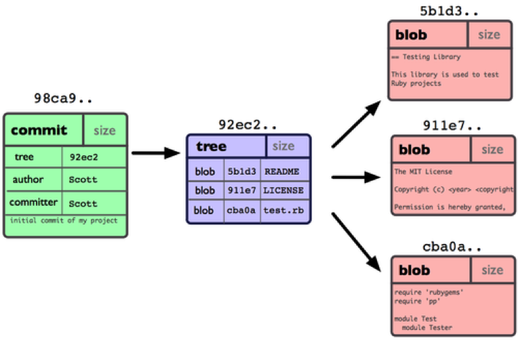
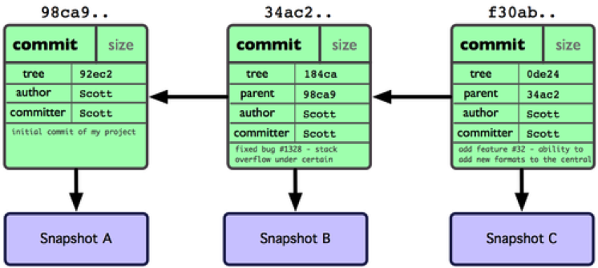
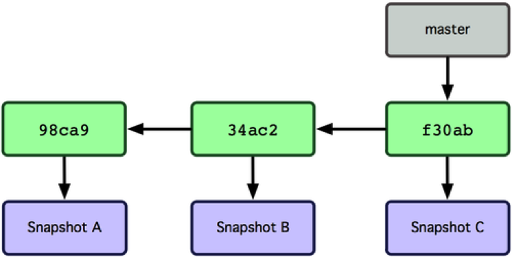
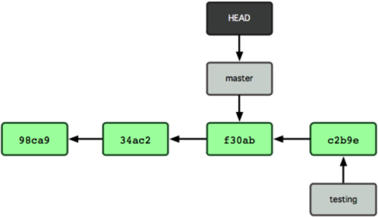
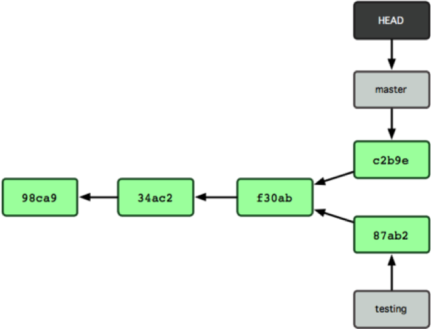
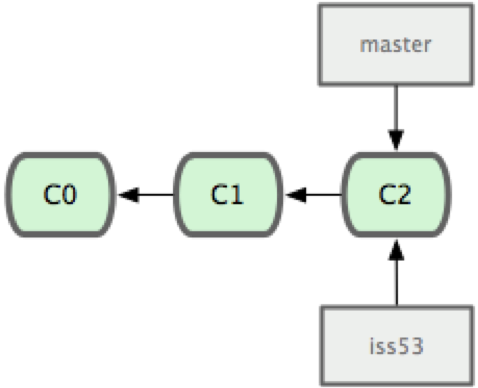
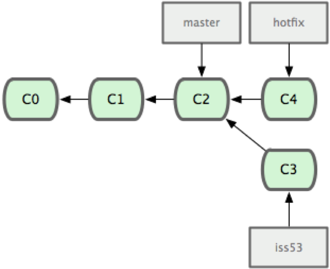
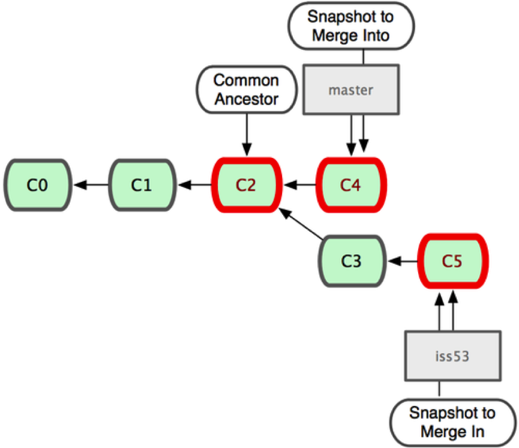
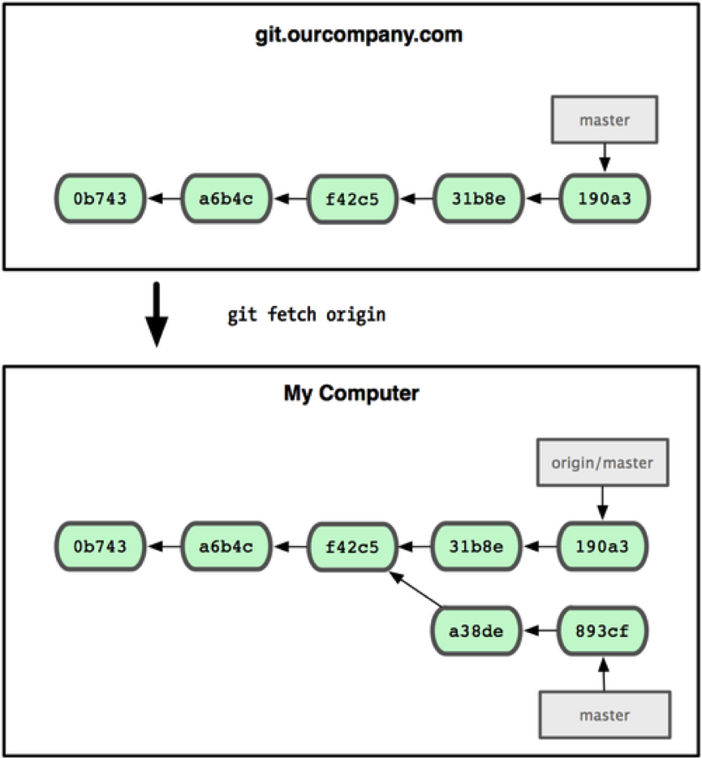

# Git 分支

初始化 Git 仓库时，Git 会自动创建一个主分支。在实际工作中，**主分支要求是一个稳定、健壮、安全的主线**，一般不允许在主分支上直接进行开发，而是拉取一个新的分支，开发、测试完成后，再将分支合并到主分支上。

主分支的名字取决于配置：Git 自身的默认值仍是 master，GitHub、GitLab 等平台新建仓库的默认分支则是 main（如何修改默认分支名见上一篇）。本文的示意图沿用了 Pro Git 中的插图，主分支都标注为 master，为了图文一致，正文示例也统一使用 master。如果你的仓库主分支叫 main，把命令中的 master 换成 main 即可，原理完全相同。

使用分支意味着你可以从开发主线上分离开来，然后在不影响主线的同时继续工作。在很多版本控制系统中，这是个昂贵的过程，常常需要创建一个源代码目录的完整副本，对大型项目来说会花费很长时间。

Git 的分支模型可称为“必杀技特性”，正是这一特性让 Git 在版本控制系统家族中脱颖而出。SVN 等集中式系统也支持分支，但分支本质上是服务器上目录的一份拷贝，切换、合并都要与服务器交互，早期版本（SVN 1.5 之前）甚至不记录合并信息，合并起来相当繁琐，以至于很多团队很少使用分支。Git 的分支则轻量得多：创建和删除分支几乎是瞬间完成的，与版本库的大小无关；切换分支也只需在本地改写两个分支之间有差异的文件，无须联网。

Git 鼓励在工作流程中频繁使用分支与合并，哪怕一天之内进行许多次都没有关系。在实际工作中，往往修复一个 bug 都会使用一个分支来完成。

理解分支的概念并熟练运用后，你才会意识到为什么 Git 是一个如此强大而独特的工具，并从此真正改变你的开发方式。

# 1 分支实现原理

上一篇提到过，Git 保存的不是文件差异或者变化量，而只是一系列文件快照。

在 Git 中提交时，会保存一个提交（commit）对象，该对象包含一个指向暂存内容快照的指针，包含本次提交的作者等相关附属信息，包含零个或多个指向该提交对象的父对象指针：首次提交是没有直接祖先的，普通提交有一个祖先，由两个或多个分支合并产生的提交则有多个祖先。

为直观起见，我们假设在工作目录中有三个文件，准备将它们暂存后提交。暂存操作会对每一个文件计算校验和（即 SHA-1 哈希字串），然后把当前版本的文件快照保存到 Git 仓库中（Git 使用 blob 类型的对象存储这些快照），并将校验和加入暂存区域。

当使用 `git commit` 新建一个提交对象前，Git 会先计算每一个子目录（本例中就是项目根目录）的校验和，然后在 Git 仓库中将这些目录保存为树（tree）对象。之后 Git 创建的提交对象，除了包含相关提交信息以外，还包含着指向这个树对象（项目根目录）的指针，如此它就可以在将来需要的时候，重现此次快照的内容了。

现在，Git 仓库中有五个对象：三个表示文件快照内容的 blob 对象；一个记录着目录树内容及其中各个文件对应 blob 对象索引的 tree 对象；以及一个包含指向 tree 对象（根目录）的索引和其他提交信息元数据的 commit 对象：



做些修改后再次提交，那么这次的提交对象会包含一个指向上次提交对象的指针（即下图中的 parent 对象）。两次提交后，仓库历史会变成这个样子：



Git 中的分支，其实本质上仅仅是个指向 commit 对象的可变指针。Git 会使用 master 作为分支的默认名字。在若干次提交后，其实已经有了一个指向最后一次提交对象的 master 分支，它在每次提交的时候都会自动向前移动。



# 2 创建分支

创建一个名为“testing”的新分支，可以使用 `git branch <branchName>` 命令：

`git branch testing`

该命令会在当前 commit 对象上新建一个指针：


那么，Git 是如何知道你当前在哪个分支上工作的呢？其实答案也很简单，它保存着一个名为 **HEAD** 的特别指针。在 Git 中，它是一个指向正在工作中的本地分支的指针（可以将 HEAD 想象为当前分支的别名）。运行 `git branch` 命令，仅仅是建立了一个新的分支，但不会自动切换到这个分支中去，所以在这个例子中，我们依然还在 master 分支里工作。


使用不带任何参数的 `git branch` 命令可以查看当前的分支情况：

```text
* master
  testing
```

Git 显示，共有两个分支，当前工作分支为 master，分支列表中的星号 `*` 相当于 HEAD 指针，标注了当前工作分支。

# 3 切换分支

命令 `git switch <branchName>` 可以将当前工作分支切换到名为 branchName 的分支。比如，运行命令：

`git switch testing`

Git 会提示：

```text
Switched to branch 'testing'
```

这样 HEAD 就指向了 testing 分支：


在 Git 2.23 之前，切换分支用的是 `git checkout testing`。和上一篇讲 `git restore` 时的情况一样，`checkout` 同时承担切换分支和恢复文件两种职责，所以 Git 把切换分支的功能拆给了 `git switch`。旧写法至今仍然可用，在老资料中很常见。

现在我们如果修改了工作区的文件，所有 commit 操作都是提交到 testing 分支，而非 master。


现在 testing 分支向前移动了一步，而 master 分支仍然指向切换前所在的 commit 对象。现在重新切换到 master 分支：

`git switch master`



这条命令做了两件事。它把 HEAD 指针移回到 master 分支，并把工作区的文件换成了 master 分支所指向的快照内容。也就是说，现在开始所做的改动，将始于本项目中一个较老的版本。它的主要作用是将 testing 分支里做出的修改暂时取消，这样你就可以向另一个方向进行开发。

在 master 分支上再做些修改，然后提交。现在我们的项目提交历史产生了分叉，因为刚才我们创建了一个分支 testing，转换到其中进行了一些工作，然后又回到原来的 master 主分支进行了另外一些工作。



这些改变分别孤立在不同的分支里。我们可以在不同分支里反复切换，并在时机成熟时把它们合并到一起。

由于 Git 中的分支实际上仅是一个包含所指对象校验和（40 个字符长度的 SHA-1 字串）的文件，所以创建和销毁一个分支就变得非常廉价。说白了，新建一个分支就是在 `.git/refs/heads/` 下写入一个 41 字节（40 个字符外加一个换行符）的文件那么简单，当然也就很快。

这里说的是默认的“files”引用存储方式。当分支和标签很多时，`git gc` 会把零散的引用文件打包进 `.git/packed-refs` 这一个文件，以减少小文件的数量（之后新建的分支仍会先以单独的文件存在）。Git 2.45 还引入了新的 reftable 引用存储格式（`git init --ref-format=reftable`），专门应对引用数量巨大的仓库，Git 3.0 计划将其设为默认格式。无论采用哪种存储方式，分支都只是一个指向提交对象的引用，创建和删除的代价都极小。

# 4 合并分支

模拟这样一个场景：早上到了公司接到新任务，新建一个名为“iss53”的分支来进行开发工作。要新建并切换到该分支，运行 `git switch` 并加上 `-c`（create）参数：

`git switch -c iss53`

这相当于执行下面这两条命令（旧写法是 `git checkout -b iss53`）：

```shell
git branch iss53
git switch iss53
```



然后不断地写代码，提交代码：


突然，接到通知，需要立即修复 master 分支上的一个严重 bug。

第一步肯定需要切换到 master。如果当前工作区与暂存区都是干净的，直接切换即可。但如果 iss53 上的开发还没有完成，不便于 commit 到版本库，就麻烦了。未提交的修改并不属于任何分支，切换时 Git 会尽量把它们原样带到目标分支；可一旦这些修改涉及的文件在两个分支之间有差异，切换就会覆盖它们，Git 会拒绝切换并提示：

```text
error: Your local changes to the following files would be overwritten by checkout:
	readme.txt
Please commit your changes or stash them before you switch branches.
Aborting
```

即便能顺利切过去，把 iss53 上做了一半的修改带进 hotfix 分支，也很容易被误提交。解决这个问题的办法就是 `git stash` 命令。

该命令会把已追踪文件的修改和暂存区中的变更保存到一个储藏栈中，然后把工作区和暂存区恢复到最近一次提交的干净状态，之后可以随时重新应用。注意，未追踪的新文件默认不会被储藏，需要加上 `-u`（`--include-untracked`）参数。

运行 `git stash` 之后，iss53 分支上未 commit 的变更就被“储藏”起来了：

```text
Saved working directory and index state WIP on iss53: 660a516 …
```

这时就可以顺利地切换到 master 分支了。要查看现有的储藏，可以使用 `git stash list`，会得到这样的一个列表：

```text
stash@{0}: WIP on iss53: 660a516 …
stash@{1}: WIP on testing: c264051 …
stash@{2}: WIP on testing: 21d80a5 …
```

列出的是所有储藏及其编号，`stash@{0}` 是最近的一次。恢复储藏有两个命令：

- `git stash apply`：应用储藏，但储藏本身仍保留在栈中。不指明编号时默认使用最近的储藏，也可以通过名字指定更早的储藏，如 `git stash apply stash@{2}`。
- `git stash pop`：应用储藏后，将其从栈中删除，日常使用更多。

储藏堆积多了很容易分不清哪个是哪个，不再需要的储藏要用 `git stash drop stash@{n}` 及时删除，或者用 `git stash clear` 全部清空。如果只想储藏部分修改，可以用 `git stash push -- <pathspec>` 指定文件，或者用 `git stash push -p` 像 `git add -p` 那样逐块挑选。

储藏之外，还有一种思路是工作树（worktree）。`git worktree` 自 Git 2.5 起提供，允许同一个仓库同时检出多个分支到不同的目录，每个目录都是一个独立的工作区，共享同一个版本库。比如在 iss53 的工作区里运行：

```shell
git worktree add -b hotfix ../hotfix master
```

Git 会基于 master 新建 hotfix 分支，并将其检出到相邻的 hotfix 目录。修复工作在那个目录里完成，iss53 的工作区原封不动，连编译产物都不受影响。用完之后，执行 `git worktree remove ../hotfix` 即可删除该工作树。需要注意，同一个分支同一时刻只能被一个工作树检出，所以如果 master 已经在别的工作树中被检出，`git worktree add ../hotfix master` 这种写法会被 Git 拒绝。

言归正传，我们用 stash 储藏好修改，切换到 master 分支，拉取一个名为“hotfix”的分支来紧急修复 bug：

```shell
git switch master
git switch -c hotfix
```

修复好之后，commit 到版本库，现在 Git 的分支结构如下图所示：



经测试之后，该 bug 成功修复，然后需要将该分支合并到 master。首先依然要切换到 master，然后使用命令 `git merge` 合并分支：

```shell
git switch master
git merge hotfix
```

Git 提示：

```text
Updating 771f6de..adea62a
Fast-forward
 …
```

请注意，合并时出现了“**Fast-forward**”的提示。由于当前 master 分支所在的提交对象是要并入的 hotfix 分支的直接上游，Git 只需把 master 分支指针直接右移。换句话说，如果顺着一个分支走下去可以到达另一个分支的话，那么 Git 在合并两者时，只会简单地把指针右移，因为这种单线的历史分支不存在任何需要解决的分歧，所以这种合并过程可以称为**快进**（Fast-forward）。

现在最新的修改已经在当前 master 分支所指向的提交对象中了：


在那个超级重要的修补发布以后，就可以回来继续之前未完成的工作。由于当前 hotfix 分支和 master 都指向相同的提交对象，所以 hotfix 已经完成了历史使命，可以删掉了。使用 `git branch` 的 `-d` 选项执行删除操作：

`git branch -d hotfix`

不用担心之前 hotfix 分支的修改内容尚未包含到 iss53 中来。如果确实需要纳入此次修补，可以用 `git merge master` 把 master 分支合并到 iss53；或者等 iss53 完成之后，再将 iss53 分支中的更新并入 master。

现在回到之前未完成的 iss53 分支，先用 `git stash pop` 恢复早上储藏的修改，然后继续工作，完成后 commit 到版本库：

```shell
git switch iss53
git stash pop
```


在 iss53 分支上的工作完成之后，可以合并回 master 分支。实际操作同前面合并 hotfix 分支差不多，只需回到 master 分支，运行 `git merge` 命令指定要合并进来的分支。

请注意，这次合并操作的底层实现，并不同于之前 hotfix 的并入方式，因为这次开发历史是从更早的地方开始分叉的。由于当前 master 分支所指向的提交对象（C4）并不是 iss53 分支的直接祖先，Git 不得不进行一些额外处理。就此例而言，Git 会用两个分支的末端（C4 和 C5）以及它们的共同祖先（C2）进行一次简单的三方合并计算。下图用红框标出了 Git 用于合并的三个提交对象：



这次，Git 没有简单地把分支指针右移，而是对三方合并后的结果重新做一个新的快照，并自动创建一个指向它的提交对象（C6）。这个提交对象比较特殊，它有两个祖先（C4 和 C5），称为合并提交（merge commit）。此时 Git 会提示：

```text
Merge made by the 'ort' strategy.
 …
```

ort 是 Git 2.34 起默认的合并策略，取代了之前的 recursive 策略，速度更快，处理重命名等复杂情况也更可靠。

值得一提的是，Git 会自动找出最佳的共同祖先作为合并基础，不需要开发者手工指定。在 CVS 和早期的 SVN（1.5 之前）中，合并基础需要开发者自己记录和指定，相比之下 Git 的合并要省心得多。


# 5 解决冲突

有时候合并操作并不会如此顺利。如果在不同的分支中都修改了同一个文件的同一部分，Git 就无法干净地把两者合到一起，逻辑上说，这种问题只能由人来裁决。这时候如果合并分支就会出现下面的结果：

```text
Auto-merging readme.txt
CONFLICT (content): Merge conflict in readme.txt
Automatic merge failed; fix conflicts and then commit the result.
```

Git 做了合并，但没有提交，它会停下来等你解决冲突。要看看哪些文件在合并时发生冲突，可以用 `git status` 查阅：

```text
On branch master
You have unmerged paths.
  (fix conflicts and run "git commit")
  (use "git merge --abort" to abort the merge)

Unmerged paths:
  (use "git add <file>..." to mark resolution)
	both modified:   readme.txt

no changes added to commit (use "git add" and/or "git commit -a")
```

任何包含未解决冲突的文件都会以**未合并**（unmerged）的状态列出。Git 会在有冲突的文件里加入标准的冲突解决标记，可以通过它们来手工定位并解决这些冲突。可以看到此文件包含类似下面这样的部分：

```text
this is my first git project
<<<<<<< HEAD
add row on master branch

add another row on master branch
=======
add row on testing branch
add another row on testing branch
>>>>>>> testing
```

可以看到 `=======` 隔开的上半部分，是 HEAD（即 master 分支，在运行 merge 命令时所切换到的分支）中的内容，下半部分是在 testing 分支中的内容。解决冲突的办法无非是二者选其一或者由你亲自整合到一起。当然，Git 插入的额外标记行也需要删除。

在解决了所有文件里的所有冲突后，运行 `git add` 将把它们标记为已解决状态（实际上就是来一次快照保存到暂存区域），因为一旦暂存，就表示冲突已经解决。最后运行 `git commit`，生成合并提交，整个合并才算完成。

如果冲突太多，想放弃这次合并，可以运行 `git merge --abort`，Git 会把工作区和暂存区恢复到合并之前的状态。

# 6 删除分支

分支合并到 master 之后，如果无特殊用途，应该及时删除分支。

要从分支清单中筛选出已经（或尚未）与当前分支合并的分支，可以用 `--merged` 和 `--no-merged` 选项。

比如用 `git branch --merged` 查看哪些分支已被并入当前分支，也就是说，这些分支的最新提交已经包含在当前分支的历史中：

```text
* master
  testing
```

这说明 testing 分支已经合并到 master 分支当中了，可以删除：

`git branch -d testing`

使用 `git branch --no-merged` 查看还没有合并的分支：

```text
  newTesting
```

如果使用命令 `git branch -d newTesting` 删除该分支，Git 会提示：

```text
error: the branch 'newTesting' is not fully merged
hint: If you are sure you want to delete it, run 'git branch -D newTesting'
```

由于这些分支中还包含着尚未合并进来的工作成果，所以简单地用 `git branch -d` 删除该分支会提示错误，因为那样做会丢失数据。

不过，如果你确实想要删除该分支上的改动，可以用大写的删除选项 `-D` 强制执行，就像上面提示信息中给出的那样。

# 7 远程分支

开篇就提到过，Git 是一个分布式版本管理系统。但是到现在为止，所有的演练都是在本地 Git 仓库进行的。如果想与他人合作，还需要一个远程的 Git 仓库。尽管技术上可以从个人的仓库里推送和拉取修改内容，但不鼓励这样做，因为一不留心就很容易弄混其他人的进度。另外，你也一定希望合作者们即使在自己不开机的时候也能从仓库获取数据——拥有一个更稳定的公共仓库十分有用。因此，更好的合作方式是建立一个大家都可以访问的共享仓库，从那里推送和拉取数据。我们将把这个仓库称为“Git 服务器”。

## 7.1 传输协议

理论上来说，Git 可以使用四种协议来传输数据：本地传输协议、SSH 协议、Git 协议和 HTTP 协议。

### 7.1.1 本地传输协议

本地传输，其实就是把本地的某个 Git 仓库当作远程仓库。这常见于团队每一个成员都对一个共享的文件系统（例如 NFS）拥有访问权的场景。基于文件仓库的优点在于它的简单，同时保留了现存文件的权限和网络访问权限。如果团队已经有一个全体共享的文件系统，建立仓库就十分容易。

这种方法的缺点是，与基本的网络连接访问相比，难以控制从不同位置来的访问权限。

### 7.1.2 Git 协议

Git 协议由 Git 自带的守护进程（`git daemon`）提供服务，监听 9418 端口，URL 形如 `git://`。仓库需要先创建 `git-daemon-export-ok` 文件才会对外提供服务，除此之外该协议没有任何加密和认证：要么所有人都能克隆，要么谁也不能；如果开放推送，网络上任何知道 URL 的人都能推送。由于省去了加密和认证的开销，它在早期曾是最快的传输协议，适合只读分发大访问量的公开项目，但需要单独架设守护进程，还要在防火墙上开放这个非标准端口。

正因为缺少加密和认证，主流平台已经不再提供该协议，例如 GitHub 从 2022 年 3 月 15 日起永久停止了对 `git://` 的支持。如今了解它主要是为了读懂老资料中的 `git://` 地址。

### 7.1.3 SSH 协议

SSH（Secure Shell）是一种基于 TCP 的应用层安全协议，会对传输的全部数据加密，并对通信双方进行认证，能够有效防止窃听和中间人攻击。

SSH 是 Git 最常用的传输协议之一，大多数服务器都已支持 SSH 访问，即便没有，架设起来也很容易。它的优点主要有：

- 访问是安全的，所有数据传输都经过加密和认证。
- 很多操作系统都自带 SSH 及相关管理工具，配置简单。
- 传输高效。和本地协议、Git 协议一样，Git 会在传输前把对象打包压缩，尽可能减少数据量。

SSH 的限制在于不支持匿名访问。即使只是读取数据，用户也必须拥有访问主机的权限，这对希望任何人都能克隆的开源项目不太友好。所以开源项目通常同时提供 HTTPS 用于匿名克隆，开发者再通过 SSH 或带认证的 HTTPS 推送。

### 7.1.4 HTTP/S 协议

Git 的 HTTP 协议有两种实现。

早期只有“哑” HTTP 协议（Dumb HTTP）：只需把 Git 的裸仓库放在 Web 服务器的根目录下，再配置一个 `post-update` 钩子（hook）即可，客户端像下载普通静态文件一样逐个获取对象。这种方式架设简单，服务器开销小，但客户端效率低，传输的数据量和请求次数都比其他协议多，而且基本只能用于只读访问。

Git 1.6.6 引入了“智能” HTTP 协议（Smart HTTP）。客户端和服务器端的 Git 会像 SSH 那样协商需要传输哪些对象，只传输打包好的增量数据，效率与 SSH 相当，同时支持认证和推送。它既能像 Git 协议那样匿名克隆，又能像 SSH 那样认证推送，而且使用的 443 端口一般不会被防火墙拦截。如今各大代码托管平台都默认提供 HTTPS 地址，通过 HTTPS 推送时用个人访问令牌（Personal Access Token）代替账户密码认证，例如 GitHub 从 2021 年 8 月起就不再接受账户密码进行 Git 操作。

综上，**本地协议只在共享文件系统等少数场景下使用，Git 协议已基本退出历史舞台，日常开发中普遍使用的是 SSH 与 HTTPS**。

在与远程仓库进行信息交换之前，我们先要获得访问权限，即对 Git 服务器上的某个项目，自己是否可读、是否可写。使用 SSH 时，最常用、最可靠的手段是公钥认证：把本地生成的公钥上传到 Git 服务器，之后的访问都由私钥完成认证。GitHub 等平台的官方文档对此有详细的教程，这里不再赘述。

## 7.2 add 操作

命令：

`git remote add [shortname] [url]`

可以将一个远程仓库与本地 Git 仓库关联起来。

比如，我在 GitHub 上有一个名为“MyProject”的项目，在本地的 Git 仓库目录下运行：

`git remote add gitHubProject git@github.com:Winner2015/MyProject.git`

然后使用 `git remote` 查看现有的远程仓库列表：

```text
gitHubProject
```

`git@github.com:Winner2015/MyProject.git` 是我的项目在 GitHub 上的地址，“gitHubProject”是我给远程仓库起的别名，以后就可以用 gitHubProject 来代指这个远程仓库。

**注意**：该命令只是建立了本地 Git 仓库与一个 URL 地址（其实本质上就是一个字符串）的关联关系，但是这个 URL 存不存在（比如，你有可能输错了一个字母）、你有没有权限访问，Git 暂时并不知道。

## 7.3 fetch 操作

命令：

`git fetch [remote-name]`

可以从远程仓库抓取数据到本地。

例如，将刚添加的远程仓库拉取到本地：

`git fetch gitHubProject`

Git 提示：

```text
warning: no common commits
remote: Enumerating objects: 13, done.
remote: Counting objects: 100% (13/13), done.
remote: Total 13 (delta 0), reused 0 (delta 0), pack-reused 13
Unpacking objects: 100% (13/13), done.
From github.com:Winner2015/MyProject
 * [new branch]      master     -> gitHubProject/master
```

现在 GitHub 上的项目 MyProject 已经抓取到本地了，`gitHubProject/master` 代表该项目的 master 分支。

`gitHubProject/master` 是远程跟踪分支，不是本地分支，不能直接用 `git switch` 切换过去，Git 会提示需要加上 `--detach` 参数。运行 `git switch --detach gitHubProject/master`（或者旧写法 `git checkout gitHubProject/master`）检出它，Git 会提示：

```text
Note: switching to 'gitHubProject/master'.

You are in 'detached HEAD' state. You can look around, make experimental
changes and commit them, and you can discard any commits you make in this
state without impacting any branches by switching back to a branch.

If you want to create a new branch to retain commits you create, you may
do so (now or later) by using -c with the switch command. Example:

  git switch -c <new-branch-name>

Or undo this operation with:

  git switch -
……
```

远程分支虽然已经抓取到本地，但是并没有与本地的任何分支关联，直接检出远程分支时 HEAD 不指向任何本地分支，所以 Git 警告当前处于“detached HEAD”（分离头指针）状态，游离于所有本地分支之外。

fetch 命令只是将远端的数据拉到本地仓库，并不自动合并到当前工作分支。

实际上，如果我们想将自己的修改提交到远程仓库，首先必须提交到本地，然后再 push 到远程仓库。所以，应该将抓取下来的数据手工 merge 到某个现有分支或者新建的一个分支当中。

很多人习惯直接使用下面介绍的 pull 命令，一步完成抓取与合并。不过先 fetch 下来，看清远端有哪些变化再决定如何合并，会更稳妥一些。

## 7.4 pull 操作

如果设置了本地某个分支用于跟踪某个远端仓库的分支，可以使用 `git pull` 命令自动抓取数据下来，并将远端分支自动合并到本地仓库中当前分支（前提是该远程分支已经与本地的某个分支建立了关联）。

命令格式如下：

`git pull [remote-name]`

`git pull` 相当于先执行 `git fetch`，再把远端分支合并进当前分支。如果本地分支和远端分支都有新的提交，即历史已经分叉，需要明确告诉 Git 如何整合。在没有做过配置时，新版 Git 会直接拒绝并提示：

```text
hint: You have divergent branches and need to specify how to reconcile them.
……
fatal: Need to specify how to reconcile divergent branches.
```

可以按需选择一种方式并写入配置：`git config --global pull.rebase false` 表示合并（merge），`pull.rebase true` 表示变基（rebase），`pull.ff only` 表示只允许快进。也可以在单次执行时用 `--no-rebase`、`--rebase` 或 `--ff-only` 参数临时指定。

pull 之后，我们的本地分支很可能与远程分支出现冲突，同样需要解决之后才能顺利合并、提交。

## 7.5 push 操作

项目进行到一个阶段，要同别人分享目前的成果，可以将本地仓库中的数据推送到远程仓库。实现这个任务的命令很简单：

`git push [remote-name] [branch-name]`

某种情况下，初次运行 `git pull` 或者 `git push` 的时候，Git 会提示“no tracking information”或“has no upstream branch”，无法完成操作，这说明本地分支还没有设置对应的上游（upstream）分支。

最常用的办法是在第一次推送时加上 `-u`（`--set-upstream`）参数，推送的同时把远程分支设为当前分支的上游：

`git push -u origin serverfix`

之后在该分支上直接运行 `git push`、`git pull` 即可。如果希望第一次推送时自动设置上游，还可以开启配置 `git config --global push.autoSetupRemote true`。

对于已经存在的本地分支，可以手动设置上游：

`git branch --set-upstream-to=origin/remote_branchname`（简写为 `git branch -u origin/remote_branchname`）

基于远程分支创建本地分支时，Git 默认会自动建立跟踪关系，无须额外参数：

`git switch -c local_branchname origin/remote_branchname`

`git branch --track local_branchname origin/remote_branchname` 的效果相同，`--track` 显式要求建立跟踪关系，在起点不是远程分支时也能使用。

取消对某个分支的跟踪，使用命令：

`git branch --unset-upstream local_branchname`

老资料中常见的 `git branch --set-upstream` 写法在 Git 1.8 中被标记为废弃，并在 Git 2.15 中被移除，现在执行会直接报错，并提示改用 `--track` 或 `--set-upstream-to`。

## 7.6 clone 操作

使用 clone 命令可以将 Git 服务器上的数据克隆到本地，例如：

`git clone git@github.com:Winner2015/MyProject.git`

默认情况下，`git clone` 命令会将远程仓库命名为“origin”，并自动创建一个本地分支，用于跟踪远程仓库的默认分支（本例中是 master，现在新建的仓库多为 main）。

使用命令 `git remote show origin` 可以查看名为“origin”的远程仓库的信息：

```text
* remote origin
  Fetch URL: git@github.com:Winner2015/MyProject.git
  Push  URL: git@github.com:Winner2015/MyProject.git
  HEAD branch: master
  Remote branches:
    master       tracked
  Local branch configured for 'git pull':
    master merges with remote master
  Local ref configured for 'git push':
    master pushes to master (up to date)
```

Git 友好地告诉你，pull 操作会将远程仓库的 master 分支自动与本地的 master 分支合并；类似地，push 操作会自动将本地的 master 推送到远程的 master 分支。

默认的 clone 会把整个仓库的全部历史都下载下来。对于体积很大的仓库，可以用 `git clone --depth 1 <url>` 做浅克隆，只获取最近一次提交；或者用上一篇介绍过的部分克隆 `git clone --filter=blob:none <url>`，保留完整的提交历史，文件内容则在用到时再按需下载。

## 7.7 删除和重命名

重命名命令：`git remote rename [oldName] [newName]`

删除命令：`git remote remove [remoteName]`（也可以简写为 `git remote rm`）

注意：删除命令只是在本地移除该远程仓库的配置及对应的远程跟踪分支，并不会删除远程服务器上的仓库或分支。

## 7.8 实现原理

远程分支（准确的叫法是远程跟踪分支，remote-tracking branch）是对远程仓库中分支状态的记录。它们是一些无法移动的本地引用，只有在 Git 进行网络交互时才会更新。远程跟踪分支就像是书签，提醒着上次连接远程仓库时上面各分支的位置。

我们用“远程仓库名/分支名”这样的形式表示远程分支。比如我们想看看上次同 origin 仓库通信时 master 的样子，就应该查看 origin/master 分支。

假设 Git 服务器地址为 git.ourcompany.com，如果从这里克隆，Git 会自动将此远程仓库命名为 origin，并下载其中所有的数据，同时建立一个指向它的 master 分支的指针，在本地命名为 origin/master，但你无法在本地更改其数据。接着，Git 建立一个属于你自己的本地 master 分支，始于 origin 上 master 分支所在的位置，你可以就此开始工作：


一次 Git 克隆会建立本地分支 master 和远程分支 origin/master，它们都指向 origin/master 分支的最后一次提交。

如果在本地 master 分支做了些改动，与此同时，其他人向 git.ourcompany.com 推送了他们的更新，那么服务器上的 master 分支就会向前推进，而本地的提交历史正朝着不同方向发展。不过只要不和服务器通信，你的 origin/master 指针仍然保持原位不会移动：


可以运行 `git fetch origin` 来同步远程服务器上的数据到本地。该命令首先找到 origin 是哪个服务器，从上面获取尚未拥有的数据，更新本地的数据库，然后把 origin/master 的指针移到它最新的位置上：



要想和其他人分享某个本地分支，需要把它 push 到一个拥有写权限的远程仓库。本地分支不会被自动同步到引入的远程服务器上，除非明确执行推送操作。换句话说，对于无意分享的分支，尽管保留为私人分支好了，而只推送那些协同工作要用到的特性分支。

如果有个叫 serverfix 的分支需要和他人一起开发，可以运行 `git push origin serverfix`。也可以运行 `git push origin serverfix:serverfix` 来实现相同的效果，它的意思是“上传我本地的 serverfix 分支到远程仓库中去，仍旧称它为 serverfix 分支”。通过此命令，可以把本地分支推送到某个命名不同的远程分支：若想把远程分支叫作 awesomebranch，可以用 `git push origin serverfix:awesomebranch` 来推送数据。

接下来，当你的协作者再次从服务器上获取数据时，他们将得到一个新的远程分支 origin/serverfix。

值得注意的是，在你的协作者 fetch 好新的远程分支之后，仍然无法在本地编辑该远程仓库中的分支。换句话说，在本例中，不会有一个新的 serverfix 分支，有的只是一个无法移动的 origin/serverfix 指针。

如果要把该内容合并到当前分支，可以运行 `git merge origin/serverfix`。如果想要一份自己的 serverfix 来开发，可以基于远程分支创建一个新的本地分支：

`git switch -c serverfix origin/serverfix`

这会切换到新建的 serverfix 本地分支，其内容同远程分支 origin/serverfix 一致，这样你就可以在里面继续开发了。

基于远程分支检出（checkout）的本地分支，称为**跟踪分支**（tracking branch）。跟踪分支是一种和远程分支有直接联系的本地分支。在跟踪分支里输入 `git push`，Git 会自行推断应该向哪个服务器的哪个分支推送数据。反过来，在这些分支里运行 `git pull` 会抓取远程仓库的数据，并把对应远程分支的更新合并到本地分支中来。

在克隆仓库时，Git 会自动创建一个与远程默认分支同名的本地分支（本例中是 master）来跟踪 origin/master。这正是 `git push` 和 `git pull` 一开始就能正常工作的原因。当然，你可以随心所欲地设定其他跟踪分支，比如 origin 上除了 master 之外的其他分支：

`git switch -c [分支名] [远程名]/[分支名]`

如果本地分支与远程分支同名，还可以进一步简化。当本地不存在 serverfix 分支，而恰好只有一个远程仓库有同名分支时，直接切换过去，Git 就会自动创建跟踪分支：

`git switch serverfix`

要为本地分支设定不同于远程分支的名字，只需在前个版本的命令里换个名字：

`git switch -c sf origin/serverfix`

现在你的本地分支 sf 会自动向 origin/serverfix 推送和抓取数据了。这几条命令的旧写法分别是 `git checkout -b serverfix origin/serverfix`、`git checkout --track origin/serverfix` 和 `git checkout -b sf origin/serverfix`。

如果不再需要某个远程分支了，可以使用 `--delete` 参数删除它。例如，想在服务器上删除 serverfix 分支，运行下面的命令：

`git push origin --delete serverfix`

在老资料中还会看到另一种写法：`git push origin :serverfix`。它的原理是推送的完整格式 `git push [远程名] [本地分支]:[远程分支]`，冒号前留空，相当于“用一个空引用去覆盖远程分支”，也就是删除。`--delete` 是 Git 1.7.0 为它加上的语义化写法，两者效果相同。

# 8 标签管理

发布一个版本时，我们通常先在版本库中打一个**标签**（tag），这样，就唯一确定了打标签时刻的版本。将来无论什么时候，取某个标签的版本，就是把那个打标签的时刻的历史版本取出来。标签本身并不保存快照，它和分支一样是一个指向某个提交对象的引用，区别在于分支会随着新的提交向前移动，而标签一旦打上就固定不动。

## 8.1 新建标签

Git 使用的标签有两种类型：轻量级的（lightweight）和含附注的（annotated）。轻量级标签就像是个不会变化的分支，实际上它就是个指向特定提交对象的引用。而含附注标签，实际上是存储在仓库中的一个独立对象，它有自身的校验和信息，包含着打标签者的名字、电子邮件地址和日期，以及标签说明，标签本身也允许使用 GNU Privacy Guard（GPG）来签署或验证。一般我们都建议使用含附注型的标签，以便保留相关信息；当然，如果只是临时性加注标签，或者不需要旁注额外信息，用轻量级标签也没问题。

创建一个含附注类型的标签非常简单，用 `-a`（取 annotated 的首字母）指定标签名字即可：

`git tag -a v1.1 -m 'My version 1.1'`

而 `-m` 选项则指定了对应的标签说明，Git 会将此说明一同保存在标签对象中。如果没有给出该选项，Git 会启动文本编辑软件供你输入标签说明。

轻量级标签实际上就是一个保存着对应提交对象的校验和信息的文件。要创建这样的标签，`-a`、`-s` 或 `-m` 选项都不用，直接给出标签名字即可：

`git tag v1.1`

Git 还支持对早先的某次提交加注标签，只要在打标签的时候跟上对应提交对象的校验和（或前几位字符）即可：

`git tag -a v1.2 9fceb02`

## 8.2 查看标签

列出现有标签的命令非常简单，直接运行：

`git tag`

显示的标签默认按名字的字母顺序排列，并不表示重要程度的高低。注意，按字母顺序排序时 v1.10 会排在 v1.2 前面，如果想按版本号排序，可以用 `git tag --sort=v:refname`，在排序键前加 `-` 表示倒序。

我们可以用特定的搜索模式列出符合条件的标签。在 Git 自身项目仓库中，有着数以百计的标签，如果只对 1.4.2 系列的版本感兴趣，可以运行下面的命令（`-l` 是 `--list` 的简写）：

`git tag -l 'v1.4.2.*'`

```text
v1.4.2.1
v1.4.2.2
v1.4.2.3
v1.4.2.4
…
```

可以使用 `git show` 命令查看相应标签的版本信息，并连同显示打标签时的提交对象。

`git show v1.1`

```text
tag v1.1
Tagger: chenlongfei <chenlongfei@163.com>
Date:   Mon Jul 18 10:07:21 2016 +0800

My version 1.1

commit 91c233e97a5a88218b93bf1b57b9383377153587
Author: chenlongfei <chenlongfei@163.com>
Date:   Fri Jul 15 17:14:50 2016 +0800
…
```

如果有自己的私钥，还可以用 GPG 来签署标签，只需要把之前的 `-a` 改为 `-s`（取 signed 的首字母）即可。Git 2.34 起还支持用 SSH 密钥签名，配置 `git config gpg.format ssh` 并通过 `user.signingKey` 指定公钥后，同样使用 `-s` 参数。

## 8.3 推送标签

默认情况下，`git push` 并不会把标签传送到远端服务器上，只有通过显式命令才能分享标签到远端仓库。其命令格式如同推送分支，运行 `git push origin [tagname]` 即可：

`git push origin v1.5`

如果要一次推送所有本地新增的标签上去，可以使用 `--tags` 选项。不过它会把本地所有标签都推送上去，包括只是临时打的轻量级标签。更稳妥的做法是 `git push --follow-tags`，只推送与本次推送的提交相关的附注标签。

## 8.4 删除标签

在本地删除标签很简单，加上 `-d` 参数：

`git tag -d v0.1`

如果标签已经推送到远程仓库，就要复杂一点：首先用上面的命令在本地删除，然后再将删除操作推送到远程仓库（无须 commit）：

`git push origin --delete v1.1`

如果远程仓库中有同名的分支和标签，可以写完整的引用名 `git push origin --delete refs/tags/v1.1` 来消除歧义。与删除远程分支一样，老资料中也会写成 `git push origin :refs/tags/v1.1`，冒号前为空，表示用空引用覆盖远程仓库的 v1.1 标签，效果相同。
